<style>
.shot { width: 100%; max-height: 455px; object-fit: contain; object-position: top left; border: 1px solid #CBD5E1; border-radius: 6px; }
.shot-sm { width: 100%; max-height: 215px; object-fit: contain; object-position: top left; border: 1px solid #CBD5E1; border-radius: 6px; }
.steps li { margin-bottom: 6px; }
.note { font-size: 0.72em; color: #64748B; margin-top: 8px; }
.split { display: grid; grid-template-columns: 34% 1fr; gap: 26px; align-items: start; }
.pair { display: grid; grid-template-columns: 1fr 1fr; gap: 14px; }
.pair img { background: #000; object-position: center; }
.flow { display: grid; grid-template-columns: repeat(4, 1fr); gap: 12px; font-size: 0.8em; }
.flow div { background: #F1F5F9; border-radius: 8px; padding: 12px 14px; }
.flow b { color: #2563EB; display: block; margin-bottom: 4px; }
pre { font-size: 0.62em; }
</style>

<!-- _class: cover -->
<!-- _paginate: false -->

# flat 파노라마 업로드 가이드

## Look360 Utils 로 만들고, Look360 에 등록해서 공개하기까지

<hr>

Indyspot AI Corp &nbsp;·&nbsp; Engineering Manager &nbsp;·&nbsp; 2026-11-09

---

## 전체 과정 — Utils 에서 3단계, Look360 관리자에서 5단계입니다

<div class="flow">
<div><b>Utils ①</b>타일 생성<br>BAT 만들고 실행</div>
<div><b>Utils ②</b>Batch XML 생성<br>tile_info 자동 포함</div>
<div><b>Utils ③</b>업로드용 zip 생성<br>{장소id}.zip</div>
<div><b>Look360 ①</b>타일 zip 업로드<br>파노zip업</div>
<div><b>Look360 ②</b>Batch XML 등록<br>신규 모두 등록</div>
<div><b>Look360 ③</b>VR투어에 추가<br>저장하기</div>
<div><b>Look360 ④</b>VR투어 XML 생성</div>
<div><b>Look360 ⑤</b>공개 설정<br>주소로 확인</div>
</div>

<br>

- flat 은 2:1 이 아닌 일반 평면 사진을 확대·드래그로 보여주는 파노라마입니다.
- 필요한 버전: **Look360 Utils v0.1.4-beta.5 이상**. 이전 버전에는 zip 생성 기능이 없습니다.
- 이 자료의 화면은 개발 서버에 샘플 이미지 3장(flat 2장, sphere 1장)을 실제로 올린 기록입니다.

---

## 이제 프로그램을 따로 설치하지 않아도 됩니다

<div class="cols">
<div class="col">

### 앱에 포함된 프로그램

| 프로그램 | 쓰임 |
|---|---|
| Hugin (`nona`) | 리틀플래닛 이미지 |
| ImageMagick | 썸네일, GIF |
| ExifTool | 360 메타데이터 |
| krpanotools | 타일 생성 (기존 포함) |

Node.js 도 더 이상 필요하지 않습니다.

</div>
<div class="col">

### 달라진 점

- 설치 파일을 받고 PATH 를 확인하던 과정이 없어졌습니다.
- 타일 생성 화면에 <span class="hl-blue">“앱에 포함되어 있어 따로 설치하지 않아도 됩니다”</span> 문구가 보이면 준비가 끝난 것입니다.
- 세 프로그램이 없는 Windows PC 에서 파일 297개 생성을 확인했습니다.

### mac

- 설치본에서 파일 297개 생성까지 확인했습니다. 처음 열 때 승인이 한 번 필요합니다(다음 장).

</div>
</div>

---

## mac 은 처음 열 때 한 번 승인이 필요합니다

<div class="cols">
<div class="col">

### 설치 순서

1. GitHub 릴리스에서 `arm64.dmg` 다운로드
2. dmg 를 열고 앱을 **응용 프로그램** 폴더로 드래그
3. 앱 더블클릭
4. 경고창에서 **완료** 클릭 (휴지통으로 이동 금지)
5. **시스템 설정 > 개인정보 보호 및 보안** 맨 아래 **그래도 열기**
6. 암호 입력 후 실행

</div>
<div class="col">

### 왜 필요한가요

- Apple 개발자 서명이 없는 앱이라 macOS 가 처음 실행을 막습니다.
- 앱에 문제가 있다는 뜻이 아니며, 설치본을 새로 받을 때마다 같은 승인이 필요합니다.

### 조건

- Apple Silicon mac 은 **Rosetta** 가 설치되어 있어야 합니다. 타일 도구가 Intel 용입니다.
- 내장 프로그램은 앱이 실행 직전에 자동으로 준비하므로 따로 할 일은 없습니다.

</div>
</div>

---

## 시작 전 — 폴더 이름만 규칙대로 만들면 됩니다

```text
20261109 샘플 장소(1641)            ← 괄호 안 숫자 = 장소 id
└─ VR
   ├─ 9801 가로형 전경 [flat]       ← 앞 숫자 = 파노 번호, [flat] = flat 표시
   │  └─ retouched.jpg
   └─ 9802 표준비율
      ├─ retouched.jpg
      └─ panorama_size.txt          ← flat,4000,3000
```

- flat 표시는 둘 중 하나면 됩니다: 폴더명 `[flat]` 또는 `panorama_size.txt` 의 `flat,가로,세로`.
- 둘 다 있으면 `panorama_size.txt` 가 우선합니다. 폴더명만 쓰면 크기 파일은 앱이 만듭니다.
- 폴더명의 `[flat]` 은 파노 이름에 그대로 들어가므로, 등록 화면의 이름 칸에서 지워 주세요.

---

## Utils ① 타일 생성 — BAT 를 만들고 실행합니다

<div class="split">
<div class="steps">

1. 왼쪽 메뉴 **3. 타일생성을 위한 BAT 파일 생성**
2. 상위 폴더 선택
3. **KRPANOTOOLS 파일복사**
4. **타일생성 BAT파일 생성**
5. 실행
   - Windows: 폴더의 `.bat` 더블클릭
   - mac: **타일생성 BAT파일 실행**

<p class="note">상단 Platform 전용 모드 스위치는 꺼 둡니다.</p>

</div>
<div>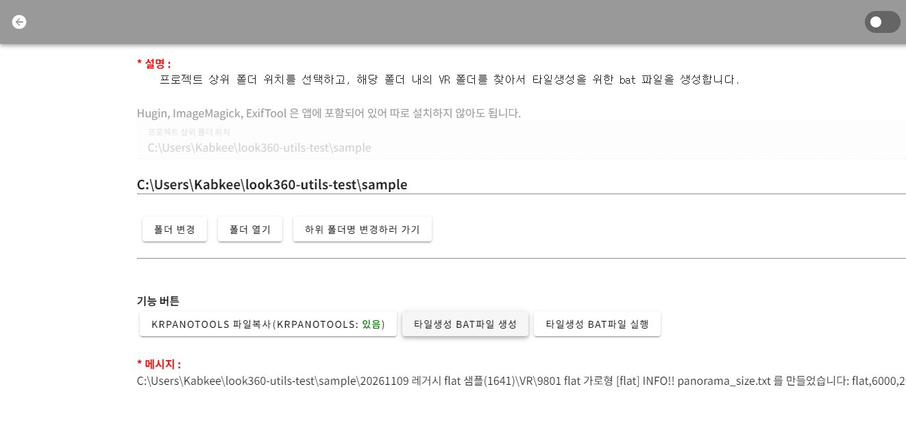</div>
</div>

---

## Utils ② Batch XML 생성 — 값을 직접 쓸 필요가 없습니다

<div class="split">
<div class="steps">

1. 메뉴 **4. Batch XML/JSON 생성**
2. **XML 생성하기**
3. 상위 폴더에 `private_Unified_날짜.xml` 생성

<p class="note">flat 은 실제 픽셀 크기와 타일 정보(tile_info)가 자동으로 들어갑니다. 타일 생성을 먼저 안 하면 그 행은 건너뜁니다.</p>

</div>
<div>
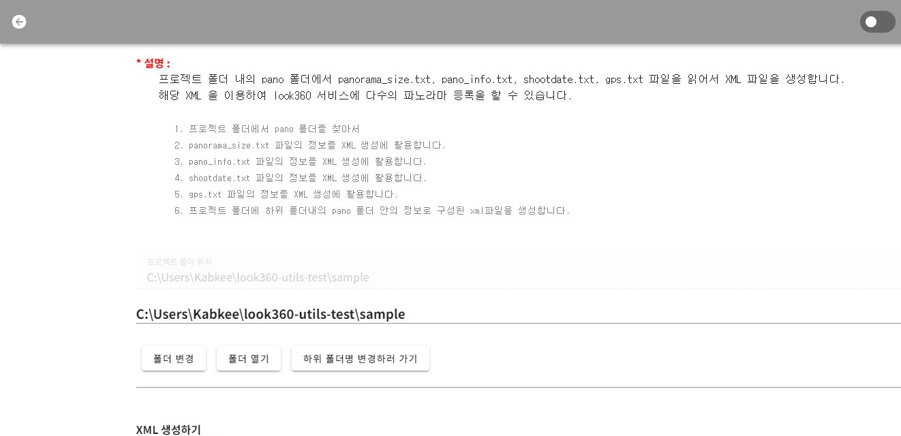

```xml
<panoramatype>flat</panoramatype>
<width>6000</width><height>2000</height><panono>9801</panono>
<tile_info><multires>512,3072x1024,6144x2048</multires>
<tilepath>l%l/%0v/l%l_%0v_%0h.jpg</tilepath> …</tile_info>
```

</div>
</div>

---

## Utils ③ 업로드용 zip 만들기

<div class="split">
<div class="steps">

1. 메뉴 **5. Pano 폴더 복사**
2. **ZIP 만들기**
3. `upload_zip/{장소id}.zip` 생성

<p class="note">장소마다 zip 1개가 만들어지고, zip 안의 맨 위에는 파노 번호 폴더만 들어갑니다. 레거시 업로드 규칙에 맞춘 구조입니다.</p>

</div>
<div>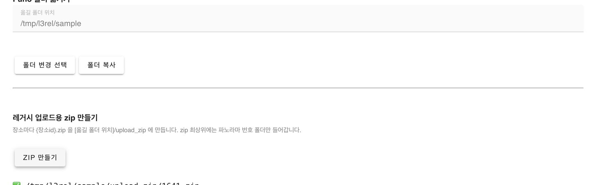</div>
</div>

---

## Look360 ① 타일 zip 업로드

<div class="split">
<div class="steps">

1. 관리자 **파노zip업** 메뉴
2. `{장소id}.zip` 선택
3. **업로드**
4. “파일 반영이 완료되었습니다” 확인

<p class="note">불안하면 <b>사전 검증만(dry-run)</b> 을 먼저 체크합니다. 이미 파일이 있는 장소에 다시 올리려면 덮어쓰기를 체크하고 비밀번호나 OTP 로 인증합니다.</p>

</div>
<div>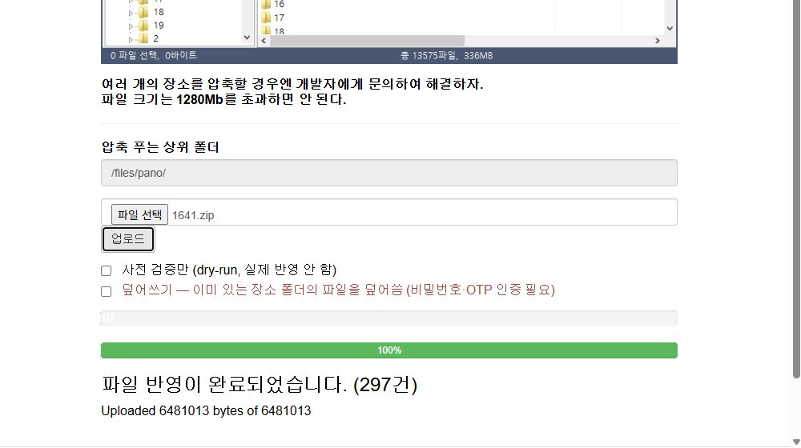</div>
</div>

---

## Look360 ② Batch XML 등록

<div class="split">
<div class="steps">

1. **파노라마 > 파노라마 XML Batch 입력**
2. XML 선택 후 **파일 분석**
3. 표에서 종류가 flat 인지, 크기가 맞는지 확인
4. 이름의 `[flat]` 정리
5. **신규 모두 등록**

<p class="note">표의 등록구분이 NEW 인 행이 새로 등록됩니다.</p>

</div>
<div>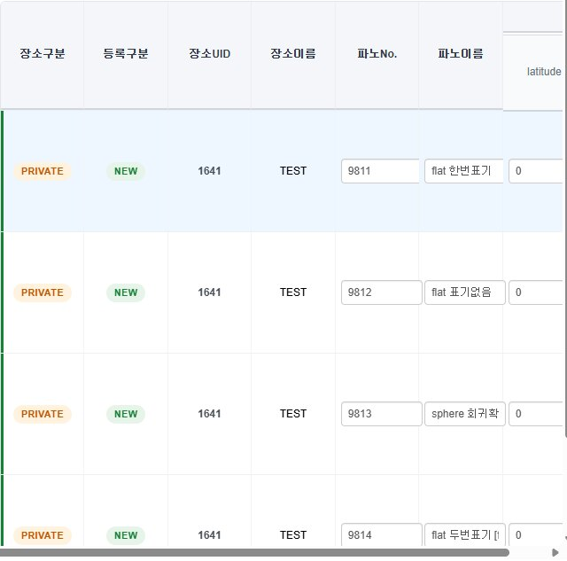</div>
</div>

---

## Look360 ③ VR투어에 파노라마 추가

<div class="split">
<div class="steps">

1. **VR투어 관리**에서 해당 투어의 목록 수정 화면 열기
2. “장소에 추가된 모든 파노라마 리스트”에서 **추가하기**
3. 위쪽 목록에 들어왔는지 확인
4. 맨 위 **저장하기**

<p class="note">화면의 빈 썸네일은 개발 서버를 IP 주소로 열어서 생긴 것입니다. 주소 차단 규칙 때문이며 운영 사이트와는 무관합니다.</p>

</div>
<div>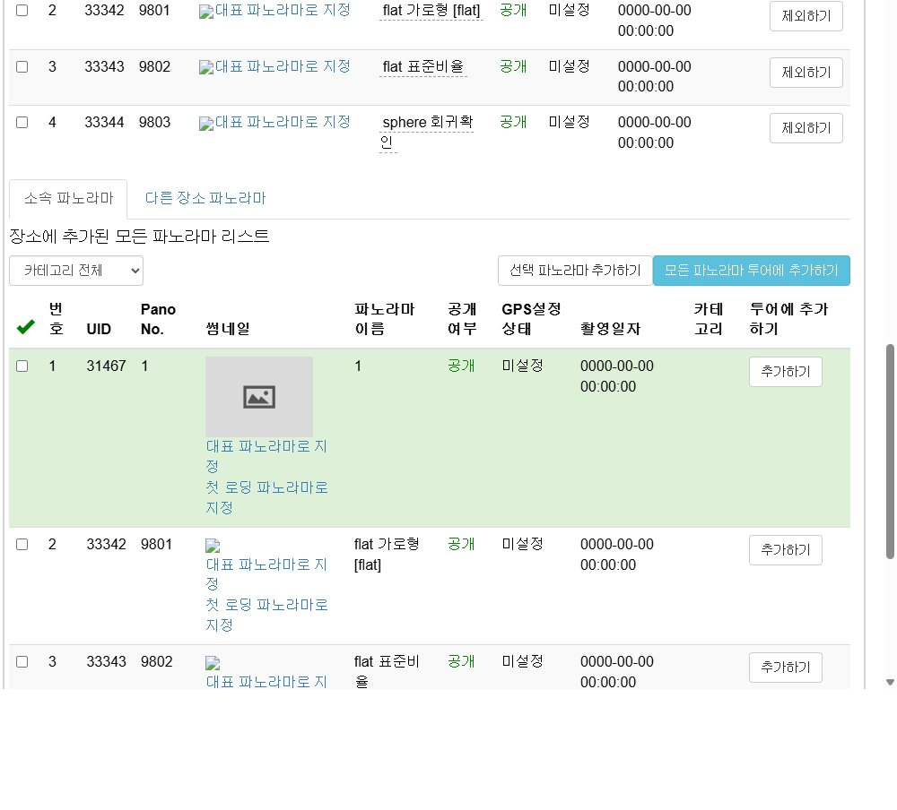</div>
</div>

---

## Look360 ④ XML 생성 · ⑤ 공개 설정

<div class="split">
<div class="steps">

**XML 생성 (필수)**
1. **xml 생성하러 가기**
2. **VR투어 XML 생성하기!!!**

**공개 설정**
- **Publish여부**: 어떤 방식이든 접근 가능한지 결정
- **공개여부**: 미공개면 사이트에 노출되지 않고 주소로만 열람
- **비밀번호 사용**: 암호 필요 시
- 변경 후 **저장하기**

<p class="note">주소: look360.kr/vr/{장소 도메인}/{투어 도메인}</p>

</div>
<div>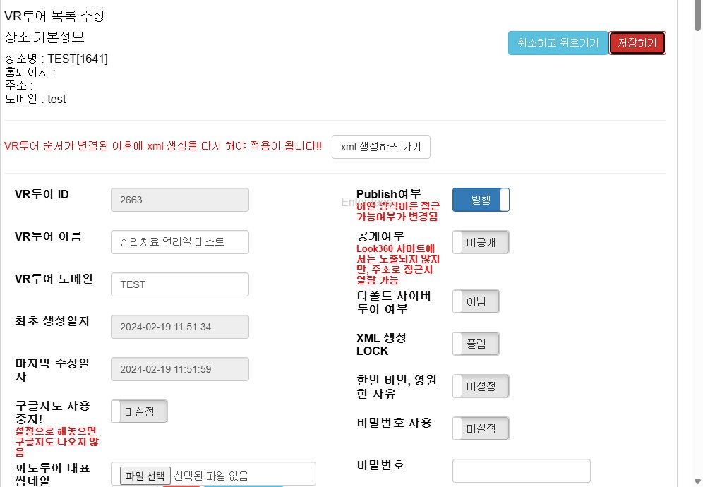</div>
</div>

---

## 결과 — 뷰어에서 flat 과 sphere 가 함께 동작합니다

<div class="pair">
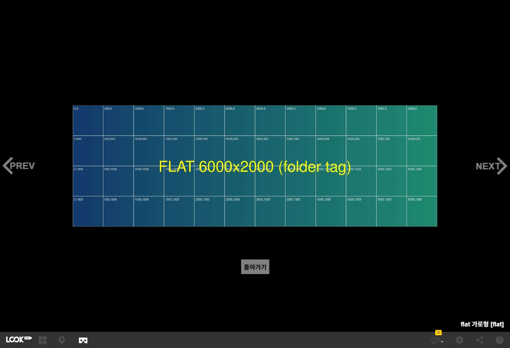
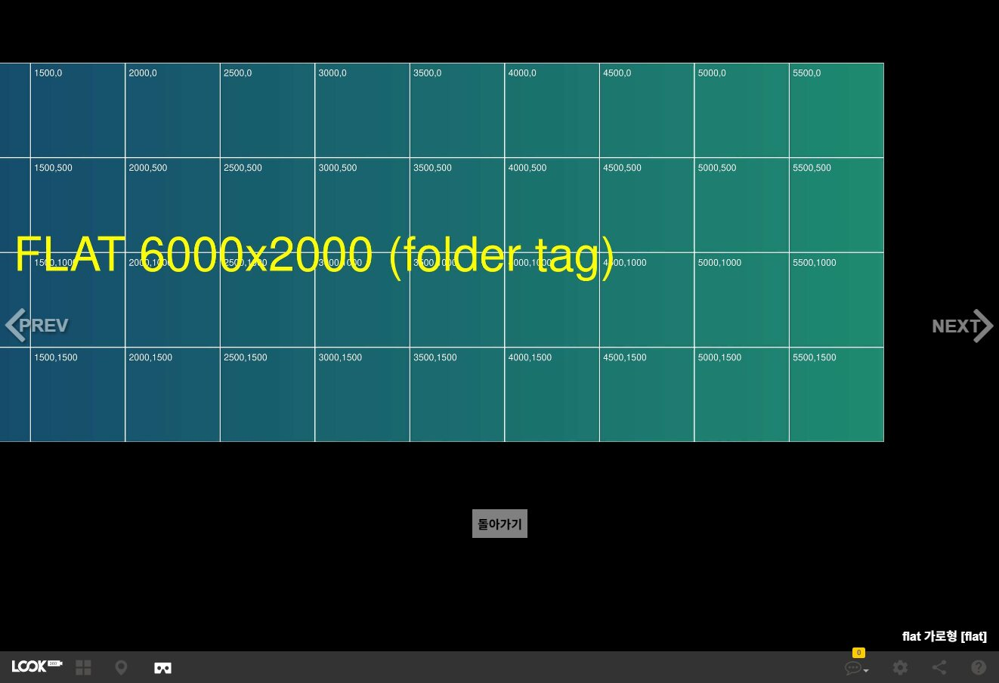
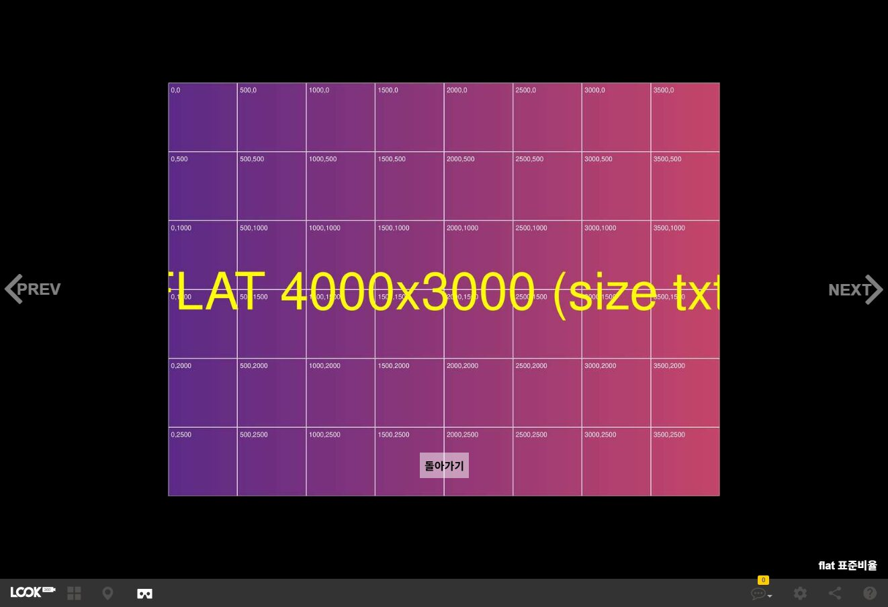
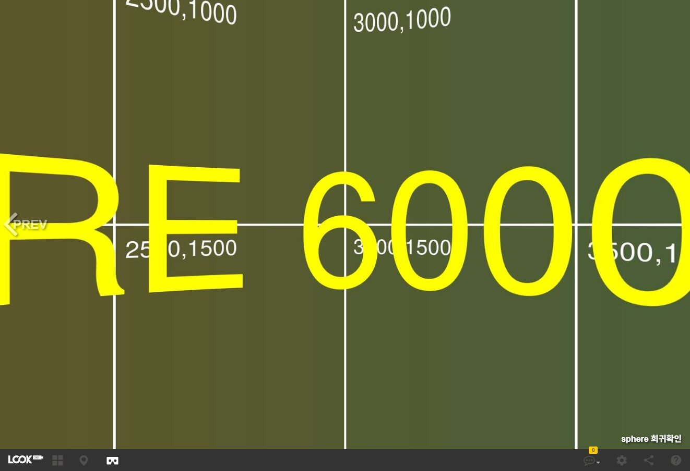
</div>

<p class="note">왼쪽 위: flat 6000×2000 · 오른쪽 위: 확대 후 드래그 · 왼쪽 아래: flat 4000×3000 · 오른쪽 아래: 같은 투어의 sphere</p>

---

## 막혔을 때

| 증상 | 원인 | 해결 |
|---|---|---|
| XML 에 flat 행이 빠짐 | 타일이 아직 안 만들어짐 | BAT 실행이 끝난 뒤 XML 다시 생성 |
| “같은 이름으로 압축이 이미 풀려있습니다” | 그 장소에 폴더가 이미 있음 | 덮어쓰기 체크 후 비밀번호·OTP 인증 |
| “zip 최상위 구조가 올바르지 않습니다” | zip 을 직접 만들어 폴더가 한 겹 더 있음 | Utils 의 ZIP 만들기 사용 |
| ZIP 만들기에서 번호 관련 오류 | 파노 번호 중복, 또는 번호가 장소 id 와 같은 폴더 하나뿐 | 폴더 번호 수정 |
| 투어에 안 보임 | XML 재생성 누락 | VR투어 XML 생성하기 다시 실행 |

---

<!-- _class: closing -->
<!-- _paginate: false -->

## 정리

Utils 로 타일 · XML · zip 을 만들고, Look360 에서 업로드 · 등록 · 투어 추가 · XML 생성 · 공개 순서로 진행합니다.
별도 프로그램 설치는 필요 없습니다.
