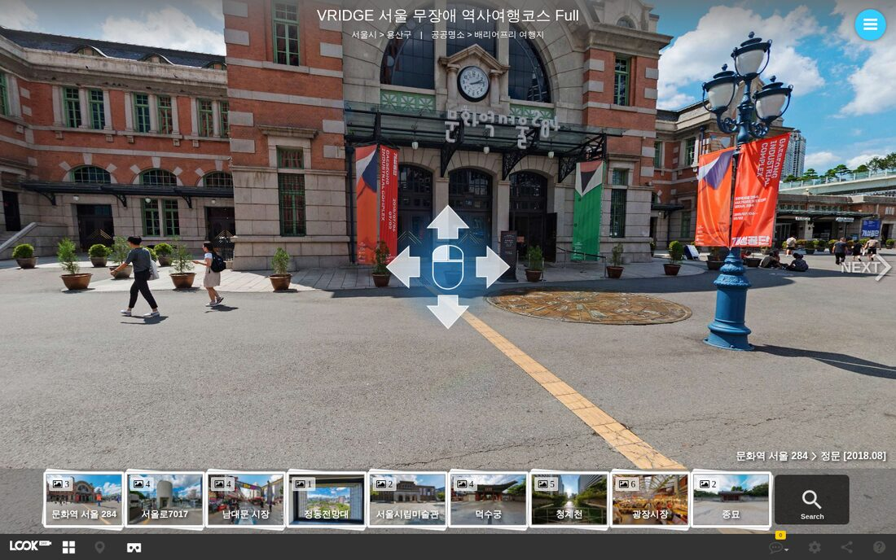
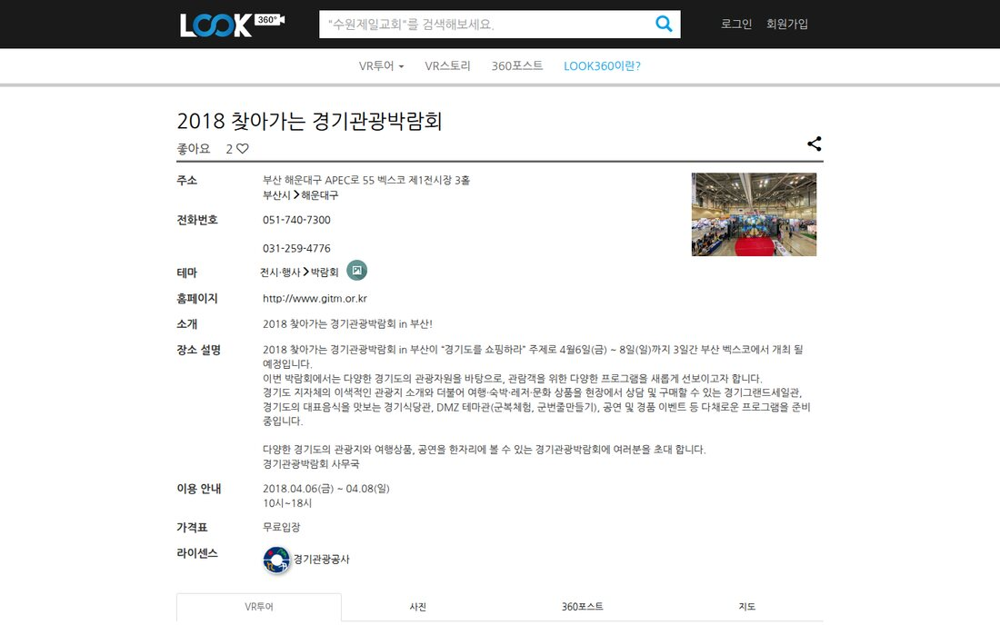

<!-- _class: cover -->
<!-- _paginate: false -->

# look360.kr 애드센스 승인 진단

## 왜 두 번 막혔고, 무엇을 고치면 승인 가능성이 높아지는가

공개 페이지 4,002개 전수 점검 &nbsp;·&nbsp; 2026-11-11

---

## 결론 먼저 — 사이트가 나쁜 게 아니라, 심사에서 좋은 면이 안 보입니다

0건

성인·도박·스팸 등 명백한 금지 콘텐츠

52%

VR 페이지의 설명글을 방문자가 읽을 수 없음

62%

검색 클릭 중 VR 페이지 비중 (서치 콘솔 16개월 실측)

- **가장 큰 원인 추정:** VR 화면만 보이고 읽을 글이 없는 페이지가 과반이고, 얇거나 겹치는 페이지도 전부 심사 대상으로 열려 있습니다
- **권고:** 지금 상태로 재신청하지 말고, 약 6주 정비 후 신청하세요. 4,000개를 다 고칠 필요는 없습니다
- **먼저 알아둘 한계:** 구글은 페이지별 거절 이유를 알려주지 않습니다. 원인은 공식 기준과 실측에 근거한 판단이며, 승인을 보장하지는 못합니다

---

## 왜 오래 운영했고 콘텐츠도 많은데 떨어졌을까

운영 기간과 콘텐츠 수는 애드센스의 합격 기준이 아닙니다. 구글은 **글로 읽히는 고유한 콘텐츠**를 먼저 봅니다.

| 구글 공식 문서의 문장 | look360.kr에 대입하면 |
|---|---|
| 「콘텐츠의 대부분이 이미지, 동영상 또는 플래시 애니메이션인 사이트는 승인되지 않을 가능성이 큽니다.」 | 핵심 콘텐츠가 360° 이미지 뷰어입니다 |
| 「콘텐츠에는 완전한 문장이나 구문이 있어야 하며, 제목만 나열하는 것은 허용되지 않습니다.」 | 장소 이름·주소·장면 이름 위주인 페이지가 많습니다 |
| 「자동 생성 페이지 또는 자체 제작 콘텐츠가 거의 없거나 전혀 없는 페이지에 광고 코드를 삽입해서는 안 됩니다.」 | 모든 페이지에 광고 코드가 들어가 있습니다 |

직접 촬영한 VR은 큰 강점입니다. 다만 **VR의 가치를 글로 설명해 주지 않으면 심사에서 드러나지 않습니다.**

출처
<a class="lnk" href="https://support.google.com/adsense/answer/81904?hl=ko" target="_blank">애드센스 계정이 승인되지 않았습니다</a>

---

## 이번에 무엇을 얼마나 확인했나

| 확인한 것 | 범위 | 방법 |
|---|---|---|
| 공개 페이지 전체 | 사이트맵 **4,002개** 전수 (오류 0) | 본문·제목·중복·금지 콘텐츠를 자동 분석 |
| 심사자 관점 품질 | **120개** 표본 | 사람처럼 직접 읽고 4단계 채점 |
| 실제 화면 | **21개 주소**, PC·모바일 | 실제 브라우저로 열어 확인 |
| 신뢰 페이지·게시판 | 약관·문의·게시판 약 460건 | 원문 확인 |
| 구글 로봇 방문 기록 | 최근 **14일** 서버 로그 | 어디를 얼마나 읽어 갔는지 집계 |
| 구글 공식 기준 | 애드센스·검색 정책 문서 | 원문 확인, 소문과 분리 |

보지 못한 것 애드센스 콘솔의 최근 거절 문구, 서치 콘솔의 색인·유입 수치, VR 사진 자체의 내용, 유튜브 영상 내용

---

## 한눈에 보는 진단 결과

| 항목 | 상태 | 요약 |
|---|---|---|
| 접속·속도·ads.txt·사이트맵 | 양호 | 4,002개 모두 정상 응답, 구글 로봇 차단 없음 |
| 금지 콘텐츠·스팸·해킹 흔적 | 양호 | 성인·도박·대부 위반 0건 |
| VR 페이지의 설명글 | 심각 | 2,081개의 글이 방문자에게 안 보임 |
| 글이 얇은 페이지 | 심각 | 장소 페이지 38%가 설명 100자 미만 |
| 다른 곳에서 가져온 글 | 심각 | 위키백과 표기 525쪽, 뉴스 전재 11쪽 |
| 페이지 중복·자동 문장 | 주의 | 거의 같은 페이지 622개, 자동 문장 810개 |
| 운영자 신뢰 정보·게시판 관리 | 주의 | 회사 소개 없음, 방치된 글 다수 |
| 광고 코드 위치 | 주의 | 얇은 화면, 로그인 화면까지 들어가 있음 |

---

## 이미 잘 되어 있어서 건드리지 않아도 되는 것

### 기술 기반

- 4,002개 페이지 오류 0건
- ads.txt와 광고 코드의 계정 번호 일치
- 구글 로봇 차단 0건 (서버 오류·403 0건)
- 사이트맵·robots.txt 정비 완료
- 8월에 문제였던 복제 문장 0건

### 콘텐츠·사용자 경험

- 강제 로그인·앱 설치 유도 없음
- 닫을 수 없는 전면 팝업 없음
- 개인정보처리방침에 구글 광고 쿠키 안내 있음
- 비지원 언어 문제 없음
- 직접 촬영한 VR 자체가 **다른 사이트에 없는 자산**

> ads.txt를 찾을 수 없다는 경고는 8월에 이미 점검했고 서버 문제가 아닌 것으로 확인했습니다. 다시 고칠 필요가 없습니다.

---

<!-- _class: sec -->

문제

# 무엇이 승인을 막고 있나

---

## 문제 ① VR 페이지에는 사람이 읽을 글이 없습니다

뷰어가 화면을 100% 채우고 설명글은 그 아래 화면 밖에 있습니다. 스크롤도 되지 않아 **VR·VR스토리 2,081개(전체의 52%)** 가 해당합니다.

직접 확인
<a class="lnk" href="https://look360.kr/vr/vridge_seoul_history_course/vridge1" target="_blank">VRIDGE 서울 무장애 코스</a>

---

## 문제 ①이 특히 위험한 이유 — 8월 대응이 역효과를 냈을 수 있습니다

- 8월에 구글 로봇이 읽도록 VR 페이지에 설명글을 넣었습니다. 하지만 **로봇만 읽고 방문자는 볼 수 없는** 구조가 되었습니다
- 구글 스팸 정책은 숨겨진 텍스트를 이렇게 정의합니다

> 「검색엔진만 조작하고 인간인 방문자에게는 쉽게 드러나지 않는 방식으로 페이지에 콘텐츠를 배치하는 행위」 — 예시: 「CSS를 사용하여 텍스트를 화면에 보이지 않도록 배치」

- 조작 의도는 없었더라도 **겉으로는 같은 모양**입니다. 8월에 이 작업 후에도 반려되었습니다
- 실측: 화면 높이 900px, 글 시작 위치 920px, 마우스 휠을 굴려도 이동 0px, 오른쪽 위 메뉴를 열어도 설명 없음(표본 확인)

조치 숨은 글을 「장소 소개」 패널에서 펼쳐 볼 수 있게 하고, 고유 글이 없는 VR은 검색 제외로 돌립니다. (뒤의 「추가 논의」 참고)

출처
<a class="lnk" href="https://developers.google.com/search/docs/essentials/spam-policies?hl=ko" target="_blank">구글 검색 스팸 정책</a>

---

## 문제 ② 내용이 얇은 페이지가 그대로 심사 대상입니다

626개

장소 페이지 설명 100자 미만 (1,636개 중 38%, 0자 226개 포함)

45개

회원 페이지 56개 중 「등록된 VR스토리가 없습니다」

0개

검색 제외(noindex) 처리된 사이트맵 페이지

**120개 표본을 직접 읽은 결과 (추정)**

| A 충분한 정보 | B 쓸 만하지만 얇음 | C 이름·주소 수준 | D 거의 비어 있음 |
|---|---|---|---|
| 약 11% | 약 56% | 약 32% | 약 1% |

애드센스는 **사이트 전체**를 검토합니다. 좋은 페이지가 있어도 약 1,300개의 C·D 페이지가 첫인상을 깎습니다.

---

## 문제 ③ 페이지끼리 내용이 겹치고, 자동 문장이 많습니다

| 무엇이 겹치나 | 규모 |
|---|---|
| 거의 똑같은 페이지 | **622개**(15.6%), 인디스팟 계정 38개 묶음이 최대 |
| VR 페이지 중 장소 페이지에 없는 설명이 있는 곳 | 2,001개 중 **137개뿐**(6.8%) |
| 같은 장소의 VR끼리 설명이 사실상 동일 | 86.7% |
| 프로그램이 자동으로 붙이는 문장 | **810개**(20.2%) |
| 제목이 겹치는 VR 페이지 | 526개 |

실제 자동 문장 예시입니다.

> 「개포중학교는 서울시 강남구에 자리한 학교 · 중학교입니다. 이 VR 투어는 총 3개 장면으로 구성되어 있습니다. 마우스 드래그 또는 화면 터치로 시점을 360도 돌려볼 수 있으며…」

구글은 사람의 검토 없이 자동으로 만든 콘텐츠에는 광고를 게재할 수 없다고 명시합니다. 8월에 지운 복제 문장과 같은 성격의 문장이 프로그램으로 계속 생성되고 있습니다.

---

## 문제 ④ 다른 곳에서 가져온 글이 많습니다

| 유형 | 규모 | 위험도 | 조치 |
|---|---|---|---|
| 설명문 끝에 「위키백과」 표기 | **525쪽**(대부분 대학·학교) | 높음 | 자체 글로 교체, 그 전까지 검색 제외·광고 제외 |
| 뉴스 기사 전재 | **11쪽**, 「무단 전재 금지」 포함 1건 | 높음 | 기사 링크 + 2~3줄 자체 요약 |
| 각주 번호 `[1]`이 남은 글 | 장소 50, VR 57 | 중간 | 다듬거나 교체 |
| 관광공사 블로그 등 출처 표기 | 다수 | 중간 | 제휴·납품 여부 확인 후 글 추가 |

구글 정책은 **논평, 선별, 부가 가치 없이 복사한 콘텐츠가 있는 화면**에 광고 게재를 금지합니다. 위키백과는 재사용이 허용되는 글이지만, 그것만으로는 **독창적인 콘텐츠로 인정받지 못합니다.**

외부 출처 신호가 있는 페이지는 장소·VR 각각 약 17%입니다(자동 측정). 실제 복제 여부는 일부만 대조했습니다.

---

## 문제 ⑤ 누가 운영하는 사이트인지 알기 어렵습니다

### 회사·운영자 정보

- **회사 소개 페이지가 없습니다.** 메뉴의 「LOOK360이란?」은 2016년 FAQ 글로 연결됩니다
- indyspot.kr도 look360.kr로 되돌아옵니다
- 대표자·사업자번호·통신판매번호는 코드에만 있고 **화면에 보이지 않습니다** (약관 제3조와 어긋남)
- 푸터 호스팅 사업자가 Azure로 남아 있지만 실제는 AWS입니다

### 방치된 공개 게시물

- 파노라마 신청 게시판 공개 글 91건: 빈 글 86건, 공격 문자열 노출 5건
- 360동영상 게시글 45건: 영상 없이 주소만 있음
- FAQ의 약 90%가 2016년 글
- 2018년 행사가 지금도 「개최될 예정」으로 표시
- 내부 메모 글이 사이트맵에 포함
- 게시글 신고 버튼이 꺼져 있음

---

## 오래된 정보가 그대로 남아 있는 예시

2018년 박람회를 「개최될 예정입니다」로 안내합니다. 내용은 충분해도 **관리되지 않는 사이트**라는 인상을 줍니다.

직접 확인
<a class="lnk" href="https://look360.kr/place/gitm_2018" target="_blank">2018 찾아가는 경기관광박람회</a>

---

## 문제 ⑥ 광고 코드와 구글 로봇의 방문 효율

### 광고 코드가 너무 넓게 들어가 있음

- 관리자·임베드 화면만 빼고 **전 페이지**에 출력
- 로그인, 없는 페이지 안내, 전체화면 뷰어까지 포함
- 공식 기준: 콘텐츠 없는 화면과 자동 생성 페이지에는 광고 코드를 넣지 말 것

### 구글 로봇이 엉뚱한 곳에 시간을 씀 (14일)

- 전체 방문 10,778건 중 63%가 삭제된 스티커 주소
- 실제 콘텐츠 방문은 약 30%
- 사이트맵 대비 방문률: 장소 약 28%, VR 약 7%

스티커 주소를 삭제 처리(410)한 것은 올바른 조치이고, 시간이 지나면 줄어듭니다. 다만 **고친 내용을 구글이 다시 읽는 데 몇 주가 걸린다**는 뜻이므로, 수정 직후 재신청하면 안 됩니다.

---

## 민감 콘텐츠 — 큰 문제는 없고, 소수 페이지만 정리하면 됩니다

| 항목 | 페이지 | 판단 | 조치 |
|---|---|---|---|
| 전자담배 매장 (「24시·배달」 문구) | 2 | 광고 제한 | 판촉 문구 삭제, 광고 제외 |
| 운동센터 치료 효과 표방 (「영구적 효과」) | 3 | 주의 | 의료 효과 문구 수정 |
| 탄핵 집회 콘텐츠 | 15 | 금지 아님, 민감 | 광고 제외 또는 검색 제외 |
| 술집·양조장 / 경마장 안내 | 14 / 4 | 경미 | 유지 |
| 깨진 외부 링크 | 12 | 품질 | 수정 |
| 초등학교 시설 VR | 275 | 금지 아님 | 유지, 맞춤 광고 설정은 승인 후 검토 |

**개인 휴대폰 번호로 보이는 번호가 98쪽**에 있습니다(추정). 광고 정책과 별개로 개인정보 측면에서 소유자 확인을 권합니다.

`/b/360video/113`은 제목이 수상하여 영상 내용을 직접 확인해야 합니다.

---

<!-- _class: sec -->

해결

# 승인을 받기 위한 실행 계획

---

## 검색 유입 데이터 — VR이 유입의 62%입니다 (서치 콘솔 실측)

2025-07-01 ~ 2026-11-09 · 검색 노출 페이지 7,175개 · 클릭 17,094건 · 노출 202만 회

| 유형 | 사이트맵 | 노출 있음 | 클릭 있음 | 16개월 노출 0 | 클릭 비중 |
|---|---|---|---|---|---|
| **VR** | 2,001 | 1,591 | 440 | 410 | 61.7% |
| **장소** | 1,636 | 1,112 | 465 | 524 | 32.1% |
| VR스토리·회원·게시판 | 356 | 108 | 24 | 248 | 1.6% |

- 사이트맵 밖 주소(`/vr/{장소}`, 장면 번호가 붙은 VR 주소 등)도 클릭 7,747건을 받습니다. 구글은 `/vr/{장소}/{투어}`보다 `/vr/{장소}`를 대표 주소로 고르고 있습니다
- 2026년 7월 말부터 노출이 90% 넘게 줄었습니다. 주간 노출이 약 5.3만 → 8월 10일 주 1.1만 → 10월 3천. 장소 페이지(특히 대학)가 가장 크게 줄었고, URL 검사 결과 색인은 유지돼 «순위 하락»입니다. 8월 13일 SEO 작업과 시점이 겹치지만 감소는 3주 앞서 시작됐고, 원인은 특정하지 못했습니다(판단)
- **결론:** 검색에 나오는 VR·장소 페이지는 noindex로 빼지 않습니다. 빼는 것은 16개월간 노출이 0인 빈 페이지뿐입니다

---

## 핵심 전략 — 전부 고치지 말고, 보여줄 페이지를 좁혀서 제대로 만듭니다

| 단계 | 페이지 수 | 무엇을 하나 |
|---|---|---|
| 현재 | **4,002** | 전부 검색 대상, 전부 광고 코드 |
| ① 정리 | 최대 약 1,180 제외 | 16개월간 검색 노출이 0이면서 고유 글이 없는 페이지만 검색·광고에서 제외 |
| ② 유지·보강 | 약 2,800 | 검색 노출이 있는 페이지는 제외하지 않고 글을 보이게·채워서 보강 (실측) |
| ③ 대표 콘텐츠 | 약 300 | 직접 촬영한 사람만 쓸 수 있는 글로 재작성 |
| ④ 안내 글 신규 | **20~30편** | 주제별 VR 코스 안내, 회사·촬영 방식 소개 |

- 페이지를 삭제하지 않습니다. **주소는 그대로 살아 있으니** 고객사 공유 링크에 영향이 없습니다
- 숨기는 것은 언제든 되돌릴 수 있고, 글을 보강한 페이지부터 다시 열면 됩니다
- 참고 검색 제외가 심사에서 얼마나 인정되는지는 구글이 공개하지 않았습니다. 그래서 **광고 코드 제외를 함께** 적용합니다

---

## 일정 — 약 6주 후 재신청을 목표로 합니다

| 시기 | 할 일 | 담당 |
|---|---|---|
| **1주차** | VR 숨은 글 해결, 자동 문장 제거, 검색 제외 규칙 적용, 광고 코드 범위 축소 | 개발 |
| **1주차** | 공격 문자열·빈 글·내부 메모 정리, 사업자 정보 표시, 푸터 수정 | 개발·운영 |
| **2주차** | 회사 소개·촬영 방식·콘텐츠 원칙 페이지 작성, 위키·뉴스 전재 글 처리 | 콘텐츠 |
| **2~5주차** | 대표 페이지 300개 재작성, 안내 글 20~30편 발행 | 콘텐츠 |
| **5~6주차** | 서치 콘솔에서 재수집 확인, 체크리스트 점검 | 운영 |
| **6주차 이후** | 재신청 1회. 결과 메일의 사유를 기록 | 운영 |

**재신청을 아껴야 하는 이유:** 구글 문서에 따르면 최근 여러 번 거부되면 검토 요청 버튼이 일정 기간 비활성화될 수 있습니다. 이 규정이 최초 승인 단계에도 적용되는지는 확인하지 못했지만, 신청 횟수는 아끼는 편이 안전합니다.

---

## 1주차 개발 작업 목록

| 작업 | 위치 (Look360_ksq1.2) | 효과 |
|---|---|---|
| VR 설명을 「장소 소개」 패널에서 펼쳐 보이게 노출 | `pages/panotour.php:2241-2308`, `panoTourWrap` JS·CSS | 숨은 글 해소 |
| 120자 미만 자동 문장 제거 | `pages/panotour.php:2286-2306` | 자동 생성 신호 제거 |
| 광고 코드 조건 강화 | `index.php:371` | 빈 화면 광고 차단 |
| 검색 제외 기준 통일, `/vr/{장소}`, `/vr/embed` 포함 | `look360_seo.php:527`, `seo-index-policy.php` | 제외 누락 해소 |
| 사이트맵을 심사 대상만 남김 | `sitemap-lib.php:394` | 구글에 좋은 페이지를 먼저 보여줌 |
| VR 페이지 제목·설명을 투어별로 고유화 | `look360_seo.php:418-473` | 제목 중복 526개 해소 |
| 사업자 정보 주석 해제, 호스팅 표기 수정 | `layouts/look360/_cross/bottom.php:46` | 신뢰 정보 |

작업 전 서치 콘솔에서 **검색 유입이 있는 페이지 목록을 내려받아** 제외 대상에서 빼세요.

---

## 어떤 페이지를 검색·광고에서 제외할까 — 판단 기준

| 페이지 | 규칙 |
|---|---|
| 회원 페이지 | VR·스토리·소개가 충분한 16개 안팎만 유지, 나머지 제외 |
| 장소 페이지 | 검색 노출이 0이고 자체 설명이 없을 때만 제외. 노출이 있으면 얇아도 유지하고 글을 보강 |
| VR 페이지 | 검색 노출이 있으면 유지(1,591개). 노출 0이면서 고유 글이 없을 때만 제외. 중복 주소는 noindex 대신 대표 주소(canonical) 정리 |
| 위키백과·뉴스 전재 | 자체 글로 바꿀 때까지 제외 |
| 360동영상 게시글 45건 | 영상을 넣고 설명을 쓰거나 비공개 |
| 파노라마 신청 게시판 | 목록·상세를 로그인 필수로 변경, 빈 글·공격 글 삭제 |
| 언어별 복사 페이지 | 깨진 자동 문장을 고칠 때까지 제외 |
| 로그인·회원가입·오류·임베드 | 항상 광고 코드 제외 |

robots.txt로 막지 마세요. 구글이 페이지를 읽지 못해 검색 제외 표시도 못 봅니다. 페이지 안의 noindex 표시를 씁니다.

---

## 어떤 글을 써야 하나 — 글자 수가 아니라 고유한 사실입니다

애드센스에 **최소 글자 수 규정은 없습니다.** 8월에 250자를 채우다 복제 문장이 70%까지 늘어난 경험도 있었습니다.

### 이렇게 쓰지 마세요

- 「○○은 △△에 위치한 □□입니다」
- 어느 장소에나 붙는 안내 문구
- 위키백과·공식 소개문 복사
- 글자 수를 맞추기 위한 문장
- 사람이 확인하지 않은 AI 문장

### 페이지마다 사실 5가지를 담으세요

1. VR에서 볼 수 있는 **구체적인 장면과 동선**
2. **촬영 시점**과 지금 달라진 점
3. 실제 방문 팁: 입구, 주차, 층별 구성
4. **휠체어·유아차** 등 접근 정보
5. 어떤 사람이 보면 좋은지

AI는 초안을 돕는 데만 쓰고, **촬영 담당자가 사실을 확인한 뒤** 발행합니다.

---

## 먼저 고칠 300개와 새로 쓸 안내 글

### 대표 페이지 300개 선정 순서

1. 서치 콘솔 유입·조회수 상위
2. 직접 촬영 자산이 뚜렷한 곳
3. 고유 정보가 이미 있는 곳
4. 공공명소, 문화시설, 배리어프리

**좋은 본보기**

- [VRIDGE 서울 무장애 코스](https://look360.kr/vr/vridge_seoul_history_course/vridge1)
- [화담숲 무장애 코스](https://look360.kr/vrstory/ggtour_hwadamsup/ggtour_hwadamsup_vrstory)
- [강서습지생태공원](https://look360.kr/place/gangseo_wetland_ecological_park)

### 안내 글 20~30편 예시

- 휠체어로 둘러보는 서울 역사 코스
- 유아차와 함께 가기 좋은 경기도 수목원
- 입학 전에 미리 보는 대학 캠퍼스 VR
- 처음 가는 전시관, VR로 동선 미리 보기
- 박물관 VR 촬영 뒷이야기

### 꼭 필요한 페이지 3개

- 회사 소개, 대표자·연혁
- 촬영·제작 방식
- 콘텐츠 원칙, 정정 요청 방법

---

## 재신청 전 체크리스트

### 콘텐츠

- [ ] 방문자가 VR 페이지의 설명을 볼 수 있다
- [ ] 자동 채움 문장이 0개다
- [ ] 위키·뉴스 전재 글이 공개 영역에 없다
- [ ] 대표 페이지 300개를 사람이 검수했다
- [ ] 안내 글 20편 이상이 발행되었다
- [ ] 빈 글과 공격 문자열 글이 없다
- [ ] 종료된 행사 안내를 과거형으로 고쳤다

### 사이트·정책

- [ ] 회사 소개와 사업자 정보가 화면에 보인다
- [ ] 모든 페이지 푸터에 개인정보처리방침 링크가 있다
- [ ] 처리방침의 수탁자, GA, 광고 해제 링크를 수정했다
- [ ] 빈 화면과 뷰어에 광고 코드가 없다
- [ ] 수정한 페이지가 서치 콘솔에서 다시 수집되었다
- [ ] 애드센스 콘솔의 등록 도메인이 look360.kr이다

---

## 승인된 뒤 지켜야 할 광고 배치 원칙

| 위치 | 판단 | 이유 |
|---|---|---|
| 360 공간 안 (돌리면 나오는 광고) | 금지 | 숨김·겹침·확대축소 조작에 해당. 직접 판매 협찬으로 대체 |
| VR 뷰어 위, 조작 버튼 옆, 설명 패널 안 | 금지 | 콘텐츠를 가리거나 실수로 클릭하게 됨 |
| 뷰어 밖 썸네일 줄 | 조건부 | 「광고」 표시, 썸네일과 다른 모양, 끌기 영역 밖 고정 |
| 전체화면 뷰어의 전면 광고 | 제외 | 자동 광고에서 해당 페이지 제외 설정 |
| 뷰어 아래 설명글 사이 | 권장 | 콘텐츠와 분리되어 안전함 |
| 장소 페이지 설명 아래 | 권장 | 읽을 콘텐츠가 있는 위치 |
| 외부 사이트에 넣는 임베드 뷰어 | 금지 | 다른 사이트 프레임 안의 광고 |

- 자동 광고로 시작할 때도 VR 뷰어 주소를 제외 페이지로 등록하고, 처음에는 설명 영역 중심으로 켭니다
- 본인 또는 직원의 광고 클릭은 금지입니다. 「광고를 눌러 주세요」 같은 문구도 금지입니다
- 유럽·영국·스위스에서 맞춤 광고를 게재하려면 구글 인증 동의 관리 도구가 필요합니다. 애드센스의 개인정보 메시지 기능을 켜면 해결됩니다

---

## 그래도 승인이 안 되면

| 대안 | 공식 조건 | 판단 |
|---|---|---|
| **카카오 애드핏** | 사전 승인·초대제, 제휴 문의 후 가입 | 애드센스 재신청과 함께 문의 가능, 정비 결과를 그대로 활용 |
| **Google Ad Manager 파트너** | 이전에 구글에서 거절된 인벤토리는 불가 조항 있음 | 애드센스 반려가 해당되는지 파트너에게 사전 확인 필요 |
| **네이버 애드포스트** | 공식 문서를 확인하지 못함 | 외부 웹사이트 등록 가능 여부를 고객센터에 확인 |

**광고가 아닌 수익도 함께 보세요.** 이번 정비의 결과물은 애드센스 외에도 쓸모가 있습니다.

- 검색 유입 품질 개선: 얇은 페이지가 줄고 대표 콘텐츠가 늘어납니다
- VR 제작 영업: 「무장애 코스」, 「캠퍼스 VR」 같은 글이 곧 제작 사례 페이지가 됩니다

---

<!-- _class: sec -->

추가 논의

# VR 뷰어와 광고, 어디까지 되나

---

## 360 공간 안에 애드센스 광고를 넣을 수 있나 — 안 됩니다

화면을 특정 방향으로 돌리면 광고가 나오는 방식은 「애드센스 광고 코드 수정」 정책의 금지 예시에 거의 다 해당합니다.

| 360 공간 안 광고의 모습 | 정책 원문 |
|---|---|
| 돌려야 보임 = 평소에는 안 보임 | 「어떤 경우라도 광고 단위를 숨김(예: display:none)」 |
| 파노라마 위에 겹쳐 뜸 | 「콘텐츠를 가리거나 콘텐츠가 광고를 가리는 방식으로…구현」 |
| 시점에 따라 늘어나고 기울어짐 | 「광고 게재 방식 조작(예: 화면에 광고 밀어넣기, 광고 확대/축소)」 |
| 끌어서 둘러보다 눌림 | 「사용자가 모바일 웹페이지를 드래그하는 동안 광고 클릭 실행」 |

- 기술적으로도 애드센스 광고는 별도 창(iframe)이라 VR 화면(WebGL 캔버스)에 그림처럼 붙일 수 없습니다. 억지로 붙이면 코드 수정이 되어 **거절이 아니라 계정 정지 사유**가 됩니다
- 대안 360 공간 안 광고는 Look360이 **직접 파는 협찬 상품**으로 만듭니다. 장소·주변 가게 홍보 핫스팟, 협찬 간판, 지자체 관광 안내 등입니다. 협찬 표시를 분명히 하고 VR 화면을 가리지 않게 설계합니다

출처
<a class="lnk" href="https://support.google.com/adsense/answer/1354736?hl=ko" target="_blank">광고 코드 수정</a>
<a class="lnk" href="https://support.google.com/adsense/answer/1346295?hl=ko" target="_blank">광고 게재위치 정책</a>

---

## 뷰어 밖 고정 영역은 됩니다 — 썸네일 줄에 넣을 때의 조건

360cities처럼 하단 썸네일 줄 일부에 광고를 두는 방식은 **뷰어 밖 고정 영역**이라 가능합니다. 다만 아래 조건을 지켜야 합니다.

| 조건 | 이유 |
|---|---|
| 광고에 「광고」 표시, 썸네일과 다른 모양, 충분한 간격 | 「메뉴, 탐색 기능…다른 콘텐츠로 착각할 수 있도록 광고를 게재하는 행위」 금지. 장면 썸네일은 탐색 메뉴입니다 |
| 썸네일 줄이 파노라마 위에 떠 있지 않을 것 | 반투명 오버레이 안의 광고는 콘텐츠와 겹치는 배치입니다 |
| 좌우로 끌어 넘기는 영역 밖에 고정 | 끌다가 실수로 누르기 쉽습니다 |
| 전체화면 모드에서는 광고 제외 | 전체화면에서는 광고가 VR 화면 위에 올라갑니다 |

360cities가 실제로 어떤 광고를 어떻게 구현했는지는 확인하지 않았습니다.

---

## 숨은 설명글은 지우지 말고, 사람이 펼쳐 볼 수 있게 합니다

- 8월에 넣은 설명글은 방향이 맞았습니다. 문제는 **사람이 볼 방법이 없다**는 점입니다. 구글은 탭·접기·「더보기」처럼 사람이 눌러서 볼 수 있는 글은 정상 콘텐츠로 봅니다
- 지금 오른쪽 「장소 소개」 패널에는 이름·전화·주소·테마만 있고, 「더보기」는 장소 페이지를 새 창으로 엽니다

| 바꿀 것 | 방법 |
|---|---|
| 숨은 설명글 | `footer#vrDocumentInfo` 내용을 「장소 소개」 패널 안으로 옮겨 그 자리에서 펼침. 같은 글을 두 곳에 두지 않음 |
| 패널 내용 생성 | 처음부터 HTML에 넣어 둠. 지금 패널은 JS가 그려서 수집한 HTML에 「장소 소개」 문구가 0번 나옵니다 |
| 장면 목록 | 이미 숨은 영역에 있음(`look360_seo.php:656-677`). 썸네일 + 한 줄 설명 + 누르면 해당 장면 이동으로 공개 |
| 장소 페이지 링크 | 「장소 페이지 전체 보기」로 패널 아래에 유지 |

한계 패널은 파노라마 위에 떠 있어서 **광고 자리로는 쓸 수 없습니다.** 패널은 숨은 글 문제만 해결합니다.

---

## 심사 페이지는 고를 수 없습니다 — 대신 보이는 순서를 정합니다

애드센스는 도메인 하나를 신청받고 **사이트 전체**를 봅니다. 광고를 안 넣는 페이지도 평가에 들어갑니다. 우리가 정할 수 있는 것은 세 가지입니다.

| 수단 | 할 일 |
|---|---|
| **검색 제외(noindex)** | 검색 노출이 0이면서 고유 글이 없는 VR·장소, 빈 회원 페이지, 빈 게시글만 색인에서 뺌 |
| **광고 코드 위치** | 장소 페이지·안내 글에만 넣고 VR·목록 페이지에서는 뺌 |
| **동선** | 메인·목록의 첫 클릭이 VR 뷰어가 아니라 장소 페이지(설명 + VR 미리보기)로 가게 함 |

| 페이지 | 심사 기간의 역할 | 광고 |
|---|---|---|
| 장소 페이지·안내 글 | **대표 콘텐츠** | 넣음 |
| VR 페이지 | 설명 패널 공개, 검색 노출 있으면 색인 유지 | 뺌 |
| 메인·VR 목록 | 길잡이. 소개 문단·카드 요약을 붙이면 광고 후보 | 보류 |

---

## 목록 페이지 광고 — 커뮤니티는 되는데 왜 지금은 보류인가

구글은 「알림, 탐색 또는 기타 행동 목적으로 사용되는 화면」과 「콘텐츠가 없거나 가치가 별로 없는」 화면에 광고를 허용하지 않습니다. **목록이라서 금지되는 것은 아닙니다.**

| | 커뮤니티 게시글 목록 | Look360 VR 목록 (현재) |
|---|---|---|
| 목록의 내용 | 사람이 쓴 제목·미리보기·댓글 수 | 썸네일 사진 + 짧은 장소 이름 |
| 구글이 읽는 글 | 많음 | 적음 |
| 사이트 상태 | 이미 승인됨 (문제 페이지만 개별 제한) | 신청 단계 (사이트 전체 판단) |

- 커뮤니티 광고 중에는 애드센스가 아닌 직접 판매·다른 네트워크도 섞여 있습니다(확인하지 않음)
- **승인 후에는 목록 페이지에도 광고를 넣을 수 있습니다.** 목록 위 지역·테마 소개 문단과 카드 한두 줄 요약을 붙이면 더 안전합니다
- 신청 단계에서는 목록 광고보다 **목록에서 들어간 페이지에 읽을거리가 있는지**가 결과를 가릅니다

출처
<a class="lnk" href="https://support.google.com/publisherpolicies/answer/11112688?hl=ko" target="_blank">게시자 콘텐츠가 없는 화면</a>

---

## 검색 제외는 목록이 아니라 «규칙»으로 전수 적용합니다

- 공개 페이지 4,002개 전수 데이터와 **서치 콘솔 16개월 실적**을 대조했습니다. 검색 노출이 있는 페이지는 제외하지 않습니다
- 구현은 「제외할 주소 목록」이 아니라 **페이지를 그릴 때마다 판정하는 규칙**으로 넣습니다. 새로 올라오는 VR·장소도 자동으로 같은 기준을 적용받고, 글을 보강하면 자동으로 다시 공개됩니다

| 단계 | 방법 |
|---|---|
| ① 자동 판정 (전수) | 자동 채움 문장을 뺀 고유 글 유무, 장소 페이지와의 중복, 장면 설명 유무를 DB 값으로 계산 |
| ② 예외 (전수) | 서치 콘솔 API로 검색 노출이 있는 페이지를 주기적으로 받아 자동 예외 처리 |
| ③ 사람 검수 (일부) | 기준 경계선에 걸린 페이지와 유입 상위 페이지만 직접 읽음 |
| ④ 재확인 | 적용 후 다시 전수 수집해서 noindex 수·광고 코드 범위를 대조 |

---

<!-- _class: sec -->

작성 방식

# 부족한 글을 어떻게 채우나

---

## 글쓰기 전용 도구를 따로 만듭니다 (IND-9307)

admin 페이지에는 회원·결제·삭제 기능이 있어 글쓴이에게 열기 위험합니다. 내부망 전용 도구에서 쓰고, **확정된 글만** 레거시로 옮깁니다.

| 단계 | 하는 일 | 저장 위치 |
|---|---|---|
| ① 작업 목록 | 검색 제외 판정 결과에서 「고유 글 없음」 페이지를 가져와 대표 300개부터 배정 | 작성용 DB |
| ② AI 초안 | 확인된 자료로 블로그형 초안 작성, 문장마다 출처 표시 | 작성용 DB |
| ③ 사람 작성 | 빈칸(현장 경험)을 채우고 확인 필요 문장을 검증 | 작성용 DB |
| ④ 검수·확정 | 검수자가 확정 (나중에는 신뢰받은 작성자도 자체 확정) | 작성용 DB |
| ⑤ 레거시 반영 | 확정본만 묶음으로 반영, 반영 직전 값 보관 → 되돌리기 가능 | 레거시 DB (묶음마다 승인) |

- 작성용 DB는 레거시 운영 DB와 분리합니다. 초안 작업이 운영 사이트에 영향을 주지 않습니다
- l3 플랫폼은 고려하지 않습니다. 확정본이 레거시 DB에 들어가면 나중에 마이그레이션으로 함께 옮겨집니다
- 장면 설명은 레거시에 저장할 칸이 없어 새 테이블을 만들고, VR 「장소 소개」 패널이 읽게 합니다

---

## AI 초안 규칙 — 지어내지 않고, 모르는 것은 빈칸으로 둡니다

| 표시 | 뜻 | 예 (VRIDGE 서울 역사여행코스) |
|---|---|---|
| ✅ 자료로 확인 | DB 값, 장면 이름, 출처를 밝힌 공식 정보 | 「지하철 엘리베이터, 서울테라스 장애인 화장실처럼 휠체어 이용자가 미리 확인해야 할 지점을 장면으로 담았습니다」 |
| 🟡 확인 필요 | 사진을 보고 묘사한 내용, 오래된 운영 정보 | 「마지막 장면 남3문·공원은 종묘 쪽으로 보입니다」 |
| ⬜ 직접 작성 | 가본 사람만 아는 내용을 질문으로 남김 | 「통행불가지역은 어디이고, 왜 지나갈 수 없었나요? 우회로는 있었나요?」 |

- **같은 틀로 찍어내지 않습니다.** 장소 유형마다 구성을 바꾸고 반복 문장을 쓰지 않습니다. 구글 스팸 정책의 「대규모 콘텐츠 악용」 대응입니다
- **남의 글을 바꿔 쓰지 않습니다.** 위키백과·공식 사이트는 사실 확인용으로만 쓰고, 문장은 Look360의 촬영 관점으로 새로 씁니다

---

## 샘플 3곳에서 확인한 것

| 장소 | 지금 설명의 문제 | 초안이 잡은 고유한 강점 |
|---|---|---|
| **VRIDGE 서울 역사여행코스** (코스형) | 한 문장 + 코스 순서뿐 | 엘리베이터·장애인 화장실·통행 불가 구간 등 **휠체어 이동 경로** |
| **인천광역시립박물관** (전시관형) | 박물관 공식 소개문 문체, 전화번호 하이픈 누락 | 도착 동선·야외 고인돌 등 **바깥 공간 미리 보기** |
| **한국기술교육대학교** (학교형) | 교육이념 문장뿐 | 호실 번호까지 있는 **학부별 실습실**, 반도체 클린룸 |

- **장면 이름이 가장 좋은 재료입니다.** 세 곳 모두 장면 이름만으로 VR의 강점이 드러났습니다. 「전시물1」, 「입구」, 「내부」 같은 모호한 이름은 먼저 고칩니다
- **같은 장소의 VR 여러 개는 장면 차이로 구분합니다.** 코리아텍은 이전 VR이 생활 공간, 2024 VR이 실습·학습 공간입니다. 페이지마다 다른 소개를 쓰면 중복이 풀립니다
- 샘플은 DB 값과 대조했습니다. 360 사진은 보지 않아 장면 설명은 전부 🟡로 남겼습니다

---

## 합격 여부를 작성자가 스스로 판단합니다 — 점수와 단계적 권한

| 구분 | 방식 | 내용 |
|---|---|---|
| **필수 조건** | 통과/불통과 | 빈칸·미확인 문장·겹치는 문장·외부 소개문 의심·금지 상투 문장이 하나라도 있으면 제출 불가 |
| **품질 점수** | 작성자용 지침 | 고유 사실 수, 장면 설명 비율, 같은 장소 VR 간 차별성, 유형별 질문 답변. 기준 점수 이상이어야 검수 요청 |
| **확정 권한** | 단계적 이양 | 처음 50~100개는 전부 검수하며 점수표 보정 → 연속 통과 작성자에게 자체 확정 권한 → 일부 무작위 재검수, 문제 시 권한 회수 |

- 글자수는 점수에 넣지 않습니다. 8월에 250자 목표를 줬더니 복제 문장이 70%까지 생겼습니다. 점수는 «맞추는 대상»이 되기 쉽습니다
- 사실이 맞는지(엘리베이터가 있는지 등)는 점수로 검증할 수 없습니다. 그래서 자동 승인은 처음부터 켜지 않습니다
- 자체 확정이 잘못돼도 레거시 반영 단계에서 묶음마다 승인하므로 운영 사이트로 바로 나가지 않습니다

---

## 장면 캡처로 장면 설명 초안까지 만듭니다 — cms-for-vr-crawler 재사용

외부 360 VR 발굴용으로 만든 `cms-for-vr-crawler`에 이미 쓸 만한 기능이 있습니다. 프로젝트를 합치지 않고 필요한 모듈만 옮겨 씁니다.

| 재사용 | 하는 일 | 이 도구에서의 쓰임 |
|---|---|---|
| **krpano 장면 캡처** | 장면을 하나씩 넘기며 화면을 찍고, 검은·로딩 화면은 버림 | 캡처를 AI가 보고 **장면 한 줄 설명 🟡 초안**을 만듦 |
| **AI 보강 처리기** | Claude 호출, 반복 지시문 캐싱 | 초안 생성 작업의 뼈대 |
| **검토 화면·단계 안내 카드** | 승인·수정 화면, 단계별 남은 수·할 일 안내 | 작업 목록·검수 화면 |

- 샘플에서 사진을 못 봐 비워 둔 장면 설명을 이 캡처로 채울 수 있습니다. 사람은 캡처와 초안을 나란히 보고 맞는지만 확인하면 됩니다
- VR 페이지 주소로 캡처하므로 파일 저장소를 훑지 않습니다. 운영 사이트 부하를 고려해 캡처 속도는 제한합니다
- 재사용하지 않는 것: URL 발굴·유효성 검증·외부 VR 적재(목적이 다름)

---

## 직접 결정해 주셔야 하는 네 가지

| 결정 사항 | 추천 | 이유 |
|---|---|---|
| **1. VR 페이지 처리** | 「장소 소개」 패널에서 설명·장면 목록 공개 + VR 페이지 광고 제외. 검색 노출이 있는 VR은 색인 유지 | VR 회사의 핵심 검색 유입(62%)을 지키면서 숨은 글은 없앰 |
| **2. 검색 제외 범위** | 16개월간 노출 0 + 고유 글 없음만 제외(최대 약 1,180) | 아무 역할을 안 하던 페이지만 빼서 잃는 것이 없음 |
| **3. 대표 글 300개 작성** | 글쓰기 전용 도구 + AI 초안(장면 캡처 포함) + 사람 작성·검수 (IND-9307 진행 중) | 직접 촬영 정보가 유일한 차별점 |
| **4. 위키백과 글 525쪽** | 자체 글 교체 전까지 검색·광고 제외 | 고쳐 쓰는 양이 많아 우선순위로 나눠야 함 |

주의 애드센스 승인에 noindex가 필수는 아닙니다. 광고 품질은 광고 코드 위치(글이 있는 페이지에만)로 지키고, 검색 유입은 지킵니다.

**추가로 확인해 주시면 정확도가 올라갑니다:** 애드센스 콘솔의 최근 거절 문구.

---

## 근거의 신뢰 수준과 한계

| 구분 | 내용 |
|---|---|
| **직접 측정** | 페이지 수, 자동 문장, 중복 수치, 서버 로그, 화면 동작 |
| **표본 추정** | A~D 등급 |
| **서치 콘솔 실측** | 검색 클릭·노출, 페이지 유형별 비중, 노출 0 페이지 수, 색인 상태(URL 검사) |
| **판단** | 반려 원인의 순서, 6주 일정, 승인 가능성 |
| **공식 문서** | 인용한 구글 문구 |
| **근거 없음(사용 안 함)** | 「○자 이상」, 「글 ○개 이상」, 「운영 ○개월」 같은 속설 |

- 360 VR 사이트의 승인 사례는 찾지 못했습니다. 이 사이트에 맞춘 판단이며 승인 보장이 아닙니다
- 외부 글 복제는 위키백과 표기와 일부 대조만 확인했습니다. 전수 검색은 도구 한계로 하지 못했습니다
- 초등학교·청소년 대상 콘텐츠의 광고 설정, 개인정보처리방침의 법률 판단은 전문가 확인을 권합니다

공식 문서
<a class="lnk" href="https://support.google.com/adsense/answer/9724?hl=ko" target="_blank">자격요건</a>
<a class="lnk" href="https://support.google.com/adsense/answer/10502938?hl=ko" target="_blank">게시자 정책</a>
<a class="lnk" href="https://support.google.com/publisherpolicies/answer/11112688?hl=ko" target="_blank">가치 낮은 화면</a>
<a class="lnk" href="https://support.google.com/adsense/answer/7003627?hl=ko" target="_blank">재검토 제한</a>
<a class="lnk" href="https://support.google.com/publisherpolicies/answer/11035030?hl=en" target="_blank">광고 방해</a>

---

<!-- _class: closing -->

# 정리

**VR의 가치가 글로 보이도록 고치고, 검색에 나오는 페이지는 지키면서 아무도 안 보던 빈 페이지만 빼고, 300개를 제대로 쓰고 6주 후 한 번 신청합니다.**

공개 페이지 4,002개 전수 점검 &nbsp;·&nbsp; 2026-11-11
