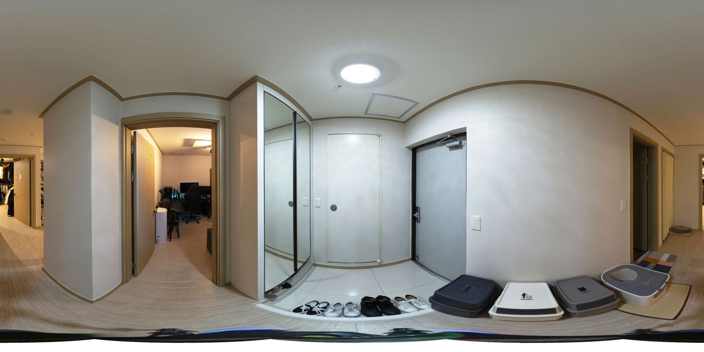
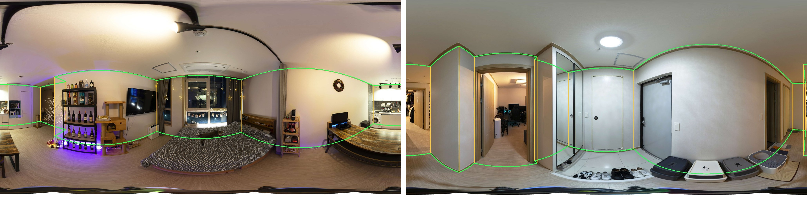
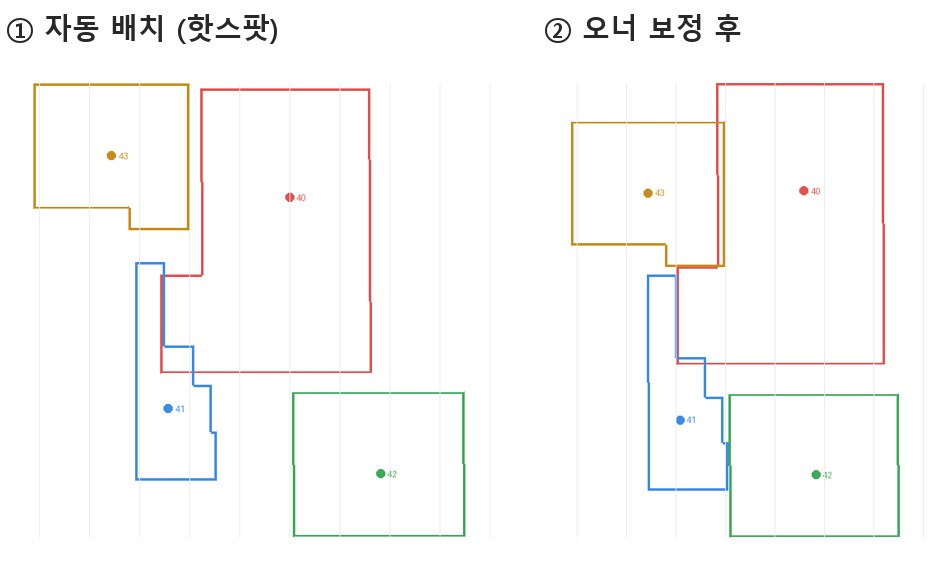
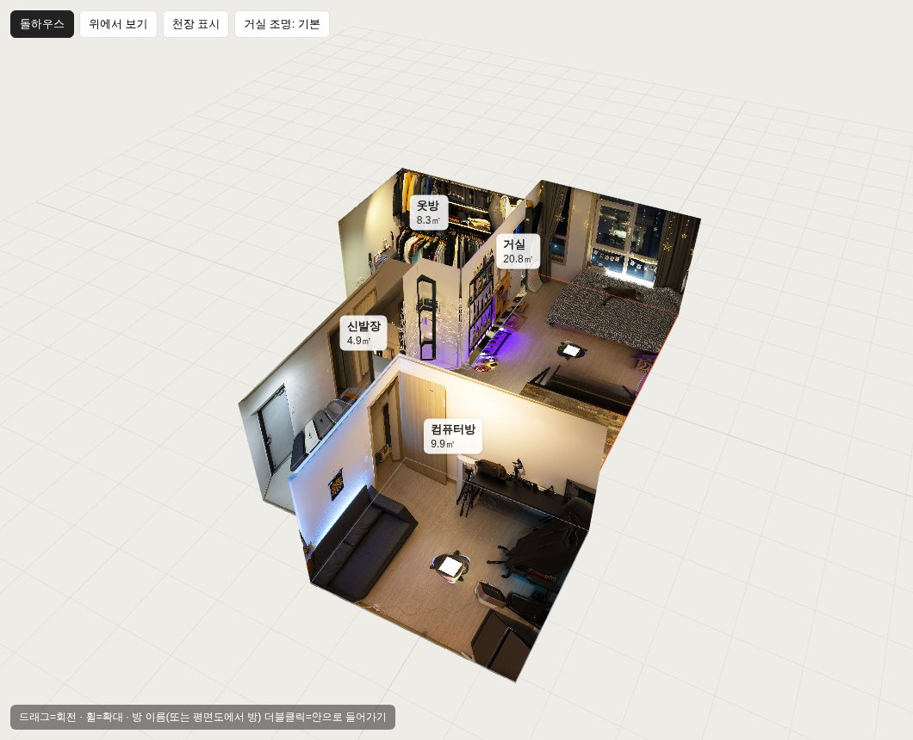
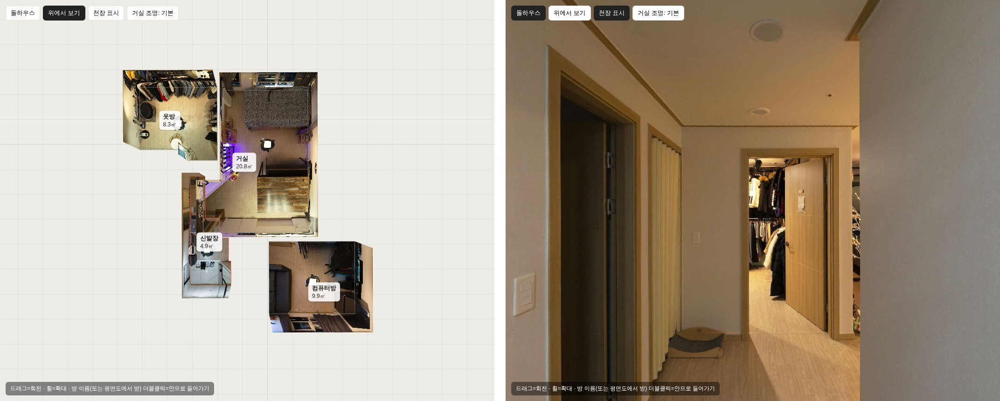

<!-- _class: cover -->
<!-- _paginate: false -->

# 360 사진만으로 돌하우스 · 평면도

## 일반 360 VR 사진 5장으로 벽·바닥·천장을 세우고, 방 배치는 반자동으로

Indyspot AI Corp &nbsp;·&nbsp; Engineering Manager &nbsp;·&nbsp; 2026-11-13

---

<!-- _class: agenda -->

## 한 줄 요약 — 깊이 카메라 없이 Studio 같은 돌하우스가 나옵니다

### 한 것
- 미노네집(투어 2432) 360 사진 5장으로 PoC
- AI 가 방마다 벽·바닥·천장 경계를 추정
- 투어의 이동 핫스팟으로 방을 자동 배치
- 어긋난 방은 평면도에서 끌어서 보정

### 결과
- 천장고 2.29~2.46m · 거실 20.8㎡
- 벽·바닥·천장 연결선이 평면으로 깔끔
- 방 안에서 보면 원본 파노라마와 동일
- 자동 배치 → 오너 보정 1회로 완성

직접 확인
<a class="lnk" href="https://kabkee-decks.netlify.app/reports/2026-11-13-dollhouse-poc/" target="_blank">미노네집 돌하우스 3D 뷰어 (보정 배치 반영)</a>

---

<!-- _class: sec -->

Section 01

## 어떤 방식으로 만들었나

네이버식 «깊이 메시» 대신 «방 구조 추정» 을 썼습니다

---

## 두 가지 방식 — 왜 «방 구조 추정» 을 골랐나

| 구분 | 깊이 추정 메시 (네이버 돌하우스로 추정) | 방 구조 추정 (이번 PoC) |
|---|---|---|
| AI 가 맞히는 것 | 픽셀마다 거리 | 벽-천장 · 벽-바닥 경계선과 모서리 |
| 결과 모양 | 물결치는 벽, 녹아내린 가구 | **처음부터 평평한 벽·바닥·천장** |
| 연결선 | 흐릿함 | 칼같이 떨어짐 (Studio 느낌) |
| 잘 되는 곳 | 어떤 공간이든 «대충» | 벽이 직각으로 만나는 실내 |
| 치수 | 상대값 | 카메라 높이만 알면 **미터 단위** |

참고 네이버 쪽 방식은 결과 화면의 특징을 보고 추정한 것이며, 직접 확인한 것은 아닙니다.

---

## 전체 흐름 — 5단계

| 단계 | 하는 일 | 자동화 |
|---|---|---|
| ① 원본 준비 | krpano 큐브 타일(l2, 면당 2048px)을 S3 에서 받아 360 사진(equirect)으로 변환 | ✅ 자동 |
| ② 방 구조 추정 | HorizonNet(실제 주택 데이터 ZInD 학습)이 경계선·모서리 추정 | ✅ 자동 · 5장 약 2초 (RTX 3060) |
| ③ 치수 계산 | 카메라 높이로 바닥 모서리 거리·천장고를 미터로 환산 | ✅ 자동 |
| ④ 방 배치 | 이동 핫스팟 쌍으로 방의 회전·위치 계산 | 🟡 자동 + 사람 보정 |
| ⑤ 3D 생성 | 벽을 세우고 원본 사진을 각 면에 투영 → 웹 뷰어 | ✅ 자동 |

사람이 하는 일은 **④ 에서 어긋난 방을 끌어서 맞추는 것뿐**입니다.

---

## ① 원본 — 기존 투어 타일에서 360 사진 복원

신발장 씬. 운영 서버 마운트는 훑지 않고, 필요한 타일만 S3 에서 받았습니다(5씬 × 96장, 수 MB).

직접 확인
<a class="lnk" href="https://kabkee-decks.netlify.app/reports/2026-11-13-dollhouse-poc/" target="_blank">돌하우스 뷰어 → 신발장 더블클릭 (이 사진이 그대로 벽에 입혀집니다)</a>

---

## ② 방 구조 추정 — 초록 선이 AI 가 찾은 경계

왼쪽 거실, 오른쪽 신발장. 초록 선 = 벽-천장·벽-바닥 경계, 노란 선 = 방 모서리. 침대·쓰레기통이 벽 아래를 가려도 이어서 추정하며, 학습 없이 공개 가중치만 썼습니다.

직접 확인
<a class="lnk" href="https://kabkee-decks.netlify.app/reports/2026-11-13-dollhouse-poc/" target="_blank">돌하우스 뷰어 → 위에서 보기 (이 경계선으로 만든 방 모양)</a>

---

## ③ 치수 — 카메라 높이 하나로 미터 단위가 됩니다

| 값 | 계산 | 미노네집 결과 |
|---|---|---|
| 바닥 모서리까지 거리 | 카메라 높이 ÷ tan(내려다본 각도) | 방 다각형 (m) |
| 천장고 | 카메라 높이 × (1 + 천장 높이 / 바닥 깊이) | 2.29 ~ 2.46m |
| 면적 | 방 다각형 넓이 | 거실 20.8 · 컴퓨터방 9.9 · 옷방 8.3 · 신발장 4.9㎡ |

카메라 높이는 **1.5m 로 가정**했습니다. 천장고가 아파트 일반 범위(2.3~2.5m)로 나와서 가정이 크게 틀리지 않은 것으로 봅니다. 실제 삼각대 높이를 알면 뷰어의 슬라이더로 바로 맞출 수 있습니다.

---

## ④ 방 자동 배치 — 기존 이동 핫스팟을 그대로 씁니다

| 규칙 | 내용 |
|---|---|
| 회전 | A→B, B→A 핫스팟 방향으로 대략 각도를 구한 뒤, 두 방의 벽 방향이 맞도록 **90° 단위로 스냅** |
| 위치 | «A 의 핫스팟 바닥점 = B 의 되돌아오는 핫스팟 바닥점» (둘 다 같은 문 앞이라고 가정) |
| 같은 자리 | 두 핫스팟이 모두 거의 바로 아래(50° 이상)면 같은 위치의 조명 변형으로 처리 |

거실 «기본 / 무드등» 두 장은 같은 자리 변형으로 자동 인식되어, 뷰어에서 조명 전환 버튼이 됐습니다.

한계 핫스팟이 문 앞이 아니라 방 안쪽 바닥에 찍혀 있으면 그만큼 위치가 어긋납니다.

---

## ④ 반자동 보정 — 오너가 평면도에서 한 번 맞춘 결과

보정 이동량: 거실 0.98m · 신발장 0.68m · 컴퓨터방 2.09m · 옷방 0 (자동 그대로). 두 그림은 축척이 서로 다르고(각각 화면에 맞춤), 숫자는 씬 번호 끝 두 자리입니다.

직접 확인
<a class="lnk" href="https://kabkee-decks.netlify.app/reports/2026-11-13-dollhouse-poc/" target="_blank">평면도 패널 «자동 배치 보기» ↔ «저장된 보정 배치» 전환</a>

---

## ⑤ 3D 생성 — 원본 사진을 벽에 «역투영»

- 각 면의 픽셀마다 «그 방 카메라 → 픽셀» 방향을 계산해 360 사진에서 색을 가져옵니다.
- 그래서 **방 촬영 위치에서 보면 원본 파노라마와 픽셀 단위로 같습니다.**
- 벽은 안쪽 면만 그립니다 → 바깥에서 보면 앞쪽 벽이 자동으로 사라져 돌하우스가 됩니다.
- 별도 3D 모델 파일 없이 웹(three.js)에서 바로 그립니다. krpano depthmap 으로 옮기는 것도 가능합니다.

---

## 결과 화면 — 돌하우스 (보정 배치)

직접 확인
<a class="lnk" href="https://kabkee-decks.netlify.app/reports/2026-11-13-dollhouse-poc/" target="_blank">드래그=회전 · 휠=확대 · 방 이름 더블클릭=안으로</a>

---

## 결과 화면 — 위에서 보기 · 방 안으로 들어가기

왼쪽은 위에서 내려다본 평면(보정 전 자동 배치). 오른쪽은 신발장 안 시점으로, 원본 파노라마와 같은 화면입니다.

직접 확인
<a class="lnk" href="https://kabkee-decks.netlify.app/reports/2026-11-13-dollhouse-poc/" target="_blank">상단 «위에서 보기» · 방 더블클릭</a>

---

<!-- _class: sec -->

Section 02

## 사진 촬영할 때 주의할 점

AI 가 경계선을 잘 찾고, 방이 자동으로 맞게 놓이도록

---

## 촬영 주의점 ① — 축척과 수평

| 항목 | 왜 중요한가 | 어떻게 |
|---|---|---|
| 카메라 높이 일정 + 기록 | 모든 치수의 기준값. 장소 안에서 높이가 바뀌면 방마다 축척이 달라집니다 | 삼각대 높이를 장소마다 메모 (예: 1.50m) |
| 수평(레벨) 맞추기 | AI 가 «수평이 맞은 사진» 을 가정합니다. 기울면 벽이 기울고 경계가 휩니다 | 삼각대 수평계 · 스티칭 시 수평 보정 |
| 바닥 로고 패치 | 바닥 가운데 로고가 그대로 바닥 텍스처가 됩니다 | 패치 없는 원본도 함께 보관 |
| 해상도 | 추정은 1024×512 로 충분, 텍스처는 클수록 선명 | 원본 equirect 4096px 이상 보관 |

---

## 촬영 주의점 ② — 방마다, 경계가 보이게

| 항목 | 왜 중요한가 | 어떻게 |
|---|---|---|
| 방마다 최소 1장 | 사진이 없는 방은 만들 수 없습니다 | 화장실·베란다·드레스룸까지 |
| 방 가운데 근처 | 모든 벽-바닥 경계가 한 장에 보여야 합니다 | ㄱ자 방은 꺾인 모서리가 다 보이는 자리 |
| 경계 가리지 않기 | 큰 가구·커튼이 벽 아래를 덮으면 경계가 흔들립니다 | 커튼 걷기, 의자 등 이동 가능한 것은 치우기 |
| 충분한 밝기 | 너무 어두우면 경계가 약해집니다 | 기본 조명 1장 필수, 무드 조명은 «같은 자리» 추가 |
| 거울·유리벽 | 비친 공간을 실제 공간으로 오인할 수 있습니다 | 가능하면 가리거나 각도 조정 |

---

## 촬영 주의점 ③ — 방 연결을 위한 문 · 핫스팟

| 항목 | 왜 중요한가 | 어떻게 |
|---|---|---|
| 문 열어두기 | 옆 방이 문틈으로 보여야 연결 관계를 알 수 있습니다 | 촬영 전 모든 방문 개방 |
| 연결 촬영 순서 | 방끼리 서로 오가는 핫스팟 쌍이 배치의 근거입니다 | A→B 를 만들면 B→A 도 반드시 |
| 핫스팟은 «문 앞 바닥» 에 | 자동 배치가 «양쪽 핫스팟 = 같은 문» 으로 계산합니다 | 문턱 바로 위 바닥에 찍기 |
| 복도·현관도 1장 | 방들을 이어주는 허브가 됩니다 | 미노네집은 신발장이 허브 역할 |

추정 컴퓨터방이 2.09m 어긋난 것은 핫스팟이 문에서 떨어진 위치에 찍힌 탓으로 보입니다(측정으로 확인하지는 않았습니다).

---

<!-- _class: sec -->

Section 03

## 다른 실내 장소에 적용하려면

무엇이 준비되어야 하나

---

## 준비물 — 장소별 데이터

| 준비물 | 내용 | 기존 투어에서 |
|---|---|---|
| 360 원본 | equirect 원본, 또는 krpano 타일 l2(2048) 이상 | ✅ S3 `files/pano` 에 있음 |
| 씬 간 이동 핫스팟 | 양방향 쌍, 문 앞 바닥 위치가 이상적 | 🟡 있으나 위치는 촬영자마다 다름 |
| 카메라 높이 | 축척 기준 | ❌ 기록 없음 → 1.5m 가정 후 천장고로 검산 |
| 방 이름 | 씬 제목을 그대로 사용 | ✅ 투어 XML 제목 |
| 사람 보정 | 평면도에서 방 끌기 · 회전 | 장소당 1회 |

---

## 어떤 장소에 맞나 — 적합도

| 장소 유형 | 적합도 | 이유 |
|---|---|---|
| 아파트 · 원룸 · 오피스텔 | 높음 | 직각 벽, 방 구분 명확 — 학습 데이터(실제 주택)와 같은 유형 |
| 사무실 · 학원 · 병원 | 높음 | 직각 구조, 복도로 연결 |
| 매장 · 카페 | 보통 | 진열대·통유리가 경계를 가림 |
| 전시장 · 행사장 · 박람회 | 낮음 | 벽이 멀고 부스가 많아 «방» 이 아님 |
| 복층 · 계단 · 야외 | 낮음 | 한 층 · 실내 가정을 벗어남 |

현황 NAS `VR/BACKUP` 에 남은 장소는 대부분 행사장·캠퍼스라 이 기능에 맞는 곳이 적었습니다. 삼가동 아파트 촬영본은 이번에 찾지 못했습니다.

---

## 준비물 — 인프라 · 소프트웨어

| 항목 | 현재 상태 |
|---|---|
| GPU | kabkee-main RTX 3060 (12GB) · 5장 추정 약 2초 |
| 파이썬 환경 | `~/.venvs/layout` (torch 2.6 + CUDA 12.4) |
| 모델 코드 | HorizonNet (MIT 라이선스) |
| 모델 가중치 | ZInD 학습본 — 상업 사용 가능 여부 확인 필요 |
| 파이프라인 | `scripts/dollhouse-poc/` (Look360 저장소) — 씬 매핑이 미노네집용으로 고정 |
| 뷰어 | three.js 단일 HTML + 사진 5장 (총 약 7MB) |

주의 ZInD 데이터셋은 연구용 라이선스로 알고 있어서, 서비스에 넣기 전에 라이선스를 확인하거나 자체 데이터로 다시 학습해야 할 수 있습니다(아직 확인하지 않은 추정입니다).

---

## 남은 과제

| 과제 | 내용 |
|---|---|
| 보정 저장 | 지금은 JSON 을 복사해 전달 → 뷰어에서 바로 서버 저장 (Netlify Blobs 등) |
| 겹침 자동 보정 | 바닥이 겹치지 않게 위치를 자동 미세 조정 · 벽 두께 반영 |
| 문 · 창문 | 문·창문 위치 검출 → 평면도 표시, 연결 근거로도 사용 |
| 평면도 내보내기 | 치수 포함 PNG/PDF |
| 일반화 | 투어 ID 만 넣으면 씬 매핑·실행까지 자동 |
| 비정형 공간 | 곡면 벽·오픈 플랜 — 깊이 추정 방식과 혼합 검토 |

---

## 🎯 안건 — 오너 결정 대기

| # | 결정할 것 | 제안 |
|---|---|---|
| 1 | 다음 시범 장소 | 삼가동 아파트 투어 ID 또는 원본 위치 알려주기 · 직각 구조 실내 2~3곳 |
| 2 | 다음 촬영부터 규칙 적용 | 카메라 높이 기록 · 문 앞 핫스팟 · 문 개방 (Section 02) |
| 3 | 모델 가중치 라이선스 | ZInD 상업 사용 가능 여부 확인 → 불가 시 자체 학습 데이터 검토 |
| 4 | 플랫폼 기능화 여부 | 관리자에서 «돌하우스 생성 + 보정» → l3 플랫폼 VR 뷰어 탑재 (에픽 발주 여부) |

---

## 🔗 링크

뷰어
<a class="lnk" href="https://kabkee-decks.netlify.app/reports/2026-11-13-dollhouse-poc/" target="_blank">미노네집 돌하우스 3D 뷰어 (보정 배치 · 자동 배치 전환 가능)</a>
모델
<a class="lnk" href="https://github.com/sunset1995/HorizonNet" target="_blank">HorizonNet (sunset1995/HorizonNet)</a>

| 파일 (Look360 저장소 `scripts/dollhouse-poc/`) | 역할 |
|---|---|
| `cube2equi.py` | krpano 큐브 타일 → 360 사진 |
| `build_layout.py` | 방 다각형 · 핫스팟 자동 배치 → `scene.json` |
| `viewer/index.html` · `publish_decks.sh` | 3D 뷰어 · 보정 에디터 · 덱 게시 |
| `run_mino.sh` · `README.md` | 전체 실행 · 원리와 한계 |

---

<!-- _class: closing -->
<!-- _paginate: false -->

## 감사합니다

360 사진 5장 → 방 구조 자동 추정 → 반자동 배치 → 돌하우스 · 평면도

Indyspot AI Corp &nbsp;·&nbsp; Engineering Manager &nbsp;·&nbsp; 2026-11-13
