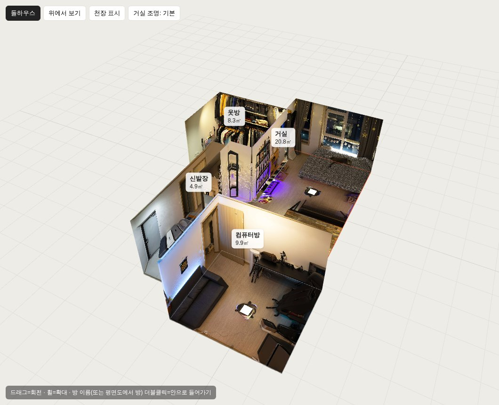
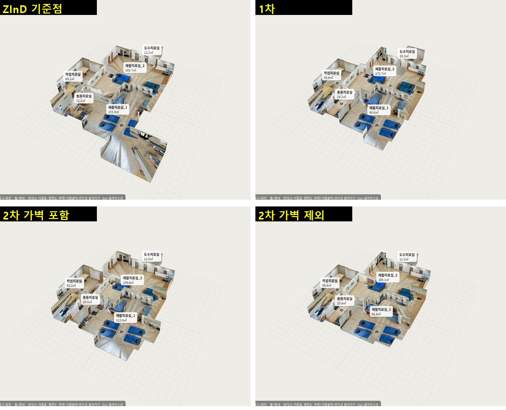

<!-- _class: cover -->
<!-- _paginate: false -->

# 360 사진 한 장으로 방을 세우는 법

## 돌하우스가 만들어지는 원리와 AI 학습 — 처음 보는 분을 위한 설명

Indyspot AI Corp &nbsp;·&nbsp; Engineering Manager &nbsp;·&nbsp; 2026-11-13

---

<!-- _class: agenda -->

## 한 줄 요약 — 사진 속 «벽이 바닥에 닿는 선»만 찾으면 방이 세워집니다

### 원리
- 360 사진은 방 전체를 한 장에 담은 «펼친 지도»
- 바닥 모서리를 내려다본 **각도**와 **카메라 높이**로 거리를 계산
- 모서리를 이으면 방 모양, 벽을 세우고 사진을 입히면 3D

### AI 의 역할
- 사람 대신 «벽-바닥 경계선»을 찾아 줌
- 우리 사진 349장에 사람이 정답을 그려 직접 학습
- 3차 학습(정답 349장)에서 일반 방 정확도 **79%** — 실제 돌하우스 기준으로 외부 모델(74%)보다 크게 앞서고, 경계선 자체는 비슷한 수준(83.2% vs 82.5%)

직접 보기
<a class="lnk" href="https://kabkee-decks.netlify.app/reports/2026-11-13-dollhouse-models/" target="_blank">돌하우스 비교 뷰어 (미노네집 외 5곳)</a>

---

<!-- _class: sec -->

Part 1

## 사진 한 장에서 방 모양을 알아내는 원리

계산은 중학교 삼각형 수준입니다

---

## 360 사진 = 방을 통째로 펼친 지도

지구본을 펼친 세계지도처럼 카메라 주변 360°를 한 장에 담았습니다. **가로 = 방향, 세로 = 위아래 각도**(가운데 줄 = 눈높이). 사진 속 위치가 곧 «카메라에서 본 각도»입니다.

직접 보기
<a class="lnk" href="https://kabkee-decks.netlify.app/reports/2026-11-13-dollhouse-models/" target="_blank">신발장 사진 — 뷰어에서 신발장 더블클릭</a>

---

## 각도 + 카메라 높이 = 거리

<svg viewBox="0 0 420 230" width="420" xmlns="http://www.w3.org/2000/svg" font-family="sans-serif">
  <line x1="20" y1="200" x2="400" y2="200" stroke="#555" stroke-width="3"/>
  <text x="300" y="222" font-size="14" fill="#555">바닥</text>
  <line x1="60" y1="200" x2="60" y2="60" stroke="#888" stroke-width="2" stroke-dasharray="5 4"/>
  <circle cx="60" cy="60" r="10" fill="#e4572e"/>
  <text x="76" y="56" font-size="14" fill="#e4572e">카메라</text>
  <text x="14" y="135" font-size="14" fill="#555">1.5m</text>
  <line x1="60" y1="60" x2="340" y2="200" stroke="#3c8cff" stroke-width="3"/>
  <line x1="340" y1="60" x2="340" y2="200" stroke="#2e9e5b" stroke-width="6"/>
  <text x="350" y="120" font-size="14" fill="#2e9e5b">벽</text>
  <circle cx="340" cy="200" r="7" fill="#2e9e5b"/>
  <text x="222" y="190" font-size="13" fill="#2e9e5b">벽-바닥 모서리</text>
  <line x1="60" y1="60" x2="200" y2="60" stroke="#aaa" stroke-width="1.5"/>
  <text x="120" y="80" font-size="14" fill="#3c8cff">내려다본 각도</text>
  <text x="150" y="218" font-size="14" fill="#555">← 거리 = ? →</text>
</svg>

- 카메라는 **삼각대 위 1.5m** 높이에 있습니다.
- 사진에서 모서리가 «눈높이보다 몇 도 아래»인지 압니다.
- 높이와 각도를 알면 직각삼각형으로 **거리**가 나옵니다.
  거리 = 1.5m ÷ tan(내려다본 각도)
- 모서리 몇 개의 거리·방향을 알면 **방의 평면 모양**이 그려집니다.
- 천장도 같은 원리로 **천장 높이**가 나옵니다.

---

## AI 가 하는 일 — 벽과 바닥·천장이 만나는 선 찾기

초록 선이 AI 가 찾은 경계(위 = 벽-천장, 아래 = 벽-바닥), 노란 세로선이 방 모서리입니다. 침대·쓰레기통이 벽 아래를 가려도 «있을 법한 위치»로 이어서 추정합니다. 이 선만 찾으면 앞 장의 계산으로 방 모양이 나옵니다.

직접 보기
<a class="lnk" href="https://kabkee-decks.netlify.app/reports/2026-11-13-dollhouse-models/" target="_blank">뷰어 «위에서 보기» — 이 선으로 만든 방 모양</a>

---

## 방 하나를 3D 로 — 벽 세우기 + 사진 입히기

| 단계 | 하는 일 | 비유 |
|---|---|---|
| ① 방 모양 | 모서리를 이어 바닥 다각형 | 바닥에 테이프로 방 윤곽 붙이기 |
| ② 벽 세우기 | 다각형 둘레에 천장 높이만큼 벽 | 테이프 선을 따라 종이벽 세우기 |
| ③ 사진 입히기 | 벽 각 점에 «카메라에서 그 방향으로 본 사진 색» | 방 한가운데서 빔프로젝터를 쏘는 것 |
| ④ 돌하우스 | 바깥에서 볼 때 앞쪽 벽만 투명하게 | 인형의 집 앞판 떼기 |

③ 덕분에 **촬영 위치에서 보면 원본 360 사진과 똑같고**, 벽 위치가 조금 틀려도 위에서 보면 자연스럽습니다. «재미·공간감» 용도에는 이 성질이 큰 장점입니다.

---

## 여러 방 잇기 — 기존 투어의 «이동 화살표»를 활용

| 단서 | 쓰는 방법 |
|---|---|
| 이동 핫스팟 (방 A → 방 B 화살표) | 화살표가 찍힌 바닥 위치 = 두 방을 잇는 문 근처 → 방 B 의 대략적 위치 |
| 되돌아오는 화살표 (B → A) | 두 화살표의 방향 차이 → 방 B 가 몇 도 돌아가 있는지 |
| 벽은 대부분 직각 | 회전을 90° 단위로 맞춰 반듯하게 |
| 사람 보정 | 어긋난 방은 평면도에서 끌어서 맞춤 (장소당 1회, 몇 분) |

완전 자동은 아직 어렵고, **«자동 배치 + 사람 한 번 보정» 반자동**이 현실적인 방식입니다.

---

## 결과 — 미노네집 돌하우스

360 사진 5장 + 사람 보정 1회. 방을 더블클릭하면 촬영 위치로 들어가 원본 360 사진과 같은 화면이 됩니다.

직접 보기
<a class="lnk" href="https://kabkee-decks.netlify.app/reports/2026-11-13-dollhouse-models/" target="_blank">드래그 = 회전 · 휠 = 확대 · 더블클릭 = 방 안으로</a>

---

## 플랫폼 krpano 에 얹기 — 돌하우스에서 방으로 날아 들어가기

l3 플랫폼의 VR 엔진(krpano)으로 띄운 같은 결과입니다. 빨간 점을 누르면 카메라가 3D 공간을 날아 원본 360 사진으로 이어지고, 방 사이도 걸어서 이동합니다.

직접 보기
<a class="lnk" href="http://100.64.25.50:5174/dollhouse-sample/index.html" target="_blank">krpano 접목 샘플 (개발 서버 · 내부망 전용)</a>

---

<!-- _class: sec -->

Part 2

## AI 는 어떻게 배우나 — 학습 방식

정답을 보여주고, 틀린 만큼 고치기를 반복합니다

---

## 학습 = 정답지를 보고 문제를 반복해서 푸는 것

| 단계 | 하는 일 | 비유 |
|---|---|---|
| ① 정답 만들기 (라벨링) | 사람이 360 사진에 벽-바닥 모서리를 찍음 | 문제집 정답지 만들기 |
| ② 학습 | AI 가 사진마다 경계선을 예측 → 정답과 차이만큼 스스로 조정 | 문제를 풀고 채점해 오답 고치기 |
| ③ 반복 (에포크) | 학습 사진 전체를 300바퀴 반복, 매번 사진을 돌리고 뒤집어 변형 | 같은 문제집을 순서·숫자를 바꿔 300번 |
| ④ 평가 | 학습에 **한 번도 안 쓴** 사진으로 시험 | 처음 보는 모의고사 |

AI 의 바탕 모델 구조는 공개된 **HorizonNet**(MIT 라이선스, 상업 사용 가능)을 쓰고, 가르치는 «정답지»는 우리가 직접 만듭니다.

---

## ① 정답 만들기 — 라벨링 도구

사진에서 **바닥 모서리만 클릭**하면 천장선은 자동으로 계산되고, 오른쪽에 위에서 본 방 모양이 바로 그려져 틀린 곳이 보입니다. 사진 1장에 1~3분.

직접 보기
<a class="lnk" href="http://100.64.25.50:8791/" target="_blank">라벨링 도구 (내부망)</a>

---

## 라벨링 3원칙과 데이터 모으기

### 3원칙
1. **카메라가 있는 방 하나의 큰 윤곽만** — 문·유리 너머는 무시
2. **작은 꺾임은 펴고 큰 꺾임만** 모서리로 (기둥 50cm 미만은 무시)
3. **같은 기준으로 일관되게** — 픽셀보다 «빠뜨리지 않기»가 중요

### 데이터
- 레거시 Look360 에서 실내 방 후보 사진을 골라 995장 라벨링
- 쓸 수 있는 방 사진 = **349장**
- 나머지 646장은 실외·복도·모서리 안 보임 등으로 제외
- 교실·객실·사무실·치료실 등 «직각 실내»가 학습 재료

---

## ④ 평가 점수 읽는 법 — 3D IoU

<svg viewBox="0 0 300 200" width="300" xmlns="http://www.w3.org/2000/svg" font-family="sans-serif">
  <rect x="30" y="30" width="160" height="120" fill="rgba(46,158,91,.25)" stroke="#2e9e5b" stroke-width="3"/>
  <rect x="70" y="50" width="160" height="120" fill="rgba(228,87,46,.25)" stroke="#e4572e" stroke-width="3"/>
  <text x="34" y="24" font-size="14" fill="#2e9e5b">정답 방</text>
  <text x="170" y="190" font-size="14" fill="#e4572e">AI 가 본 방</text>
  <text x="95" y="110" font-size="14" fill="#333">겹친 부분</text>
</svg>

- **IoU = Intersection over Union** (교집합 ÷ 합집합) — «겹친 부분 ÷ 합친 부분»
- 정답 방과 AI 가 본 방을 3D 로 겹쳐서
- **겹친 부피 ÷ 합친 부피** = 점수
- 100% 면 완벽히 일치, 방 크기·모양이 조금씩 틀릴수록 내려감
- 75% 안팎이면 «모양과 크기를 대체로 맞힘» 수준
- 평가 사진은 학습에 **절대 쓰지 않습니다** (같은 이미지 사본도 자동으로 걸러냄)

---

## 학습 결과 — 데이터가 늘수록 올라갑니다

| 학습 | 정답 사진 | 일반 방 점수 | 전체 점수 | 비고 |
|---|---|---|---|---|
| 1차 | 103장 | 69.3% | 60.6% | 평가 사진 11장 (2차부터와 직접 비교 불가) |
| 2차 | 189장 | 76.2% | 71.9% | 목표 70% 달성 |
| **3차** | **349장** | **79.1%** | **75.7%** | 실제 돌하우스 기준으로 외부 모델보다 5점 이상 앞섬 |
| 비교용 외부 모델 (ZInD) | 20,077장 | 73.8% | 71.3% | 상업 불가 · 후처리 없음 기준 82.5% (3차 83.2% — 비슷) |

«일반 방» = 아파트·사무실 같은 보통 방 14장, «전체» = 가벽·복층까지 포함한 18장입니다. 평가 사진이 적어 2~3점 차이는 우연일 수 있습니다. ⚠️ 정정(11-14): 평가 사진 1장이 학습 사진과 같은 이미지(레거시 중복 사본)로 확인돼 빼고 다시 잰 점수입니다. 2차·3차·ZInD 모두 같은 사진으로 재채점했습니다.

---

## 후처리 — 반듯한 벽으로 정리하는 단계

| | 후처리 없음 (날것) | 후처리 있음 (우리 돌하우스) |
|---|---|---|
| 결과 | 사진 세로줄 1,024개마다 경계 높이 → 점 2,048개의 울퉁불퉁한 윤곽 | 경계선을 **직각으로 만나는 반듯한 벽 몇 개**로 정리 |
| 돌하우스 모양 | 벽이 물결침 | 벽이 평평 — 처음 목표한 «깔끔한» 모양 |
| 점수 | 경계를 그대로 따라가 높게 나옴 | 직각이 아닌 방을 억지로 펴면서 깎임 |
| 의미 | «AI 가 경계를 얼마나 잘 보나» | **«실제로 쓰는 결과물이 얼마나 맞나»** |

그래서 점수를 **두 가지 모두** 기록합니다. 후처리 없음 점수가 오르면 «모델이 좋아진 것», 두 점수 차이가 크면 «후처리를 다듬을 여지가 있는 것»입니다.

---

## 3D IoU 비교 — 우리 공간에서 (평가 18장, 같은 사진)

| 모델 | 학습 사진 | 후처리 있음 · 일반 방 14장 | 후처리 없음 · 일반 방 14장 | 후처리 없음 · 전체 18장 |
|---|---|---|---|---|
| **3차 자체 학습** | 283장 | **79.1%** | **83.2%** | **79.7%** |
| 2차 자체 학습 | 170장 | 76.2% | 78.7% | 73.8% |
| ZInD 공개 모델 (비상업) | 20,077장 | 73.8% | 82.5% | 77.7% |

- 2차에서는 **경계선 자체(후처리 없음)** 를 ZInD 가 3.8점 앞섰습니다.
- 학습 사진을 170장 → 283장으로 늘린 3차는 **실제 돌하우스(후처리 있음)** 기준 ZInD 보다 **5.3점** 높고, **경계선 자체는 0.7점 차이로 사실상 비슷**해졌습니다. ZInD 학습 사진의 70분의 1입니다.
- 3차에서 늘린 평가 사진까지 합친 36장으로 재도 3차 **78.5%**(후처리 있음) · 83.4%(없음), ZInD 72.3% · 78.4% 입니다. 평가 사진이 적어 2~3점 차이는 우연일 수 있습니다.
- ⚠️ 정정(11-14): 처음 발표한 «경계선 자체도 1.9점 앞섬»은 평가 사진 1장이 학습 사진과 같은 이미지여서 부풀려진 값이었습니다. 이제 학습 데이터를 만들 때 같은 이미지를 자동으로 걸러냅니다.

---

## 3D IoU 비교 — 공개 논문·저장소 공식 수치

| 데이터셋 | 학습 사진 | HorizonNet | LGT-Net (2022 최신) |
|---|---|---|---|
| PanoContext (직육면체 방) | 약 800장 (두 데이터셋 합) | 82.63% | 85.16% |
| Stanford 2D-3D (직육면체 방) | 〃 | 82.72% | 85.76% |
| MatterportLayout (실제 집, 일반 모양) | 총 2,295장 | 79.11% | 81.11% |
| ZInD (미국 주택) | 2만~2.5만 장 | 88.59% | 89.95% |
| ZInD · 후처리 있음 | 20,077장 | 67.52% | — |

- 공개 모델은 **수백~수만 장**으로 학습해 자기 데이터에서 **80~90%**. 우리와 가장 비슷한 «실제 집·일반 모양»(MatterportLayout)은 **79~81%**.
- 우리 3차(학습 283장)는 후처리 없음 기준 **83.2%**(2차 78.7%) — 데이터셋이 달라 직접 비교는 조심해야 하지만 같은 수준대.
- 출처: HorizonNet 저장소 README(sunset1995/HorizonNet) · LGT-Net 논문(CVPR 2022, arXiv 2203.01824)

---

## 기술 ① 3D IoU — 점수를 실제로 이렇게 계산합니다

**IoU** = **I**ntersection **o**ver **U**nion (교집합 ÷ 합집합) · «3D» = 면적이 아니라 **부피**로 잰다는 뜻

1. 정답·AI 모서리를 각각 **위에서 본 바닥 다각형**으로 바꿉니다 (카메라 높이는 같은 값으로 가정)
2. 두 다각형의 **겹친 바닥 면적**을 구합니다 — 다각형 계산 라이브러리 Shapely
3. 방 높이 = 바닥선과 천장선 사이 높이. **겹친 부피 = 겹친 면적 × 둘 중 낮은 높이**
4. **3D IoU = 겹친 부피 ÷ (AI 부피 + 정답 부피 − 겹친 부피)** → 평가 사진마다 구해 평균

| 예시 | 바닥 면적 | 높이 | 부피 |
|---|---|---|---|
| 정답 | 20㎡ | 2.5m | 50 |
| AI | 18㎡ (그중 17㎡ 겹침) | 2.4m | 43.2 |
| 겹침 | 17㎡ | 2.4m (낮은 쪽) | 40.8 |

→ 40.8 ÷ (43.2 + 50 − 40.8) = **77.9%** · 모양·크기·높이 중 하나라도 틀리면 내려감 (채점: HorizonNet `eval_general.py`)

---

## 기술 ② 사용한 도구(라이브러리)

| 도구 | 역할 | 비고 |
|---|---|---|
| **HorizonNet** (sunset1995) | 방 구조 AI 모델 + 학습·추론·채점 코드 | MIT 라이선스 · 최신 라이브러리용으로 3곳 수정 |
| **PyTorch 2.6** + CUDA 12.4 | 신경망 계산 (학습·추론) | kabkee-main GPU RTX 3060 12GB |
| **torchvision 0.21** | ResNet-50 구조 + ImageNet 초기 가중치 | 모델의 «눈» 부분 |
| **Shapely 2.2** | 다각형 면적·겹침 계산 | 채점 · 후처리 |
| SciPy · NumPy | 모서리 봉우리 찾기 · 수치 계산 | |
| **three.js 0.170** | 돌하우스 3D 화면 · 사진을 벽에 입히기 | 브라우저 |
| 우리 코드 | 라벨링 도구 · 큐브→360 변환 · 방 배치 · 평면도 에디터 · 작업실 연동 | Python · JS |

---

## 기술 ③ AI 모델 구조 — 사진을 «세로줄 1,024개 문제»로 바꾼다

**360 사진(1024×512)** → **ResNet-50** (사진 특징 추출) → **세로 방향 압축** (세로줄마다 특징 한 줄) → **양방향 LSTM 2층** (왼쪽·오른쪽 세로줄의 맥락을 함께 봄, 360° 끝과 끝이 이어짐) → **세로줄마다 숫자 3개**

- 세로줄마다 맞히는 것: **천장선 높이 · 바닥선 높이 · 이 줄에 모서리가 있을 확률**
- 후처리: 모서리 확률의 봉우리를 찾고, 벽이 직각으로 만나도록 정리 → 모서리 좌표(JSON)
- 우리 코드가 모서리 좌표 → 방 바닥 다각형(미터) → 돌하우스 3D 로 바꿉니다
- 핵심 아이디어: 방 전체를 한 번에 맞히지 않고 **«이 세로줄에서 천장선·바닥선이 어디냐»** 를 1,024번 맞히는 문제로 바꾼 것

---

## 기술 ④ 가중치 — 언제 만들어지고 언제 쓰이나

| 단계 | 하는 일 |
|---|---|
| **가중치란** | 모델 안의 숫자 **약 8,157만 개** (ResNet-50 2,351만 · LSTM 1,260만 · 나머지 압축·출력층). 파일 하나 311MB |
| **학습 전** | ResNet-50 부분만 **ImageNet 사진으로 미리 학습된 초기값**(사물을 보는 일반적인 눈)으로 시작, 나머지는 무작위 |
| **학습 중** | 우리 정답 283장으로 **전체 가중치를 조금씩 조정** · 오차 = 경계선 높이 오차 + 모서리 위치 오차 · 300바퀴(에포크), GPU 약 1시간 50분 |
| **고르기** | 바퀴마다 검증 사진 29장으로 3D IoU 를 재서 **가장 좋았던 순간(252번째)** 을 저장 → `v3_349_best.pth` |
| **사용(추론)** | 파일을 GPU 에 한 번 올려 두고 사진마다 계산 — **사진 1장 46ms**(모델 부분 실측). 사진 받기·변환이 더 오래 걸림 |

- ZInD 가중치는 **비교 채점에만** 씁니다(서비스·라벨 초안 금지).
- ⚠️ 확인 필요: ImageNet 초기값은 업계에서 흔히 쓰지만, 상업 서비스 사용 범위는 법무 확인을 권장합니다.

---

## 실험 — 가벽 방을 학습에 넣을까 뺄까

가벽 치료실 2곳 — 넣고 학습(빨강) vs 빼고 학습(보라). 일반 방 점수는 같고(76.2%), 가벽 방은 **넣은 쪽이 정답(초록)에 더 가까워** 채택했습니다.

직접 보기
<a class="lnk" href="https://kabkee-decks.netlify.app/reports/2026-11-13-dollhouse-places/nulbom-manual/" target="_blank">가벽 공간 5곳 비교 뷰어</a>

---

## 실제 공간 비교 — 재활치료실 (처음 보는 사진)

학습·평가에 한 번도 안 쓴 요양병원 재활치료실 5개 방을 4개 모델로 세운 결과입니다(방 위치는 같고 방 모양만 모델마다 다름). 외부 모델(왼쪽 위)은 «재활치료실_1»을 건물 밖까지 길게 봤고, 우리 모델(1·2차)은 건물 안에 담았습니다.

직접 보기
<a class="lnk" href="https://kabkee-decks.netlify.app/reports/2026-11-13-dollhouse-places/nulbom-rehab/" target="_blank">재활치료실 — 모델 버튼으로 4개 버전 전환</a>

---

<!-- _class: sec -->

Part 3

## 왜 남의 모델을 그대로 못 쓰나

AI 는 «무엇으로 배웠는지»에 따라 쓸 수 있는 범위가 정해집니다

---

## ZInD 란 — 그리고 왜 못 쓰게 됐나

| 질문 | 답 |
|---|---|
| ZInD 는? | 미국 부동산 회사 **Zillow** 가 공개한 실내 360 사진 데이터(약 7만 장, 주택 1,500여 채)와 정답 |
| 처음엔 왜 썼나 | 이 데이터로 학습된 공개 AI 가 있어서, 우리가 학습하기 전 «가능성 확인»에 가장 빨랐음 |
| 왜 못 쓰나 | 약관이 **비상업 전용**. 제품·서비스 개선에 쓰는 것도 금지로 명시. 출처 표기만으로 허용되는 조항 없음 |
| 다른 공개 모델은? | Matterport3D·Structured3D 등으로 배운 모델도 전부 비상업. Matterport 는 «3D 투어와 비슷한 서비스»까지 금지 |
| 그래서 | 모델 구조(코드)는 자유롭게 쓰고, **정답지만 우리가 직접** 만들어 학습 |

현재 ZInD 모델은 **내부 성능 비교 기준점**으로만 씁니다(서비스 반영 금지). 법률 자문이 아니라 공개 약관 기준 판단입니다.

---

## 중국 쪽 모델·데이터는? — 있지만 역시 비상업

| 이름 | 만든 곳 | 규모 | 상업 사용 |
|---|---|---|---|
| Realsee3D | 베이커(Beike) 산하 Realsee — 중국 최대 부동산 VR | 실내 3D 장면 1만 개 (2025-12 공개) | ❌ 학술·비상업. 상업은 별도 계약 협의 |
| Structured3D | 쿠자레(Kujiale) — 인테리어 설계 플랫폼 | 집 3,500채 · 방 2.1만 개 (합성) | ❌ 비상업 연구·교육만 |
| 최신 방 구조 AI 들 | 중국 등 여러 대학 | — | 코드는 대부분 공개, 하지만 위 데이터들로 학습돼 **가중치는 비상업** |

**국적이 아니라 «학습 데이터 약관»이 문제**입니다. 중국 쪽이 데이터 규모는 가장 크지만 공개분은 모두 비상업이고, Realsee 처럼 **상업 계약을 따로 협의**하는 길은 있습니다(조건 미공개).

---

## 정리 — 우리가 가는 길

| 선택지 | 판단 |
|---|---|
| 남의 학습 모델 그대로 사용 | ❌ 상업 불가 (ZInD·Matterport·Structured3D·Realsee 공개분) |
| 데이터 회사와 상업 계약 | 🟡 가능하지만 조건·비용 미정 (Zillow·Realsee 문의 경로 있음) |
| **우리 사진으로 직접 학습** | ✅ 권리 깔끔 · 2차에서 이미 외부 모델 수준 도달 · 우리 공간(한국 실내)에 특화 |

용도는 **재미·공간감 파악용**(치수 정확도는 목표 아님)으로 정했고, 이 수준에서는 **직접 학습 + 반자동 배치**로 충분하다는 것이 지금까지의 결론입니다.

---

<!-- _class: closing -->
<!-- _paginate: false -->

## 감사합니다

사진 속 «벽이 바닥에 닿는 선» → 각도와 높이로 방 모양 → 벽 세우고 사진 입히기 → 돌하우스

Indyspot AI Corp &nbsp;·&nbsp; Engineering Manager &nbsp;·&nbsp; 2026-11-13
