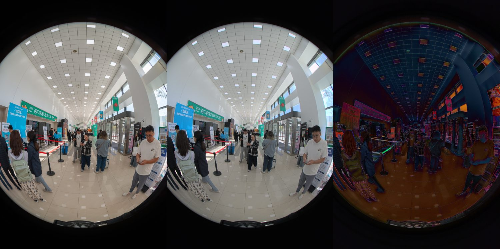
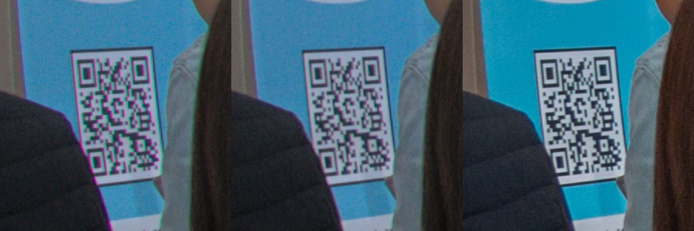
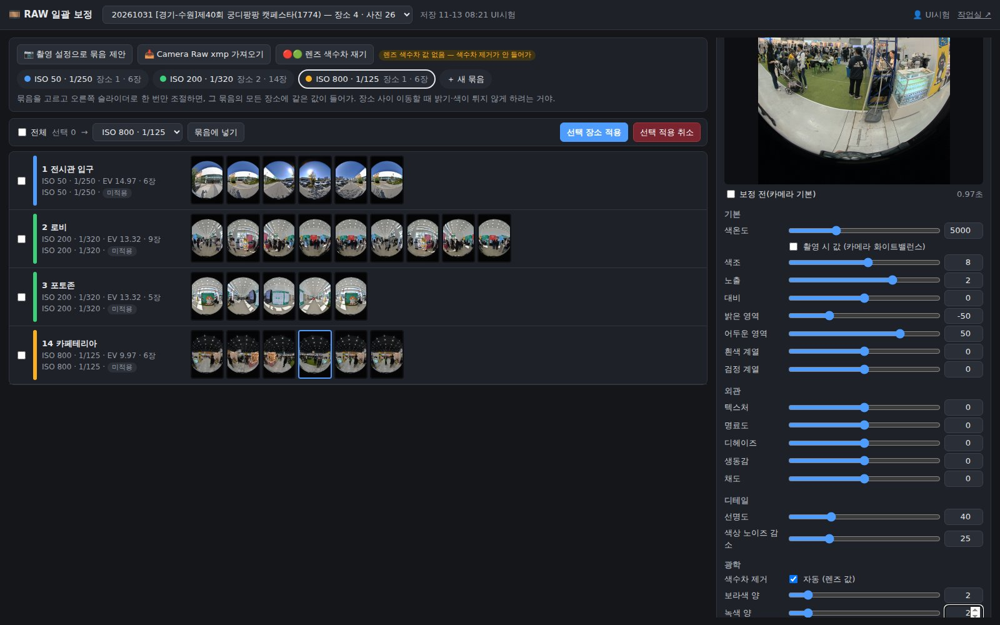
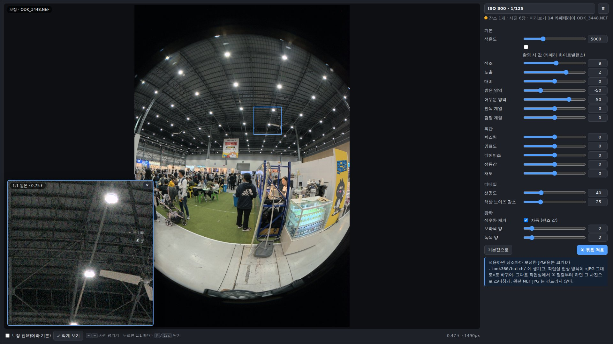

<!-- _class: cover -->
<!-- _paginate: false -->

# 360 작업실 RAW 일괄 보정

## Camera Raw 에서 하던 NEF 보정을 작업실에서 «같은 조명 묶음» 단위로 한 번에

Indyspot AI Corp &nbsp;·&nbsp; Engineering Manager &nbsp;·&nbsp; 2026-11-13

---

<!-- _class: agenda -->

## 한 줄 요약 — 가능성을 실측으로 확인했고, 작업실에 넣어 운영 중입니다

### 배경
- NEF 150장 이상을 Camera Raw 로 보정
- 같은 조명끼리 묶으려고 스크롤로 찾아다님

### 가능성 검증 (11-12)
- 작업자 xmp 130장 = 보정 4묶음, ISO 로 구분됨
- 실내 재현 오차 L 2 안팎

### 구현 (11-13)
- 작업실 🧰 도구 «🎞️ RAW 일괄 보정»
- 나중에 빼기 쉬운 독립 모듈

### 속도
- 적용 26장 약 9분 → 85초
- 첫 화면 102초 → 12.7초 (이후 2초)

### 저장 형식
- WebP 90 = JPG 95 대비 −36~−62%
- 스티칭 품질 차이 없음

### 결정 필요
- 저장 형식 기본값 · 실사용 시작 시점
- 실외 장면 보정 개선 진행 여부

---

<!-- _class: sec -->

Section 01

## 배경과 원본 분석

작업자가 실제로 어떻게 묶어서 보정했는지를 원본 데이터로 확인했습니다

---

## 지금 작업 방식 — Camera Raw 수작업

장소당 5장 × 30곳이면 150장 이상을 한 번에 열어 보정합니다. 장소를 옮길 때 밝기·색이 튀면 바로 이질감이 생기므로 **같은 조명끼리 묶어 같은 값**을 줍니다.

| 단계 | 하는 일 (작업 가이드 기준) |
|---|---|
| 광학 | 색수차 제거, 보라·녹색 프린지 제거(값 3 안팎) |
| 기본 | 화이트밸런스, 밝은 영역·어두운 영역 |
| 외관 | 텍스처 20 · 명료도 10 · 디헤이즈 10 |
| 저장 | JPEG 품질 최대 → PTGui·작업실 스티칭 입력 |

문제 폴더 순서대로 나열되어, 같은 조명 사진을 스크롤로 멀리까지 찾아가 선택해야 합니다.

---

## 원본 분석 — 130장이 정확히 4묶음, ISO 로 갈립니다

제40회 궁디팡팡(1774) NAS 백업의 xmp 130개를 집계했습니다. 원본은 읽기만 하고 필요한 것만 사본으로 썼습니다.

| 묶음 | 장소 | 장수 | 촬영 ISO·셔터 | 작업자 Camera Raw 값 (5000K 공통) |
|---|---|---|---|---|
| A | 1 전시관 입구 (실외) | 6 | ISO 50 · 1/250 | 색조 +5 · 노출 +0.60 · 밝은 −50 · 어두운 +50 |
| B | 2 로비 | 9 | ISO 200 · 1/320 | 색조 +25 · 노출 +1.25 · 밝은 −70 · 어두운 +50 |
| C | 3 포토존 | 5 | ISO 200 · 1/320 | 색조 +22 · 노출 +0.50 · 밝은 −70 · 어두운 +50 |
| D | 4~23 전시장 20곳 | 110 | ISO 800 · 1/100~1/125 | 색조 +8 · 노출 +2.00 · 밝은 −50 · 어두운 +50 |

`4 고공전경`은 40분 늦게 찍어 폴더 순서로는 떨어져 있지만 같은 D 묶음입니다. → **촬영 노출(EV100)로 자동 묶음 제안**이 가능합니다. B·C 는 EXIF 가 같아 사람이 나눠야 합니다.

---

## 재현 정확도 — 실내 L 2 안팎, 실외는 개선 필요

기본 톤 곡선은 «14 카페테리아» 1곳으로만 맞추고, 설정값이 다른 3곳으로 검증했습니다 (Lab 평균 절대 오차, 장소별 전 사진 평균).

| 장소 | 용도 | 재현 L / a / b | 보정 안 함 L | 다른 묶음 값 L |
|---|---|---|---|---|
| 14 카페테리아 | 맞춤 | 1.91 / 3.44 / 3.60 | 19.29 | 11.95 |
| 2 로비 | 검증 | 2.47 / 2.57 / 3.84 | 15.18 | 6.64 |
| 3 포토존 | 검증 | 2.18 / 2.21 / 3.66 | 7.67 | 12.94 |
| 1 전시관 입구 (실외) | 검증 | 6.72 / 3.14 / 3.21 | 3.01 | 16.24 |

«다른 묶음 값» 오차가 6~16 으로 크다는 것은, **묶음을 잘못 고르면 장소 이동 시 이질감이 바로 생긴다**는 뜻입니다. 실외 하늘 장면은 밝은 영역 계수를 실내로만 맞춘 탓으로 추정합니다.

근거
<a class="lnk" href="https://kabkee-decks.netlify.app/reports/2026-11-12-studio-raw-batch-edit.html" target="_blank">가능성 확인 보고서 (11-12, 비교 이미지 포함)</a>

---

## 재현 비교 — 작업자 Camera Raw · 작업실 재현 · 차이(×3)

2 로비(검증 장소). 왼쪽이 작업자 결과, 가운데가 작업실 재현, 오른쪽은 차이를 3배로 키운 것입니다.

직접 확인
<a class="lnk" href="https://studio.look360.kr/rawbatch.html" target="_blank">360 작업실 · RAW 일괄 보정</a>

---

## 색수차 — 렌즈마다 한 번 재서 모든 사진에 적용합니다

가로 색수차는 사진이 아니라 **렌즈의 성질**입니다. 입구·로비를 따로 재도 같은 값이 나왔고, ISO 800 사진은 단독 측정이 실패했습니다.

| 항목 | 실측 |
|---|---|
| 렌즈 값 (D800 + 10.5mm) | R 1.0011 · B 1.0008 (사진 4장 중앙값, 17.5초) |
| 로비 사진 보라 경계 화소 | 62,354 → 29,473 (색수차 보정만) |
| 로비 사진 녹색 경계 화소 | 35,905 → 2,210 |
| 카페테리아 단독 측정 | 실패(배율 1.0) → 렌즈 공통값으로 정상 보정 |

남은 것 보라 번짐은 작업자 결과보다 아직 10배 이상 남습니다. 줌 렌즈(초점거리별 값)는 지원하지 않습니다.

---

## 색수차 확대 비교 — 보정 전 · 색수차+프린지 보정 · 작업자

2 로비 어안 가장자리를 원본 해상도로 확대했습니다. QR 코드 테두리의 보라·녹색 번짐이 보정 후(가운데) 사라져 작업자 결과(오른쪽)와 비슷해졌습니다.

직접 확인
<a class="lnk" href="https://studio.look360.kr/rawbatch.html" target="_blank">렌즈 색수차 재기 · 크게 보기에서 1:1 확대경</a>

---

<!-- _class: sec -->

Section 02

## 작업실 구현

🧰 도구 메뉴 «🎞️ RAW 일괄 보정» — 기존 기능을 건드리지 않는 독립 모듈입니다

---

## 기능 흐름 — 묶음마다 슬라이더 한 번

| 단계 | 내용 |
|---|---|
| ① 불러오기 | 프로젝트의 모든 RAW 장면 NEF 를 썸네일로 한 화면에 (130장 첫 화면 12.7초 · 이후 약 2초) |
| ② 묶음 | 촬영 노출 0.6스톱 안 = 같은 조명으로 **자동 제안** · Camera Raw xmp 가져오기 · 나누기·합치기·전부 풀기 |
| ③ 조절 | Camera Raw 와 같은 이름 18개 슬라이더 · 미리보기 0.2~0.9초 · 크게 보기 + 1:1 확대경 |
| ④ 적용 | 원본 크기 현상 → `.look360/batch/` · 현상 방식 «JPG 그대로» → 작업실 ① 정렬·④ 렌더가 그대로 사용 |
| 취소 | 결과 폴더 삭제 + 적용 전 현상 방식 복원 · 원본 NEF·JPG·xmp 는 읽기만 |

궁디팡팡 시험 프로젝트(130장)에서 자동 제안이 **입구 1 / 로비·포토존 2 / 전시장 20** 으로 묶여 작업자 구조와 같았습니다.

빼기 쉬운 구조 새 파일 4개 + 기존 파일 수정 19줄(`[rawbatch]` 표시). `PANO_RAWBATCH=0` 이면 꺼집니다.

---

## 화면 — 장소별 썸네일 · 묶음 색 · 슬라이더

체크·Shift 범위 선택으로 여러 장소를 한 번에 묶음에 넣고, 묶음을 고르면 오른쪽 슬라이더가 그 묶음의 모든 장소에 적용됩니다.

직접 확인
<a class="lnk" href="https://studio.look360.kr/rawbatch.html" target="_blank">360 작업실 · RAW 일괄 보정 (시험 프로젝트: 제40회 궁디팡팡 RAW일괄보정시험)</a>

---

## 🔍 크게 보기 + 1:1 확대경

F 키로 화면 가득 미리보기(0.4~0.5초) · 사진을 누르면 그 자리를 **원본 1:1** 로(0.75~0.83초) · ←/→ 사진 넘기기 · Esc 닫기.

직접 확인
<a class="lnk" href="https://studio.look360.kr/rawbatch.html" target="_blank">360 작업실 · RAW 일괄 보정 → 미리보기 «🔍 크게 보기»</a>

---

## ⚡ 속도 — 적용 6배 이상 빨라졌습니다

| 항목 | 이전 | 개선 후 | 방법 |
|---|---|---|---|
| 적용 26장 (원본 해상도) | 약 9분 (장당 21초 순차) | 85초 (장당 실질 3.3초) | 사진별 별도 프로세스 3장 동시 |
| 톤 계산 (원본 1장, 작업자 값) | 13.5초 | 1.1초 | 축소본 계산 + 2D 배율 + 행 묶음 스레드 |
| 톤 (텍스처·명료도·디헤이즈 포함) | 25.6초 | 8.5초 | 디헤이즈를 채널별 배율·오프셋으로 |
| 첫 화면 (NAS 130장) | 102초 | 12.7초 → 이후 약 2초 | NEF 앞 512KB 만 읽기 + 로컬 캐시 |
| 슬라이더 20번 연속 | 요청 20번 | 요청 1번 | 한 번에 하나 · 마지막 값만 |

속도 개선 전후 결과 차이는 평균 0.06/255 로 눈으로 구분되지 않습니다. 궁디팡팡 130장 전체 적용은 JPG 기준 약 7분으로 추정합니다.

---

<!-- _class: sec -->

Section 03

## 저장 형식 — 적정 압축률

적용 결과를 JPG·WebP 와 품질별로 실측했습니다

---

## 형식·품질별 실측 — 3장, 원본 해상도

입구(실외) · 로비(밝은 실내) · 카페테리아(ISO 800) 3장의 범위입니다. 화질은 원본 대비 SSIM / 가장 나쁜 조각 SSIM.

| 설정 | 장당 크기 | JPG 95 대비 | SSIM / 최저 조각 | 저장 시간 |
|---|---|---|---|---|
| JPG 95 (기존) | 7.9~15.2MB | 기준 | 0.981~0.989 / 0.971~0.980 | 0.1초 |
| WebP 95 | 5.7~14.4MB | −6~−28% | 0.976~0.986 / 0.967~0.978 | 8~10초 |
| WebP 90 (권장) | 3.0~9.7MB | −36~−62% | 0.966~0.980 / 0.941~0.964 | 2~10초 |
| WebP 85 | 1.8~7.0MB | −54~−78% | 0.949~0.972 / 0.914~0.946 | 2~9초 |

2배 확대 육안 비교에서 WebP 90·95 는 원본과 구분되지 않았고, 85 부터 어두운 곳 노이즈가 뭉개집니다. 화면에서 85 미만은 경고합니다.

---

## WebP 90 vs JPG — 용량 차이

| 사진 | JPG 95 | JPG 90 | WebP 90 | JPG 95 대비 | JPG 90 대비 |
|---|---|---|---|---|---|
| 1 전시관 입구 (ISO 50) | 9.53MB | 6.10MB | 4.39MB | −54% | −28% |
| 2 로비 (ISO 200) | 7.89MB | 4.78MB | 3.01MB | −62% | −37% |
| 14 카페테리아 (ISO 800) | 15.22MB | 9.96MB | 9.68MB | −36% | −3% |
| 3장 합계 | 32.6MB | 20.8MB | 17.1MB | −48% | −18% |
| 궁디팡팡 130장 (추정) | 1.84GB | 1.20GB | 1.13GB | −0.71GB (−38%) | −0.07GB |

절감의 상당 부분은 품질 95 → 90대 효과입니다. **노이즈가 많은 ISO 800 사진은 WebP 이점이 거의 없습니다.** 130장 추정은 장소 성격별로 위 3장과 비슷하다고 가정한 값입니다.

---

## WebP 입력으로도 스티칭 품질은 같습니다

WebP 90 결과를 작업실 입력으로 써서 ① 정렬 → 미리보기 → ④ 최종 렌더(12000px + vr.psd)까지 끝까지 돌렸습니다 (14 카페테리아 6장).

| 입력 | 정렬 잔차 중앙값 | 어긋남 의심 면적 | 적용 (장당) | 정렬 시간 |
|---|---|---|---|---|
| JPG 95 | 8.82′ | 0.51% | 약 10초 | 25초 |
| WebP 90 | 8.76′ | 0.49% | 약 20초 | 56초 |

대가 WebP 는 저장·읽기가 느려 적용과 정렬이 약 2배 걸립니다(130장 적용 약 7분 → 15분 추정). 렌즈 프로필·촬영 시각 EXIF 는 WebP 에도 유지됩니다.

---

## 검증 — 테스트와 실측 중 고친 문제

| 항목 | 결과 |
|---|---|
| 단위 테스트 | 새 테스트 40개 + 기존 작업실 테스트 9종 전부 통과 |
| 끝까지 시험 | 사본 NEF 로 화면 → 적용 → ① 정렬(잔차 8.8′) → 미리보기 → ④ 최종 렌더 → 취소 |
| 고친 문제 ① | 같은 초에 다시 적용하다 멈추면 현재 결과 폴더가 지워짐 → 버전 이름 고유값 |
| 고친 문제 ② | ISO 50(Lo 1) 을 못 읽음(표준 EXIF 에 없음) → LibRaw 값 사용 |
| 고친 문제 ③ | 운영 첫 화면 102초(NEF 전체 읽기) → 앞 512KB 만 |
| 고친 문제 ④ | PoC 1차 색조 부호 반대(로비 색 오차 13.16) → 수정 후 6.4 |

원본(NAS 백업)은 읽기만 했고, 시험 프로젝트는 별도 폴더(`…캣페스타 RAW일괄보정시험`, 9.3GB)로 만들어 기존 `(1774)` 프로젝트는 건드리지 않았습니다.

---

## 🎯 안건 — 오너 결정 대기

| # | 결정할 것 | 제안 |
|---|---|---|
| 1 | 저장 형식 기본값 | WebP 90 (−38% 추정). 속도가 중요하면 JPG 90 (용량 차이 6%, 저장 0.1초) |
| 2 | 실사용 시작 | 다음 촬영 프로젝트 1건을 Camera Raw 대신 작업실로 시범 보정 |
| 3 | 실외 장면 개선 | 실외 장면을 맞춤 기준에 추가 (입구 L 6.72 → 목표 3 이하) |
| 4 | 남은 품질 과제 | 보라 번짐 잔여 · Adobe 색감 b 축 −2~−4 편차 · 줌 렌즈 색수차 |
| 5 | 시험 프로젝트 폴더 | 9.3GB — 시범 기간 유지 후 삭제 |

---

## 🔗 링크

작업실
<a class="lnk" href="https://studio.look360.kr/rawbatch.html" target="_blank">360 작업실 · 🎞️ RAW 일괄 보정</a>
근거
<a class="lnk" href="https://kabkee-decks.netlify.app/reports/2026-11-12-studio-raw-batch-edit.html" target="_blank">가능성 확인 보고서 (11-12)</a>
코드
<a class="lnk" href="https://github.com/kabkee/pano-stitcher" target="_blank">pano-stitcher master — 0217cca · 672ef34 · c0649a2 · dc71454 · 3b129a8</a>

| 파일 | 역할 |
|---|---|
| `mosaic/rawbatch.py` · `static/rawbatch.html` | 서버 API · 화면 |
| `stitcher/crs_develop.py` | Camera Raw 식 현상 엔진 · 적용용 CLI |
| `mosaic/test_rawbatch.py` | 테스트 40개 · README §35 에 사용법·빼는 법 |

---

<!-- _class: closing -->
<!-- _paginate: false -->

## 감사합니다

Camera Raw 수작업을 «묶음 자동 제안 + 슬라이더 한 번 + 85초 적용» 으로 바꿨습니다.

Indyspot AI Corp &nbsp;·&nbsp; Engineering Manager &nbsp;·&nbsp; 2026-11-13
