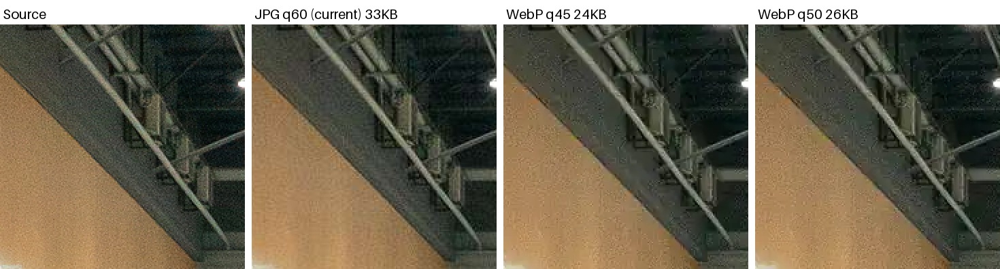
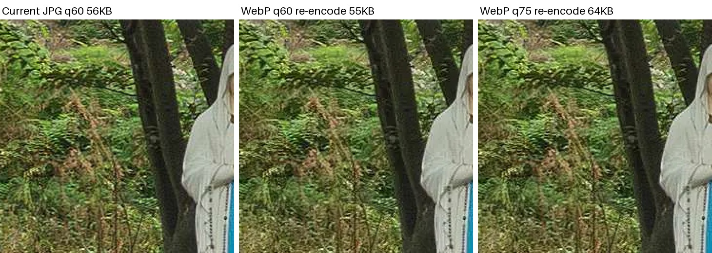

<!-- _class: cover -->
<!-- _paginate: false -->

# files/pano WebP 전환 검토

## krpano 호환 · 기존 데이터 전수 변환 · 신규 타일 생성 · 코드 전환 계획

Indyspot AI Corp &nbsp;·&nbsp; Engineering Manager &nbsp;·&nbsp; 2026-11-13

---

<!-- _class: agenda -->

## 결론 — 신규는 WebP로 전환하고, 기존 전수 변환은 지금 하지 않는 것을 권합니다

### ① krpano 호환
- 뷰어 가능 · 브라우저가 디코딩 (client·레거시 1.23.3, admin 1.22.4)
- 타일 도구 불가 · krpanotools 는 JPEG·TIFF 만 출력 → 변환 단계 추가

### ② 신규 타일 WebP
- 권장 · 현재 JPG q60 과 같은 화질 = WebP q45 (−31%)
- 여유를 두면 WebP q50 (−25%, 화질 약간 ↑)
- 단, krpanotools 는 JPG q100 · 4:4:4 로 출력한 뒤 변환

### ③ 기존 데이터 전수 변환
- 보류 권장 · 대상 JPG 352GB · 1,322만 개
- 이미 JPG q60 이라 재인코딩하면 화질이 한 번 더 떨어짐
- 타일 −26%(q60) 줄여도 월 저장비 절감은 약 $2 수준 (추정)

### ④ 전제 조건
- JPG·WebP 가 장면마다 섞이므로 파노마다 확장자 값을 두고 읽어야 함
- og:image·메일 이미지는 JPG 유지

---

## 🎯 결정 필요 — 오너 확인 사항

| # | 결정할 것 | 제안 |
|---|---|---|
| 1 | 신규 타일 품질 | WebP q50 (−25%, 화질 약간 ↑) · 용량 우선이면 q45 (−31%, 지금과 같은 화질) |
| 2 | 기존 1,322만 개 전수 변환 | 보류 · 대신 조회 상위 장면만 원본에서 다시 생성 (선택) |
| 3 | 모바일·VR 큐브 (`512_` · `1024_`) | WebP 로 통일 · JPG 대체본을 따로 두지 않음 |
| 4 | 지원 하한 | iOS 14 · macOS 11 Safari 미만 제외 · 실제 사용자 약 0.002% (GA4 90일 실측) |
| 5 | 진행 방식 | 에픽 발주 또는 직접 구현 (오빠 지시 필요) |

전환 작업 순서는 «읽는 쪽 먼저(확장자 값 지원) → 만드는 쪽(utils) → 신규 1~2건 시범» 입니다. 읽는 쪽을 먼저 배포하면 모든 값이 `jpg` 인 상태라 서비스 동작은 바뀌지 않습니다.

---

## 대상 규모 — files/pano 실측 447.7GB, 그중 JPG 352GB

백업 목록표(2026-11-12 기준, 현재 버전만 집계)로 셌습니다. 서버 마운트는 순회하지 않았습니다.

| 구분 | 개수 | 용량 | 전환 대상 |
|---|---|---|---|
| 큐브 타일 `mres_*/l*/…jpg` | 1,222만 | 275.0GB | ✅ 핵심 |
| 장면 단위 JPG (`imglink_*` · `1024_*` · `view_*` · `pv` 등) | 88.8만 | 74.7GB | 일부 (og·메일용은 유지) |
| 기타 JPG (flat 타일 등) | 약 11만 | 2.5GB | ✅ |
| 애니메이션 GIF (`imglink_*.gif`) | 37.9만 | 76.0GB | 별도 검토 |
| zip · 영상 · 음원 · XML 등 | — | 19.5GB | ❌ |

확인 필요 오빠가 말한 700GB 와 차이가 큽니다. 목록표는 현재 버전만 세므로, 버킷의 이전 버전(버전 관리)이나 다른 경로가 포함된 값일 수 있습니다(추정).

---

## 같은 화질 기준 — 지금 JPG q60 에 만족한다면 WebP q45 면 됩니다

궁디팡팡 보정 원본 6장(12000×6000)을 8192 폭으로 줄여 512 타일 384장을 비교했습니다. JPG 는 지금 krpanotools 설정(q60 · 4:2:0 · optimize)과 같고, WebP 는 JPG q100 · 4:4:4 중간 출력에서 변환했습니다.

| 형식 | 타일 평균 | 현재 대비 | SSIM | JPG 보다 나은 타일 |
|---|---|---|---|---|
| JPG q60 (현재) | 30.8KB | 기준 | 0.8515 | — |
| WebP q40 | 19.0KB | −38.2% | 0.8403 | 22% |
| ⭐ WebP q45 | 21.2KB | −31.4% | 0.8517 (같음) | 45% |
| ⭐ WebP q50 | 23.2KB | −24.8% | 0.8621 | 59% |
| WebP q55 | 25.3KB | −17.9% | 0.8721 | 71% |
| WebP q60 | 27.6KB | −10.5% | 0.8819 | 80% |
| WebP q70 | 32.5KB | +5.5% | 0.9003 | 90% |

평균 SSIM 이 같아지는 지점은 q45 이고, 이때 타일 절반 정도는 JPG 보다 조금 나쁩니다. 그래서 여유를 둔 q50 을 기본값으로 제안합니다. SSIM 읽는 법은 뒤쪽 «SSIM 이란» 슬라이드에 있습니다.

---

## 화질 비교 — 원본 · JPG q60 · WebP q45 · WebP q50 (2배 확대)

전시장 천장 타일입니다. JPG q60(33KB)은 벽면에 블록 무늬가 생기고, WebP 는 블록 대신 질감이 조금 부드러워지는 방식으로 손실이 생깁니다. q45 는 24KB, q50 은 26KB 입니다.

직접 확인
<a class="lnk" href="https://kabkee-decks.netlify.app/reports/assets/2026-11-13-webp-transition/cmp_new.jpg" target="_blank">원본 크기 비교 이미지 (cmp_new.jpg)</a>

---

## 용량 차이 — 장면 1개 8.7MB → 6.5MB, 같은 규모면 약 70~86GB 절감

장면 1개 평균은 목록표 기준 타일 384장 · 8.65MB 입니다 (275.0GB ÷ 31,790 장면). 여기에 위 실측 비율을 곱했습니다.

| 기준 | JPG q60 (현재) | WebP q50 (제안) | WebP q45 (같은 화질) |
|---|---|---|---|
| 타일 1장 평균 | 30.8KB | 23.2KB | 21.2KB |
| 장면 1개 타일 전체 | 8.65MB | 6.5MB (−2.1MB) | 5.9MB (−2.7MB) |
| 관람자가 장면 1개를 다 받을 때 전송량 | 기준 | −25% | −31% |
| 지금 타일 275GB 를 같은 방식으로 만들었다면 | 275GB | 약 207GB (−68GB) | 약 189GB (−86GB) |

마지막 줄은 «원본에서 처음부터 WebP 로 만들었다면»이라는 가정입니다. 기존 JPG 를 다시 저장하는 경우가 아닙니다. 기존 타일을 다시 저장하면 화질이 한 번 더 떨어지는데, 이 내용은 다음 장에 있습니다. 실제 관람 시에는 보이는 타일만 받으므로, 전송량 절감은 비율(−25~−31%)로 보는 것이 정확합니다.

---

## 중간 출력 품질 — krpanotools 를 q100 · 4:4:4 로 바꿔야 효과가 납니다

krpanotools 는 WebP 를 못 만들어서 «JPG 출력 → WebP 변환» 두 단계가 됩니다. 같은 타일 135장을 중간 형식만 바꿔 최종 WebP q55 로 만들었습니다.

| 중간 출력 | 중간 파일 | 최종 WebP | SSIM |
|---|---|---|---|
| 무손실 (TIFF) | — | 24.2KB | 0.8962 (기준) |
| ⭐ JPG q100 · 4:4:4 | 400KB | 24.3KB | 0.8967 |
| JPG q95 · 4:4:4 | 146KB | 24.9KB | 0.8968 |
| JPG q90 · 4:2:0 | 80KB | 25.3KB | 0.8926 |
| JPG q60 · 4:2:0 (지금 설정 그대로) | 32KB | 22.1KB | 0.8517 |

주의 설정을 q60 그대로 두고 변환하면 지금 JPG 보다도 화질이 나빠집니다. q95 이상이면 무손실과 차이가 없고, q100 은 중간 파일이 크지만 변환 후 지우는 임시 파일입니다.

---

## 기존 데이터 재인코딩 — 줄일수록 화질이 한 번 더 떨어집니다

운영 버킷에서 무작위 타일 500장(장소 120곳)을 받아 WebP 로 다시 저장했습니다. 기존 타일은 전부 JPG q60 · 4:2:0 입니다(300장 확인). SSIM 은 «현재 타일» 대비 값입니다.

| WebP 품질 | 용량 변화 | SSIM 평균 | 하위 5% |
|---|---|---|---|
| q60 | −25.9% | 0.950 | 0.895 |
| q70 | −16.4% | 0.959 | 0.912 |
| q75 | −11.2% | 0.963 | 0.921 |
| q80 | +6.2% | 0.973 | 0.945 |

이미 압축으로 사라진 정보는 되돌릴 수 없어서, WebP 로 바꾸면 «JPG 손실 + WebP 손실»이 겹칩니다. 화질을 지키려고 품질을 올리면(q80) 오히려 커집니다.

---

## 기존 데이터 비교 — 질감이 많은 타일은 거의 줄지 않습니다

숲 장면 타일(56KB)입니다. WebP q60 은 55KB 로 1KB 만 줄었고 잎 질감이 뭉개졌습니다. q75 는 64KB 로 오히려 커졌습니다. 평균 −26% 는 하늘·벽처럼 단순한 타일에서 나온 값입니다.

직접 확인
<a class="lnk" href="https://kabkee-decks.netlify.app/reports/assets/2026-11-13-webp-transition/cmp_existing.jpg" target="_blank">원본 크기 비교 이미지 (cmp_existing.jpg)</a>

---

## 전수 변환 비용 대비 효과 — 지금은 남는 것이 적습니다

| 항목 | 값 | 근거 |
|---|---|---|
| 타일 절감 (q60) | 275GB → 약 204GB (−71GB) | 실측 비율 × 목록표 용량 |
| 월 저장비 절감 | 약 $1.8 | S3 Standard 서울 $0.025/GB 가정 (추정) |
| 업로드 요청 비용 | 약 $55 (1회) | PUT 1,222만 건 × $0.0045/1천 (추정) |
| 인코딩 시간 | 약 44 CPU시간 (20코어 약 2.5시간) | 실측 13ms/타일, 업로드 시간 별도 |
| 이전 버전 | 버전 관리가 켜져 있으면 지운 JPG 가 남아 오히려 늘어남 | 목록표에 version_id 존재 (설정 조회 권한 없음) |

효과는 저장비보다 관람자 전송량 −26% 쪽이 큽니다. 다만 그 효과는 조회가 많은 장면에서만 의미가 있으므로, 필요하면 **조회 상위 장면만 원본에서 다시 생성**하는 쪽이 화질·비용 모두 낫습니다.

---

<!-- _class: sec -->

Section 02

## 코드 전환 계획

utils · BE · client · admin · 레거시에서 확장자를 고정한 지점과 단계별 순서

---

## 전환 단계 — 읽는 쪽부터, 서비스 동작은 마지막에 바뀝니다

| 단계 | 할 일 | 서비스 영향 |
|---|---|---|
| 0 준비 | `tile_info` 에 확장자 값(예: `tile_ext`, 기본 `jpg`) 추가 | 없음 |
| 1 읽는 쪽 | BE XML 빌더 · 레거시 PHP XML 생성기 · client · admin 이 이 값을 읽도록 변경 | 없음 (전부 jpg) |
| 2 만드는 쪽 | utils: krpanotools 를 JPG q100 · 4:4:4 로 출력 → `cwebp`/libvips 로 WebP q50 변환 · `tile_ext=webp` 기록 · S3 ContentType 지정 | 신규만 |
| 3 시범 | 신규 1~2건을 WebP 로 올려 기기별 확인 (iOS Safari · 안드로이드 · 카톡 인앱 · VR 모드) | 시범 장면만 |
| 4 선택 | 조회 상위 장면을 원본에서 다시 생성 | 해당 장면만 |

🔑 JPG 와 WebP 는 장면마다 섞여서 오래 공존합니다. 그래서 `.jpg` 를 `.webp` 로 일괄 치환하면 안 되고, 파노마다 저장된 확장자 값으로 URL 을 만들어야 합니다.

---

## utils — 타일 생성 도구가 WebP 를 만들지 못합니다

`look360_utils_v3` 에 번들된 krpanotools 는 **1.20.9 (2020-11-19)** 입니다. krpano 1.23.3 문서에서도 출력 형식은 JPEG·TIFF 뿐입니다.

| 출력물 | 현재 | 바꿀 것 |
|---|---|---|
| 큐브 타일 · `pv` · `1024_` · `512_` | `multires_*.config` 25개, `jpegquality=60` | `jpegquality=100 jpegsubsamp=444` → WebP q50 변환 · 파일명 `.webp` |
| `sphere_*` · `view_800` 등 미리보기 | `kmakepreview` q80 | 카드용은 WebP, **og 용 JPG 1장은 유지** |
| flat 타일 · 미리보기 | `flatTiles.mjs`, magick q85 | 같은 방식 |
| `imglink_*_src2.jpg` | 레거시 og:image 원본 | JPG 유지 |
| `imglink_*.gif` | 애니메이션 GIF 76GB | 이번 범위 밖 (별도 검토) |

수정 지점: 약 22건 + 설정 파일 25개. 업로드는 utils 가 아니라 BE `uploadPanoramaZip` 이 합니다.

---

## BE — XML 빌더 8건 · 썸네일 상수 · S3 Content-Type

| 위치 | 현재 | 바꿀 것 |
|---|---|---|
| `utils/krpano-xml-builder.ts:1463` · `:1488` · `:1494~1505` | `pv.jpg` · `mres_%s/…%h.jpg` · `512_`/`1024_` | 파노의 확장자 값으로 조립 |
| `krpano-xml-builder.ts:1306~1308` · `:563` | flat · cylinder 타일 `.jpg` 고정, `tilepath` 무시 | `tile_info.tilepath` 우선 사용 |
| `utils/panostory-xml-builder.ts:541~566` | 같은 패턴 5건 | 같음 |
| `utils/pano-thumb.util.ts:22` | `NEW_PANO_VIEW_FILE = 'view_800.jpg'` (= og:image) | 카드용과 og 용 파일명 분리 |
| `file-uploads/file-upload.service.ts:200` | `PutObjectCommand` 에 ContentType 없음 | 확장자별 `image/webp` 지정 |
| 레거시 폴백 리터럴 33곳 | `view_250.jpg` · `view_500.jpg` | 기존 데이터를 바꿀 때만 |

하드코딩이 아닌 곳: `preview_file` · `cube_levels[].url` · `single_image_url` 은 DB 값을 그대로 씁니다. `legacy-files.util.ts` 는 이미 webp 를 허용합니다.

---

## client · admin — 수정은 적고, krpano 버전은 둘 다 WebP 가능

| 저장소 | 위치 | 현재 | 바꿀 것 |
|---|---|---|---|
| client | `VrShareModal.vue:553` · `:834` | 공유 미니뷰 `512_%s.jpg` 고정 | 본 뷰어의 `image.cube.url` 사용 |
| client | `VrDetailPanoList.vue:125` | `view_250.jpg` → `view_500.jpg` 치환 | 확장자 무관하게 치환 |
| admin | `src/utils/sphereUrl.js:28` · `:33` | `sphere_1200.jpg` · `sphere_2000.jpg` 기본값 | 확장자 값 반영 |
| admin | `View360/…/List.vue:342` · `Panorama/…/List.vue:409` | `retouched_2000.jpg` | 같음 |

krpano 뷰어: client `1.23.3` · admin `1.22.4` · 레거시 `1.23.3`. 셋 다 이미지를 브라우저가 디코딩하므로 WebP 를 지원하는 브라우저면 그대로 열립니다. og:image 는 client 가 아니라 BE 가 만듭니다.

---

## 레거시(look360.kr) — 같은 files/pano 를 쓰므로 함께 바꿔야 합니다

| 위치 | 건수 | 바꿀 것 |
|---|---|---|
| `a.createCyberTourXML.php` 등 XML 생성기 (`pv` · `mres` · `512_` · `1024_`) | 약 52건 | 확장자 값으로 조립 |
| `a.createCyberTourXML.php:520` → `a.getImg.php` | 1건 | `ext=jpg` 고정 · mime 을 확장자로 판정 |
| `look360_seo.php` og:image (`imglink_view_900_src2.jpg`) | 11건 | JPG 유지 |
| `email_form_factory.php` 메일 이미지 | 8건 | JPG 유지 (메일 앱 WebP 미지원) |
| 썸네일 표시 (`view_500` · `view_250` · `imglink_*`) | 약 50건 | 기존 데이터를 바꿀 때만 |

이미 저장된 장면 XML 은 약 1.2만 개(0.3GB)입니다. 기존 장면은 이 XML 이 `.jpg` 를 가리키므로, 신규만 WebP 로 바꾸면 기존 XML 은 고칠 필요가 없습니다. `.htaccess` 핫링크 규칙은 이미 webp 를 허용합니다.

---

## 위험 요소와 대응

| 위험 | 대응 |
|---|---|
| 카카오·페이스북 공유 이미지가 WebP 가 됨 | og 용 JPG 파일을 따로 유지 (BE 상수 분리 · 레거시 `src2.jpg` 유지) |
| 구형 iOS(14 미만) · 옛 Mac Safari 에서 화면이 안 뜸 | 실제 사용자 약 0.002% (GA4 실측) → 대체본 없이 진행. 필요하면 «최신 브라우저 안내» 문구만 추가 |
| S3 Content-Type 누락 | 업로드 시 `image/webp` 지정 (`nosniff`·크롤러 대비) |
| DB 의 `tile_info`·`thumb_filename` 에 `.jpg` 값 저장 | 신규만 새 값으로 기록, 기존 값은 건드리지 않음 |
| 재인코딩 화질 저하 | 기존 데이터는 원본(retouched)이 있는 장면만 다시 생성 |
| 전환 중 일부만 올라간 장면 | 장면 단위로 «전부 올린 뒤 확장자 값 변경» 순서 고정 |

---

## 지원 하한 — WebP 를 못 여는 실제 사용자는 약 0.002% 입니다

| 환경 | WebP 지원 시작 | 못 여는 기기 · 마지막 업데이트 |
|---|---|---|
| iPhone · iPad | iOS 14 (2020-09) | iPhone 6·5s 이하(2014년 이전 모델) · iOS 12.5.7 이 마지막(2023-01) |
| Mac Safari | Safari 14 + macOS 11 (2020-11) | macOS 10.15 이하 + Safari · 마지막 보안 업데이트 2022-07 |
| 안드로이드 · Chrome · Firefox | 2011~2019 | 사실상 없음 (옛 Mac 도 Chrome 이면 열림) |

| GA4 look360.kr 90일 (183,580 페이지뷰) | 페이지뷰 | 판단 |
|---|---|---|
| iOS 14 미만으로 집계 | 730 (0.40%) | 대부분 아래 두 경우 |
| └ iOS 13.2.3 · Safari 13.0.3 | 612 | 봇 추정 · 606명 = 606세션 · 1인 0.6초 |
| └ Whale 브라우저 | 41 | 앱 버전(3.9·4.0)이 OS 버전으로 잘못 집계됨 |
| Mac Safari 13 이하 | 1 | macOS 10.13 |
| 실제로 못 여는 사용자 | 약 3~4 | 약 0.002% |

Mac 은 Safari 가 OS 를 늘 «10.15» 로 보고해서 Safari 버전으로 판정했습니다.

---

## SSIM 이란 — 원본과 «사람 눈에» 얼마나 비슷한지를 0~1 로 나타낸 값

SSIM(Structural Similarity, 구조적 유사도)은 1 이면 원본과 같고, 낮을수록 많이 망가진 것입니다. 픽셀을 하나씩 빼는 대신 작은 창(약 11픽셀)으로 훑으며 세 가지를 비교하고, 창마다 나온 점수를 평균합니다.

| 비교 항목 | 의미 | 망가지는 예 |
|---|---|---|
| 밝기 | 그 영역의 평균 밝기가 같은가 | 전체가 어두워짐 |
| 대비 | 밝고 어두운 차이의 폭이 같은가 | 질감이 뭉개져 밋밋해짐 |
| 구조 | 무늬·경계의 모양이 같은가 | 블록 무늬, 선이 흐려짐 |

- 이 덱의 값은 모두 **보정 원본(retouched.jpg) 대비**입니다. WebP q45 = 0.8517 은 «원본에서 벗어난 정도가 지금 JPG q60(0.8515)과 같다»는 뜻입니다.
- 0.85 는 512 타일의 미세 질감까지 따진 값이라 낮아 보일 뿐입니다. **절대값이 아니라 같은 원본끼리 비교**하는 용도입니다.
- 밝기 채널만 계산했으므로 색 번짐은 거의 반영되지 않습니다.

한계 SSIM 이 같아도 손실 모양은 다릅니다. JPG 는 8×8 블록 무늬, WebP 는 질감이 부드럽게 뭉개집니다. 그래서 q45 를 «같은 화질»로 보되 기본값은 q50 으로 제안하고, 결정 전에는 신규 장면 1개를 뷰어에서 직접 비교하는 것을 권합니다.

---

## 측정 방법과 근거

| 항목 | 방법 |
|---|---|
| 용량 | `look360-v1-files` 백업 목록표 `state/pano__*.csv.gz` 1,764개 집계 (2026-11-12) |
| 기존 타일 표본 | 목록표에서 무작위 장소 120곳 · 타일 500장 · 장면 파일 200개를 S3 에서 받음 (약 42MB) |
| 기존 품질값 | ImageMagick `identify %Q` → 타일 300장 전부 q60 · 4:2:0 |
| 신규 비교 | 궁디팡팡 `retouched.jpg` 6장 사본 → 512 타일 384장 · JPG q60 4:2:0 optimize vs JPG q100 4:4:4 → WebP (libwebp 1.6.0, method 6) · 중간 출력 비교는 3장 · 135장 |
| 화질 지표 | 밝기 채널 SSIM (가우시안 11×11, σ 1.5) · PSNR |
| krpano | krpano 1.23.3 문서 (`image` url · krpanotools 지원 형식) · 저장소별 `vr.js` 헤더 |
| 코드 | 5개 저장소 읽기 전용 조사 (수정 없음) |

추정 값 저장·요청 단가는 AWS 서울 공시가 기준이며 실제 청구액과 다를 수 있습니다. 신규 비교는 실제 큐브 면이 아니라 정방형 사진의 가운데 띠를 잘라 쓴 근사입니다.

---

<!-- _class: closing -->
<!-- _paginate: false -->

## 감사합니다

신규는 krpanotools q100 출력 → WebP q50 으로 −25%, 기존 352GB 는 화질·비용을 따져 보류를 권합니다.

Indyspot AI Corp &nbsp;·&nbsp; Engineering Manager &nbsp;·&nbsp; 2026-11-13
