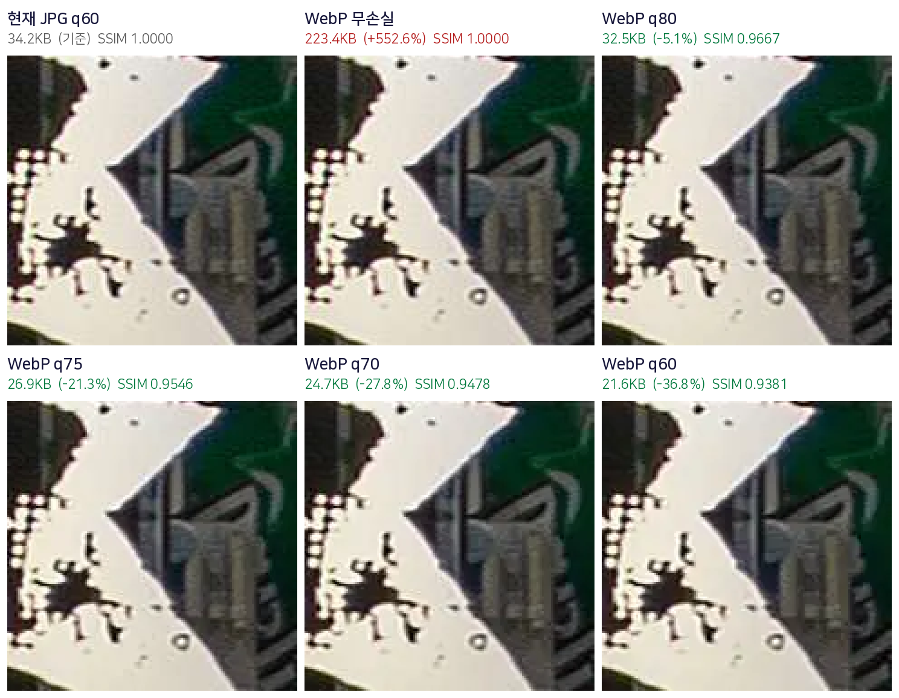
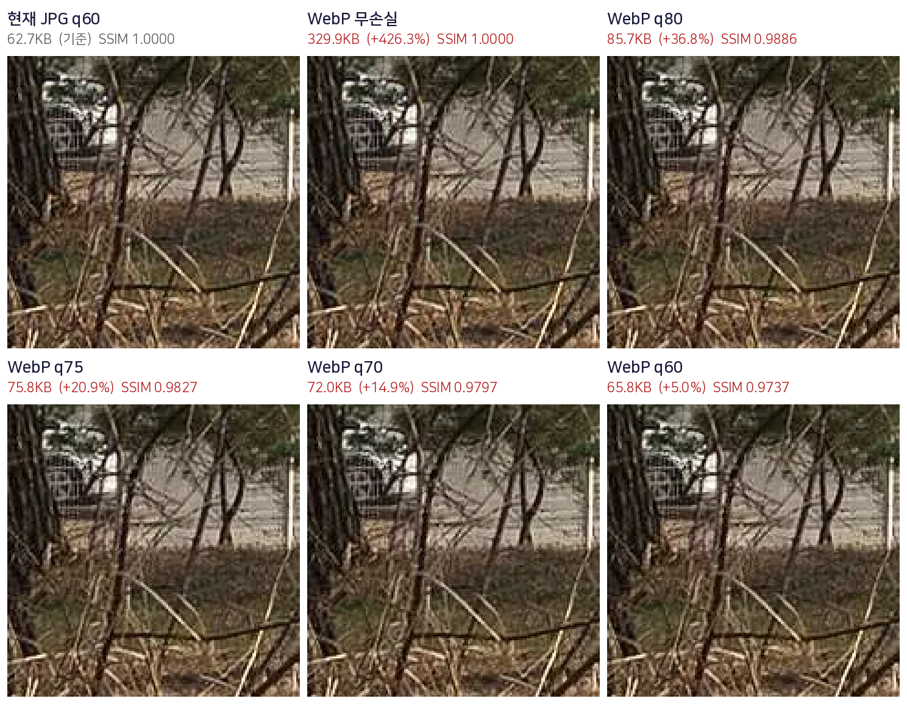

<!-- _class: cover -->
<!-- _paginate: false -->

# 레거시 큐브 타일 WebP 전환 실행 계획

## 전환 확정 후 실행 계획 · 얼마가 줄고 트래픽이 늘면 얼마가 남는가 · 시범 3곳 → 점진 전환

<hr>

Indyspot AI Corp &nbsp;·&nbsp; 2026-11-18 &nbsp;·&nbsp; 11-13 «files/pano WebP 전환 검토» 후속

---

<!-- _class: agenda -->

## 요약 — 전환은 확정됐고, 지금은 저장비 월 $1~1.5 · 트래픽이 1TB 를 넘는 순간부터 타일 1TB 당 월 $20~27 이 줄어듭니다

<div class="cols">
<div class="col">

### ① 결정과 범위
- <span class="hl-green">WebP 전환 확정</span> (이 덱은 결정 이후를 전제로 씀)
- 레거시 `mres_*` 큐브 타일 전부 · 1,758곳 · 1,224만 개 · 275.6GB
- 품질은 시범 장소에서 q70 · q75 비교 후 확정

### ② 줄어드는 양
- 타일 275.6GB → <span class="hl-blue">약 215~245GB</span> (−30~61GB)
- 저장비 월 <span class="hl-green">−$0.8~1.5</span> · 관람자가 받는 타일 −23~28%

</div>
<div class="col">

### ③ 미래 이득 (CloudFront)
- 지금 월 0.2~0.4TB → 무료 한도(1TB) 안이라 전송비 0원
- 1TB 를 넘으면 **타일 전송 1TB 당 월 $20~27** 절감
- 월 2TB 면 연 <span class="hl-green">$330~454</span> · 5TB 면 연 $826~1,135
- 유료 전환 시점이 1TB → **1.13~1.18TB** 로 늦춰짐

### ④ 일정과 비용
- 1회 약 $67 (업로드 $55 + 공존 기간 저장 약 $12) · 4~8주 · kabkee-main
- S3 Files 비용(월 약 $52)은 별도 덱에서 다룸

</div>
</div>

---

## 🎯 결정 사항 — 확정된 것과 남은 것

| # | 항목 | 상태 · 내용 |
|---|---|---|
| 1 | 전환 여부 | <span class="hl-green">확정</span> · 레거시 큐브 타일 전부 WebP 로 전환 |
| 2 | 범위 | <span class="hl-green">확정</span> · `mres_*` 타일 · `512_` · `1024_` 는 2차 · 썸네일·og·GIF 는 JPG 유지 |
| 3 | 실행 위치 | <span class="hl-green">확정</span> · kabkee-main (로컬 백업에서 읽기 · S3 API 로 업로드) |
| 4 | 시범 장소 3곳 | <span class="hl-amber">남음</span> · 크기 소·중·대 1곳씩 + 그중 1곳은 커스텀·다국어 XML 사용 장소 |
| 5 | 품질값 | <span class="hl-amber">남음</span> · 시범 장소에서 <span class="hl-blue">q70 · q75</span> 를 뷰어로 나란히 비교한 뒤 결정 (무손실은 +532% 라 제외) |
| 6 | JPG 삭제 시점 | <span class="hl-amber">남음</span> · 관찰 30일 후 · 백업 대조 완료분만 · `files/pano` 삭제 금지 규칙에 따라 오너 승인 |
| 7 | 진행 방식 | <span class="hl-amber">남음</span> · 에픽 발주 또는 직접 구현 |

버킷 이전 버전은 추가 작업이 필요 없습니다(버전 관리 Enabled + 이전 버전 30일 만료 규칙 `noncurrent-30d-bucketwide` 확인).

---

## 얼마나 줄어드는가 — 타일 275.6GB 가 215~245GB 가 됩니다

| 품질 | 절감률 (실측 범위) | 전환 후 타일 용량 | 줄어드는 양 | 저장비 월 절감 |
|---|---|---|---|---|
| 지금 JPG q60 | — | 275.6GB | — | — |
| WebP q75 | −11~16% | 231~245GB | −30~44GB | $0.8~1.1 |
| <span class="hl-blue">WebP q70</span> | −16~22% | 215~231GB | <span class="hl-green">−44~61GB</span> | $1.1~1.5 |

- 절감률은 운영 타일 표본 두 종(180장 · 500장) 실측 범위입니다. 저장 단가는 S3 서울 $0.025/GB-월입니다.
- 관람자 쪽에서는 첫 화면 타일이 **444KB → 320~342KB (−23~28%)** 로 줄어듭니다(로딩 속도 실측).
- 지금 look360.kr 의 월 전송량 330GB 중 70% 가 타일이라고 보면, **매달 37~51GB** 를 덜 보냅니다(타일 비중은 가정).
- 지금은 이 차이가 무료 한도 안에서 생겨 돈으로 바뀌지 않습니다. 돈이 되는 시점은 다음 장의 «1TB 초과» 부터입니다.

---

## 지금의 트래픽 — 무료 한도(1TB) 안이지만, 5월에는 한도의 84% 까지 갔습니다

| 월 (2026) | 05 | 06 | 07 | 08 | 09 | 10 | 11 (1~17일) |
|---|---|---|---|---|---|---|---|
| CloudFront 전송량 | <span class="hl-amber">864.8GB</span> | 313.2GB | 272.8GB | 238.1GB | 216.1GB | 401.2GB | 201.6GB |
| 전송 비용 | $0.14 | $0 | $0 | $0 | $0 | $0 | $0 |

- 최근 30일 배포별: **look360.kr `E134ZI2PZY55NN` 330.0GB** · beta.look360.co.kr 18.9GB · api 1.2GB
- 무료 한도는 계정 전체 월 1TB 이고, 넘는 순간부터 아시아 태평양 단가 **$0.120/GB**(월 10TB 까지, AWS 가격 API 조회)가 붙습니다.
- WebP 로 타일이 줄면 같은 방문량에서 유료 구간 진입 시점이 **1TB → 1.13~1.18TB** 로 늦춰집니다. 즉 방문이 13~18% 늘어도 전송비는 여전히 0원입니다.
- 요청 수는 타일 개수 그대로라 요청 비용은 변하지 않습니다.

---

## 미래 시나리오 — 월 트래픽별 CloudFront 전송비와 WebP 절감액

| 월 전송량 | 지금(JPG) 월 전송비 | WebP 이후 | 월 절감 | 연 절감 |
|---|---|---|---|---|
| 0.4TB (지금) | $0 | $0 | $0 | $0 |
| 1TB | $0 | $0 | $0 | $0 |
| 1.5TB | $61 | $33~41 | $21~28 | $248~341 |
| <span class="hl-blue">2TB</span> | $123 | $85~95 | <span class="hl-green">$28~38</span> | <span class="hl-green">$330~454</span> |
| 3TB | $246 | $189~204 | $41~57 | $495~681 |
| 5TB | $492 | $397~423 | $69~95 | $826~1,135 |
| 10TB | $1,106 | $917~968 | $138~189 | $1,652~2,271 |

- 계산식: 전송비 = (월 전송량 − 1TB) × $0.120 · WebP 이후 전송량 = 전송량 × (1 − 타일 비중 70% × 절감률 16~22%)
- 간단히 기억하면 **1TB 를 넘는 구간에서 타일 전송 1TB 당 월 $20~27** 이 줄어듭니다.
- <span class="hl-amber">가정</span> 타일 비중 70% 는 경로별 집계가 없어 둔 가정입니다. 50% 면 절감액이 약 ×0.71, 90% 면 약 ×1.29 가 됩니다.

---

## 5년 누적 이득 — 트래픽이 1.5TB 를 넘으면 두세 달 만에 회수합니다

| 월 전송량이 5년간 유지될 때 | 5년 누적 이득 (1회 비용 $67 차감) | 회수 기간 |
|---|---|---|
| 0.4TB (지금) | 약 −$1~24 (저장비만) | 3.7~5년 |
| 1.5TB | $1,238~1,727 | 2~3개월 |
| 2TB | $1,651~2,295 | 약 2개월 |
| 3TB | $2,476~3,430 | 1~2개월 |
| 5TB | $4,128~5,701 | 1개월 이내 |

- 저장비 절감(월 $1.1~1.5)은 트래픽과 무관하게 계속 쌓이고, 전송비 절감은 1TB 를 넘는 달마다 더해집니다.
- 지금 트래픽에서는 본전 수준이지만, **5월처럼 한도 근처까지 가는 달이 다시 오면** 그 달부터 바로 이득입니다.
- 비용 밖의 이득도 남습니다. 관람자가 받는 타일이 23~28% 줄어 모바일 데이터 사용량이 줄고, 첫 화면은 4~9% 빨라집니다(다음 장).
- 신규 업로드도 원본에서 WebP 로 만들면(11-13 덱의 별도 트랙) 같은 화질에서 −15.6% 가 추가로 쌓입니다.

---

## 관람자 체감 — 받는 타일은 23~28% 줄고 첫 화면은 4~9% 빨라집니다

장소 `100` 투어 `103` 장면 3개를 JPG · WebP 로 띄워 비교했습니다(조건별 3회 중앙값, 장면 3개 평균).

| 네트워크 | 형식 | 첫 화면 타일 | 첫 화면 시간 | 확대(최고 레벨) 시간 |
|---|---|---|---|---|
| 4G (9Mbps · 170ms) | JPG | 444KB | 1,932ms | 787ms |
| 4G | WebP q70 | 320KB (−28%) | 1,846ms <span class="hl-gray">(−4%)</span> | 725ms (−8%) |
| 4G | WebP q75 | 342KB (−23%) | 1,848ms <span class="hl-gray">(−4%)</span> | 753ms (−4%) |
| 느린 3G (1.6Mbps · 300ms) | JPG | 444KB | 5,606ms | 2,486ms |
| 느린 3G | WebP q70 | 320KB (−28%) | 5,079ms <span class="hl-gray">(−9%)</span> | 2,250ms (−10%) |
| 느린 3G | WebP q75 | 342KB (−23%) | 5,179ms <span class="hl-gray">(−8%)</span> | 2,383ms (−4%) |

- 운영 화면(look360.kr)은 페이지 전체가 **3.05MB** 이고 첫 화면 타일은 0.42MB(14%) 뿐입니다. 타일 로드 완료까지 스로틀 없이 4.9초 · 4G 4.8초로 **네트워크 속도와 거의 무관**해서, 시간은 타일보다 페이지의 다른 처리가 좌우합니다(추정).
- <span class="hl-amber">한계</span> 로컬 서빙(CDN·TLS 지연 없음) · 장소 1곳 · swiftshader 렌더링이라 실제 기기의 WebP 디코딩 비용은 빠져 있습니다.

---

## 무손실 전환은 가능한가 — 무손실 WebP 는 지금 JPG 보다 6배 이상 커집니다

| 방식 | 용량 변화 | SSIM 평균 | 하위 5% | 판단 |
|---|---|---|---|---|
| WebP 무손실 | <span class="hl-red">+531.8%</span> | 1.0000 | 1.0000 | 🚫 6.3배 커짐 |
| JPG 무손실 최적화 (`jpegtran -optimize`) | −0.3% | 1.0000 | 1.0000 | 효과 없음 |
| JPG 무손실 프로그레시브 (`jpegtran -progressive`) | −0.5% | 1.0000 | 1.0000 | 효과 없음 |
| WebP q90 | +57.5% | 0.9878 | 0.9794 | 🚫 커짐 |
| WebP q85 | +23.7% | 0.9790 | 0.9642 | 🚫 커짐 |
| WebP q80 | +1.3% | 0.9691 | 0.9463 | 🚫 그대로 |
| <span class="hl-blue">WebP q75</span> | <span class="hl-green">−16.4%</span> | 0.9577 | 0.9242 | ✅ 후보 |
| <span class="hl-blue">WebP q70</span> | <span class="hl-green">−21.6%</span> | 0.9536 | 0.9149 | ✅ 후보 |
| WebP q60 | −31.3% | 0.9447 | 0.8961 | 화질 저하 큼 |

운영 타일 무작위 180장 · SSIM 은 지금 JPG 대비(1 = 동일) · 11-13 표본 500장은 q70 −16.4% · q75 −11.2% → **q70 −16~22% · q75 −11~16%**

---

## 화질 비교 ① 보통 타일 — q70 은 −28% 지만 경계가 조금 부드러워집니다

<div class="cols">
<div class="col">



</div>
<div class="col">

- 표본 180장 중 절감률이 **중앙값**인 타일(34.2KB · 장소 `1750` 장면 `3`)
- 가장 질감이 많은 160×160 영역을 **3배 확대**(픽셀 그대로)
- **무손실**은 지금과 픽셀이 같지만 <span class="hl-red">223KB (+553%)</span>
- **q75 · q70** 은 21~28% 줄고, 확대하면 글자·창틀 경계가 조금 뭉개집니다
- 실제 뷰어 크기에서 보이는 차이는 시범 장소에서 직접 비교해 판정합니다

<div class="links"><span class="lbl">직접 확인</span>
<a class="lnk" href="assets/2026-11-18-webp-legacy/cmp-typical.png" target="_blank">원본 크기 비교 이미지 (cmp-typical.png)</a></div>

</div>
</div>

---

## 화질 비교 ② 질감 많은 타일 — WebP 는 q60 까지 내려도 지금보다 큽니다

<div class="cols">
<div class="col">



</div>
<div class="col">

- 표본 중 q70 에서 가장 **많이 커진** 타일(62.7KB · 장소 `90` 장면 `23`, 나뭇가지·풀)
- q80 +37% · q75 +21% · q70 +15% · **q60 도 +5%**
- 이미 JPG q60 의 잡음이 들어 있는 질감을 WebP 가 다시 압축하느라 오히려 커집니다
- 그래서 계획에 **장면 스킵 규칙**(장면 전체 절감률 8% 미만이면 JPG 유지)을 넣었습니다

<div class="links"><span class="lbl">직접 확인</span>
<a class="lnk" href="assets/2026-11-18-webp-legacy/cmp-texture.png" target="_blank">원본 크기 비교 이미지 (cmp-texture.png)</a></div>

</div>
</div>

---

## 어떤 타일이 줄어드는가 · 원본에서 새로 만들면 달라지는가

<div class="cols">
<div class="col">

### 기존 타일 재인코딩 (q70 · 표본 180장)

| JPG 크기 | 용량 비중 | 변화 | 커지는 타일 |
|---|---|---|---|
| 20KB 미만 (하늘·벽) | 27% | <span class="hl-green">−37.5%</span> | 0장 |
| 20~40KB (보통) | 52% | −20.2% | 1장 |
| 40KB 이상 (질감) | 20% | <span class="hl-gray">−4.0%</span> | 3장 |

- 줄어드는 타일만 골라 바꿔도 −22.1% 로, 전부 바꾼 −21.6% 와 거의 같습니다.
- 소용없는 건 **질감 타일(용량의 20%)** 이고, 나머지 80% 는 확실히 줄어듭니다.

</div>
<div class="col">

### 원본에서 새로 생성 (11-13 덱 실측)

| 항목 | 재인코딩 (레거시) | 새로 생성 |
|---|---|---|
| 같은 화질 기준 절감 | — | <span class="hl-green">q60 −15.6%</span> |
| 화질 | 지금보다 한 번 더 손실 | 지금 JPG q60 과 같음 (SSIM 0.9135 vs 0.9146) |
| 질감 타일 (40KB 이상) | −4% | −7% |

- 새로 만들면 **화질 손실 없이** 줄어든다는 점이 다릅니다.
- 다만 레거시 장소는 버킷에 원본이 2개뿐이라 <span class="hl-red">새로 만들 수 없습니다.</span> 원본이 있는 **신규 업로드**(플랫폼 utils)에만 해당합니다.

</div>
</div>

---

## 왜 무손실은 오히려 커지는가

| 질문 | 답 |
|---|---|
| 이미 q60 으로 압축됐으니 «포장만» 바꾸면 되지 않나? | WebP 는 JPG 의 압축 데이터를 그대로 옮겨 담을 수 없습니다. 반드시 **픽셀로 풀었다가 다시 압축**합니다 |
| 그러면 왜 무손실이 커지나? | 풀어낸 픽셀에는 JPG 의 8×8 블록 무늬와 잡음이 그대로 남아 있습니다. 무손실은 이 잡음까지 한 픽셀도 틀리지 않게 보존해야 해서, 원래 그 잡음을 만든 JPG 보다 훨씬 비효율적입니다 |
| JPG 그대로 무손실로 줄이는 방법은? | `jpegtran` 이 대표적인데 −0.5% 뿐입니다. 지금 타일은 이미 최적화된 상태로 저장돼 있습니다 |
| JPEG XL 은? | JPG 를 무손실로 약 20% 줄일 수 있다고 알려져 있지만(이번에 측정하지 않음), 주요 브라우저가 모두 지원하지 않아 지금은 쓸 수 없습니다 |

<span class="hl-amber">결론</span> SSIM 1 에 가깝게 유지하면서 용량을 줄이는 방법은 없습니다. 용량을 줄이려면 **q70~q75 수준의 손실을 받아들이는 것**이 유일한 길이고, 그래서 시범 장소에서 육안 비교가 필요합니다.

---

## 대상 규모 — 장소 1,758곳 · 타일 1,224만 개 · 275.6GB

백업 목록표(`state/pano__*.csv.gz`, 2026-11-17 기준)에서 `mres_[fblrud]/l*/…jpg` 만 집계했습니다. 서버 마운트는 순회하지 않았습니다.

| 지표 | 값 |
|---|---|
| 장소 수 | 1,758곳 |
| 타일 수 · 용량 | 12,246,880개 · 275.6GB |
| 장소당 중앙값 | 50MB |
| 장소당 상위 10% | 407MB 이상 |
| 가장 큰 장소 | `100` 5.9GB · `137` 3.5GB · `861` 2.4GB · `66` 2.3GB · `314` 1.7GB |

원본 이미지(`retouched` · `origin`)는 버킷 전체에서 20개뿐이라, 레거시 장소는 **원본에서 다시 생성하는 방식을 쓸 수 없습니다.**

---

## 범위 — XML 의 `<cube url>` 한 줄로만 참조되는 타일만 바꿉니다

| 대상 | 처리 | 이유 |
|---|---|---|
| `mres_*/l*/…jpg` 큐브 타일 | <span class="hl-green">전환</span> | 전체 JPG 의 78% · XML `<level><cube url>` 에서만 참조 |
| `512_*` · `1024_*` 모바일·태블릿 큐브 | <span class="hl-amber">2차</span> | `VrShareModal.vue` 등 XML 밖에서도 `.jpg` 고정 참조 |
| `pv.jpg` (미리보기 큐브 띠) | <span class="hl-gray">유지</span> | 작고, 생성기마다 별도 리터럴 |
| `view_*` · `imglink_*` (썸네일·og) | <span class="hl-gray">유지</span> | og:image · 메일 · 폴백 리터럴 수십 곳 |
| `imglink_*.gif` · 게시판 첨부 · 장소 사진 | <span class="hl-gray">범위 밖</span> | 타일이 아님 |

---

## 왜 «XML 만 고치면 끝»이 아닌가

레거시 XML 생성기는 **DB 를 기준으로 투어 XML 을 통째로 다시 쓰고**, 타일 확장자를 `.jpg` 로 고정합니다. 핫스팟·스티커를 편집할 때마다 이 생성기가 돕니다.

```php
// a.createCyberTourXML.php:523 · :525
'/mres_%s/l' . $countOfPanoLevelsReverse . '/%v/l' . $countOfPanoLevelsReverse . '_%s_%v_%h.jpg'
```

| 상황 | 결과 |
|---|---|
| XML 만 `.webp` 로 고치고 JPG 유지 | 다음 편집 때 `.jpg` 로 되돌아감 → 절감 효과 사라짐 |
| XML 만 고치고 JPG 삭제 | 다음 편집 때 <span class="hl-red">검은 화면</span> |

투어 XML 예시(`pano/0/329/865.xml`)도 장면마다 `53/mres_%s/l2/%v/l2_%s_%v_%h.jpg` 형태로 적혀 있습니다.

---

## 핵심 설계 — 장면마다 확장자 값을 두고, 생성기가 다시 쓰게 합니다

1. **장면(pano)마다 `tile_ext`** (기본값 `jpg`) 를 DB 에 둡니다.
2. **XML 을 만드는 모든 곳이 이 값을 읽습니다.**
   - 레거시: `a.createCyberTourXML.php` · `_multiLanguage` · `_remote` · `look360_ucc/…/a.getKrpanoXml.php` · `a.krpanoXmlForIndoorMap.php` · `panoTour_customXml.php`
   - 플랫폼: `nestjs-look360-api/src/utils/krpano-xml-builder.ts` · `panostory-xml-builder.ts`
3. 장면 단위 순서를 고정합니다: **WebP 전부 업로드 → 검증 → `tile_ext=webp` → 생성기로 XML 재생성.** 생성기가 쓰면 `xmlBackup/` 도 자동으로 남습니다.
4. **롤백** = `tile_ext=jpg` 로 되돌리고 XML 재생성. 그래서 관찰 기간에는 JPG 를 지우지 않습니다.
5. **장면 스킵 규칙** — 한 장면 안에서는 확장자를 섞을 수 없으므로, 장면 전체 절감률이 <span class="hl-amber">8% 미만</span>이면(질감 많은 숲 장면 등) JPG 로 둡니다.

<span class="hl-amber">미확인</span> 레거시 pano 테이블과 플랫폼 `tile_info` 의 동기화 경로는 이번에 조회하지 못했습니다(MySQL 연결 끊김). 1단계 첫 작업입니다.

---

## 수정 범위 ① 레거시 PHP — 타일 `.jpg` 를 고정한 생성기·페이지 17곳

같은 `files/pano` 타일을 레거시와 플랫폼이 함께 쓰므로, **타일 URL 을 만드는 모든 페이지**가 `tile_ext` 를 읽어야 합니다.

| 구분 | 파일 (`Look360_ksq1.2/`) · 줄 |
|---|---|
| 투어 XML 저장 생성기 | `PanoramaManagement/…/hotspot/a.createCyberTourXML.php:520~552` · `_multiLanguage.php:422~512` · `_BATCH.php:115` |
| 실시간 XML (편집기·미리보기·지도) | `PanoramaManagement/…/a.krpanoXml.php:458` · `a.krpanoXmlForHotspotEditor.php:215` · `a.krpanoXmlForPanoramaMap.php:222` · `…MapBatch.php:214` · `…Preview.php:232` |
| 다른 모듈 | `look360_pano_cms/…/a.getKrpanoXml.php:365` · `look360_place_map/…/a.krpanoXmlForIndoorMap.php:430~450` · `look360_ucc/…/a.getKrpanoXml.php:206~218` · `plugins/indyspot/php/indyspot_default_plugin.php:1270` |
| 이미지 프록시 | `vr/…/a.getImg.php` — XML 이 `ext=jpg` 로 넘기고, `Content-Type: image/{ext}` 로 응답 |
| 확인만 | `modules/vr/xml/*.php` 5개는 구형 `tablet_%s.jpg` 형식이라 `mres` 대상이 아님 |

---

## 수정 범위 ② 레거시 저장 XML — 타일을 품은 2,972개를 생성기로 다시 씁니다

버킷의 XML 5,994개(`xmlBackup` 제외)를 모두 받아 `mres_…jpg` 참조 여부를 검사했습니다.

| 저장된 XML (버킷 실측 5,994개 중) | 개수 | 처리 |
|---|---|---|
| 투어 XML (`{장소}/{투어}.xml`, 직접 경로) | 2,256 | 생성기로 재생성 |
| 투어 XML (`a.getImg.php` 프록시 · `ext=jpg`) | 495 | 생성기로 재생성 |
| 다국어 투어 XML (`_us` 109 · `_cn` 13 · `_jp` 12) | 134 | `_multiLanguage` 로 재생성 |
| 패노스토리 XML (`panostory_{N}.xml`) | 87 | 생성 경로 확인 후 재생성 |
| 커스텀 XML 1,451 · 일괄 업로드 목록 1,477 | 0 | 타일 참조 없음 (확인 완료) |

---

## 수정 범위 ③ 플랫폼 — BE 빌더 2개가 핵심입니다

| 저장소 | 위치 | 처리 |
|---|---|---|
| BE | `nestjs-look360-api/src/utils/krpano-xml-builder.ts:1488~1505` · `:1704~1720` (`:40~56` 은 상단 예시) | `mres` · `512_` · `1024_` URL 을 `tile_ext` 로 조립 |
| BE | `nestjs-look360-api/src/utils/panostory-xml-builder.ts:580~587` | 같음 |
| client | `look360_v3_client/src/components/vr-viewer/VrShareModal.vue:553` · `:834` | 공유 미니뷰 `512_%s.jpg` 고정 → 2차(`512_` 전환 시) |
| admin | 해당 없음 | 타일 URL 을 직접 만들지 않음 |
| utils | 수정 불필요 | 신규 업로드는 계속 JPG(`tile_ext=jpg`) · 신규 WebP 는 11-13 덱의 별도 트랙 |

- 플랫폼은 XML 을 저장하지 않고 요청마다 DB 로 만들므로, `tile_ext` 만 읽으면 재생성 작업이 없습니다.
- 확인 순서: 1단계에서 **전 장소 XML 을 바꾸기 전과 바이트 단위로 비교**해, `jpg` 기본값일 때 결과가 하나도 달라지지 않는지 봅니다.

<span class="hl-gray">확인</span> `a.getImg.php` 프록시는 타일을 서버 마운트에서 읽지만, 최근 15일 호출은 하루 0~576건이고 마운트의 데이터 읽기량도 거의 0이라 S3 Files 비용과는 무관합니다.

---

## 단계 — 읽는 쪽부터, 서비스 동작은 시범 장소에서 처음 바뀝니다

| 단계 | 할 일 | 통과 조건 |
|---|---|---|
| 0 결정 | ✅ 전환 확정 · 비용·트래픽 실측 완료 (11-18) | 남은 결정 4건 (시범 장소 · 품질 · 삭제 시점 · 진행 방식) |
| 1 읽는 쪽 | `tile_ext` 컬럼 추가 · 생성기 6곳 + 플랫폼 빌더가 값을 읽도록 수정 (기본 `jpg`) | 전 장소 XML 재생성 결과가 바이트 단위로 동일 |
| 2 변환 도구 | kabkee-main 배치 스크립트 (장소 단위 · 재개 가능 · 장부 기록) | 장소 1곳 드라이런 · 실측 절감률 |
| 3 시범 | 레거시 장소 3곳 통째 전환 | 검증 목록 전부 통과 + 2주 관찰 |
| 4 품질 확정 | 시범 장소에서 q70 · q75 비교 | 오너 승인 |
| 5 점진 전환 | 밤 시간대 하루 30~50곳 · 조회 상위 장소부터 | 일일 장부 · 오류 0건 |
| 6 JPG 정리 | 관찰 기간이 끝난 장소부터 삭제 | <span class="hl-red">오너 승인 필수</span> |

---

## 시범 검증 목록 — 장소 3곳에서 모두 통과해야 다음 단계로 갑니다

| 축 | 확인할 것 |
|---|---|
| 뷰어 | look360.kr 레거시 뷰어 (운영 krpano 는 아직 1.24 배포 전) · 플랫폼 client |
| 기기 | iOS Safari · 안드로이드 Chrome · 카카오톡 인앱 브라우저 · VR 모드 |
| 재생성 | 핫스팟 편집 후 XML 이 다시 쓰여도 `.webp` 유지 |
| CDN | CloudFront Function `look360-files-guard-strip` (배포 `E134ZI2PZY55NN`) 이 `.webp` 를 통과시키는지 |
| 마운트 | 서버 마운트에서 **정확한 경로 1개**로 새 파일이 보이는지 (순회 금지) |
| 메타데이터 | `ContentType: image/webp` · S3 Files 소유자·권한 값 유지 |
| 화질 | 원본 JPG 와 WebP 를 같은 시점에서 나란히 비교 (질감 많은 장면 포함) |
| 전송량 | 시범 장소의 전환 전후 타일 전송량 비교 |

---

## 실행 위치 — kabkee-main 을 추천합니다

| 위치 | 판단 |
|---|---|
| <span class="hl-green">kabkee-main</span> | 원본 JPG 를 로컬 백업(`/mnt/h/look360-v1-files-backup-20260913/tars/`)에서 읽어 **S3 다운로드 비용 0원** · 20코어 · 인코딩 약 44 CPU시간(실측 13ms/타일) |
| AWS 본서버 | <span class="hl-red">비추천</span> · 운영 웹과 CPU 를 나눠 씀 · `/var/www/html/files` 를 건드리면 순회 과금 위험 · S3 API 로만 읽으면 가능은 함 |
| ncore | 보조 작업자로 가능 · 타일 데이터를 먼저 옮겨야 하므로 kabkee-main 이 바쁠 때만 |

- 백업은 하루 단위로 갱신되므로, 변환 직전에 **목록표의 `md5` 와 S3 현재값을 대조**해 바뀐 타일은 S3 에서 새로 받습니다.
- 업로드는 S3 API 로 직접 합니다(서버 마운트 경유 금지).

---

## 비용과 기간 (추정)

| 항목 | 값 | 근거 |
|---|---|---|
| 업로드 요청 | 약 $55 (1회) | PUT 1,224만 건 × $0.0045/1천 |
| 월 절감 | 저장 $0.8~1.5 · 전송은 1TB 초과분부터 타일 1TB 당 $20~27 | 미래 시나리오 슬라이드 참조 |
| 회수 기간 | 지금 트래픽 3.7~5년 · 월 2TB 면 약 2개월 | 1회 비용 약 $67 기준 |
| 원본 다운로드 | 0원 | 로컬 백업 사용 (S3 에서 받으면 약 $35 추가) |
| 인코딩 | 약 44 CPU시간 | 기존 리포트 실측 13ms/타일 |
| 전환 기간 저장 증가 | 최대 약 +230GB (월 약 $6) | JPG · WebP 공존 기간 |
| 전체 기간 | 약 4~8주 | 밤 시간대 하루 30~50곳 · 업로드 속도가 병목 |

<span class="hl-amber">추정 값</span> 단가는 AWS 서울 공시가 기준이며 실제 청구액과 다를 수 있습니다. 절감률은 기존 리포트의 표본 500장(장소 120곳) 실측 기준이라 장소마다 다를 수 있습니다.

---

## 놓치면 사고가 나는 함정

| 함정 | 대응 |
|---|---|
| 기존 타일에 S3 Files 메타데이터가 있음 (`file-owner: 33` · `file-permissions: 0100664`, `head-object` 실측) | 같은 메타데이터 + `ContentType: image/webp` 를 함께 지정해 업로드 |
| 버킷 버전 관리 (Enabled · 조회 확인) | 이전 버전 30일 만료 규칙 `noncurrent-30d-bucketwide` 가 이미 있어 JPG 삭제 30일 뒤 실제로 줄어듦 |
| `files/pano` 삭제 금지 규칙 (09-03 오너 결정) | 6단계는 백업 대조 후 오너 승인 · 변수 보간 `rm` 금지 |
| 재인코딩 이중 손실 | 장면 스킵 규칙(절감 8% 미만) + 4단계 육안 비교 |
| 일부만 올라간 장면 | 장면 단위로 «전부 업로드 → 검증 → 값 변경» 순서 고정 |
| 서버 마운트 순회 과금 | 존재 확인은 목록표 · `head-object` 로만 |

---

## 측정 방법과 근거

| 항목 | 방법 |
|---|---|
| 대상 규모 | `look360-v1-files` 백업 목록표 `state/pano__*.csv.gz` 1,764개에서 `mres_*/l*/*.jpg` 집계 (2026-11-17 기준) |
| 원본 존재 여부 | 같은 목록표에서 파일명 `retouch` · `origin` 집계 → 20개 |
| XML 형식 | S3 에서 `pano/0/329/865.xml` 1개를 받아 확인 |
| 생성기 고정 지점 | `Look360_ksq1.2` 소스 검색 (`a.createCyberTourXML.php:523` · `:525` 등) |
| 타일 메타데이터 | `head-object pano/0/329/53/mres_f/l1/1/l1_f_1_1.jpg` |
| 화질·용량 비율 | 무작위 타일 180장(샤드 30개) · Pillow WebP `method=6` · `jpegtran` 2.1.5 · 밝기 SSIM(가우시안 11×11, σ 1.5) + 11-13 덱 표본 500장 |
| 고정 `.jpg` 지점 | `Look360_ksq1.2` · `nestjs-look360-api` · `look360_v3_client` · `look360_platform_admin` · `look360_utils_v3` 소스 검색 (주석 줄 제외) |
| 저장된 XML | 버킷 XML 5,994개(`xmlBackup` 제외)를 받아 `mres_…jpg` · `512_/1024_%s.jpg` 참조 검사 |
| 비용·전송량 | Cost Explorer(서비스·사용 유형별 월 비용, 2026-05~11-17) · CloudWatch `BytesDownloaded`·`Requests`(배포별 10-18~11-16) · 관리자 SSO 로 조회만 |
| 전송 단가 | AWS Price List API `AmazonCloudFront` · `AP-DataTransfer-Out-Bytes` ($0.120/GB · 10TB 까지, $0.100 · 50TB 까지) · 무료 한도 월 1TB |
| 미래 시나리오 | 타일 비중 70% · 절감률 16~22% · 트래픽 5년 유지 가정 · 1회 비용 $67 = 업로드 $55 + 공존 기간 저장 약 $12 |
| 버킷 설정 | `get-bucket-versioning` · `get-bucket-lifecycle-configuration` (`look360-v1-files`) |
| 미확인 | DB 동기화 경로 (MySQL 연결 끊김) · look360.kr 전송량 중 타일 비중 (경로별 집계 없음) |

---

<!-- _class: closing -->
<!-- _paginate: false -->

## 감사합니다

레거시 큐브 타일 275.6GB 를 WebP q70~q75 로 바꾸면 30~61GB 가 줄고, 관람자가 받는 타일은 23~28% 줄어듭니다. 지금은 저장비 월 $1~1.5 수준이지만, CloudFront 트래픽이 1TB 를 넘는 순간부터 타일 1TB 당 월 $20~27 이 줄어듭니다. 순서는 읽는 쪽 수정 → 변환 도구 → 시범 3곳 → 품질 확정 → 점진 전환입니다.

Indyspot AI Corp &nbsp;·&nbsp; 2026-11-18
