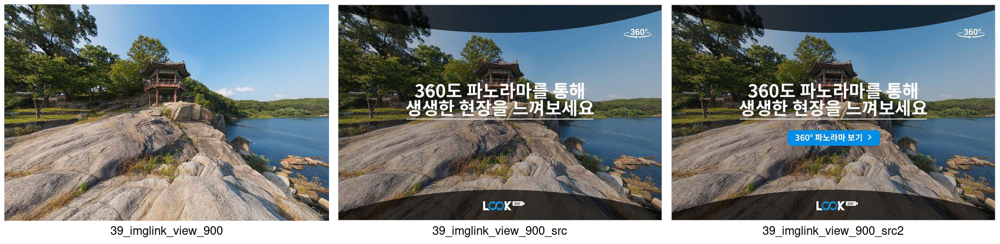
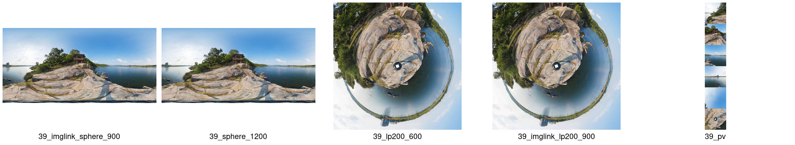

<!-- _class: cover -->
<!-- _paginate: false -->

# 레거시 파노라마 «생성 이미지» 지도

## 장면 폴더의 타일 외 이미지가 무엇이고, 어디에 쓰이고, WebP 로 바뀌는지

Indyspot AI Corp &nbsp;·&nbsp; 2026-11-25 &nbsp;·&nbsp; IND-9832 (카톡 썸네일) · IND-9881 (WebP 전환) 참조 자료

---

<!-- _class: agenda -->

## 요약 — `imglink_*` 는 «공유·외부 노출용» 세트이고, 합성본·GIF 는 WebP 에서 빠집니다

### ① 장면 폴더 구성
- `files/pano/{p/1000}/{place}/{pano_number}/` 에 타일 외 **생성 이미지 약 20종**이 함께 있습니다
- `imglink_*` · `lp*` · `sphere_*` · `pv.jpg` · `preview.jpg` 등
- 이 파일들을 **만드는 코드는 두 레포 어디에도 없습니다** (레포 밖 도구로 생성된 것으로 추정)

### ② 카톡 썸네일
- og:image 는 `imglink_view_900_src2.jpg` (문구 + 「360° 파노라마 보기」 버튼 합성본)
- IND-9810: 커버 없는 VR 스토리가 **장소 기본 파노투어**의 장면을 내던 버그 → `d37700222` 로 수정

### ③ WebP 변환 (IND-9881)
- 포함: 타일 · `512_/1024_` · `view_*` · `sphere_*` · `lp*` · `pv` · `imglink_*_900.jpg`
- 제외: `imglink_*_src(2).jpg` · `imglink_*.gif` · `preview.jpg` 등 미분류 · artwork PNG
- ⇒ **og:image·이미지 링크 GIF 는 계속 jpg/gif**

### ④ 주의
- 비공개 장소 `.htaccess` 는 `^(lp|sphere|view|imglink)` **접두어**만 허용합니다 — 이름을 바꾸면 접근이 막힙니다
- 변환 대상 정규식이 **도구·레거시·l3 세 벌**로 따로 있습니다

---

## 🔖 장면 폴더에 무엇이 있나 — 전체 집계

`look360-v1-files` 백업 목록표 1,764 샤드에서 **장면 폴더 최상위 파일**을 파일명 패턴별로 셌습니다 (2026-11-25).

| 패턴 | 개수 | 실물 (신륵사 `pano/0/139/39/`) |
|---|---:|---|
| `imglink_{view,sphere,lp200,lp250}_{180,450,900}.gif` | 약 37.8만 | 문구·로고 들어간 애니메이션 GIF (view 180 = 180×120) |
| `imglink_{…}_900.jpg` | 약 12.6만 | **문구 없는 원본** (view 900×600 · sphere 900×450 · lp 900×900) |
| `imglink_{…}_900_src.jpg` / `_src2.jpg` | 각 약 12.6만 | **문구 합성본** — `_src2` 에만 파란 버튼 |
| `view_{250,500,1000}.jpg` | 67,596 | 썸네일 |
| `512_*` · `1024_*` | 각 면 63,576 | 큐브 면 원본 |
| `pv.jpg` | 31,859 | 큐브 6면을 세로로 이은 256×1536 띠 |
| `lp200_/lp250_{300,600,1200}.jpg` | 17,076 | 리틀플래닛 정사각형 |
| `sphere_{400,800,1200}.jpg` | 11,779 | 2:1 등장방형 전경 |
| `preview.jpg` · `photo_event.jpg` | 198 · 477 | flat 미리보기 · 개인 파노라마 이벤트 사진 |
| 기타 | 소수 | `thumb_*` 23 · `*_orig(in(al)).gif` 33 · `*.zip` 42 · `.htaccess` 875 |

---

## 🔖 `imglink_view_900` 3종 — 같은 장면, 다른 용도

직접 확인
<a class="lnk" href="https://look360.kr/files/pano/0/139/39/imglink_view_900.jpg" target="_blank">https://look360.kr/files/pano/0/139/39/imglink_view_900.jpg</a>
<a class="lnk" href="https://look360.kr/files/pano/0/139/39/imglink_view_900_src2.jpg" target="_blank">…/imglink_view_900_src2.jpg</a>

| 파일 | 내용 | 쓰는 곳 |
|---|---|---|
| `imglink_view_900.jpg` | 원본 사진 | 장소 페이지 배경 · 사용자 페이지 · 임베드 배경 · 지도 정보창 |
| `imglink_view_900_src.jpg` | 문구 + 로고 | og:image **2순위** (src2 가 없을 때) |
| `imglink_view_900_src2.jpg` | 문구 + 로고 + 「360° 파노라마 보기」 버튼 | **og:image 1순위 (카톡·SNS 미리보기)** |

---

## 🔖 그 밖의 생성 이미지 (신륵사 장면 39)

직접 확인
<a class="lnk" href="https://look360.kr/files/pano/0/139/39/imglink_sphere_900.jpg" target="_blank">https://look360.kr/files/pano/0/139/39/imglink_sphere_900.jpg</a>
<a class="lnk" href="https://look360.kr/files/pano/0/139/39/lp200_600.jpg" target="_blank">…/lp200_600.jpg</a>

- `imglink_sphere_900.jpg` 와 `sphere_1200.jpg` 는 **같은 2:1 전경**이고 크기만 다릅니다
- `lp200_600.jpg` 와 `imglink_lp200_900.jpg` 도 같은 리틀플래닛입니다
- `pv.jpg` 는 대표 이미지가 아닙니다 — krpano 로딩용 큐브 띠라 **썸네일 대체로 쓰면 안 됩니다** (l3 `VrDetail.vue:4058` 주석)

---

## 🔖 카톡 썸네일이 다르게 나왔던 이유 (IND-9810 · IND-9832)

### 원인
- 레거시 `look360_seo.php` `/vrstory/` 분기 (수정 전 `591b4a8a4` L342~352)
- 커버가 비면 스토리 투어(`panostory.panotour_id`)가 아니라 **장소 기본 투어**(`default_panotour`)의 장면을 냈습니다
- 대상 5건 (story id 1~5 · indyspot·silleuksa kr/en/cn)

| URL | 수정 전 | 수정 후 |
|---|---|---|
| `/vrstory/ggtour_silleuksa/silleuksa` | `0/139/47` (기본 투어) | `0/139/39` (스토리 투어 157) |
| `/vrstory/indyspot/indyspot` | 로고 폴백 | `0/100/6` (스토리 투어 118) |

### og:image 선택 순서 (수정 후 `d37700222`)
1. `panostory.cover_image`
2. 스토리 투어 대표 장면의 `imglink_view_900_src2.jpg`
3. 같은 폴더 `imglink_view_900_src.jpg`
4. 장소 기본 파노투어 장면 (기존 동작)
5. 로고 `pages/img/look360_logo_profile_400.jpg`

대표 장면은 `rep_pano_number` → `rep_pano_id` → `first_pano_id` 순서로 찾습니다.

### 범위 밖
- 뷰어 카톡 버튼 = 현재 장면 (IND-6805) · 목록 카드 버튼 = `view_500.jpg`
- `/vrstory/{장소}` 의 `(rep=1 OR 1)` 임의 선택

---

## 🔖 사용처 ① — `imglink_*`

| 파일 | 사용처 | 용도 |
|---|---|---|
| `imglink_view_900_src2.jpg` → `_src.jpg` | 레거시 `look360_seo.php` (분기 5곳) | **og:image** |
| `imglink_view_900.jpg` | 레거시 `pages/place.php:315,351,1451` · `pages/user.php:424` · `pages/embedpano.php:216` · `pages/360sticker_concept.php:53` · `_core/function/thumb.func.php:204` · `PlaceManagement/…/map.php:1206` · `a.getPlaceInfo.php:31` · `indyspot_default_plugin.php:945,947` · 개인 파노라마 React 2개 | 화면 배경·대표 이미지 |
| `imglink_sphere_900.jpg` | 레거시 `look360_panostory/…/panostory_factory.php:260` · **l3** `nestjs-look360-api/src/utils/krpano-xml-builder.ts:398` | 스토리 미리보기 · **l3 에서 타일 없는 sphere 장면의 단일 이미지 폴백** |
| `imglink_*_180.gif` | `panoTourWrap.js:7503` · `panoTourWrap_vue.js:2889` | 공유창 «이미지 링크» 탭 미리보기 4종 |
| `imglink_{type}_{180,450,900}.gif` | `panoTourWrap.js:4544` · `panoTourWrap_vue.js:3078` | 사용자가 복사하는 `<a>` 코드 (외부 블로그용) |
| `imglink_lp200/250_900.jpg·.gif` | `email_form_factory.php` · `member/doc/2017_peace_park_childrenday_email.txt` | 2017년 무렵 포토 이벤트 이메일 |

---

## 🔖 사용처 ② — 그 외 · 참조 0건

### 사용 중
| 파일 | 사용처 · 용도 |
|---|---|
| `pv.jpg` | 레거시 투어 XML 생성기 전부 · l3 `krpano-xml-builder.ts` · FE `VrViewer.vue` 등 — **krpano `CUBESTRIP` 프리뷰** |
| `preview.jpg` | 레거시 `thumb.func.php:179` · `_flatTourXml.php:285` · l3 `pano-thumb.util.ts` — flat 썸네일 |
| `sphere_1200.jpg` | l3 admin `src/utils/sphereUrl.js:31` |
| `sphere_400.jpg` | 레거시 `pages/test.php:103` 뿐 |
| `photo_event.jpg` | 개인 파노라마 이메일 첨부 |
| `thumb_250.*` | UCC (`files/ucc/`) — 별개 경로 |

### 코드 참조 0건
- `imglink_{sphere,lp*}_900_src(2).jpg` — 각 약 3만 개 (og:image 는 view 만)
- `lp200_/lp250_{300,600,1200}.jpg` — 주석 코드에만 남음
- `sphere_800.jpg`
- `*_orig(in(al)).gif` — 수동 백업 추정

주의 DB 의 XML·본문 HTML 은 검색하지 않았습니다. 외부 블로그의 `imglink_*.gif` 링크는 살아 있을 수 있어 **«참조 0건 = 삭제 가능»이 아닙니다.**

---

## 🔖 WebP 변환 — 포함되는 것 (IND-9881)

근거: `.artifacts/IND-9881/W2/webp_convert.py:28` `CONVERT` · `W0/ledger.py:19-30` 정규식 · 인코딩 `q60 · method=6 · lossless=False`

| 분류 | 파일명 규칙 | 용도 |
|---|---|---|
| 타일 | `mres_{면}/l*/…jpg` · `l*/NN/l*_NN_NN.jpg`(flat) · `{면}/l*/…`(면 직접) · `artwork/N.tiles/…` | 뷰어 본체 |
| cylinder 2단 | `l{n}/NN_NN.jpg` (장소 100 · 130~133) | EM 결정으로 재편입 |
| `512_` · `1024_` | `^(512\|1024)_{면}\.jpg$` | 큐브 면 원본 |
| `view_*` | `^view_\d+\.jpg$` | 썸네일 |
| `sphere_*` | `^sphere_\d+\.jpg$` | admin 미리보기 |
| `lp*` | `^lp\d+_\d+\.jpg$` | (참조 0건이지만 포함) |
| `pv` | `^pv\.jpg$` | krpano 로딩 프리뷰 |
| `imglink_*_900.jpg` | `^imglink_(lp\d+\|sphere\|view)_900\.jpg$` | 장소 페이지 배경 · l3 sphere 폴백 · 이메일 |
| artwork 비타일 | `artwork/photo/N/N.jpg` · `artwork/intro_*.jpg` | IND-9910 오너 확정 |

---

## 🔖 WebP 변환 — 제외되는 것

| 파일 | 제외 사유 |
|---|---|
| `imglink_*_900_src.jpg` · `_src2.jpg` | `imglink_src` 분류 — `CONVERT` 에 없음. **og:image(카톡 썸네일)는 계속 jpg** |
| `imglink_*.gif` (180·450·900 전부) | `imglink_gif` 분류 — 공유창 미리보기·이미지 링크 코드용 |
| `preview.jpg` · `photo_event.jpg` · `thumb_*` · `view_N-org.jpg` · `org_*.jpg` | 어느 규칙에도 안 맞아 «미분류» → 기본값 보류 |
| `hotspot/…jpg` · `panostory/image/…jpg` 등 일반 이미지 | 미분류 105건 (장소 1~100 기준) — 범위 밖 |
| `artwork/*.png` | 오너 확인 전 변환 금지 (`held_owner`) |
| `artwork/narration/*.mp3` | 보존 |
| 장소 루트 `mres_*` (장소 48) | 읽는 XML 없음 — EM 결정으로 제외, 고아 정리 후보 |
| panotype cylinder·미분류 장면 · DB 행 없는 고아 폴더 | 장면 단위 보류 · `excluded_orphan` |
| `.DS_Store` · `Thumbs.db` | 변환 없이 제거 대상 |

레거시 주석 원문 (`_core/function/db.mysql.func.php:381`): «🚫 imglink_*.gif·_src.jpg·_src2.jpg 는 이 값(tile_ext)을 쓰지 않는다»

---

## 🔖 나중에 헷갈리기 쉬운 점

### 같은 `imglink` 안에서 결과가 갈립니다
- 한 폴더에서 `imglink_view_900.jpg` 는 **webp**, `imglink_view_900_src2.jpg`·`imglink_view_180.gif` 는 **그대로**
- 화면 코드는 장면의 `tile_ext` 를 보고 `.jpg → .webp` 로 바꿔 부릅니다 (레거시 `panoThumbSwapPath` · l3 `tile-ext.util.ts`)
- og:image 경로는 `tile_ext` 를 보지 않습니다

### 정규식이 세 벌입니다
- 변환 도구 `ledger.py` · 레거시 `db.mysql.func.php:381` 주석 · l3 `tile-ext.util.ts:40`
- l3 쪽은 `sphere_[^/]+` · `lp[^/]*` 로 더 느슨합니다 — 현재 파일명 기준으로는 차이가 없습니다

### 이름이 곧 접근 권한입니다
- 비공개 장소 `.htaccess` = `Deny from all` + `<FilesMatch "^(lp|sphere|view|imglink)">` 만 허용 (`indyspot_default_plugin.php:1483`)
- `robots.txt:67` 도 `imglink_*` · `view_*` 만 엽니다
- l3 가 타일 대신 `imglink_sphere_900.jpg` 를 쓰는 이유도 이 제약입니다
- ⇒ **파일명을 바꾸거나 지우면 공유·폴백 경로가 바로 깨집니다**

### 확인 방법
- 파일 존재·목록은 **백업 목록표**(`/mnt/h/look360-v1-files-backup-20260913/incremental/state/`) 또는 S3 API 로 봅니다
- 🚫 서버 `/var/www/html/files` 를 `find` 로 훑지 않습니다 (유료 S3 Files)

