<!-- _class: cover -->
<!-- _paginate: false -->

# 주간 업무 보고

## 2026-09-15 &nbsp;~&nbsp; 2026-10-05 &nbsp;(3주 통합)

Indyspot AI Corp &nbsp;·&nbsp; Engineering Manager &nbsp;·&nbsp; 2026-10-07

---

<!-- _class: agenda -->

## 3주 주요 작업 — 「사라진 것을 되살리고, 새 지면을 열고, 바깥 문을 잠근」 3주

### 🎬 l3 플랫폼 · VR 뷰어와 레거시 복구

- 설정탭 언어 서브탭 신설 · 첫 로딩 4초 → 1~2초
- 이관 때 사라진 동영상·미니게임·특수 파노라마 복구
- VR스토리 이관 결함은 오너 결정 1건 대기

### 🧭 l3 플랫폼 · 사용자 페이지와 외부VR

- 장소 페이지 신설 · 언어 자동 판별 · 자동번역 토글
- 구독·채널 알림 9종 완료
- 외부VR 2,097건 이관 · 분류 검토 진행 중

### 🔒 l3 플랫폼 · 관리자 보안

- 주소만 알면 열리던 관리자 화면을 관리자 로그인 전용으로 (운영 반영)

### 🎤 weekly(k)pop · 데이터

- 가수 정보 페이지 · 가수명·곡명 영문 병기
- 가수 확정률 27% → 59% (로컬 · 운영 집행 대기)

### 🛡️ weekly(k)pop · 서버 보안

- 트래픽 절반이 우회하던 경로를 Cloudflare 경유 전용으로 잠금
- DB root 계정 사용 중단 · 최소 권한 분리

### 🏛️ 레거시 look360.kr

- 장소 관리 정렬·숨김 · 푸터 주소 운영 반영
- 홍보 랜딩 24장 기획 — 오너 입력 대기

---

<!-- _class: sec -->

Section 01

## l3 플랫폼 · VR 뷰어

언어 선택, 하단 정보 표시, 360영상 재생, 첫 로딩 등 VR 뷰어 개선 내역입니다. 모두 개발 서버 반영 상태입니다.

---

## 🔖 설정탭 「언어」 서브탭 신설 9/16~9/18 NEW

사이트 언어와 콘텐츠 언어를 선택하는 화면이 더보기 팝업과 설정탭으로 나뉘어 있어 한곳으로 모았습니다.

| 항목 | 조치 | 결과 |
|---|---|---|
| 언어 선택 | 사이드패널 안 하프시트로 선택, 기본 7개 외에는 「다른 언어 찾기」 | 완료 |
| 오너 결정 변경(9/17) | 더보기 「언어」는 설정탭으로 연결, 기존 팝업 제거 | 팝업 파일 삭제 |
| 하프시트 항목 | 카드형에서 텍스트 한 줄 목록으로 교체 | 완료 |
| 콘텐츠 언어 표기 | 「한국어 (원문)」, 「원문」은 형광 칩 | 완료 |
| 명칭·색상·접근성 | 「VR 뷰어」「언어」 용어, 형광 밑줄, 방향키 이동 | 완료 |
| 검증 | 자식 9건 모두 완료, 칩과 언어명 겹침 307건 중 0건 | QC 통과 |

> 개발 서버 반영 완료이며 운영 배포는 별도 지시 대기입니다.

확인
<a class="lnk" href="https://kabkee-macbookpro-2020.tailfe017f.ts.net:8443/IND/issues/IND-7370" target="_blank">IND-7370 설정탭 언어 패널</a>
<a class="lnk" href="https://kabkee-macbookpro-2020.tailfe017f.ts.net:8443/IND/issues/IND-7494" target="_blank">IND-7494 오너 결정 변경</a>

---

## 🔖 하단 정보바 · 모바일 미니바 · 제목 카드 9/30~10/2

긴 파노라마명과 그룹 경로가 겹치거나 버튼을 화면 밖으로 밀어내던 문제를 정리했습니다.

| 항목 | 조치 | 결과 |
|---|---|---|
| PC 정보바(클린모드) | 찌그러져 줄바꿈되던 폭 계산 오류 수정 | 완료 |
| PC 경로 표시 | 경로 2줄 허용, 줄이면 전체 경로 툴팁 | 완료 |
| 모바일 미니바 | 이름 2줄, 경로 축약, 「다음」 버튼 밀림 수정 | QC 통과 |
| 제목 카드 접기 버튼 | 카드 하단 중앙 원형 버튼으로 이동 | 완료 |
| 펼침·접힘 애니메이션 | 약 0.25초, 1차 QC 2건 불합격 후 수정 | 재QC 통과 |
| 패널 닫기 | 검색·파노라마 정보를 PC에서 ESC로 닫기 | 완료 |

> 남은 것: PC에는 접기 토글이 없어 애니메이션 미적용, 긴 채널명 토글 이탈은 별도 이슈화 여부 미정입니다.

확인
<a class="lnk" href="https://kabkee-macbookpro-2020.tailfe017f.ts.net:8443/IND/issues/IND-7893" target="_blank">IND-7893 모바일 미니바</a>
<a class="lnk" href="https://kabkee-macbookpro-2020.tailfe017f.ts.net:8443/IND/issues/IND-7884" target="_blank">IND-7884 PC 정보바</a>
<a class="lnk" href="https://kabkee-macbookpro-2020.tailfe017f.ts.net:8443/IND/issues/IND-7709" target="_blank">IND-7709 접힘 애니메이션</a>

---

## 📱 화면 — VR 뷰어 모바일 미니바 10/2

파노라마명은 2줄까지, 그룹 경로는 축약해 「다음」 버튼이 밀려나지 않습니다. 인증 채널 배지도 제목 카드에 표시됩니다.

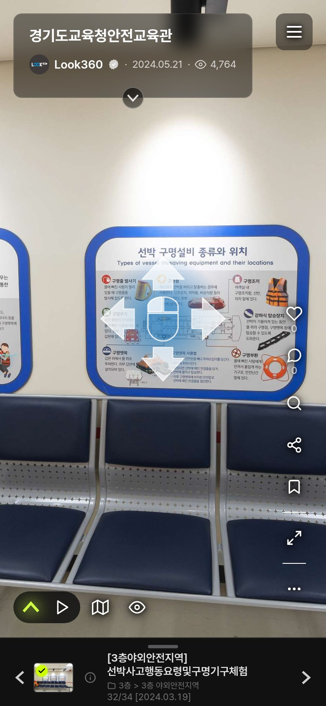

직접 확인
<a class="lnk" href="http://100.120.25.127:5174/vr/1xdrlfot/31636" target="_blank">http://100.120.25.127:5174/vr/1xdrlfot/31636</a>

---

## 🔖 360영상 핫스팟 재생 UX 정비 10/1

복구한 360VIEW 영상이 콘텐츠마다 재생 방식이 달라 재생 버튼이 없거나 클릭 정지가 되지 않았습니다.

| 항목 | 조치 | 결과 |
|---|---|---|
| 재생버튼 소실 | 레거시 스타일 변환 중 빠진 버튼 생성 기능 복원 | 완료 |
| 자동재생 | 허용·엄격·모바일 3정책 × 8콘텐츠 점검 | 정지 0건 |
| 소리 | 자동재생은 음소거, 첫 클릭 시 소리 켬 | 완료 |
| 클릭 재생/일시정지 | 288 원인은 인트로 시야 이동, 격자 9/9 정상 | 완료 |
| 2859 영상 404 | 영상 위치 정정, 200/206 응답 확인 | 완료 |
| 데이터 보존 | 영상 설정 28행을 재마이그 규칙으로 영속화 | 28/28 일치 |

> 대기: iOS Safari 실기기 확인(오너), 소리 켜짐 표시 아이콘은 미구현입니다.

확인
<a class="lnk" href="https://kabkee-macbookpro-2020.tailfe017f.ts.net:8443/IND/issues/IND-7810" target="_blank">IND-7810 영상 재생 UX</a>

---

## ▶ 시연 — 360영상 재생 ① 오너가 지적한 콘텐츠 10/1

아래 링크를 누르면 해당 장면이 바로 열립니다. **시크릿 창**으로 열면 처음 방문한 상태라 자동재생 제한이 가장 엄격합니다.

| 콘텐츠 | 보여줄 것 | 바로 열기 |
|---|---|---|
| 데이즈스튜디오 (1788) | 재생 버튼이 보이고, 영상이 소리 없이 자동재생 | <a href="http://100.120.25.127:5174/vr/6lmp0o6a?pano=19747" target="_blank">열기</a> |
| 882 | 재생 버튼 · 자동재생 | <a href="http://100.120.25.127:5174/vr/l55md6ls?pano=6673" target="_blank">열기</a> |
| 288 | 영상을 누르면 멈추고, 다시 누르면 재생 | <a href="http://100.120.25.127:5174/vr/e940jcdf?pano=4079" target="_blank">열기</a> |
| 2859 · 1층 로비 | 안 나오던 영상(파일 없음)이 이제 재생 | <a href="http://100.120.25.127:5174/vr/c7bce52b?pano=33132" target="_blank">열기</a> |
| 2859 · 3층 | 〃 | <a href="http://100.120.25.127:5174/vr/c7bce52b?pano=33146" target="_blank">열기</a> |

> 정상 동작: 영상은 **음소거로 자동재생**되고, 화면을 **처음 클릭하면 소리가 켜집니다**. 아이폰(Safari) 실기기는 아직 확인 전이라 휴대폰으로도 열어 보시기 바랍니다.

---

## 📸 화면 — 오너가 지적한 콘텐츠 10/1

<figure style="margin:0">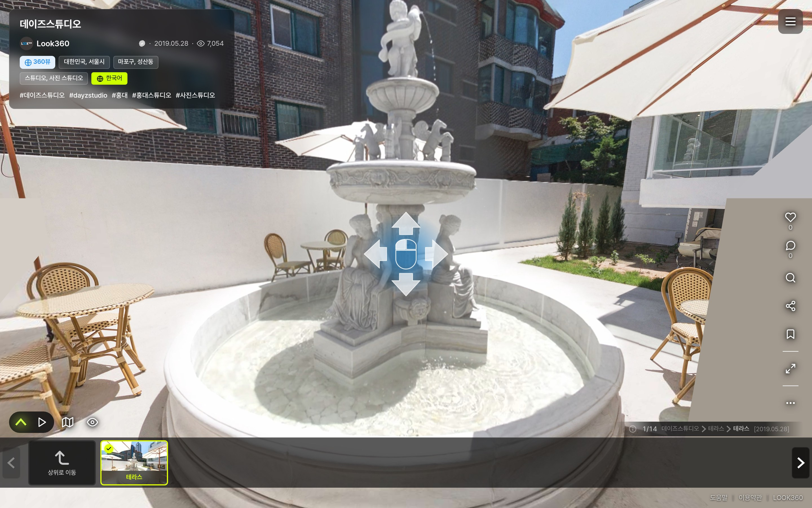<figcaption>1788 데이즈스튜디오</figcaption></figure><figure style="margin:0">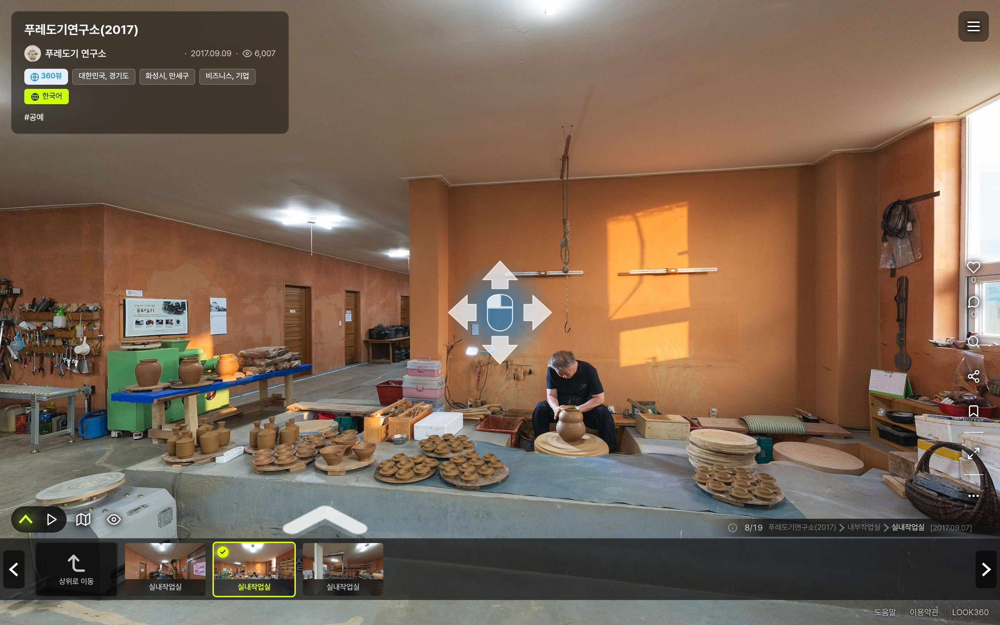<figcaption>882</figcaption></figure><figure style="margin:0">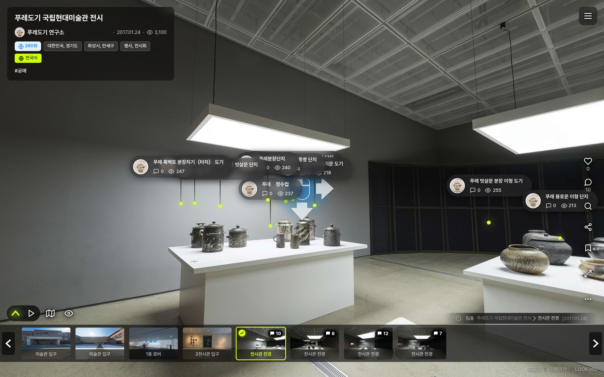<figcaption>288 (클릭 토글)</figcaption></figure><figure style="margin:0">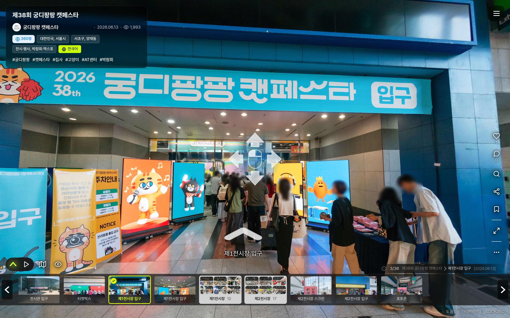<figcaption>2859 1층 로비</figcaption></figure><figure style="margin:0">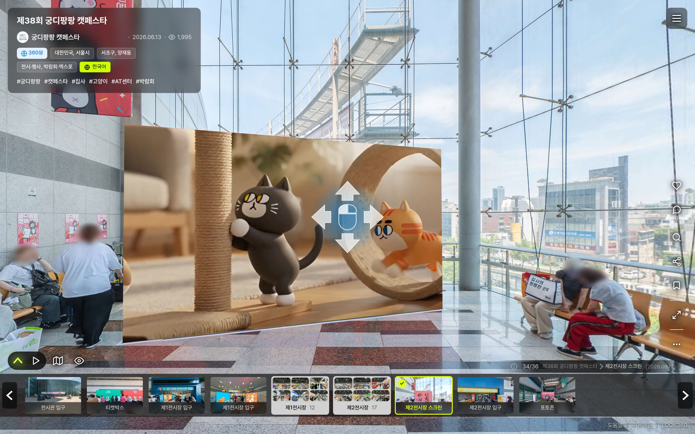<figcaption>2859 3층</figcaption></figure>

직접 확인
<a class="lnk" href="http://100.120.25.127:5174/vr/6lmp0o6a?pano=19747" target="_blank">1788</a>
<a class="lnk" href="http://100.120.25.127:5174/vr/l55md6ls?pano=6673" target="_blank">882</a>
<a class="lnk" href="http://100.120.25.127:5174/vr/e940jcdf?pano=4079" target="_blank">288</a>
<a class="lnk" href="http://100.120.25.127:5174/vr/c7bce52b?pano=33132" target="_blank">2859 1층</a>
<a class="lnk" href="http://100.120.25.127:5174/vr/c7bce52b?pano=33146" target="_blank">2859 3층</a>

---

## ▶ 시연 — 360영상 재생 ② 다른 영상 콘텐츠도 같은 규칙인지 10/1

영상 재생 규칙을 모든 영상 콘텐츠에 똑같이 적용했으므로, 지적받지 않은 콘텐츠에서도 같은 동작을 보여줄 수 있습니다.

| 콘텐츠 | 비고 | 바로 열기 |
|---|---|---|
| 826 · 영상 3 | 원래부터 정상이던 기준 장면 | <a href="http://100.120.25.127:5174/vr/qmwy4mq9?pano=6196" target="_blank">열기</a> |
| 826 · 영상 5 | 같은 콘텐츠의 다른 영상 | <a href="http://100.120.25.127:5174/vr/qmwy4mq9?pano=6200" target="_blank">열기</a> |
| 954 | | <a href="http://100.120.25.127:5174/vr/19w11wcp?pano=7558" target="_blank">열기</a> |
| 2323 | 이번에 새로 추가 점검 | <a href="http://100.120.25.127:5174/vr/27ayk33n?pano=27838" target="_blank">열기</a> |
| 2430 한국 근대추리소설 특별전 | 첫 장면에 영상 3개 | <a href="http://100.120.25.127:5174/vr/ddtf13lr" target="_blank">열기</a> |
| 2436 세일 제품 | 강의 영상 | <a href="http://100.120.25.127:5174/vr/hmsjc4mf?pano=28744" target="_blank">열기</a> |
| 2578 | 누르면 재생되는 영역 | <a href="http://100.120.25.127:5174/vr/2l6aav48?pano=29886" target="_blank">열기</a> |

> 영상이 첫 화면 밖에 있으면 화면을 돌려 영상 쪽을 보여주시면 됩니다.

---

## 📸 화면 — 다른 영상 콘텐츠 10/1

<figure style="margin:0">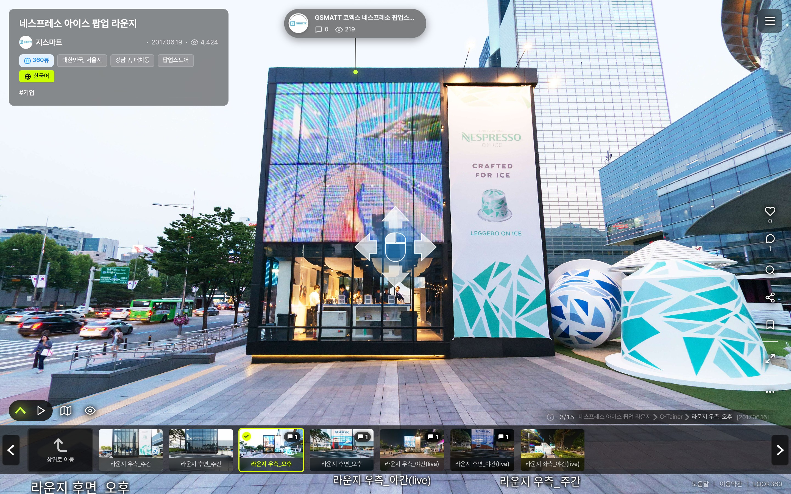<figcaption>826 영상 3</figcaption></figure><figure style="margin:0">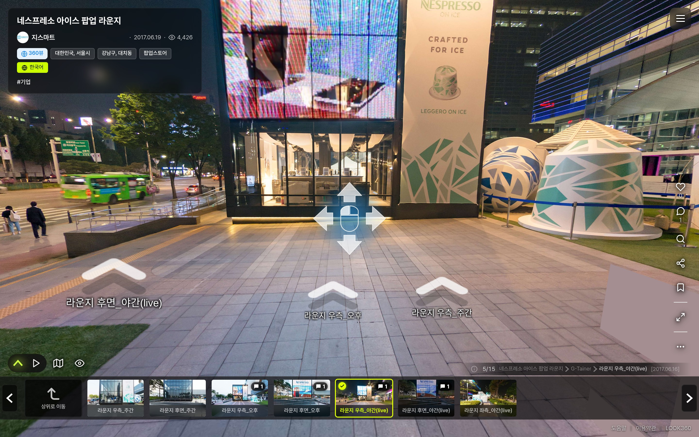<figcaption>826 영상 5</figcaption></figure><figure style="margin:0">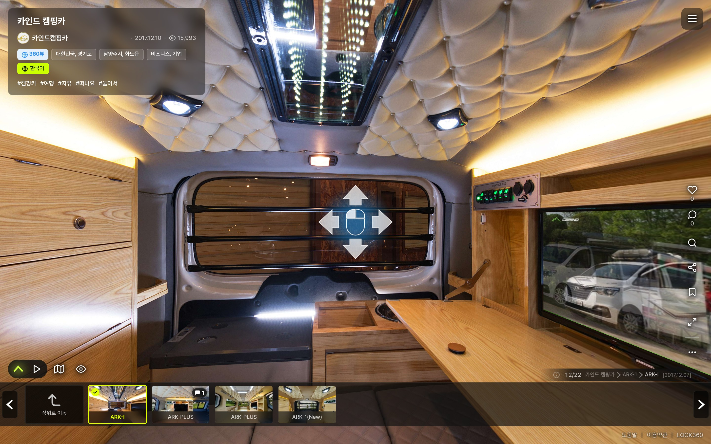<figcaption>954</figcaption></figure><figure style="margin:0">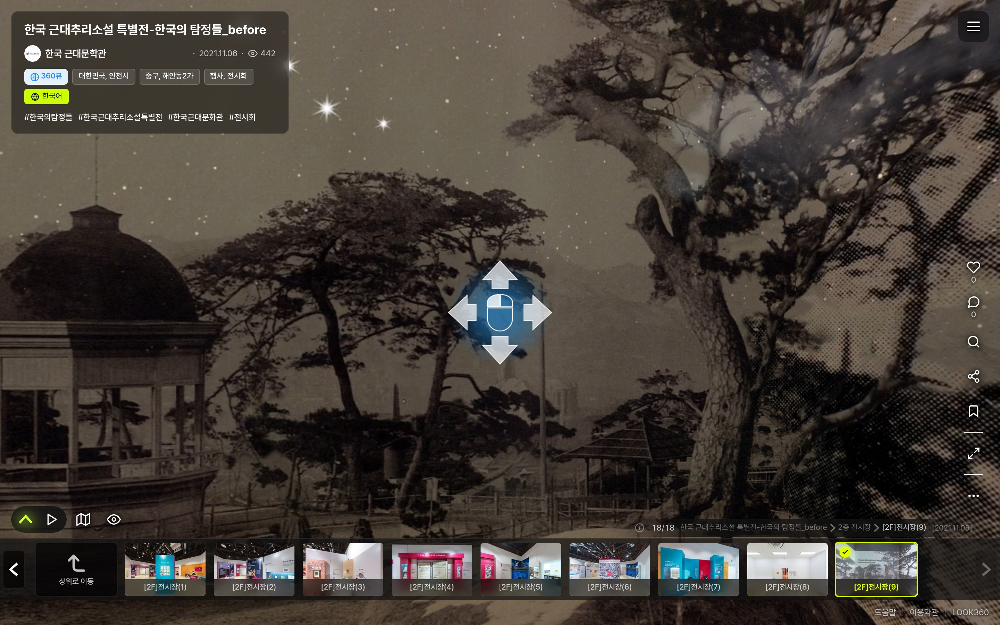<figcaption>2323</figcaption></figure><figure style="margin:0">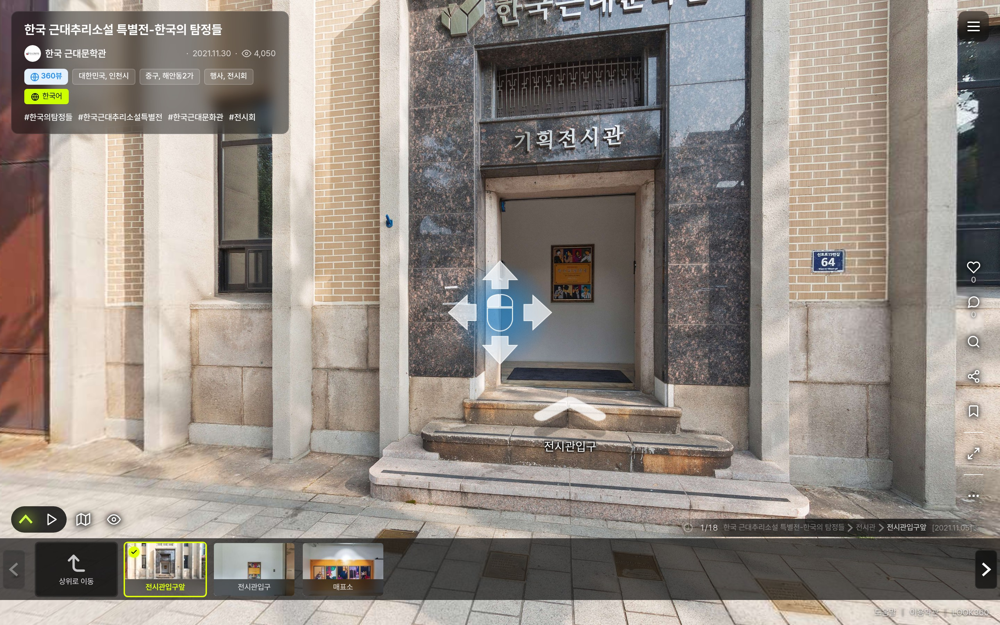<figcaption>2430</figcaption></figure><figure style="margin:0">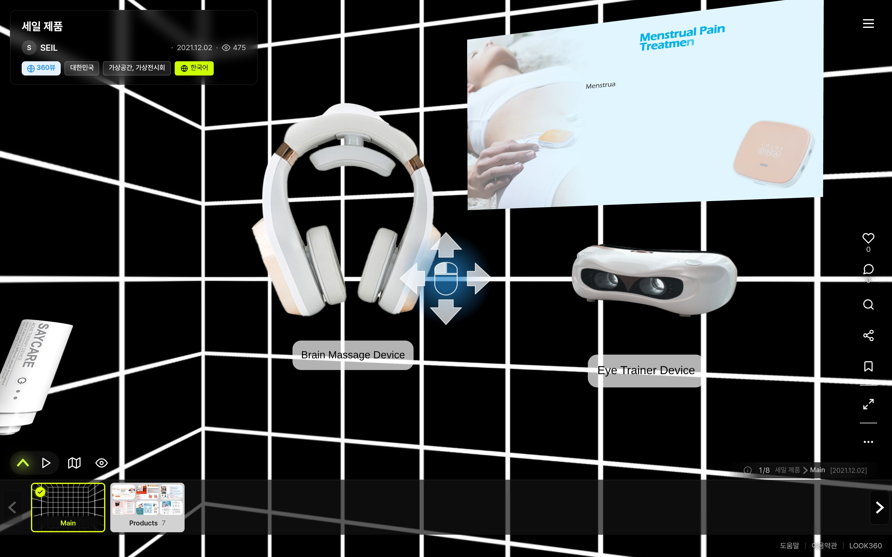<figcaption>2436</figcaption></figure><figure style="margin:0">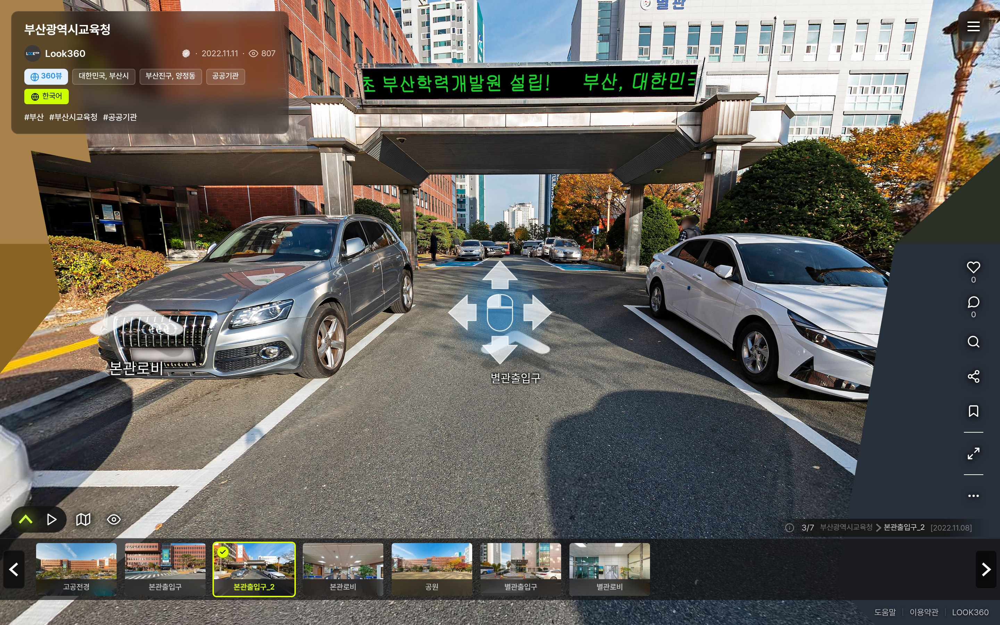<figcaption>2578</figcaption></figure>

직접 확인
<a class="lnk" href="http://100.120.25.127:5174/vr/qmwy4mq9?pano=6196" target="_blank">826</a>
<a class="lnk" href="http://100.120.25.127:5174/vr/19w11wcp?pano=7558" target="_blank">954</a>
<a class="lnk" href="http://100.120.25.127:5174/vr/ddtf13lr" target="_blank">2430</a>
<a class="lnk" href="http://100.120.25.127:5174/vr/hmsjc4mf?pano=28744" target="_blank">2436</a>
<a class="lnk" href="http://100.120.25.127:5174/vr/2l6aav48?pano=29886" target="_blank">2578</a>

---

## 🔖 krpano 첫 로딩 개선 · 화면 통일 10/2 NEW

로딩 오버레이가 저해상도 미리보기와 타일 표시를 가려 이미지가 한꺼번에 늦게 뜨는 것처럼 보였습니다.

| 항목 | 조치 | 결과 |
|---|---|---|
| 원인 실측 | 미리보기 8.4초에 도착했으나 오버레이는 16.2초에 제거 | 주원인 확정 |
| 오버레이 분리 | 미리보기 도착 시 즉시 노출, 타일은 점진 표시 | 완료 |
| 체감 시간(구현자 측정) | 데스크톱 3.99초→1.92초, 모바일 4.04초→1.03초 | 단축 |
| 로딩 화면 통일 | 영어 「Loading...」 공통 컴포넌트, 모든 뷰어 진입점 적용 | QC 통과 |
| 그 외 원인 | 측정 결과 코드 변경 불필요 | 변경 0 |

> 남은 것: 어드민 미push 커밋 4건은 오너 일괄 push 지시 대기입니다.

확인
<a class="lnk" href="https://kabkee-macbookpro-2020.tailfe017f.ts.net:8443/IND/issues/IND-7888" target="_blank">IND-7888 첫 로딩 개선</a>

---

## 🔖 그 밖의 VR 뷰어 개선 9/14~9/30

| 항목 | 무엇을 | 결과 | IND |
|---|---|---|---|
| AI 생성 이미지 안내 | 파노라마 상세 문구와 바닥 배지, 어드민에서 AI 여부 체크 | QC 통과 업로더 체크는 오너 선택으로 추가 없음 | 7375 |
| 360동영상 기획서 | 콘텐츠 모델·적응형 해상도·유튜브 임베드·종류 배지 | 오너 결정 7건 대기 | 7495 |
| 무료 콘텐츠 목록 | 파노라마 클릭 시 해당 장면으로 바로 이동 | 완료 | 7708 |
| 프로필 아바타 | 흰 배경에서 사라지던 원형 경계 그림자 보강 | 완료 | 7582 |
| 링크·탭 오류 | 게시글 탭 딥링크, 갤러리 활성 표시 고착 수정 | 완료 | 7399·7398 |
| 작성자 줄 | 긴 채널명 말줄임 처리 | 완료 | 7300 |
| 콘텐츠 언어 전환 | 그룹 내 목록·경로명 즉시 갱신, 이동 핫스팟 라벨 한글 잔존 해소 | 완료 (자식 17건) | 7232 |
| 홈 히어로 카테고리 | 사이트 언어를 바꿔도 한국어로 남던 문제 | 완료 · 7개 언어 QC | 7376 |
| 삭제 시 고아 데이터 | 콘텐츠 삭제 후 핫스팟·번역·좋아요 통계가 남던 사고 → 삭제 경로·재이관 정리 규칙 보강 | 완료 9/23 반영 | 7458 |

> 기획서(IND-7495)는 코드 변경 없이 문서만 작성했으며, 구현은 오너 결정 후 발주합니다.

확인
<a class="lnk" href="https://kabkee-macbookpro-2020.tailfe017f.ts.net:8443/IND/issues/IND-7375" target="_blank">IND-7375 AI 생성 이미지 안내</a>
<a class="lnk" href="https://kabkee-macbookpro-2020.tailfe017f.ts.net:8443/IND/issues/IND-7495" target="_blank">IND-7495 360동영상 기획서</a>

---

## 🤖 AI로 만든 파노라마 안내 9/16~9/21

AI로 만든 파노라마는 관리자가 표시를 켜면 뷰어에 안내가 나옵니다.

**바뀐 것**
- 관리자 파노라마 등록·일괄등록·정보수정에 「AI 생성 이미지」 스위치
- 뷰어 파노라마 정보창에 「이 파노라마는 AI로 생성된 이미지입니다」(7개 언어)
- 바닥 로고 옆 「AI GENERATED」 원형 표시 (로고를 가리지 않게 위치 조정)
- 기존 파노라마는 일괄 변경하지 않고, 필요한 것만 관리자가 켭니다

**시연 순서** — 현재 AI 표시가 켜진 콘텐츠가 없어 시연 전에 하나를 켜야 합니다
1. 관리자 파노라마 화면에서 「(주)인디스팟 · 공원」 정보수정 → 「AI 생성 이미지」 켜기
2. 뷰어를 열고 바닥을 내려다보면 AI 표시, 정보창에 안내 문구
3. 시연 후 스위치를 다시 끕니다 (실제 데이터)

시연
<a class="lnk admin" href="http://100.120.25.127:5277/panorama" target="_blank">관리자 파노라마</a>
<a class="lnk" href="http://100.120.25.127:5174/vr/4qorh7b8?pano=2523" target="_blank">뷰어 — 공원</a>

---

## 🎬 360동영상 기획서 9/17~9/18

사진처럼 360동영상도 뷰어에서 보여주기 위한 기획서입니다. 개발은 하지 않고 기획만 했습니다.

**담은 내용**
- 지금 구조 조사, 화질 자동 조절 방식
- 유튜브 360 영상이 브라우저별로 되는지 확인한 표
- 일반 VR · 평면 · 영상 구분 표시 시안 2개, 작업 순서

**오너가 정할 7가지** (괄호는 추천)
1. 저장 방식 (파노라마 종류에 「360영상」 추가)
2. 유튜브 영상엔 핫스팟·포스트 불가 수용 (조건부 수용)
3. 저화질 영상 생성 (우리 서버에서 시작)
4. 목록 카드 「영상 포함」 표시 (나중에)
5. 항공 촬영 배지 (넣지 않음) · 6. 백업 범위 (원본만)
7. 판매자 등록 허용 (처음엔 관리자만)

<figure style="margin:0 0 8px">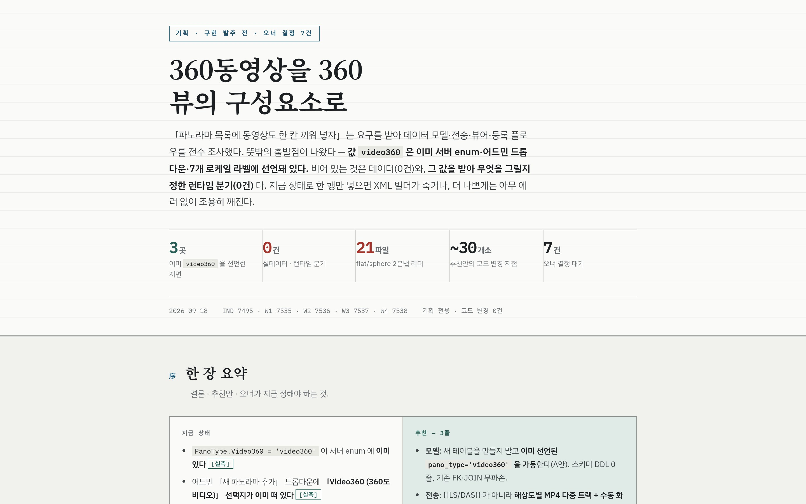<figcaption>기획서 첫 화면</figcaption></figure>

시연
<a class="lnk" href="https://kabkee-decks.netlify.app/ideas/2026-09-18-look360-360video-content-plan.html" target="_blank">기획서 열기</a>

---

## 👆 무료 콘텐츠는 누른 장면으로 바로 이동 9/30

무료 콘텐츠는 상세 페이지 파노라마 목록에서 누른 장면이 뷰어에서 바로 열립니다. 유료는 기존처럼 미리보기 창만 뜹니다.

**시연 순서 (무료)**
1. 「경희판교VI캠퍼스」 상세에서 「파노라마 목록」
2. 「주차장 출입구」 썸네일 클릭
3. 뷰어가 첫 장면이 아니라 **주차장 출입구**로 바로 열림

**비교 (유료)**
- 「K SHOP 2018」 상세에서 「입구」를 누르면 페이지는 그대로, 미리보기 창만 뜸

<figure style="margin:0 0 8px">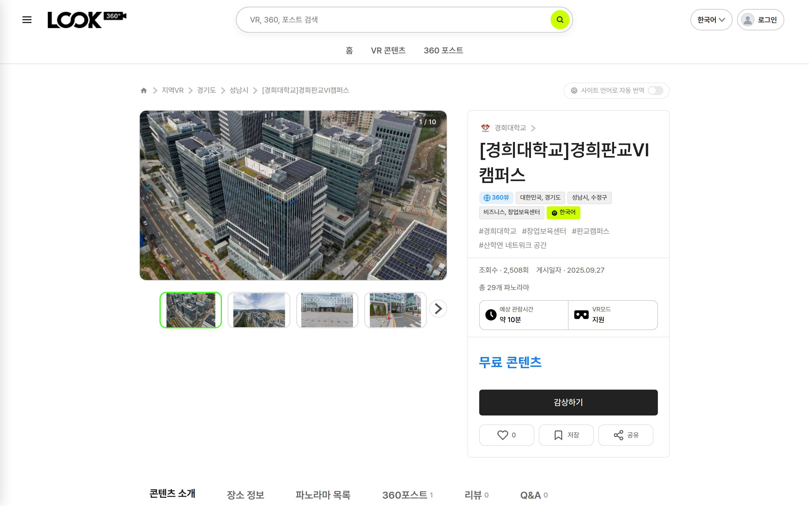<figcaption>① 무료 콘텐츠 상세</figcaption></figure><figure style="margin:0 0 8px">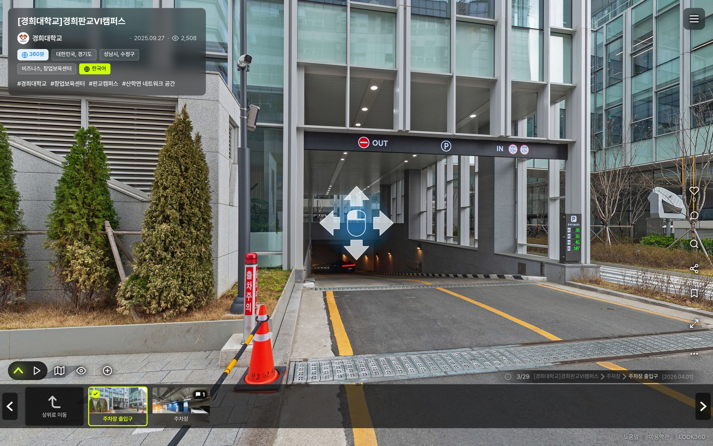<figcaption>② 누른 장면으로 바로 열림</figcaption></figure>

시연
<a class="lnk" href="http://100.120.25.127:5174/vr-info/xo6jh8ib" target="_blank">무료 — 경희판교VI캠퍼스</a>
<a class="lnk" href="http://100.120.25.127:5174/vr-info/13m4a6cp" target="_blank">유료 — K SHOP 2018</a>

---

## ⭕ 흰 배경 프로필 사진 테두리 9/22

프로필 사진 배경이 흰색이면 카드와 구분되지 않던 것을, 옅은 그림자와 얇은 테두리로 보이게 했습니다.

**적용한 6개 화면**
- 360포스트 목록 카드 · 작성 · 수정
- 설정 탭 · 문의(Q&A) 글 · 댓글 입력줄

**시연 순서**
1. 링크를 열면 오른쪽에 「360포스트」가 바로 열림
2. 「경희대학교 · 셔틀엘리베이터 이용안내」 카드
3. 흰 로고 둘레에 옅은 동그라미 테두리

<figure style="margin:0 0 8px">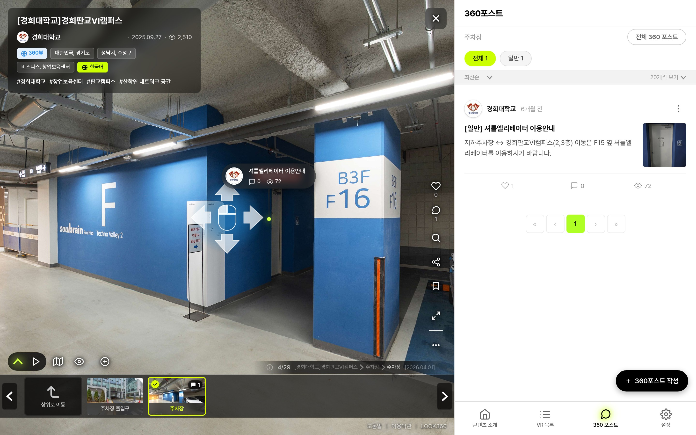<figcaption>경희대학교 흰 배경 로고</figcaption></figure>

시연
<a class="lnk" href="http://100.120.25.127:5174/vr/xo6jh8ib?pano=33044&tab=post" target="_blank">360포스트 — 경희대학교</a>

---

## 🔗 공유 링크로 탭 바로 열기 · 갤러리 탭 표시 9/16

주소에 탭을 지정해 공유하면 그 탭이 바로 열리고, 장소소개의 「갤러리」 탭을 누르면 선택 표시가 제대로 옮겨갑니다.

**고친 것 ① 360포스트 탭 바로 열기**
- 주소 끝 `?tab=post` 를 붙여 공유해도 탭이 열리지 않던 것 수정

**고친 것 ② 갤러리 탭 선택 표시**
- 「갤러리」를 눌러도 밑줄이 「장소정보」에 남던 것 수정

**시연 순서**
1. 첫 링크 → 360포스트 패널이 바로 열림
2. 둘째 링크 → 「콘텐츠 소개 / 장소정보 / 갤러리」
3. 「갤러리」 클릭 → 밑줄이 갤러리로 이동해 유지

<figure style="margin:0 0 8px">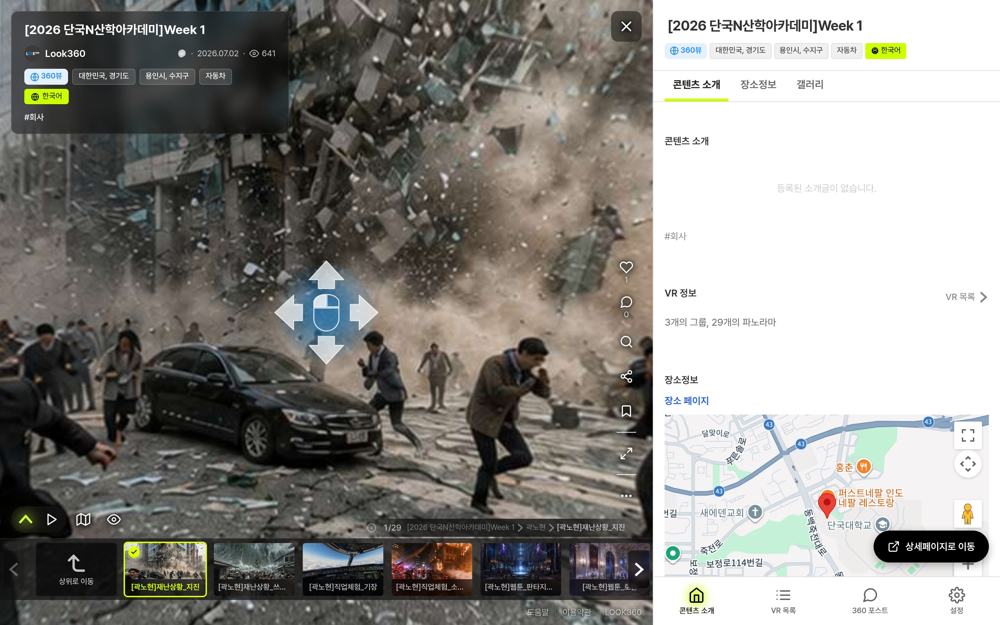<figcaption>장소소개 탭 (콘텐츠 소개 · 장소정보 · 갤러리)</figcaption></figure>

시연
<a class="lnk" href="http://100.120.25.127:5174/vr/xo6jh8ib?tab=post" target="_blank">360포스트 탭 바로 열기</a>
<a class="lnk" href="http://100.120.25.127:5174/vr/09a2e3fd?tab=intro" target="_blank">장소소개 · 갤러리</a>

---

## ✂️ 긴 채널 이름 한 줄 줄임 9/15

채널 이름이 길면 제목 카드가 두 줄로 늘어나던 것을, 한 줄로 두고 넘치면 「…」로 줄였습니다.

**바뀐 것**
- 채널명만 줄어들고, 인증 배지·날짜·조회수는 그대로
- 휴대폰 화면에서 두 줄 → 한 줄 (PC는 변화 없음)

**시연 순서**
1. 휴대폰으로 링크를 엽니다
2. 왼쪽 위 제목 카드의 「산림복지 국민참여 공모전 운영…」
3. 한 줄에서 끝나고 날짜·조회수가 같은 줄에 남음

<figure style="margin:0 0 8px">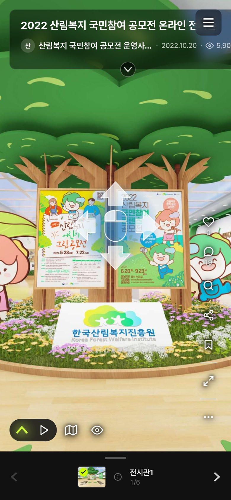<figcaption>휴대폰 화면</figcaption></figure>

시연
<a class="lnk" href="http://100.120.25.127:5174/vr/1lfn283t" target="_blank">산림복지 공모전 (휴대폰으로)</a>

---

## 🌐 VR 안에서 언어를 바꾸면 전부 바로 바뀜 9/14~9/15

콘텐츠 언어를 바꿔도 장면 목록·위치 표시·이동 화살표 이름이 한국어로 남던 것을, 새로고침 없이 바로 바뀌게 했습니다.

**바뀐 것**
- 아래 장면 목록과 위치 표시(경로)가 즉시 번역
- 이동 화살표 이름표와 마우스를 올리면 뜨는 설명도 번역
- 영어판 같은 별도 언어판 VR은 처음부터 번역된 이름으로

**시연 순서**
1. 링크를 열면 아래 목록에 「고공전경」
2. 옆 패널 「설정」 → 「콘텐츠 언어」 → English
3. 목록이 「High altitude view」로, 화살표 이름표도 영어로 바뀜 · 「사용 안 함」이면 원래대로

<figure style="margin:0 0 8px">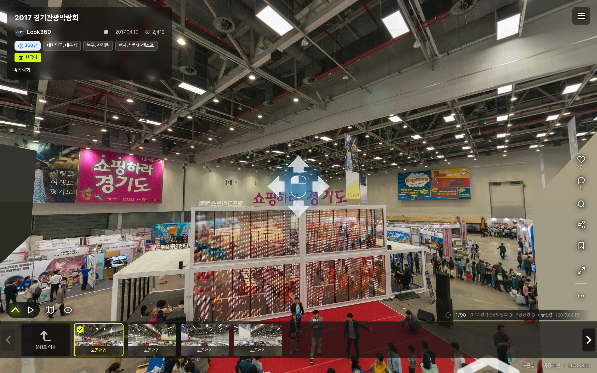<figcaption>바꾸기 전 (한국어)</figcaption></figure>

시연
<a class="lnk" href="http://100.120.25.127:5174/vr/wrpkbkcy?pano=4322" target="_blank">2017 경기관광박람회 · 고공전경</a>

---

## 🏠 홈 배너 분류 이름도 사이트 언어를 따라감 9/16~9/17

사이트 언어를 일본어 등으로 바꿔도 홈 첫 화면 배너의 분류 이름(대학교, 스케이트파크 등)이 한국어로 남던 것을 고쳤습니다.

**바뀐 것**
- 공식 번역이 없는 언어는 자동번역으로 표시
- 한국어 외 6개 언어에서 한국어 잔존 0건

**시연 순서**
1. 홈을 열고 배너 위 분류 이름을 봅니다
2. 위쪽 언어 버튼 → 「日本語」
3. 새로고침 없이 분류·지역 이름이 일본어로

**참고** 배너는 열 때마다 무작위로 바뀝니다. 로그인 상태면 계정 언어가 우선이라 비로그인으로 시연하세요.

<figure style="margin:0 0 8px">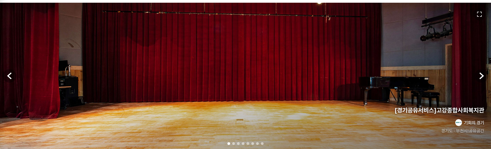<figcaption>한국어</figcaption></figure><figure style="margin:0 0 8px"><figcaption>日本語</figcaption></figure>

시연
<a class="lnk" href="http://100.120.25.127:5174/" target="_blank">홈 (l3 플랫폼)</a>

---

## 🧹 VR을 지운 뒤 남던 데이터 정리 9/17 (9/23 반영)

화면에서 보이는 변화는 없는 내부 정리 작업입니다.

**무슨 일이었나**
- 지워진 VR에 딸린 이동 화살표·번역·좋아요 통계 약 **590건**이 주인 없이 남아 있었습니다

**원인**
- 개발용 데이터를 처음부터 다시 옮기면서(9/8) 번호가 다시 매겨져 생긴 찌꺼기였습니다

**조치**
- 다시 옮길 때마다 남는 데이터를 지우는 정리 규칙 추가
- 다른 삭제 경로 1곳도 딸린 데이터까지 함께 지우도록 수정
- 점검 항목 35개 모두 0건 확인 → **화면 시연 대상 없음**

시연
<a class="lnk" href="http://100.120.25.127:5174/" target="_blank">l3 플랫폼 홈</a>

---

<!-- _class: sec -->

Section 02

## l3 플랫폼 · 레거시 이관 복구 (데이터·콘텐츠)

레거시 사이트에서 새 플랫폼으로 옮기며 조용히 사라진 동영상·기능·이미지를 찾아 복구하고, 재발을 막은 3주간의 기록입니다.

---

## 🔖 레거시 투어 XML 전수조사 9/16~9/22 NEW

레거시 투어에는 DB에 없던 손코딩 기능(동영상·미니게임·팝업)이 있어 이관 때 에러 없이 사라졌고, 오너 제보가 있어야만 발견됐습니다.

| 항목 | 조치 | 결과 |
|---|---|---|
| 찾는 방식 | 이름이 아닌 기능 단위로 레거시 XML 2,869개를 서버에서 검색 | 후보를 수십 건으로 압축 |
| 누락 판정 | DB 대조 후 화면 렌더까지 확인 | 새 플랫폼이 이미 구현한 기능은 제외 |
| 판정 결과 | 콘텐츠별 1행 통합표 작성 | 복구 대상 20행·코드 보강 4계열 |
| 오너 결정 | 일부 기능은 「레거시 수용 대상 아님」 | 5건은 신규 설계로 이관 |
| 위양성 회수 | 이미 이관됐거나 공통 파일에 정의된 건 | 오판 방지 기준 기록 |
| 트랙 종결 | 21개 하위 트랙 전건 | 완료 9/22 |

> 「있어야 할 기능이 없는 것」을 오너 제보 없이 찾아내는 기준표가 생겼습니다.

확인
<a class="lnk" href="https://kabkee-macbookpro-2020.tailfe017f.ts.net:8443/IND/issues/IND-7395" target="_blank">IND-7395 투어 XML 전수조사</a>

---

## 🔖 사라졌던 기능 복구 결과 9/18~9/22

전수조사에서 확정된 누락을 개발 서버에서 복구하고 실제 화면에서 재생까지 확인했습니다.

| 사용자에게 안 보였던 것 | 조치 | 결과 |
|---|---|---|
| 파노라마 속 동영상 7건 (네스프레소 라운지 등) | 장면별 데이터 복원 | PC·모바일 각각 재생 확인 |
| 팝업·영상 버튼 3건 | 깨진 데이터 복구 | 복구 |
| 미니게임·반딧불이·장명등 등 6건 | 동작 정의 이식 | 복구 |
| VR스토리 주야간 전환·360영상·시작 연출 | 엔진 기능 신설 | 복구 |
| 영문 콘텐츠 6건이 한국어 나레이션 재생 | 영문 음성 경로로 교정 | 교정 (1회 되돌려져 재적용) |
| 깜빡임 강조 효과 (335개 콘텐츠) | 코드 반영 | 9/21 기준 화면 미도달 |

> 개발 서버 반영입니다. 깜빡임 효과는 서버 재시작(운영과 공유)이 필요해 배포 지시 시점에 반영됩니다.

확인
<a class="lnk" href="https://kabkee-macbookpro-2020.tailfe017f.ts.net:8443/IND/issues/IND-7394" target="_blank">IND-7394 파노라마 동영상 복구</a>
<a class="lnk" href="https://kabkee-macbookpro-2020.tailfe017f.ts.net:8443/IND/issues/IND-7542" target="_blank">IND-7542 동영상 7건</a>

---

## 🔖 VR스토리 이관 결함 — 문제와 원인 10/2~ NEW

오너가 이관 콘텐츠 102건을 직접 검토해 88건이 미통과였고, 공통 증상은 「첫 장면 인사말 나레이션이 안 나온다」였습니다.

| 사용자에게 보인 문제 | 원인 |
|---|---|
| 시작 버튼이 없어 진행이 멈춤 | 비파노 장면(시작 화면 등)이 이관 때 통째로 누락 |
| 바람개비 애니메이션 정지 | 레거시 공용 동작이 새 플랫폼에 없음 |
| 360영상 단계에서 진행 정지 | 스토리 동작이 복구한 영상 경로를 덮어씀 |
| 첫 나레이션이 시작하자마자 끊김 | 「나레이션 끝을 기다리지 않음」으로 잘못 해석 |
| 일반 열람 중 장면 로딩 실패 | 요청 한도(429) 초과 |

> 일부가 아니라 구조 문제여서, 원인 5종으로 묶어 단계별로 고쳤습니다.

확인
<a class="lnk" href="https://kabkee-macbookpro-2020.tailfe017f.ts.net:8443/IND/issues/IND-7864" target="_blank">IND-7864 VR스토리 이관 결함 복구</a>

---

## 🔖 VR스토리 이관 결함 — 결과와 남은 것 10/2~10/6

하위 이슈 대부분이 완료되었고, 인수 검증에서 스토리 대부분이 끝까지 진행됩니다. 마지막 2건을 막던 오너 결정은 10/6 내려져 작업이 재개되었습니다.

| 항목 | 조치 | 결과 |
|---|---|---|
| 나레이션·공용 동작·누락 장면 | 엔진 교정, 레거시 동작 이식, 장면 복원 | 개발 서버 반영 |
| 360영상 장면 | 오너 카드 `restore-legacy` 승인 후 복원 | 완료 |
| 인수 검증 (스토리 3~46번) | 끝까지 진행 측정 | 대부분 통과 |
| 인수 검증 (47~91번) | 동일 측정 | 22건 통과·1건 보완 |
| 56번 스토리 아이콘 완주 | W19 수정 대기 | 대기 |
| 33~36번 운영 주소 연결 | 콘텐츠 안 `look360.kr` 주소를 l3 주소로 바꿈 | 10/6 결정: 별도 이슈로 분리 |

> 이슈 상태는 「대기(blocked)」이며, 운영에는 배포하지 않았습니다.

확인
<a class="lnk" href="https://kabkee-macbookpro-2020.tailfe017f.ts.net:8443/IND/issues/IND-7950" target="_blank">IND-7950 W18 검토 중</a>
<a class="lnk" href="https://kabkee-macbookpro-2020.tailfe017f.ts.net:8443/IND/issues/IND-7957" target="_blank">IND-7957 W19 대기</a>

---

## 🔖 특수 레거시 파노라마 렌더 복구 10/2~10/3

레거시에서 DB 기록과 실제 파일이 다른 특수 파노라마가 새 플랫폼에서 깨져 보였습니다 (오너 제보 `/vr/ryma4vrw?pano=22443`).

| 항목 | 조치 | 결과 |
|---|---|---|
| 단일 이미지 파노라마 | 단일 구면 방식으로 렌더 | 정상 표시 |
| 평면·원통형 테스트 파노라마 | 실제 파일 기준으로 보정 | 정상 표시 |
| 삭제 후 남은 고아 152건 | 백업 후 정리 | 정리 |
| 장소 없는 파노라마 60건 | 56건 정리·4건 유지 (오너 승인) | 완료 |
| 핫스팟 누락 6장면·로고 404 | 코드 수정 후 실클릭 검증 | 완료 |
| 재발 방지 | 재이관 규칙·게이트 6종·화면 검증 10건 | 10/10 통과 |

> 개발 서버 반영입니다. 모바일 실기기 확인은 보드 확인 대기입니다.

확인
<a class="lnk" href="https://kabkee-macbookpro-2020.tailfe017f.ts.net:8443/IND/issues/IND-7896" target="_blank">IND-7896 특수 파노라마 복구</a>
<a class="lnk" href="https://kabkee-macbookpro-2020.tailfe017f.ts.net:8443/IND/issues/IND-7897" target="_blank">IND-7897 후속 6항목</a>

---

## 🔖 클린 재이관 신뢰성 확보 9/22~10/6

오너 요청은 「다음에 개발·본 서버에 다시 이관할 때 문제가 없어야 한다」였는데, 이관 작업이 중간에 멈추는 상태였습니다.

| 항목 | 조치 | 결과 |
|---|---|---|
| 이관 중단 원인 | 코드 1줄 오류 수정·방지 검사 추가 | 최초 완주 9/22 |
| 완주 후 검증 | 진짜 회귀 16건 확인 | 원인별로 순차 수정 |
| 공개 주소 소실 우려 | 정상 환경 재측정 | 위험은 빈 DB 경로 한정으로 확인 |
| 지역·콘텐츠 번호·사용자 입력 | 보존 후 복원 방식 | 번호 밀림 해소 (10/5) |
| 비밀번호·관리자 권한 덮어쓰기 | W16 수정 중 | 진행 중 |
| 최종 전 테이블 재측정 | W17 | 대기 |

> 이슈 상태는 「대기」이며, 최종 측정 전까지 운영·개발 DB 재이관은 하지 않습니다.

확인
<a class="lnk" href="https://kabkee-macbookpro-2020.tailfe017f.ts.net:8443/IND/issues/IND-7586" target="_blank">IND-7586 클린 재이관 회귀 16건</a>
<a class="lnk" href="https://kabkee-macbookpro-2020.tailfe017f.ts.net:8443/IND/issues/IND-7579" target="_blank">IND-7579 이관 중단 버그</a>

---

## 🔖 레거시 이미지 주소·차단 해결 9/16~9/30

새 플랫폼 서버를 거치는 레거시 파일 요청이 방화벽 한도에 걸려, VR 화면 타일이 간헐적으로 403이 났습니다.

| 항목 | 조치 | 결과 |
|---|---|---|
| 간헐 403 | 중계 대신 서버가 레거시 원본 주소를 직접 내려줌 | 9/17 적용 · 이후 재측정 통과 |
| 갤러리·응답 누락 | 전수 점검 후 누락 응답 보강 | 공개 응답 10곳 잔존 0 |
| 어드민 이미지 404 | 누락 응답 편입·중계 경로 | 개발 서버만 |
| 메인 추천VR 옛 경로 | 읽을 때마다 재계산 | 개발 서버만 |
| 북마크 썸네일 | 자동 생성분 저장 제거 | 개발 서버만 |

> 어드민·추천VR·북마크는 배포 지시 시 반영되며, 북마크는 DB 변경을 먼저 적용해야 합니다.

확인
<a class="lnk" href="https://kabkee-macbookpro-2020.tailfe017f.ts.net:8443/IND/issues/IND-7388" target="_blank">IND-7388 WAF 차단 근본 해결</a>
<a class="lnk" href="https://kabkee-macbookpro-2020.tailfe017f.ts.net:8443/IND/issues/IND-7486" target="_blank">IND-7486 게이트 누락 마감</a>
<a class="lnk" href="https://kabkee-macbookpro-2020.tailfe017f.ts.net:8443/IND/issues/IND-7737" target="_blank">IND-7737 어드민 이미지</a>

---

<!-- _class: sec -->

Section 03

## l3 플랫폼 · 사용자 페이지

신설된 장소 페이지를 중심으로, 홈 · 언어 · 채널 · VR 상세 · 게시판 · 알림 · 검색 화면의 변화를 정리합니다.

---

## 📍 장소 페이지 ① 왜, 어떤 방식으로 9/30~10/2 NEW

플랫폼에는 장소 화면이 없어, 장소에 연결된 VR 콘텐츠를 한곳에서 볼 수 없었습니다. 오너 요청(9/30)으로 설계부터 진행했습니다.

| 항목 | 확인한 사실 | 결정 |
|---|---|---|
| 장소 규모 | 장소 1,774곳 중 VR이 1건뿐인 곳이 1,384곳(78%) | 「1건짜리 화면」을 필수 요구로 설계 |
| 방식 비교 | 독립 페이지 · VR 상세 안 허브 · 채널 통합 3안 | 안1 독립 페이지 채택(공유 URL 가능) |
| 주소 규칙 | 기존 장소 주소는 읽기 쉬운 영문 이름 | 8자리 해시 주소로 전환, 옛 주소는 자동 연결 |
| 보안 | 기존 장소 API가 이메일·팩스를 그대로 응답 | 공개 전용 응답(비공개 장소 404) 신설 |
| 공유 미리보기 | 「크롤러가 못 본다」는 전제가 틀림 | 기존 미리보기 프록시를 확장(별도 이슈) |
| 단계 | Figma 시안 → 서버 → 화면 → 진입 경로 → 공용 장소 | 5단계로 분할 발주 |

> 오너 결정 카드 3문항(안1 채택 · 미리보기 별도 이슈 · 해시 주소 전환)으로 확정했습니다.

확인
<a class="lnk" href="https://kabkee-macbookpro-2020.tailfe017f.ts.net:8443/IND/issues/IND-7692" target="_blank">IND-7692 장소 페이지 설계</a>
<a class="lnk" href="https://kabkee-macbookpro-2020.tailfe017f.ts.net:8443/IND/issues/IND-7753" target="_blank">IND-7753 구현 EPIC</a>

---

## 📍 장소 페이지 ② 구현 결과 10/1~10/2 NEW

장소 페이지(`/place/:domain`)가 개발 서버에서 열리며, 단계별 검수를 모두 통과했습니다. 정식 운영 반영은 아직 하지 않았습니다.

| 단계 | 내용 | 결과 |
|---|---|---|
| 화면 | 히어로 · 대표 VR · 종류별 목록 · 정보 · 1건/0건/404 변형 | 완료 · 검수 중 장소명 미표시·헤더 가림 2건 수정 |
| 진입 경로 | VR 상세 · 뷰어 · 지역 지도 마커에서 장소로 이동 | 완료 · 스크린샷 41장 검수 |
| 개인정보 | 기존 공개 응답에 이메일·팩스 노출 발견 | 제거 · 숨김 장소 주소 비공개 |
| 공용 장소 | 「Look360 공용 장소」 배지 · 소유자 UI 없음 | 완료 |
| 같은 지역 · 검색 | 같은 지역의 다른 장소 · 검색 「장소」 그룹 | 완료 · 응답 4초 → 1초 미만 |
| 공유 카드 | 공유 미리보기 · 옛 주소는 새 주소로 안내 | 완료 · 실제 배포 환경 검증은 배포 후 |

> 구현 EPIC 자식 20건 전부 완료. 개인정보 수정의 운영 반영과 채널 페이지의 「이 채널의 장소」는 오너 판단 대기입니다.

확인
<a class="lnk" href="https://kabkee-macbookpro-2020.tailfe017f.ts.net:8443/IND/issues/IND-7841" target="_blank">IND-7841 W4 공용 장소·검색</a>
<a class="lnk" href="https://kabkee-macbookpro-2020.tailfe017f.ts.net:8443/IND/issues/IND-7754" target="_blank">IND-7754 공유 카드</a>

---

## 📍 화면 — 신설된 장소 페이지 10/2 NEW

장소 대표 이미지, 업종·주소, 운영 채널, 지도와 장소 정보, 연결된 VR 콘텐츠를 한 화면에서 봅니다.

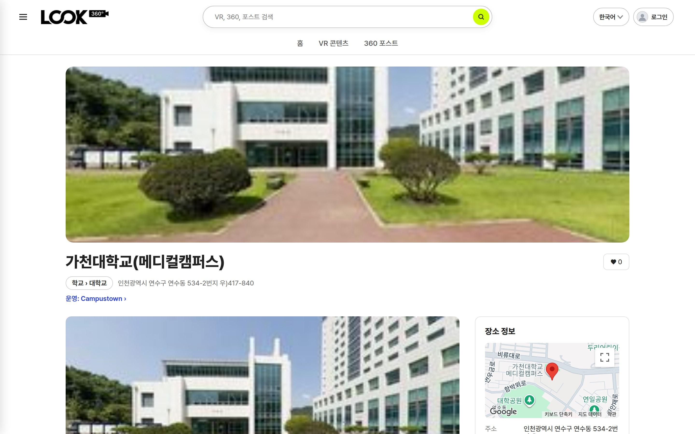

직접 확인
<a class="lnk" href="http://100.120.25.127:5174/place/fzkets8c" target="_blank">http://100.120.25.127:5174/place/fzkets8c</a>

---

## 🏠 홈 히어로 9/14~10/2

홈 첫 화면의 히어로 VR에 핫스팟·건물 툴팁을 넣고, 모바일 자이로를 켜는 작업입니다. 오너 답변으로 범위를 좁혔습니다.

| 항목 | 조치 | 결과 |
|---|---|---|
| 핫스팟·건물 툴팁 | 이동 핫스팟은 제외, 툴팁·이미지·링크만 포함(무료 콘텐츠) | 완료 9/15 · 이동 핫스팟 0건 확인 |
| 지역 표기 | 국가 제외, 상위 2단계까지만 표시 | 완료 · API 30회 대조 |
| 모바일 자이로 | 자동 ON, 불가 기기는 버튼 | 완료 · 실기기 3항목은 오너 확인 트랙 |
| 자이로 후속 | Android 실기기에서 자동 ON 안 됨 → 오너가 「첫 터치 금지」 번복 | 10/2 ON/OFF 토글 + 첫 터치 ON |
| 건물 폴리곤 조사 | 3건 중 2건이 마우스·탭에 반응 안 함 | 원인 규명, 수정은 미발주 |
| 추천 VR 경로 | 옛 스냅샷에 깨진 이미지 경로 16건 | 읽을 때 재계산 · 재발 방지 |

> 건물 폴리곤은 「그리지 못하는 데이터」로 판명됐고, 렌더 경로 조사 발주 여부는 미확인입니다.

확인
<a class="lnk" href="https://kabkee-macbookpro-2020.tailfe017f.ts.net:8443/IND/issues/IND-7235" target="_blank">IND-7235 홈 히어로</a>
<a class="lnk" href="https://kabkee-macbookpro-2020.tailfe017f.ts.net:8443/IND/issues/IND-7339" target="_blank">IND-7339 폴리곤 조사</a>

---

## 🌐 언어 — 자동 판별 · 자동번역 토글 · 채널 다국어 9/16~9/30 NEW

방문자가 고르지 않아도 알맞은 언어로 열리고, 번역 여부는 사용자가, 채널 번역은 운영자가 직접 정하도록 바꿨습니다.

| 항목 | 조치 | 결과 |
|---|---|---|
| 언어 자동 판별 | 저장된 선호 → 브라우저 언어 → 접속 국가 → 영어 순 | 완료 · 기본값 한국어 → 영어 |
| 기존 회원 433명 | 선호 언어 미지정이면 다음 접속 때 자동 적용 | 완료 |
| 접속 국가(IP) | CloudFront 국가 헤더 방식으로 서버·화면 반영 | 코드 완료 · CDN 설정은 오너 결정 |
| 헤더 자동번역 토글 | 카드 제목·내용은 토글 값만 따름(OFF면 원문) | 완료 · 오교체 0건 |
| 채널명·소개 다국어 | 기본 언어 지정 + 언어별 번역(YouTube 방식) | 완료 · 관리자 화면 포함 |
| 홈 카테고리 언어 | 비한국어 선택 시 한글이 남던 문제 | 한글 잔존 0건 (6개 언어) |

> 모두 개발 서버 반영입니다. 접속 국가 판별은 CloudFront 헤더 전달을 켜야 실제로 동작합니다.

확인
<a class="lnk" href="https://kabkee-macbookpro-2020.tailfe017f.ts.net:8443/IND/issues/IND-7374" target="_blank">IND-7374 언어 자동 판별</a>
<a class="lnk" href="https://kabkee-macbookpro-2020.tailfe017f.ts.net:8443/IND/issues/IND-7483" target="_blank">IND-7483 접속 국가</a>
<a class="lnk" href="https://kabkee-macbookpro-2020.tailfe017f.ts.net:8443/IND/issues/IND-7712" target="_blank">IND-7712 자동번역 토글</a>
<a class="lnk" href="https://kabkee-macbookpro-2020.tailfe017f.ts.net:8443/IND/issues/IND-7711" target="_blank">IND-7711 채널 다국어</a>

---

## 📺 채널 · VR 상세 · 목록 9/15~10/2

VR 상세와 목록, 채널 화면의 표시와 이동 방식을 다듬은 묶음입니다.

| 항목 | 무엇을 | 결과 | 바로 열기 |
|---|---|---|---|
| 인증 채널 뱃지 | 뷰어 제목줄에 인증 아이콘, 관리자 화면에서 부여 | 완료 · look360 채널 1건 부여 | <a href="http://100.120.25.127:5174/channel/channel-cd5q7v89" target="_blank">열기</a> |
| 채널명 반영 | 뷰어 작성자를 채널 정보 기준으로 통일 | 완료 | <a href="http://100.120.25.127:5174/vr/1xdrlfot" target="_blank">열기</a> |
| 채널 목록 | 채널 이름이 보이지 않던 문제 | 수정 · 높이 0 → 21px | <a href="http://100.120.25.127:5174/channels" target="_blank">열기</a> |
| 모바일 경로 표시 | 영문 5줄 → 1줄, 중간 단계 접기 | 완료 · 136px → 24px | <a href="http://100.120.25.127:5174/vr-info/xo6jh8ib" target="_blank">열기</a> (휴대폰) |
| 파노라마 바로 이동 | 무료 콘텐츠는 클릭한 장면으로 직접 열림 | 완료 · 유료는 현행 유지 | <a href="http://100.120.25.127:5174/vr-info/xo6jh8ib" target="_blank">열기</a> |
| 국가 선택 | 국가를 별도 선택(기본 대한민국), 지역 필터 정리 | 완료 · 해외 콘텐츠는 「전체」에서만 노출 | <a href="http://100.120.25.127:5174/vr-list" target="_blank">열기</a> |

> 국가 필터가 한국 기본이라, 검색에서 해외 콘텐츠를 보이게 할지는 오너 요청 시 별도 이슈로 진행합니다.

시연
<a class="lnk" href="http://100.120.25.127:5174/channel/channel-cd5q7v89" target="_blank">인증 채널 — Look360</a>
<a class="lnk" href="http://100.120.25.127:5174/channels" target="_blank">채널 탐색</a>
<a class="lnk" href="http://100.120.25.127:5174/vr-list" target="_blank">VR 목록 · 국가 선택</a>

---

## 📸 화면 — 채널 · VR 상세 · 목록 9/15~10/2

<figure style="margin:0">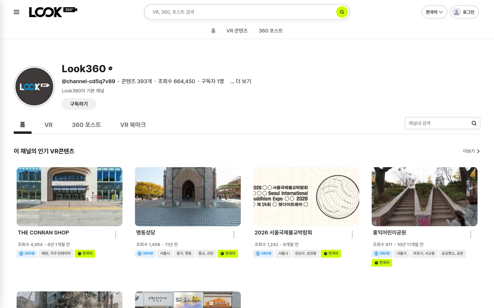<figcaption>① 인증 채널 — 채널 이름 옆 인증 표시</figcaption></figure>
<figure style="margin:0"><figcaption>② VR 뷰어 제목 카드 — 채널명 옆 인증 표시</figcaption></figure>

<figure style="margin:0">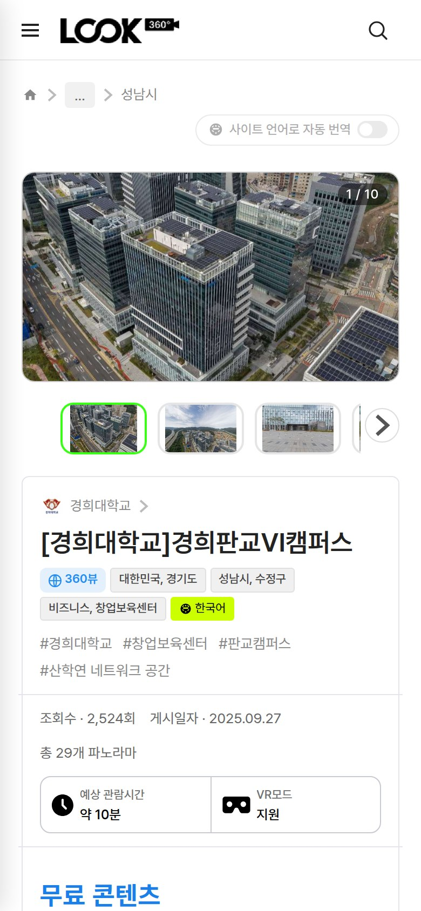<figcaption>⑤ 휴대폰 VR 상세 — 경로 한 줄 「… › 성남시」</figcaption></figure>

<figure style="margin:0">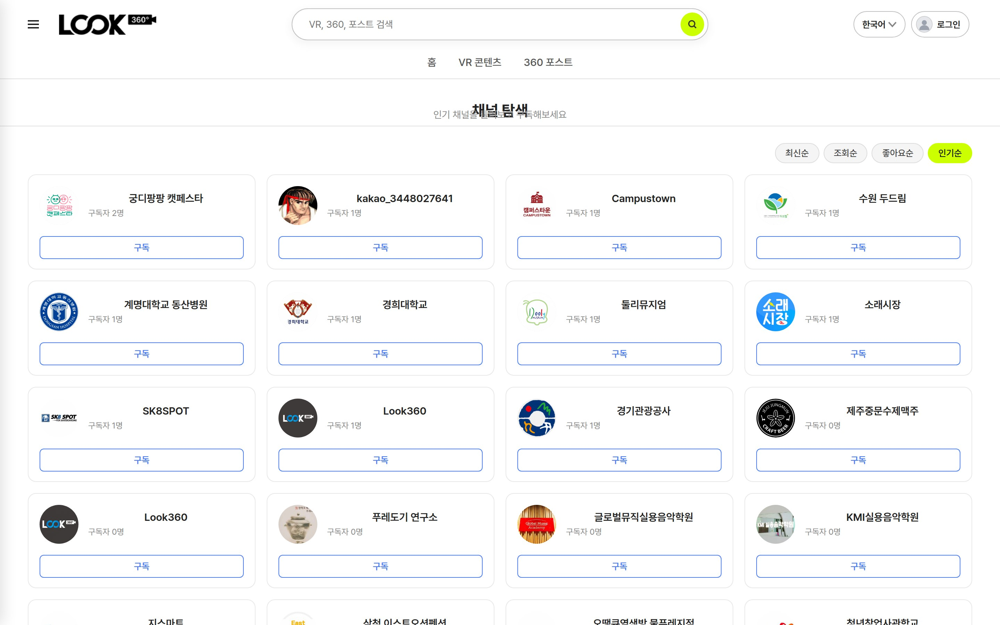<figcaption>③ 채널 탐색 — 채널 이름이 보임</figcaption></figure>
<figure style="margin:0">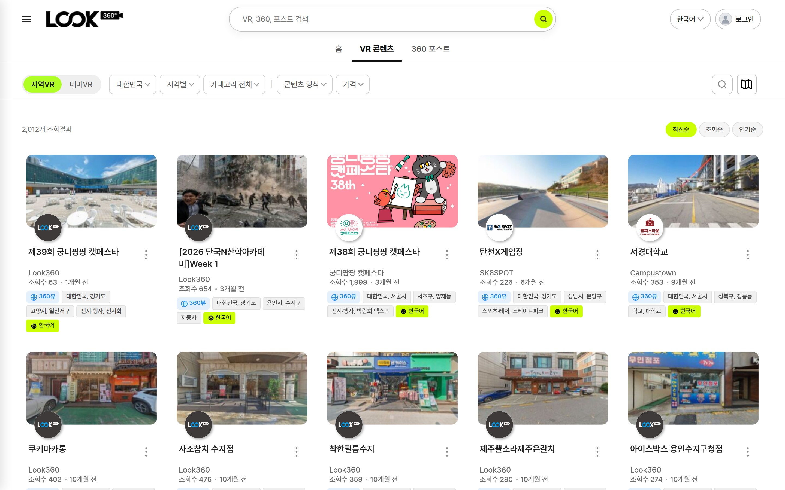<figcaption>④ VR 목록 — 「대한민국」 국가 선택</figcaption></figure>

직접 확인
<a class="lnk" href="http://100.120.25.127:5174/channel/channel-cd5q7v89" target="_blank">① 인증 채널</a>
<a class="lnk" href="http://100.120.25.127:5174/vr/1xdrlfot" target="_blank">② 뷰어 제목 카드</a>
<a class="lnk" href="http://100.120.25.127:5174/channels" target="_blank">③ 채널 탐색</a>
<a class="lnk" href="http://100.120.25.127:5174/vr-list" target="_blank">④ VR 목록</a>
<a class="lnk" href="http://100.120.25.127:5174/vr-info/xo6jh8ib" target="_blank">⑤ VR 상세(휴대폰)</a>

---

## 📱 게시판 · 360포스트 모바일 9/14~9/16

모바일에서 카테고리 탭이 줄바꿈되던 화면과 360포스트 작성 흐름을 손봤습니다.

| 항목 | 조치 | 결과 | IND |
|---|---|---|---|
| 카테고리 탭 | 한 줄 가로 스크롤 + 끝 화살표, 공용 컴포넌트로 4개 화면 적용 | 4/4 완료 | 7256 |
| 화살표 정렬 | 화살표 높이 정렬, PC도 한 줄 스크롤 | 완료 · 오너 확인 통과 | 7373 |
| 360포스트 작성 | 위치 조준 먼저 → 작성 폼(오너가 9/7 결정 번복) | 완료 | 7238 |
| 뒤로가기 오류 | 작성 중 뒤로가기 시 위치·파노라마 불일치 제출 | 재현 후 수정 | 7301 |
| 죽은 코드 | 5개월간 쓰이지 않던 스타일 358줄 삭제 | 완료 · 화면 변화 0 | 7326 |

> 검수 중 실제 회원 계정으로 로그인해 알림 메일이 3회 발송된 사고가 있어, 실사용자 계정 검수 금지와 전용 테스트 계정이 도입됐습니다.

확인
<a class="lnk" href="https://kabkee-macbookpro-2020.tailfe017f.ts.net:8443/IND/issues/IND-7256" target="_blank">IND-7256 카테고리 탭</a>
<a class="lnk" href="https://kabkee-macbookpro-2020.tailfe017f.ts.net:8443/IND/issues/IND-7238" target="_blank">IND-7238 360포스트 작성</a>

---

## 🔔 구독·채널 알림 9종 9/17~9/26

구독자와 채널 운영자에게 필요한 알림 9종을 추가하는 EPIC입니다. 오너 결재(9/17)로 9종 전부 착수했습니다.

| 대상 | 알림 | 결과 |
|---|---|---|
| 구독자 | 유료 → 무료 전환 · 할인 종료 D-1 · 휴면 채널 복귀 · 기존 VR 새 챕터 | 구현·검수 완료 |
| 운영자 | 새 구독자 · 구독자 마일스톤 · 미답변 Q&A(2일) | 구현·검수 완료 |
| 운영자 | 리뷰 일일 요약 · 주간 판매/조회 요약 | 구현·검수 완료 |
| 1차 검수 | 5종 중 2종(새 챕터·리뷰 요약)이 영구 무발송 | 원인 수정 · 컬럼명 오류, 문자 정렬 불일치 |
| 화면 표시 | es/de/ru 라벨 미등재, 일부 알림이 한국어 노출, 숫자 서식 깨짐 | 수정 · 7개 언어 확인 |
| 이슈 규모 | 직속 자식 23건 | 전건 완료 9/26 |

> 실제 발송은 개발 서버 안전장치 안에서만 검증했고, 운영 반영은 확인되지 않았습니다.

확인
<a class="lnk" href="https://kabkee-macbookpro-2020.tailfe017f.ts.net:8443/IND/issues/IND-6570" target="_blank">IND-6570 알림 9종 EPIC</a>
<a class="lnk" href="https://kabkee-macbookpro-2020.tailfe017f.ts.net:8443/IND/issues/IND-7634" target="_blank">IND-7634 화면 표시 검수</a>

---

## 🔍 검색 의도 분류 실험 10/3~10/4 NEW

검색어의 업종 의도를 AI로 분류해 결과를 끌어올리는 실험입니다. 개발 서버 한정이며, 측정 결과로 방식을 바꿨습니다.

| 항목 | 측정·조치 | 결과 |
|---|---|---|
| 1차 모델(Laya) | VR 300건 기준 정확도 약 39% (확신 높아도 오답) | 폐기 |
| 전환 모델(Kev) | 같은 조건 정확도 73%, 확신 0.8 이상일 때 95% | 밤마다 미리 분류해 캐시 |
| 검색 화면 | 3상태(끔/의도/의도+재정렬) 비교 패널 | 완료 · 개발 전용 |
| 안전성 | 분류 서버가 꺼져도 검색 30건 모두 정상 | 지연 증가 평균 +5ms |
| 전량 분류 | 하루 300건씩이면 약 15일 | 상향 여부 오너 판단 |

> 구현·검수 중 마이그레이션 동반 실행과 자격증명 출력 노출이 기록되어, 조치 여부를 오너가 판단합니다.

확인
<a class="lnk" href="https://kabkee-macbookpro-2020.tailfe017f.ts.net:8443/IND/issues/IND-7949" target="_blank">IND-7949 검색 의도 실험</a>
<a class="lnk" href="https://kabkee-macbookpro-2020.tailfe017f.ts.net:8443/IND/issues/IND-7956" target="_blank">IND-7956 Kev 캐시</a>

---

<!-- _class: sec -->

Section 04

## l3 플랫폼 · 외부VR 이관·분류

외부 제작 VR의 신청·승인, 기존 2,097건 이관, 업종·지역 분류와 검수 체계를 정리했습니다.

---

## 📥 외부VR 신청·승인과 2,097건 이관 9/16~9/23

NAS에 흩어져 있던 외부 제작 VR을 l3 플랫폼에 정식 등록하고, 이후에는 신청 후 관리자 승인으로 받기 위한 작업입니다.

| 항목 | 조치 | 결과 |
|---|---|---|
| 신청·승인 | 사용자 신청 폼, 관리자 승인·반려·직접 등록 | 완료 |
| 표시 규칙 | 전용 「외부VR」 채널, 채널명 비노출, 「외부VR」 구분 표시 | 완료 |
| 데이터 이관 | NAS 2,097건 적재(재실행해도 중복 0) | 2,097건 개발 DB 반영 |
| 이미지·장소 | 이미지 10,062장 S3 복사, 장소 연결 | 장소 164건 연결 |
| 목록 노출 | 업종·테마 값이 전부 비어 탭에서 보이지 않음 | 미해결 |

> 하위 25건 중 24건 완료이며, 업종 분류(IND-7601)가 끝나야 닫을 수 있어 대기 중입니다. 이관은 개발 서버 DB에만 적용했습니다.

확인
<a class="lnk" href="https://kabkee-macbookpro-2020.tailfe017f.ts.net:8443/IND/issues/IND-7237" target="_blank">IND-7237 외부VR 신청·승인·이관</a>

---

## 🔎 2,097건 업종·지역 분류 — 시험 분류와 오너 결정 9/23~10/5

이관한 2,097건은 업종·테마가 비어 지역VR·테마VR 탭에 한 건도 나오지 않아, 시험 분류 후 사람이 확정하는 방식으로 진행했습니다.

| 항목 | 조치 | 결과 |
|---|---|---|
| 자동 분류 | 임시 테이블에 업종·지역 시험 분류 | 업종 1,992건 제안 · 누락 536건 회수 |
| 검증 화면 | 어드민 목록·필터·단건 확정·일괄 승인 (저신뢰 792건 제외) | 개발 서버 반영 |
| 고신뢰 표본 100건 | 정 94 · 오 3 · 애매 3 (오답은 제목 앞 기관명) | 정확도 94% |
| 오너 결정(9/30) | 일괄 승인 없이 전부 화면에서 직접 검토 | 결정 D |
| 검토 진척(10/5) | 승인 105건 · 대기 1,972건 | 진행 중 |
| 서비스 반영 | 승인분을 실제 데이터에 넣는 단계(W3) | 미발주 · 운영 반영 0건 |

> W3 은 오너의 「여기까지 반영」 지시 또는 검토 완료 후 발주하며, 그때 「공용 장소로 등록」 버튼도 함께 켜집니다.

확인
<a class="lnk" href="https://kabkee-macbookpro-2020.tailfe017f.ts.net:8443/IND/issues/IND-7601" target="_blank">IND-7601 외부VR 분류</a>
<a class="lnk" href="https://kabkee-macbookpro-2020.tailfe017f.ts.net:8443/IND/issues/IND-7623" target="_blank">IND-7623 검증 화면</a>
<a class="lnk" href="https://kabkee-macbookpro-2020.tailfe017f.ts.net:8443/IND/issues/IND-7652" target="_blank">IND-7652 표본 100건</a>

---

## ⚡ 빠른 검수 모드와 외부 검토 페이지 10/3 NEW

승인이 100건에서 멈춘 것은 건당 6단계 조작과 239개 업종 단일 목록 때문이어서, 검토 조작을 줄이고 외부 인력도 참여하도록 했습니다.

| 항목 | 조치 | 결과 |
|---|---|---|
| 빠른 검수 | 한 건씩 넘기는 카드, 추천대로 승인은 클릭 1회 | 완료 |
| 외부 검토 페이지 | 어드민과 분리, 허용된 계정만 의견 입력 | 완료 |
| 승인 권한 | 외부는 의견만, 최종 승인은 관리자 | 오너 결정 |
| 동시 검토 | 두 명이 같은 건을 받지 않음 | 충돌 0 |
| 검증 | 독립 검수 3건 통과, 운영 데이터 변경 0 | PASS |

> 개발 서버 반영 상태이며, 검토자 등록과 의견 입력은 아직 0건입니다.

확인
<a class="lnk" href="https://kabkee-macbookpro-2020.tailfe017f.ts.net:8443/IND/issues/IND-7932" target="_blank">IND-7932 빠른 검수 모드</a>

---

## 🗂️ 화면 — 외부VR 분류 검증 (관리자) 9/23~10/3

업종·지역 제안과 신뢰도, 외부 의견, 승인 상태를 한 목록에서 보고, 「빠른 검수 모드」 탭에서 한 건씩 넘기며 확정합니다.

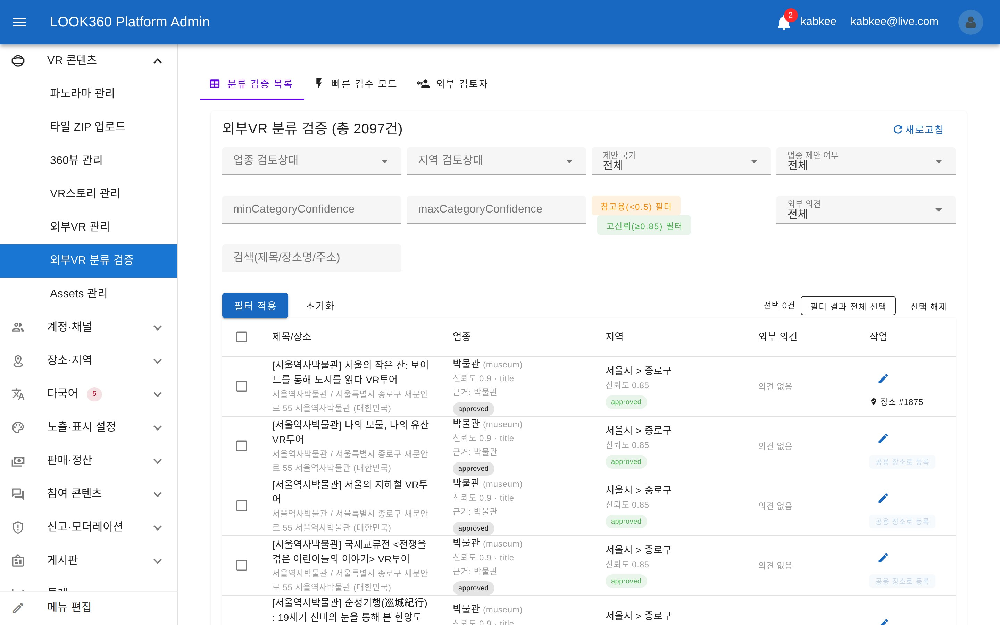

직접 확인
<a class="lnk admin" href="http://100.120.25.127:5277/external-vr-classification" target="_blank">http://100.120.25.127:5277/external-vr-classification</a>

---

## 🌍 해외 지역 자동 제안 (좌표 기반) 10/3~10/5 NEW

해외 VR은 국가까지만 기록되고 미국·영국 등 하위 지역이 없어, 좌표로 지역을 추정해 제안하도록 했습니다.

| 항목 | 조치 | 결과 |
|---|---|---|
| 해외 571건 | 지도 서비스로 지역 1~2단계 제안 | 548건 제안 |
| 국내 28건 | 카카오 좌표 변환 | 12건 제안 |
| 정확도 | 표본 36건 대조 | 불일치 0 |
| 신규 지역 | 관리자 승인 시에만 생성, 중복 0 | 검수 통과 |
| 장소 등록 버튼 | 승인만으로는 켜지지 않고, 운영 데이터 반영 후 켜짐 | 10/6 오너 결정: 의도된 설계로 확정 |

> 지역명이 영문으로 표시되는 비율이 높습니다(1단계 한국어 6%). 버튼 건은 10/6 「검수 기준 정정」으로 결정되어 마지막 검수가 재개되었습니다.

확인
<a class="lnk" href="https://kabkee-macbookpro-2020.tailfe017f.ts.net:8443/IND/issues/IND-7943" target="_blank">IND-7943 지역 자동 제안</a>
<a class="lnk" href="https://kabkee-macbookpro-2020.tailfe017f.ts.net:8443/IND/issues/IND-7948" target="_blank">IND-7948 독립 검수</a>

---

## 🧭 외부VR 신설 화면 ① 사용자 · 외부 검토자 9/17~10/4 NEW

l3 플랫폼 사이트(client)에 외부VR 신청 화면 3개와 외부 검토자 전용 페이지 1개를 새로 만들었습니다.

| 화면 | 주소 | 하는 일 | 일자 · IND |
|---|---|---|---|
| 외부VR 신청 | `/my/external-vr/new` | 외부 제작 VR 주소·장소 정보를 입력해 등록 신청 | 9/17 · 7417 |
| 내 신청 현황 | `/my/external-vr` | 신청 목록과 승인·반려 상태 확인 (`/external-vr` 는 여기로 이동) | 9/17 · 7417 |
| 신청 수정 | `/my/external-vr/:uid/edit` | 신청 내용 수정 (신청 화면 재사용) | 9/17 · 7417 |
| 외부 검토 페이지 | `/review/external-vr` | 허용된 검토자만 진입, 카드 한 장씩 업종·지역 의견 입력, `A` 키는 추천대로 저장, 두 명이 같은 건을 받지 않음 | 10/3 · 7935 |
| 〃 지역 제안 | 같은 페이지 | 해외 좌표 기반 2단계 추천, 「신규 생성 예정」 표시, 지도 핀으로 다시 제안 | 10/4 · 7946 |

> 외부 검토 페이지는 의견만 남기며 최종 승인은 관리자 화면에서 합니다. 검색엔진 비노출(noindex)이고 개발 서버에만 반영했습니다.

직접 확인
<a class="lnk" href="http://100.120.25.127:5174/my/external-vr" target="_blank">내 신청 현황</a>
<a class="lnk" href="http://100.120.25.127:5174/my/external-vr/new" target="_blank">외부VR 신청</a>
<a class="lnk" href="http://100.120.25.127:5174/review/external-vr" target="_blank">외부 검토 페이지</a>

---

## 🧭 외부VR 신설 화면 ② 관리자 9/17~10/3 NEW

관리자(admin)에 메뉴 2개를 새로 만들었습니다. 「외부VR 관리」에는 탭 2개, 「외부VR 분류 검증」에는 탭 3개가 있고, 공용 장소 등록 대화상자를 별도로 붙였습니다.

| 화면 | 주소 | 하는 일 | 일자 · IND |
|---|---|---|---|
| 신청 관리 | `/external-vr?tab=requests` | 사용자 신청 승인·반려 | 9/17 · 7418 |
| 외부VR 콘텐츠 관리 | `/external-vr?tab=contents` | 등록된 외부VR 목록·수정, 관리자 직접 등록 | 9/17 · 7418 |
| 분류 검증 목록 | `/external-vr-classification?tab=list` | 업종·지역 제안과 신뢰도 필터, 단건 확정, 일괄 승인, 국가별 지역 선택·새 지역 추가 | 9/23~9/30 · 7623·7686 |
| 빠른 검수 모드 | `…?tab=quick` | 한 건씩 넘기며 추천대로 1클릭 승인, 외부 의견 필터·최종 승인, 해외 지역 신규/연결 수 표시 | 10/3 · 7936·7947 |
| 외부 검토자 | `…?tab=reviewers` | 외부 검토 페이지에 들어올 계정 등록·관리 | 10/3 · 7936 |
| 공용 장소 등록 | 분류 목록 행의 버튼 | 비슷한 기존 장소 후보 제시 → 「기존에 연결」 또는 「새 공용 장소 만들기」 (건별) | 10/2 · 7691 |

직접 확인
<a class="lnk admin" href="http://100.120.25.127:5277/external-vr" target="_blank">외부VR 관리</a>
<a class="lnk admin" href="http://100.120.25.127:5277/external-vr-classification" target="_blank">분류 검증 목록</a>
<a class="lnk admin" href="http://100.120.25.127:5277/external-vr-classification?tab=quick" target="_blank">빠른 검수 모드</a>
<a class="lnk admin" href="http://100.120.25.127:5277/external-vr-classification?tab=reviewers" target="_blank">외부 검토자</a>

---

<!-- _class: sec -->

Section 05

## l3 플랫폼 · 관리자 · 보안 · 품질 기반

관리자 화면의 접근 차단과 진입로, 계정·자격증명 재발 방지, 테스트·빌드 기반 복구를 정리했습니다.

---

## 🔒 관리자 화면 접근 차단 — 열려 있던 것과 막은 방법 9/30~10/2 NEW

관리자(admin) 화면은 주소만 알면 누구나 열 수 있는 공개 상태였고, 오너 지시로 «플랫폼 사이트에 관리자로 로그인한 사람에게만» 열리도록 바꾸었습니다.

| 단계 | 내용 | 결과 |
|---|---|---|
| 열려 있던 것 | `admin.look360.co.kr` 접속 시 누구나 화면 수신 | 운영 응답 200 (10/1 실측) |
| 막은 방식 | 화면을 내려주기 «전» 서버가 관리자 로그인 여부 확인 | 화면 코드 자체를 보내지 않음 |
| 일반 방문자 | 비로그인·일반회원·판매자 접속 | 없는 주소와 같은 화면, 관리자 코드 0건 |
| 관리자 | 로그인한 관리자 접속 | 대시보드 정상 (요청 14건 오류 0) |
| 위조 시도 | 토큰의 권한 값을 관리자로 바꿔 접속 | 차단 (개발 서버 검증) |
| 비밀 주소 | 관리자에게만 응답으로 전달, 사이트 코드에는 없음 | 공개 코드 65개 전수 0건 |

> 서버 쪽 권한 검사(일반회원·판매자 403)는 그대로 두고, 그 앞에 한 겹을 더한 구조입니다.

확인
<a class="lnk admin" href="https://kabkee-macbookpro-2020.tailfe017f.ts.net:8443/IND/issues/IND-7710" target="_blank">IND-7710 admin 접근 제한</a>
<a class="lnk admin" href="https://kabkee-macbookpro-2020.tailfe017f.ts.net:8443/IND/issues/IND-7809" target="_blank">IND-7809 운영 전환</a>

---

## 🔒 운영 반영과 관리자 진입로 정리 10/1~10/3 NEW

개발 서버에서 검증한 차단을 운영에 올리고, 관리자가 자연스럽게 들어갈 수 있는 입구를 만들었습니다.

| 항목 | 조치 | 결과 |
|---|---|---|
| 운영 서버 반영 | 사이트 배포 + API 설정 + 호스팅 앱 접근 인증 | 운영 반영 완료 (10/2) |
| 구 주소·기본 도메인 | 접근 인증으로 폐쇄 | 3개 주소 모두 401 |
| 구 도메인 해제 | 도메인 연결·DNS 해제 | 연결 0건, 해석 불가 (10/2) |
| 관리자 메뉴 | 프로필 팝업·사이드메뉴에 「관리자 페이지」 (관리자에게만) | 팝업·재로그인 없이 진입, 7개 언어 |
| 비밀 주소 교체 | 수동 교체 스크립트 작성 | 시험 실행만, 실제 교체 미실행 |
| 개발 환경 보정 | 개발 서버에서 누르면 운영 주소로 가던 문제 | 개발 빌드에서만 분리 (10/3) |

> 로그아웃·만료 후 복귀 구간은 운영 QC 가 계정 정보 부족으로 재지 못했고, 오너가 10/3 「된다」로 확인했습니다. 개발 서버 실클릭 확인은 미확인입니다.

확인
<a class="lnk admin" href="https://kabkee-macbookpro-2020.tailfe017f.ts.net:8443/IND/issues/IND-7857" target="_blank">IND-7857 admin 진입로 정리</a>

---

## 🛡️ 계정·자격증명 재발 방지 9/15~9/23

QC 가 개발 DB 의 실사용자 계정으로 로그인해 알림 메일이 실제 사용자에게 3회 발송된 사고(9/15)를 계기로, 행위 차단 구조를 만들었습니다.

| 항목 | 조치 | 결과 |
|---|---|---|
| 실사용자 계정 차단 | DB 에서 실사용자 비밀번호 변경 자체를 거부 | 발화 실증, 개발 DB 전용 |
| 외부 발송 차단 | 개발 환경은 허용 목록 수신자에게만 발송 | 허용 밖 발송 0건 (실측) |
| QC 전용 계정 | 신규 계정 + 관리자 로그인 공용 도구 (보드 계정 사용 금지) | 완료 (자식 9건) |
| 서버 시크릿 11종 | 현재 설정은 이미 안전, 과거 기록에 평문 잔존 확인 | 오너 결정: 교체 진행 |
| 교체 준비 | 참조처 전수 조사·절차서·사후 검증 도구 | 실제 교체 집행 미확인 |
| 커밋 차단 가드 | 시크릿 패턴 확대 + 값 대조, 검사 74.7초 → 0.06초 | 4개 저장소 적용 |

> 시크릿 11종 교체는 오너 구간이며 집행 여부는 확인하지 못했습니다. 이번 기간 중 키 값이 작업 로그에 1회 출력된 건은 교체 여부 보드 판단 대기 중입니다.

확인
<a class="lnk" href="https://kabkee-macbookpro-2020.tailfe017f.ts.net:8443/IND/issues/IND-7335" target="_blank">IND-7335 QC 계정 오용 방지</a>
<a class="lnk" href="https://kabkee-macbookpro-2020.tailfe017f.ts.net:8443/IND/issues/IND-7351" target="_blank">IND-7351 시크릿 조사</a>
<a class="lnk" href="https://kabkee-macbookpro-2020.tailfe017f.ts.net:8443/IND/issues/IND-7439" target="_blank">IND-7439 교체 런북</a>
<a class="lnk" href="https://kabkee-macbookpro-2020.tailfe017f.ts.net:8443/IND/issues/IND-7602" target="_blank">IND-7602 가드 성능</a>

---

## 🧭 관리자 화면 개선과 데이터 규칙 결정 9/14~9/29

| 항목 | 무엇을 | 결과 | IND |
|---|---|---|---|
| 사이드바 편집 모드 | 메뉴명이 잘려 「지역 …」 3개 구분 불가 | 편집 모드만 2줄 표시, 잘림 0건 (39/39) | 7340 |
| 목록 페이지네이터 | 눌러도 동작 없는 장식 페이지 이동 제거 | 7화면 정리, 재검수 7/7 통과 | 7329 |
| 쿠키 소실 원인 | 관리자·사이트 동시 열면 로그인이 풀림 | 원인 확정 (규명 전용), 수정 별도 | 7298 |
| 지역 필터 규칙 | 시 58곳이 빈 칸 → 「3단계 이상은 끝 노드」 | 행정구역 10건 정합, 개발 서버 반영 | 7354 |
| 판매자 가격 변경 | 판매자가 직접 바꾸지 못하는 것이 설계인가 | 오너 확정: 관리자 전용 유지 | 7637 |
| 미관람 30일 소멸 | 정책은 확정, 고지·약관 작업 착수 시점 | PG 계약·약관 작성 시 착수 (10/6) | 6147 |

> 목록 정리 1차 검수는 «페이지당 건수 선택 기능이 사라져» 반려되었고, 복원 후 통과했습니다. 쿠키 건은 후속 수정 이슈를 확인하지 못했습니다.

확인
<a class="lnk admin" href="https://kabkee-macbookpro-2020.tailfe017f.ts.net:8443/IND/issues/IND-7340" target="_blank">IND-7340 사이드바</a>
<a class="lnk admin" href="https://kabkee-macbookpro-2020.tailfe017f.ts.net:8443/IND/issues/IND-7329" target="_blank">IND-7329 페이지네이터</a>
<a class="lnk" href="https://kabkee-macbookpro-2020.tailfe017f.ts.net:8443/IND/issues/IND-7354" target="_blank">IND-7354 지역 정합</a>
<a class="lnk" href="https://kabkee-macbookpro-2020.tailfe017f.ts.net:8443/IND/issues/IND-6147" target="_blank">IND-6147 30일 소멸</a>

---

## 🧪 품질 기반 — 테스트·빌드·검수 도구 복구 9/17~10/3

| 항목 | 문제 | 결과 | IND |
|---|---|---|---|
| 서버 테스트 | 7개 그룹 실패 + 4개 그룹은 컴파일 오류로 «미실행» | 380그룹·6,616건 통과 (테스트 약화 없음) | 7954·7441 |
| 개발 서버가 운영 파일 삭제 | 개발용 실행이 공유 실행 파일을 지움 | 출력 폴더 분리 · 해시 전후 동일 | 7562 |
| 지역 건수 스냅샷 | 테이블만 있고 마이그레이션 없음 | 새벽 5시 배치 1,504건씩 저장 | 7448·7487 |
| 골든 회귀 실패 | 스토리 XML 「익명 요청」 설정 누락 | 5건 통과 | 7550 |
| 브라우저 검수 도구 크래시 | 임시 폴더 삭제로 크롬 사망 · 덤프 71.7GB 가 디스크 100% | 크래시 5/5 → 0 · 여유 70GB | 7839·7831 |
| 코드 업로드 불가 | GitHub 토큰 만료로 4커밋 고립 | SSH 전환 후 원격 도달 | 7429 |

> 모두 개발 환경 기준입니다. 테스트를 고치며 기대값을 낮추지 않고 원인을 고쳤습니다.

확인
<a class="lnk" href="https://kabkee-macbookpro-2020.tailfe017f.ts.net:8443/IND/issues/IND-7954" target="_blank">IND-7954 테스트 복구</a>
<a class="lnk" href="https://kabkee-macbookpro-2020.tailfe017f.ts.net:8443/IND/issues/IND-7562" target="_blank">IND-7562 dist 보호</a>
<a class="lnk" href="https://kabkee-macbookpro-2020.tailfe017f.ts.net:8443/IND/issues/IND-7839" target="_blank">IND-7839 크롬 크래시</a>

---

<!-- _class: sec -->

Section 06

## weekly(k)pop · 가수 정보와 데이터 품질

가수 전용 페이지 신설, 가수 정보 수집 구조 개선, 영문 병기, 차트 데이터 정리와 관리자 도구 안정화를 다룹니다.

---

## 🎤 가수 정보 페이지 신설 9/16~9/17 NEW

오너께서 멜론 가수 상세를 참고해 「가수별 곡 목록 페이지」를 요청하셨고, 구현 전에 가능성부터 실측해 제안했습니다.

| 항목 | 조치 | 결과 |
|---|---|---|
| 가능성 판정 | 확정 가수 기준 곡 연결 실측 | kpop 562명·pop 921명 전원 곡 1건 이상 |
| 구성 | 오너 답변 5문 반영 | 탭 없이 한 페이지에 상세정보 + 곡 목록(앨범 버전 분리) |
| 진입 경로 | 곡 상세의 가수 이름을 링크로 변경 | 두 사이트 PC·모바일 4지면 실클릭 확인 |
| 범위 밖 | 가수 목록 인덱스, 페이징 | 오너가 선택하지 않은 항목으로 제외 |
| 배포 | 10/2 오너 직접 배포(master 전체)에 포함 | 운영에서 가수 페이지 주소가 「안내메세지」로 응답 |

> 10/6 읽기 확인 결과, 운영 곡 상세의 가수 링크는 노출되나 가수 페이지 자체가 열리지 않았습니다. 페이지 등록 누락으로 추정되며 오너 확인이 필요합니다.

확인
<a class="lnk" href="https://kabkee-macbookpro-2020.tailfe017f.ts.net:8443/IND/issues/IND-7377" target="_blank">IND-7377 가수 정보 페이지</a>
<a class="lnk" href="https://www.weeklykpop.com/b/kpop-chart/15588" target="_blank">운영 곡 상세(가수 링크)</a>

---

## 🔎 가수 정보 수집 — 공식 API 우선 · 웹 검색 개선 9/17~10/4

가수 정보 빈 구간이 커서 수집을 전체 연도로 넓히고, 공식 데이터(Wikidata·MusicBrainz)를 먼저 쓰며, 채택 0건이던 웹 검색 수집기를 고쳤습니다.

| 항목 | 조치 | 결과 |
|---|---|---|
| 대상 범위 | 2010년 이후 → 전체 연도 | 완료 |
| 공식 API 백필(kpop 761명) | 미사용 데이터 활용, 보강 필요 판정 교정 | 소속사 123→394 · 장르 158→656 |
| 웹 검색 대상 축소 | 이미 채운 항목 제외 | kpop 761→571 · pop 1,264→622명 |
| 웹 검색 0건 원인 | 검색은 정상, 값 추출기가 약함 | 원인 확정 → 오너: 추출기 수정 |
| 오채택 사고 | 그룹 생일을 멤버 생일로 채택 | 운영 1행 삭제·크론 중지·핫픽스 |
| 재개 결과 | 미러 사이트 묶기까지 수정 후 재개 | 채택 0 → 회차당 1~2건 · 오채택 0 |

> 운영 DB 반영은 오너 승인 카드 후 집행했습니다. 하루 20요청 기준 남은 대상에 수개월이 걸려, 처리량 상향은 오너 판단 사항입니다.

확인
<a class="lnk" href="https://kabkee-macbookpro-2020.tailfe017f.ts.net:8443/IND/issues/IND-7517" target="_blank">IND-7517 전체 연도</a>
<a class="lnk" href="https://kabkee-macbookpro-2020.tailfe017f.ts.net:8443/IND/issues/IND-7679" target="_blank">IND-7679 공식 API 우선</a>
<a class="lnk" href="https://kabkee-macbookpro-2020.tailfe017f.ts.net:8443/IND/issues/IND-7673" target="_blank">IND-7673 웹 검색 수집기</a>

---

## 🎯 가수 매칭·확정률 개선 9/30~10/2 NEW

kpop은 가수 문자열 3,017건 중 791건(26.2%)만 확정되어, 미확정이 차트 등장 기준 52.3%에 달했습니다.

| 항목 | 조치 | 결과 |
|---|---|---|
| 협업곡 결함 | 조각 단위로 판정(확정 불가였던 구조 수정) | 조각 확정 kpop 286 · pop 187건 |
| 음악가 판정·동명이인·괄호 병기 | 보조 근거 추가, 표본 40건 + 오너 승인 | 오너 카드 6장 전부 응답 |
| 공식 ID 없는 국내 가수 | 국내 출처 기반 확정 경로 신설 | 구분 표기로 재검증 가능 |
| kpop 확정률(로컬) | W1~W11 적용 후 | 27.4% → 59.4% |
| pop 확정률(로컬) | 같은 방식 | 56.2% → 80.0% |

> 위 수치는 로컬 DB 기준입니다. 운영 집행은 오너 지시 대기이며, 운영 수치는 집행 시 같은 방식으로 측정합니다.

확인
<a class="lnk" href="https://kabkee-macbookpro-2020.tailfe017f.ts.net:8443/IND/issues/IND-7694" target="_blank">IND-7694 매칭·확정률</a>

---

## 🌐 가수명·곡명 영문 병기 9/30~10/2 NEW

kpop 한글 가수·곡명 옆에 영문을 함께 보여주고, 수집 중 발견한 영문은 출처와 함께 저장하도록 했습니다.

| 항목 | 조치 | 결과 |
|---|---|---|
| 저장소 | 영문 표기를 출처·종류(공식/번역/음역)로 저장 | 가수 kpop 2,804 · pop 2,311건 적재 |
| 곡명 규칙 | 공식 영문 우선, 없으면 번역, 고유명사는 음역 | 번역 표본은 반려 후 재승인 |
| 곡 영문 커버리지 | 한글만 있는 곡 전부 채움 | 운영 기준 영문 없음 0곡 |
| 표시 검증 | 화면 24지면 × PC·모바일 캡처 | QC 7축 통과(캡처 165장) |
| 운영 반영 | 데이터는 10/1 오너 승인 후 적재, 화면은 10/2 배포 | 운영 메인에 영문 병기 노출 확인 |

> 가수 영문 표시의 병목은 영문 자료가 아니라 가수 확정률이며, 앞 장의 매칭 개선과 이어집니다.

확인
<a class="lnk" href="https://kabkee-macbookpro-2020.tailfe017f.ts.net:8443/IND/issues/IND-7695" target="_blank">IND-7695 영문 병기</a>
<a class="lnk" href="https://www.weeklykpop.com/" target="_blank">운영 kpop 메인</a>

---

## 🧹 차트 데이터 품질 일괄 정리 9/30~10/2 NEW

가사 소급 작업 중 같은 곡이 가짜 곡 번호 6개로 중복되는 등 차트 데이터 결함이 발견되어 전수 감사 후 정리했습니다.

| 항목 | 조치 | 결과 |
|---|---|---|
| 전수 감사 | 읽기 전용 쿼리 8회 | 제목 빈 값 kpop 3·pop 8, 순위 중복 108·16행 |
| 오너 승인 정리 | 백업·되돌리기 SQL 후 집행 | 27건 + 656건 집행 |
| 제목·가수 빈 값 | 원본 대조 후 보정 | 제목 kpop 3→0·pop 8→0, pop 가수 19→9 |
| 고아 게시물 | 차트 행 없는 게시물 숨김 | 632건 숨김 처리 |
| 재발 방지 | 등록 코드에 중복·빈 값 방지 가드 추가 | 두 사이트 QC 2회 통과, 10/2 배포 포함 |

> 순위 충돌 27행, 가수 후보 9행 등은 오너 결정으로 보류했습니다. 종결 코멘트는 「운영 코드 미반영」이나, 10/2 오너 직접 배포에 포함된 것으로 코드 이력상 판단됩니다(운영 서버 직접 확인은 미확인).

확인
<a class="lnk" href="https://kabkee-macbookpro-2020.tailfe017f.ts.net:8443/IND/issues/IND-7747" target="_blank">IND-7747 차트 데이터 품질</a>

---

## 🛠️ 관리자 도구와 가사 처리 안정화 9/14~10/2

관리자 화면 마비, 유튜브 엑박 점검, 가사 생성 속도 문제를 각각 원인까지 확인해 처리했습니다.

| 항목 | 조치 | 결과 |
|---|---|---|
| 관리자 매칭 화면 60초 지연·오류 | 세션 잠금 해소, 목록 50행 분할 | 운영 60.9초 오류 → 0.87초 정상 (9/29 배포) |
| 유튜브 엑박 대시보드 | 연도별 표에서 서버 확인·진행 표시·목록 열람 | 2차 QC까지 통과 |
| 유튜브 점검 운영 적용 | 점검 큐 테이블과 워커 크론을 오너가 직접 등록 | 10/2 운영 반영, 점검 작업은 오너 시작 대기 |
| 가사 속도 급락 원인 | 추론 모드가 출력 한도를 소진하는 설정 | 2단계 추론 끔으로 기동, 곡당 응답 중앙값 607초 → 11초(표본 7건) |
| 가사 1·2단계 완주 | 오너 PC 운영 감시 | kpop 99.59% · pop 95.44% 성공 |

> 유튜브 야간 자동 갱신 크론은 등록 기록이 없어 미확인이며, 가사 비용(약 69달러)은 원장 일부 결손으로 역산한 추정값입니다.

확인
<a class="lnk" href="https://kabkee-macbookpro-2020.tailfe017f.ts.net:8443/IND/issues/IND-7659" target="_blank">IND-7659 매칭 화면 지연</a>
<a class="lnk" href="https://kabkee-macbookpro-2020.tailfe017f.ts.net:8443/IND/issues/IND-7665" target="_blank">IND-7665 엑박 서버 확인</a>
<a class="lnk" href="https://kabkee-macbookpro-2020.tailfe017f.ts.net:8443/IND/issues/IND-7581" target="_blank">IND-7581 가사 감시</a>

---

<!-- _class: sec -->

Section 07

## weekly(k)pop · 서버 보안과 운영

운영 서버의 침입 경로 차단, 계정·비밀번호 정리, 메일 알림 복구, 두 사이트 연결·검색 노출 보강입니다.

---

## 🛡️ 서버 보안 방어 구축 — 발단과 점검 결과 9/23~10/1 NEW

9/22 밤 weeklykpop이 느려진 사고를 조사하니, 속도 문제 뒤에 **서버 외부 공격 경로**가 여럿 열려 있었습니다.

| 발견 | 조치 | 결과 |
|---|---|---|
| 소스 저장소(.git) 공개 | 웹서버에서 전역 차단 | 차단 완료 |
| 서버 직접 접속(Cloudflare 우회) — 트래픽의 절반 | 아래 2번 슬라이드 | 차단 완료 |
| 크롤러 서버 무인증 호출 경로 | 외부 포트 닫기, 비밀 헤더 가드 | 차단 완료 |
| 파일 업로드 무인증 · 웹셸 흔적 | 경로·확장자 제한, 침해 조사 | 차단 · 조사 종결 |
| 게시판 SQL 인젝션 | 응답 구분 채널 폐쇄 | 운영 배포 9/29 |
| 지연의 직접 원인(탭 일괄 열기 · 작업자 5개) | 작업자 8개로 확대 | 자원 부족 아님(CPU 평균 4%) |

> 10/1 하위 14건 전건 완료, 완료 기준 8항목 충족(독립 재측정). 방어 첫 24시간에 스캐너 13개 IP를 실제 차단했고 정상 사용자 오탐은 0건이었습니다.

확인
<a class="lnk" href="https://kabkee-macbookpro-2020.tailfe017f.ts.net:8443/IND/issues/IND-7604" target="_blank">IND-7604 indyspot VM 보안 방어 구축</a>
<a class="lnk" href="https://kabkee-macbookpro-2020.tailfe017f.ts.net:8443/IND/issues/IND-7657" target="_blank">IND-7657 게시판 SQL 인젝션 수정</a>

---

## 🔒 Cloudflare 경유 접속만 허용 9/29~10/1 NEW

서버 IP로 직접 접속하면 **Cloudflare 보안 설정을 우회**할 수 있어, 우회 경로를 단계적으로 막았습니다.

| 일자 | 조치 | 결과 |
|---|---|---|
| 9/29 | 우회 가능한 와일드카드·DNS 레코드 정리(오너 직접 수정), 4개 도메인 전수 점검 | 우회 레코드 0건 |
| 9/29 | Cloudflare 방어 규칙 3개 + 요청 수 제한 1개 적용 | 실차단 확인 |
| 9/30 | 서버(Apache)가 Cloudflare 접속만 받도록 잠금, 24시간 관찰 | 직접 접속 403 · 오탐 0 |
| 10/1 | Azure 방화벽 80/443을 Cloudflare 대역으로 제한 | 직접 접속 차단 |
| 확인 | 서비스 · SSH · DB · 내부 크론 | 모두 정상 |

> 이전에는 트래픽의 절반이 Cloudflare를 우회했습니다. 이제 방어 규칙이 모든 외부 접속에 적용됩니다. (SSH·DB 포트는 변경하지 않았습니다.)

확인
<a class="lnk" href="https://kabkee-macbookpro-2020.tailfe017f.ts.net:8443/IND/issues/IND-7651" target="_blank">IND-7651 Cloudflare 설정 (9/29)</a>
<a class="lnk" href="https://kabkee-macbookpro-2020.tailfe017f.ts.net:8443/IND/issues/IND-7676" target="_blank">IND-7676 서버 잠금</a>
<a class="lnk" href="https://kabkee-macbookpro-2020.tailfe017f.ts.net:8443/IND/issues/IND-7677" target="_blank">IND-7677 방화벽 제한</a>

---

## 🚧 차단 체계 정비 — fail2ban 재설계와 요청 제한 1주 점검 10/1~10/6 NEW

Cloudflare 잠금 이후 기존 자동 차단(fail2ban)이 **무력해지는 문제**가 확인되어 차단 지점을 옮겼습니다.

| 항목 | 내용 | 결과 |
|---|---|---|
| 문제 | 접속 IP가 모두 Cloudflare로 보여 차단이 실효 없음 | 차단 0건 |
| 조치(10/1) | 차단을 웹서버(Apache)에서 집행하도록 이전, 임계값 실측 조정 | 차단→해제 왕복 실증 |
| 요청 제한 1주(10/6) | 9/29~10/6 발화 3,451건, 대부분 스캐너 | 정상 차단 |
| 오탐 | 오너 IP가 pop 글쓰기 중 3건 차단 | 규칙 미변경 · 오너 결정 대기 |

> 남은 것: 오탐 해소 방식(pop 사이트 제외 · 운영자 IP 예외 등) 결정. 동작하지 않던 다른 차단 규칙 4종은 별도 정리가 필요합니다.

확인
<a class="lnk" href="https://kabkee-macbookpro-2020.tailfe017f.ts.net:8443/IND/issues/IND-7796" target="_blank">IND-7796 fail2ban 재설계</a>
<a class="lnk" href="https://kabkee-macbookpro-2020.tailfe017f.ts.net:8443/IND/issues/IND-7797" target="_blank">IND-7797 요청 제한 1주 조회</a>

---

## 🔑 DB 계정 분리 · 비밀번호 교체 — 직후 회귀까지 복구 9/23~9/30 NEW

앱이 DB 최고 관리자(root) 계정을 **평문 파일**에 두고 쓰고 있어, 유출 여부를 확인한 뒤 최소 권한 계정으로 분리했습니다.

| 항목 | 조치 | 결과 |
|---|---|---|
| 유출 실측 | 로그 20개월 대조 | 유출 증거 없음 |
| 계정 분리 · root 교체(9/29) | 사이트별 전용 계정, 보드 승인 후 운영 집행 | 완료 · 옛 값 접속 불가 |
| 비밀값 · 백업 정리 | 크롤러 호출 비밀값 교체, 옛 값 든 백업 16개 권한 제한 | 완료 9/30 |
| 회귀 ① pop 차트 수집 | 다른 사이트 DB까지 읽던 코드가 막혀 매시간 실패 | 권한 확대 없이 코드 수정 · 당일 복구 |
| 회귀 ② 관리자 위젯 | 수집 현황 칸이 조용히 빈값 | 두 사이트 동시 수정 · 9/30 운영 확인 |
| 남은 것 | 유튜브 점검 테이블 1개가 운영 DB에 없던 문제 | 10/2 오너가 직접 적용 (IND-7887) |

> 교훈: 계정 분리는 파일 단위가 아니라 «누가 어느 DB에 접속하는가» 기준으로 점검해야 합니다.

확인
<a class="lnk" href="https://kabkee-macbookpro-2020.tailfe017f.ts.net:8443/IND/issues/IND-7622" target="_blank">IND-7622 최소권한 분리</a>
<a class="lnk" href="https://kabkee-macbookpro-2020.tailfe017f.ts.net:8443/IND/issues/IND-7663" target="_blank">IND-7663 root 로테이션</a>
<a class="lnk" href="https://kabkee-macbookpro-2020.tailfe017f.ts.net:8443/IND/issues/IND-7653" target="_blank">IND-7653 pop 배치 복구</a>

---

## 📬 메일 알림 복구 · 두 사이트 연결과 검색 노출 9/29~10/2

| 항목 | 무엇을 | 결과 | IND |
|---|---|---|---|
| newsalert 메일 | 5/19 이후 중단 — 크론 시각 불일치 + 메일 API 포트 차단 복구 | 9/30 06:05·09:05 발송 재개 (과거 3.3만 건은 미발송 처리) | 7667 |
| 상호 이동 | 헤더 · 모바일 · 푸터 링크, 이번 주 Top 3 카드 | 운영 반영 10/2 | 7882 |
| 공유 미리보기 | OG 이미지·메타, 파비콘 18종 교체 | 운영 반영 | 7882 |
| 검색 노출(SEO) | 대표 주소·sitemap · apex→www 301 · 곡 제목/설명 | 운영 확인 | 7883 |

> 7882·7883은 오너 직접 구현입니다. 남은 것: Search Console sitemap 제출(오너), 메일 수신함 확인(오너).

확인
<a class="lnk" href="https://kabkee-macbookpro-2020.tailfe017f.ts.net:8443/IND/issues/IND-7667" target="_blank">IND-7667 newsalert 메일 복구</a>
<a class="lnk" href="https://kabkee-macbookpro-2020.tailfe017f.ts.net:8443/IND/issues/IND-7882" target="_blank">IND-7882 상호 이동·OG·파비콘</a>
<a class="lnk" href="https://kabkee-macbookpro-2020.tailfe017f.ts.net:8443/IND/issues/IND-7883" target="_blank">IND-7883 SEO 잔여·운영 배포</a>

---

<!-- _class: sec -->

Section 08

## 레거시 look360.kr

운영 중인 기존 사이트의 관리자 기능 개선, 문구 수정, 홍보 페이지 기획 현황입니다.

---

## 🛠️ 장소 관리 · 공유 제목 · 푸터 주소 9/17~9/30

운영 중인 레거시 사이트에서 장소 관리 불편과 공유 제목 문제를 고치고, 회사 주소를 바꿨습니다. **모두 운영 반영을 확인했습니다.**

| 항목 | 조치 | 결과 |
|---|---|---|
| 장소 목록 | 열 제목 클릭 정렬(15개 열) · 페이지당 개수(최대 100) | 운영 반영 |
| 정렬 오류 | 정렬 시 결과 0건, 페이지 이동 시 행 겹침 | 해결 |
| 숨김 체크박스 | 장소 등록·수정에 「VR 지역·테마 숨김」 | 운영 반영 |
| 공유 제목 | 숨김 장소의 「[/가상전시회]」 같은 접두어 제거 | 운영 반영 |
| 푸터 주소 | 202호 → 405호 (운영 페이지 실측 405호 1건) | 운영 반영 · 과거 게시물 4건은 오너 판단 |
| 썸네일 규격 조사 | 250×167 · 500×333 · 900×600 (3:2) | 공유 · l3 플랫폼도 그대로 참조 |

> 장소 관리 4건은 별도 이슈 번호 없이 진행됐고, 운영 서버 HEAD(`0135aa2bf`)에 포함돼 있습니다.

확인
<a class="lnk" href="https://kabkee-macbookpro-2020.tailfe017f.ts.net:8443/IND/issues/IND-7706" target="_blank">IND-7706 푸터 주소</a>
<a class="lnk" href="https://kabkee-macbookpro-2020.tailfe017f.ts.net:8443/IND/issues/IND-7707" target="_blank">IND-7707 썸네일 규격</a>
<a class="lnk legacy" href="https://look360.kr" target="_blank">look360.kr (운영)</a>

---

## 📣 홍보 랜딩페이지 기획 10/4 NEW

VR 촬영 의뢰를 늘리기 위해 검색 노출용 랜딩페이지 24장을 기획하고, 첫 6장의 시안을 만들었습니다.

| 항목 | 내용 | 상태 |
|---|---|---|
| 기획 | 업종 10 · 고민형 5 · 목적 4 · 지역 5, 월별 4회 배치 | 작성 완료 |
| 첫 배치 시안 | 대학교·초중고·공공·관광·비용·절차 6장 | 시안 완료 |
| 근거 수치 | 공개 VR 4,383건, 학교 계열 585건 (10/4 집계) | 로컬 DB 기준 |
| 게시 차단 5항목 | 고객명 공개, 서비스 약속 확인, 연락처, 수치 기준일, 링크 위치 | 오너 입력 대기 |
| 페이지별 4항목 | 가격, 제작 기간, 미확인 실적, 대표 사례 | 오너 입력 대기 |
| 작업 방식 | 직접 구현 또는 발주 선택 등 4항목 | 오너 입력 대기 |

> 답변서 13항목이 채워지기 전에는 사이트 반영을 시작하지 않습니다(보관 상태). 운영 배포는 CEO 지시 후에만 진행합니다.

확인
<a class="lnk" href="https://kabkee-macbookpro-2020.tailfe017f.ts.net:8443/IND/issues/IND-7960" target="_blank">IND-7960 홍보 랜딩</a>
<a class="lnk" href="https://kabkee-decks.netlify.app/ideas/2026-10-04-look360-landing-plan.html" target="_blank">기획서</a>
<a class="lnk" href="https://kabkee-decks.netlify.app/ideas/2026-10-04-look360-landing-inputs.html" target="_blank">오너 답변서</a>

---

## 🎯 이번 주 안건 — 오너 결정 대기

10/3부터 기다리던 승인 카드 2건은 10/6 처리했고, 아래 사항은 오너 판단이 필요합니다.

| 항목 | 필요한 판단 |
|---|---|
| ✅ **처리됨 (10/6)** | VR스토리 33~36번 주소 → 별도 이슈로 분리, 콘텐츠 안 주소를 l3 주소로 변경 · 외부VR 장소 등록 버튼 → 검수 기준 정정 |
| 🟡 **l3 플랫폼 운영 배포** | 장소 페이지·언어·알림 등 3주 변경분 대부분이 개발 서버 한정 · 미push 커밋 정리 |
| 🟡 **weekly(k)pop** | 운영 가수 페이지가 「안내메세지」로 응답(10/6 확인) · 확정률 개선 운영 집행 · 요청 제한 오탐 |
| 🟡 **외부VR · 언어** | 분류 승인분 반영 시점 · CloudFront 국가 헤더 전달 사용 여부 |
| 🟡 **이월** | 미관람 30일 소멸(정책 확정 · PG 계약 후 고지 착수) · 360동영상 기획 결정 7건 · 홍보 랜딩 답변서 13항목 |

> 지난 안건 결과: 테스트 계정 처리(전용 계정 도입) · 설정 탭 언어 메뉴(구현 완료) · 구독 알림 9종(9/17 착수 → 9/26 완료). 미관람 30일 소멸은 정책이 확정되었고, 고지·약관 작업은 PG 계약 확정 후 착수합니다.

카드
<a class="lnk" href="https://kabkee-macbookpro-2020.tailfe017f.ts.net:8443/IND/issues/IND-7950" target="_blank">IND-7950 VR스토리 주소</a>
<a class="lnk" href="https://kabkee-macbookpro-2020.tailfe017f.ts.net:8443/IND/issues/IND-7948" target="_blank">IND-7948 공용 장소 버튼</a>

---

## 📊 3주 처리량

656

완료 작업

140

작업 단위(EPIC)

353

코드 반영

7,667

3주 방문자

| 구분 | 9/15~9/21 | 9/22~9/28 | 9/29~10/5 | 합계 |
|---|---|---|---|---|
| 완료 작업 | 271 | 68 | 317 | 656 |
| 서버(API) 코드 반영 | 84 | 27 | 101 | 212 (변경 파일 448) |
| 사용자 화면 · 관리자 화면 | 47 · 13 | 8 · 3 | 55 · 15 | 110 · 31 |
| 검증 증빙 | 196 | 45 | 154 | 395 |
| 방문자(GA4) | 2,493 | 2,302 | 3,021 | 7,667 |

> 일일 점검 루틴 23건은 제외했습니다. 9/22 주간의 감소는 추석 연휴 구간과 겹칩니다. 3주 방문자는 직전 3주(7,349명) 대비 +4.3%, 페이지뷰는 32,420회로 -13.9%입니다.

---

## 🔗 라이브 엔드포인트

사용자
<a class="lnk" href="http://100.120.25.127:5174" target="_blank">Look360 l3 플랫폼 (개발)</a>
<a class="lnk" href="http://100.120.25.127:5174/vr/1xdrlfot/31636" target="_blank">VR 뷰어 — 미니바·정보바·첫 로딩</a>

이번 기간 신설
<a class="lnk" href="http://100.120.25.127:5174/place/fzkets8c" target="_blank">장소 페이지</a>
<a class="lnk admin" href="http://100.120.25.127:5277/external-vr-classification" target="_blank">관리자 — 외부VR 분류 검증·빠른 검수</a>

weekly(k)pop
<a class="lnk legacy" href="https://www.weeklykpop.com/" target="_blank">weeklykpop.com (운영 · 영문 병기)</a>
<a class="lnk legacy" href="https://www.weeklykpop.com/b/kpop-chart/15588" target="_blank">곡 상세 — 가수 링크</a>

외부
<a class="lnk legacy" href="https://look360.kr" target="_blank">look360.kr (레거시 운영)</a>
<a class="lnk legacy" href="https://kabkee-decks.netlify.app/ideas/2026-10-04-look360-landing-plan.html" target="_blank">홍보 랜딩 기획서</a>

---

<!-- _class: closing -->
<!-- _paginate: false -->

## 감사합니다

이관 때 사라진 기능을 되살리고, 장소 페이지라는 새 지면을 열고, 관리자 화면과 weekly(k)pop 서버의 바깥 문을 잠근 3주였습니다.

Indyspot AI Corp &nbsp;·&nbsp; Engineering Manager &nbsp;·&nbsp; 2026-10-07

