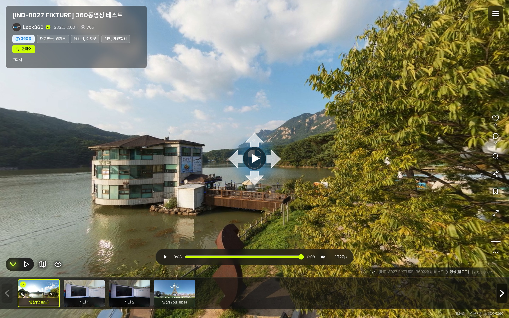
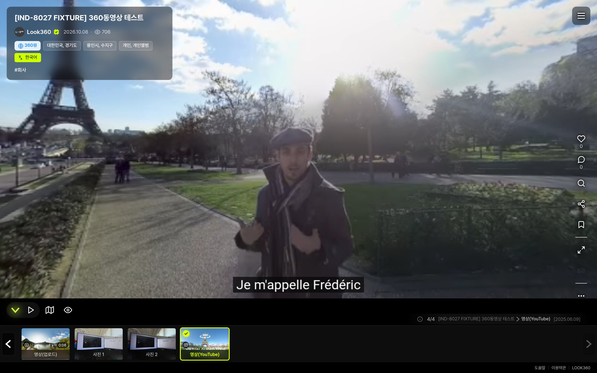
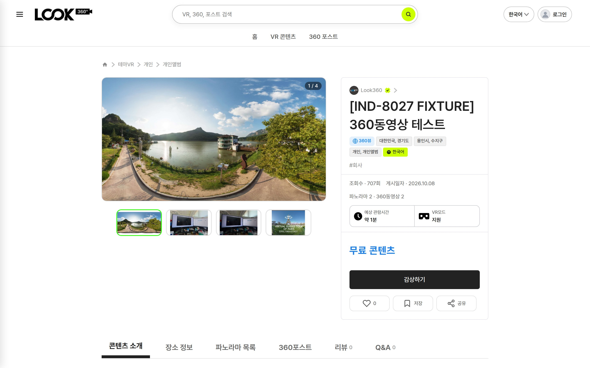
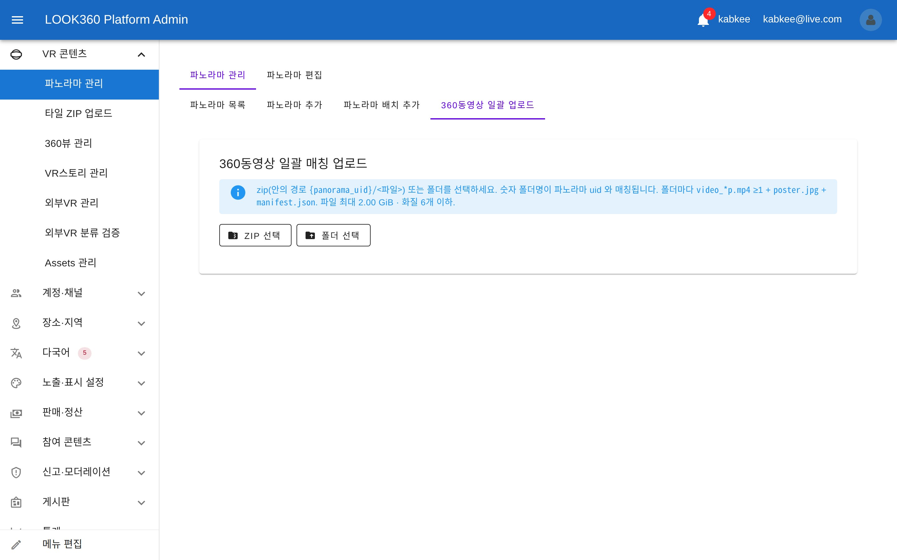
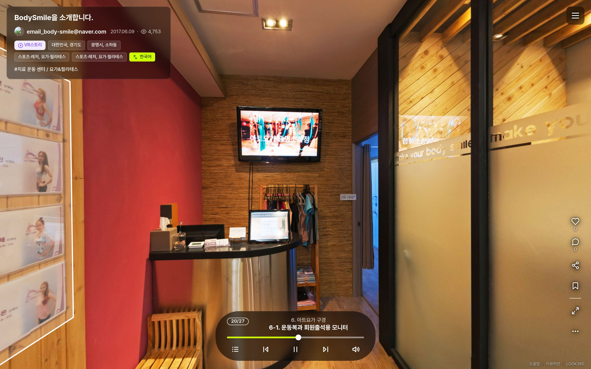
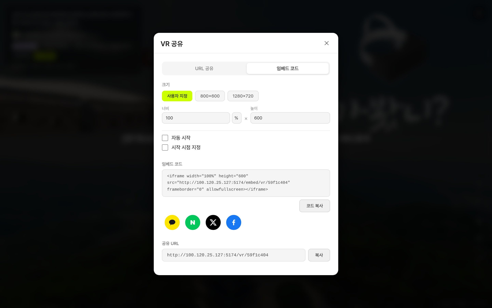
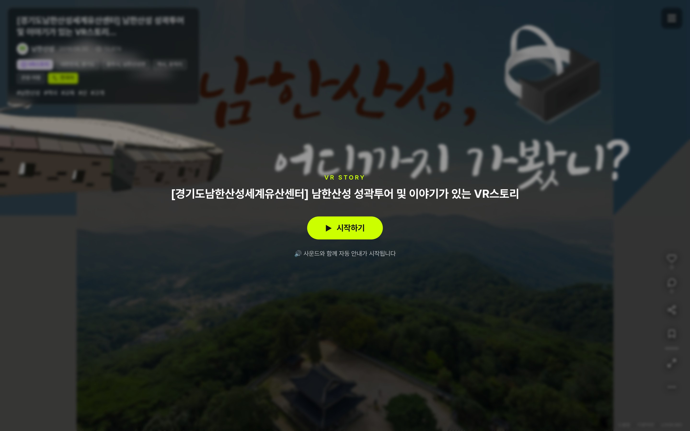
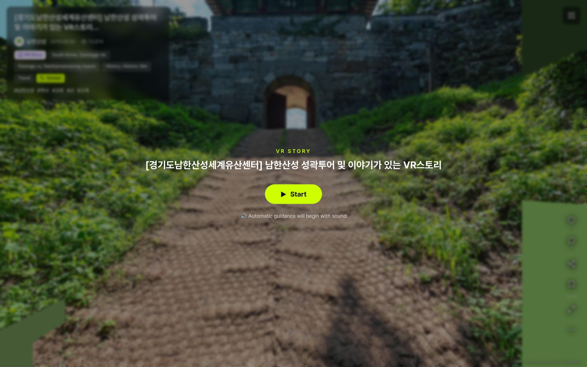

<!-- _class: cover -->
<!-- _paginate: false -->

# 주간 업무 보고

## 2026-10-08 &nbsp;~&nbsp; 2026-10-12

Indyspot AI Corp &nbsp;·&nbsp; Engineering Manager &nbsp;·&nbsp; 2026-10-12

---

<!-- _class: agenda -->

## 이번 기간 주요 작업 — 「새 매체를 들이고, 옛 스토리를 옛날처럼 움직이게 한」 5일

### 🎬 l3 플랫폼 · 360동영상 (신규 기능)

- 업로드형·YouTube형 등록→재생→통계 전 구간 완료
- YouTube 드래그 불가는 임베드 자체 제약 → 자체 입력 레이어로 우회
- 파일 저장소 버킷 백업 신설 (그동안 백업 0)

### 📖 l3 플랫폼 · VR 스토리

- 레거시 구면 360영상 재생 복구 (22건 전수 통과)
- 러너의 레거시 동작 이관 결함 5종 수정 · QC 진행 중
- 리틀플래닛 잔류 해소 · 오늘 오너 점검분 7건 즉시 수정

### 🧭 l3 플랫폼 · VR 뷰어 요청 일괄 정비

- 10/8 오너 요청 9개 EPIC 당일 구현·QC
- 지도 · 로딩 화면 · 공유 팝업 · 영문 용어 · 자동번역 인트로

### 🎤 weekly(k)pop

- 유튜브 엑박 자동 복구 1차 구현 (사람 승인 방식)
- 재QC FAIL 2건 · YouTube API 키 발급 대기

### 🎯 오너 결정 대기

- 카드 4장 + 판단 요청 2건

---

<!-- _class: sec -->

Section 01

## l3 플랫폼 · 360동영상 구성요소

360뷰의 구성요소 줄에 사진 파노라마와 나란히 360동영상을 넣을 수 있게 했습니다. 기획서(9/18) 이후 처음 구현한 신규 기능이며, 모두 개발 서버 반영 상태입니다.

---

## 🎬 360동영상 — 무엇을 만들었나 10/8~10/11 NEW

파노라마 종류에 `video360` 을 추가해, 업로드 영상과 YouTube 영상을 360뷰 한 칸으로 등록·재생합니다.

| 영역 | 구현 내용 | 결과 |
|---|---|---|
| 서버(API) | 영상 테이블 신설 · 개별/일괄(zip) 매칭 업로드 · 읽기/쓰기 계약 | QC 통과 (테스트 385/385) |
| 영상 변환 | ffmpeg 프리셋 스크립트 · 화질 단계와 기본 화질 하한 실측 | 완료 |
| 관리자 화면 | 등록·편집 탭 · 일괄 매칭 업로드 · 구성요소 종류 배지 | QC 통과 |
| 사용자 뷰어 | 재생 레이어 · 화질 선택 · 종료 후 이동 · 첫 재생 통계 · 목록 배지 | 재QC 통과 |
| QC 결함 2건 | ① 화질을 바꿔도 실제 재생 소스가 그대로 ② 잠긴 영상의 원본 주소 노출 | 수정 후 재QC 통과 |
| 오너 결정 | 영상 장면 진입 시 자동 패닝 끄기 | 적용 |

> 관리자 화면은 10/8 오너 결정(「push 는 오너 지시 때만」)에 따라 일부 커밋(`3e9ad4a` 등 3건)이 원격 미반영 상태입니다.

확인
<a class="lnk" href="https://kabkee-macbookpro-2020.tailfe017f.ts.net:8443/IND/issues/IND-8026" target="_blank">IND-8026 360동영상 EPIC</a>
<a class="lnk" href="https://kabkee-macbookpro-2020.tailfe017f.ts.net:8443/IND/issues/IND-8039" target="_blank">IND-8039 재QC</a>
<a class="lnk" href="https://kabkee-decks.netlify.app/ideas/2026-09-18-look360-360video-content-plan.html" target="_blank">기획서</a>

---

## 📸 화면 — 업로드형 360동영상 재생 10/8

하단 목록에 영상 칸이 재생 시간 배지와 함께 보이고, 재생 바에서 화질(1920p)을 고를 수 있습니다. 화면의 콘텐츠는 검수용 테스트 콘텐츠입니다.

직접 확인
<a class="lnk" href="http://100.120.25.127:5174/vr/ind8027fx?pano=33662" target="_blank">http://100.120.25.127:5174/vr/ind8027fx?pano=33662</a>

---

## 🧭 YouTube형 — 드래그가 안 되는 원인과 우회 10/8~10/11

오너 실기에서 「YouTube형 360동영상은 손가락·마우스로 둘러볼 수 없다」는 문제가 나왔고, 원인을 먼저 확정했습니다.

| 단계 | 내용 | 판정 |
|---|---|---|
| 가설 ① | 테스트 영상이 일반 영상이라서 | 반증 — 360 메타 확인 |
| 가설 ② | 우리 화면 요소가 드래그를 가로채서 | 반증 — 4지점 모두 YouTube 화면 |
| 원인 확정 | 우리 화면을 모두 뺀 순수 임베드 페이지에서도 PC·폰 모두 드래그 불가 | YouTube 임베드 제약 |
| 우회 구현 | 위에 입력 레이어를 얹어 드래그·자이로를 YouTube 시점 회전 명령으로 전달 | QC 통과 |
| 회귀 수정 | 레이어를 누른 뒤 키보드 ←/→ 10초 이동이 안 되던 문제 | 재QC 통과 |
| 실기 확인 | 폰 드래그 · 자이로 · YouTube 하단바 · PC 조작 4항목 | 오너 확인 대기 |

> 자이로는 보안 연결(https)에서만 동작하므로, 개발 서버 https 주소(:8444)를 열어 두었습니다.

확인
<a class="lnk" href="https://kabkee-macbookpro-2020.tailfe017f.ts.net:8443/IND/issues/IND-8044" target="_blank">IND-8044 원인 판정</a>
<a class="lnk" href="https://kabkee-macbookpro-2020.tailfe017f.ts.net:8443/IND/issues/IND-8104" target="_blank">IND-8104 입력 레이어</a>

---

## 📸 화면 — YouTube형 360동영상 10/11

YouTube 영상도 하단 목록의 한 칸으로 재생됩니다. 화면을 끌면 입력 레이어가 YouTube 시점을 회전시킵니다.

직접 확인
<a class="lnk" href="http://100.120.25.127:5174/vr/ind8027fx?pano=33663" target="_blank">http://100.120.25.127:5174/vr/ind8027fx?pano=33663</a>

---

## 📸 화면 — VR 상세 표기 · 관리자 일괄 업로드 10/8

VR 상세에는 「파노라마 2 · 360동영상 2」처럼 구성이 따로 표기되고, 관리자는 zip 또는 폴더 하나로 여러 영상을 파노라마에 매칭해 올립니다.

<figure style="margin:0"><figcaption>VR 상세 — 파노라마 N · 360동영상 M</figcaption></figure>
<figure style="margin:0"><figcaption>관리자 — 360동영상 일괄 매칭 업로드</figcaption></figure>

직접 확인
<a class="lnk" href="http://100.120.25.127:5174/vr-info/ind8027fx" target="_blank">http://100.120.25.127:5174/vr-info/ind8027fx</a>
<a class="lnk admin" href="http://100.120.25.127:5277/panorama?tab=mng&subTab=video_batch" target="_blank">http://100.120.25.127:5277/panorama?tab=mng&subTab=video_batch</a>

---

## 💾 l3 플랫폼 파일 저장소 백업 신설 10/8~10/12 NEW

영상 백업 범위를 정하다가, l3 플랫폼이 쓰는 저장소 버킷(`l3-platform-file-storage`)에 **백업이 전혀 없다**는 사실을 확인했습니다.

| 항목 | 이전 | 조치 | 결과 |
|---|---|---|---|
| 버전 관리 | 없음 | 켜기 + 구버전 30일 보관 규칙 (기존 버킷과 동일) | 적용 |
| 증분 백업 | 대상 아님 | 매일 04:30 증분 백업 대상에 추가 | 10/12 첫 자동 실행 정상 |
| 실패 알림 | 새 대상은 실패해도 무알림 | 06:00 미러 점검에 연결 (Slack) | 10/12 06:00 정상 통과 |
| 용량 한도 | 193 / 200 (한도 근접) | 한도는 유지, 160곳·40GB 도달 시 사전 경고 | 적용 |

> 결정 근거: 오너 카드에서 「버전 관리 + 증분 백업 둘 다」를 선택했습니다. Slack 실수신 여부는 오너 확인이 필요합니다.

확인
<a class="lnk" href="https://kabkee-macbookpro-2020.tailfe017f.ts.net:8443/IND/issues/IND-8045" target="_blank">IND-8045 버킷 백업</a>
<a class="lnk" href="https://kabkee-macbookpro-2020.tailfe017f.ts.net:8443/IND/issues/IND-8110" target="_blank">IND-8110 실패 알림·한도</a>

---

<!-- _class: sec -->

Section 02

## l3 플랫폼 · VR 스토리

레거시(look360.kr)에서 옮겨 온 VR 스토리가 레거시와 똑같이 진행되도록, 오너 실사용 점검에서 나온 결함을 처리했습니다.

---

## 🎞️ 레거시 구면 360영상 — 재생 복구와 진행 결함 3건 10/8~10/12

지난주 「복원 완료」로 보고한 360영상 장면이 실제로는 재생되지 않았고, 이번 기간에 재생부터 진행까지 바로잡았습니다.

| 문제 | 원인 | 결과 |
|---|---|---|
| 나레이션 뒤 영상으로 넘어가도 재생 안 됨 | 영상 재생 명령이 이관 과정에서 누락 | 복구 · 22건 전수 통과 |
| 썰매 아이콘이 안 뜨고 자동으로 넘어감 | 레거시 실측 결과 「아이콘 노출 → 클릭 대기」가 정답 | 레거시와 일치 |
| 영상 진척이 상태바에 안 보임 | 진척 연결 없음 | 연결 · 10/12 이동·일시정지 추가 |
| 이전/다음으로 떠나도 소리가 계속 남 | 매체 정지 처리가 매체별로 흩어짐 | 공통 정지 장치 1곳으로 통합 |
| 플랫폼 전체 매체·전 스토리 전수 검사 | 공통 장치 확대 적용 | 대기 |

> 측정은 모두 가상 GPU(헤드리스) 환경이며, 실제 그래픽카드 환경은 측정하지 않았습니다.

확인
<a class="lnk" href="http://100.120.25.127:5174/vr/152165ca?story=5-3" target="_blank">아침고요 5-3 시연</a>
<a class="lnk" href="https://kabkee-macbookpro-2020.tailfe017f.ts.net:8443/IND/issues/IND-8024" target="_blank">IND-8024 재생 복구</a>
<a class="lnk" href="https://kabkee-macbookpro-2020.tailfe017f.ts.net:8443/IND/issues/IND-8041" target="_blank">IND-8041 진행 결함</a>

---

## 🧩 스토리 진행기 — 레거시 동작 이관 결함 5종 10/12 NEW

지난주 「시점 초기화」 검토 중 남은 6건을 오너가 레거시와 직접 대조했고, 공통 진행 로직의 이관 결함으로 판정됐습니다.

| 구분 | 레거시 동작 | 결과 |
|---|---|---|
| A 대기 시간 | 지정 시간만큼 «먼저» 기다린 뒤 실행 (반대로 옮겨져 있었음) | 수정 |
| B 나레이션 후 진행 | 나레이션이 끝나면 다음 연출로 자동 진행 | 수정 |
| C 다른 장면 시선 이동 | 시선 이동 대상이 다른 장면이면 자동으로 불러옴 | 수정 |
| D 아침고요 건물 툴팁 | 레거시보다 글자가 작음 | 레거시 크기로 복원 |
| E 시선 이동 완료 시점 | 목표에 도달하기 전에 「완료」 처리 | 수정 |
| 클릭 유도 영역 깜빡임 | 레거시의 깜빡임 효과 누락 | 이식 · 스토리 e2e 회귀 통과 |

> 진행기 단위 테스트 107건이 통과했습니다. 독립 QC는 오늘 오후 코드가 계속 바뀌어 측정을 보류한 상태입니다. 코드가 안정되면 전 항목을 다시 측정합니다.

확인
<a class="lnk" href="http://100.120.25.127:5174/vr/d916372a?story=6-1" target="_blank">안중근 6-1 시연</a>
<a class="lnk" href="https://kabkee-macbookpro-2020.tailfe017f.ts.net:8443/IND/issues/IND-8115" target="_blank">IND-8115 이관 결함</a>
<a class="lnk" href="https://kabkee-macbookpro-2020.tailfe017f.ts.net:8443/IND/issues/IND-8119" target="_blank">IND-8119 QC</a>

---

## 🌐 리틀플래닛 잔류 해소 · 오늘 직접 수정 7건 10/12

「시작하기」를 눌러도 시작 화면의 리틀플래닛(오목한 화면)이 남던 문제를 고치고, 오너 점검에서 나온 세부 결함을 당일 수정했습니다.

| 항목 | 조치 | 결과 |
|---|---|---|
| 리틀플래닛 잔류 | 사용자 진입 시 화면 방식도 일반 모드로 초기화 | QC 통과 |
| 시작 연출 | 리틀플래닛 → 일반 뷰로 부드럽게 전환 | 반영 |
| 장면 전환 시선 | 장면 기본 시점이 지정 시선을 덮던 문제 | 반영 |
| 360영상 상태바 | 이동·일시정지·이어서 재생 연결 | 반영 |
| 팝업·핫스팟 | 팝업 닫힘을 관람 완료로 기록 · 자동 진행 조건 정리 · 자막 줄바꿈 | 반영 |

> 오늘 17:30~19:14 커밋 7건(`198c98a2` ~ `c22cbda2`)은 별도 이슈 없이 진행했으며, 위 QC(IND-8119) 재측정 범위에 포함됩니다.

확인
<a class="lnk" href="http://100.120.25.127:5174/vr/b600e6a4?story=6-1" target="_blank">BodySmile 6-1 시연</a>
<a class="lnk" href="https://kabkee-macbookpro-2020.tailfe017f.ts.net:8443/IND/issues/IND-8112" target="_blank">IND-8112 리틀플래닛</a>

---

## 📸 화면 — 시작 후 일반 뷰로 진행 중인 VR 스토리 10/12

「시작하기」를 누르고 8초 뒤의 화면입니다. 일반 뷰로 진행되고, 왼쪽 클릭 유도 영역은 흰 판이 아닌 테두리로 표시됩니다.

직접 확인
<a class="lnk" href="http://100.120.25.127:5174/vr/b600e6a4?story=6-1" target="_blank">http://100.120.25.127:5174/vr/b600e6a4?story=6-1</a>

---

## 🏛️ 레거시 운영 — 흰 클릭 영역 9건 교정 10/12 NEW

레거시 운영 사이트에서 클릭 유도 영역이 흰 판으로 그려져 사진·인물을 가리고 있어, 새 플랫폼처럼 「테두리 반짝임」으로 바꿨습니다.

| 항목 | 내용 | 상태 |
|---|---|---|
| 대상 | BodySmile 「아트요가 구경」 · 안중근 「법정투쟁」 등 스토리 3개 파일 9건 | 전수 집계 |
| 백업 | 운영 원본·로컬 원본 모두 백업, 3쌍 해시 일치 | 완료 |
| 수정 | 채움 투명도 0.2 · 테두리 3 · 깜빡임 (3파일 9줄) | 커밋 `00720f2b3` |
| 배포 범위 | 운영과의 차이는 이 커밋 1건뿐 | 확인 |
| 운영 배포 | look360.kr 에 반영 | 오너 승인 대기 |

확인
<a class="lnk legacy" href="https://look360.kr/vrstory/bodysmile/bodysmile/5-0" target="_blank">레거시 BodySmile 5-0 (수정 전)</a>
<a class="lnk" href="https://kabkee-macbookpro-2020.tailfe017f.ts.net:8443/IND/issues/IND-8116" target="_blank">IND-8116 흰 폴리곤</a>

---

<!-- _class: sec -->

Section 03

## l3 플랫폼 · VR 뷰어 요청 일괄 정비

10/8 오너가 한꺼번에 요청한 뷰어 개선 9건을 같은 날 구현하고 독립 QC까지 마쳤습니다.

---

## 🔧 10/8 오너 요청 9건 — 처리 결과 10/8~10/11

| 요청 | 주요 조치 | 상태 |
|---|---|---|
| 지도 | 「구글맵/미니맵」 용어 통일 · 미니맵 우선 표시 · 전체화면 결함 · 위치 잔류 | QC 통과 · zoom 결정 대기 |
| 로딩 화면 | 썸네일 배경 제거 · 로고 + Loading... (6개 지면 통일) · 방향 안내 1/2 속도·1회 | QC 통과 |
| 제목 정보 | 구분점 삭제 · 공식채널 뱃지 재디자인 · 언어 아이콘 A+文 | QC 통과 |
| 하단 목록 | 썸네일 원본 비율 · 화살표 방향 · 「Up」 문구 · 하단 26px · 하프시트 고정 | QC 통과 |
| 설정·공유 | 모두 숨기기↔보이기 · PC VR 버튼 비활성 노출 · 「VR 공유」 · 임베드 기본값 | QC 통과 · 색상 결정 대기 |
| 영문 용어 | View in VR · View Details · Create 360 Post · Capture Date (7개 언어) | QC 통과 |
| 더보기·ESC | 모바일 더보기 최대 75% · PC ESC 로 사이드패널 닫기 | QC 통과 |
| VR 상세 | 탭 이동 위치·하이라이트 기준 통일 · 갤러리 드래그 시 고정 | QC 통과 |
| 자동번역 | 스토리 인트로 번역 · 「원문으로 감상하기」는 이번 감상만 원문 | QC 통과 |

확인
<a class="lnk" href="https://kabkee-macbookpro-2020.tailfe017f.ts.net:8443/IND/issues/IND-8047" target="_blank">IND-8047 지도</a>
<a class="lnk" href="https://kabkee-macbookpro-2020.tailfe017f.ts.net:8443/IND/issues/IND-8051" target="_blank">IND-8051 설정·공유</a>
<a class="lnk" href="https://kabkee-macbookpro-2020.tailfe017f.ts.net:8443/IND/issues/IND-8057" target="_blank">IND-8057 자동번역</a>

---

## 📸 화면 — 「VR 공유」 팝업 임베드 탭 10/8

팝업 제목은 「VR 공유」, 탭은 「URL 공유 / 임베드 코드」입니다. 크기 기본값은 맨 왼쪽 「사용자 지정」 100% × 600 입니다.

직접 확인
<a class="lnk" href="http://100.120.25.127:5174/vr/59f1c404" target="_blank">http://100.120.25.127:5174/vr/59f1c404</a>

---

## 📸 화면 — 스토리 인트로 다국어 10/8

사이트 언어를 영어로 바꾸면 「시작하기」와 안내 문구가 영어로 나옵니다. 자동번역을 끈 상태라 제목은 원문 그대로입니다.

<figure style="margin:0"><figcaption>한국어 — 시작하기</figcaption></figure>
<figure style="margin:0"><figcaption>영어 — Start · Automatic guidance…</figcaption></figure>

직접 확인
<a class="lnk" href="http://100.120.25.127:5174/vr/59f1c404?story=6-5" target="_blank">http://100.120.25.127:5174/vr/59f1c404?story=6-5</a>

---

## ⏳ 착수 대기 · 진행 중인 l3 플랫폼 과제 10/8~10/12

| 과제 | 내용 | 상태 |
|---|---|---|
| 방문 이력 이전/다음 버튼 | VR 화면 아래에 따라다니는 버튼 2개 (VR 모드 포함) | 선행 작업 대기 |
| 자동 재생 순환 투어 | 파노라마마다 360° 회전 후 다음 → 끝나면 처음으로 | 위 작업 뒤 착수 |
| 썸네일 해상도 상향 | 신규 콘텐츠는 가장 큰 이미지(800) · 레거시는 VR 카드만 250→500 | 서버 구현 완료 · QC 대기 |
| 매체 정지 전수 검사 | 공통 정지 장치를 플랫폼 전체로 확대 | 대기 |
| 외부VR 분류 검토 | 승인 105 · 대기 1,972 · 대상 밖 20 (외부 점검자 의견 6건) | 검토 진행 중 |
| AI 파노라마 표시 2차 · 도움말 디자인 · 제목 토글 시안 | 시안·Figma 대기 | 보류 |

> 썸네일 실측에서 신규 콘텐츠의 일부 지면이 지금도 없는 이미지(250)를 가리키던 문제가 확인돼 함께 해소됩니다.

확인
<a class="lnk" href="https://kabkee-macbookpro-2020.tailfe017f.ts.net:8443/IND/issues/IND-8131" target="_blank">IND-8131 썸네일 해상도</a>
<a class="lnk" href="https://kabkee-macbookpro-2020.tailfe017f.ts.net:8443/IND/issues/IND-8053" target="_blank">IND-8053 이전/다음</a>
<a class="lnk" href="https://kabkee-macbookpro-2020.tailfe017f.ts.net:8443/IND/issues/IND-8054" target="_blank">IND-8054 순환 투어</a>

---

<!-- _class: sec -->

Section 04

## weekly(k)pop

차트 사이트의 깨진 유튜브 영상(엑박)을 자동으로 찾아 고치는 기능과 가사 작업대 개선입니다.

---

## 🎥 유튜브 엑박 자동 복구 — 1차 구현 10/12 NEW

썸네일 확인 방식은 삭제만 잡고, 비공개·퍼가기 금지·지역 차단은 놓칩니다. 가요 전수 확인에서 엑박이 2,125건 나와 수작업으로는 감당이 어렵습니다.

| 단계 | 내용 | 결과 |
|---|---|---|
| 판정 교체 | YouTube Data API로 «재생 가능 여부» 판정, 사유별 집계 | 구현 · API 키 발급 대기 |
| 재생 실패 기록 | 플레이어 오류(100/101/150)를 서버에 기록 | 구현 |
| 대체 후보 | 후보 탐색 · 규칙 점수 · 애매한 경우만 AI 보조 | 구현 |
| 승인·적용 | 승인 대기열 · 전 사본 갱신 · 이력·롤백 · 일치율 | 구현 |
| 자동 승인 | 스위치는 «꺼짐»으로 배포, 이중 차단 | 구현 |
| 재QC | 점수 수정 부작용 — 정곡이 다른 곡 뒤로 밀림 등 | FAIL 2건 |

> 커밋은 두 사이트 각각 반영됐고, 원격 미반영 커밋이 kpop 2건 · pop 1건 남아 있습니다. 운영 반영 전입니다.

확인
<a class="lnk" href="https://kabkee-macbookpro-2020.tailfe017f.ts.net:8443/IND/issues/IND-8122" target="_blank">IND-8122 엑박 자동 복구</a>
<a class="lnk" href="https://kabkee-macbookpro-2020.tailfe017f.ts.net:8443/IND/issues/IND-8128" target="_blank">IND-8128 재QC</a>

---

## ✍️ 가사 작업대 개선 10/8

| 항목 | 조치 | 결과 |
|---|---|---|
| 곡의 차트 시점 | 곡이 처음 진입한 연도·N주차 표시 | QC 통과 |
| 차트 바로가기 | 두 사이트의 해당 주·연도 차트 링크 | QC 통과 |
| 사이트 전환 토글 | 헤더 우상단에 위치·폭·순서 고정 | QC 통과 |
| 대표 주소 | `www` 로 들어오면 `weeklykpop.com` 으로 이동(10/12) | 반영 |

> 대표 주소 방향이 10/2 보고(apex→www)와 반대로 바뀌었습니다. Search Console 등록 주소도 함께 맞춰야 합니다.

확인
<a class="lnk" href="https://kabkee-macbookpro-2020.tailfe017f.ts.net:8443/IND/issues/IND-8058" target="_blank">IND-8058 가사 작업대</a>
<a class="lnk legacy" href="https://weeklykpop.com/" target="_blank">weeklykpop.com</a>

---

## 🎯 이번 주 안건 — 오너 결정 대기

| 안건 | 선택지 | 대기 |
|---|---|---|
| 구글맵 첫 화면 최대 zoom (현재 22) | 15 · 14 (EM 추천) · 13 | 4일 |
| 「모두 숨기기/보이기」 버튼 색상 | 라임 배경 · 라임 테두리 · 붉은/녹색 · 유지 | 4일 |
| YouTube형 360동영상 실기 확인 | 폰 드래그 · 자이로 · 하단바 · PC 4항목 | 1일 |
| 레거시 흰 클릭 영역 9건 운영 배포 | `00720f2b3` 를 look360.kr 에 반영할지 | 당일 |
| 엑박 재QC FAIL 처리 방식 | EM 재할당(추천) · 종결 후 재QC · 유지 | 당일 |
| YouTube Data API 키 발급 | 발급 전에는 썸네일 확인 방식으로 동작 | 당일 |

**지난 보고 안건 처리** — 시점 초기화 「도달 불가 6건」은 오너 대조 결과 이관 결함으로 판정돼 별도 과제로 처리 중이고, 360영상 재생 결함은 복구 완료했습니다.

---

## 📊 처리량 (10/8~10/12)

83

완료 작업

11

완료 작업 단위(EPIC)

82

코드 반영

50

검증 증빙

| 저장소 | 10/8 | 10/11~10/12 | 합계 |
|---|---|---|---|
| 사용자 화면 (`look360_v3_client`) | 27 | 16 | 43 |
| 서버 API (`nestjs-look360-api`) | 6 | 3 | 9 |
| 관리자 화면 (`look360_platform_admin`) | 4 | 0 | 4 |
| weekly(k)pop (두 사이트) · 레거시 | 4 | 21 · 1 | 26 |

> 10/9(한글날)·10/10은 커밋이 없습니다. 일일 점검 루틴 5건은 완료 수에서 제외했습니다.

---

## 🔗 라이브 엔드포인트

사용자
<a class="lnk" href="http://100.120.25.127:5174" target="_blank">Look360 l3 플랫폼 (개발)</a>
<a class="lnk" href="http://100.120.25.127:5174/vr/b600e6a4?story=6-1" target="_blank">VR 스토리 — BodySmile 6-1</a>

이번 기간 신설
<a class="lnk" href="http://100.120.25.127:5174/vr/ind8027fx?pano=33662" target="_blank">360동영상 (테스트 콘텐츠)</a>
<a class="lnk admin" href="http://100.120.25.127:5277/panorama?tab=mng&subTab=video_batch" target="_blank">관리자 — 360동영상 일괄 업로드</a>

weekly(k)pop
<a class="lnk legacy" href="https://weeklykpop.com/" target="_blank">weeklykpop.com (운영)</a>
<a class="lnk legacy" href="https://pop.weeklykpop.com/" target="_blank">pop.weeklykpop.com (운영)</a>

외부
<a class="lnk legacy" href="https://look360.kr" target="_blank">look360.kr (레거시 운영)</a>
<a class="lnk legacy" href="https://kabkee-decks.netlify.app/ideas/2026-09-18-look360-360video-content-plan.html" target="_blank">360동영상 기획서</a>

---

<!-- _class: closing -->
<!-- _paginate: false -->

## 감사합니다

360동영상이라는 새 매체를 등록부터 재생까지 열고, 옮겨 온 VR 스토리를 레거시와 같은 동작으로 맞춘 5일이었습니다.

Indyspot AI Corp &nbsp;·&nbsp; Engineering Manager &nbsp;·&nbsp; 2026-10-12

