<!-- _class: cover -->
<!-- _paginate: false -->

# 주간 업무 보고

## 2026-10-13 &nbsp;~&nbsp; 2026-10-19

Indyspot AI Corp &nbsp;·&nbsp; Engineering Manager &nbsp;·&nbsp; 2026-10-19

---

<!-- _class: agenda -->

## 이번 기간 주요 작업 — 「규칙을 바로 세우고, 밖으로 나가는 문을 닫은」 7일

### 📜 약관 · 다국어

- 플랫폼 약관을 레거시 운영 원문으로 재이식 · 책임자 교체
- 약관 7개 언어 · 사이트 UI 미번역 전수 정리
- 운영 공지 게시일 회의 확정 필요

### 🎬 360동영상 · VR 스토리

- YouTube형 드래그·자이로 운영 배포 · iPhone 미지원 판정
- VR 스토리 안 360동영상 + 화질 메뉴
- 매체 정지 공통 장치 플랫폼 전체 확장

### 🧭 vrViewer · 목록

- 이전/다음 버튼·VR 모드 실기 정상 · 외형 결정 대기
- 필터·썸네일 아이콘·AI 배지 시안 회의 결정

### 🗺️ 데이터 · 판매 정책

- 해외 지역 트리 dr5hn 5,316행 도입 · 라이선스 페이지
- 유료 리뷰 상시 · 유료→무료 금지 · 0원 = 100% 할인

### 🏛️ look360.kr 레거시 운영

- 애드센스 반려 원인 확정 · 사이트맵 9,372→4,001
- 보안 구멍 5종 차단 · 운영 반영

### 🎤 weekly(k)pop · 사내

- Google·X·Discord 운영 개통 · 메일 실발송 복구
- 회사 비밀번호 금고(Vaultwarden) 사용 안내

---

<!-- _class: sec -->

Section 01

## 꼭 알아야 할 변경 — 정책 · 화면 · 반영 범위

이번 주에 바뀐 규칙과, 사용자·운영자가 직접 체감하는 변화, 그리고 어디까지 운영에 반영됐는지를 먼저 정리합니다.

---

## 🔑 정책이 바뀐 것 (1) — 약관 · 회원 · 판매 10/13~10/19

| 영역 | 바뀐 규칙 | 상태 |
|---|---|---|
| 약관 개정 방식 | 회원 메일·동의 확인 없이 **공지만으로 변경** · 시행 전날까지 거부 없으면 동의(의제동의, 제5조) | 공지 게시 대기 |
| 사전 공지 기간 | 7일 → **기본 10일 · 불리한 개정 30일** | 시행 B 예정 |
| 약관 표시 언어 | 한국어·영어 2개 → **7개 언어**, 번역본은 「한국어 원문 우선」 고지 | dev 반영 |
| 회원가입 동의 | 6개 → **레거시와 같은 3개 필수**(이용약관·개인정보·위치정보) | dev 반영 |
| 유료 콘텐츠 | 별점·리뷰 **항상 노출**(판매자·관리자 모두 끌 수 없음) · 무료·외부VR 은 기본 숨김 | dev 반영 |
| 가격 | **유료→무료 전환 금지(관리자 포함)** · 할인가 0 = 「100% 할인」 · 정가 0 금지 | dev 반영 |

> 영문 상호는 **Indyspot Inc.** 로 통일했습니다(Indispot 아님). 책임자 연락처는 회사 대표 연락처(070-7518-3600 · indyspot.kr@gmail.com)로 일원화합니다.

확인
<a class="lnk" href="https://kabkee-main.tailfe017f.ts.net:8443/IND/issues/IND-8321" target="_blank">IND-8321 약관 원문 동기화</a>
<a class="lnk" href="https://kabkee-main.tailfe017f.ts.net:8443/IND/issues/IND-8245" target="_blank">IND-8245 판매·리뷰 정책</a>

---

## 🔑 정책이 바뀐 것 (2) — 서비스 · 보안 · 데이터 10/13~10/19

| 영역 | 바뀐 규칙 | 상태 |
|---|---|---|
| iPhone·iPad | YouTube형 360동영상 둘러보기 **공식 미지원** → 「YouTube 앱에서 보기」 안내 | QC 진행 중 |
| look360.kr 게시판 | 공지·FAQ·Q&A **비로그인 글쓰기 차단**(입력 화면부터) · 댓글 캡차는 서버가 판정 | 운영 반영 |
| look360.kr 평점·좋아요 | **로그인 + POST + 보안 토큰(CSRF)** 이 있어야만 반영 | 운영 반영 |
| look360.kr 주소 | 전 경로 **https 강제** · 없는 게시물·사용자 등은 **404** · 스티커 상세는 **410** | 운영 반영 |
| weekly(k)pop 소셜 | 이메일이 같아도 **계정 자동 병합 안 함**(로그인 후 직접 연결) | 운영 반영 |
| 지역 데이터 | 해외 지역 정본 = **dr5hn(ODbL)** · 국내 단계 체계 유지 · 화면의 「N단계」 번호 라벨 폐지 | dev 반영 |

> YouTube 임베드는 사용자 화면 전체를 `youtube-nocookie.com` 으로 통일했습니다(재생하지 않은 방문자에게 YouTube 쿠키를 심지 않음).

확인
<a class="lnk" href="https://kabkee-main.tailfe017f.ts.net:8443/IND/issues/IND-8487" target="_blank">IND-8487 iOS 미지원</a>
<a class="lnk" href="https://kabkee-main.tailfe017f.ts.net:8443/IND/issues/IND-8346" target="_blank">IND-8346 게시판 권한</a>
<a class="lnk" href="https://kabkee-main.tailfe017f.ts.net:8443/IND/issues/IND-8196" target="_blank">IND-8196 지역 트리</a>

---

## 🚦 어디까지 운영에 나갔나 — 반영 범위 10/13~10/19

같은 「완료」라도 반영된 지면이 다릅니다. 회의에서 운영 배포 여부를 판단할 때 이 표를 기준으로 봐 주십시오.

| 지면 | 이번 주 반영 | 비고 |
|---|---|---|
| look360.kr 레거시 운영 | 4회 반영 — 10/16 `da7cee3a3` · 10/18 `a86bdeb9c` · 10/19 `87e4090d1` · `c84819c5d` | 오너 승인 카드 경로 |
| l3 플랫폼 운영(Netlify) | **YouTube형 드래그·자이로(IND-8104)만** 반영 | 나머지는 dev 에만 있음 |
| l3 플랫폼 관리자(Amplify) | 10/18 「몰아서 push」 1회(`8aa8d04..5e89b6a`) | 판매 설정 `9f813bf` 등 보류 |
| weekly(k)pop 운영 | 10/16 오너 직접 반영(소셜로그인·메일·약관·영문 줄·엑박 코드) | 엑박 크론·설정 배치는 미확인 |
| 약관 개정(레거시·플랫폼) | 시행일별 보관 브랜치로 **배포 준비만 완료** | 운영 공지 게시 후 반영 |

> 운영 Netlify 에서 직접 확인한 결과, `/sitemap.xml`·라이선스 데이터 파일이 아직 없습니다. 이번 주 l3 플랫폼 사용자 화면 변경은 운영에 들어가지 않은 상태입니다.

확인
<a class="lnk legacy" href="https://look360.kr" target="_blank">look360.kr (레거시 운영)</a>
<a class="lnk legacy" href="https://look360-v3-client.netlify.app" target="_blank">l3 플랫폼 운영(Netlify)</a>
<a class="lnk" href="http://100.64.25.50:5174" target="_blank">l3 플랫폼 개발 서버</a>

---

## 🖥️ 개발 서버 이전 — 새 주소 10/15 NEW

10/15 개발 서버와 자동화 작업을 mac2020 에서 사무실 데스크톱(kabkee-main, WSL)으로 옮겼습니다. 예전 주소는 더 이상 동작하지 않습니다.

| 대상 | 새 주소 | 예전 주소(폐기) |
|---|---|---|
| 사용자 화면(dev) | `http://100.64.25.50:5174` | `100.120.25.127:5174` |
| 관리자 화면(dev) | `http://100.64.25.50:5277` | `100.120.25.127:5277` |
| 서버 API(dev) | `http://100.64.25.50:3001/v1.0` | `100.120.25.127:3001` |
| 작업 관리(paperclip) | `https://kabkee-main.tailfe017f.ts.net:8443` | `kabkee-macbookpro-2020…` |
| 자이로 확인용 https | `https://kabkee-main.tailfe017f.ts.net:8444` | — |

> 지난주 덱의 링크는 예전 주소라 열리지 않습니다.

확인
<a class="lnk" href="http://100.64.25.50:5174" target="_blank">사용자 화면(dev)</a>
<a class="lnk admin" href="http://100.64.25.50:5277" target="_blank">관리자 화면(dev)</a>
<a class="lnk" href="https://kabkee-main.tailfe017f.ts.net:8443/IND/issues" target="_blank">paperclip</a>

---

<!-- _class: sec -->

Section 02

## 약관 · 다국어

약관을 레거시 운영 원문 그대로 다시 옮기고 7개 언어로 번역했으며, 사이트 화면의 남은 한국어를 전수 조사해 정리했습니다.

---

## 📜 약관 원문 동기화 — 무엇이 문제였나 10/16~10/19 NEW

플랫폼 약관이 레거시 운영 약관을 **요약해서** 옮긴 것이었습니다(일치율 이용약관 0.37 · 개인정보 0.31). 원문 전체로 다시 옮기면서 책임자·연락처 개정을 함께 처리했습니다.

| 오너 결정 | 내용 |
|---|---|
| 원문 그대로 | 요약·의역 금지, 표시 형식만 변경 · 「게시물 게시 원칙」 탭 삭제(탭 8개) |
| 책임자 교체 | 청소년보호 책임자 = **문갑기(CTO)** · 「담당자」 항목 삭제 · 개인정보 보호책임자 직책 CTO |
| 연락처·주소 | 책임자 연락처를 회사로 통일 · 위치정보 약관 제17조 주소 = 단국대 죽전캠퍼스 서관 405호 |
| 제5조 | 공지 기간 기본 10일 / 불리하면 30일 · 의제동의 조항 |
| 제26조 | 「콘텐츠 제공 개시」 청약철회 제한(1회 이상 재생 = 개시) 문구를 레거시에도 반영 |
| 진행 상태 | 하위 19건 · 최종 QC4 PASS → **배포 준비 완료**, 운영 공지 게시만 남음 |

> 10/19 18:13 기준 look360.kr 공지사항에 개정 공지는 아직 게시되지 않았습니다. 오너 조건에 따라 공지가 확인되기 전에는 배포하지 않습니다.

확인
<a class="lnk" href="https://kabkee-main.tailfe017f.ts.net:8443/IND/issues/IND-8321" target="_blank">IND-8321 약관 원문 동기화</a>
<a class="lnk legacy" href="http://100.64.25.50:82/?m=bbs&bid=notice&uid=526" target="_blank">공지 초안(로컬 레거시)</a>

---

## 🗓️ 약관 개정 — 회의에서 정할 「공지 게시일」 회의 안건

공지 게시일이 곧 **공고일(D)** 입니다. 가안 공고일 10/16 은 공지 없이 지나갔으므로 실제 게시일로 다시 계산해야 합니다.

| 항목 | 계산식 | 가안(D=10/16) |
|---|---|---|
| 시행 A — 청소년·개인정보·위치정보(책임자·연락처·주소) | D + 10일 | 10/26 |
| 시행 B — 이용약관 제5·26조 | D + 30일 | 11/15 |
| 위치정보 거부 기한 | A + 7일 | 11/02 |
| 이용약관 거부 기한 | B − 1일 | 11/14 |

- 게시 후 IND-8321 에 게시일을 코멘트로 남기면 EM 이 `retarget-dates.py --D <게시일> --apply` 로 **7개 언어 약관·레거시 보관 브랜치·공지 초안 날짜를 한 번에** 다시 계산하고 배포 이슈를 발주합니다.
- 영어 「개정 내용」 4줄은 오너 검토 완료(10/18) — youth 1줄만 *"…and removed the Youth Protection Manager entry"* 로 고쳤습니다(지운 대상을 명시).
- 공지 헤더 이미지(900×329)는 운영 게시 때 함께 올려야 합니다.

확인
<a class="lnk" href="https://kabkee-main.tailfe017f.ts.net:8443/IND/issues/IND-8321" target="_blank">IND-8321</a>
<a class="lnk legacy" href="https://look360.kr/?m=bbs&bid=notice" target="_blank">look360.kr 공지사항(게시 위치)</a>

---

## 🌐 약관 5개 언어 번역 — 오너 일괄 승인 10/18~10/19 NEW

한국어·영어뿐이던 약관·정책 8개 탭을 **일본어·중국어(간체)·독일어·스페인어·러시아어**로 번역했습니다. 회원가입 모달의 「보기」도 같은 번역을 씁니다.

| 단계 | 내용 | 결과 |
|---|---|---|
| 번역 초안 | 언어마다 8탭 · 태그 구조·고유명사·날짜 원문과 불일치 0 · 한글 잔여 0 | 완료 |
| 오너 검토 | 체크박스 카드 1장으로 5개 언어 검토 → **5개 전부 승인**(10/19) | 승인 |
| 반영 | 언어별 필요할 때만 내려받는 방식(메인 번들 +0.7kB) · 실패 시 영어 | dev 반영 |
| QC | /policy 5언어×8탭 40/40 · 가입 모달 15/15 · 한·영 회귀 16/16 | PASS |
| 날짜 | 공고일이 바뀌면 7개 언어가 같은 도구로 함께 바뀜 | 준비됨 |

> 법적 효력은 한국어 원문에 있으며, 번역본 첫머리에 그 고지가 붙습니다. 운영 배포는 약관 공지 게시 이후입니다.

확인
<a class="lnk" href="https://kabkee-main.tailfe017f.ts.net:8443/IND/issues/IND-8396" target="_blank">IND-8396 5개 언어 번역</a>
<a class="lnk" href="https://kabkee-main.tailfe017f.ts.net:8443/IND/issues/IND-8460" target="_blank">IND-8460 오너 검토 카드</a>

---

## 📸 화면 — 일본어 약관 10/19

사이트 언어를 일본어로 바꾸면 약관 탭 이름과 본문이 일본어로 나오고, 첫 줄에 「한국어 원문이 우선한다」는 고지가 붙습니다.

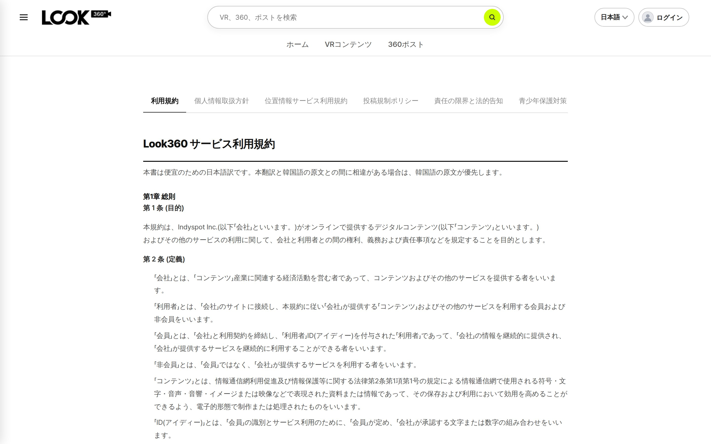

직접 확인
<a class="lnk" href="http://100.64.25.50:5174/policy?tab=agreement" target="_blank">http://100.64.25.50:5174/policy?tab=agreement</a>

---

## 🔤 사이트 화면 다국어 — 미번역 전수 정리 10/14~10/19

언어를 바꿔도 헤더·사이드패널에 한국어가 남는다는 오너 지적(10/14)에서 출발해, 화면 전체의 하드코딩 한국어를 전수 조사하고 고쳤습니다.

| 항목 | 결과 | 상태 |
|---|---|---|
| 전수 조사 | 템플릿·속성·스크립트·서버 문구 등 「고칠 것」 1,300여 건 · en·ja 48화면 실측 | 잔여 0 |
| 브라우저 탭 제목 | 60개 화면 제목이 사이트 언어를 따름(분석용 GA4 제목은 한국어 고정) | QC PASS |
| 서버 오류 문구 | 로그인 실패·비밀번호 재설정 등 150종에 코드 부여 → 사이트 언어로 표시 | QC PASS |
| 재발 방지 | 한글 문구를 새로 넣으면 `yarn lint` 실패 | 적용 |
| 콘텐츠 번역 | VR 스토리 챕터·컨트롤러 제목 번역 · 홈에서 언어를 바꿔도 VR 재로딩 없음 | QC PASS |
| 후속 7곳(10/19) | 홈 첫 슬라이드·마이페이지 지역/카테고리·지갑 상품명 등 | 진행 중 |

> 자동번역 확인 팝업은 「자동번역이 꺼져 있을 때만」 뜨도록 바꿨고, 팝업 바깥을 누르면 취소로 처리합니다. 예전 알림은 한국어로 남습니다(오너 결정).

확인
<a class="lnk" href="https://kabkee-main.tailfe017f.ts.net:8443/IND/issues/IND-8208" target="_blank">IND-8208 전수 정리</a>
<a class="lnk" href="https://kabkee-main.tailfe017f.ts.net:8443/IND/issues/IND-8469" target="_blank">IND-8469 후속 7곳</a>
<a class="lnk" href="https://kabkee-main.tailfe017f.ts.net:8443/IND/issues/IND-8154" target="_blank">IND-8154 콘텐츠 번역</a>

---

## ❓ FAQ · 공지사항 «본문»도 다국어로? 회의 안건

사이트 다국어 작업은 **화면 문구**(메뉴·버튼·표 머리글·탭 제목·서버 오류)만 번역했습니다. FAQ(`/faq`)·공지사항(`/notice`)의 제목·본문은 DB 에 한국어로만 있어 언어를 바꿔도 한국어로 나옵니다.

### 오너 의견 (10/19)

- FAQ·공지는 운영자가 쓰는 글이라 **다국어로 제공해도 좋겠다**
- 1:1 문의는 사용자가 자기 언어로 쓰므로 **화면 문구만 번역**, 본문은 그대로

### 회의에서 정할 것

1. FAQ·공지 본문 다국어 여부
2. 방식 — 운영자 직접 작성(관리자 입력란 추가) / 자동번역(기존 콘텐츠 자동번역 재사용) / 혼합(자동번역 후 검수)
3. 대상 언어 — 7개 전부 또는 영어 우선

> 함께 결정이 필요한 것: 중요 메일 다국어(한·영 병기 제안) · 번역 품질(「시작→startup」 등 어색한 기계 번역) 처리 방침.

확인
<a class="lnk" href="http://100.64.25.50:5174/faq" target="_blank">FAQ(dev)</a>
<a class="lnk" href="https://kabkee-main.tailfe017f.ts.net:8443/IND/issues/IND-8208" target="_blank">IND-8208</a>

---

<!-- _class: sec -->

Section 03

## l3 플랫폼 · 360동영상 · VR 스토리

YouTube형 360동영상의 조작을 운영까지 반영했고, iPhone 실기 결과에 따라 지원 범위를 확정했습니다. VR 스토리에는 360동영상과 화질 선택이 들어갔습니다.

---

## 🎬 YouTube형 360동영상 — 드래그·자이로 운영 반영 10/13~10/16

YouTube 임베드는 원래 손가락·마우스로 시점을 돌릴 수 없어, 위에 입력 레이어를 얹어 우회했습니다. 이번 주 오너 실기 후 **운영(Netlify)에 반영**했습니다.

| 단계 | 내용 | 결과 |
|---|---|---|
| 1차 실기(오너) | 모바일 드래그 불가 · 자이로 부정확 · 아이콘 겹침 | FAIL |
| 원인·수정 | 모바일 YouTube 의 방향 센서가 드래그를 덮어씀 → 끄고 전달 · 재생 중 제목 숨김 | QC PASS |
| 운영 배포 | 이 수정 3커밋만 골라 Netlify 반영(`ef619978`) | 반영 |
| 2차 실기(오너) | Android Chrome — 드래그·자이로·겹침·제목 숨김 전부 정상 | 정상 |
| YouTube 자체 UI | 설정·공유 메뉴가 입력 레이어에 가려 안 눌림 → YouTube UI 를 끄고 **우리 컨트롤바**로 제어 | dev 반영 |
| 자이로 아이콘 | 오너 요청대로 「지구본 + 대각선 축」 모양 | dev 반영 |

> 「드래그가 필요하면 업로드형으로」라는 임시 방침은 종료됐습니다. YouTube 영상에는 화질 메뉴가 없습니다(YouTube 가 화질 지정을 막음).

확인
<a class="lnk" href="https://kabkee-main.tailfe017f.ts.net:8443/IND/issues/IND-8104" target="_blank">IND-8104 드래그·자이로</a>
<a class="lnk" href="https://kabkee-main.tailfe017f.ts.net:8443/IND/issues/IND-8272" target="_blank">IND-8272 우리 컨트롤바</a>

---

## 📸 화면 — YouTube 360 을 우리 컨트롤바로 제어 10/16

YouTube 자체 컨트롤·설정·공유 버튼이 사라지고, 업로드형 영상과 같은 재생·시크·음소거 바로 조작합니다. 화면 어디를 끌어도 시점이 돕니다.

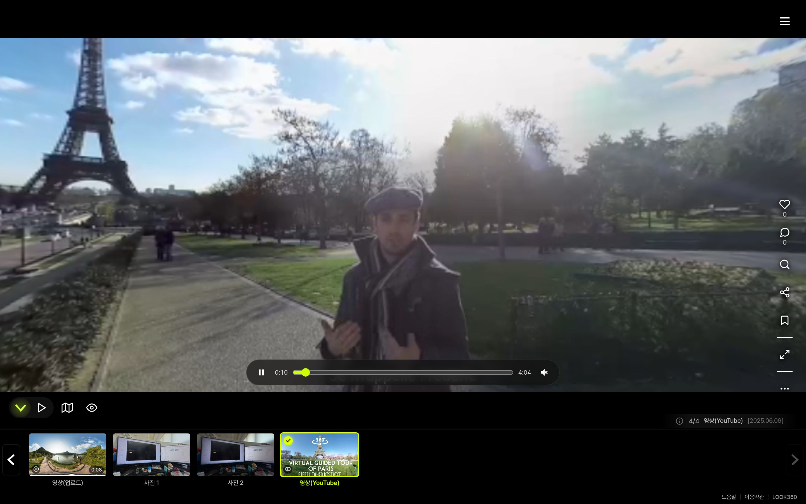

직접 확인
<a class="lnk" href="http://100.64.25.50:5174/vr/ind8027fx?pano=33663" target="_blank">http://100.64.25.50:5174/vr/ind8027fx?pano=33663</a>

---

## 📱 iPhone 실기 결과 — FAIL, iOS 미지원으로 결정 10/19 NEW

iPhone SE2 · iOS 27.0.1 에서 운영 화면의 「영상(YouTube)」 장면을 확인했습니다. 두 브라우저 모두 YouTube 가 구(球) 형태로 그리지 않아 **돌릴 시점 자체가 없습니다**.

<figure style="margin:0">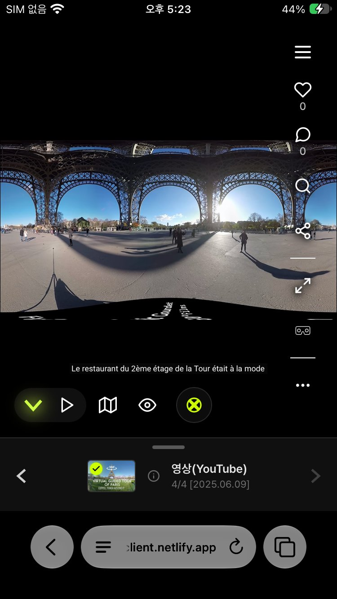<figcaption>Safari — 등장방형 원본이 평면 그대로(바닥 로고가 가로로 늘어짐)</figcaption></figure>
<figure style="margin:0">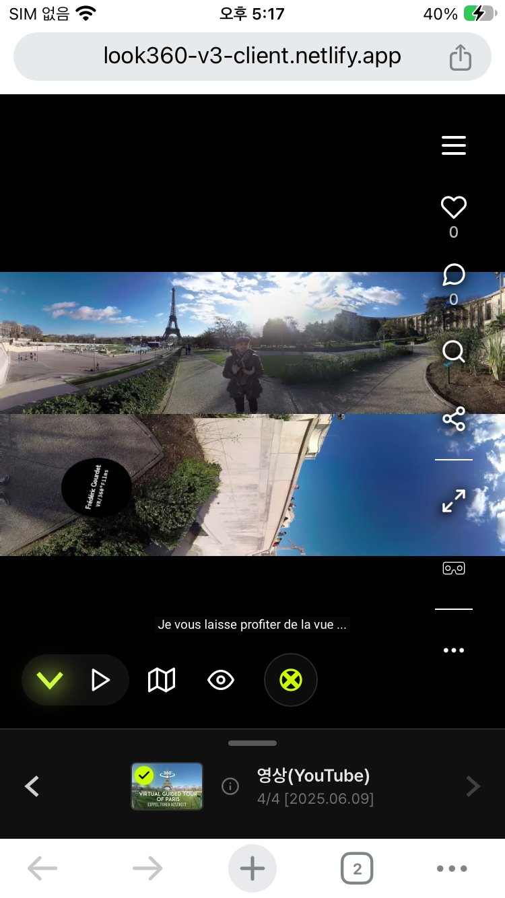<figcaption>Chrome — 큐브맵 원본이 위아래 두 띠로 그대로</figcaption></figure>

직접 확인
<a class="lnk" href="https://kabkee-main.tailfe017f.ts.net:8443/api/attachments/b29269de-5cd8-40c8-a9f7-324be6dc9c6c/content" target="_blank">Safari 원본 (IMG_0045)</a>
<a class="lnk" href="https://kabkee-main.tailfe017f.ts.net:8443/api/attachments/17650d23-ce26-4ab0-ad0e-3d7c0e4014ef/content" target="_blank">Chrome 원본 (IMG_0044)</a>
<a class="lnk legacy" href="https://look360-v3-client.netlify.app/vr/ind8027fx?pano=33663" target="_blank">운영 화면</a>

---

## 🍎 iOS 대책 — 「YouTube 앱에서 보기」 10/19

YouTube iframe 은 다른 사이트 영역이라 우리 코드로 영상 픽셀을 가져와 구에 입힐 수 없습니다. iOS Chrome 도 엔진이 WebKit 이라 같은 제약입니다.

### 구현 (dev · QC 진행 중)

- iOS + YouTube형 장면에서만 **안내 배너 + 「YouTube 앱에서 보기」** 버튼
- 누르면 YouTube 앱으로 **보던 시각부터** 이어서 열림 · 앱은 360 드래그·자이로 지원
- iOS 에선 드래그 레이어·자이로 버튼 숨김 · Android·PC 는 그대로
- 업로드형 360동영상은 iOS 에서도 정상(우리 엔진으로 렌더링)

### 회의에서 정할 것

1. iOS 미지원 + YouTube 앱 우회 방향 **최종 확정**
2. 관리자 360 영상 등록 화면에 「iOS 에서도 둘러보려면 업로드형으로」 안내를 넣을지(별도 발주)
3. Android 는 10/15 정상 확인 → 감지 조건을 **iOS 로 한정**하는 것이 맞는지

> 에뮬레이션으로만 확인했습니다. 버튼이 iPhone 에서 실제로 YouTube 앱을 여는지는 오너 실기 확인이 필요합니다.

확인
<a class="lnk" href="https://kabkee-main.tailfe017f.ts.net:8443/IND/issues/IND-8487" target="_blank">IND-8487 iOS 대책</a>
<a class="lnk" href="https://kabkee-main.tailfe017f.ts.net:8443/IND/issues/IND-8488" target="_blank">IND-8488 구현</a>

---

## 📸 화면 — iPhone 안내 배너 / Android 기존 동작 10/19

같은 장면을 iPhone 과 Android 화면 크기로 비교한 에뮬레이션 화면입니다. iPhone 에서만 배너가 뜨고 자이로 버튼이 빠집니다.

<figure style="margin:0">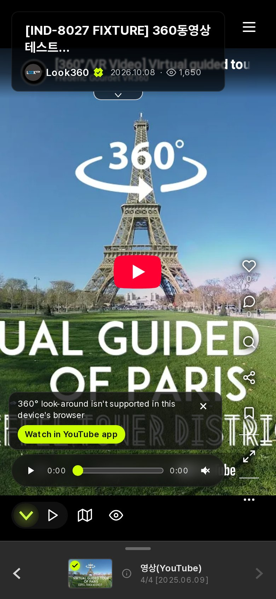<figcaption>iPhone — 미지원 안내 + YouTube 앱 버튼</figcaption></figure>
<figure style="margin:0">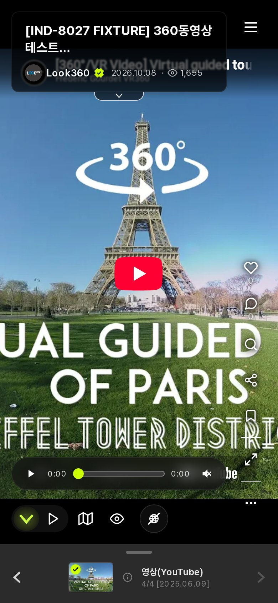<figcaption>Android — 드래그·자이로 그대로</figcaption></figure>

직접 확인
<a class="lnk" href="https://kabkee-main.tailfe017f.ts.net:8444/vr/ind8027fx?pano=33663" target="_blank">https://kabkee-main.tailfe017f.ts.net:8444/vr/ind8027fx?pano=33663</a>

---

## 🎞️ VR 스토리 안 360동영상 + 화질 선택 10/14~10/19 NEW

오너 요청(10/15): 「시청자가 재생 중에 화질을 고를 수 있고, 제작자는 업로드할 때 기본 화질을 정할 수 있어야 한다.」 그전에는 VR 스토리에 영상 장면을 넣을 방법 자체가 없었습니다.

| 영역 | 내용 | 결과 |
|---|---|---|
| 화질 결정 순서 | **시청자 선택 > 제작자 지정 > 기기 자동** (1920 / 1440 / 960p) | 적용 |
| 관리자 | 스토리에 영상 장면 추가 · 장면별 기본 화질 · 진행 조건(영상 끝/클릭/타이머) · 소리 | QC PASS |
| 사용자 | 영상이 끝나면 다음 단계로 · 나레이션 중엔 영상 음소거 · 사진 장면에선 메뉴 숨김 | QC4 PASS |
| 범위 | 1단계는 **업로드형만**(YouTube형은 스토리에 못 넣음) · 새 스토리 만들기는 제외 | 결정 |
| 남은 관찰 | 모바일·태블릿에서 열린 화질 메뉴가 오른쪽 버튼 2개와 겹침 · 관리자 429 시 빈 화면 | 오너 판단 |

> 운영 배포는 하지 않았습니다. 용량 기준: 영상 1편 3단 저장 시 1분 약 183MB · 5분 약 916MB(백업 포함 2배).

확인
<a class="lnk" href="https://kabkee-main.tailfe017f.ts.net:8443/IND/issues/IND-8164" target="_blank">IND-8164 화질 선택</a>

---

## 📸 화면 — VR 스토리 화질 메뉴 10/18

VR 스토리 하단 컨트롤바 오른쪽에 화질(1440p)이 표시되고, 누르면 1920/1440/960p 를 고를 수 있습니다. QC 때 넣었던 테스트 장면을 찍은 화면입니다(현재는 원복).

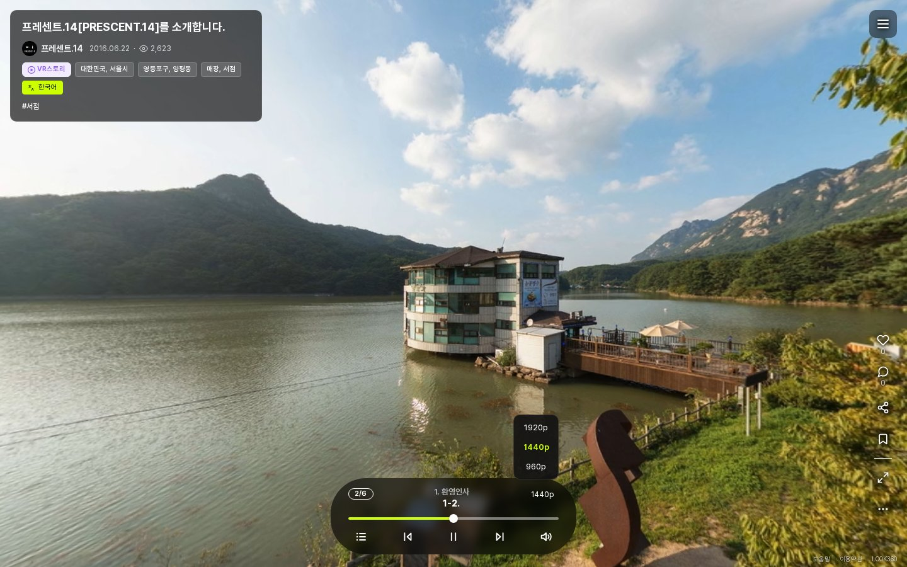

직접 확인
<a class="lnk" href="http://100.64.25.50:5174/vr/ind8027fx?pano=33662" target="_blank">http://100.64.25.50:5174/vr/ind8027fx?pano=33662 (같은 화질 메뉴 · 360뷰)</a>

---

## ⏹️ 매체 정지 공통 장치 — 플랫폼 전체 확장 · 종결 10/16

지난주 「전수 검사 대기」로 보고한 항목입니다. 스토리별로 고치지 않고, 영상·소리의 정지·진척·진행 버튼을 **한 곳의 공통 장치**가 맡도록 플랫폼 전체에 넓혔습니다.

| 항목 | 결과 |
|---|---|
| 아침고요 5-3 | 나레이션 후 썰매 버튼이 나타나고 **누를 때까지 대기** (PC·모바일 실클릭) |
| 아침고요 5-4 | 하단 상태바가 영상 재생에 맞춰 참 |
| 단계 이탈 | 이전·다음·챕터·종료·창 닫기 시 영상·소리 **확실히 정지** |
| 적용 범위 | 레거시 360영상 · livepano · 업로드형/YouTube형 · YouTube 팝업 · 씬 자동재생 영상 |
| 전수 검사 | 레거시 336칸 중 공통 결함 1건(로비 자동재생 영상 소리 잔류) 수정 · 회귀 104 PASS |

> 남은 관찰(FAIL 아님): 모바일 390px 에서 자동 회전 때문에 썰매 아이콘이 화면 밖으로 나갈 수 있습니다. 스토리 고유 문제(uid 11 1-5·1-6)는 오너가 직접 수정합니다.

확인
<a class="lnk" href="http://100.64.25.50:5174/vr/152165ca?story=5-3" target="_blank">아침고요 5-3 시연</a>
<a class="lnk" href="https://kabkee-main.tailfe017f.ts.net:8443/IND/issues/IND-8041" target="_blank">IND-8041</a>
<a class="lnk" href="https://kabkee-main.tailfe017f.ts.net:8443/IND/issues/IND-8046" target="_blank">IND-8046</a>

---

## 📸 화면 — 아침고요 5-3 진행 중 10/19

5-3 「썰매장 정상」 단계에서 상태바가 진행 중인 화면입니다. 나레이션이 끝나면 썰매 버튼이 뜨고 클릭을 기다립니다.

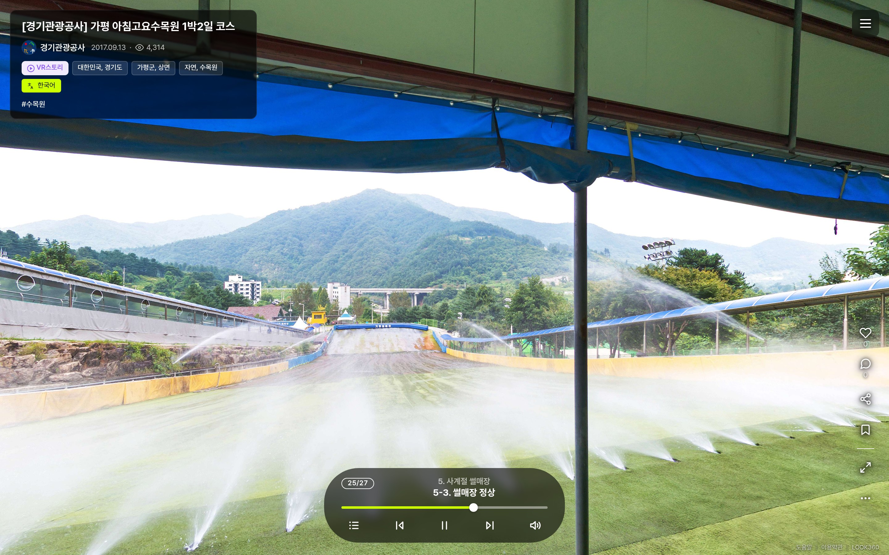

직접 확인
<a class="lnk" href="http://100.64.25.50:5174/vr/152165ca?story=5-3" target="_blank">http://100.64.25.50:5174/vr/152165ca?story=5-3</a>

---

## 📖 VR 스토리 — 지난주 이월 항목 종결 10/12~10/15

| 과제 | 결과 | 상태 |
|---|---|---|
| 스토리 진행기 레거시 동작 이관 결함 A~E (지난주 「독립 QC 보류」) | 전 항목 QC PASS · 깜빡임 대상 49/49 일치 | 종결 10/12 |
| 폴리곤 클릭 영역 배경 — 새 플랫폼 | 반투명 흰 면도 **흰 테두리 반짝임**으로 통일(49건) | 종결 10/12 |
| 폴리곤 클릭 영역 배경 — 레거시 운영 9건 | 흰 판 → 투명 + 테두리 반짝임 · 백업 후 운영 반영 | QC PASS 10/13 |
| 남한산성 「다음」 지연 | 화면 안 아이콘 뒤 숨은 카메라 연출(중앙값 4.8초) · 하단 「다음」 버튼은 0.04초 | 오너 결정 keep |

> 레거시 XML 은 CloudFront 가 주소 뒤 버전값을 무시해, 배포 후 약 15시간 옛 파일이 나갔습니다. 앞으로 레거시 XML 배포에는 캐시 무효화를 함께 합니다. 남한산성 개선 선택지 5개(클릭 시 회전 건너뛰기 등)는 보류 상태입니다.

확인
<a class="lnk" href="https://kabkee-main.tailfe017f.ts.net:8443/IND/issues/IND-8115" target="_blank">IND-8115 이관 결함</a>
<a class="lnk" href="https://kabkee-main.tailfe017f.ts.net:8443/IND/issues/IND-8121" target="_blank">IND-8121 폴리곤(새 플랫폼)</a>
<a class="lnk" href="https://kabkee-main.tailfe017f.ts.net:8443/IND/issues/IND-8116" target="_blank">IND-8116 폴리곤(레거시)</a>
<a class="lnk" href="https://kabkee-main.tailfe017f.ts.net:8443/IND/issues/IND-8158" target="_blank">IND-8158 남한산성</a>

---

<!-- _class: sec -->

Section 04

## l3 플랫폼 · vrViewer · 목록 화면

방문 이력 이전/다음 버튼을 VR 모드까지 완성했고, 뷰어 곳곳의 요청을 처리했습니다. 필터·썸네일 아이콘·AI 배지는 시안을 회의에서 고릅니다.

---

## ↔️ 방문 이력 이전/다음 버튼 — VR 모드까지 완성 10/16~10/18

VR 화면 아래쪽에 「이전」「다음」 버튼과 파노라마 이름이 떠 있다가, 시선을 내릴수록 진해지고 고개를 돌리면 살짝 따라옵니다.

| 단계 | 내용 | 결과 |
|---|---|---|
| 버튼·라벨 | 방문한 파노라마가 있을 때만 해당 방향 표시 · 이름 라벨은 버튼 바로 아래에 붙음 | QC PASS |
| 「시작하기」 진입 | 시작하기로 들어온 뒤 「이전」이 숨던 결함 수정 | QC PASS |
| VR 모드 표시 | PC 와 같은 점진 투명도·추종(이전에는 VR 에서 고정) | 반영 |
| VR 모드 클릭 | 오너 실기 「터치로 못 누름」 → **1.5초 응시 자동 클릭** · 40° 안에서는 버튼 고정 | 오너 「정상작동」 |
| 함께 바뀐 것 | 액션 목록의 VR 버튼 제거 · 자이로 **기본 켜짐**(끄면 기기에 기억) | 반영 |
| 외형 · 오토투어 이력 | 아래 시안 비교 → 회의에서 확정 | 결정 대기 |

> flat(평면) 장면에서는 이전/다음 버튼을 숨기는 것이 사양입니다. VR 스토리·자동 진행 중에도 버튼은 뜨지 않습니다.

확인
<a class="lnk" href="http://100.64.25.50:5174/vr/2wxh34h3" target="_blank">서경대학교(시안 촬영 콘텐츠)</a>
<a class="lnk" href="https://kabkee-main.tailfe017f.ts.net:8443/IND/issues/IND-8053" target="_blank">IND-8053</a>
<a class="lnk" href="https://kabkee-main.tailfe017f.ts.net:8443/IND/issues/IND-8406" target="_blank">IND-8406 결합·자이로</a>
<a class="lnk" href="https://kabkee-main.tailfe017f.ts.net:8443/IND/issues/IND-8420" target="_blank">IND-8420 VR 표시</a>

---

## 🎨 이전/다음 버튼 외형 — 시안 비교 보드 회의 안건

A = 현행(라임 원 · 곡선 화살표 · 흰 글자+그림자) · B = 반투명 다크 원 · 꺾쇠 · 라벨 다크 pill · C = 화살표+이름 통합 라임 캡슐. **오너 1차 의견: A안이 가장 좋아 보임.**

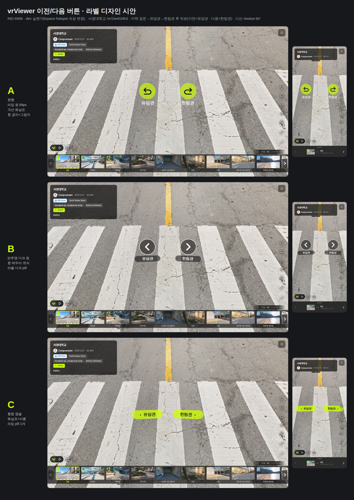

**회의에서 확정할 것** (카드 `b54e37eb`)

1. 외형 A / B / C
2. 오토투어 장면도 방문 이력에 넣을지 — 오너가 10/18 **「모든 장면을 뒤로가기로 갈 수 있는 게 낫다」(포함)** 로 결정했으므로 카드에 그대로 답하면 됩니다

⚠️ 포함하면 오토투어를 오래 틀어 둔 뒤 브라우저 뒤로가기로 VR 페이지를 나가기까지 누를 횟수가 늘어납니다(무한 순환).

C안은 모바일에서 오른쪽 캡슐이 액션 아이콘 줄에 닿습니다.

직접 확인
<a class="lnk" href="https://kabkee-main.tailfe017f.ts.net:8443/api/attachments/3757b3f1-9a12-4b91-b7c4-d09b640667d4/content" target="_blank">비교 보드 원본</a>
<a class="lnk" href="https://kabkee-main.tailfe017f.ts.net:8443/api/attachments/635bb34b-9c65-4adc-8f6a-b00072286f96/content" target="_blank">A안 PC</a>
<a class="lnk" href="https://kabkee-main.tailfe017f.ts.net:8443/api/attachments/d3ead15b-d782-4526-b77e-a56670434825/content" target="_blank">B안 PC</a>
<a class="lnk" href="https://kabkee-main.tailfe017f.ts.net:8443/api/attachments/ce9a21cf-b254-46d6-834d-3388ad538f88/content" target="_blank">C안 PC</a>

---

## 🖼️ flat 장면 「전시회로 돌아가기」 — VR 모드 호환 10/18~10/19 NEW

오너가 10/18 이전/다음 버튼을 실기로 확인하다가, flat 장면의 「전시회로 돌아가기」만 VR 모드에서 누를 수 없다는 것을 발견했습니다. 화면 고정 레이어라 VR 화면에 그려지지 않았기 때문입니다.

| 항목 | 내용 | 상태 |
|---|---|---|
| 방식 | 이전/다음 버튼처럼 VR 진입 시 **3D 버튼 + 1.5초 응시 클릭** · 일반 화면 모습은 그대로 | QC PASS |
| 레거시 자체 버튼 | flat 장면 261개 중 43개는 레거시 XML 에 자체 버튼 → 데이터 수정 없이 화면 단에서 함께 처리 | 포함 |
| 문구 다국어 | 「전시회로 돌아가기」 7개 언어 | 필터 작업 뒤 대기 |
| 헤드셋 실기 | 렌더 · 시선 하향 시 크기/위치 · 1.5초 응시 이동 | 오너 확인 필요 |
| 기존 결함 후보 | 일부 flat 장면 직링크에서 「Loading…」 표시가 사라지지 않음(이번 변경과 무관) | 발주 여부 판단 |

확인
<a class="lnk" href="https://kabkee-main.tailfe017f.ts.net:8444/vr/o1vj1ty0?pano=29315" target="_blank">전시회 flat 장면(https)</a>
<a class="lnk" href="https://kabkee-main.tailfe017f.ts.net:8443/IND/issues/IND-8436" target="_blank">IND-8436</a>

---

## 🧭 vrViewer 정비 (1) — 패널 · 목록 · 제목 10/13~10/18

| 과제 | 바뀐 것 | 상태 |
|---|---|---|
| 사이드패널 닫기 | PC 는 패널 안쪽 X 하나로 · 패널·하단 배경 반투명+흐림 | 완료 |
| VR 목록·하단 썸네일 | 항목 화살표·hover 강조 · 그룹 hover 시 하단 상위 폴더 강조 · 썸네일 16:9, 제목은 아래로 | 완료 |
| 파노라마 목록·경로 | 탭 이름 「VR 정보」 · 폴더 아이콘 · 검색 결과에 전체 경로 · 하위 그룹만 있는 그룹은 썸네일 6장 모음 | 완료 |
| 탭 상태 주소 공유 | 사이드패널 탭·소개 하위 섹션·설정 항목이 주소에 반영 → 링크로 바로 열림 | 완료 |
| 제목 표시 | 2줄 말줄임 · 햄버거 버튼과 겹침 0 · 접기/펼치기 탭을 디자이너 시안으로 | 완료 |
| UI 숨김/노출 효과 | 깜빡임 대신 화면 중앙 기준으로 바깥으로 나갔다 들어옴 | 완료 |

확인
<a class="lnk" href="http://100.64.25.50:5174/vr/xo6jh8ib" target="_blank">vrViewer 시연</a>
<a class="lnk" href="https://kabkee-main.tailfe017f.ts.net:8443/IND/issues/IND-8240" target="_blank">IND-8240</a>
<a class="lnk" href="https://kabkee-main.tailfe017f.ts.net:8443/IND/issues/IND-8241" target="_blank">IND-8241</a>
<a class="lnk" href="https://kabkee-main.tailfe017f.ts.net:8443/IND/issues/IND-8156" target="_blank">IND-8156</a>

---

## 🧭 vrViewer 정비 (2) — 지도 · 공유 · 로딩 · 정리 10/13~10/18

| 과제 | 바뀐 것 | 상태 |
|---|---|---|
| 지도 zoom 상한 (지난주 결정 대기) | 구글지도 **7곳 모두 최대 zoom 15** — 예: 「2019 스마트 테크 코리아」 22 → 15 | 종결 |
| 표시 설정 버튼 색 (지난주 결정 대기) | 「모두 보이기」 = 녹색 · 「모두 숨기기」 = 빨강 | 종결 |
| VR 공유 팝업 | 미리보기 사라짐 수정 · 임베드 십자선·로딩 표시 · 세로 %/px 선택 | 완료 |
| 로딩 화면 | 로고 + `Loading...` 으로 7개 지면 통일 · 방향 안내 감속·1회 | 완료 |
| 자동 재생 투어 | 파노라마마다 360° 회전 후 다음 → 끝나면 처음으로 무한 반복(영상·잠금 장면은 건너뜀) | 완료 |
| 정리 | 채널 탐색 페이지 삭제(`/channels` 404) · 검색 실험 코드 제거 · 360포스트 공지 마커를 「공지」 칩으로 | 완료 |

> 관리자 지도 용어 커밋(`1fe5c2b8`)은 「몰아서 push」 대기입니다. 숨김 VR 스토리는 소유자·관리자만 열 수 있게 했고, 360뷰도 같이 막을지는 답을 기다립니다(기본값으로 종결).

확인
<a class="lnk" href="https://kabkee-main.tailfe017f.ts.net:8443/IND/issues/IND-8047" target="_blank">IND-8047 지도</a>
<a class="lnk" href="https://kabkee-main.tailfe017f.ts.net:8443/IND/issues/IND-8248" target="_blank">IND-8248 확정값</a>
<a class="lnk" href="https://kabkee-main.tailfe017f.ts.net:8443/IND/issues/IND-8054" target="_blank">IND-8054 투어</a>

---

## 🔎 VR 목록 통합 필터 — 수정본 시안 A / B 회의 안건

서버 통합은 끝났고 화면은 시안 선택을 기다립니다. 오너 수정 요청(강조색 `#CCFF00` · 선택 표시 1종 · 개수 표기 · 「전체」 자동 전환)을 반영한 수정본입니다.

<figure style="margin:0">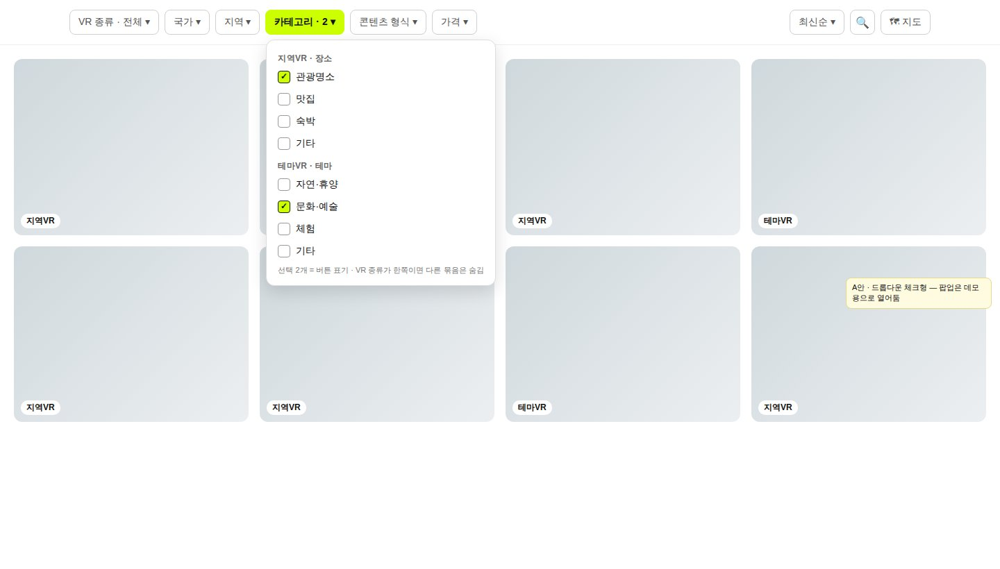<figcaption>A안 — 드롭다운 체크형 (PC 필터 1줄)</figcaption></figure>
<figure style="margin:0">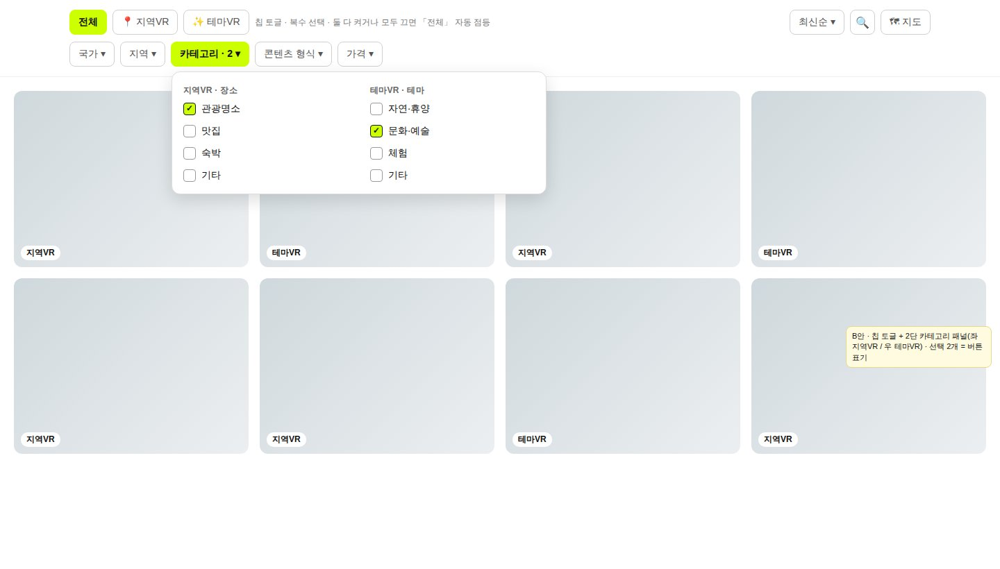<figcaption>B안 — 칩 토글 + 카테고리 2단 패널 (PC 필터 2줄)</figcaption></figure>

함께 정할 것: 「Etc 맨 아래」 = 묶음 **각각** 맨 아래(시안 그대로) / 합쳐서 **전체** 맨 아래 한 칸 · 카드 `18713398`

직접 확인
<a class="lnk" href="https://kabkee-main.tailfe017f.ts.net:8443/IND/issues/IND-8424" target="_blank">IND-8424 수정본(규칙 프레임 포함)</a>
<a class="lnk" href="https://kabkee-main.tailfe017f.ts.net:8443/IND/issues/IND-8262" target="_blank">IND-8262 첫 시안 갤러리</a>
<a class="lnk" href="https://kabkee-main.tailfe017f.ts.net:8443/IND/issues/IND-8446" target="_blank">IND-8446 선택 카드</a>

---

## 🏷️ 썸네일 좌하단 형식·AI 아이콘 — 지면별 선택 회의 안건

오너 원문(#45): 360 파노라마는 표시 없음 · flat 은 이미지 아이콘 · AI 로 만든 이미지는 형식 아이콘 왼쪽에 AI 아이콘. 이미 제목 앞에 AI 아이콘이 있어 **같은 칸에 두 번** 나오지 않도록 지면마다 고릅니다.

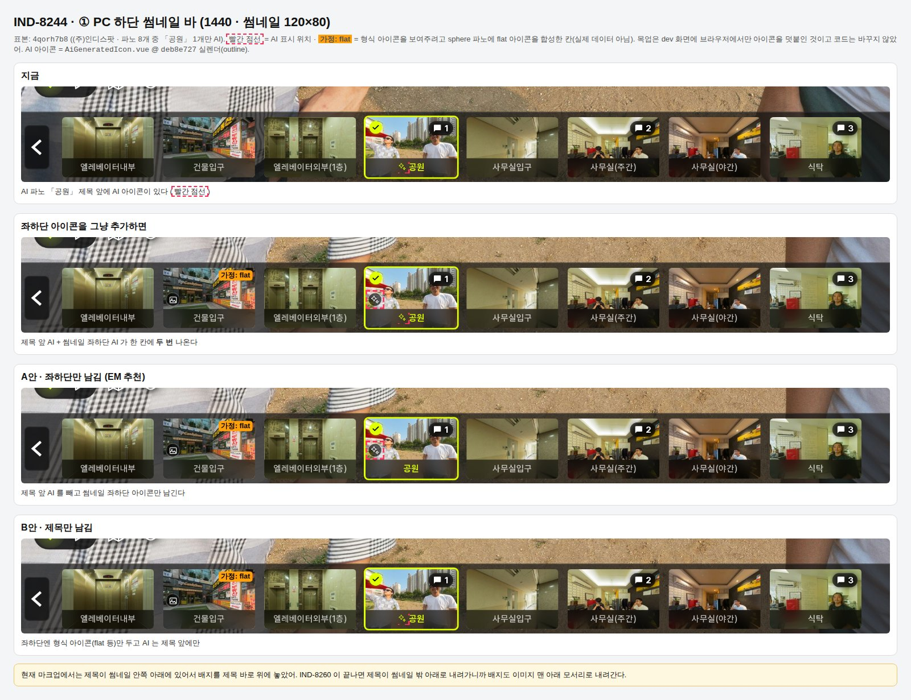

직접 확인
<a class="lnk" href="https://kabkee-main.tailfe017f.ts.net:8443/api/attachments/e6191f0c-2007-4e77-9111-896289def496/content" target="_blank">① PC 하단 바 목업</a>
<a class="lnk" href="https://kabkee-main.tailfe017f.ts.net:8443/api/attachments/b147dce5-b736-4a60-aeed-ec3c96d5768c/content" target="_blank">아이콘 조합 범례</a>
<a class="lnk" href="http://100.64.25.50:5174/vr/4qorh7b8" target="_blank">기준 화면(dev)</a>

---

## 🏷️ 썸네일 아이콘 — 카드 선택지와 EM 추천 회의 안건

A안 = 썸네일 좌하단만 남김 · B안 = 제목만 남김. 기본 체크(★)가 EM 추천이며, 그대로 확정하면 바로 구현을 시작합니다(카드 `496d346a`).

| 지면 | EM 추천 | 이유 |
|---|---|---|
| ① PC 하단 썸네일 바 | ★ A안 | 칸이 작아 제목 앞 아이콘이 이름을 가림 |
| ② VR 정보 탭 | ★ B안 | 제목 칸이 넓어 아이콘+「AI」 글자가 더 잘 읽힘 |
| ③ 파노라마 상세 팝업 | ★ B안 | 「AI 로 생성된 이미지」 안내 줄이 이미 있음 |
| ⑤ 모바일 파노라마 목록 | ★ A안 | — |
| ④ 모바일 현재 썸네일 · ⑥ `/vr-info` 그리드 | ★ 아이콘 추가 | ⑥ AI 아이콘은 서버 수정 필요 |
| 콘텐츠 카드(vrCard) | 제외 | 카드는 파노라마가 여러 개라 형식을 하나로 못 정함 |

> ②에서 A안을 고르면 다음 장 AI 카드의 「VR 정보 탭 제목 위치」 질문은 필요 없어집니다. 두 카드를 함께 보고 답해 주십시오.

확인
<a class="lnk" href="https://kabkee-main.tailfe017f.ts.net:8443/IND/issues/IND-8244" target="_blank">IND-8244 카드</a>
<a class="lnk" href="https://kabkee-main.tailfe017f.ts.net:8443/api/attachments/71849d73-4aab-4c75-bbe0-c0e8c221d547/content" target="_blank">② VR 정보 탭 목업</a>
<a class="lnk" href="https://kabkee-main.tailfe017f.ts.net:8443/api/attachments/7073d308-4adc-4ed3-8770-1fb934d22a2e/content" target="_blank">③ 상세 팝업 목업</a>

---

## ✨ AI 생성 파노라마 표시 2차 — dev 화면 10/14~10/15

전부 AI 면 「AI」 배지 실선, 일부만 AI 면 일부 점선입니다. VR 화면 안에 떠 있던 AI 배지는 없앴고(오너 결정), 제목 칩·썸네일·VR 정보 탭에 아이콘을 넣었습니다.

<figure style="margin:0">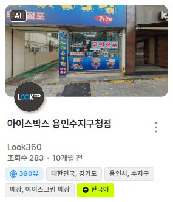<figcaption>콘텐츠 카드 「AI」 배지(전체)</figcaption></figure>
<figure style="margin:0">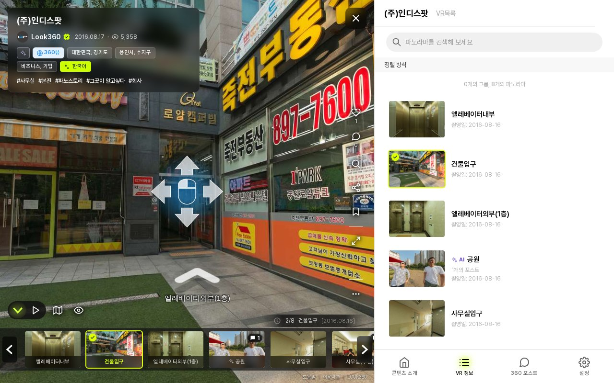<figcaption>VR 정보 탭 — 「공원」 제목 앞 AI 아이콘 + 「AI」</figcaption></figure>

직접 확인
<a class="lnk" href="http://100.64.25.50:5174/vr/4qorh7b8?aiMarkPos=front" target="_blank">http://100.64.25.50:5174/vr/4qorh7b8?aiMarkPos=front</a>
<a class="lnk" href="http://100.64.25.50:5174/vr/9i8bfqkx" target="_blank">전체 AI 콘텐츠</a>

---

## ✨ AI 표시 — 회의에서 고를 5문항 회의 안건

카드 `8fa89948` 의 질문입니다. 답이 나오면 화면의 앞/뒤 비교 토글을 걷어내고 고른 안만 남깁니다.

| 질문 | 선택지 | 현재 기본값 |
|---|---|---|
| VR 정보 탭 제목의 AI 아이콘+「AI」 위치 | 맨 앞 / 맨 뒤 | 맨 앞 |
| 파노라마 상세 팝업 제목의 AI 아이콘 위치 | 맨 앞 / 맨 뒤 | 맨 앞 |
| 콘텐츠 카드 「AI」 배지 시안(전체 실선 / 일부 점선) | 이대로 확정 / 수정 | — |
| 파노라마 퀵뷰에도 같은 아이콘 | 포함 / 미포함 | 미포함 |
| 전체/일부 판정에 숨김 파노라마도 셀지 | 뺀다 / 센다 | 뺀다 |

확인
<a class="lnk" href="https://kabkee-main.tailfe017f.ts.net:8443/IND/issues/IND-8059" target="_blank">IND-8059 카드</a>
<a class="lnk" href="https://kabkee-main.tailfe017f.ts.net:8443/api/attachments/bd5cb4b7-9bea-4832-a470-59154715a36e/content" target="_blank">상세 팝업(앞)</a>
<a class="lnk" href="https://kabkee-main.tailfe017f.ts.net:8443/api/attachments/329c6eda-5643-47d5-a09e-d64656bcfa07/content" target="_blank">상세 팝업(뒤)</a>
<a class="lnk" href="https://kabkee-main.tailfe017f.ts.net:8443/api/attachments/4b0e7d66-5604-4b66-8445-01b7366a0174/content" target="_blank">카드 배지(일부)</a>

---

<!-- _class: sec -->

Section 05

## l3 플랫폼 · 데이터 · 판매 정책

지역 트리의 기준을 세우고, 유료 콘텐츠 판매 규칙을 오너 요구대로 뒤집었습니다.

---

## 🗺️ 지역 트리 기준 정비 — 해외 dr5hn 도입 10/14~10/19 NEW

해외 지역이 구글 지오코딩으로 그때그때 만들어져 나라마다 깊이가 제각각이었고(해외 19행), 서울에서 구를 고르면 저장이 안 됐습니다.

| 항목 | 조치 | 결과 |
|---|---|---|
| 해외 지역 | 공개 데이터 dr5hn 를 정본으로 228개국 **5,316행** 반입 · 9개 언어 이름 | QC PASS |
| 국내 지역 | 시·도 / 시 / 구·군 / 읍·면 / 동·리 단계 체계 **유지**(오너 결정) | 결정 |
| 지역 선택 화면 | 「1단계·2단계」 번호 대신 앞 칸의 하위 지역이 다음 칸에(서울 → 「구」) · 저장 정상화 | QC PASS |
| 관리자 | 해외 노드 생성 허용(출처·이력 기록) · 동명 경고 · 노드 수정 화면 | QC PASS |
| 재마이그 안전장치 | 재마이그가 dev 서버의 VR 스토리 XML 88건을 다시 만들던 경로 차단 | QC PASS |
| 빈 DB 재현성 | 클린 재마이그 잔여 결함 → 새 EPIC 으로 분리(오너 결정) | 진행 중 |

> 해외 지역 데이터는 ODbL 라이선스라 파생 데이터를 무료로 내려받을 수 있게 제공해야 합니다. 그래서 라이선스 페이지를 함께 만들었습니다(다음 장).

확인
<a class="lnk" href="https://kabkee-main.tailfe017f.ts.net:8443/IND/issues/IND-8196" target="_blank">IND-8196 지역 트리</a>
<a class="lnk" href="https://kabkee-main.tailfe017f.ts.net:8443/IND/issues/IND-8477" target="_blank">IND-8477 빈 DB 재현성</a>
<a class="lnk" href="https://kabkee-main.tailfe017f.ts.net:8443/IND/issues/IND-8162" target="_blank">IND-8162 지역 선택 화면</a>

---

## 📸 화면 — 오픈소스 라이선스 페이지 신설 10/14 NEW

사이드메뉴 하단 「오픈소스 라이선스」로 들어갑니다. 데이터 출처(dr5hn ODbL) 1 · 웹 오픈소스 161 · 글꼴·아이콘 3 · 상용 2, 총 167개를 안내합니다. 한국어 외 언어에서는 영어로 나옵니다.

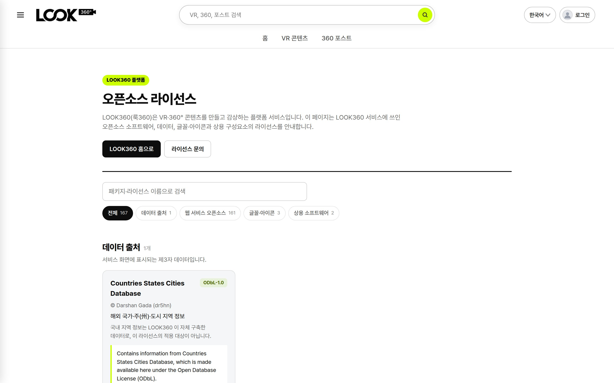

직접 확인
<a class="lnk" href="http://100.64.25.50:5174/licenses" target="_blank">http://100.64.25.50:5174/licenses</a>

---

## 📚 데이터 정리 · 검색 · 기반 작업 10/13~10/19

| 과제 | 결과 | 상태 |
|---|---|---|
| VR스토리 지역·테마 카테고리 중복 | 둘 다 가진 69건에서 테마 카테고리 제거(백업 선행) → 테마VR 탭엔 테마 전용 19건만 | 완료 |
| 관리자 파노라마 검색 OR→AND | 서버는 원래 AND · 늦게 온 응답이 최신 결과를 덮던 화면 문제 수정 | QC PASS |
| 한 장소·여러 VR 목록 | 289곳·1,454건 구글시트 · 주소 판정 「긴급」 117건 | 시트 전달 |
| 사이트맵 자동 생성 | 공개 콘텐츠 11,644 URL · robots.txt 연결 · 검색엔진 제출 절차 준비 | 운영 배포 대기 |
| 이미지 주소 통일 | dev 서버 주소가 바뀌어도 프로필·썸네일이 깨지지 않게 한 곳에서 처리 | QC PASS |
| `/files` 주소 조립 결함 3종 | 나레이션 `.mp3)` 꼬리(스토리 75건 BGM) · 언어 접미사 · 슬래시 누락 | 마무리 중 |

> 지역·테마 동시 지정을 코드로 막지는 않습니다(오너 결정). 관리자 운영 규칙으로 관리합니다.

확인
<a class="lnk" href="https://kabkee-main.tailfe017f.ts.net:8443/IND/issues/IND-8140" target="_blank">IND-8140 카테고리 중복</a>
<a class="lnk" href="https://kabkee-main.tailfe017f.ts.net:8443/IND/issues/IND-8207" target="_blank">IND-8207 사이트맵</a>
<a class="lnk" href="https://kabkee-main.tailfe017f.ts.net:8443/IND/issues/IND-8450" target="_blank">IND-8450 /files 결함</a>

---

## 💳 유료 콘텐츠 별점·리뷰 · 「100% 할인」 — 종결 10/15~10/16

오너 요구(#14): 「유료는 리뷰를 항상 켜고, 무료·외부VR 은 기본 숨김. 유료→무료 전환은 관리자 포함 전원 막고, 0원은 100% 할인으로 표시.」 측정해 보니 기존 동작이 **정반대**였습니다.

| 항목 | 이전 | 이후 |
|---|---|---|
| 유료 리뷰 | 판매자가 끌 수 있음 | **항상 노출** — 끄기 요청은 서버가 거부 |
| 무료·외부VR 리뷰 | 끌 수 없음 | **기본 숨김**(기존 무료 리뷰 20건은 숨김 처리 · 삭제 아님) |
| 유료→무료 | 알림까지 있는 정식 기능 | 9개 경로 모두 **거부(관리자 포함)** |
| 할인가 0 | **정가로 결제되던 결함** | 「100% 할인」 배지 · 결제 없이 바로 구매 완료 |
| 검증 | — | 격리 DB 클린 재마이그와 dev 불일치 0 · QC 3회 PASS |

> 작업 중 관람기록 화면이 전 사용자 500 이 되는 회귀가 한 번 있었고 즉시 복구했습니다. 관리자 화면 커밋(`9f813bf`)은 「몰아서 push」 대기입니다.

확인
<a class="lnk" href="http://100.64.25.50:5174/search?q=Flat" target="_blank">검색 — 100% 할인 배지</a>
<a class="lnk" href="https://kabkee-main.tailfe017f.ts.net:8443/IND/issues/IND-8245" target="_blank">IND-8245</a>
<a class="lnk" href="https://kabkee-main.tailfe017f.ts.net:8443/IND/issues/IND-8254" target="_blank">IND-8254 서버 W1</a>

---

## 📸 화면 — 「100% 할인」 배지 10/16

정가는 그대로 두고 할인가를 0 으로 한 테스트 콘텐츠입니다. 목록·상세·결제·구매내역·검색·채널·관람기록 카드에 같은 배지가 붙습니다.

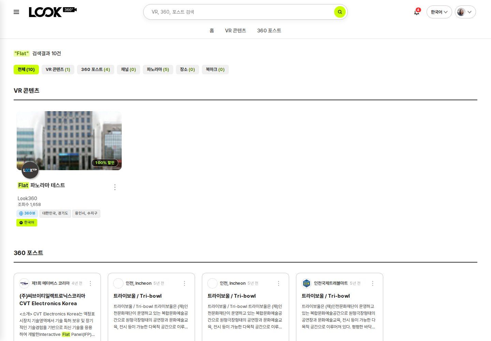

직접 확인
<a class="lnk" href="http://100.64.25.50:5174/search?q=Flat" target="_blank">http://100.64.25.50:5174/search?q=Flat</a>

---

<!-- _class: sec -->

Section 06

## look360.kr 레거시 운영 — 애드센스 대응 · 보안

애드센스 반려 원인을 찾아 정리하고, 같은 점검에서 나온 보안 구멍을 막아 모두 운영에 반영했습니다.

---

## 🔍 애드센스 「가치가 별로 없는 콘텐츠」 반려 — 원인 10/16 NEW

2026-08 사이트맵을 만들 때 의도하지 않은 **스티커 독립 상세 페이지** 5,371건(게시판 모듈 복제 잔재)이 제출돼 사이트맵 9,372 URL 의 **57%** 를 차지했습니다.

| 관찰 | 내용 |
|---|---|
| 그 화면의 모습 | HTML 코드 노출(표본 16%) · 비로그인 편집 버튼 · VR 없는 빈 본문 → «오류 화면»처럼 보임 |
| 원래 의도 | 스티커는 목록 팝업(`?c=sticker`)으로만 제공, 독립 상세는 제공하지 않음 |
| 보조 결함 ① | http 요청이 https 로 넘어가지 않고 200 → 같은 내용의 주소가 2개 |
| 보조 결함 ② | 없는 게시물·게시판·사용자·메뉴도 200 「안내메세지」로 응답(소프트 404) |
| 이미 충족 | ads.txt · robots · 정책 페이지 등 기술 요건(실측) |

> 진행 순서: 두 이슈 반영(완료) → Search Console 사이트맵 재제출 → 스티커 색인 제외 확인 → 애드센스 재신청. 재제출·재신청은 오너가 직접 합니다.

확인
<a class="lnk" href="https://kabkee-main.tailfe017f.ts.net:8443/IND/issues/IND-8341" target="_blank">IND-8341 스티커 제거·410</a>
<a class="lnk" href="https://kabkee-main.tailfe017f.ts.net:8443/IND/issues/IND-8342" target="_blank">IND-8342 https·404</a>

---

## ✅ 애드센스 대책 — 운영 반영 결과 10/16~10/18

| 대책 | 결과 | 운영 반영 |
|---|---|---|
| 사이트맵에서 스티커 제거 | 9,372 → **4,001** URL | 10/16 18:33 |
| 스티커 독립 상세 주소 | **410**(영구 삭제) + 검색 제외 표시 | 10/16 18:33 |
| 소프트 404 | 없는 대상 8종이 **404** 를 돌려줌 | 10/16 18:33 |
| http → https | 전 경로 301(CloudFront 설정 1개 변경) | 10/18 16:00 |
| 게시판 상세 JS 오류 | 제목이 JS 안에 그대로 출력되던 문제(스크립트 삽입 경로) 수정 | 10/18 11:58 |

> `http://www` 로 들어오면 301 이 두 번 일어납니다(EM 판단으로 수용). www 리다이렉트에서 주소 뒤 조건값이 빠지는 문제는 오너 판단 대기입니다.

확인
<a class="lnk legacy" href="https://look360.kr/sitemap.xml" target="_blank">look360.kr/sitemap.xml</a>
<a class="lnk legacy" href="https://look360.kr/?m=look360_panoSticker&uid=18" target="_blank">스티커 상세(410)</a>
<a class="lnk legacy" href="https://look360.kr/b/notice/999999" target="_blank">없는 게시물(404)</a>

---

## 🔐 look360.kr 보안 구멍 차단 — 운영 반영 10/16~10/19

| 구멍 | 무엇이 가능했나 | 조치 |
|---|---|---|
| 비밀번호 확인 우회 | 비밀번호 확인 기록을 부분 문자열로 대조 → **남의 글 수정·삭제 가능** | 정확 대조 · 서버 권한 검사 108셀 실측 |
| 비로그인 버튼 노출 | 비로그인에게 수정·삭제·답변 버튼이 보임 | 버튼 0개(PC·모바일) |
| 비로그인 글쓰기 | 공지·FAQ 에 새 글 작성 가능 | 서버 거부 + 입력 화면부터 차단 |
| 댓글 캡차 우회 | 캡차 필요 여부를 브라우저가 결정 | 서버가 로그인 여부로 판정 |
| 평점 SQL 삽입·CSRF | 로그인 사용자가 평점을 9999 처럼 임의 값으로 조작 가능 | 값 고정(+1/−1) · POST + 보안 토큰 |

> 시작은 CloudFront 4xx 알람 조사(10/19)였습니다. 봇의 평점 조작 의심 요청(10/1~10/19 1,306건)은 전부 「로그인해 주세요」 화면이라 **피해 0** 으로 확인됐고, 대신 로그인 경로의 실제 결함을 찾았습니다. 위치 문의 등록(pano_request)은 비로그인 + 캡차로 계속 가능합니다.

확인
<a class="lnk" href="https://kabkee-main.tailfe017f.ts.net:8443/IND/issues/IND-8346" target="_blank">IND-8346 게시판 권한</a>
<a class="lnk" href="https://kabkee-main.tailfe017f.ts.net:8443/IND/issues/IND-8372" target="_blank">IND-8372 캡차·글쓰기</a>
<a class="lnk" href="https://kabkee-main.tailfe017f.ts.net:8443/IND/issues/IND-8449" target="_blank">IND-8449 평점</a>

---

## ⭐ 레거시 평점 취약점 — 수정·회귀 복구까지 10/19 NEW

| 단계 | 내용 | 시각 |
|---|---|---|
| 조사 | 봇 요청은 모두 「로그인해 주세요」 화면 · 대상 게시물도 운영에 없음 → **피해 0** | 10/19 오전 |
| 수정 | `$score` 외부 입력 제거 · good/bad 만 허용 · 평점 호출부 37곳을 POST + 토큰으로 | 운영 15:00 `87e4090d1` |
| 회귀 | POST 로 바꾼 뒤 댓글 하트를 누르면 「POST 데이터 재전송」 확인창이 뜸 | 즉시 발견 |
| 복구 | 하트 클릭 후 새로고침 방식을 바꿔 확인창 제거 | 운영 16:53 `c84819c5d` |
| 오너 확인 | 로그인 상태에서 하트 +1·취소 실클릭 정상 | 확인 완료 |

> 하지 않기로 한 것: 응답 코드 401/404 전환 · 중복 판정 유니크 키(스키마 변경) · WAF 규칙 · 평점 데이터 정리. 4xx 알람은 같은 날 「404 전용 + 최소 트래픽 조건」으로 바꿔 야간 오탐을 줄였습니다. 남은 오너 판단: reCAPTCHA 비밀 키가 코드에 하드코딩된 문제.

확인
<a class="lnk legacy" href="https://look360.kr/?m=bbs&bid=360video&uid=73" target="_blank">댓글 하트(로그인 필요)</a>
<a class="lnk" href="https://kabkee-main.tailfe017f.ts.net:8443/IND/issues/IND-8449" target="_blank">IND-8449</a>
<a class="lnk" href="https://kabkee-main.tailfe017f.ts.net:8443/IND/issues/IND-8476" target="_blank">IND-8476 회귀 복구</a>

---

<!-- _class: sec -->

Section 07

## weekly(k)pop

해외 사용자를 위한 소셜로그인을 운영에 열고, 실제로 나가지 않던 메일을 복구했습니다.

---

## 🔑 해외 SNS 소셜로그인 — 운영 개통 현황 10/14~10/16 NEW

해외 이용 순위 기준으로 **Google · X · Discord** 를 도입했고(오너 결정), 오너가 직접 Facebook 까지 붙였습니다. 버튼은 PC 사이드바 로고 한 줄 + 로그인·가입 화면 전폭 버튼입니다.

| 제공자 | kpop · pop | 비고 |
|---|---|---|
| Discord | 운영 개통 · 실로그인 성공 | 앱 「Weekly K-Pop」·「Weekly Pop」 |
| Google | 운영 개통 · 실로그인 성공 | 크롤러용과 분리한 새 프로젝트 `weeklychart-login`(프로덕션 게시) |
| X | 운영 개통(10/16 20:27) | 무료 등급 없음 · 선불 크레딧 · 첫 카드 등록 시 $20 |
| Facebook | 코드 운영 반영 · 키 대기 | Meta 앱 등록·비즈니스 인증 필요 여부 확인 |
| 계정 병합 | 이메일이 같아도 **자동 병합 안 함** | 로그인 후 직접 연결(계정 탈취 방지) |

> X 는 크레딧 $0 상태에서도 로그인이 됐습니다. 로그인마다 크레딧이 빠지는지 X 콘솔 사용량을 지켜봐야 하고, 자동 충전 + 월 지출 상한을 함께 정해야 합니다(로그인 1회 약 $0.010 추정). 키는 Bitwarden 에 저장했습니다.

확인
<a class="lnk legacy" href="https://weeklykpop.com/?m=member&front=join" target="_blank">weeklykpop 가입</a>
<a class="lnk legacy" href="https://pop.weeklykpop.com/?m=member&front=join" target="_blank">weeklypop 가입</a>
<a class="lnk" href="https://kabkee-main.tailfe017f.ts.net:8443/IND/issues/IND-8165" target="_blank">IND-8165</a>

---

## ✉️ weekly(k)pop 메일 복구 · 약관 · 표시 개선 10/14~10/16

| 과제 | 내용 | 상태 |
|---|---|---|
| 메일이 실제로 안 나감 | kpop: 서버에 메일 발송기 없음 · pop: 폐기된 SendGrid 형식(API 키 평문 포함) → **AWS SES + PHPMailer** 로 교체 | 운영 실수신 확인 |
| 비밀번호 찾기 | kpop 은 항상 「Invalid Access」 → 정상 동작 | 운영 반영 |
| 가입 검증 | 이모지만 있는 닉네임·잘못된 이메일 형식 거절 | 운영 반영 |
| 약관·개인정보처리방침 | 영/한 정적 페이지 · 데이터 삭제 안내 · 운영자 (주)인디스팟 / Indyspot Inc. | 운영 반영 |
| 영문 줄 표시 | 원문 아래 영문 줄에 가수·곡 모두 표시, 원문과 똑같은 쪽만 생략(kpop) | 운영 반영 |
| 유튜브 엑박 자동 복구 | QC 3회차 PASS(지난주 FAIL 2건 해소) · Data API 실판정 kpop 1,427곡 / pop 495곡 | 운영 설정 결정 |

> 엑박 자동 복구는 코드가 10/16 운영 반영에 포함됐지만, 설정 파일·`yt-dlp` 배치·일일 크론 등록은 확인하지 못했습니다. 자동 승인은 꺼 둔 상태를 유지합니다.

확인
<a class="lnk legacy" href="https://weeklykpop.com/privacy.html" target="_blank">개인정보처리방침</a>
<a class="lnk" href="https://kabkee-main.tailfe017f.ts.net:8443/IND/issues/IND-8249" target="_blank">IND-8249 영문 줄</a>
<a class="lnk" href="https://kabkee-main.tailfe017f.ts.net:8443/IND/issues/IND-8122" target="_blank">IND-8122 엑박 복구</a>

---

<!-- _class: sec -->

Section 08

## 사내 공지 — 회사 비밀번호 금고

회사 계정을 안전하게 함께 쓰기 위한 비밀번호 금고(Vaultwarden) 사용 방법입니다. 지난번 공유한 「WireGuard 설치 · 터널 추가」를 마친 뒤의 단계만 다룹니다.

---

## 🔒 Vaultwarden 접속 · 가입 사내 안내 NEW

### 접속

- 주소: **`https://vault.look360.co.kr`**
- 사무실 LAN 또는 **WireGuard 연결 상태에서만** 열립니다(외부 인터넷에 노출하지 않음)
- 공식 **Bitwarden** 앱 · 브라우저 확장 · 웹 볼트를 그대로 씁니다
- 로그인 화면에서 서버를 「자체 호스팅(Self-hosted)」 → `https://vault.look360.co.kr` 로 지정

### 가입 절차

1. 대표가 조직에 이메일로 **초대**
2. 직원이 **초대받은 그 이메일로 직접 가입**(초대 메일은 발송되지 않음)
3. 대표가 **승인(Confirm)** 하면 공유 컬렉션이 보임

### 사용 원칙

- 개인 볼트와 조직 컬렉션은 분리 — 개인 항목은 다른 사람에게 보이지 않음
- **회사 계정은 조직 컬렉션**에 저장

---

## ⚠️ Vaultwarden 보안 수칙 사내 안내

| 수칙 | 내용 |
|---|---|
| 2단계 인증 | **인증 앱 방식으로 반드시 설정**합니다 |
| 인증서 경고 | 경고가 뜨면 **절대 진행하지 마십시오** — 집 네트워크의 다른 기기에 잘못 연결된 상태입니다 |
| 집 공유기 대역 | 집 공유기가 iptime 기본 대역(`192.168.0.x`)이면 WireGuard 를 켜도 접속이 안 될 수 있습니다 — 안 되면 대표에게 문의 |
| 저장 위치 | 회사 계정 = 조직 컬렉션 · 개인 계정 = 개인 볼트 |

> 이번 주 weekly(k)pop 소셜로그인 키(Discord·Google·X)도 이 금고에 저장했습니다.

접속
<a class="lnk" href="https://vault.look360.co.kr" target="_blank">https://vault.look360.co.kr (사내망·WireGuard 전용)</a>

---

## 🎯 이번 주 안건 (1) — 회의에서 확정할 것

| 안건 | 선택지 | 대기 |
|---|---|---|
| 약관 개정 공지 **게시일(D)** | 게시일 → 시행 A = D+10 · 시행 B = D+30 자동 재계산 | 3일 |
| 이전/다음 버튼 외형 · 오토투어 이력 | A(오너 1차 의견) · B · C / 이력 포함(오너 10/18 결정) | 1일 |
| VR 목록 필터 시안 · 「Etc 맨 아래」 | A 드롭다운 · B 칩+2단 / 묶음별 · 전체 맨 아래 | 당일 |
| 썸네일 형식·AI 아이콘 지면별 | 지면 6곳 A/B 체크(EM 추천 기본 체크) | 4일 |
| AI 표시 5문항 | 제목 위치 앞/뒤 · 카드 배지 · 퀵뷰 · 숨김 집계 | 5일 |
| FAQ·공지 본문 다국어 | 여부 · 방식(직접/자동/혼합) · 대상 언어 | 당일 |

> 위 4개 시안 카드(`b54e37eb` · `18713398` · `496d346a` · `8fa89948`)는 paperclip 이슈 스레드에 있습니다. 필터 카드 답이 VR 목록 화면 작업과 「전시회로 돌아가기」 다국어 작업을 함께 막고 있어 가장 먼저 처리하면 효과가 큽니다.

---

## 🎯 이번 주 안건 (2) — 판단 요청

| 안건 | 내용 |
|---|---|
| iOS YouTube형 360 | 미지원 + 앱 우회 확정 · 관리자 「업로드형 권장」 안내 별도 발주 여부 · 감지 조건 iOS 한정 |
| 유튜브 엑박 자동 복구 운영 반영 | 설정 파일·`yt-dlp` 배치·일일 크론 등록(자동 승인은 끈 상태 유지) |
| 외부VR 분류 반영 | 승인 105 / 대기 1,972 — 10/3 이후 검토 정지 · **승인분만 먼저 운영 데이터에 반영**할지 |
| 관리자 「몰아서 push」 | 판매 설정 `9f813bf` · 지도 용어 `1fe5c2b8` 등 대기 커밋 반영 시점 |
| X 로그인 비용 | 자동 충전 + 월 지출 상한 · Facebook 개통(Meta 앱·비즈니스 인증) 진행 |
| 보안·기타 | reCAPTCHA 비밀 키 하드코딩 정리 · 모바일 썰매 아이콘 화면 밖 이탈 · flat 장면 로딩 표시 잔류 |

> 외부VR 분류 이슈 코멘트에 외부 점검자 계정 비밀번호가 평문으로 남아 있습니다. 삭제 후 Vaultwarden 으로 옮기는 것을 권합니다.

확인
<a class="lnk" href="https://kabkee-main.tailfe017f.ts.net:8443/IND/issues/IND-7601" target="_blank">IND-7601 외부VR 분류</a>
<a class="lnk" href="https://kabkee-main.tailfe017f.ts.net:8443/IND/issues/IND-8122" target="_blank">IND-8122 엑박 복구</a>
<a class="lnk" href="https://kabkee-main.tailfe017f.ts.net:8443/IND/issues/IND-8372" target="_blank">IND-8372 reCAPTCHA</a>

---

## ✅ 지난 보고(10/12) 안건 처리 결과

| 지난 안건 | 처리 결과 |
|---|---|
| 구글맵 첫 화면 최대 zoom | 15 로 확정 · vrViewer 포함 구글지도 7곳 모두 적용 |
| 「모두 숨기기/보이기」 버튼 색 | 보이기 녹색 · 숨기기 빨강 확정 · 적용 |
| YouTube형 360동영상 실기 확인 | Android 정상(운영 배포) · iPhone FAIL → iOS 미지원 결정 |
| 레거시 흰 클릭 영역 9건 운영 배포 | 승인 · 운영 반영 · QC PASS(10/13) |
| 엑박 재QC FAIL 처리 | 수정 후 QC 3회차 PASS · 운영 설정 반영은 결정 대기 |
| YouTube Data API 키 | 발급 · 실호출 판정 kpop 1,427곡 / pop 495곡 완료 |

> 지난주 「매체 정지 전수 검사 대기」·「스토리 진행기 독립 QC 보류」 항목도 이번 주에 모두 종결했습니다(Section 03).

---

## 📊 처리량 (10/13~10/19)

337

완료 작업

53

완료 작업 단위(EPIC)

216

코드 반영(l3·레거시·weekly)

180

검증 증빙

| 저장소 | 10/13~10/15 | 10/16~10/19 | 합계 |
|---|---|---|---|
| 사용자 화면 (`look360_v3_client`) | 51 | 62 | 113 |
| 서버 API (`nestjs-look360-api`) | 25 | 36 | 61 |
| 관리자 화면 (`look360_platform_admin`) | 4 | 2 | 6 |
| 레거시 (`Look360_ksq1.2`) · weekly(k)pop 두 사이트 | 0 · 5 | 17 · 14 | 36 |

> 일일 점검 루틴 7건은 완료 수에서 제외했습니다. QC 이슈만 102건으로, 완료 작업의 약 30% 가 독립 검증입니다.

---

## 🔗 라이브 엔드포인트

사용자
<a class="lnk" href="http://100.64.25.50:5174" target="_blank">Look360 l3 플랫폼 (개발)</a>
<a class="lnk legacy" href="https://look360-v3-client.netlify.app" target="_blank">l3 플랫폼 운영(Netlify)</a>

이번 주 화면
<a class="lnk" href="http://100.64.25.50:5174/policy?tab=agreement" target="_blank">약관(7개 언어)</a>
<a class="lnk" href="http://100.64.25.50:5174/vr/ind8027fx?pano=33663" target="_blank">YouTube형 360동영상</a>
<a class="lnk" href="http://100.64.25.50:5174/vr/152165ca?story=5-3" target="_blank">VR 스토리 5-3</a>

이번 주 신설
<a class="lnk" href="http://100.64.25.50:5174/licenses" target="_blank">오픈소스 라이선스</a>
<a class="lnk admin" href="http://100.64.25.50:5277/external-vr-classification" target="_blank">관리자 — 외부VR 분류</a>

외부
<a class="lnk legacy" href="https://look360.kr" target="_blank">look360.kr (레거시 운영)</a>
<a class="lnk legacy" href="https://weeklykpop.com/" target="_blank">weeklykpop.com</a>
<a class="lnk legacy" href="https://pop.weeklykpop.com/" target="_blank">pop.weeklykpop.com</a>

---

<!-- _class: closing -->
<!-- _paginate: false -->

## 감사합니다

약관과 판매·지원 범위의 규칙을 바로 세우고, 레거시 운영의 열린 문을 닫은 7일이었습니다.

Indyspot AI Corp &nbsp;·&nbsp; Engineering Manager &nbsp;·&nbsp; 2026-10-19

