<!-- _class: cover -->
<!-- _paginate: false -->

# 주간 업무 보고

## 2026-10-20 &nbsp;~&nbsp; 2026-10-26

Indyspot AI Corp &nbsp;·&nbsp; Engineering Manager &nbsp;·&nbsp; 2026-10-26

---

<!-- _class: agenda -->

## 이번 기간 주요 작업 — 「회의 결정을 화면에 옮기고, 낡은 서버와 데이터를 정리한」 7일

### 🛡️ 보안 · 인프라

- weekly 서버 PHP 취약점 → Lightsail 이전 완료(중단 9분) · 옛 Azure VM 10/29 삭제
- look360.kr SNS 로그인 임의 계정 로그인 차단 · 운영 반영
- API 개인정보 노출 784개 경로 전수 검사 · 파일 백업 변경분 방식

### 📜 약관 · 다국어

- 약관 공고일 10-21 확정 · 운영 공지 527
- FAQ·공지 본문 7개 언어 · 소프트웨어 라이선스 정리

### 🧭 l3 플랫폼 화면

- 회의 요청 #1~#27 반영 — 아이콘·뷰어·할인·북마크·외부VR
- 자동번역 토글 회귀 재수정 · 조회수 원칙 정립

### 🗄️ 데이터 · 이관 정합성

- 1:N 콘텐츠 1,454건 오너 검수 반영
- 핫스팟 두 벌 적재(84,897행) 정리 · 전시 작품 핫스팟 복구

### 📷 360 작업실

- Insta360 완성본 자동 흐름 · PTGui 왕복 · 자원 보호
- 폰 360 촬영 PoC 결과 · RAW 자동 현상 비교

### 🎯 회의에서 정할 것

- 장소 재매칭 정책 · 공유 화살표 · 언어 필터 · 백업 추가
- 오너 확인 대기 카드 13장

---

<!-- _class: sec -->

Section 01

## 꼭 알아야 할 변경 — 정책 · 반영 범위

이번 주에 새로 정한 규칙과, 어디까지 운영에 반영됐는지를 먼저 정리합니다.

---

## 🔑 이번 주에 정한 규칙 10/20~10/26

| 영역 | 정한 규칙 | 상태 |
|---|---|---|
| 금액 표기 | 「원」 글자 → **₩ 아이콘을 금액 앞에** · 7개 언어 동일 · 알림 서버 문장은 `₩9,900` | 진행 중 |
| 할인 표시 | 「100% 할인」 배지 폐지 → **정가 취소선 + 할인가** · 결제창에 「?월 ?일까지 할인」 | dev 반영 |
| 조회수 | **사용자가 의도해 들어간 1회만 +1** · 번역 전환·탭 복귀·홈 히어로 자동 재생은 +0 | 전수 검수 발주 |
| SNS 로그인 | weekly 방식 이식 — **연결 테이블** · 이메일 중복 안내 · 계정 연결/옮기기 | 콘솔 등록 대기 |
| 푸시 알림 | 수신자 언어(7종)로 발송 · 순서 = 채널 선호 언어 → 기기 언어 → 한국어 | 진행 중 |
| 서비스 구조 | **콘텐츠 중심 분류**(채널·카테고리·콘텐츠 지역) · 장소는 부가 정보로 내림 | 정책 회의 안건 |

확인
<a class="lnk" href="https://kabkee-main.tailfe017f.ts.net:8443/IND/issues/IND-8590" target="_blank">IND-8590 ₩ 아이콘</a>
<a class="lnk" href="https://kabkee-main.tailfe017f.ts.net:8443/IND/issues/IND-8870" target="_blank">IND-8870 조회수 검수</a>
<a class="lnk" href="https://kabkee-main.tailfe017f.ts.net:8443/IND/issues/IND-8850" target="_blank">IND-8850 SNS 로그인</a>
<a class="lnk" href="https://kabkee-main.tailfe017f.ts.net:8443/IND/issues/IND-8816" target="_blank">IND-8816 푸시 다국어</a>

---

## 🚦 어디까지 운영에 나갔나 — 반영 범위 10/20~10/26

| 지면 | 이번 주 반영 | 비고 |
|---|---|---|
| look360.kr 레거시 운영 | 약관 공지 527 · 약관 날짜(`f7d1d83f4`) · 옛 주소 정리(`5f4d9c5b4` · `6b4687f90`) · SNS 로그인 보안(`2fd48a9cd`) | 오너 지시·승인 경로 |
| weekly(k)pop 운영 | **서버 이전**(Azure → Lightsail, 10/23) · 옛 Azure VM 삭제(10/29) · 엑박 자동 적용 ON(10/22) | `chore/*` 브랜치 master 미병합 |
| look360 파일 백업 | 변경분(delta) 세대 방식으로 전환 · 10/23 정기 실행 정상 | kabkee-main 로컬 |
| l3 플랫폼 운영(Netlify) | 10/26 배포 — `374b9055` (직전 `768e43d4` 이후 35커밋) | 지금 보는 언어로 공유 · 히어로 조회수 제외 · SNS 로그인 등 |
| l3 플랫폼 관리자(Amplify) | 10/26 push — `adfde2b` (직전 `5e89b6a` 이후 8커밋) | FAQ 번역 수정 · 판매 할인 기간 · client 바로가기 등 |
| 레거시 flat 파노라마 | 운영 반영 계획서 v2 작성 · 실행은 오너 승인 대기 | IND-8770 카드 `fb9ca945` |

확인
<a class="lnk legacy" href="https://look360.kr/?m=bbs&bid=notice&uid=527" target="_blank">운영 공지 527</a>
<a class="lnk" href="https://kabkee-main.tailfe017f.ts.net:8443/IND/issues/IND-8849" target="_blank">IND-8849 SNS 보안</a>
<a class="lnk" href="https://kabkee-main.tailfe017f.ts.net:8443/IND/issues/IND-8770" target="_blank">IND-8770 flat 운영 계획</a>

---

<!-- _class: sec -->

Section 02

## 보안 · 인프라

PHP 원격 코드 실행 취약점 공지에 대응해 weekly 서버를 옮겼고, 레거시 SNS 로그인과 API 응답의 개인정보 노출을 막았습니다.

---

## 🛡️ weekly 서버 PHP 취약점 — 진단과 결정 10/21~10/23 NEW

php.net 이 10/21 공지한 **CVE-2026-109618 · CVE-2026-109619**는 로그인 없이 원격 코드를 실행할 수 있는 취약점입니다(PHP-FPM 포함, 수정 버전 8.5.12 / 8.4.27 / 8.3.36 / 8.2.35).

| 서버 | 진단 | 조치 |
|---|---|---|
| look360 레거시 운영 (AWS EC2 `t3.small`) | PHP 8.3.6 `0ubuntu0.24.04.13` | 10/22 06:02 **자동 보안 업데이트가 패치·Apache 재시작까지 완료** — 사람 손 없이 다음 날 해결 |
| weekly 서버 (Azure VM `52.231.13.80`) | Ubuntu 16.04 + Bitnami PHP **7.1.23**(2018 빌드) | 7.1 은 패치가 나오지 않고 OS 도 지원 종료 → **서버 이전 외 방법 없음** |
| 이전 대상 | **AWS Lightsail $12 플랜**(서울 · 2GB/60GB · 트래픽 3TB · 고정 IP 포함) | 같은 사양 EC2 는 IPv4·디스크·트래픽 별도 과금이라 약 $25 이상(추정) |
| 설치 방식 | Docker 대신 **apt 직접 설치** | look360 EC2 처럼 다음 PHP 보안 패치도 자동 적용되게 |

> 한국민속촌 파노라마 사이트 담당자 문의에도 look360 서버 실측 결과(패치 리비전·적용 시각·접근 로그 점검)로 회신 초안을 만들었습니다.

확인
<a class="lnk" href="https://www.php.net/ChangeLog-8.php" target="_blank">php.net PHP 8 변경 기록(CVE 수정 버전)</a>
<a class="lnk" href="https://weeklykpop.com/" target="_blank">weeklykpop.com</a>

---

## 🛡️ weekly 서버에 함께 옮긴 서비스 — 전부 이전 완료 10/23

| 서비스 | 도메인 | 종류 | 이전 전 → 후 |
|---|---|---|---|
| weeklykpop | weeklykpop.com · www | PHP (KIMS) | PHP 7.1 → 8.3 |
| weeklypop | pop.weeklykpop.com | PHP (KIMS) | PHP 7.1 → 8.3 |
| newsalert (NEWSBOT 뉴스 알리미) | news.weeklykpop.com | PHP (CodeIgniter) | CI 3.1.10 → 3.1.13 · PHP 8.3 |
| narabids (나라장터 입찰 알림 · 메일 허브) | bids.weeklykpop.com | Node (:3100) | Node 11.6 → 24 · 메일 Gmail → SES |
| webtoon-3300 (웹툰창고) | webtoon.weeklykpop.com | Node (:3300) · 정적 11GB | Node 11.6 → 24 |
| MySQL 4개 DB (weeklykpop · weeklypop · newsalert · narabids) | — | DB | 5.7 → 8.0 |

직접 확인
<a class="lnk" href="https://weeklykpop.com/" target="_blank">weeklykpop.com</a>
<a class="lnk" href="https://pop.weeklykpop.com/" target="_blank">pop.weeklykpop.com</a>
<a class="lnk" href="https://news.weeklykpop.com/" target="_blank">news</a>
<a class="lnk" href="https://bids.weeklykpop.com/" target="_blank">bids</a>
<a class="lnk" href="https://webtoon.weeklykpop.com/" target="_blank">webtoon</a>

---

## 🛡️ 함께 옮긴 작업 · 버린 것 · 작업 내역 10/23

| 항목 | 내용 |
|---|---|
| 크론 7종 → 새 서버 | 유튜브 큐 워커(매분) · 유튜브 엑박 점검(09:00) · 입찰 크롤(20:00) · 뉴스 수집(30분) · 뉴스 메일(:05/:35) · Cloudflare IP 갱신(월 04:00) |
| dsgn 가수 수집 크론 10줄 | 사내 서버에서 weekly DB 원격 접속 → **접속 대상을 새 DB 로 변경** |
| 버린 것(오너 결정) | melonCrawler · notiDeliveryBot · sql_backups · 꺼져 있던 sk8spot/wordpress/indyspot/campustown · `weeklypop.net`(도메인 만료) |
| PHP 8.3 호환 수정 | 진입점 shim · 제거 함수(`each`·`ereg`·`mysql_*`·`get_magic_quotes`) · PHP4 생성자 · `getLink` 비교 회귀 · 위젯 캐시 500 · MySQL 8 예약어(`system`) |
| Node 라이브러리 | express 4.16→4.22 · mysql2 2→3 · sequelize 5→6 · passport 0.4→0.7 · axios 0.19→1.20 · nodemailer 6→10 · jade→pug |
| 메일 일원화 | 모든 메일이 **AWS SES** 로 발송(narabids 만 Gmail 이던 것 정리) |

> 브랜치(master 미병합): weeklykpop `ca7a040` · weeklypop `c3aa6df` · newsalert `15adc41` · narabids `e6c1255` · webtoon `8b29e15`

커밋
<a class="lnk" href="https://gitlab.com/kabkeemoon/weeklykpop/-/commit/ca7a040" target="_blank">weeklykpop ca7a040</a>
<a class="lnk" href="https://gitlab.com/kabkeemoon/weeklypop_/-/commit/c3aa6df" target="_blank">weeklypop c3aa6df</a>
<a class="lnk" href="https://gitlab.com/kabkeemoon/newsalert/-/commit/15adc41" target="_blank">newsalert 15adc41</a>
<a class="lnk" href="https://github.com/kabkee/narabids_server_nodejs/commit/e6c1255" target="_blank">narabids e6c1255</a>
<a class="lnk" href="https://github.com/kabkee/moneytoday_webtoon_server_nodejs/commit/8b29e15" target="_blank">webtoon 8b29e15</a>

---

## 🛡️ 보안 정리 · 검증 · 회의에서 정할 것 10/23~10/29

| 구분 | 내용 |
|---|---|
| 보안 정리 | DB 계정 전부 새 비밀번호 · dsgn 원격 계정 권한 전체 DB → weekly 2개 DB · 3306 은 사내 IP 만 · Cloudflare 경유만 받는 오리진 잠금 유지 · 평문 비밀번호 설정 파일 git 추적 해제 · 비밀값은 Vaultwarden |
| 발견·구제 | narabids 운영 커밋 `590b568`(크롤 API 비밀 헤더 가드)이 **GitHub 에 없고 VM 에만** 있었음 → git bundle 로 회수 |
| 검증 | 테이블 198개 행 수 100% 일치 · 5개 도메인 응답 동일 · 전환 후 실요청 1,356건 Fatal 0 · 5xx 0 · 크론·메일 실발송 확인 |
| 중단 시간 | **약 9분**(10/23 11:15~11:24) |
| CVE 패치 | PHP-FPM `8.3.6-0ubuntu0.24.04.13`(패치 포함) · 다음 패치도 자동 업데이트 |
| DB 계정 재점검 (10/29) | 앱 4개(kpop·pop·newsalert·narabids)는 각자 DB 에만 읽기·쓰기 · `root` 는 서버 내부 소켓 전용 · narabids 설정 파일에 남아 있던 `root` 항목 삭제 |
| 옛 Azure VM 삭제 (10/29) | 전체 DB 마지막 덤프를 사내 백업 디스크에 보관(해시 검증) → 리소스 그룹 `RG-indyspot` 통째 삭제(VM · 디스크 2개 · 공인 IP · 방화벽) · 롤백 대기 6일 동안 DB 변경 0건(마지막 변경 10/23 11:20) |

> **회의에서 정할 것** — ~~① Azure VM 삭제 시점과 삭제 전 복구 수단~~ → ✅ 10/29 오너 결정으로 마지막 DB 덤프 보관 후 삭제 완료 ② Lightsail 자동 스냅샷(월 몇 달러) ③ `chore/*` 브랜치 master 병합 ④ SSH 접속 IP 제한

확인
<a class="lnk" href="https://github.com/kabkee/narabids_server_nodejs/commit/590b568" target="_blank">narabids 590b568 (VM 에서 회수)</a>
<a class="lnk" href="https://weeklykpop.com/" target="_blank">weeklykpop.com</a>

---

## 🔐 look360.kr SNS 로그인 — 임의 계정 로그인 차단 10/26 NEW

플랫폼 SNS 로그인을 검토하다가 **레거시에도 같은 종류의 결함**을 찾았습니다. 서버가 카카오·네이버 토큰을 확인하지 않고 브라우저가 보낸 SNS id 만 믿었기 때문에, 피해자의 SNS id 를 알면 그 계정으로 로그인할 수 있었습니다.

| 항목 | 내용 |
|---|---|
| 운영 노출 | 대상 파일 7개 md5 가 로컬과 전부 일치 → **운영에 그대로 노출돼 있었음** |
| 같은 결함 추가 발견 | 가입 API `a.snscall_join_api.php` 도 기존 회원이면 바로 세션 발급 · SQL 문자열 결합 · 프로필 이미지 서버 다운로드(SSRF 소지) |
| 처방 | 서버가 받은 토큰으로 **카카오·네이버 사용자 API 를 직접 호출**해 그 응답 값만 사용 · `type` 화이트리스트 · id 형식 검증 · 이스케이프 |
| 운영 반영 | `bb93099f2` + `2fd48a9cd` → look360-aws `git pull --ff-only` |
| 남은 것 | 오너 실계정 카카오·네이버 로그인 회귀 확인 — 카드 `0fc69941` |

확인
<a class="lnk" href="https://kabkee-main.tailfe017f.ts.net:8443/IND/issues/IND-8849" target="_blank">IND-8849 레거시 SNS 로그인 보안</a>
<a class="lnk legacy" href="https://look360.kr/" target="_blank">look360.kr 로그인</a>

---

## 🧾 API 응답 개인정보 노출 — 전수 검사 10/21 QC PASS · 오너 확인 대기

[IND-8528](https://kabkee-main.tailfe017f.ts.net:8443/IND/issues/IND-8528) 작업 중, 비로그인 360포스트 목록이 **작성자 IP·이메일·로그인 ID·User-Agent** 를 그대로 내려주는 것을 발견했습니다. 원인은 DB 엔티티를 응답에 통째로 싣는 방식이라, 전 API 를 검사했습니다.

| 축 | 결과 |
|---|---|
| 전수 범위 | 라우트 **784개** = 데코레이터 784개 · 비로그인 축 + 로그인(타인) 축 |
| 360포스트 | 응답 허용 목록(allowlist) DTO — ip·email·로그인 ID 차단(관리자만 이메일) |
| 게시판·외부VR·장소 요청 | 응답 허용 목록 · `GET /users/:uid` 본인·관리자만(IDOR 차단) · 타인 첨부·로고 쓰기 403 |
| 이미지 파일명 | 이메일 형태 파일명을 비식별 주소로 중계 + dev DB 백필 |
| 회귀 | 전체 7,095 테스트 통과 · QC 6축 PASS · 테스트 산물 잔존 0 |

> 남은 관찰: 홈 히어로의 채널 이름 2건이 이메일 형태입니다(응답 필드가 아니라 사용자 데이터 값이라 손대지 않았습니다).

확인
<a class="lnk" href="https://kabkee-main.tailfe017f.ts.net:8443/IND/issues/IND-8628" target="_blank">IND-8628 개인정보 노출 전수 검사</a>

---

## 💾 look360 파일 백업 — 변경분(delta) 세대 전환 10/22~10/23 QC PASS · 오너 확인 대기

10/22 04:00 증분 백업이 안전장치(50GiB)에 걸려 멈췄습니다. 실제 변경은 **XML 88개(약 2.3MB)** 인데, 9/14 원안(«바뀐 장소는 장소 전체 tar 재다운로드») 때문에 장소 71곳 **57.2GiB** 를 받으려 했습니다.

| 항목 | 내용 |
|---|---|
| 오너 결정 | 57.2GiB 를 옛 방식으로 승인하지 않고, **바뀐 파일만 받는 변경분 세대**로 고친 뒤 처리 |
| 결과 | 같은 변경을 **2,380,411바이트**로 처리 · 10/23 정기 실행 3건(04:00 · 04:30 · 06:00) 정상 · QC 7축 PASS |
| 9/14 판단이 틀린 지점 | «장소가 바뀌면 대개 장소 전체가 바뀐다» — XML 일괄 수정은 여러 장소에 1~3개씩 흩어진다 |
| 유지한 가치 | 복원 단순성(목록표 하나로 복원) · 복원 md5 39,342건 불일치 0 |
| 10/23 추가 조치 | 복원 도구가 소유자·권한(www-data)을 버리던 문제 수정(`fd1c54e`) · 핫스팟 복구 때 root 로 덮인 XML 80개를 33:33 · 0664 로 복구 |

확인
<a class="lnk" href="https://kabkee-main.tailfe017f.ts.net:8443/IND/issues/IND-8672" target="_blank">IND-8672 변경분 세대</a>
<a class="lnk" href="https://kabkee-main.tailfe017f.ts.net:8443/IND/issues/IND-8673" target="_blank">IND-8673</a>
<a class="lnk" href="https://kabkee-main.tailfe017f.ts.net:8443/IND/issues/IND-8685" target="_blank">IND-8685 QC</a>
<a class="lnk" href="http://100.64.25.50:8088/reports/2026-09-14-look360-file-backup-strategy.html" target="_blank">백업 전략 덱</a>

---

<!-- _class: sec -->

Section 03

## 약관 · 다국어 — 오너 확인 완료

지난 회의 안건 세 가지의 결과입니다. 약관 공고일과 FAQ 다국어는 오너 확인까지 끝났고, 라이선스 페이지는 확인 뒤에 범위가 늘어 재확인이 필요합니다.

---

## 📜 약관 개정 공고일 — 10/21 확정 · 운영 반영 10/20~10/21 오너 확인 완료

지난 회의에서 공고일을 **2026-10-21** 로 정했고, 운영 공지 게시와 약관 날짜 반영까지 끝냈습니다.

| 항목 | 결과 |
|---|---|
| 운영 공지 | uid **527** 「이용약관 및 개인정보 취급방침 등 개정 안내 (시행일 : 2026년 10월 31일 / 11월 20일)」 · 2026.10.21 09:05 |
| 개정 사유 | ① 책임자·연락처 일원화와 회사 주소 반영 ② 약관 개정 공지 기간·절차 명확화 ③ 디지털 콘텐츠 청약철회 제한을 전자상거래법에 맞춰 구체화 |
| 날짜 | 이용약관 공고/시행 **10.21 / 11.20** · 개인정보·위치정보·청소년 **10.21 / 10.31** · 옛 날짜 0건 |
| 검증 | dev l3 플랫폼 7개 언어가 레거시와 일치 — QC1 [IND-8540](https://kabkee-main.tailfe017f.ts.net:8443/IND/issues/IND-8540) 28/28 · QC2 [IND-8587](https://kabkee-main.tailfe017f.ts.net:8443/IND/issues/IND-8587) 운영 읽기 전용 실측 · 레거시 merge `f7d1d83f4` |
| 남은 것 | 시행일은 본문에 이미 적혀 있어 추가 배포 없음 · l3 플랫폼 운영 반영은 재마이그 때 이관(오너 확정) |

확인
<a class="lnk" href="https://kabkee-main.tailfe017f.ts.net:8443/IND/issues/IND-8525" target="_blank">IND-8525 공고일 확정</a>
<a class="lnk" href="https://kabkee-main.tailfe017f.ts.net:8443/IND/issues/IND-8321" target="_blank">IND-8321 상위 안건</a>
<a class="lnk legacy" href="https://look360.kr/?m=bbs&bid=notice&uid=527" target="_blank">운영 공지 527</a>
<a class="lnk" href="http://100.64.25.50:5174/policy?tab=agreement" target="_blank">dev 약관</a>

---

## 📜 무엇이 바뀌어 보이나 (1) — 시행 10/31 운영 look360.kr 직접 조회 10/23

청소년 보호정책 · 개인정보 취급방침 · 위치정보 이용약관

| 약관 | 개정 전 | 개정 후 |
|---|---|---|
| 청소년 보호정책 | 청소년보호 책임자(CMO) + 담당자(VR팀) 2인 | 책임자 1인 — 문갑기(CTO) · 070-7518-3600 · indyspot.kr@gmail.com / 담당자 항목 삭제 |
| 개인정보 취급방침 | 보호책임자 문갑기 — 직책 개발총괄 · 직급 팀장 · kabkee.moon@gmail.com | 보호책임자 문갑기 — 직책 CTO · indyspot.kr@gmail.com (직급 줄 삭제) |
| 위치정보 부칙 제2조 | 위치정보관리책임자 연락처: 전화만 | 전화 + indyspot.kr@gmail.com |
| 위치정보 제17조 | 회사 주소: 기흥구 죽현로31 (보정동, 로얄캠퍼빌) 604호 | 수지구 죽전로 152 단국대 죽전캠퍼스 서관 (글로컬 산학협력관) 405호 |

> 4종 모두 하단 개정 이력에 「개정 공고일자 2026. 10. 21 / 시행일자 2026. 10. 31(이용약관은 2026. 11. 20) / 개정 내용」 줄이 추가됐습니다.

직접 확인
<a class="lnk legacy" href="https://look360.kr/?mod=look360_policy&mode=youth_protection" target="_blank">청소년 보호정책</a>
<a class="lnk legacy" href="https://look360.kr/?mod=look360_policy&mode=private" target="_blank">개인정보 취급방침</a>
<a class="lnk legacy" href="https://look360.kr/?mod=look360_policy&mode=locationInfo" target="_blank">위치정보 이용약관</a>

---

## 📜 무엇이 바뀌어 보이나 (2) — 시행 11/20 · 옛 주소 정리 10/21~10/23

서비스 이용약관은 이용자에게 불리할 수 있는 개정이라 30일 전에 공지했습니다.

| 조항 | 개정 전 | 개정 후 |
|---|---|---|
| 제5조 ② 공지 기간 | 적용일 7일 전 공지 + 기존 회원에게 전자우편 발송 | 적용일 10일 전 초기화면 공지(불리한 개정은 30일 전) · 메일 발송 삭제 |
| 제5조 ③ 동의 | 공지 후 이용자 동의 여부 확인 | 적용일 전날까지 거부 의사가 없으면 동의한 것으로 봄(의제동의) |
| 제26조 ① 청약철회 제한 | 「시용상품을 제공한 경우」 | 시용상품 = 「무료로 공개된 파노라마 미리보기」 · 1회 이상 관람하면 제공 개시로 보고 철회 제한(전자상거래법 제17조제2항제5호) · 시행일 이후 결제분부터 |

> 조회 중 발견: 검색엔진용 구조화 데이터(`application/ld+json`)의 주소가 옛 주소였습니다. 오너 지시(10/23)로 `pages/main.php`(`5f4d9c5b4`)와 메일 하단 8곳 · 레이아웃 6개 파일(`6b4687f90`)을 수지구 죽전로 152 · 우)16890 으로 고쳐 운영에 반영했고, 운영 메인·약관에서 옛 주소 0건을 확인했습니다(메일은 실발송 미확인).

직접 확인
<a class="lnk legacy" href="https://look360.kr/?mod=look360_policy&mode=agreement" target="_blank">서비스 이용약관</a>
<a class="lnk legacy" href="https://look360.kr/?m=bbs&bid=notice&uid=527" target="_blank">공지 527</a>

---

## 🌐 FAQ·공지 다국어 · 소프트웨어 라이선스 10/20~10/21

| 작업 | 결과 | 원장 |
|---|---|---|
| FAQ·공지 제목·본문 7개 언어 ([IND-8526](https://kabkee-main.tailfe017f.ts.net:8443/IND/issues/IND-8526)) | 방식 = **자동번역 + 관리자 수정** · 원문을 고치면 1초 안에 재번역, 그 사이엔 한국어 원문 표시 · admin 「번역 수정」으로 언어별 수정(원문이 바뀌기 전까지 유지) · QC [IND-8577](https://kabkee-main.tailfe017f.ts.net:8443/IND/issues/IND-8577) DoD 1~10 PASS | 오너 확인 완료 |
| 번역 구현 참고 | AWS IAM 에 `TranslateDocument` 권한이 없어 `TranslateText` + HTML 블록 분할 · 1회성 사용량 1,731,730자 · admin `441a883` push 보류 | — |
| 「소프트웨어 라이선스」 개명 ([IND-8529](https://kabkee-main.tailfe017f.ts.net:8443/IND/issues/IND-8529)) | 고지 의무 항목만 남김 · 번들 `*.LICENSE.txt` 0 · `*.map` 0 · client `26296dca` · QC [IND-8586](https://kabkee-main.tailfe017f.ts.net:8443/IND/issues/IND-8586) 6축 PASS | 재확인 필요 |
| 라이선스 — 확인 뒤 추가 | 오너 확인(10/21) 뒤 **운영 빌드의 라이브러리 버전 배너·상수 제거**(W2 `b37bfe69` · W3 `df69de97`)가 추가되고 QC2 PASS | 변경분 재확인 |

> 라이선스 남은 확인(ask Q42): krpano·PortOne 계약상 표시 의무 · DOMPurify 배너 · 다음 운영 배포 때 옛 `licenses/frontend.json` 삭제.

직접 확인
<a class="lnk" href="http://100.64.25.50:5174/faq" target="_blank">FAQ</a>
<a class="lnk" href="http://100.64.25.50:5174/notice" target="_blank">공지사항</a>
<a class="lnk" href="http://100.64.25.50:5174/licenses" target="_blank">소프트웨어 라이선스</a>

---

## 📸 화면 — 영어 사이트 언어의 FAQ 10/26

사이트 언어를 영어로 바꾸면 FAQ 목록 제목이 영어로 나옵니다. 분류 칩과 검색창도 같은 언어를 따릅니다.

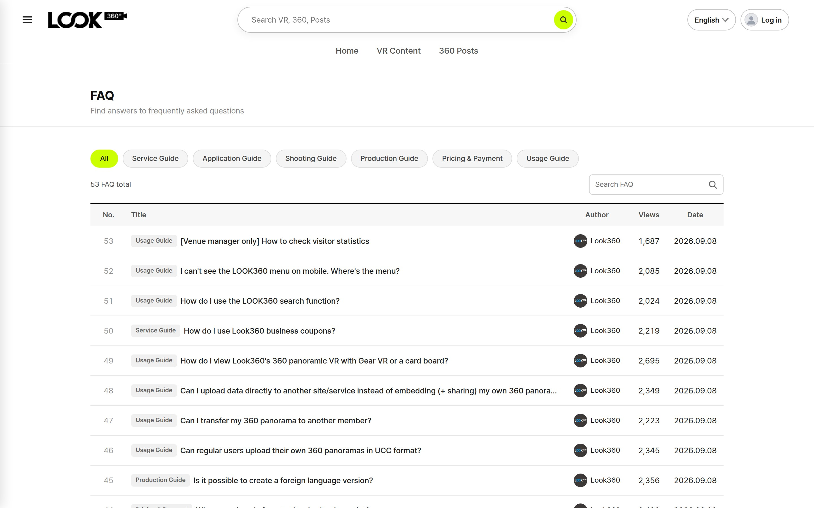

직접 확인
<a class="lnk" href="http://100.64.25.50:5174/faq" target="_blank">http://100.64.25.50:5174/faq</a>

---

<!-- _class: sec -->

Section 04

## l3 플랫폼 화면 — 회의 요청 반영

10/19 회의 요청 #1~#27 을 EPIC 으로 나눠 구현했습니다. 이 Section 의 항목은 QC PASS · 오너 확인 대기이며, 회의에서 확인 도장을 받으면 완료로 기록합니다.

---

## 🧭 vrViewer · 썸네일 정비 10/20~10/21 QC PASS · 오너 확인 대기

| EPIC | 반영한 것 | 검증 |
|---|---|---|
| [IND-8528](https://kabkee-main.tailfe017f.ts.net:8443/IND/issues/IND-8528) AI·형식 아이콘 | chipList VR 종류 뒤 「(아이콘)+AI」 칩 · 썸네일 **좌하단** 형식·AI 아이콘 · 제목 쪽 AI 삭제 · AI 보라 · 지역 칩 배경 없음 | QC2 PNG 122장 PASS |
| [IND-8532](https://kabkee-main.tailfe017f.ts.net:8443/IND/issues/IND-8532) 모바일 레이아웃 | 하단 썸네일 63×42 → **80×54** · 촬영일 대괄호 제거 · 액션 컬럼 366→318px · iPhone 햄버거 겹침 0px | iPhone 실기 미확인 |
| [IND-8627](https://kabkee-main.tailfe017f.ts.net:8443/IND/issues/IND-8627) 모바일 메타 줄 | 순번 「1/36」과 촬영일 사이 8px 여백 | QC 5축 PASS |
| [IND-8533](https://kabkee-main.tailfe017f.ts.net:8443/IND/issues/IND-8533) 지도 | 크기 변경 시 줌·중심 유지(미니맵·구글맵) · 풀스크린에서 파노 선택 시 해제 | Q1~Q11 PASS |
| [IND-8593](https://kabkee-main.tailfe017f.ts.net:8443/IND/issues/IND-8593) 유료 미리보기 퀵뷰 | 안내 테두리 `#CCFF00` 깜빡임 · 제목/카운터 하단 중앙 | PASS |
| [IND-8436](https://kabkee-main.tailfe017f.ts.net:8443/IND/issues/IND-8436) 「전시회로 돌아가기」 | VR 모드에서도 보이고 눌리는 3D 버튼 · 7개 언어 | 오너 헤드셋 확인 |

> 이전/다음 버튼([IND-8053](https://kabkee-main.tailfe017f.ts.net:8443/IND/issues/IND-8053) · [IND-8242](https://kabkee-main.tailfe017f.ts.net:8443/IND/issues/IND-8242))과 AI 표시 2차([IND-8059](https://kabkee-main.tailfe017f.ts.net:8443/IND/issues/IND-8059) · [IND-8244](https://kabkee-main.tailfe017f.ts.net:8443/IND/issues/IND-8244))는 회의 결정대로 위 EPIC 에 흡수하고 종결했습니다.

---

## 🎬 YouTube 360 장면 개편 10/21~10/23 QC PASS · 오너 확인 대기

회의 요청 #25·#26 대로 YouTube 360 장면은 YouTube 자체 컨트롤을 쓰고, 우리 UI 는 강제 clearMode 로 최소화했습니다.

| 항목 | 결과 |
|---|---|
| 화면 구성 | YouTube 자체 컨트롤 복귀 · 강제 clearMode · 오른쪽 액션 버튼 숨김 · `vr360-yt__input` 삭제 |
| 조이패드 | 우하단(bottom 96px) 확정 · 버튼 누르기 + **드래그 연속 이동**(8방향 · 거리 비례 속도 · 데드존) · 좌우 방향 반전 |
| 하단 겹침 | iframe 아래에 여백 — PC 844 ≤ 848 · 모바일 792 ≤ 796 |
| 영상 장면 공통 | 자동 회전 투어에서 제외 · 표시 설정 · 360포스트 비활성 |
| iOS | 미지원 + 「YouTube 앱에서 보기」 확정 · **iPhone 실기 확인은 오너 몫**(Section 07) |

확인
<a class="lnk" href="https://kabkee-main.tailfe017f.ts.net:8443/IND/issues/IND-8535" target="_blank">IND-8535 YouTube 360 개편</a>
<a class="lnk" href="https://kabkee-main.tailfe017f.ts.net:8443/IND/issues/IND-8625" target="_blank">IND-8625 후속 3건</a>

---

## 📸 화면 — YouTube 360 장면 · 우하단 조이패드 10/26

YouTube 자체 컨트롤바가 하단에 보이고, 우리 UI 는 이전/다음 버튼만 남았습니다. 오른쪽 아래 원형 조이패드로 시점을 돌립니다.

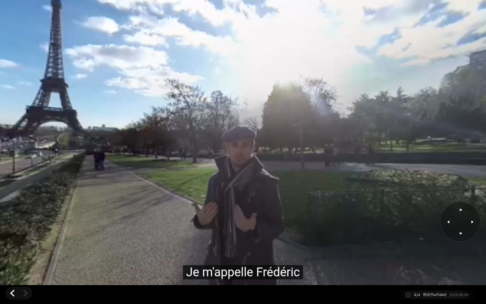

직접 확인
<a class="lnk" href="http://100.64.25.50:5174/vr/ind8027fx?pano=33663" target="_blank">http://100.64.25.50:5174/vr/ind8027fx?pano=33663</a>

---

## 🛒 목록 · 결제 · 북마크 · 외부VR 10/20~10/25

| EPIC | 반영한 것 | 상태 |
|---|---|---|
| [IND-8530](https://kabkee-main.tailfe017f.ts.net:8443/IND/issues/IND-8530) 할인 표시 | 정가 취소선 + 할인가 · 할인 기간(시작~종료) 신설 · 종료 후 정가 결제 · 카드·상세·결제창·영수증·구매내역 | QC PASS · 오너 확인 대기 |
| [IND-8590](https://kabkee-main.tailfe017f.ts.net:8443/IND/issues/IND-8590) ₩ 아이콘 | 가격 필터 placeholder 삭제 · 천단위 · 범위 표현 7개 언어 · 금액 지면 전역 ₩ | 알림 문장 진행 중 |
| [IND-8531](https://kabkee-main.tailfe017f.ts.net:8443/IND/issues/IND-8531) · [IND-8621](https://kabkee-main.tailfe017f.ts.net:8443/IND/issues/IND-8621) 북마크 | 채널·마이 아이템 통일 · 조회수 쉼표 · 소속 콘텐츠 **2×2 자동 썸네일** · 맞춤 업로드↔초기화 · 빈 칸 30% 정중앙 | QC PASS · 오너 확인 대기 |
| [IND-8591](https://kabkee-main.tailfe017f.ts.net:8443/IND/issues/IND-8591) 외부VR | 카드 칩 1개 · 상세 탭 3개 · 「0개 파노라마」·「무료」 줄 숨김 · ✦ 버튼 · 기획 일치 | QC PASS · 오너 확인 대기 |
| [IND-8595](https://kabkee-main.tailfe017f.ts.net:8443/IND/issues/IND-8595) 지역VR 지도 | 모바일 하프시트·전체화면 · 「현 지도에서 검색」/「필터 해제」 · 목록 안쪽 스크롤 | 마커 색 결정 대기 |
| [IND-8727](https://kabkee-main.tailfe017f.ts.net:8443/IND/issues/IND-8727) 관리자 목록 | 「페이지당 100」 선택 시 HTTP 400 → 옵션을 API 상한 50 이하로 | QC PASS · 오너 확인 대기 |

---

## 📸 화면 — 할인 표시 시안 v3 (카드 · 결제창) 10/21

dev 에 지금 할인 중인 콘텐츠가 없어 시안 v3 로 보여드립니다. 구현은 이 시안대로 들어갔고 QC 가 실화면 112장으로 확인했습니다.

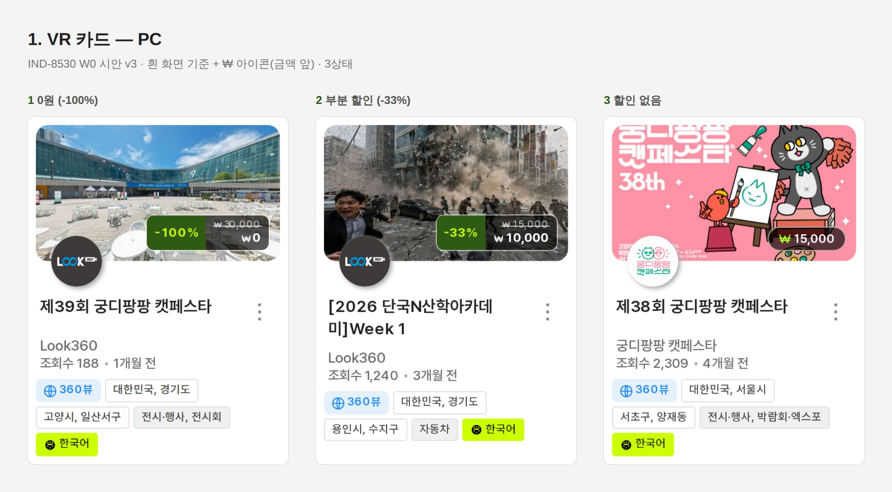

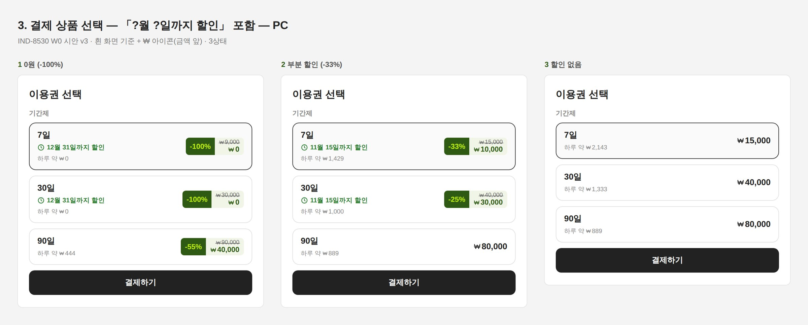

직접 확인
<a class="lnk" href="https://kabkee-main.tailfe017f.ts.net:8443/IND/issues/IND-8530" target="_blank">https://kabkee-main.tailfe017f.ts.net:8443/IND/issues/IND-8530</a>

---

## 📸 화면 — 외부VR 상세 10/26

라임색 「사이트 이동하기」 버튼에 ✦ 아이콘이 붙고, 핑크 안내 박스와 탭 3개(콘텐츠 소개 · 장소 정보 · Q&A)로 정리됐습니다.

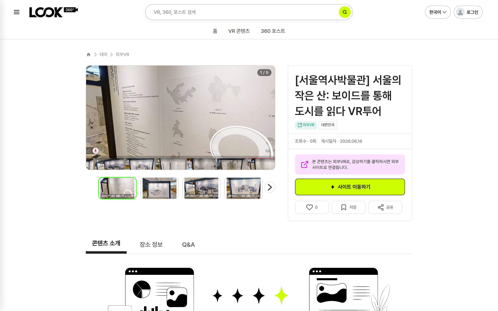

직접 확인
<a class="lnk" href="http://100.64.25.50:5174/vr-info/nsUMZzRN" target="_blank">http://100.64.25.50:5174/vr-info/nsUMZzRN</a>

---

## 🌐 자동번역 토글 회귀 재수정 · 조회수 원칙 10/26 NEW

오너가 10/26 실사용 중 **화면은 자동번역 ON 인데 번역 요청은 `translate=0`** 인 회귀를 발견했습니다. 원장에서 IND-8153 · IND-7712 를 재수정 요청으로 돌리고 IND-8844 로 다시 고쳤습니다.

| 항목 | 내용 |
|---|---|
| 원인 | 로그인 전환·인증 늦은 복원(`store load()`) 경로에서 토글 상태가 갈라짐 · 이전 QC 는 같은 화면 4방향 토글만 확인 |
| 오너 결정 | **로그인 값 무조건 우선** · `?translate=1` 은 «이번 감상만» 번역 |
| 고친 것 | 토글 상태 1곳으로 일원화 · 헤더↔설정 탭 연동 · 탭 간 로그인·로그아웃 동기화 · 언어 변경 시 360포스트·마커 번역 · 로그아웃 쿠키 삭제 |
| 조회수 | 토글할 때마다 +1 되던 것 → 첫 진입만 +1(`countView=0`) · 홈 히어로 자동 재생도 +0([IND-8869](https://kabkee-main.tailfe017f.ts.net:8443/IND/issues/IND-8869) 진행 중) · 전 경로 검수([IND-8870](https://kabkee-main.tailfe017f.ts.net:8443/IND/issues/IND-8870)) |
| 검증 | QC 3회 · 수용 기준 1~5 PASS · EM curl 실측 31→31→32 |

확인
<a class="lnk" href="https://kabkee-main.tailfe017f.ts.net:8443/IND/issues/IND-8844" target="_blank">IND-8844 재수정</a>
<a class="lnk" href="https://kabkee-main.tailfe017f.ts.net:8443/IND/issues/IND-8153" target="_blank">IND-8153</a>
<a class="lnk" href="https://kabkee-main.tailfe017f.ts.net:8443/IND/issues/IND-7712" target="_blank">IND-7712</a>

---

## 🔗 새로 시작한 것 — SNS 로그인 · 공유 언어 · 푸시 다국어 10/25~10/26 NEW

| EPIC | 내용 | 지금 |
|---|---|---|
| [IND-8850](https://kabkee-main.tailfe017f.ts.net:8443/IND/issues/IND-8850) SNS 로그인 | 회원 1명 = 로그인 수단 1개 구조 → **연결 테이블**(`l3_user_social`) · 이메일 중복 안내 · 계정 연결/해제/옮기기 · Netlify 테스트 환경 | 구현·QC 완료 · provider 콘솔 콜백 등록 대기 |
| [IND-8862](https://kabkee-main.tailfe017f.ts.net:8443/IND/issues/IND-8862) 지금 보는 언어로 공유 | 공유 창 「지금 보는 언어로 공유」(기본 켜짐) · `?lang`·`?translate` 는 이번 감상만 · 360포스트 공유 쿼리 소실 수정 · SNS 미리보기 다국어 | W1·W3 커밋 · 안내 표시 방식 결정 대기 |
| [IND-8816](https://kabkee-main.tailfe017f.ts.net:8443/IND/issues/IND-8816) 푸시 다국어 | FCM 제목·본문을 수신자 언어로 · 푸시 토큰에 기기 언어 저장(`626b60d5` · `9183e9b5`) | 진행 중 |
| [IND-8840](https://kabkee-main.tailfe017f.ts.net:8443/IND/issues/IND-8840) 콘텐츠 정보 레이아웃 | 장소 정보형 왼쪽 정렬 · 1024 이상 지도+정보 2열 · 시안 10장 | 시안 확인 대기 |

---

<!-- _class: sec -->

Section 05

## 데이터 · 이관 정합성

레거시에서 옮겨 온 데이터가 두 벌로 들어가거나, 손으로 만든 XML 의 동작이 빠진 곳을 찾아 고치고 재마이그 규칙에 반영했습니다.

---

## 🗄️ 이관 결함 정리 10/20~10/24 QC PASS · 오너 확인 대기

| EPIC | 무엇이 문제였나 | 결과 |
|---|---|---|
| [IND-8752](https://kabkee-main.tailfe017f.ts.net:8443/IND/issues/IND-8752) 핫스팟 두 벌 | 레거시 42,480행이 **84,897행**으로 두 번 적재 — 검증 스크립트가 없는 메서드를 mock 해 실제 `run()` 이 dev 에서 돈 것 | 42,563행 · 레거시 id 중복 0 · 검증 맥락 dev 쓰기 거부 |
| [IND-8648](https://kabkee-main.tailfe017f.ts.net:8443/IND/issues/IND-8648) 전시 작품 핫스팟 | 2529 Kay Park — 작품이 반짝이고 클릭 이동·돌아가기 시점이 안 됨 | 레거시와 같은 동작 · 1936 등 유사 콘텐츠 함께 복구 |
| [IND-8749](https://kabkee-main.tailfe017f.ts.net:8443/IND/issues/IND-8749) · [IND-8750](https://kabkee-main.tailfe017f.ts.net:8443/IND/issues/IND-8750) | 1903 문 열기 토글 누락 · 1951 사진 토글 클릭 불발(hover 순간 아이콘 소멸) | 실클릭 PASS · 공용 스타일 1건으로 36개 콘텐츠 281개 핫스팟 해소 |
| [IND-8731](https://kabkee-main.tailfe017f.ts.net:8443/IND/issues/IND-8731) 타일 레벨 | 저해상도 구형 파노라마에 3레벨 XML 고정 → 화면 안 나옴(pano 6520) | 선언 레벨 실물 맞춤 · 전수 검사 진행 중 |
| [IND-8477](https://kabkee-main.tailfe017f.ts.net:8443/IND/issues/IND-8477) · [IND-8572](https://kabkee-main.tailfe017f.ts.net:8443/IND/issues/IND-8572) | 빈 DB 부트스트랩 불가 · 클린 재마이그 신규 FAIL 9건 | 재현성 확보 · 기준선 갱신 2 / 회귀 수정 6 / 정리 1 |
| [IND-8606](https://kabkee-main.tailfe017f.ts.net:8443/IND/issues/IND-8606) · [IND-8607](https://kabkee-main.tailfe017f.ts.net:8443/IND/issues/IND-8607) · [IND-8521](https://kabkee-main.tailfe017f.ts.net:8443/IND/issues/IND-8521) · [IND-8524](https://kabkee-main.tailfe017f.ts.net:8443/IND/issues/IND-8524) | 시작 안내 아이콘 404 · 죽은 「안내 영상」 버튼 · 없는 include 36줄 | 404 0 · 재마이그 재발 방지 규칙 |

---

## 📸 화면 — 2529 Kay Park 작가 전시회 10/26

벽의 작품 핫스팟이 더 이상 반짝이지 않습니다. 작품을 누르면 그 작품의 평면 이미지로 이동하고, 「전시회로 돌아가기」를 누르면 그 작품을 바라보는 시점으로 돌아옵니다.

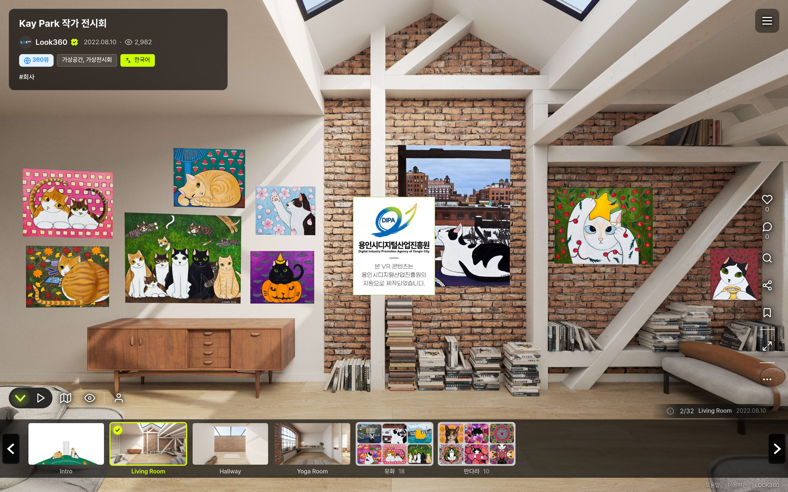

직접 확인
<a class="lnk" href="http://100.64.25.50:5174/vr/o1vj1ty0?pano=29315" target="_blank">http://100.64.25.50:5174/vr/o1vj1ty0?pano=29315</a>

---

## 📍 장소 정보 복사 · 1:N 오너 검수 반영 10/21~10/22 QC PASS · 오너 확인 대기

장소와 1:1 로 매칭된 콘텐츠 1,460건에 장소 정보를 한 번 복사했고, 장소 1개에 콘텐츠가 여럿 걸린 **1:N 1,454건**은 오너가 전수 검수한 결과를 반영했습니다(쓰기 전 백업 테이블 선행).

| 오너 검수 결과 | 건수 |
|---|---|
| 장소 정보 복사 | 1,191 |
| 콘텐츠 주소 변경 | 201 (확정 주소 162 + 빈 확정 주소 39건은 촬영 좌표 역지오코딩 제안 주소) |
| 장소 매칭 해제 | 30 |
| 콘텐츠 삭제 | 3 (2687 · 54 · 92) |
| 콘텐츠 특이사항 신설 | admin 편집 · vrCard/vr-info/뷰어 소개 탭 지면별 표시 · 뷰어 소개 탭 채널 정보 |

> 이 작업 중에 «장소가 실제 장소가 아닌» 매칭이 많다는 것이 드러났습니다. → **Section 07 첫 안건**

확인
<a class="lnk" href="https://kabkee-main.tailfe017f.ts.net:8443/IND/issues/IND-8668" target="_blank">IND-8668 1:N 검수 반영</a>
<a class="lnk" href="https://kabkee-main.tailfe017f.ts.net:8443/IND/issues/IND-8534" target="_blank">IND-8534 장소 정보 복사</a>
<a class="lnk" href="https://docs.google.com/spreadsheets/d/1TN8ulgbJba1j6FjTjU2TPKKVKjRnF6wGtP2VcP31hgk" target="_blank">원본 검수 시트</a>

---

<!-- _class: sec -->

Section 06

## 360 작업실

PTGui 를 대신할 스티처와 웹 작업실을 실제 업무에 쓰기 위한 정비와, 폰·Insta360 촬영 흐름 실험을 진행했습니다.

---

## 📷 360 작업실 — 이번 주 진행 10/22~10/26

| 작업 | 내용 | 상태 |
|---|---|---|
| [IND-8675](https://kabkee-main.tailfe017f.ts.net:8443/IND/issues/IND-8675) 실사용 전환 로드맵 | 하위 5트랙 — NAS 연동 · 스티칭 품질 · RAW 자동 현상 · 모자이크 후보 · 외부 도구 연동 | 진행 중 |
| [IND-8811](https://kabkee-main.tailfe017f.ts.net:8443/IND/issues/IND-8811) Insta360 완성본 흐름 | 카메라가 스티칭한 360 사진 → 자동 톤·노이즈·수평 → 모자이크 → 타일 · **사람 개입 검수 1회** · 샘플 전체 132초 | 오너 확인 대기 |
| [IND-8810](https://kabkee-main.tailfe017f.ts.net:8443/IND/issues/IND-8810) 자원 보호 | 12:47 전역 OOM 실사고 후 렌더·타일을 별도 프로세스로 · 작업당 22GB · 서비스 30GB 상한 · 대기열 순서·취소 | 오너 확인 대기 |
| [IND-8826](https://kabkee-main.tailfe017f.ts.net:8443/IND/issues/IND-8826) PTGui 왕복 | 「PTGui 로 넘기기」 zip(사진 포함) → 수정본 올려 적용 · QC2 PASS | PTGui 실확인 대기 |
| [IND-8780](https://kabkee-main.tailfe017f.ts.net:8443/IND/issues/IND-8780) 폰 360 PoC | 촬영 웹 + 작업실 스티처 고도화 · 손으로 든 다중 촬영은 잔차가 리그의 **5~10배**(25~38′) → Insta360 흐름으로 전환 | 오너 확인 대기 |
| [IND-8770](https://kabkee-main.tailfe017f.ts.net:8443/IND/issues/IND-8770) 레거시 flat 정식 지원 | 작업실 batch XML 로 flat 등록 · 투어 XML 자동 생성 · 운영 계획서 v2 | 운영 반영 승인 대기 |

> 작업실 저장소(`pano-stitcher`)는 이번 주 커밋 160건입니다. 노이즈·샤픈과 RAW 자동 현상 기본값은 Section 07 에서 정합니다.

---

<!-- _class: sec -->

Section 07

## 🎯 이번 주 안건 — 오너 결정 대기

장소 재매칭 정책을 먼저 정하고, 이어서 시안·기본값 결정과 확인 대기 카드를 처리합니다.

---

## 🗺️ 안건 1 · 장소 재매칭 — 왜 필요한가 회의 안건

레거시(look360_ksq1.2)의 «장소»는 실제 지리적 장소가 아니라 **«업로드 폴더 + VR 주소 + 업체 페이지 + 결제 단위»를 겸한 묶음**이었습니다. l3 플랫폼은 장소를 «어디서 찍었나»로 쓰는데(지역 칩·지역 필터·지도), 마이그레이션이 값을 의미 변환 없이 옮겨서 위치가 아닌 장소가 위치처럼 화면에 나갑니다.

| 레거시에서 장소가 하던 역할 | 코드 근거 |
|---|---|
| 업로드 폴더 — 장소 id 없이는 일괄등록 거부 · `files/pano/{장소}/…` · 번호도 장소 안에서만 유일 | `panoBatch/a.insertNewPano.php:5-21, :89-91` |
| VR 주소 — `/vr/{장소}/{투어}` · `/vrstory/{장소}/…` | `.htaccess:154-157, :174-181` |
| 업체 페이지·회원 소유·결제 단위 — 가격표·영업시간·쿠폰·유료 기간·소유 회원 | `mypage/myplace.php:26-51` |
| 입력 검증 없음 — 이름만 필수(50자) · 주소·좌표 선택 | `addPlace.js:507-520` |
| 마이그레이션 — `look360_place → l3_place` 그대로 복사, «실제 장소인가» 판정 없음 | `column-mapping.json:933-940` |

> 타당성: ① 지금도 «청와대 → 경기도 · 용인시» 같은 틀린 칩이 나갑니다(소속형 81건 중 노출 69). ② 10/19 회의 #24 가 «나중에 수동 전수 검수로 재매칭»을 정했고 이번이 그 재매칭입니다. ③ **서비스 방향 전환(오너 10/29 갱신)** — 장소를 «서비스가 관리하는 실제 위치»로 다시 정의하고, 지역·주소·지도는 콘텐츠 위치를 우선합니다(IND-9021).

시트
<a class="lnk" href="https://docs.google.com/spreadsheets/d/1vH70Rc4zpIc5unxIhEQf5rWDMCcjv5tzMvdKIUSJ-V4" target="_blank">장소 정비 오너 결정 — 폴더형·소속형 139</a>
<a class="lnk" href="https://kabkee-main.tailfe017f.ts.net:8443/IND/issues/IND-9021" target="_blank">IND-9021 장소 개편 EPIC</a>

---

## 🗺️ 안건 1 · 레거시 장소의 다섯 가지 유형 dev DB 실측 10/22

| 유형 | 모습 | 규모 · 예시 |
|---|---|---|
| **행사형** | 회차마다 URL·폴더가 필요해 회차마다 장소를 새로 만듦 | 궁디팡팡 캣페스타 30회차 = 장소 30개, 실제 전시장은 5곳(aT센터 10 · SETEC 7 · 벡스코 6 · 킨텍스 6 · 대전 1) |
| **소속형** | 촬영 회사·작가 계정의 장소를 «작업 공간»으로 사용 | 「(주)인디스팟」 장소에 청와대·광화문·동대문시장 · **81건**(노출 69) |
| **코스형** | 여러 지역을 도는 콘텐츠 — 장소 하나로 표현 불가 | 22건 · 「서울시 종로구, 서울시 용산구」 · 「Californa, USA \| Nevada, USA」 |
| **폴더형** | 이름만 있으면 만들 수 있어 생긴 임시 묶음 | **58건** · 「[LOTTE_DFS] Sample VR」 · 「쿠팡 작업용」 · 「2024 마이스터테크 내부공유」 |
| **개인·가상** | 오너가 «주소 삭제»로 판정 | 30건 · [IND-8668](https://kabkee-main.tailfe017f.ts.net:8443/IND/issues/IND-8668) 에서 매칭 해제 처리 |

> 행사형·소속형·폴더형이 «왜 그렇게 운영됐는지»는 코드 구조에서 나온 추정이고, 구조 자체는 코드로 확인했습니다. 주소 오타 3건: 816 `Californa` → California · 1072 · VR 스토리 36 `경기도 강서구` → 서울특별시 강서구.

---

## 🗺️ 안건 1 · 용어 설명 — 폴더형 · 소속형 오너 요청 10/23

둘 다 «장소가 실제 장소가 아닌» 레거시 매칭을, 남은 흔적의 모양에 따라 나눈 이름입니다.

| | 폴더형 (58건) | 소속형 (81건) |
|---|---|---|
| 장소의 정체 | 콘텐츠를 묶으려고 붙인 «묶음 이름» — 주소·좌표 없음 | 콘텐츠를 만든 «촬영 회사·작가» — 회사 주소 있음 |
| 예시 | 「[LOTTE_DFS] Sample VR」 · 「쿠팡 작업용」 · 「2024 마이스터테크 내부공유」 · 「[2024.07.13]경희대학교 추가촬영」 · 「EBO」 · 「TEST」 · 온라인 공모전 · 가상 전시 | 「(주)인디스팟」(용인) 아래 청와대·광화문·동대문시장·경기모바일과학고 · 작가명 장소 「파노라마 킴」 아래 오벨리스크 |
| 판별 기준 | 주소 없는 장소에 연결된 콘텐츠 | 콘텐츠 주소를 실제 촬영지로 바꿨는데 장소는 여전히 회사·작가인 콘텐츠 |
| 화면 문제 | 장소 정보가 비어 보인다 | **틀린 지역 칩** — 청와대 콘텐츠에 「경기도 · 용인시」 |
| 제안 처리(10/29) | 해제 46 · 장소에 주소 채움 7 · 재매칭 3(행사장) · 검토 필요 2 | 재매칭 27 · 새 장소 21(해외 실제 위치 포함) · 해제 27 · 유지 2 · 검토 필요 4 |

> 행사형(궁디팡팡처럼 회차마다 장소)과 코스형(주소가 여러 개)은 시트 탭이 없고, 유형별 정책에서 함께 정합니다.

시트
<a class="lnk" href="https://docs.google.com/spreadsheets/d/1vH70Rc4zpIc5unxIhEQf5rWDMCcjv5tzMvdKIUSJ-V4" target="_blank">장소 정비 오너 결정 — 폴더형·소속형 139</a>
<a class="lnk" href="https://kabkee-main.tailfe017f.ts.net:8443/IND/issues/IND-8674" target="_blank">IND-8674</a>

---

## 🗺️ 안건 1 · 실측 — 장소 · 주소 · 카테고리 조합 dev 10/23

view360 + VR 스토리 2,946건 · 괄호는 노출 건수

| 장소 | 콘텐츠 주소 | 지역VR만 | 테마VR만 | 지역+테마 | 미분류 |
|---|---|---|---|---|---|
| 있음 | 있음 | 2,091 (2,000) | **319 (206)** — 다지역 의심 **23** | 19 (14) | 395 (3) |
| 있음 | 없음 | 18 (6) | 38 (15) | 2 (2) | — |
| 없음 | 있음 | **0** | **0** | 0 | 0 |
| 없음 | 없음 | 1 (1) | 46 (32) | — | 17 (4) |

- 지금 지역 칩은 콘텐츠 주소가 아니라 **매칭된 장소의 country·area1~5** 로 만듭니다. 콘텐츠 주소는 소개에 텍스트로만 나옵니다.
- «장소 없음 + 주소만»은 지금 0건이고, 시트의 «해제 · 주소 유지/콘텐츠 주소» 제안 12건을 적용하면 **이때 처음 생깁니다.**
- 테마VR 인데 장소·주소가 있는 콘텐츠가 이미 319건(노출 206)입니다 — «테마VR 에 주소 표시»는 이미 현실이고, 지도 마커 여부만 정하면 됩니다.
- 구조 한계: 콘텐츠 주소는 `info_address`(한 줄) + 좌표 1쌍뿐이라 ① 여러 주소를 담지 못하고 ② 지역 트리에 연결되지 않아 칩·필터를 만들 수 없습니다.

데이터
<a class="lnk" href="https://docs.google.com/spreadsheets/d/1TN8ulgbJba1j6FjTjU2TPKKVKjRnF6wGtP2VcP31hgk" target="_blank">원본 주소 검수 시트 (1,454건)</a>
<a class="lnk" href="https://kabkee-main.tailfe017f.ts.net:8443/IND/issues/IND-8534" target="_blank">IND-8534</a>
<a class="lnk" href="https://kabkee-main.tailfe017f.ts.net:8443/IND/issues/IND-8668" target="_blank">IND-8668</a>

---

## 🗺️ 안건 1 · 회의에서 정할 것 회의 안건

| # | 정할 것 | 오너 방향(10/23) · 🐈‍⬛ AI 제안(참고) |
|---|---|---|
| 1 | ~~유형별 재매칭 정책~~ → **✅ 오너 결정(10/29)** | 장소 = 서비스 소유 실제 위치(주인 개념 없음) · 행사형 → 행사장(코엑스·킨텍스 등)으로 통합 · 해외도 실제 위치면 장소 · 사적 공간·위치 불명은 해제 · 실행 IND-9021 W5 |
| 2 | **지역 칩의 출처** | **오너 방향(10/29): 콘텐츠 위치 우선, 콘텐츠에 위치가 없을 때만 장소** · 콘텐츠에 국가·지역 칸 신설(IND-9021 W3) → 확정하면 IND-9022 게이트를 닫아 W4(읽기 전환) 착수 |
| 3 | 코스형(여러 지역) 칩 | 제안: 공통 상위 지역 1개(종로·용산 → 「서울시」) · 국가만 공통이면 생략 · «외 N» 비추천 |
| 4 | 테마VR + 주소 — 칩·지역 필터·지도 노출 | 근본 질문: 테마VR 도 지도 마커가 필요한가, 장소 매칭된 경우만인가 · 제안: 칩은 보이되 필터·지도는 «단일 지역 + 좌표»만 |
| 5 | 소속형 81건 회의 전 임시 조치 | (가) 그대로 둠 ← 추천 — IND-9021 W4 에서 칩이 콘텐츠 기준으로 바뀌며 근본 해결 · (나) 81건만 칩 숨김 |
| 6 | 주소 표기 통일(구분자·정식 명칭) · 오타 3건 수정 | 816(시트 제안에 반영) · 1072 · 36 |

확인
<a class="lnk" href="https://docs.google.com/spreadsheets/d/1vH70Rc4zpIc5unxIhEQf5rWDMCcjv5tzMvdKIUSJ-V4" target="_blank">오너 결정 시트</a>
<a class="lnk" href="https://kabkee-main.tailfe017f.ts.net:8443/IND/issues/IND-8668" target="_blank">IND-8668</a>
<a class="lnk" href="https://kabkee-main.tailfe017f.ts.net:8443/IND/issues/IND-8534" target="_blank">IND-8534</a>
<a class="lnk" href="https://kabkee-main.tailfe017f.ts.net:8443/IND/issues/IND-9021" target="_blank">IND-9021 장소 개편 EPIC</a>
<a class="lnk" href="https://kabkee-main.tailfe017f.ts.net:8443/IND/issues/IND-9022" target="_blank">IND-9022 지역 칩 게이트</a>
<a class="lnk" href="https://kabkee-main.tailfe017f.ts.net:8443/IND/issues/IND-9023" target="_blank">IND-9023 시트 확정 게이트</a>

---

## 🗂️ 안건 1 · 오너 결정 시트 10/29 갱신

폴더형 58 + 소속형 81 = **139건을 표 하나**로 합쳤습니다. 입력 칸은 **「✍ 오너 결정」 한 칸**뿐입니다(옛 시트의 O·S열은 폐기).

| 열 | 내용 |
|---|---|
| 🐈‍⬛ 제안 | 한 줄 — `재매칭 → 명동성당` · `새 장소 → 영월 장릉 · 주소` · `해제 · 주소 유지 (Cebu, Philippines)` · `해제 · 주소 삭제` (색 = 처리 종류) |
| **✍ 오너 결정** | 왼쪽 제안대로면 `O` · 아니면 직접 기입(드롭다운 있음) |
| 이유 · 확인 링크 | 제안 근거 한 줄 · 화면 바로 열기 |

1. 맨 위 **노란 행(검토 필요) 6건**부터 직접 고릅니다 — 818 청창사 졸업식 · 858 오벨리스크 · 2800 광화문 · 2807 동대문시장 · 2256 NH 데이터센터 · 2828 외대당구클럽.
2. 나머지는 제안이 맞으면 `O`, 다르면 직접 씁니다.
3. 다 채우면 IND-9023 에 «확정» 코멘트 → 게이트 해제 → [IND-9021](https://kabkee-main.tailfe017f.ts.net:8443/IND/issues/IND-9021) W5(장소 재정비)가 반영합니다.

시트
<a class="lnk" href="https://docs.google.com/spreadsheets/d/1vH70Rc4zpIc5unxIhEQf5rWDMCcjv5tzMvdKIUSJ-V4" target="_blank">장소 정비 오너 결정 — 폴더형·소속형 139</a>
<a class="lnk" href="https://kabkee-main.tailfe017f.ts.net:8443/IND/issues/IND-9023" target="_blank">IND-9023 시트 확정 게이트</a>

---

## ➡️ 안건 2 · 공유 링크 화살표 — 색 · 크기 · 모양 회의 안건

공유 링크로 들어오면 지정 지점에 아래 화살표가 뜨는데, 현재 화살표(흰색 선형 · 48px · 그림자만)는 밝은 배경에서 거의 보이지 않습니다. 시안 v2 = 96px(2배) · 밝은 채움 6색 + 어두운 테두리 / 어두운 채움 6색 + 흰 테두리 · 선형/채움형.

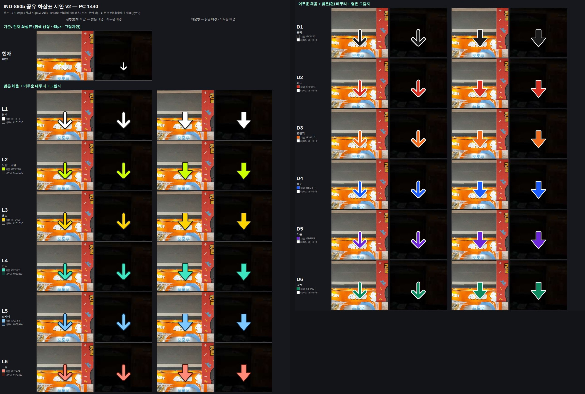

직접 확인
<a class="lnk" href="https://kabkee-main.tailfe017f.ts.net:8443/api/attachments/0198f28c-3c01-459a-b447-9c767bd50d93/content" target="_blank">PC 1440 비교판 원본</a>
<a class="lnk" href="https://kabkee-main.tailfe017f.ts.net:8443/IND/issues/IND-8605" target="_blank">IND-8605</a>

---

## ➡️ 안건 2 · 모바일 비교판 · 실제 크기감 회의 안건

왼쪽: 모바일 390 비교판 · 오른쪽: 실제 화면 크기감(현재 48px vs L1 선형 · L2 채움형 · D1 채움형 96px)

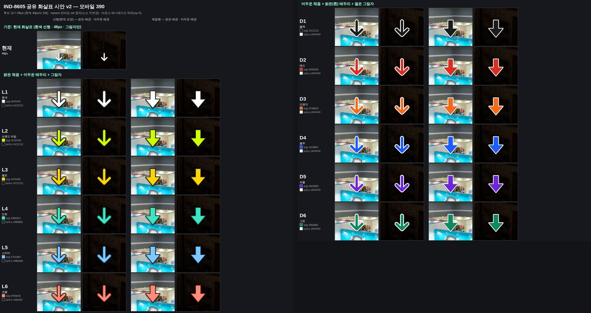

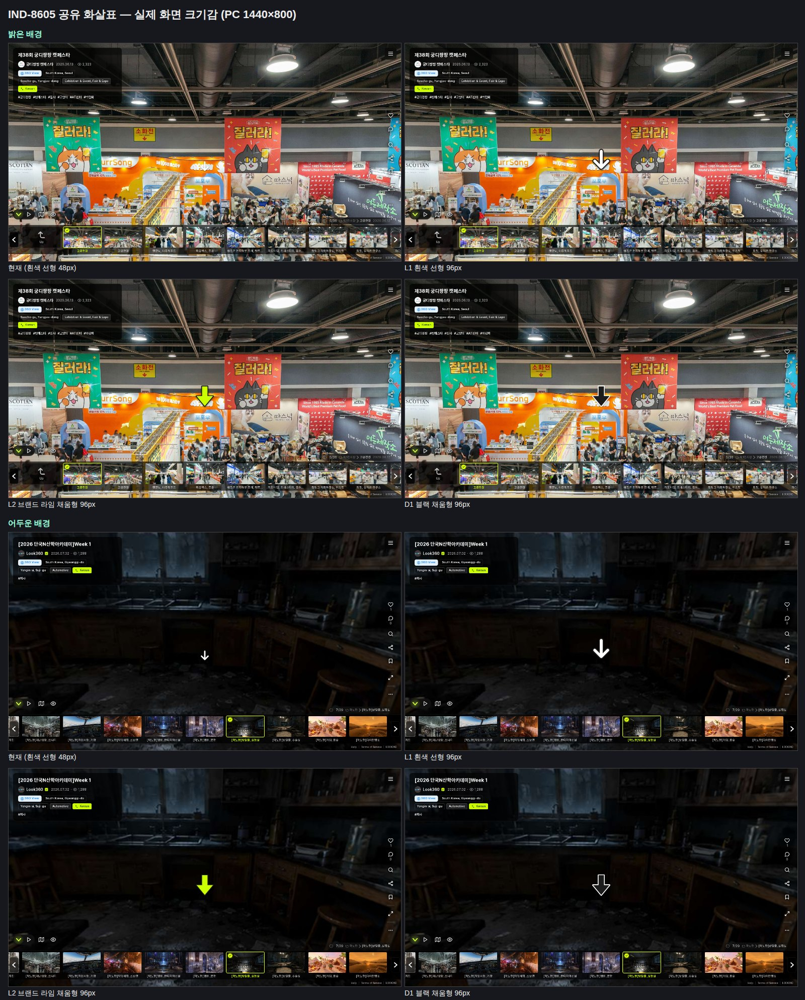

직접 확인
<a class="lnk" href="https://kabkee-main.tailfe017f.ts.net:8443/api/attachments/fdaa2fe3-4255-489c-b571-8be289dcef58/content" target="_blank">모바일 390 비교판</a>
<a class="lnk" href="https://kabkee-main.tailfe017f.ts.net:8443/api/attachments/f5be9b56-dcd1-4496-901e-f4d41fb700f1/content" target="_blank">실제 크기감</a>
<a class="lnk" href="https://kabkee-main.tailfe017f.ts.net:8443/IND/issues/IND-8527" target="_blank">IND-8527 상위 EPIC</a>

---

## ➡️ 안건 2 · 정할 것 회의 안건

| # | 정할 것 | 참고 |
|---|---|---|
| 1 | 색상 — 12색(L1~L6 · D1~D6) 중 무엇 | 양쪽 배경 모두 잘 보인 것: **L2 라임 채움형 · L1 흰색 채움형** · D1 블랙은 어두운 배경에서 흰 테두리만 보여 속이 빈 화살표처럼 보임 |
| 2 | 모양 | 선형(현재 모양 유지) vs 채움형(블록 화살표) |
| 3 | 크기 | 96px(2배) 확정 여부 · 모바일 390 은 더 작게 할지 |
| 4 | 위아래 바운스(20px · 1.5초 왕복) 유지 여부 | 시안 캡처는 정지 상태 |
| 5 | 확정 후 진행 방식 | 직접 구현 vs paperclip 발주 |

> 같은 EPIC([IND-8527](https://kabkee-main.tailfe017f.ts.net:8443/IND/issues/IND-8527))의 나머지 — 이동 핫스팟·이전/다음 `zoom=false` · Figma 외형 · 라벨 안쪽 정렬 · 오토투어 이력 · spot URL 화살표 미노출 버그 — 는 구현과 QC 를 마쳤고, **VR 헤드셋 직접 확인**만 남았습니다.

---

## 📖 안건 3 · VR스토리 오른쪽 가장자리 아이콘 겹침 오너 확인 대기 · 5일째

VR스토리 컨트롤러 개편(W1 `2e34ffde` · QC 13축 PASS)에서 남은 결정 1건입니다. 화면 밖 핫스팟을 가리키는 **오른쪽** 가장자리 아이콘이 오른쪽 세로 버튼 줄(좋아요·댓글·북마크)과 겹칩니다(왼쪽은 겹침 없음).

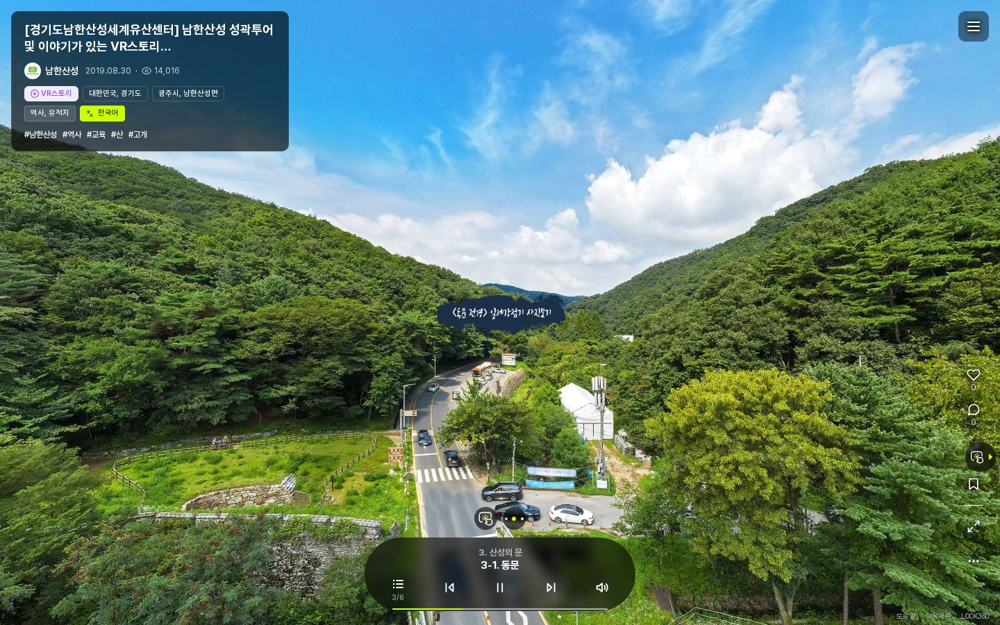

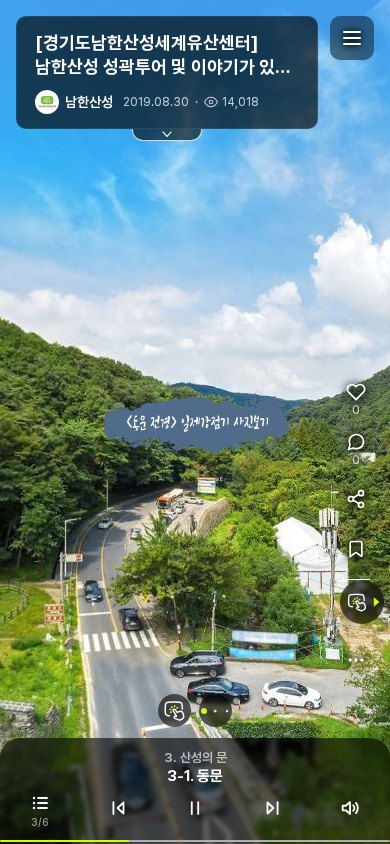

> 아이콘 x / 버튼 줄 x — PC 1440: 1390 / 1380~1424 · PC 1024: 974 / 964~1008 · 모바일: 340 / 334~378. **정할 것:** ① 그대로 종결 vs ② 오른쪽 아이콘만 버튼 줄 왼쪽으로(후속 발주) ③ (참고) 챕터 «4/31» 알약 · 모바일 사운드 믹서 시트 동작

직접 확인
<a class="lnk" href="http://100.64.25.50:5174/vr/59f1c404" target="_blank">http://100.64.25.50:5174/vr/59f1c404 → 시작하기 → 3-1. 동문</a>
<a class="lnk" href="https://kabkee-main.tailfe017f.ts.net:8443/api/attachments/86ac4db6-2221-4202-b17f-582e66888d0c/content" target="_blank">PC 1024 캡처</a>
<a class="lnk" href="https://kabkee-main.tailfe017f.ts.net:8443/IND/issues/IND-8594" target="_blank">IND-8594 · 카드 f3ad4ef3</a>

---

## 🔤 안건 4 · 콘텐츠 언어 필터 + 검색결과 필터 통일 — 추천안 오너 확인 대기 · 5일째

🔴 **구현은 회의 뒤에 시작합니다.** 지금은 시안(W0 [IND-8600](https://kabkee-main.tailfe017f.ts.net:8443/IND/issues/IND-8600))만 끝났고 구현 트랙은 하나도 발주하지 않았습니다.

| # | 추천안 (카드를 수락하면 이대로 발주) |
|---|---|
| 1 | 선택 방식 — 복수 선택(체크) · 같은 필터 안은 OR · 전부 해제 = 전체 |
| 2 | 언어 목록 — 데이터에 실제로 있는 8종(한국어·English·中文·日本語·Türkçe·Русский·Deutsch·Español) · 원어 표기 |
| 3 | 위치 — PC 「콘텐츠 형식」 뒤 · 「가격」 앞 / 모바일 필터 아이콘 안 «콘텐츠 형식» 아래 |
| 4 | 검색결과 VR 탭 = vr-list 와 같은 항목·컴포넌트·순서 · 다른 건 «필터바 검색어 칸 숨김» 1건 |
| 5 | 기본값 — 전체 언어(아무것도 거르지 않음) |

> ⚠️ 수락하면 함께 확정: ① 08-21 결정([IND-6321](https://kabkee-main.tailfe017f.ts.net:8443/IND/issues/IND-6321) E5 「목록 언어 자동 필터 폐기」) 가드 교체 — 기본 노출은 전체 유지, 사용자가 고르는 필터만 신설 ② 검색결과 정렬 「이름순」 제거(최신·조회수·인기로 통일). 시안 «after» 는 [IND-8264](https://kabkee-main.tailfe017f.ts.net:8443/IND/issues/IND-8264) A안(VR 종류 드롭다운) 위에 얹은 그림입니다.

---

## 🔤 안건 4 · 시안 — vr-list (PC · 모바일) 시안 W0

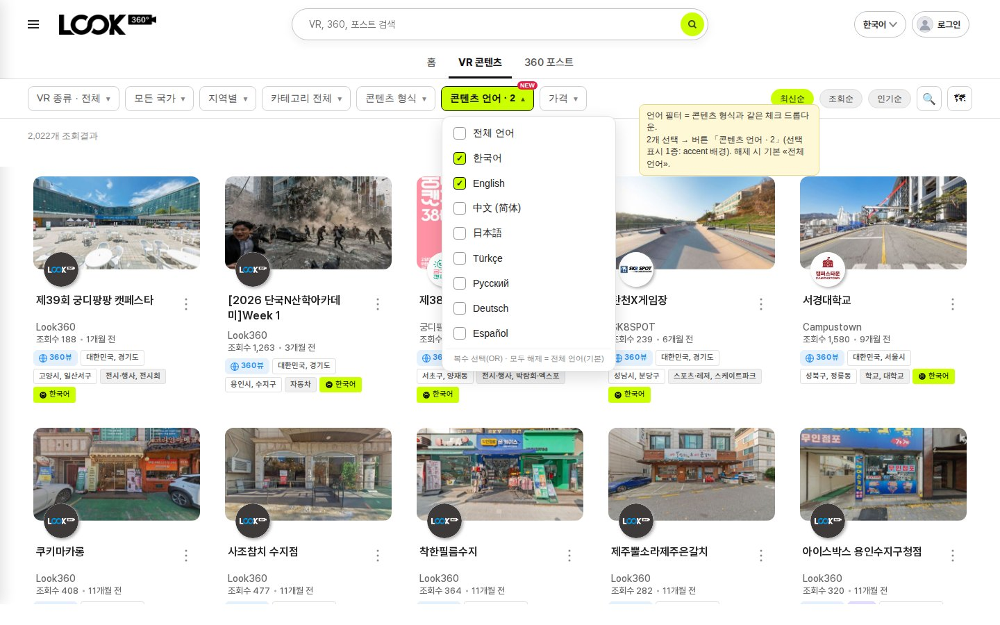

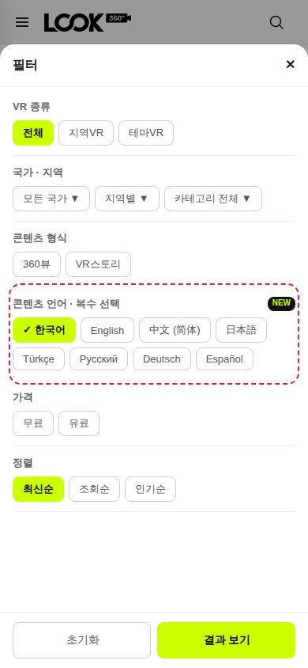

직접 확인
<a class="lnk" href="https://kabkee-main.tailfe017f.ts.net:8443/api/attachments/448d1cd2-b919-434a-9c06-38f1a0c06594/content" target="_blank">before — vr-list PC</a>
<a class="lnk" href="https://kabkee-main.tailfe017f.ts.net:8443/api/attachments/7139ba14-5847-4896-9031-bab967c0e55b/content" target="_blank">before — vr-list 모바일</a>
<a class="lnk" href="https://kabkee-main.tailfe017f.ts.net:8443/IND/issues/IND-8592" target="_blank">IND-8592 · 카드 b739001a</a>

---

## 🔤 안건 4 · 시안 — 검색결과 (PC · 모바일) 시안 W0

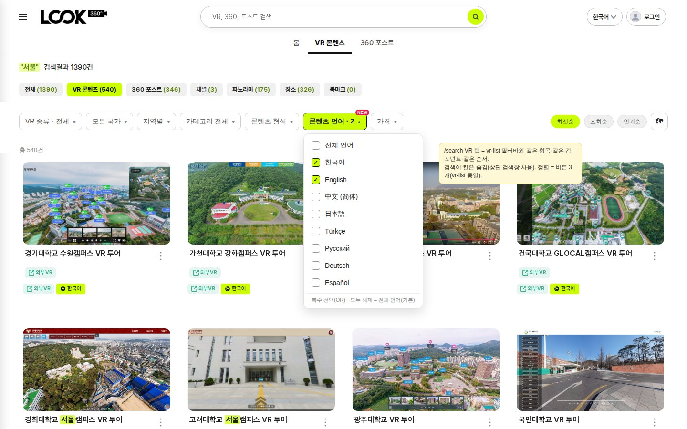

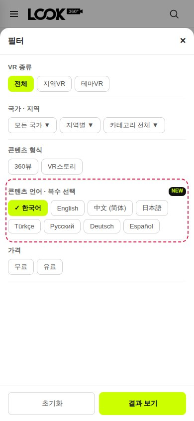

> **정할 것:** ① 추천안 1~5 그대로 수락 vs 바꿀 항목 ② 검색 「이름순」 제거 수용 ③ [IND-8264](https://kabkee-main.tailfe017f.ts.net:8443/IND/issues/IND-8264) A/B안과의 관계 ④ 직접 구현 vs paperclip 발주

직접 확인
<a class="lnk" href="https://kabkee-main.tailfe017f.ts.net:8443/api/attachments/1b86a3f2-6273-43bd-b41a-95be44e6d774/content" target="_blank">before — 검색결과 PC</a>
<a class="lnk" href="https://kabkee-main.tailfe017f.ts.net:8443/api/attachments/a34260ad-34c6-45db-a9b4-36076a67e71f/content" target="_blank">before — 검색결과 모바일</a>
<a class="lnk" href="https://kabkee-main.tailfe017f.ts.net:8443/IND/issues/IND-8592" target="_blank">IND-8592</a>

---

## 🎞️ 안건 5 · RAW 자동 현상 기본 프리셋 회의 이후 확정

지금은 작업자가 Lightroom 에서 사진마다 노출·섀도·하이라이트를 손으로 맞춘 JPG 를 PTGui 에 넣습니다. 이를 NAS 수신 즉시 NEF 를 자동 현상하는 방식으로 바꾸려 합니다(Adobe 구독·로그인 불필요).

| 후보 | 평균 L 오차 (자동 − LR 수동, 12장면) |
|---|---|
| 지금 기본 (HOUSE) | +6.07 |
| nas · nas2 | +3.79 · +3.90 |
| **auto2** | **+2.94** (EM 제안 기준 ≤1.0 미달) |

- 오차의 주원인은 장면별 노출 규칙입니다(노출만 맞춰도 L 11.9 → 5.5). QC [IND-8768](https://kabkee-main.tailfe017f.ts.net:8443/IND/issues/IND-8768) PASS.
- 「Lightroom 수동 JPG」 칸은 작업자가 만든 JPG 를 같은 정렬로 스티칭만 한 **기준선**이라 선택지가 아닙니다. 자동이 이 칸에 얼마나 가까워졌는지로 판단합니다.
- 제안(미착수): NAS 의 Lightroom xmp 설정값(작업자가 실제로 준 값)을 직접 학습 — 지금 코드는 xmp 를 한 번도 읽지 않습니다.

> **정할 것:** ① 기본값 — `auto2` 교체 / HOUSE 유지 / 둘 다 아직 ② 눈으로 봐서 수용 가능한지 ③ xmp 학습 진행 여부 ④ 진행 방식. 결과는 카드 `2745d830` 에 답합니다.

회의 때 열기
<a class="lnk" href="https://kabkee-main.tailfe017f.ts.net:8446/output/IND-8767-compare/index.html" target="_blank">장면 13개 비교 페이지</a>
<a class="lnk" href="https://kabkee-main.tailfe017f.ts.net:8443/IND/issues/IND-8678" target="_blank">IND-8678</a>

---

## ✨ 안건 6 · 작업실 노이즈 제거 · 샤픈 기본값 10/24~10/25

어둡게 찍힌 곳의 굵은 색 노이즈를 녹이고 마지막에 전체 샤픈을 주는 단계를 작업실에 넣으려 합니다. 실제 RAW 3장(마트·주차장·호텔)으로 ①없음 ②LibRaw ③④🎨 색 노이즈 ⑤🤖 AI(SCUNet, GPU) ⑥🤖+🎨 를 같은 자리 확대로 비교했습니다(렌즈통 제외).

| 항목 | 내용 |
|---|---|
| 오너 의견(10/24) | **🤖 AI + 🎨 색 노이즈(강) + 샤픈** 이 가장 보기 좋다 · 장당 약 48초(RTX 3060)여도 이 조합이 낫다 |
| 먼저 넣은 것 | 작업실에 「AI + 색 강 + 샤픈 보통」 기본값(`86f0233`) · NAS 원본 3포인트를 시험 프로젝트에 돌림 · 렌더당 74~81초 |
| 정할 것 | ① 기본 조합 확정 ② AI 를 기본으로 켤지, 작업자가 고르게 할지(포인트당 4~6장 → 4~5분, ⑦ 작업 큐 일괄 안) ③ 샤픈 강도 기본값 |
| 확정 후 | ② 톤·색 카드에 노이즈 선택 · ⑦ 앞 최종 샤픈 · 바뀌면 `stitcher/finish.py` `DEFAULTS` 만 수정 |

회의 때 열기
<a class="lnk" href="http://100.64.25.50:8088/guides/2026-10-24-studio-noise-result.html" target="_blank">작업실 실제 결과 덱</a>
<a class="lnk" href="http://100.64.25.50:8088/guides/2026-10-24-noise-sharpen-compare.html" target="_blank">비교 덱(숫자키 1~6)</a>

---

## 💾 안건 7 · 파일 백업 — 추가 백업 논의 논의 · 결정 아님

오너 지시(10/23): 「내용만 공유하고 논의하기로」.

- **문제:** 원본 백업(H:)과 2차 사본(D:·E:) 3벌이 **모두 kabkee-main 한 대**에 있습니다. 디스크 1개 고장은 막지만, 랜섬웨어(연결된 디스크의 파일을 전부 암호화하는 악성코드)·도난·전원 사고면 3벌이 함께 사라질 수 있습니다. AWS 쪽은 버전관리 + 구버전 30일뿐입니다(AWS Backup·복제·Object Lock 없음).
- 9/14 원안은 2차 사본을 «다른 컴퓨터»에 두었는데, 10/15 서버 이전 때 같은 컴퓨터로 모였습니다. 이를 따로 결정한 기록은 찾지 못했습니다.

| 선택지 | 월 비용(추정) | 특징 |
|---|---|---|
| **A. 별도 AWS 계정 S3 Glacier Deep Archive** (오너 선호안) | 약 $1 | 꺼낼 때만 비용 · 전체 복원 1회 약 $50~62 · 최소 보관 180일 |
| B. Backblaze B2 | 약 $3 | 바로 꺼냄 |
| C. 외장 HDD 다른 장소 보관 | 처음 약 10만원 | 수동 갱신 |

> 어느 쪽이든 kabkee-main 에는 «올리기만 되고 지우기는 안 되는» 권한만 줍니다. A 는 180일 전에 지우면 남은 기간 저장비를 한 번에 청구합니다(490GB 기준 최대 $5.88). **정할 것:** ① 할지·어느 방식 ② 직접 vs 발주 ③ A·B 면 새 계정 생성(오너 작업)

참고
<a class="lnk" href="https://aws.amazon.com/s3/pricing/" target="_blank">AWS S3 요금(Glacier Deep Archive)</a>
<a class="lnk" href="https://www.backblaze.com/cloud-storage/pricing" target="_blank">Backblaze B2 요금</a>

---

## 🗳️ 안건 8 · 오너 확인 대기 카드 — 결과 확인 10/19~10/26

| 카드 | 확인할 것 | 대기 |
|---|---|---|
| [IND-8487](https://kabkee-main.tailfe017f.ts.net:8443/IND/issues/IND-8487) `e5f0a9c6` | **iPhone 실기** — YouTube 360 안내 배너 · 「YouTube 앱에서 보기」 · × 닫기 · 조이패드 숨김 | 1일 |
| [IND-8849](https://kabkee-main.tailfe017f.ts.net:8443/IND/issues/IND-8849) `0fc69941` | look360.kr 카카오·네이버 **실계정 로그인** 회귀 확인 | 당일 |
| [IND-8850](https://kabkee-main.tailfe017f.ts.net:8443/IND/issues/IND-8850) `fe223a4a` | 네이버·페이스북·카카오·X 콘솔에 Netlify 테스트 콜백 주소 등록 | 당일 |
| [IND-8770](https://kabkee-main.tailfe017f.ts.net:8443/IND/issues/IND-8770) `fb9ca945` | 레거시 flat 운영 반영 계획서 v2 실행 승인(희망 KST 04:00~05:30 · 실행 직전 `aws sso login` 필요) | 1일 |
| [IND-8826](https://kabkee-main.tailfe017f.ts.net:8443/IND/issues/IND-8826) `4401bc50` · [IND-8702](https://kabkee-main.tailfe017f.ts.net:8443/IND/issues/IND-8702) `50d86f14` | PTGui 에서 zip 열기 · yaw 1장 수정본 적용 / 포토샵 로그인·라이선스 창 넘기기 | 1일 |
| [IND-8840](https://kabkee-main.tailfe017f.ts.net:8443/IND/issues/IND-8840) `831be77c` | 콘텐츠 상세 「콘텐츠 정보」 장소 정보형 시안 구현 승인 | 1일 |

> 확인 화면: iPhone [http://100.64.25.50:5174/vr/ind8027fx?pano=33663](http://100.64.25.50:5174/vr/ind8027fx?pano=33663) — tailnet 없이 보는 방법은 [IND-8837](https://kabkee-main.tailfe017f.ts.net:8443/IND/issues/IND-8837) 에 정리했습니다.

---

## 🗳️ 안건 8 · 선택이 필요한 질문 카드 10/19~10/26

| 카드 | 질문 | 대기 |
|---|---|---|
| [IND-8495](https://kabkee-main.tailfe017f.ts.net:8443/IND/issues/IND-8495) `251ffdff` | 🔴 **운영 자동 확정이 한국 가수 10명을 외국 인물로 잘못 연결**해 틀린 영문이 지금 운영에 나옴(헬로 → Helloween 등) · 매칭 82건 반영 여부 | 1일 |
| [IND-8825](https://kabkee-main.tailfe017f.ts.net:8443/IND/issues/IND-8825) `68966604` | vr-list 지도 마커 색 — 현행 / A안 / B안 | 1일 |
| [IND-8862](https://kabkee-main.tailfe017f.ts.net:8443/IND/issues/IND-8862) `e8fb89f9` | 링크로 «이번 감상만» 다른 언어로 볼 때 안내 표시 방식(상단 안내 바 등) | 당일 |
| [IND-8880](https://kabkee-main.tailfe017f.ts.net:8443/IND/issues/IND-8880) `f0477ce1` | VR 목록 카테고리 필터 — 1·2단계 2단 탐색 패널 새 시안(기존 [IND-8446](https://kabkee-main.tailfe017f.ts.net:8443/IND/issues/IND-8446) `18713398` A/B 대체) | **7일**(기존 카드 기준) |
| [IND-8678](https://kabkee-main.tailfe017f.ts.net:8443/IND/issues/IND-8678) `2745d830` · [IND-8592](https://kabkee-main.tailfe017f.ts.net:8443/IND/issues/IND-8592) `b739001a` · [IND-8594](https://kabkee-main.tailfe017f.ts.net:8443/IND/issues/IND-8594) `f3ad4ef3` | 안건 3 · 4 · 5 | 2~5일 |

> 필터 카드 `18713398` 는 지난 회의 안건이었는데 아직 답이 없고, A/B 시안이 카테고리 1·2단계를 표현하지 못해 새 시안과 카드 `f0477ce1` 로 바꿨습니다. 이 답이 언어 필터(안건 4)와 ₩ 아이콘 locales 작업의 순서를 함께 막고 있습니다. 다음 8장에 카드별 이미지와 확인할 사항을 정리했습니다(안건 3·4·5 는 앞 장 참조).

---

## 🗳️ 질문 카드 ① IND-8495 · 운영 가수 오연결 정리 카드 251ffdff

운영 자동 확정이 한국 가수 10명을 외국 인물로 잘못 연결해, 틀린 영문 이름이 지금 운영에 노출되고 있습니다.

| 질문 | 선택지 (권장) | 확인할 사항 |
|---|---|---|
| ① 오연결 10명 이승훈·리즈·김정은·리사·파이브·비욘드·씨엘·크리스티나·헬로·퀸즈 | 10명 해제 · 김정은 재연결 보류 / 9명 해제 + 김정은 Q489001 재연결 / 그대로 둠 | 헬로 → Helloween · 파이브 → Five Finger Death Punch · 퀸즈 → 외국 밴드 · 해제 시 자동 로마자로 표시 · 백업과 되돌리기 SQL 준비됨 |
| ② 운영에 없는 가수 7명 신규 추가 | 7명 추가(INSERT) / 보류 | 순순희·양동근·김광민·크로스진·정일훈·MSG워너비·WSG워너비 · 로컬 DB 리허설 후 반영 |
| ③ 영문 없는 ext 가수 46명 | W5 백필 후 남은 가수만 표본 확인 · 추가 / 지금 46명 추가 / 보류 | 동명이인은 곡 단위로 대조하지 않음 · W5 백필이 공식값으로 먼저 채울 수 있음 |

직접 확인
<a class="lnk" href="https://kabkee-main.tailfe017f.ts.net:8443/IND/issues/IND-8495" target="_blank">IND-8495 · 카드 251ffdff</a>
<a class="lnk" href="https://kabkee-main.tailfe017f.ts.net:8443/IND/issues/IND-8835" target="_blank">IND-8835 매칭 82건 설계</a>

---

## 🗳️ 질문 카드 ② IND-8825 · vr-list 지도 마커 색 카드 68966604 · 1/2

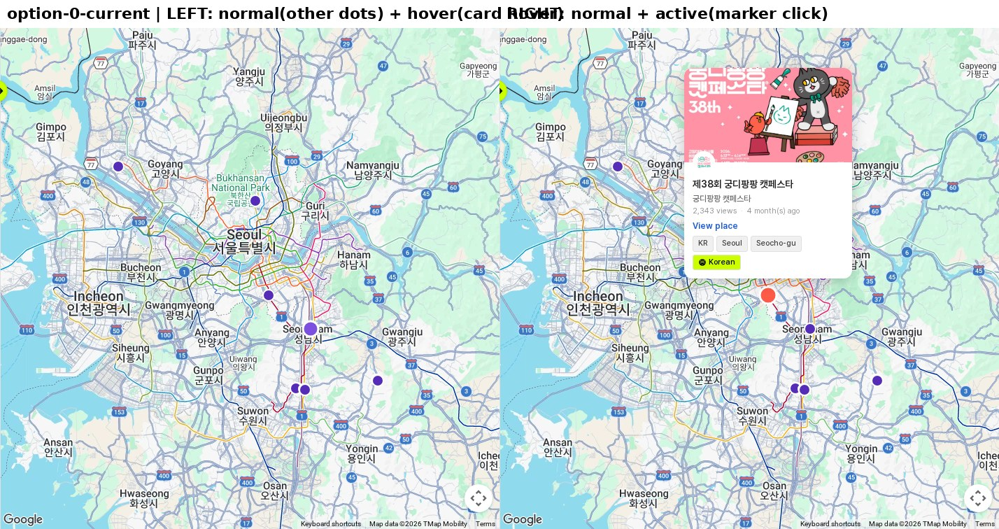

**현행 — 보라 #552cb8 / hover #7c4fe0 / 선택 #fd5a47**

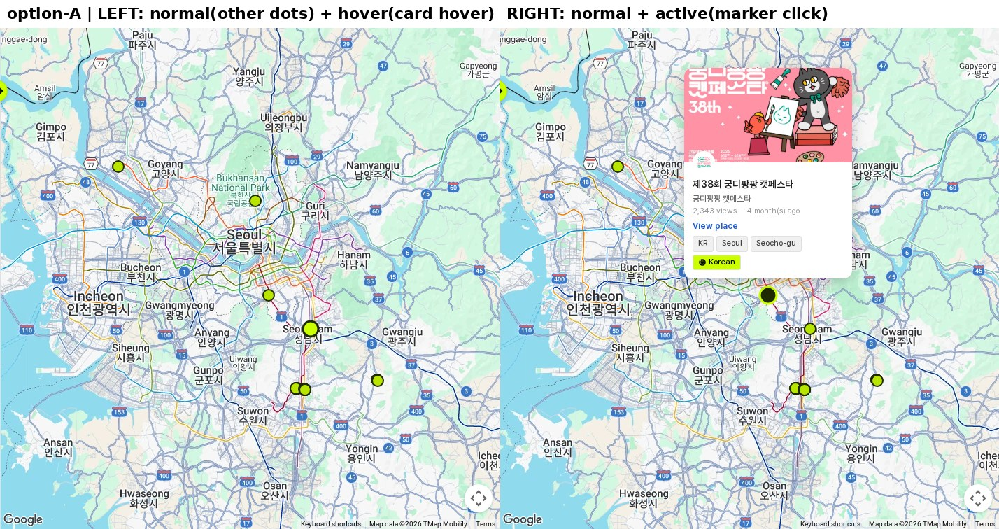

**A 브랜드 라임 (디자이너 추천) — #b8e600 / #ccff00 / 선택 #1f2a00**

> 각 이미지 왼쪽 = 목록 카드에 마우스를 올렸을 때, 오른쪽 = 마커를 눌렀을 때입니다. **확인할 사항:** A 는 브랜드 색과 통일되지만 기본·hover 색 차이가 작아 크기로 구분합니다.

직접 확인
<a class="lnk" href="https://kabkee-main.tailfe017f.ts.net:8443/api/attachments/b81f3924-b5e8-47ca-be02-83ac072a5266/content" target="_blank">현행</a>
<a class="lnk" href="https://kabkee-main.tailfe017f.ts.net:8443/api/attachments/6f17d8c4-2fc3-4d2e-b1eb-30925f3ce471/content" target="_blank">A안</a>
<a class="lnk" href="https://kabkee-main.tailfe017f.ts.net:8443/api/attachments/2d029e7c-fa7e-408a-b990-965f6402cce4/content" target="_blank">B안</a>
<a class="lnk" href="https://kabkee-main.tailfe017f.ts.net:8443/api/attachments/52395a3d-0262-42fb-ab39-eb65ac49e3a3/content" target="_blank">C안</a>
<a class="lnk" href="http://100.64.25.50:5174/vr-list" target="_blank">http://100.64.25.50:5174/vr-list</a>
<a class="lnk" href="https://kabkee-main.tailfe017f.ts.net:8443/IND/issues/IND-8825" target="_blank">IND-8825</a>

---

## 🗳️ 질문 카드 ② IND-8825 · vr-list 지도 마커 색 카드 68966604 · 2/2

**B 로즈-레드 + 검정 선택 — #e11d48 / #fb7185 / 선택 #111827**

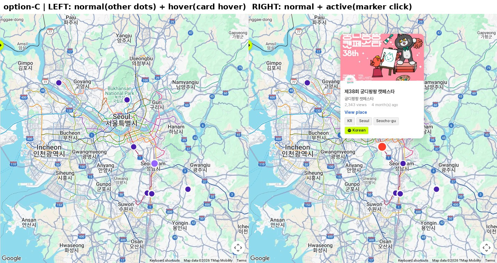

**C 현행 보라 보정 — #4a1fb0 / #9566ff / 선택 #ff3d2a**

> **확인할 사항:** 지도 위에서 잘 보이는지 · 올린 마커와 선택한 마커가 구분되는지. B 는 지도 대비가 가장 크고, C 는 변경이 가장 적습니다. 선택지는 A / B / C / 현행 유지입니다.

직접 확인
<a class="lnk" href="https://kabkee-main.tailfe017f.ts.net:8443/api/attachments/b81f3924-b5e8-47ca-be02-83ac072a5266/content" target="_blank">현행</a>
<a class="lnk" href="https://kabkee-main.tailfe017f.ts.net:8443/api/attachments/6f17d8c4-2fc3-4d2e-b1eb-30925f3ce471/content" target="_blank">A안</a>
<a class="lnk" href="https://kabkee-main.tailfe017f.ts.net:8443/api/attachments/2d029e7c-fa7e-408a-b990-965f6402cce4/content" target="_blank">B안</a>
<a class="lnk" href="https://kabkee-main.tailfe017f.ts.net:8443/api/attachments/52395a3d-0262-42fb-ab39-eb65ac49e3a3/content" target="_blank">C안</a>
<a class="lnk" href="http://100.64.25.50:5174/vr-list" target="_blank">http://100.64.25.50:5174/vr-list</a>
<a class="lnk" href="https://kabkee-main.tailfe017f.ts.net:8443/IND/issues/IND-8825" target="_blank">IND-8825</a>

---

## 🗳️ 질문 카드 ③ IND-8862 · 「이번 감상만」 언어 안내 방식 카드 e8fb89f9

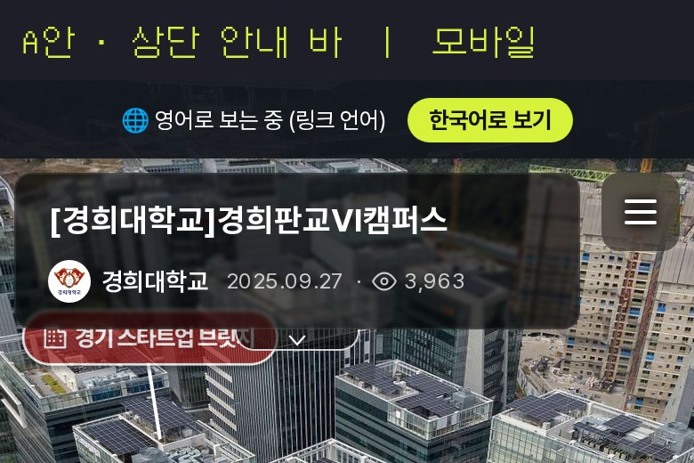

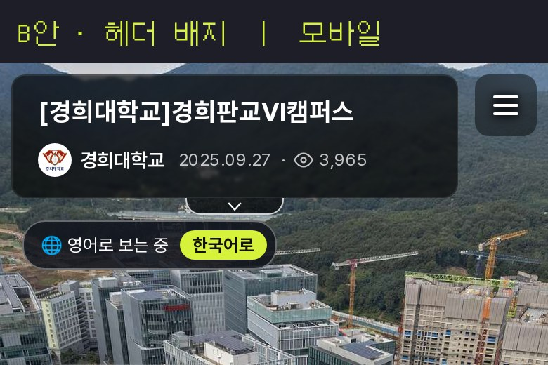

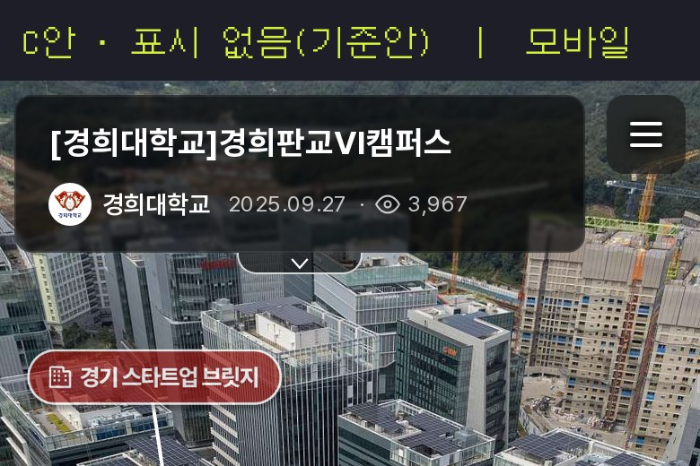

| 안 | 모습 | 확인할 사항 |
|---|---|---|
| A 상단 안내 바(디자이너 추천) | 「🌐 영어로 보는 중 · [한국어로 보기]」 | 가장 눈에 띄지만 상단 36~44px 를 가림 · 닫기(✕) 정책도 정해야 함 |
| B 헤더 배지 | 「🌐 영어로 보는 중 [한국어로]」 | 거의 안 가리지만 모바일에서 놓치기 쉬움 |
| C 표시 없음 | 헤더 언어 표시만 바뀜 | 구현은 최소 · 원래 언어로 돌아가는 길이 드러나지 않음 |

직접 확인
<a class="lnk" href="https://kabkee-main.tailfe017f.ts.net:8443/api/attachments/4d634de2-2ef4-4cb7-aa4f-818d4fe39e1d/content" target="_blank">A PC</a>
<a class="lnk" href="https://kabkee-main.tailfe017f.ts.net:8443/api/attachments/7f88c42d-ed30-4eb1-829b-b1d8ea5123cd/content" target="_blank">B PC</a>
<a class="lnk" href="https://kabkee-main.tailfe017f.ts.net:8443/api/attachments/39a9379c-6270-40e1-92c2-ca3beb40a4bc/content" target="_blank">C PC</a>
<a class="lnk" href="https://kabkee-main.tailfe017f.ts.net:8443/IND/issues/IND-8862" target="_blank">IND-8862</a>
<a class="lnk" href="https://kabkee-main.tailfe017f.ts.net:8443/IND/issues/IND-8866" target="_blank">IND-8866 비교표</a>

---

## 🗳️ 질문 카드 ④ IND-8880 · VR 목록 카테고리 필터 — 2단 탐색 패널 카드 f0477ce1 · 새 시안

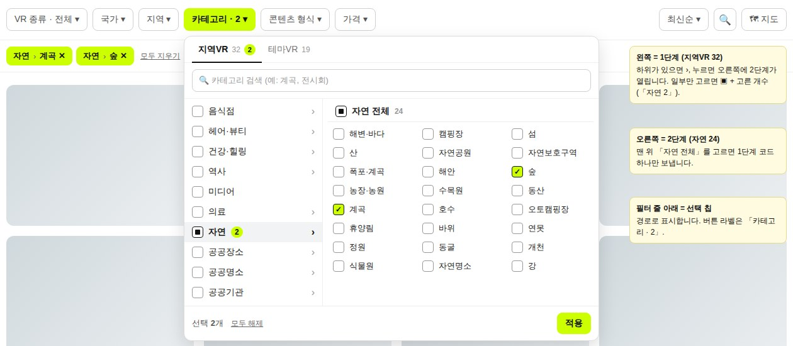

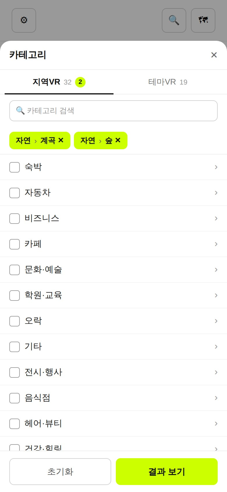

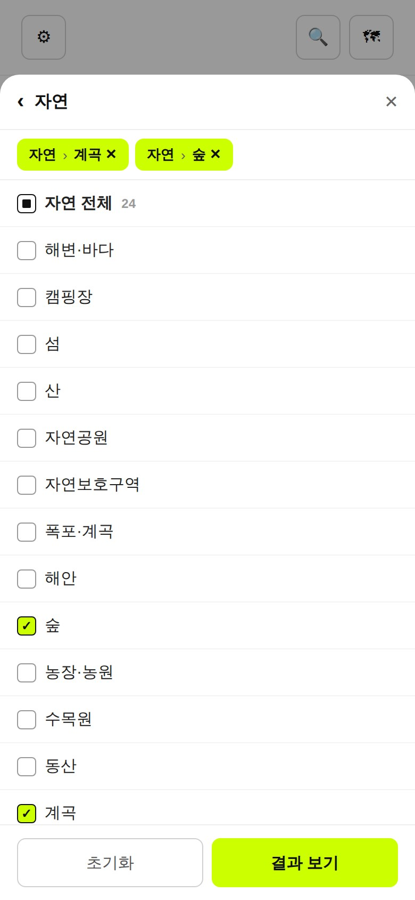

> **확인할 사항:** ① 이 시안대로 구현할지 — PC 는 **왼쪽 1단계 · 오른쪽 2단계** 패널, 모바일은 하단 시트에서 1단계 → 2단계로 넘어갑니다. ② 「기타」·「미분류」를 **각 탭 맨 아래**로 둘지, 관리자 정렬 순서를 따를지. 답이 나오면 W3 [IND-8264](https://kabkee-main.tailfe017f.ts.net:8443/IND/issues/IND-8264) 를 시작합니다(기존 A/B 카드 18713398 대체).

직접 확인
<a class="lnk" href="https://kabkee-main.tailfe017f.ts.net:8443/api/attachments/2e804565-99e4-4659-9dbc-39dc5a93386b/content" target="_blank">① PC 자연 2개 선택</a>
<a class="lnk" href="https://kabkee-main.tailfe017f.ts.net:8443/api/attachments/fdad40b2-479c-4a57-a72d-d1a37a68e130/content" target="_blank">④ 모바일 1단계</a>
<a class="lnk" href="https://kabkee-main.tailfe017f.ts.net:8443/api/attachments/ab39aded-937c-4701-873e-14cdc506b799/content" target="_blank">⑤ 모바일 2단계</a>
<a class="lnk" href="https://kabkee-main.tailfe017f.ts.net:8443/IND/issues/IND-8880" target="_blank">IND-8880 카드 f0477ce1</a>
<a class="lnk" href="https://kabkee-main.tailfe017f.ts.net:8443/IND/issues/IND-8446" target="_blank">IND-8446 기존 A/B</a>

---

## 🗳️ 질문 카드 ④ 보충 · A·B 모두 카테고리 2단계를 표현하지 못함 10/26 오너 지적

시안은 묶음마다 카테고리 4개를 평평하게 나열했지만, 실제 카테고리는 **1단계 → 2단계** 구조이고 하위가 없는 1단계도 있습니다.

| 축 | 1단계 | 2단계 | 하위 없는 1단계 |
|---|---|---|---|
| 지역VR | 32 | 207 (자연 24 · 스포츠·레저 27 · 매장 17) | 미디어 · 미분류 |
| 테마VR | 19 | 25 | VR웹툰 · 팝업스토어 · VR게임 · 동물 · 관광·여행 · 자연 |

**추천 — 2단 탐색 패널:** ① 상단 탭 지역VR / 테마VR(VR 종류가 「전체」일 때만) ② 왼쪽 1단계 목록 — 하위가 있으면 `›`, 없으면 바로 체크, 일부 선택은 ▣ + 개수 ③ 오른쪽 2단계 — 맨 위 「○○ 전체」, 하위를 모두 고르면 「전체」로 합침 ④ 카테고리 검색(결과는 「자연 › 계곡」) ⑤ 선택 칩은 경로로 표시, 같은 이름이 두 축에 있으므로 「테마 ·」 표기 ⑥ 모바일은 하단 시트에서 1단계 → 2단계로 넘어가는 화면

> 백엔드는 이미 준비되어 있습니다 — 1·2단계 코드를 섞어 여러 개 받고, 1단계는 하위를 자동 포함합니다([IND-5593](https://kabkee-main.tailfe017f.ts.net:8443/IND/issues/IND-5593) · [IND-8263](https://kabkee-main.tailfe017f.ts.net:8443/IND/issues/IND-8263)). **화면 표시 방식만 다시 그리면 됩니다.**

직접 확인
<a class="lnk" href="http://100.64.25.50:3001/v1.0/content-categories/place/tree" target="_blank">지역VR 카테고리 트리</a>
<a class="lnk" href="http://100.64.25.50:3001/v1.0/content-categories/theme/tree" target="_blank">테마VR 카테고리 트리</a>
<a class="lnk" href="http://100.64.25.50:5174/vr-list" target="_blank">http://100.64.25.50:5174/vr-list</a>

---

## 🗳️ 질문 카드 ④ 보충 2 · 「전체」 선택과 검색 IND-8880 시안 ②·③

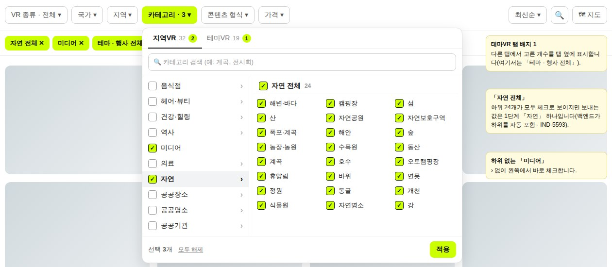

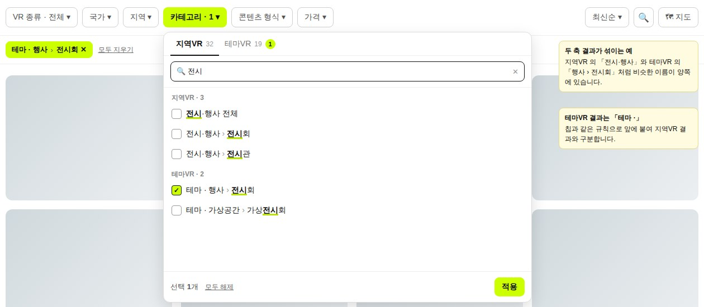

- **왼쪽 ②:** 「자연 전체」를 고르면 1단계 「자연」 하나만 보냅니다. 하위가 없는 「미디어」는 왼쪽에서 바로 체크합니다. 다른 탭에서 고른 개수는 탭 옆 숫자로 보입니다.
- **오른쪽 ③:** 검색은 지역VR·테마VR 을 함께 찾고, 결과를 「전시·행사 › 전시회」·「테마 · 행사 › 전시회」처럼 경로로 보여 줍니다. 「계곡」은 지역VR 에만 있어서 두 축이 섞이는 예로 「전시」를 함께 그렸습니다.

직접 확인
<a class="lnk" href="https://kabkee-main.tailfe017f.ts.net:8443/api/attachments/74bad394-d2f8-46c9-89bf-c63068f006c4/content" target="_blank">② 자연 전체 + 미디어</a>
<a class="lnk" href="https://kabkee-main.tailfe017f.ts.net:8443/api/attachments/d6ea85fa-c457-4009-ace0-e4b4b6a9da21/content" target="_blank">③ 검색 「계곡」</a>
<a class="lnk" href="https://kabkee-main.tailfe017f.ts.net:8443/api/attachments/16ce6434-3bc5-463b-bb62-5e81aa88af91/content" target="_blank">③-2 검색 「전시」</a>
<a class="lnk" href="https://kabkee-main.tailfe017f.ts.net:8443/IND/issues/IND-8880" target="_blank">IND-8880</a>

---

## 🗳️ 질문 카드 ④ 보충 3 · 「전체」 규칙 IND-8880 시안 ⑥

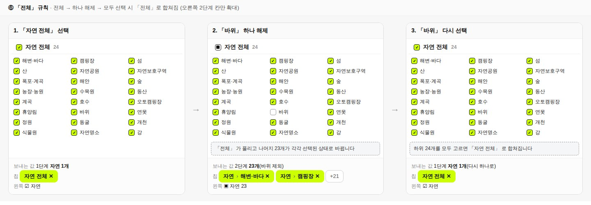

> 「자연 전체」 상태에서 하나를 빼면 나머지 23개가 각각 선택된 상태로 풀리고, 다시 24개를 모두 고르면 「자연 전체」 하나로 합쳐집니다. 서버로 보내는 값도 1개 → 23개 → 1개로 바뀝니다.

직접 확인
<a class="lnk" href="https://kabkee-main.tailfe017f.ts.net:8443/api/attachments/5e9978b1-5ecb-4812-b045-4ef9f241aa96/content" target="_blank">⑥ 「전체」 규칙 3장</a>
<a class="lnk" href="https://kabkee-main.tailfe017f.ts.net:8443/IND/issues/IND-8880" target="_blank">IND-8880</a>

---

## 💬 논의 · 적용된 조건을 칩 줄로 모아 보기 예시 시안 · 미개발

지금은 걸린 조건을 확인하려면 드롭다운을 하나씩 열어야 합니다. 정렬을 뺀 **모든 조건(검색어 포함)을 필터 줄 아래 한 줄에 칩으로** 보여 주고, ✕ 로 하나씩 빼는 방식을 제안합니다.

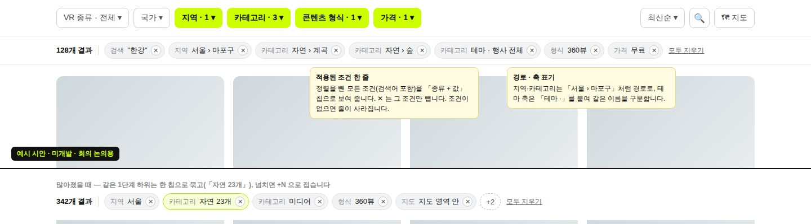

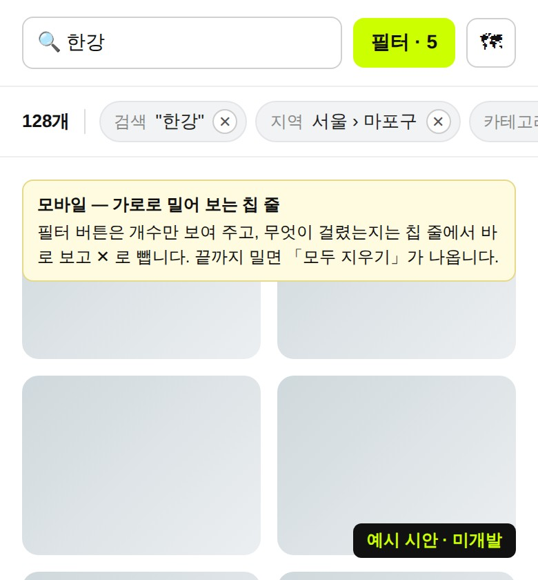

> **정할 것:** ① 칩 줄 도입 여부 ② 카테고리 패널 안 칩을 이 줄로 옮길지 — 「자연 23개」 묶음으로 칩 넘침도 해결 ③ 검색결과 화면(안건 4 · [IND-8592](https://kabkee-main.tailfe017f.ts.net:8443/IND/issues/IND-8592))과 같은 컴포넌트로 통일할지. 발주는 회의 결정 후 진행합니다.

직접 확인
<a class="lnk" href="http://100.64.25.50:5174/vr-list" target="_blank">http://100.64.25.50:5174/vr-list (현행 — 칩 줄 없음)</a>
<a class="lnk" href="https://kabkee-main.tailfe017f.ts.net:8443/IND/issues/IND-8880" target="_blank">IND-8880 2단 탐색 패널</a>

---

## 🔁 회의 이후 바뀐 것 · 재수정 요청 요청 원장 기준

지난 회의에 보고한 뒤 방향이 바뀌었거나 후속이 생긴 항목입니다.

| 지난 보고 | 바뀐 것 |
|---|---|
| [IND-8153](https://kabkee-main.tailfe017f.ts.net:8443/IND/issues/IND-8153) · [IND-7712](https://kabkee-main.tailfe017f.ts.net:8443/IND/issues/IND-7712) 자동번역 토글 | 재수정 요청(10/26 회귀) → [IND-8844](https://kabkee-main.tailfe017f.ts.net:8443/IND/issues/IND-8844) 로 재수정 완료 · 오너 재확인 필요 |
| [IND-8496](https://kabkee-main.tailfe017f.ts.net:8443/IND/issues/IND-8496) 엑박 자동 복구 | 10/22 자동 적용 ON(최소 90점 · 하루 20곡) · 10/23 kpop 20 · pop 20 적용 · 롤백 0 · 엑박 kpop 311→291 · pop 262→244 |
| [IND-8495](https://kabkee-main.tailfe017f.ts.net:8443/IND/issues/IND-8495) 영문 줄 규칙 | 가수 영문 공식 수집 단계 추가 · 운영 가수 오연결 10명 발견(안건 8) · 밤 백필 2회차 10/27 00:12 |
| [IND-8248](https://kabkee-main.tailfe017f.ts.net:8443/IND/issues/IND-8248) · [IND-8051](https://kabkee-main.tailfe017f.ts.net:8443/IND/issues/IND-8051) 지도·표시 설정 | 후속 [IND-8533](https://kabkee-main.tailfe017f.ts.net:8443/IND/issues/IND-8533)(지도 크기 변경 시 줌·중심 유지)으로 이어짐 |
| [IND-7237](https://kabkee-main.tailfe017f.ts.net:8443/IND/issues/IND-7237) 외부VR | 후속 [IND-8591](https://kabkee-main.tailfe017f.ts.net:8443/IND/issues/IND-8591)(카드·상세 기획 일치) 완료 · 분류 반영은 대기 |
| [IND-7864](https://kabkee-main.tailfe017f.ts.net:8443/IND/issues/IND-7864) · [IND-7665](https://kabkee-main.tailfe017f.ts.net:8443/IND/issues/IND-7665) | 후속 이슈([IND-8024](https://kabkee-main.tailfe017f.ts.net:8443/IND/issues/IND-8024) · [IND-8122](https://kabkee-main.tailfe017f.ts.net:8443/IND/issues/IND-8122))로 이관된 기록 갱신 |

---

## ✅ 지난 보고(10/19) 안건 처리 결과

| 지난 안건 | 처리 결과 |
|---|---|
| 약관 개정 공지 게시일(D) | 10/21 확정 · 운영 공지 527 · 7개 언어 날짜 반영 |
| 이전/다음 버튼 외형 · 오토투어 이력 | A안 유지 · 이력 포함 → [IND-8527](https://kabkee-main.tailfe017f.ts.net:8443/IND/issues/IND-8527) 구현·QC 완료 |
| VR 목록 필터 시안 A/B | 카드 미응답(7일) |
| 썸네일 형식·AI 아이콘 · AI 표시 5문항 | 회의 결정 반영 → [IND-8528](https://kabkee-main.tailfe017f.ts.net:8443/IND/issues/IND-8528) 완료 |
| FAQ·공지 본문 다국어 | 자동번역 + 관리자 수정 → [IND-8526](https://kabkee-main.tailfe017f.ts.net:8443/IND/issues/IND-8526) 완료(오너 확인) |
| iOS YouTube 360 · 엑박 자동 복구 | iOS 앱 우회 확정(실기 확인 대기) · 엑박 자동 적용 ON |

> 외부VR 분류 반영 · X 로그인 비용 · reCAPTCHA 비밀 키 정리는 이번 주 처리 기록이 없습니다. 다음 회의로 이월합니다.

---

## 📊 처리량 (10/20~10/26)

328

완료 작업

39

완료 작업 단위(EPIC)

382

코드 반영(l3·레거시·weekly·작업실)

109

검증 증빙

| 저장소 | 10/20~10/22 | 10/23~10/26 | 합계 |
|---|---|---|---|
| 사용자 화면 (`look360_v3_client`) · 서버 API (`nestjs-look360-api`) | 34 · 48 | 22 · 30 | 56 · 78 |
| 관리자 화면 (`look360_platform_admin`) | 4 | 3 | 7 |
| 레거시 (`Look360_ksq1.2`) · weekly(k)pop 두 사이트 | — | — | 21 · 43 |
| 360 작업실 (`pano-stitcher`, 전 브랜치) | — | — | 160 |

> 일일 점검 루틴 7건은 완료 수에서 제외했습니다. 완료 작업 중 QC 이슈가 100건으로, 약 30% 가 독립 검증입니다.

확인
<a class="lnk" href="https://kabkee-main.tailfe017f.ts.net:8443/IND/issues" target="_blank">paperclip 작업 목록</a>

---

## 🔗 라이브 엔드포인트

사용자
<a class="lnk" href="http://100.64.25.50:5174" target="_blank">Look360 l3 플랫폼 (개발)</a>
<a class="lnk legacy" href="https://look360-v3-client.netlify.app" target="_blank">l3 플랫폼 Netlify(SNS 테스트)</a>

이번 주 화면
<a class="lnk" href="http://100.64.25.50:5174/faq" target="_blank">FAQ 다국어</a>
<a class="lnk" href="http://100.64.25.50:5174/vr/ind8027fx?pano=33663" target="_blank">YouTube 360 장면</a>
<a class="lnk" href="http://100.64.25.50:5174/vr/o1vj1ty0?pano=29315" target="_blank">Kay Park 전시회</a>
<a class="lnk" href="http://100.64.25.50:5174/vr-info/nsUMZzRN" target="_blank">외부VR 상세</a>

이번 주 신설
<a class="lnk" href="http://100.64.25.50:5174/licenses" target="_blank">소프트웨어 라이선스</a>
<a class="lnk" href="https://kabkee-main.tailfe017f.ts.net:8446/" target="_blank">360 작업실</a>
<a class="lnk" href="http://100.64.25.50:8830/" target="_blank">요청 원장</a>

외부
<a class="lnk legacy" href="https://look360.kr" target="_blank">look360.kr (레거시 운영)</a>
<a class="lnk legacy" href="https://weeklykpop.com/" target="_blank">weeklykpop.com</a>
<a class="lnk legacy" href="https://pop.weeklykpop.com/" target="_blank">pop.weeklykpop.com</a>

---

<!-- _class: closing -->
<!-- _paginate: false -->

## 감사합니다

회의 결정을 화면에 옮기고, 낡은 서버와 이관 데이터를 정리한 7일이었습니다.

Indyspot AI Corp &nbsp;·&nbsp; Engineering Manager &nbsp;·&nbsp; 2026-10-26

