<!-- _class: cover -->
<!-- _paginate: false -->

# 주간 업무 보고

## 2026-10-27 &nbsp;~&nbsp; 2026-11-02

<hr>

Indyspot AI Corp &nbsp;·&nbsp; Engineering Manager &nbsp;·&nbsp; 2026-11-04

---

<!-- _class: agenda -->

## 이번 기간 주요 작업 — 「장애의 진짜 원인을 찾고, 콘텐츠를 외부로 내보낼 길을 연」 7일

<div class="cols">
<div class="col">

### 운영 안정화
- look360.kr 11/01 무응답 — 2015년 코드 버그 규명
- 메인 페이지 쿼리 485개 → 65개
- 방문 통계 중복·SQL 인젝션 통로 정리

### 외부 확산 (embed · oEmbed)
- oEmbed 엔드포인트 · embed 가능 판정 단일화
- CloudFront 썸네일 외부 허용 (운영 LIVE)
- 「LOOK360에서 보기」 유입 버튼 시안

### 레거시 파노라마
- flat 파노라마 정식 지원 (batch XML · 투어 XML)
- 장소 페이지 flat 썸네일·캐러셀·라벨 정상화
- 구형 sphere 타일 레벨 선언 전수 검사

</div>
<div class="col">

### l3 플랫폼 화면
- vr-info 장소 SNS 표시 · 알림 드롭다운 리디자인
- 확인 팝업에 동작 이름 · 2단계 삭제 잠김
- 어드민 11건 정합화 (테마·장소·핫스팟·주소)

### 보안
- 레거시 SNS 로그인 임의 계정 차단
- 전역 라우트 가드 회귀 spec (IDOR 재발 방지)

### weekly(k)pop
- 유튜브 영상 교체 308곡 · 검토자 역할 신설
- 통합검색 개편 · 차트 조회 481ms → 2.3ms
- 운영 정상화 · n8n 철거 · 판정 AI 도입

### 수익
- 고객사 호스팅 1년 연장 — 200만 원

</div>
</div>

---

<!-- _class: sec -->

<span class="sec-num">Section 01</span>

## 꼭 알아야 할 변경 — 결정 · 반영 범위

이번 주에 정한 규칙과 어디까지 운영에 나갔는지를 먼저 정리합니다.

---

## 🔑 이번 주에 정한 규칙 <span class="badge-date">10/27~11/02</span>

| 결정 | 내용 | 근거 |
|---|---|---|
| **embed 비공개 처리** | 유료·비밀번호·비공개는 embed·oEmbed 모두 「있다는 것조차 알 수 없게」 없는 콘텐츠와 같은 404·같은 화면. Referer 화이트리스트·워터마크는 두지 않음 | [IND-8885](https://kabkee-main.tailfe017f.ts.net:8443/IND/issues/IND-8885) 오너 10/27 |
| **레거시 설정 변경 원칙** | look360.kr CloudFront 는 **「썸네일 파일 규칙만」** 허용 목록에 추가. 썸네일을 beta 로 옮기는 안은 기각 — beta 는 새 플랫폼 전용이고 look360.kr 저장소는 레거시로 계속 유지 | [IND-8909](https://kabkee-main.tailfe017f.ts.net:8443/IND/issues/IND-8909) 오너 10/27 |
| **유입 버튼 방식** | 임베드 재생 중 「LOOK360에서 보기 ↗」는 **「조작 중 숨김 + 모서리 아이콘」 조합**으로 시안부터 받음 | [IND-8890](https://kabkee-main.tailfe017f.ts.net:8443/IND/issues/IND-8890) 오너 10/27 |
| **flat 제목 현행 유지** | 장소 1722 의 `sy01`~`sy29` 같은 파일명 코드 제목은 그대로 둠. 작품명 수집·데이터 수정은 하지 않음 | [IND-8935](https://kabkee-main.tailfe017f.ts.net:8443/IND/issues/IND-8935) 오너 10/27 |
| **검토자 롤백 허용** | 10/27 의 「롤백은 관리자만」을 바꿔 **검토자도 롤백·교체 가능**. 작업자가 자기 실수를 남에게 부탁하지 않아도 되게. 관리자 전용은 「자동 승인 설정」 하나뿐 | weekly 오너 10/28 |
| **상한을 두는 이유** | 상한은 **「외부 호출 제한·서버 부하·크롤링 차단」이 이유일 때만** 둔다. 유튜브 자동 교체 20곡·후보 탐색 50곡을 1,000(사실상 해제)으로 풂 | weekly 오너 10/29 |
---

## 🔑 이번 주에 정한 규칙 (2) <span class="badge-date">10/27~11/02</span>

| 결정 | 내용 | 근거 |
|---|---|---|
| **조회수 +1 기준** | 진입 1회는 **최대 +1**(부풀림 금지). 360포스트는 마커·목록 클릭으로 상세가 열릴 때만 +1 | [IND-8870](https://kabkee-main.tailfe017f.ts.net:8443/IND/issues/IND-8870) 오너 10/29 |
| **DB 차단 정책** | look360.kr 과부하에 **IP 기준 차단은 하지 않음** — 국내 학교·기관이 IP 하나로 5분에 2,300~6,668건을 정상 사용 | [IND-9048](https://kabkee-main.tailfe017f.ts.net:8443/IND/issues/IND-9048) 오너 11/02 |
| **콘텐츠 링크 신설** | 콘텐츠 단위 홈페이지·SNS 링크를 에픽으로 진행. 판매자(OWNER 롤)도 입력 가능 · 개수 제한 없음 · 플랫폼 종류 확장 + 「기타」 직접 입력 | [IND-9049](https://kabkee-main.tailfe017f.ts.net:8443/IND/issues/IND-9049) 오너 11/02 |

---

## 🚦 어디까지 운영에 나갔나 — 반영 범위 <span class="badge-date">10/27~11/02</span>

| 대상 | 반영 수준 | 좌표 |
|---|---|---|
| look360.kr **CloudFront 썸네일 허용** | <span class="hl-green">운영 LIVE 10/27 16:32:46 KST</span> | 배포 `E134ZI2PZY55NN` · ETag `E1PA6795UKMFR9` → `E13V1IB3VIYZZH` |
| look360.kr **장소 페이지 flat 정상화** | <span class="hl-green">운영 반영 10/28</span> | 레거시 HEAD `1c6050bd6` · 캐러셀 `d0c87f8d2` · 라벨 `6cc9153b8` |
| look360.kr **flat 파노라마 정식 지원** | <span class="hl-green">운영 반영 11/01 00:2x KST</span> | [IND-8770](https://kabkee-main.tailfe017f.ts.net:8443/IND/issues/IND-8770) · 후속 수정 `673076aa1` |
| look360.kr **DB 인덱스·쿼리 최적화** | <span class="hl-green">운영 반영 11/02</span> | `ae7861889` · `55a416f20` · `5721207c7` · `0eef8a838` |
| weeklykpop · weeklypop **유튜브 교체·검색·검토자** | <span class="hl-green">운영 반영 완료</span> | `chore/php83-lightsail` push 완료 |
| l3 플랫폼 **client 확인 팝업** | <span class="hl-red">운영 미반영 — 개발 서버만</span> | `paperclip` 브랜치에만 있고 `main` 에 없음. 운영 번들은 아직 브라우저 기본 `confirm()` |
| l3 플랫폼 **어드민 11건 · vr-info · 알림** | <span class="hl-amber">개발 서버 반영 · 오너 지시 시 배포</span> | admin 은 로컬 커밋까지만(push 는 오너가 몰아서 지시) |
| **360 작업실 flat 지원** | <span class="hl-green">studio.look360.kr 반영</span> | `~/Developments/pano-stitcher` master |

> 🔴 client 운영 배포는 수동(`netlify deploy --prod`)이라 **paperclip `done` ≠ 배포**입니다. 10/28 운영 번들 실측에서 `cancelPurchaseBtn` 0건 · `ConfirmDeleteModal` 잠김 없음을 확인했습니다.

---

<!-- _class: sec -->

<span class="sec-num">Section 02</span>

## 운영 안정화 — look360.kr 11/01 무응답

약 5분간 사이트가 응답하지 않았습니다. 원인은 사용자 증가가 아니라 2015년 코드의 버그였습니다.

---

## 🚨 직접 원인 — 접속 기록 100만 행 통째 삭제 <span class="badge-date">11/01 22:34</span>

방문자 접속 경로 기록(`rb_s_referer`)이 100만 건을 넘는 순간, 「오래된 1건 삭제」 코드가 `delete … where 7003202`(항상 참)이 되어 **100만 행을 통째로 삭제**했습니다. 삭제가 끝나자 첫 방문자 요청이 운영 중에 통계 테이블 5개를 재구성(OPTIMIZE)하기 시작했고, 그동안 방문자 요청들이 잠금을 기다리며 연결 60개를 모두 채웠습니다. **2015-10 코드부터 있던 버그**입니다(`switchs/end/visitercheck/main.php`).

| 지표 | 평소 (22:25) | 장애 (22:37~38) |
|---|---:|---:|
| DB CPU | 5~7% | <span class="hl-red">91%</span> |
| 디스크 읽기(ReadIOPS) | 2~3 | <span class="hl-red">최대 1,110</span> |
| DB 연결 수 | 0~1 | <span class="hl-red">58 / 60</span> |
| 분당 웹 요청 | 278건 (22:20 · 이때 DB CPU 6%) | 15~32건 |

> 증거: DB 디스크 여유 공간이 22:33~22:41 **−231MB**(대량 삭제) → 22:42 **+274MB** · 22:45 **+151MB**(재구성으로 회수)로 움직이고, 남은 기록의 가장 오래된 행이 정확히 22:42:15 입니다. **「사용자 증가」는 원인이 아닙니다** — 요청이 훨씬 많던 22:20 에 DB CPU 는 6% 였습니다. DB 사양(db.t4g.micro · 메모리 1GB · 버퍼 풀 128MB · 연결 상한 60)에 여유가 없어 상황이 커졌습니다. 작업실(pano-stitcher)·flat 개발과는 무관합니다(그 시간 작업실 요청 0건).

<div class="links"><span class="lbl">확인</span>
<a class="lnk" href="https://kabkee-main.tailfe017f.ts.net:8443/IND/issues/IND-9048" target="_blank">IND-9048 원인 추적 · 인덱스·쿼리 최적화</a></div>

---

## ⚡ 최적화 — 라이브 트래픽의 모든 쿼리를 2.5분씩 기록해 전후 비교 <span class="badge-date">11/02</span>

| 무엇을 했나 | 전 | 후 |
|---|---:|---:|
| **메인 페이지 요청당 쿼리 수** | 485개 | <span class="hl-green">65개 (−87%)</span> |
| 메인 페이지 요청당 DB 시간 | 약 270ms | <span class="hl-green">약 50ms (−81%)</span> |
| 메인 페이지 응답 시간 | 약 0.9초 | <span class="hl-green">약 0.2초</span> |
| 쿼리마다 따라 보내던 `set names`·`sql_mode` (전체 쿼리의 64%) | 쿼리 1개당 2개 | 연결당 1번 |
| 히어로·HOT 랜덤 파노라마 50곳 (장소별 N+1 → 묶음 조회) | 쿼리 101개 · 158ms | <span class="hl-green">3개 · 14ms</span> |
| 메인 「최신 VR투어」 (FIND_IN_SET·OR 조인 → 파생 테이블) | 읽는 행 102,042 · 70~90ms | <span class="hl-green">2,888 · 23ms</span> (결과 동일) |
| 투어 조회 `look360_panotour` place_id·domain (인덱스 신설) | 전체 2,715행 | <span class="hl-green">1행</span> |
| 투어별 파노라마 목록 `look360_panotour_pano` (복합 인덱스 + 쓸모없는 `hidden` 인덱스 숨김) | 8,233~30,623행 | <span class="hl-green">24~52행</span> |

> 재발 대비로 깔아둔 것: ① slow log(1초 이상) 상시 기록 + CloudWatch 보관 ② 1분 감시 — 피크·무응답이면 Slack `#monitoring-alerts` 로 그 순간 실행 중 쿼리·느린 URL·크롤러 스냅샷, 회복 10분 뒤 범인 쿼리 순위 자동 발송 ③ Apache 로그에 요청별 처리시간 ④ WAF 에 위장 봇 UA 3종 속도 제한(UA별 5분 300건 · 월 약 $1).

---

## 📉 방문 통계 정리 — 부풀림·중복·보안 구멍 <span class="badge-date">11/02 · 커밋 55a416f20</span>

| 무엇을 했나 | 전 | 후 |
|---|---:|---:|
| 접속 기록 100만 건 정리 | 새 방문마다 전체 COUNT(*) · 넘으면 <span class="hl-red">테이블 통째 삭제</span> | 1,000건마다 오래된 것만 범위 삭제 |
| 운영 요청 안의 테이블 재구성(OPTIMIZE) | 5개 | <span class="hl-green">0개</span> |
| 일별 통계 쓰기(브라우저·카운터·방문수) | 「조회 → 없으면 INSERT」 6쿼리 | upsert 3쿼리 + 유니크 키 |
| 같은 날 행이 둘로 갈라진 중복 | browser 65 · counter 18 · numinfo 18 그룹 | <span class="hl-green">0</span> (병합 · 백업 `bak20261102_*`) |
| 일별 방문 수 누적 합계 | 7,179,227 (<span class="hl-red">149,406회 부풀림</span>) | <span class="hl-green">7,029,821</span> = 카운터 합계와 일치 |
| 방문 통계 조회 `rb_s_browser` | 약 4,000행 | <span class="hl-green">1~2행</span> |
| 접속 기록 INSERT 의 UA·Referer | 이스케이프 없음 — <span class="hl-red">SQL 인젝션 통로</span> | 이스케이프 |
| 검색어 값 SQL 이스케이프 | 없음 — `UNION ALL SELECT …` 공격 시도 문자열 <span class="hl-red">15건 실제 저장</span> | 이스케이프 + upsert |
| 관리자 파노라마 삭제 빈 조건 | 조건이 비면 <span class="hl-red">테이블 전체 삭제</span> 가능 | 가드 추가 |
| 검색 페이지 — 검색어 없이 검색 | 파노라마 3만여 개 전체 검색 · 0.82~0.88초 | <span class="hl-green">DB 검색 생략 + 안내 · 0.05초</span> |

> 오너 결정: DB 사양 상향(t4g.small 월 +$19)·Aurora Serverless v2(최소 월 약 $73)는 **다음 피크의 slow log 를 보고** 결정합니다. 다음 주 할 일 — 백업 테이블 `bak20261102_*` 5개를 1~2주 뒤 삭제하고, 검색어가 있는 검색의 첫 검색 0.75~1.08초(버퍼 풀 128MB 부족으로 디스크를 읽는 탓 · 쿼리 자체는 22~39ms)는 사양 결정과 함께 봅니다.

---

<!-- _class: sec -->

<span class="sec-num">Section 03</span>

## 외부 확산 — embed · oEmbed · 유입 버튼

Look360 콘텐츠가 외부 사이트로 퍼지고, 그 사람들이 다시 Look360 으로 들어오게 하는 묶음입니다.

---

## 🔗 oEmbed 제공 — 무엇을 만들었나 <span class="badge-date">10/27~</span>

l3 플랫폼은 그동안 oEmbed 를 제공하지 않았습니다. 외부 사이트에 Look360 주소를 붙여도 링크로만 남고 영상처럼 펼쳐지지 않았습니다.

| 만든 것 | 내용 |
|---|---|
| `/oembed` 엔드포인트 | 콘텐츠 주소를 받아 제목·썸네일·iframe 코드를 JSON 으로 돌려줍니다 |
| 찾기용 링크 태그 | 모든 VR 페이지에 `<link rel="alternate" type="application/json+oembed">` 를 넣어, 페이지를 직접 열어보는 프로그램(WordPress 링크 찾기·Iframely 등)이 우리를 찾게 합니다 |
| embed 가능 판정 단일화 | 유료·비밀번호·비공개(hidden 은 비번 유무 무관)는 **없는 콘텐츠와 같은 404·같은 화면**. 「iframe 가능/불가」만 구분하고 Referer 화이트리스트·워터마크는 두지 않습니다 |
| embed 허용 범위 | VIEW360 만 embed 허용하고 VRSTORY 등은 「없음」. 공유 창 탭 내용 섞임도 함께 고쳤습니다 |

> hidden 콘텐츠의 `/vr` 직링크 감상은 [IND-4741](https://kabkee-main.tailfe017f.ts.net:8443/IND/issues/IND-4741) 결정 그대로 유지합니다. 출처는 오너 자료 `oEmbed-API-Look360.pptx`(2026-03-09)입니다.

<div class="links">
<span class="lbl">확인</span>
<a class="lnk" href="https://kabkee-main.tailfe017f.ts.net:8443/IND/issues/IND-8885" target="_blank">IND-8885 oEmbed provider</a>
<a class="lnk" href="https://kabkee-main.tailfe017f.ts.net:8443/IND/issues/IND-8892" target="_blank">IND-8892 embed 후속</a>
</div>

---

## 🖼️ look360.kr 썸네일 외부 허용 — embed 를 만들다가 찾은 문제 <span class="badge-date">10/27 운영 LIVE</span>

🔴 이 변경은 **embed 기능([IND-8885](https://kabkee-main.tailfe017f.ts.net:8443/IND/issues/IND-8885)·[IND-8892](https://kabkee-main.tailfe017f.ts.net:8443/IND/issues/IND-8892))을 구현하면서 확인된 문제**이고, oEmbed 응답을 점검하다 바꾼 사항입니다(별도 요청이 아님). 응답의 주소 섞임 자체는 개발 서버로 테스트해 생긴 정상 동작이었지만, 그 과정에서 **썸네일 URL 이 외부에서 403** 인 것을 발견했습니다. CloudFront `/files/*` 의 referer 가드 때문에 **oEmbed 썸네일뿐 아니라 카톡·페이스북 공유 카드(OG 이미지)도 안 나오던 상태**였습니다(이번 작업 전부터 있던 문제).

| 대상 | 10/27 반영 전 | 반영 후 (실서버 실측) |
|---|---|---|
| VR스토리 `thumb.png` — referer 없음 / 외부 / 페이스북 / 카카오 UA | <span class="hl-red">전부 403</span> | <span class="hl-green">200</span> |
| flat 파노라마 `preview.jpg` · VR스토리 `cover.png` | 403 | <span class="hl-green">200</span> |
| XML · `pv.jpg` (큐브면·타일·장소 원본·UCC 원본) | 403 | <span class="hl-green">403 유지</span> — 원본 보호 그대로 |
| look360.kr 홈 · www 리다이렉트 | 정상 | 회귀 없음 |

> 기존 규칙은 그대로 두고 허용 규칙 4개만 추가했습니다(썸네일류 · flat `preview.jpg` · VR스토리 `cover.*` · UCC `_250/_500`). 반영 전 시험 16건이 전부 기대대로 나왔고, CloudFront 수정은 이슈 위험이 있어 오너 세션이 직접 했습니다.

<div class="links"><span class="lbl">확인</span>
<a class="lnk" href="https://kabkee-main.tailfe017f.ts.net:8443/IND/issues/IND-8909" target="_blank">IND-8909 SNS·oEmbed 썸네일 외부 노출 정상화</a></div>

---

## 🖼️ 함께 고친 것 — 공유 카드 기본 이미지 <span class="badge-date">10/27</span>

썸네일 가드를 확인하다가 데이터 쪽 문제도 함께 찾았습니다.

| 확인된 것 | 수치 | 처리 |
|---|---:|---|
| 콘텐츠 대표 썸네일이 비어 있던 view360 | 2,856건 중 <span class="hl-red">2,816건</span> | 오너 결정으로 **시작 파노라마 썸네일**을 쓰도록 변경 |
| 그때 쓰던 기본 이미지 경로 | `/web/images/ogImage-default.png` | 이미지가 아니라 <span class="hl-red">SPA HTML 을 돌려주는 깨진 경로</span>였음 |

- 바뀐 규칙: `?pano=` 로 지정된 처음 로딩 파노라마의 썸네일을 쓰고, 개별 업로드 썸네일이 없으면 기존 `view_250/500.jpg` 를 그대로 씁니다. 스플래시와 oEmbed 가 같은 규칙을 공용합니다([IND-8907](https://kabkee-main.tailfe017f.ts.net:8443/IND/issues/IND-8907) 커밋 `52205d7d`).
- 남은 것: OG 카드 이미지(W1)와 외부 UA 실측(W2)이 [IND-8909](https://kabkee-main.tailfe017f.ts.net:8443/IND/issues/IND-8909) 에서 진행 중입니다.
- 회의에서 확인할 것: **레거시 look360.kr 설정을 l3 플랫폼 필요로 바꾼 첫 사례**입니다. 앞으로도 「썸네일류만 허용」 원칙으로 갈지, 운영 배포 뒤 카톡·페이스북 공유 카드 이미지를 실제로 확인할 담당을 정해야 합니다.

---

## ↗️ 임베드 유입 버튼 — 현재 재생 중 화면 (before) <span class="badge-date">10/27 시안</span>

외부 사이트에서 작게 보던 사람을 **새 창으로 Look360 원본 페이지에 크게 데려오는 버튼**입니다. 버튼은 이미 있지만(`VrViewer.vue:38~48`) **재생 전 스플래시에만 있고 재생이 시작되면 사라집니다.** 아래가 지금 재생 중 화면이고, 돌아갈 길이 보이지 않습니다.

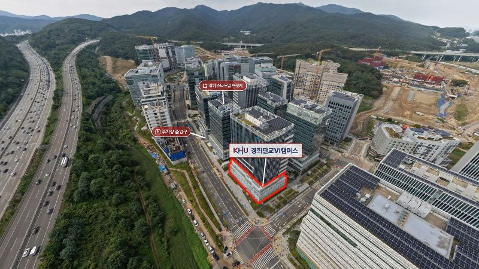

<div class="links"><span class="lbl">직접 확인</span>
<a class="lnk" href="https://kabkee-main.tailfe017f.ts.net:8443/IND/issues/IND-8890" target="_blank">https://kabkee-main.tailfe017f.ts.net:8443/IND/issues/IND-8890</a></div>

---

## ↗️ 유입 버튼 시안 — 위치 안 A / B / C <span class="badge-date">Designer IND-8891</span>

360 뷰어는 재생·정지가 없어서 유튜브식 「정지하면 표시」를 그대로 쓸 수 없습니다. 그래서 「조작하지 않는 시간」을 기준으로 삼았습니다. Designer 추천은 **A 우상단**입니다.

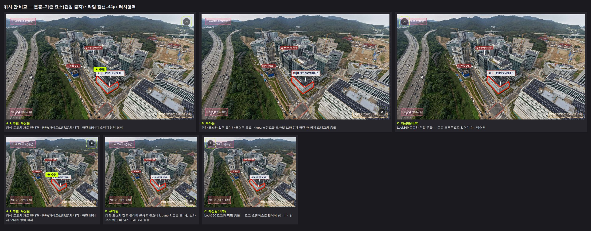

<div class="links"><span class="lbl">직접 확인</span>
<a class="lnk" href="https://kabkee-main.tailfe017f.ts.net:8443/IND/issues/IND-8891" target="_blank">https://kabkee-main.tailfe017f.ts.net:8443/IND/issues/IND-8891</a></div>

---

## ↗️ 유입 버튼 시안 — 크기 4종 × 상태 4종 <span class="badge-date">Designer IND-8891</span>

320×180(아주 작은 임베드) · 560×315(블로그 기본) · 800×450 · 모바일 세로를, 조작 중(숨김) · 손 뗀 뒤 나타남 · hover · 글자 포함 네 상태로 그렸습니다.

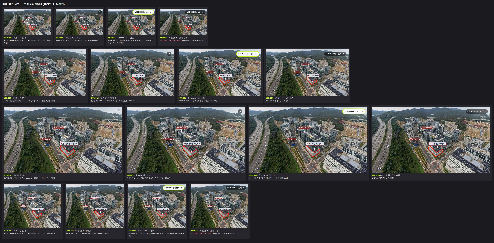

<div class="links"><span class="lbl">직접 확인</span>
<a class="lnk" href="https://kabkee-main.tailfe017f.ts.net:8443/IND/issues/IND-8890" target="_blank">https://kabkee-main.tailfe017f.ts.net:8443/IND/issues/IND-8890</a></div>

---

## ↗️ 유입 버튼 — 스플래시와의 연속성 · 시안 제안 <span class="badge-date">Designer spec.md</span>

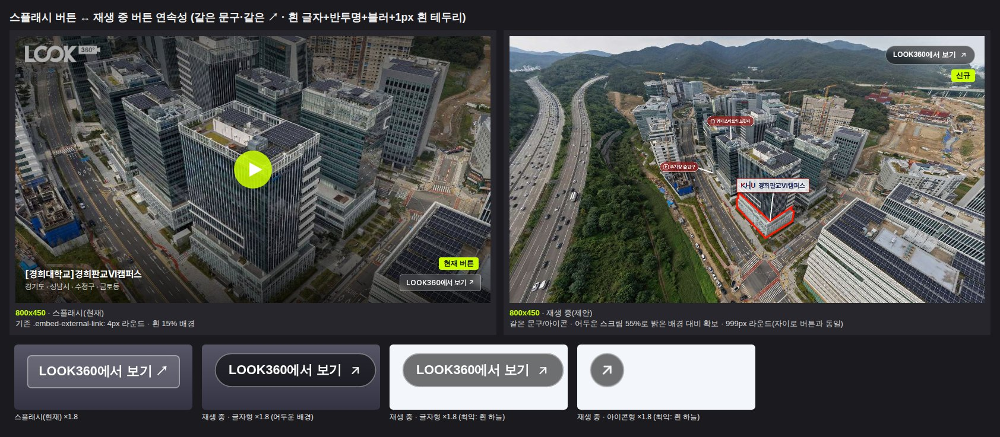

| 항목 | Designer 제안 |
|---|---|
| 타이밍 | 조작 시작 0.15초 만에 사라지고, 손을 뗀 뒤 2.5초 지나면 0.3초 페이드 인(미세한 흔들림은 조작으로 치지 않음) |
| 터치 | 아이콘은 탭 한 번에 이동. 숨어 있을 때 탭하면 3초 동안 보임 |
| 폭 경계 | 컨테이너 480px 미만은 아이콘만, 480px 이상은 글자까지 |
| `nocontrol=1` 슬라이드용 | 추천은 **「넣지 않는다」** · 반대 안은 「우상단 아이콘만 허용」 |

<div class="links"><span class="lbl">직접 확인</span>
<a class="lnk" href="https://kabkee-main.tailfe017f.ts.net:8443/IND/issues/IND-8891" target="_blank">https://kabkee-main.tailfe017f.ts.net:8443/IND/issues/IND-8891</a></div>

> ⚠️ 매트릭스의 560×315·800×450 「나타남」 칸은 아이콘만 그려져 있는데, 폭 경계 규칙상 480px 이상은 글자형이 기본입니다. 어느 쪽인지 함께 골라 주세요.

---

<!-- _class: sec -->

<span class="sec-num">Section 04</span>

## 레거시 — 장소 페이지 flat 파노라마

오너 제보로 시작해, 2021년부터 깨져 있던 flat 파노라마 표시를 전부 정상화했습니다.

---

## 🖼️ 발단과 원인 — 2021년부터 깨져 있던 분기 <span class="badge-date">10/27</span>

오너 제보: [look360.kr/place/azziyong_thematch](https://look360.kr/place/azziyong_thematch)(place 1722 · 「이시용 바둑 사진기자의 사진전 \<승부\>」)에서 파노라마 30개(sy01~sy29)의 썸네일이 빈 칸이었습니다. **DB·원본 손실이 아닙니다** — 목록 API 40건 정상 · S3 파일 전부 있음 · delete marker 없음.

flat 파노라마는 업로드 방식이 두 가지입니다(단일 이미지 `preview.jpg` / krpano 타일 + `pv.jpg`·`view_250.jpg`). 그런데 **2021-03-16 레거시 커밋 `a6374780f` 가 flat 이면 무조건 `preview.jpg` 를 쓰게 고정**했습니다. 최근 회귀가 아니라 원래부터 깨져 있던 것입니다([IND-6806](https://kabkee-main.tailfe017f.ts.net:8443/IND/issues/IND-6806) 은 flat 분기를 건드리지 않았습니다).

| 영향 범위 (flat 276건 전수 대조) | 건수 |
|---|---:|
| 썸네일 깨짐 — 장소 100 · 329 · 1475 · 1722 | <span class="hl-red">72건</span> |
| 정상 — `preview.jpg` 방식 (장소 1316 등) | 197건 |

<div class="links">
<span class="lbl">확인</span>
<a class="lnk" href="https://kabkee-main.tailfe017f.ts.net:8443/IND/issues/IND-8935" target="_blank">IND-8935 flat 썸네일 404</a>
<a class="lnk legacy" href="https://look360.kr/place/azziyong_thematch" target="_blank">https://look360.kr/place/azziyong_thematch</a>
</div>

---

## 🖼️ 무엇을 고쳤나 — flat 파노라마 표시 4건 <span class="badge-date">10/27~10/28 운영 반영</span>

| 항목 | 바뀐 것 |
|---|---|
| **썸네일** | 서버 `getPanoThumbUrl()` 후보를 `view_250 → preview.jpg → pv.jpg → default.png` 로 확장하고 `place.php` 의 flat 고정 분기를 제거. 장소 1316 등 기존 정상 장소는 그대로 `preview.jpg` |
| **촬영일** | `0000-00-00`·1971년 이전이면 날짜 배지를 숨김 (지금은 `0001-11` 로 깨져 보임 · 1722 30건 · 100 13건) |
| **라벨** | flat 썸네일·대표 영역에서 `360° VR` 라벨 제거 (대체 라벨 없음 · sphere 는 유지) |
| **대표 미리보기** | 1722 상단 큰 미리보기가 회색이던 것 → `imglink_view_900 → view_500 → pv → view_250 → preview` 순서로 있는 파일을 사용 |

> **제목 노출**: 1722 의 flat 30건은 제목이 `sy01`~`sy29` 같은 파일명 코드라 화면에 그대로 노출됩니다(DB 실측: flat 276건 중 제목 공란 0건 → 사용자에게는 「제목 없음」처럼 보입니다). **오너 결정(10/27): 제목은 현행 유지**하고 작품명 수집·데이터 수정은 하지 않습니다. W2 는 제목이 「완전히 빈」 경우에만 제목 칸을 숨기는 규칙을 넣었고, `sy01` 같은 코드 제목은 그대로 보입니다.

<div class="links">
<span class="lbl">확인</span>
<a class="lnk" href="https://kabkee-main.tailfe017f.ts.net:8443/IND/issues/IND-8936" target="_blank">IND-8936 W1 `a8ecb490`</a>
<a class="lnk" href="https://kabkee-main.tailfe017f.ts.net:8443/IND/issues/IND-8938" target="_blank">IND-8938 W2 `48606b230`</a>
</div>

---

## 🎞️ 후속 — 대표 미리보기 캐러셀이 flat 차례에 회색 <span class="badge-date">10/28 운영 반영</span>

큰 미리보기는 5초마다, 그리고 썸네일에 마우스를 올릴 때 다음 장면으로 넘어갑니다. 타일 방식 flat 장면 차례가 되면 회색이 됐습니다(1722 는 40장면 중 30장면).

원인은 캐러셀 JS 가 썸네일 경로의 `view_250` 을 `imglink_view_900` 으로 바꿔 큰 이미지 주소를 **「추측」**한 것입니다. 타일 방식 flat 폴더에는 그 파일이 없고 `pv.jpg`(정상 사진)만 있습니다. **실제로 있는 이미지를 두고 없는 경로를 부른 것**입니다. [IND-8938](https://kabkee-main.tailfe017f.ts.net:8443/IND/issues/IND-8938) 은 첫 화면만 고쳤고, QC 도 첫 화면만 재서 놓쳤습니다.

고친 방식: 서버가 장면마다 실제로 있는 대표 이미지 URL(`repUrl`)을 계산해 내려주고, 캐러셀은 그 값만 씁니다. sphere 는 큐브 띠 이미지(`pv.jpg` 256×1536)로 바뀌지 않게 후보에서 뺐습니다.

> 운영 실측(전 순번 · 회색 장면 수): azziyong_thematch **30 → 0** · indyspot 「Kay Park 작가 전시회」 32 → 0 · 「Flat 파노라마 테스트」 4 → 0 · yongsan_oldphoto 95 → 0(회귀 없음) · panoramakim 3 → 0. 전부 HTTP 200 · JS 오류 0건.

<div class="links">
<span class="lbl">확인</span>
<a class="lnk" href="https://kabkee-main.tailfe017f.ts.net:8443/IND/issues/IND-8998" target="_blank">IND-8998 캐러셀 회색 · 운영 `d0c87f8d2`</a>
<a class="lnk" href="https://kabkee-main.tailfe017f.ts.net:8443/IND/issues/IND-9000" target="_blank">IND-9000 QC</a>
</div>

---

## 📸 화면 — 같은 장면 「sy01」 수정 전 / 수정 후 <span class="badge-date">10/28</span>

<div class="cols">
<div class="col" style="flex:1">

**수정 전 — 회색**

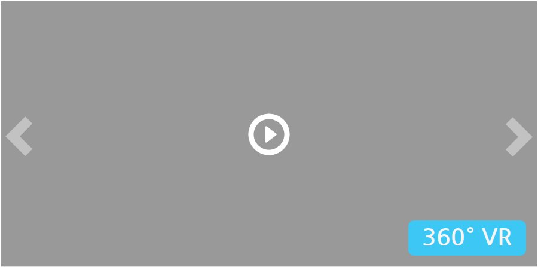

</div>
<div class="col" style="flex:1">

**수정 후 — 사진**


</div>
</div>

<div class="links"><span class="lbl">직접 확인</span>
<a class="lnk legacy" href="https://look360.kr/place/azziyong_thematch" target="_blank">https://look360.kr/place/azziyong_thematch</a>
<span class="lbl">11번째 썸네일 「sy01」에 마우스</span></div>

---

## 📸 화면 — 대조군 sphere 「전시장 건물 입구」 (회귀 없음) <span class="badge-date">10/28</span>

sphere 장면은 수정 전·후가 같습니다. `imglink_view_900.jpg`(900×600)가 실제로 있어서 원래부터 정상이었고, 이번 변경으로 회귀가 생기지 않은 것을 확인했습니다.

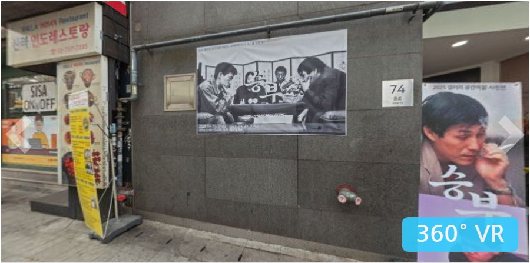

<div class="links"><span class="lbl">직접 확인</span>
<a class="lnk legacy" href="https://look360.kr/place/azziyong_thematch" target="_blank">https://look360.kr/place/azziyong_thematch</a>
<span class="lbl">1번째 썸네일</span></div>

---

## 🏷️ 후속 2 — 큰 미리보기의 `360° VR` 라벨이 고정돼 있던 문제 <span class="badge-date">10/28 운영 반영</span>

썸네일 라벨은 장면별로 맞게 나오는데, 큰 미리보기의 `360° VR` 라벨은 **첫 장면 종류로 고정**돼 있었습니다. 그래서 flat 장면(일반 사진)으로 넘어가도 `360° VR` 이 떠 있었습니다. 캐러셀이 장면을 바꿀 때마다 그 장면 썸네일에 라벨이 있는지 보고 큰 라벨도 똑같이 보이거나 숨기도록 고쳤습니다.

| 장소 · 투어 | 라벨 불일치 순번 (전 → 후) |
|---|---:|
| azziyong_thematch | <span class="hl-red">30</span> → <span class="hl-green">0</span> |
| indyspot 「Kay Park 작가 전시회」 | 27 → <span class="hl-green">0</span> |
| indyspot 「Flat 파노라마 테스트」 | 4 → <span class="hl-green">0</span> |
| yongsan_oldphoto | 86 → <span class="hl-green">0</span> |

<div class="links">
<span class="lbl">확인</span>
<a class="lnk" href="https://kabkee-main.tailfe017f.ts.net:8443/IND/issues/IND-9009" target="_blank">IND-9009 · 운영 커밋 `6cc9153b8`</a>
</div>

---

## 📸 화면 — 라벨 (완료 상태) <span class="badge-date">10/28</span>

<div class="cols">
<div class="col" style="flex:1">

**flat 「sy01」 — 사진만, 라벨 없음**

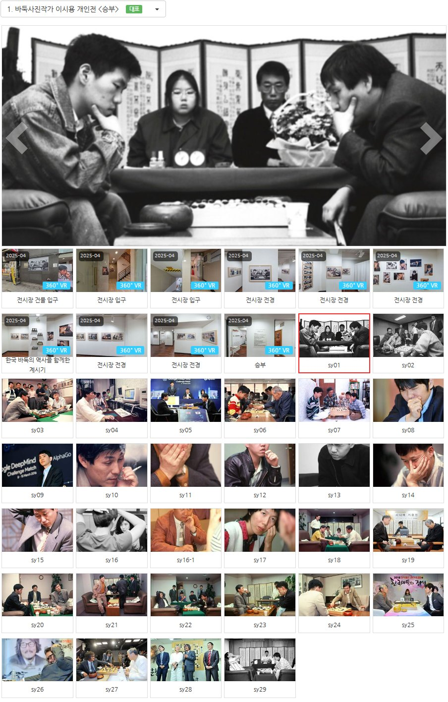

</div>
<div class="col" style="flex:1">

**sphere 「전시장 건물 입구」 — `360° VR` 라벨 있음**

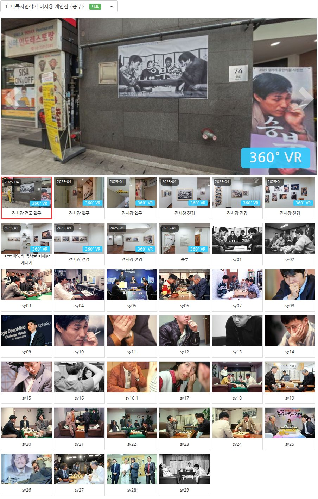

</div>
</div>

<div class="links"><span class="lbl">직접 확인</span>
<a class="lnk legacy" href="https://look360.kr/place/azziyong_thematch" target="_blank">https://look360.kr/place/azziyong_thematch</a></div>

---

## 🔎 확인 예제 — 회의 때 직접 열어볼 4가지 <span class="badge-date">운영 실측</span>

| 유형 | 페이지 · 고를 VR투어 | 확인할 장면 | 수정 전 | 수정 후 |
|---|---|---|---|---|
| 타일 방식 flat | azziyong_thematch · 기본(대표) | 11번째 「sy01」에 마우스 | 회색 (`…/1722/11/imglink_view_900.jpg` 404) | 사진 (`…/1722/11/pv.jpg` 938×660) |
| sphere (회색 → 이미지) | indyspot · 「Kay Park 작가 전시회」 | 22번째 (pano 205) | 회색 (`…/100/205/imglink_view_900.jpg` 404) | 사진 (`…/100/205/view_500.jpg`) |
| sphere (회귀 대조) | azziyong_thematch · 기본(대표) | 1번째 「전시장 건물 입구」 | 사진 | 같음 (`imglink_view_900.jpg` 900×600) |
| `preview.jpg` 방식 flat (회귀 대조) | yongsan_oldphoto · 기본(대표) | 1번째 「인사말(한글)」 | 사진 | 같음 (`preview.jpg` 1062×432) |

<div class="links">
<span class="lbl">직접 확인</span>
<a class="lnk legacy" href="https://look360.kr/place/azziyong_thematch" target="_blank">azziyong_thematch</a>
<a class="lnk legacy" href="https://look360.kr/place/indyspot" target="_blank">indyspot</a>
<a class="lnk legacy" href="https://look360.kr/place/yongsan_oldphoto" target="_blank">yongsan_oldphoto</a>
</div>

---

<!-- _class: sec -->

<span class="sec-num">Section 05</span>

## 레거시 — flat 파노라마 정식 지원 · 타일 레벨

작업자가 손으로 XML 을 복사해 넣던 flat 파노라마를, 개발자 손 없이 등록되게 만들었습니다.

---

## 📐 flat 파노라마 정식 지원 — 무엇이 문제였나 <span class="badge-date">10/31 운영 반영</span>

레거시(ksq1.2)는 flat 파노라마(2:1 이 아닌 평면 이미지)를 정식 흐름으로 등록하지 못했습니다. 지금까지는 krpanotools 가 자동 계산한 multires 레벨과 krpano 가 만든 `<image>` 코드를 **개발자가 투어 custom XML 에 손으로 복사**해 넣었습니다.

| 운영 DB 실측 (2026-10-24 · 조회 전용) | 값 |
|---|---|
| `look360_panorama` flat / sphere | flat **273건** / sphere 31,907건 |
| `panowidth`·`panoheight` 자료형 | **smallint** · `tile_info` 류 칼럼 없음 |
| 기존 flat 가로값 | 4000·3000 처럼 **1000 단위로 반올림**되어 있었음(세로는 실제값) — 예전 batch 생성기의 흔적 |
| 주의 | place 100 에 가로 28,665 flat 이 이미 있음 (smallint 상한 32,767 근접) |

- 이번 EPIC 범위: 레거시가 작업실의 batch XML 을 받아 저장하고, 투어 XML·관리자 화면이 flat 을 정식으로 그리게 하는 것입니다.
- 작업실(pano-stitcher) 쪽 flat 타일 생성·batch XML flat 출력·업로드 zip 은 오너 세션에서 직접 구현했습니다.

<div class="links"><span class="lbl">확인</span>
<a class="lnk" href="https://kabkee-main.tailfe017f.ts.net:8443/IND/issues/IND-8770" target="_blank">IND-8770 레거시 flat 정식 지원</a></div>

---

## 🔧 운영 반영 뒤 발견한 회귀 3건 — 당일 수정 <span class="badge-date">11/01</span>

[IND-8770](https://kabkee-main.tailfe017f.ts.net:8443/IND/issues/IND-8770) 을 운영에 반영한 뒤(11/01 00:2x KST) 오너가 운영 화면에서 회귀를 보고했습니다. Claude Code 가 직접 구현·운영 반영했고 **남은 작업은 없습니다.**

| 회귀 | 원인 | 수정 |
|---|---|---|
| flat 썸네일이 전부 `default.png` | 투어 생성기가 flat 장면에도 `view_250.jpg` 를 찾는데 flat 폴더에는 `preview.jpg`·`pv.jpg` 만 있음 | 후보 순서 확장 |
| **flat → sphere 로 돌아오면 fov 제한이 풀림** | custom.xml 6개에 남아 있던 옛 `flatpano_events`/`flatpano_startup`/`flatpano_imagefit` 정의가 생성기의 keep=true events 와 이름이 같아 병합됨 → 옛 `flatpano_startup` 이 sphere 장면에서도 실행 | 이름 충돌 해소. 운영 실측으로 sphere 인데 `fovmax 360 · fov 179`, 모바일 fovmin 3.9, 돌아가기 fov=50 무시가 나던 것을 바로잡음 |
| pano 23907 타일 404 | 폴더에 0패딩/비패딩 타일 세트가 두 벌 있는데 [IND-9038](https://kabkee-main.tailfe017f.ts.net:8443/IND/issues/IND-9038) multires override 가 다른 세트 기준으로 측정됨 | 측정 기준 교정 |

<div class="links"><span class="lbl">확인</span>
<a class="lnk" href="https://kabkee-main.tailfe017f.ts.net:8443/IND/issues/IND-9045" target="_blank">IND-9045 후속 기록 · 커밋 `673076aa1`</a></div>

---

## 🛠️ 유틸(look360_utils_v3)도 flat 지원 — 작업 현장 도구 <span class="badge-date">11/02</span>

[IND-8770](https://kabkee-main.tailfe017f.ts.net:8443/IND/issues/IND-8770) 은 입력 도구로 **작업실만** 전제했습니다. 그런데 작업 현장에서 쓰는 **유틸(Electron 앱)** 은 범위 밖이라, 유틸로 만든 flat 을 레거시에 올릴 수 없었습니다.

| 막혀 있던 지점 | 내용 |
|---|---|
| 가로 반올림 | batch XML 생성기가 flat 이어도 가로를 **1000 단위로 반올림** — 레거시 계약은 실제 픽셀값을 요구 |
| `tile_info` 미출력 | 레거시 파서는 [IND-8775](https://kabkee-main.tailfe017f.ts.net:8443/IND/issues/IND-8775) 이후 **tile_info 없는 flat 행을 거부**(코드 `-7`) ⇒ 유틸이 만든 flat XML 은 등록 단계에서 거부됨 |
| flat 타일 생성 분기 없음 | 레거시용 타일 생성 화면에 flat 분기가 아예 없고, krpano `xml=true` 로 multires 레벨을 받아오는 단계도 없음 |

<div class="links"><span class="lbl">확인</span>
<a class="lnk" href="https://kabkee-main.tailfe017f.ts.net:8443/IND/issues/IND-9056" target="_blank">IND-9056 유틸 flat 지원</a></div>

---

## 🧩 구형 sphere 타일 레벨 불일치 — 전수 검사 <span class="badge-date">10/30</span>

`vr/r781aofh?pano=6520`(pano 6520 「화장실」)이 뷰어에 표시되지 않았습니다. **원본 손실이 아니라 XML 의 타일 레벨 선언과 실제 타일 구조가 불일치**하는 문제였습니다.

| 대상 (`/files/pano/0/329/88/`) | 결과 |
|---|---|
| `mres_{f,b,l,r,u,d}/l1/` | 200 · 2×2 타일(512+444) → 면당 **956×956 단일 레벨** |
| `mres_*/l2/`, `mres_*/l3/` (6면 전부) | <span class="hl-red">404</span> |
| `512_f.jpg` · `1024_f.jpg` · `pv.jpg` · `imglink_sphere_900.jpg` | 200 |

반면 XML 은 `l1=3820 / l2=2048 / l3=1024` 의 **3레벨 multires** 를 선언합니다. 그래서 krpano 가 없는 l3·l2 타일을 요청하고, l1 도 8×8 격자를 기대해 실제 2×2 파일과 좌표가 맞지 않았습니다. 2006년 촬영분처럼 원본 해상도가 낮은 구형 sphere 는 단일 레벨로만 타일이 생성됐는데 XML 빌더가 그것을 모른 채 레벨을 선언한 것으로 추정합니다.

> ⚠️ 이 검사는 **Referer 헤더를 포함해** 요청해야 합니다. 없이 요청하면 핫링크 차단으로 전부 403 이 나와 「파일 없음」으로 오판합니다.

<div class="links"><span class="lbl">확인</span>
<a class="lnk" href="https://kabkee-main.tailfe017f.ts.net:8443/IND/issues/IND-8731" target="_blank">IND-8731 타일 레벨 전수검사</a></div>

---

## 🏠 홈 히어로 슬라이드 파노라마 404 <span class="badge-date">10/30</span>

CloudFront 자산 404 일일 리포트에 **홈 히어로 슬라이드발 404** 가 반복해서 잡혔습니다. 히어로는 5초 간격으로 투어 XML 을 차례로 요청하는데, 커스텀/타일 형식 투어는 지원하지 않아 큐브면 파일(`1024_*.jpg`)을 요청하다 404 가 납니다. 그 슬라이드 5초 동안 히어로가 빈 화면으로 보였을 것으로 추정합니다(화면 실측은 하지 않았습니다).

| 날짜 | 경로 | 폴더 실물 (백업 목록표 기준) |
|---|---|---|
| 10/21 | `pano/1/1722/31` | `l1~l4/` 타일 + `pv.jpg` 만 있음 · `1024_*.jpg` 없음 |
| 10/22 | `pano/1/1366/157` | 폴더 자체 없음 (DB 레코드만 남은 것으로 보임) |
| 10/29 | `pano/1/1317/31` | `l1~l4/` 타일 + `preview.jpg` 만 · `1024_*.jpg`·`pv.jpg` 없음 · 투어는 customxml 방식 |

- 처리: 후보군을 고를 때 **파일이 실제로 있는지 판정**하고, 관리자 화면에 그 상태를 표시하도록 바꿨습니다.

<div class="links"><span class="lbl">확인</span>
<a class="lnk" href="https://kabkee-main.tailfe017f.ts.net:8443/IND/issues/IND-9031" target="_blank">IND-9031 홈 히어로 슬라이드 404</a></div>

---

<!-- _class: sec -->

<span class="sec-num">Section 06</span>

## 360 작업실 — flat 장면 사용성

외부 공개 기간(11/05 19:40 종료 예정) 동안 직원이 실제로 쓰고 있어, 막히는 곳을 그 전에 열었습니다.

---

## 📷 작업실 flat — 결과를 눈으로 볼 수 없던 문제 <span class="badge-date">10/28</span>

오너가 외부 공개 주소로 작업실을 쓰다가 발견했습니다. **flat 파노라마는 작업 결과를 눈으로 확인할 방법이 없었습니다** — 올린 이미지를 크게 볼 곳이 없고, 타일을 만든 뒤에도 결과를 볼 수 없었습니다.

| 막힌 곳 | 원인 |
|---|---|
| 타일 생성 후 「뷰어에서 열어 보기」 → 이미지 깨짐 | 뷰어가 `pano/preview.jpg` 를 띄우는데, flat 타일 설정은 미리보기를 `pano/pv.jpg` 로 만듦 — 이름이 서로 다름 |
| 올린 원본을 크게 볼 화면 없음 | flat 장면은 `FLAT_SKIP` 으로 ①~⑥ 단계를 건너뛰어 ⑦ 타일로 바로 가는데, 그 경로에 원본 보기가 없었음 |

- 처리: 올린 원본 크게 보기와 타일 결과 뷰어를 넣고, 깨진 `preview.jpg` 참조를 실제 파일명으로 고쳤습니다.

<div class="links"><span class="lbl">확인</span>
<a class="lnk" href="https://kabkee-main.tailfe017f.ts.net:8443/IND/issues/IND-9001" target="_blank">IND-9001 flat 결과 미리보기</a>
<a class="lnk" href="https://studio.look360.kr" target="_blank">studio.look360.kr</a>
</div>

---

## 📷 작업실 flat — 타일 단계로 갈 방법이 없던 문제 <span class="badge-date">10/29</span>

오너가 flat 이미지를 ⑦ 타일 단계에서 보려고 했는데, ⑦ 화면이 「먼저 ⑤ 에서 보정본을 올리거나 「보정 없이 진행」을 눌러줘」라고 안내했습니다. ⑤ 로 올라가 「보정 없이 진행」을 누르자 아래 에러가 났습니다. **flat 장면은 타일 단계로 진행할 방법이 아예 없는 상태**였습니다.

```
File "mosaic/studio.py", line 2834, in _copy_tmp
  raise FileNotFoundError("최종 렌더(stitched.jpg)가 아직 없어")
```

결함이 두 개 겹쳐 있었습니다 — ① ⑦ 타일 입력 판정이 「폴더에 바로 둔 retouched.jpg」를 찾지 못해 ⑤ 로 되돌려 보냄 ② ⑤ 의 「보정 없이 진행」이 flat 에는 없는 `stitched.jpg` 를 복사하려 함.

이어서 **애초에 그 단계로 들어가지 않게** 했습니다. 장면 화면의 단계 메뉴가 `FLAT_SKIP` 을 전혀 보지 않아 flat 장면에서도 ①~⑥ 이 클릭됐고, 주소의 `step=` 으로 북마크·새로고침으로도 들어올 수 있었습니다. 프로젝트 홈에서는 「완료」로 보이는데 장면 안에서는 할 일처럼 보이는 불일치도 함께 없앴습니다.

<div class="links">
<span class="lbl">확인</span>
<a class="lnk" href="https://kabkee-main.tailfe017f.ts.net:8443/IND/issues/IND-9020" target="_blank">IND-9020 `fa57f0e`·`2fee917`</a>
<a class="lnk" href="https://kabkee-main.tailfe017f.ts.net:8443/IND/issues/IND-9029" target="_blank">IND-9029 단계 비활성화</a>
</div>

---

<!-- _class: sec -->

<span class="sec-num">Section 07</span>

## l3 플랫폼 화면 · 어드민

콘텐츠 상세·알림·어드민 11건을 현재 데이터 구조에 맞게 정합화했습니다.

---

## 🔗 vr-info 장소 정보에 장소 SNS 표시 <span class="badge-date">10/28</span>

오너 질문 「vr-info 장소 정보에 SNS가 실제로 표시되는가?」를 코드로 확인해 보니 **표시되지 않았습니다.**

| 구간 | 상태 |
|---|---|
| 어드민 입력 | ✅ 웹사이트와 그 밖의 SNS(youtube·instagram 등)를 따로 입력·저장 |
| API 응답 | ✅ `l3_place_sns` 를 platform 필터 없이 `place.sns[]` 로 내려줌 |
| 클라이언트 vr-info | <span class="hl-red">❌ `platform === 'website'` 가 아닌 항목을 모두 버림</span> |

즉 **DB → API 구간은 장소 SNS 를 전부 내려주는데 화면이 버리고 있었습니다.** 장소 홈페이지는 이미 여러 개 입력·표시가 가능합니다(어드민 「웹사이트 추가」 · [IND-6925](https://kabkee-main.tailfe017f.ts.net:8443/IND/issues/IND-6925)). 다만 dev DB 에서 website 가 2개 이상인 장소는 이번 시연 데이터 전까지 0곳이었습니다.

<div class="links"><span class="lbl">확인</span>
<a class="lnk" href="https://kabkee-main.tailfe017f.ts.net:8443/IND/issues/IND-8982" target="_blank">IND-8982 장소 SNS 표시</a></div>

---

## 📸 화면 — 장소 홈페이지 여러 개 + 장소 SNS (PC 1440) <span class="badge-date">11/02</span>

장소 1457 에 website 2개 + instagram + youtube 를 넣어 시연했습니다.

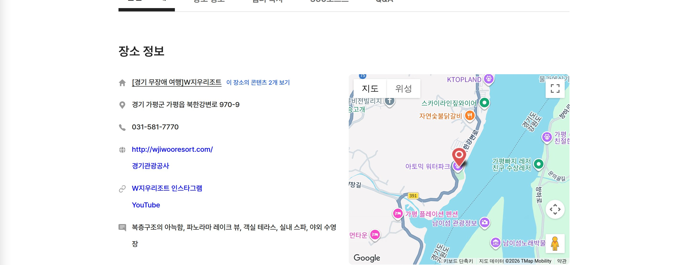

<div class="links"><span class="lbl">직접 확인</span>
<a class="lnk" href="http://100.64.25.50:5174/vr-info/ab28f18c" target="_blank">http://100.64.25.50:5174/vr-info/ab28f18c</a></div>

---

## 📸 화면 — 같은 화면 모바일 390 <span class="badge-date">11/02</span>

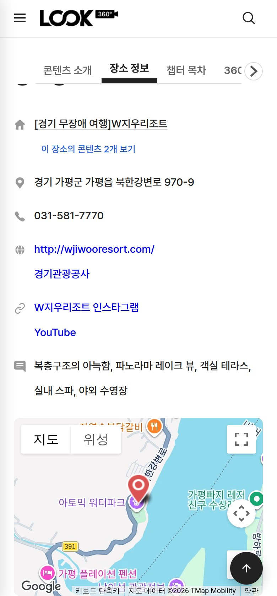

<div class="links"><span class="lbl">직접 확인</span>
<a class="lnk" href="http://100.64.25.50:5174/vr-info/ab28f18c" target="_blank">http://100.64.25.50:5174/vr-info/ab28f18c</a></div>

---

## 🧹 vr-info · 알림 드롭다운 정리 <span class="badge-date">10/28</span>

| EPIC | 무엇이 문제였나 | 바뀐 것 |
|---|---|---|
| [IND-8974](https://kabkee-main.tailfe017f.ts.net:8443/IND/issues/IND-8974) vr-info | 한줄 소개 「더보기」가 **글이 실제로 잘리는지 보지 않고** 늘 떴고(`scrollHeight 20 = clientHeight 20` 인데 「Show More ▼」), 바로 뒤 무료 배지와 같은 줄에 붙어 레이아웃이 깨졌음 | 실제로 잘릴 때만 토글 표시 · 배지 겹침 해소 · 「감상하기」 Ctrl/Shift 새 탭·새 창 지원 |
| [IND-8972](https://kabkee-main.tailfe017f.ts.net:8443/IND/issues/IND-8972) 알림 드롭다운 | 본문 폭이 **167px**(body 248px)까지 좁아져 알림 1건이 5줄로 접히며 높이 122px. 칩과 시간이 세로 가운데에 떠서 아바타와 줄이 맞지 않고, actor 가 있으면 타입 아이콘이 사라졌음 | 메타(카테고리·시간)/본문 2단으로 정형화 — IND-1251 시안 구조 안에 현재 기능을 다시 담음 |

> 오너 판단으로 알림 드롭다운은 「정신없고, 정렬이 맞지 않고, 본문이 찌그러져 있다」는 상태였습니다. 1440 뷰포트에서 드롭다운(360px)을 열어 실측한 값입니다.

---

## 🗂️ 어드민 정합화 — 9건 묶음 <span class="badge-date">10/27</span>

9/27 이후 어드민 FE ↔ 클라이언트·API 변경분을 대조 점검해 찾은 묶음입니다.

| EPIC | 무엇이 문제였나 |
|---|---|
| [IND-8924](https://kabkee-main.tailfe017f.ts.net:8443/IND/issues/IND-8924) 테마 관리 | 화면이 읽는 필드 4개(`key`·`theme_depth`·`translations[].value`·`memo`)가 **전부 API 응답에 없음** → 키 컬럼 공란 · 분류 칩이 전부 「세부분류」 · 번역 칩에 값이 빈 칸. 비활성 테마 19건(63건 중)이 구분 없이 섞여 나옴 |
| [IND-8923](https://kabkee-main.tailfe017f.ts.net:8443/IND/issues/IND-8923) 장소 관리 | 장소 유형/테마 2축 필터·유형 컬럼·지역 검색을 현재 분류 구조에 맞게 수정 |
| [IND-8933](https://kabkee-main.tailfe017f.ts.net:8443/IND/issues/IND-8933) 주소 검색 팝업 | 옛 지역 규칙으로 파싱해 **서울·부산 같은 특별시·광역시를 `area2` 에 넣고 `area1` 은 null** 로 둠. dev 실측은 서울 `area1` 363건 / `area2` 0건 ⇒ area1 이 현행 규칙 |
| [IND-8941](https://kabkee-main.tailfe017f.ts.net:8443/IND/issues/IND-8941) 콘텐츠 언어 8종 | DTO 가 `@IsIn(['kr','us','cn'])` 3종에 묶여 **jp/ru/tr/de/es 콘텐츠 17건은 어떤 필드를 고쳐도 저장 400**. 언어 목록의 출처를 하나로 모음 |
| [IND-8942](https://kabkee-main.tailfe017f.ts.net:8443/IND/issues/IND-8942) 핫스팟 편집 | 레거시 `legacy_attrs` 우선 규칙 반영 + 클라 `common_style.xml` 단일화 |

---

## 🗂️ 어드민 정합화 — 9건 묶음 (2) <span class="badge-date">10/27</span>

| EPIC | 무엇이 문제였나 |
|---|---|
| [IND-8943](https://kabkee-main.tailfe017f.ts.net:8443/IND/issues/IND-8943) VR스토리 뷰어 | 7/02 제거된 embed 경로를 쓰고 있었고 주소도 **죽은 IP `100.120.25.127` 로 하드코딩** → 목록의 「뷰어」 버튼이 항상 실패. runtime 도 uid 로 호출해 404 |
| [IND-8944](https://kabkee-main.tailfe017f.ts.net:8443/IND/issues/IND-8944) 장소 domain | 어드민에서 만든 장소의 domain 이 NULL 이라 `/places/public/:domain` 으로 접근 불가. 신청 승인 시 자유 입력 domain 이 형식 검사 없이 들어감(신청 36건 중 25건이 domain 보유) |
| [IND-8931](https://kabkee-main.tailfe017f.ts.net:8443/IND/issues/IND-8931) 라우트 정리 | 어디서도 import 되지 않는 죽은 라우트 파일 제거 + 지역 미연결/별칭 메뉴를 「지역 매칭」 단일 페이지로 통합 |
| [IND-8945](https://kabkee-main.tailfe017f.ts.net:8443/IND/issues/IND-8945) 표시·필터 잔재 | 360포스트 조회수가 항상 0(필드가 3월에 `view_count` 로 바뀜) · 판매 거부 사유 미표시 · 신고 유형 3종 누락(해당 신고 26건) · 알림 유형 누락(`sales_preview_violation` 98건) 등 |

---

## 🗂️ 어드민 — 오너가 QC 중 발견한 2건 <span class="badge-date">11/02</span>

| EPIC | 내용 |
|---|---|
| [IND-9065](https://kabkee-main.tailfe017f.ts.net:8443/IND/issues/IND-9065) 팝업 버튼 고정 | 장소 추가/수정 팝업이 세로로 길어, 취소·저장을 누르려면 매번 맨 아래까지 스크롤해야 했습니다. 버튼을 팝업 하단에 고정하고 본문만 스크롤되게 했습니다 |
| [IND-9066](https://kabkee-main.tailfe017f.ts.net:8443/IND/issues/IND-9066) 주소 검색 멈춤 | 주소 검색 팝업에서 결과를 클릭하면 **빈 화면에 멈추고** 주소가 폼에 들어가지 않으며 다이얼로그도 닫히지 않았습니다. 좌표 조회가 실패하면 `catch` 가 콘솔 로그만 남기고 끝나는데, Daum 팝업은 결과 클릭 시 자기 화면을 비우기 때문입니다 — IND-8933 회귀가 아니라 **기존 결함**입니다 |

> ⚠️ 트리거가 된 환경 요인(이 이슈 범위 밖): 카카오 앱의 Web 사이트 도메인에 배포 어드민 origin 과 dev IP 가 등록돼 있지 않습니다(허용은 `localhost:5277`·`:5173` 만). 등록은 **오너 계정 작업**이라 에이전트가 처리하지 않습니다.

---

<!-- _class: sec -->

<span class="sec-num">Section 08</span>

## client 확인 팝업 디자인

브라우저 기본 `confirm()` 을 커스텀 팝업으로 바꾸고, 위험한 동작에는 버튼에 동작 이름을 넣었습니다.

---

## 💬 무엇이 바뀌었나 <span class="badge-date">10/27~10/28</span>

| 바뀐 것 | 내용 |
|---|---|
| **위험 확인 버튼 10곳** | 「확인」 대신 **동작 이름**으로 표시 — 삭제 · 해제 · 철회 · 구매 취소 (en: Delete · Disconnect · Withdraw · Cancel purchase · 새 키 `mypage.purchases.cancelPurchaseBtn` 7개 로케일). 일반 확인(LOOK360 메인 이동 · 로그아웃)은 「확인」 그대로 |
| **2단계 삭제 400ms 잠김** | 공지·FAQ·고객센터·게시판 댓글 4곳 공용 `ConfirmDeleteModal` 에서 2단계로 넘어간 뒤 400ms 동안 「영구 삭제」가 흐리게 잠깁니다 → **1단계 「삭제」 더블클릭으로 두 단계를 통과하던 구멍**을 막았습니다. 2단계 디자인·문구는 그대로(오너 결정) |

> ⚠️ 측정 한계: QC 의 라벨 스크린샷 14장은 화면 클릭이 아니라 호출부와 같은 인자로 팝업을 직접 띄워 찍은 것입니다. 클릭 경로는 [IND-8915](https://kabkee-main.tailfe017f.ts.net:8443/IND/issues/IND-8915) 실클릭에서 따로 확인됐습니다.

<div class="links">
<span class="lbl">확인</span>
<a class="lnk" href="https://kabkee-main.tailfe017f.ts.net:8443/IND/issues/IND-8916" target="_blank">IND-8916 · W1 `248bd361`</a>
<a class="lnk" href="https://kabkee-main.tailfe017f.ts.net:8443/IND/issues/IND-8919" target="_blank">IND-8919 QC 29축 PASS</a>
<a class="lnk" href="https://kabkee-main.tailfe017f.ts.net:8443/IND/issues/IND-8897" target="_blank">IND-8897 선행 EPIC</a>
</div>

---

## 📸 팝업 디자인 (1) — 공통 확인 · danger <span class="badge-date">10/27 v2</span>

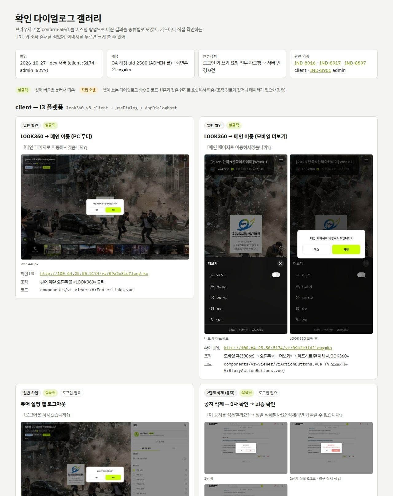

<div class="links"><span class="lbl">직접 확인</span>
<a class="lnk" href="https://kabkee-main.tailfe017f.ts.net:8443/api/attachments/9dddef21-2fcf-4b40-8b68-f8a3e57435b4/content" target="_blank">갤러리 원본 (1280×4845)</a></div>

---

## 📸 팝업 디자인 (2) — 2단계 삭제 · alert <span class="badge-date">10/27 v2</span>

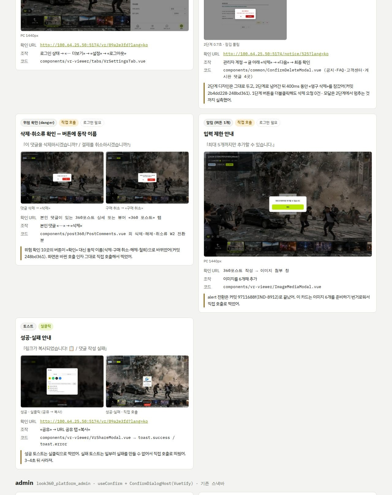

<div class="links"><span class="lbl">직접 확인</span>
<a class="lnk" href="http://100.64.25.50:5174/notice/525?lang=ko" target="_blank">http://100.64.25.50:5174/notice/525?lang=ko</a>
<span class="lbl">🚫 「영구 삭제」는 누르지 말고 「취소」로 닫기</span></div>

---

## 📸 팝업 디자인 (3) — 토스트 · admin 비교 카드 <span class="badge-date">10/27 v2</span>

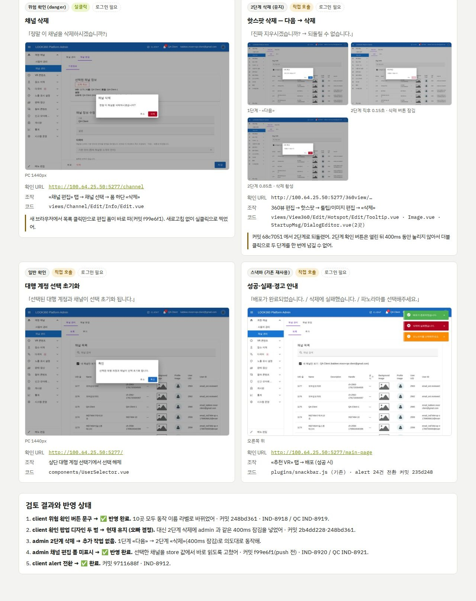

<div class="links"><span class="lbl">직접 확인</span>
<a class="lnk" href="https://kabkee-main.tailfe017f.ts.net:8443/api/attachments/9dddef21-2fcf-4b40-8b68-f8a3e57435b4/content" target="_blank">갤러리 원본 (1280×4845)</a></div>

---

## 🔴 팝업 — 운영 미반영 상태 <span class="badge-date">10/28 실측</span>

운영 번들(`look360-v3-client.netlify.app`)에는 [IND-8897](https://kabkee-main.tailfe017f.ts.net:8443/IND/issues/IND-8897) 의 커스텀 팝업조차 없고 **브라우저 기본 `confirm()` 이 그대로**입니다(`cancelPurchaseBtn` 0건 · `ConfirmDeleteModal` 에 잠김 없음). 커밋은 client `paperclip` 브랜치(origin/paperclip)에만 있고 `main` 에 없습니다.

| 확인 경로 (개발 서버 `:5174`) | 무엇을 보나 |
|---|---|
| `/notice/525?lang=ko` · `/faq/363?lang=ko` | 관리자(ADMIN) 로그인 → 「삭제」 → 「다음」 → 「영구 삭제」가 잠깐 흐렸다가 진해지는지. 🚫 **누르지 말고 「취소」로 닫기**(개발 DB 실데이터가 지워집니다) |
| `/my/purchases` · `/my/external-vr` · `/my/channel-settings` · `/my/settings` · `/post360` | 위험 확인 버튼 이름(구매 취소 · 신청 철회 · 채널 번역 삭제 · 소셜 연결 해제 · 삭제). 해당 데이터가 있는 계정으로 로그인해야 버튼이 보입니다 |
| `/vr/09a2e3fd?lang=ko` 하단 「LOOK360」 · 뷰어 설정 「로그아웃」 | 비교용 — 「확인」이 그대로 유지되는 경우 |

> 🎯 회의에서 정할 것: ① 팝업 디자인 확정 여부 ② client 운영 배포 시점([IND-8897](https://kabkee-main.tailfe017f.ts.net:8443/IND/issues/IND-8897)·[IND-8916](https://kabkee-main.tailfe017f.ts.net:8443/IND/issues/IND-8916) 묶어서)

---

<!-- _class: sec -->

<span class="sec-num">Section 09</span>

## 보안

SNS 로그인의 임의 계정 로그인 통로를 막고, 권한 누락이 다시 생기지 않게 회귀 테스트를 깔았습니다.

---

## 🔐 레거시 SNS 로그인 — 임의 계정 로그인 차단 <span class="badge-date">10/28</span>

[IND-6803](https://kabkee-main.tailfe017f.ts.net:8443/IND/issues/IND-6803)(플랫폼이 body 의 id 만으로 세션을 발급하던 결함)과 **같은 종류의 결함**이 레거시(look360.kr)에도 있었습니다. 10/26 플랫폼 SNS 검토 중 로컬 사본에서 발견했습니다. 레거시는 지금도 가입을 받고 있어(마지막 가입 2026-08-25) 운영에 노출 중일 가능성이 높았습니다.

| 결함 | 내용 |
|---|---|
| provider 토큰 미검증 | `a.snscall_direct_api.php` 가 클라이언트가 보낸 데이터를 그대로 믿어, **임의 계정으로 로그인**할 수 있었습니다 |
| SQL 문자열 결합 | 같은 파일에서 입력값을 이스케이프 없이 쿼리에 결합하고 있었습니다 |

> 🔴 오너 지시에 따라 보안 이슈는 우선순위 최고(critical)로 바로 처리했습니다. 회귀 확인 경로: look360.kr 로그인 → 카카오 / 네이버 실계정 로그인 → 메인 이동 + 로그인 상태면 정상(운영 HEAD `2fd48a9cd`).

<div class="links">
<span class="lbl">확인</span>
<a class="lnk" href="https://kabkee-main.tailfe017f.ts.net:8443/IND/issues/IND-8849" target="_blank">IND-8849 레거시 SNS 로그인</a>
<a class="lnk legacy" href="https://look360.kr/" target="_blank">https://look360.kr/</a>
</div>

---

## 🔐 전역 라우트 가드 회귀 spec · l3 SNS 로그인 신설 <span class="badge-date">10/28~10/29</span>

| EPIC | 내용 |
|---|---|
| [IND-8985](https://kabkee-main.tailfe017f.ts.net:8443/IND/issues/IND-8985) 라우트 가드 회귀 spec | `:param` 이 들어가는 라우트에 `AdminGuard`·요청자 전달을 **강제하는 테스트**를 깔았습니다. [IND-7159](https://kabkee-main.tailfe017f.ts.net:8443/IND/issues/IND-7159)(임의 로그인 유저가 타인의 시작 메시지를 삭제할 수 있던 IDOR)의 재발을 막기 위한 것입니다 |
| [IND-8850](https://kabkee-main.tailfe017f.ts.net:8443/IND/issues/IND-8850) l3 SNS 로그인 | 현재 구조는 `l3_user.id = "{provider}_{providerId}"` 하나로 회원을 찾아 **회원 1명 = 로그인 수단 1개**였습니다. 이메일 비교가 없어 이메일 회원이 SNS 로 들어오면 별도 계정이 생겼습니다. weekly 방식(연결 테이블 · 이메일 중복 안내 · 계정 연결/옮기기)을 이식하고 Netlify 테스트 환경을 만들었습니다 |

> [IND-8850](https://kabkee-main.tailfe017f.ts.net:8443/IND/issues/IND-8850) 은 **오너 작업이 남아 있습니다** — provider 콘솔(카카오·네이버 등)에 테스트 사이트 주소를 등록해야 합니다. 등록 뒤 테스트 사이트에서 소셜 로그인 버튼을 눌러 **provider 동의 화면까지 뜨면 정상**이고, `redirect_uri mismatch`·`KOE006`·`URL 차단됨` 이 나오면 등록값이 다르다는 뜻입니다.

<div class="links">
<span class="lbl">확인</span>
<a class="lnk" href="https://look360-v3-client.netlify.app" target="_blank">테스트 사이트</a>
<a class="lnk" href="https://kabkee-main.tailfe017f.ts.net:8443/IND/issues/IND-8853" target="_blank">IND-8853 등록 요청서 전문</a>
</div>

---

<!-- _class: sec -->

<span class="sec-num">Section 10</span>

## weeklykpop · weeklypop

유튜브 영상 교체 체계를 세우고, 조용히 빠지던 데이터를 찾아 메우고, 운영 자동화를 정리했습니다.

---

## 📺 엑박 과소 보고 — API 키에서 서버 주소가 빠져 있었다 <span class="badge-date">10/24~10/27</span>

매일 오는 「유튜브 엑박 점검」 메일은 엑박을 kpop 3곡 · pop 5곡으로 보고했지만, 실제로는 **kpop 283곡 · pop 246곡이 재생 불가**였습니다.

| 무엇이 문제였나 | 내용 |
|---|---|
| 원인 | YouTube API 키의 IP 제한에 Lightsail 서버 주소(43.202.102.159 · IPv6 `2406:da12:240:6900::/64`)가 빠져 있었습니다 |
| 그래서 생긴 일 | 점검이 10/24부터 조용히 썸네일 확인으로 대체돼 **「삭제」만 잡았습니다** — 비공개·퍼가기 금지·한국 지역 차단은 검출하지 못했습니다 |
| 자동 교체도 멈춤 | 직전 재검증이 403 으로 막혀 **4일간 0곡** |
| 해소 | 10/27 오너가 키의 IP 제한에 서버 주소를 추가 |

> 🔑 함정: 「점검이 돌고 있고 메일도 온다」는 것이 「제대로 재고 있다」는 뜻은 아닙니다. 판정 수단이 조용히 바뀌어도(API → 썸네일) 리포트 형식은 그대로였습니다.

---

## 📺 10/27 처리 결과와 바뀐 규칙 <span class="badge-date">10/27 · 그 시점 스냅샷</span>

| 사이트 | 교체 적용 | 내역 |
|---|---:|---|
| kpop | **140곡** | 오너 직접 13 · 90점 단독 후보 일괄 57 · 공식 영상 자동 70 |
| pop | **216곡** | 일괄 71 · 공식 영상 145 |

적용 후 재검사에서 전부 정상이었습니다. 남은 승인 대기는 kpop 148곡 · pop 29곡으로, 대부분 90점 미만이라 사람이 골라야 하는 곡입니다.

| 바뀐 규칙 | 내용 |
|---|---|
| 0순위 자동 교체 | 공식 뮤비 > 공식 오디오 > 공식 채널 영상은 점수와 무관하게 자동 교체 — 단 **제목이 곡명과 완전 일치 + 80점 이상**(다른 곡의 공식 영상 방지) |
| 단독 후보만 자동 | 공식 영상이 없으면 90점 이상 후보가 **하나뿐인** 곡만 자동. 여럿이면 사람이 선택 |
| 적용 전 재확인 | 사람이 승인할 때도 적용 **직전** API 로 재생 가능 여부를 확인 |
| 실패를 드러냄 | API 가 막히면 메일 제목에 **「⚠ API 판정 실패」** 경고 |
| 메일·화면 정리 | 명칭 정리(유튜브 영상 교체 리포트 · 재생 불가 · 교체 승인 대기 · 직접 찾기 · 자동 교체) + 승인 화면에 「직접 찾기」(후보 없는 곡) 목록 추가 |

<div class="links">
<span class="lbl">확인</span>
<a class="lnk" href="https://kabkee-main.tailfe017f.ts.net:8443/IND/issues/IND-8122" target="_blank">IND-8122 상위 에픽</a>
<a class="lnk" href="https://kabkee-main.tailfe017f.ts.net:8443/IND/issues/IND-8496" target="_blank">IND-8496</a>
</div>

---

## 👥 검토자 역할 신설 — 관리자 계정 없이 승인 처리 <span class="badge-date">10/27~10/28</span>

관리자 계정 없이 승인 대기열을 처리할 수 있는 **「검토자」** 역할을 만들었습니다. 검토자는 일반 회원이라 사이트 관리자 권한이 없고, 승인·일괄 승인·전체 거절·건너뛰기·직접 찾기 적용을 할 수 있습니다. 처리 이력에 `reviewer:<아이디>` 로 남습니다.

> 🔴 **결정 변경(10/28)**: 10/27 에 「롤백·자동 승인 설정은 관리자만」으로 정했는데, **검토자도 롤백·교체를 할 수 있게** 바꿨습니다. 작업자가 자기 실수를 남(관리자)에게 부탁하지 않고 바로 되돌릴 수 있어야 하기 때문입니다. 이제 관리자 전용은 **「자동 승인 설정」 하나뿐**입니다.

| 항목 | 값 |
|---|---|
| 검토 페이지 | kpop [weeklykpop.com/?m=weeklychart&mode=yt_review](https://weeklykpop.com/?m=weeklychart&mode=yt_review) · pop [pop.weeklykpop.com/?m=weeklychart&mode=yt_review](https://pop.weeklykpop.com/?m=weeklychart&mode=yt_review) |
| 계정 | 사이트마다 `ytreviewer1` · `ytreviewer2` (총 4개). 비밀번호는 Bitwarden `[리뷰용] … 검토자 …` 항목 참조 |
| ⚠️ 주소 주의 | POP 사이트는 **`pop.weeklykpop.com`** 입니다(`weeklypop.com` 은 주차 페이지) |

> 🎯 회의에서 정할 것: ① 검토자 배정 — 누구에게 계정을 줄지(kpop·pop 각 2명) ② 남은 대기열 처리 기한과 분담 ③ 검토 기준 — 같은 곡의 다른 버전(라이브·리마스터·일본어판 등) 허용 여부

---

## 🔄 엑박 복구 화면 개편 — 탭 분리 · 직접 입력 되돌리기 <span class="badge-date">10/28</span>

발단: 검토자가 「직접 찾기」에서 kpop `[BMK]One Two Three Four (1234)` 에 영상을 잘못 넣었는데(운영 이력 #285) 되돌리는 UI 가 없어 보였습니다. 롤백 기능은 있었지만 ① 검토자 화면에서는 롤백 칸이 `—` 로만 보였고 ② 관리자 화면에서도 「적용 이력」 표에 모든 방식의 이력(kpop 289건)이 섞여 최근 50건만 보였습니다.

| 바뀐 것 | 내용 |
|---|---|
| 탭 분리 | 한 화면에 위아래로 늘어놓던 목록을 **승인 대기 \| 직접 찾기 \| 직접 입력 내역 \| 적용 이력** 으로 나눴습니다(탭마다 곡수·건수 표시) |
| 「직접 입력 내역」 탭 | 직접 입력한 곡만 모아 **되돌리기**(넣기 전 영상으로 · 곡은 다시 직접 찾기 목록으로)와 **교체**(맞는 주소를 넣으면 되돌린 뒤 바로 다시 적용) |
| 「적용 이력」 탭 | 최근 50건 고정 → 30건씩 페이지 + 방식 필터(자동 승인·일괄 승인·후보 승인·직접 입력) + 곡명 검색 |
| 안전 장치 | 되돌리기·교체는 곡의 **가장 최근** 적용에서만 가능(순서가 꼬이지 않게) · 「교체」는 새 영상의 재생 가능 여부를 **먼저** 확인하고 막힌 영상이면 아무것도 바꾸지 않습니다 |

> 검증: 로컬에서 교체·되돌리기·재시도 거부·필터·검색을 실제로 눌러 확인하고 DB 변화를 조회했습니다. 운영은 조회 함수로 kpop 289건·직접 입력 33건·pop 251건을 확인했습니다. **검토자 계정으로 운영 화면을 직접 눌러보는 확인은 하지 않았습니다.**

<div class="links"><span class="lbl">직접 확인</span>
<a class="lnk" href="https://weeklykpop.com/?m=weeklychart&mode=yt_review&tab=direct" target="_blank">kpop 직접 입력 내역 탭</a>
<a class="lnk" href="https://pop.weeklykpop.com/?m=weeklychart&mode=yt_review&tab=direct" target="_blank">pop 직접 입력 내역 탭</a></div>

---

## 🔍 통합검색 개편 — 옛 차트 곡이 「검색결과 없음」이던 문제 <span class="badge-date">10/28</span>

킴스큐 기본 검색은 게시글 **등록일 기준 최근 12개월**만 찾습니다. 그런데 곡 게시글의 등록일은 곡을 차트에 들여온 날이라서, 옛 차트 곡을 검색하면 「검색결과가 없습니다」가 나와 **사이트에 없는 곡처럼 보였습니다**(pop 은 곡 9,102건 중 **35건만** 검색 대상이었습니다).

| 바뀐 것 | 내용 |
|---|---|
| 기간 조건 제거 | 차트 게시판 곡은 기간 조건 없이 찾습니다(공지·자유 게시판은 기존 검색 그대로) |
| 곡 중심 결과 | 썸네일 · 최근 차트와 순위 · 최고 순위 · 차트에 오른 횟수 · 「▶ 듣기」(플레이어에서 그 곡부터) · 「차트에서 보기」 · 엑박 판정 곡은 「영상 준비 중」 |
| 여러 단어 | **모든 단어가 들어간 곡**만 찾습니다(기존은 하나만 걸려도 결과) |
| 띄어쓰기 무시 | 「아이유 좋은날」로 `[아이유]좋은 날` 이 찾아집니다 |
| 적용 범위 | PC·모바일, 통합 탭·게시판 탭 모두(kpop 은 영어 문구). 공통 로직 `modules/weeklychart/lib/search_songs.php`(두 사이트 동일 파일) |

> 같이 고친 기존 버그: **「게시판」 탭이 PHP 8.3 서버로 옮긴 10/23 이후 줄곧 치명적 오류로 깨져 있었습니다**(`echo $_BBS = getDbArray(...)` 한 줄 · 페이지가 드롭다운 중간에서 끊김 · 서버 오류 로그에도 기록).

---

## ⚡ 검색 속도 — 인덱스 한 개로 200배 <span class="badge-date">10/28 운영 DB 실측</span>

차트 테이블에 gid 인덱스가 없어 검색할 때마다 전체를 훑었습니다. 10/28 운영 두 DB 에 `KEY gid(gid)` 를 추가했습니다(`_setting/sql/20261028_chart_gid_index.sql`).

| 테이블 · 검색어 | 행 수 | 전 | 후 |
|---|---:|---:|---:|
| `rb_weeklychart_gayo` · 「BTS」 | 105,875행 | 481ms | <span class="hl-green">2.3ms</span> |
| `rb_weeklychart_pop` · 「Madonna」 | 93,499행 | 419ms | <span class="hl-green">0.8ms</span> |

같은 인덱스로 유튜브 엑박 복구 화면의 차트 위치 조회도 빨라졌습니다.

> ⚠️ 운영 DB 앱 계정(`kpop_app`·`pop_app`)에는 ALTER 권한이 없습니다(의도된 최소 권한). 스키마 변경은 서버 관리자 계정으로 실행했습니다.
> 검증: 운영 두 사이트에서 「BTS」·「아이유 좋은날」·「One Two Three Four」를 통합 탭·게시판 탭으로 검색 → 전부 200 · 곡 결과 표시 · PHP 오류 0건 · 배포 후 서버 오류 로그 신규 0줄.

---

## ✅ weekly 운영 정상화 — 10/29 하루 작업 <span class="badge-date">10/29</span>

1. **조용히 빠지던 데이터를 찾아서 메웠다** — 2주치 KPOP 차트(10/04·10/11), 가수 페이지(Lightsail 이전 뒤 전체 미표시), 새 곡 가사(10/07 이후 미처리), 신곡 유튜브(n8n 이 옛 DB 를 읽음)가 **「성공」으로 보이면서 비어 있었습니다.** 원인을 하나씩 확인해 모두 채우고 재발을 막았습니다.
2. **사람 손이 필요한 일을 줄였다** — 엉뚱한 유튜브 영상 289곡 중 159곡을 당일 교체(자동 149), 신곡 유튜브·차트 수집·가사 처리를 스크립트로 자동화, 가수 매칭 오류를 검수 화면에 「jev 의심」으로 모았습니다.
3. **운영 비용·관리 대상을 줄였다** — n8n(컨테이너·Caddy·Route53 2건·CloudFront 1건)을 내리고 하던 일 3가지를 스크립트로 옮겼습니다. 판정 AI 총비용은 약 **$0.56**.

> 커밋: weeklykpop 14건 · weeklypop 6건 · `weeklychart-chart` 5건 · `cron` `74cbf9d` · 운영 반영 완료 · paperclip 발주 없음(오너 세션 직접 구현).

---

## 📊 weekly 성과 지표 — 전 / 후 <span class="badge-date">운영 DB·로그 실측</span>

| 영역 | 전 | 후 |
|---|---|---|
| KPOP 주간 차트 | 10/04·10/11 <span class="hl-red">2주 누락(0곡)</span> | 2주 × 100곡 복구 · 운영 DB 대조 차이 0 |
| POP 주간 차트 | 8/23 99곡(6위 누락) | 100곡 |
| 공개 가수 페이지 | <span class="hl-red">모든 가수에서 「페이지 만들기」 화면으로 튕김</span> | KPOP·POP 정상 |
| 이름이 없어 카드가 빠지던 POP 가수 | 9명 | <span class="hl-green">0명</span> |
| 최근 4주 차트 가사 | KPOP 13곡·POP 2곡 「사람 입력 필요」(실제로는 미처리) | 각 4주 × 100곡 = <span class="hl-green">100% 완료</span> |
| 이번 주 신곡 유튜브 | KPOP 5곡 빈칸 | 5곡 자동 연결 |
| 엉뚱한 곡의 유튜브 영상 | <span class="hl-red">289곡</span>(전수 22,453곡 점검으로 발견) | 159곡 교체 |
| 유튜브 승인 대기(사람 확인 필요) | KPOP 97곡 · POP 77곡 | <span class="hl-green">KPOP 13곡 · POP 39곡</span> — 122곡을 「같은 곡」 기준으로 정리 |
| 유튜브 영상 교체 (10/29 하루) | — | <span class="hl-green">KPOP 142곡 · POP 166곡 = 308곡</span> |
| 가수 매칭 점검 | 점검 수단 없음 | 4,069건 전수 · 의심 25건 · 주의 61건 표시 |
| 위클리차트 관리자 메뉴 | 10개 | 6개 묶음 |
| n8n | 상시 운영(컨테이너·도메인 2개·CloudFront) | <span class="hl-green">운영 중단</span> · 백업만 보관 |

---

## 🔁 바뀐 운영 구조 — 무엇이 어디서 언제 도는가 <span class="badge-date">10/29</span>

| 일 | 전 | 후 |
|---|---|---|
| 주간 차트 수집 | n8n 월 16:00 | kabkee-main `chart_guard.py --primary` 월 16:05 + **매일 17:30 안전망**(빠지면 채우고 Slack) |
| 신곡 유튜브 | n8n(Gemini) — 옛 DB 를 읽어 10/26 신곡 누락 | 운영 서버 매일 09:00(판정 AI · 결과 메일) |
| 둘리뮤지엄 GA4 월별 리포트 | n8n 매월 1일 15:00 | kabkee-main 스크립트 매월 1일 15:00(SES · 수신자·서명은 비밀값 분리) |
| 새 곡 가사 | 10/07 이후 멈춤 | 매일 12:30 최근 4주 새 곡만(완료곡 재처리 없음 · 한도·실패 3곡이면 자동 정지) |
| 차트 등록 POST | SEO 301 에 걸려 본문 유실(10/05·10/12) | `.htaccess` 가 POST 는 옮기지 않음 |

> 새로 생긴 화면: **「가수 관리」**(KPOP·POP · 관리자 메뉴 「가수 관리」 / 검토자 `/?m=weeklychart&mode=artist_review`) — 매칭 검수(가수별 표기·곡 단위로 해제·다른 가수로 옮기기), 가수 목록(추가·이름 수정·합치기·삭제), 작업 내역(되돌리기). 「jev 의심」 필터로 잘못 붙은 가수만 모아 봅니다.

---

## 🕳️ 「조용한 실패」 5가지 사례 — 함정 지식 <span class="badge-date">10/29</span>

전부 **「성공」으로 기록되면서 실제로는 아무 일도 하지 않던** 경우입니다.

| 사례 | 무슨 일이 있었나 |
|---|---|
| ① SEO 301 리다이렉트 | 크롤러의 POST 가 GET 으로 바뀌어 **차트 데이터 본문이 유실**됐는데, n8n 은 「성공」으로 기록 |
| ② Lightsail 이전 | 페이지 등록 행이 빠져 **가수 페이지 전체가 미표시** |
| ③ n8n MySQL 접속 정보 | **옛 VM DB** 를 가리켜 신곡을 0곡으로 판정 |
| ④ 가사 작업 | 만료된 다른 키를 읽고 있었고, 모델 폐기가 그 키 오류를 가림 |
| ⑤ 서버 유튜브 AI 검증 | ④ 와 같은 폐기 모델을 쓰고 있었음 |

> 🔑 공통 교훈: **「돌고 있다」와 「제대로 재고 있다」는 다릅니다.** 성공/실패 플래그만 보지 말고 결과물의 건수를 함께 확인해야 합니다.
> 함께 정리한 운영 규칙: **상한은 「외부 호출 제한·서버 부하·크롤링 차단」이 이유일 때만 둡니다**(오너 결정). 멜론 요청 하루 300건 중 150건은 곡번호 확정용으로 예약했습니다(멜론 크롤링 제한이라 유지).

---

## 🤖 [정보 공유] 판정 AI 「jev」 도입 — 별도 덱 참조 <span class="badge-date">10/29</span>

| 성과 | 수치 |
|---|---|
| 유튜브 영상 선택 1위 일치 | <span class="hl-blue">52% → 77%</span> (AUC 0.734 → 0.833) |
| 전수 점검 규모 | 가수 매칭 4,069건 · 유튜브 22,453곡 · **이번 주 총비용 약 $0.56** |
| Bitwarden 181개 분류 비교 | jev **81.8% 일치 · 19초 · $0.008** / 로컬 jev-9b 64.6% → 「판정은 jev, 갈린 것만 사람이 검토」 권장 |

<div class="links">
<span class="lbl">별도 덱</span>
<a class="lnk" href="http://100.64.25.50:8088/reports/2026-10-29-jev-judge-model.html" target="_blank">판정 AI jev 도입·활용 (13장)</a>
</div>

---

## 📌 [결정 보고] 유튜브 자동 교체 하루 상한 해제 <span class="badge-date">10/29 오너 결정</span>

10/27 항목의 「회의에서 정할 것 ④」는 **회의 전에 결정됐습니다.** 하루 상한 20곡 → **1,000(설정 최댓값)**.

| 근거 | 내용 |
|---|---|
| 상한을 두는 이유 | 「외부 호출 제한·서버 부하·크롤링 차단」이 있을 때만 둡니다(오너 기준) |
| 해당 없음 확인 | 자동 반영 단계는 판정 AI 를 부르지 않고 YouTube 공식 API 를 **곡당 2유닛**만 씁니다(하루 1만 유닛 중 평소 약 470 사용) |
| 후보 탐색 상한도 해제 | 사이트당 하루 50곡 → 1,000. 처음 이유는 검색 API 할당량(검색 1회 100유닛 · 50곡×2회 = 하루치 전부)이었는데, 지금은 yt-dlp 로 검색해 할당량을 쓰지 않습니다 |
| 남은 위험 | 유튜브 봇 확인 차단 — 10/29 실측 **642회 검색 · 실패 0** 으로 나타나지 않았고, 막혀도 1시간 뒤 재시도(최대 3회)와 API 예비 검색으로 처리됩니다 |

---

## 🔎 「직접 찾기」 곡 1건 조사 — 오식별 반증 사례 <span class="badge-date">10/28</span>

pop 엑박 화면의 「직접 찾기」에 `[Chevt Man]Pussy 2006 · WFf-LEPsung` 이 남아 있었습니다. 처음엔 크롤링 중 제목이 깨진 것으로 보고 곡을 추정했습니다.

| 단계 | 내용 |
|---|---|
| ❌ 처음 판단 | `LEP` 를 Lee Perry 로 읽어 Lee "Scratch" Perry 「Pussy Man」으로 식별하고 유튜브 영상을 연결하려 했습니다 |
| 🔴 반증 | 운영 DB 를 직접 조회해 보니 화면 문자열은 **「제목 `[Chevt Man]Pussy` + 연도 `2006` + 옛 videoId `WFf-LEPsung`」을 이어 붙인 표시**였습니다. `LEP` 는 videoId 조각이었고, Lee Perry 식별과 그 영상은 **다른 곡**입니다(적용 전에 발견해 적용하지 않았습니다) |
| ✅ 실제 곡 | **Chevt Man — 「Pussy」**(앨범 「Pussy (Single)」 · 2006-02-16 · 랩/힙합) · 멜론 songId `1110411`. 운영 DB `rb_bbs_data` uid `4613` · `rb_weeklychart_pop` 2006년 3주차 98위 · song_uid 가 멜론과 정확히 일치 ⇒ **DB 수정 불필요** |
| 영상 | 원래 영상은 삭제됨(10/28 API 판정). 「Chevt Man」은 웹 검색에 아무것도 나오지 않아 대체 영상이 없을 가능성이 큽니다(추정). 없으면 「찾아봤는데 없음」으로 기록합니다 |

> 🔑 **교훈: 화면에 보이는 문자열을 「원본 데이터」로 믿기 전에 DB 원본 행부터 조회합니다.** 표시용으로 이어 붙인 값(연도·videoId)을 제목 일부로 오인하면 엉뚱한 곡을 「찾아냅니다」.
> 같이 바꾼 것: 직접 찾기 목록의 곡 링크가 **그 곡이 어느 차트에 있는지 알 수 없는 게시판 화면**으로 가던 것을, 그 곡이 오른 주간 차트 페이지로 이동하도록 고쳤습니다.

---

<!-- _class: sec -->

<span class="sec-num">Section 11</span>

## 수익 보고

고객사 콘텐츠 호스팅 1년 연장 계약과, 그 1년 동안의 실제 지출을 대조했습니다.

---

## 💰 호스팅 1년 연장 — 지출 대비 수익 <span class="badge-date">10/29 오너 결정</span>

대상은 Azure App Service `daejeon-nid-2023`(Node 24)이고, B1 Linux 플랜을 이 앱 하나만 쓰므로 **플랜 비용 전액이 이 고객사 몫**입니다.

**계약: 1년 연장 · 200만 원 · 부가세 별도 · 기간 2026-12-01 ~ 2027-11-30** (계약 진행 예정)

| 항목 | 금액 | 비고 |
|---|---:|---|
| 계약 수익 | 2,000,000 | 부가세 별도(청구 시 +200,000) |
| 예상 지출 | 약 245,600 | 월평균 20,468 × 12 |
| **예상 이익** | **약 1,754,400** | 이익률 약 <span class="hl-green">87.7%</span> |

> 각주: Azure 는 달러 요금이라 환율에 따라 플랜 비용이 월 17,000~20,600원 사이로 움직이고, 데이터 전송료는 방문자 수에 따라 월 0~2,500원입니다. 같은 날 옛 weekly 서버 VM(52.231.13.80)과 죽은 크롤러를 삭제해, **이 구독에서 돈이 나가는 App Service 는 이제 `daejeon-nid-2023` 하나뿐입니다.**

---

## 💰 호스팅 — 월별 실제 지출 <span class="badge-date">Azure 실측 · 부가세 제외 · 원</span>

<div class="cols">
<div class="col" style="flex:1">

| 월 | 플랜 | 전송 | 합계 |
|---|---:|---:|---:|
| 2025-11 | 18,554 | 2,437 | 20,991 |
| 2025-12 | 19,720 | 222 | 19,942 |
| 2026-01 | 19,151 | 52 | 19,203 |
| 2026-02 | 17,233 | 2 | 17,235 |
| 2026-03 | 19,143 | 1,642 | 20,785 |
| 2026-04 | 19,554 | 1,822 | 21,376 |

</div>
<div class="col" style="flex:1">

| 월 | 플랜 | 전송 | 합계 |
|---|---:|---:|---:|
| 2026-05 | 19,734 | 494 | 20,228 |
| 2026-06 | 19,452 | 2,532 | 21,984 |
| 2026-07 | 20,551 | 2,277 | 22,828 |
| 2026-08 | 19,383 | 2,548 | 21,931 |
| 2026-09 | 17,893 | 748 | 18,641 |
| **월평균** | 19,124 | 1,343 | **20,468** |

</div>
</div>

> 11개월 합계 **225,143원**(플랜 210,367 + 전송 14,777). 2026-10 은 월말 전이라 뺐습니다.

---

<!-- _class: sec -->

<span class="sec-num">Section 12</span>

## 🎯 이번 주 안건 — 오너 결정 대기

시안 확정과 기본값 결정이 중심입니다. 결정이 나오면 그 뒤에 발주합니다.

---

## 🎞️ 안건 1 · RAW 자동 현상 기본 프리셋 <span class="badge-date">회의 안건</span>

지금은 작업자가 Lightroom 에서 사진마다 노출·섀도·하이라이트를 손으로 맞춘 JPG 를 PTGui 에 넣습니다. 이를 **NAS 수신 즉시 NEF 를 자동 현상**하는 방식으로 바꾸려 합니다(Adobe 구독 불필요).

| 프리셋 | 평균 L 오차 (자동 − LR 수동 · 12장면) |
|---|---:|
| 지금 기본(HOUSE) | +6.07 |
| nas | +3.79 |
| nas2 | +3.90 |
| **auto2** | <span class="hl-blue">+2.94</span> (EM 제안 기준 ≤1.0 에는 미달) |

- QC [IND-8768](https://kabkee-main.tailfe017f.ts.net:8443/IND/issues/IND-8768) PASS. 오차의 주원인은 **장면별 노출을 고르는 규칙**입니다(장면마다 노출만 맞춰도 L 11.9 → 5.5).
- 오너 의견(10/25): 가장 가까운 건 「Lightroom 수동 JPG」 칸이지만, 그 칸은 예전 JPG 를 같은 정렬로 스티칭만 한 **기준선**이라 고를 수 있는 선택지가 아닙니다. **자동이 이 칸에 얼마나 가까워졌는지로 판단합니다.**
- 제안(미착수): 지금 학습은 **색 차이로만** 맞추고 NAS 의 Lightroom xmp 설정값은 한 번도 읽지 않았습니다. xmp 값을 직접 학습시키면 사람 판단에 더 가까워질 수 있습니다.

<div class="links"><span class="lbl">회의 때 열어서 볼 것</span>
<a class="lnk" href="https://kabkee-main.tailfe017f.ts.net:8446/output/IND-8767-compare/index.html" target="_blank">장면 13개 비교 페이지 (retouched · LR 수동 · 기본 · nas · nas2 · auto2)</a>
<a class="lnk" href="https://kabkee-main.tailfe017f.ts.net:8443/IND/issues/IND-8678" target="_blank">IND-8678</a></div>

---

## 🎞️ 안건 1 · 정할 것 <span class="badge-date">카드 2745d830</span>

| # | 정할 것 | 선택지 |
|---|---|---|
| ① | 기본 프리셋 | `auto2` 로 교체 / 지금 기본(HOUSE) 유지 / **둘 다 아직 안 됨** |
| ② | 눈으로 봐서 수용 가능한지 | EPIC 완료 기준을 여기서 정합니다 |
| ③ | xmp 설정값 학습 | 다음 단계로 진행 / 하지 않음 |
| ④ | 진행 방식 | 직접 구현 / paperclip 발주 |

> 회의 결과가 나오면 질문 카드 `2745d830` 에 답합니다. 기본값 교체 발주는 그 뒤에 EM 이 합니다.

---

## 🔤 안건 2 · 콘텐츠 언어 필터 + 검색결과 필터 통일 <span class="badge-date">회의 안건</span>

🔴 **구현은 주간회의 뒤에 시작합니다.** 지금은 W0 시안만 끝났고 구현 트랙(W1 BE → W2 vr-list → W3 검색결과 → 각 QC)은 **아직 하나도 발주하지 않았습니다.**

| # | 추천안 (카드를 「수락」하면 이대로 발주) |
|---|---|
| 1 | 선택 방식 — **복수 선택(체크)**. 같은 필터 안은 OR, 전부 해제 = 전체 |
| 2 | 언어 목록 — 데이터에 실제로 있는 **8종**(한국어·English·中文·日本語·Türkçe·Русский·Deutsch·Español), 표시는 카드 언어 칩과 같은 원어 표기 |
| 3 | 위치 — PC 는 「콘텐츠 형식」 뒤 · 「가격」 앞 / 모바일은 필터 아이콘 안 「콘텐츠 형식」 아래 섹션(노출 아이콘 3개 유지) |
| 4 | 검색결과 VR 탭 — vr-list 와 **같은 항목·컴포넌트·순서**. 다른 건 「필터바 검색어 칸 숨김」 1건뿐(상단 검색창과 중복). 전체·포스트·채널 탭엔 지금처럼 필터 없음 |
| 5 | 기본값 — **전체 언어**(아무것도 거르지 않음) |

> ⚠️ 수락하면 함께 확정되는 것: ① 08/21 결정([IND-6321](https://kabkee-main.tailfe017f.ts.net:8443/IND/issues/IND-6321) E5 「목록 언어 자동 필터 폐기」) 가드 교체 — 기본 노출은 전체 언어 유지, 사용자가 고르는 필터만 신설 ② **검색결과 정렬에서 「이름순(오름/내림)」이 사라집니다**(vr-list 의 최신·조회수·인기 버튼으로 통일).
> 전제: dev 가 아직 [IND-8264](https://kabkee-main.tailfe017f.ts.net:8443/IND/issues/IND-8264) 반영 전이라, 시안의 「after」는 [IND-8424](https://kabkee-main.tailfe017f.ts.net:8443/IND/issues/IND-8424) 수정본 A안(VR 종류 드롭다운 · 모바일 노출 아이콘 3개) 위에 언어 필터를 얹은 그림입니다. B안이 되면 VR 종류 부분만 칩으로 바뀝니다.

---

## 🔤 안건 2 · 시안 — vr-list PC (언어 필터 열림 + 2개 선택) <span class="badge-date">W0 IND-8600</span>

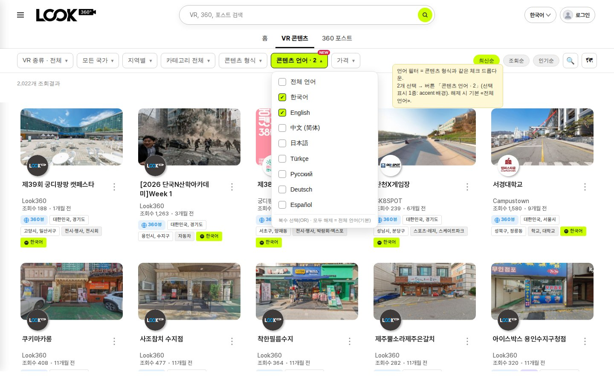

<div class="links"><span class="lbl">직접 확인</span>
<a class="lnk" href="https://kabkee-main.tailfe017f.ts.net:8443/IND/issues/IND-8592" target="_blank">https://kabkee-main.tailfe017f.ts.net:8443/IND/issues/IND-8592</a></div>

---

## 🔤 안건 2 · 시안 — 검색결과 PC (vr-list 와 같은 필터바) <span class="badge-date">W0 IND-8600</span>

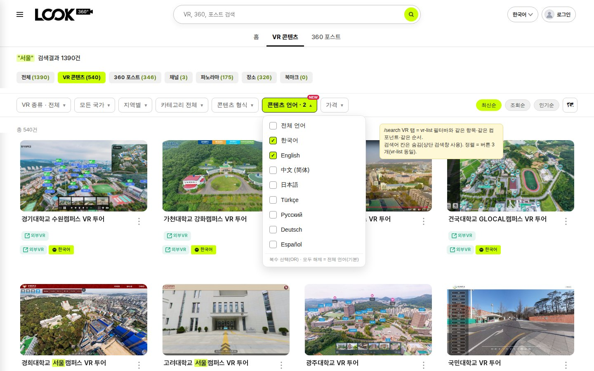

<div class="links"><span class="lbl">직접 확인</span>
<a class="lnk" href="https://kabkee-main.tailfe017f.ts.net:8443/IND/issues/IND-8600" target="_blank">https://kabkee-main.tailfe017f.ts.net:8443/IND/issues/IND-8600</a></div>

---

## 🔤 안건 2 · 시안 — 모바일 필터 오버레이 <span class="badge-date">W0 IND-8600</span>

<div class="cols">
<div class="col" style="flex:1">

**vr-list 모바일**

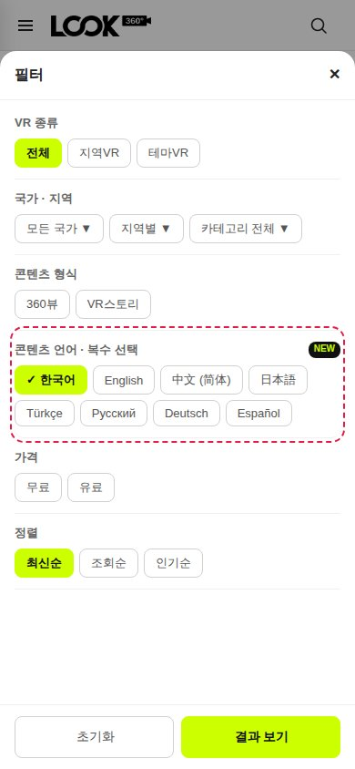

</div>
<div class="col" style="flex:1">

**검색결과 모바일**

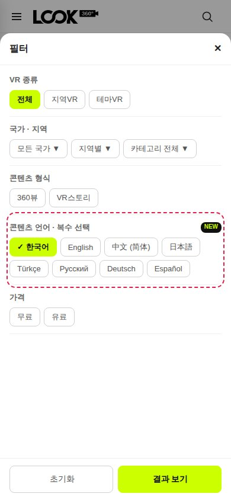

</div>
</div>

<div class="links"><span class="lbl">직접 확인</span>
<a class="lnk" href="https://kabkee-main.tailfe017f.ts.net:8443/IND/issues/IND-8592" target="_blank">https://kabkee-main.tailfe017f.ts.net:8443/IND/issues/IND-8592</a></div>

---

## 🔤 안건 2 · 정할 것 <span class="badge-date">카드 b739001a</span>

| # | 정할 것 |
|---|---|
| ① | 추천안 1~5 그대로 수락 / 바꿀 항목(번호 + 원하는 안) |
| ② | 검색 「이름순」 제거 수용 여부 |
| ③ | [IND-8264](https://kabkee-main.tailfe017f.ts.net:8443/IND/issues/IND-8264) A/B안과의 관계 |
| ④ | 진행 방식 — 직접 구현 / paperclip 발주 |

> 🚫 회의 전에 [IND-8592](https://kabkee-main.tailfe017f.ts.net:8443/IND/issues/IND-8592) 에 사람 명의 코멘트를 달면 안 됩니다 — 카드가 `supersedeOnUserComment:true` 라 **코멘트 하나로 카드가 무효**가 됩니다.

---

## 📐 안건 3 · vr-info 콘텐츠 정보 레이아웃 — 현행 <span class="badge-date">2차 시안</span>

1차 시안은 장소 정보 섹션이 빠져서 반려됐고, 2차는 장소 정보까지 한 장에 그렸습니다. 아래가 현행 화면입니다.

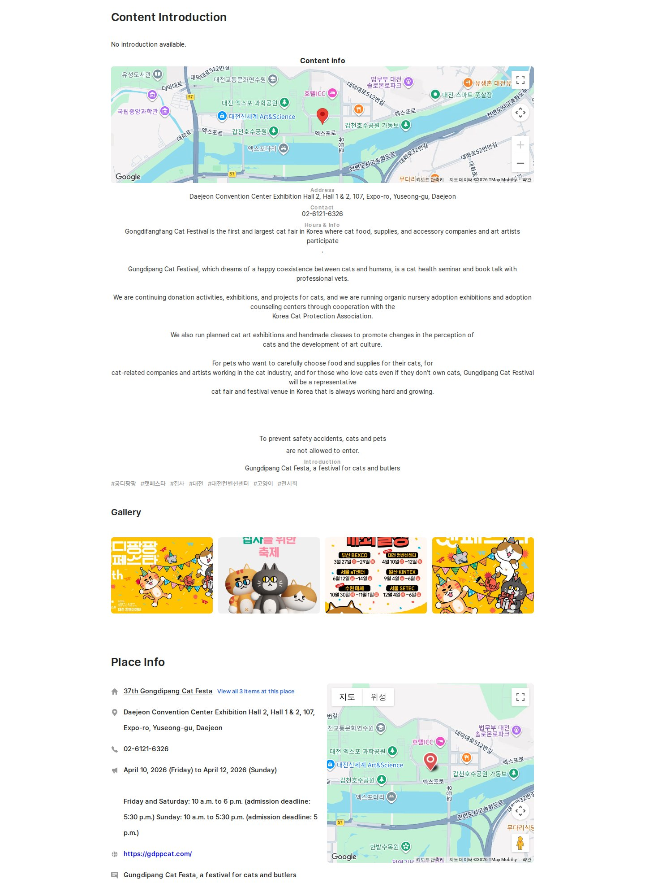

<div class="links"><span class="lbl">직접 확인</span>
<a class="lnk" href="http://100.64.25.50:5174/vr-info/9iw56uht" target="_blank">http://100.64.25.50:5174/vr-info/9iw56uht</a></div>

---

## 📐 안건 3 · A안 / B안(추천) — PC ≥1440 <span class="badge-date">2차 시안 IND-8981</span>

<div class="cols">
<div class="col" style="flex:1">

**A안** — 회색 카드 · 아이콘 없는 라벨로 구분 · 지도 2개 유지(콘텐츠 정보 쪽 축소)

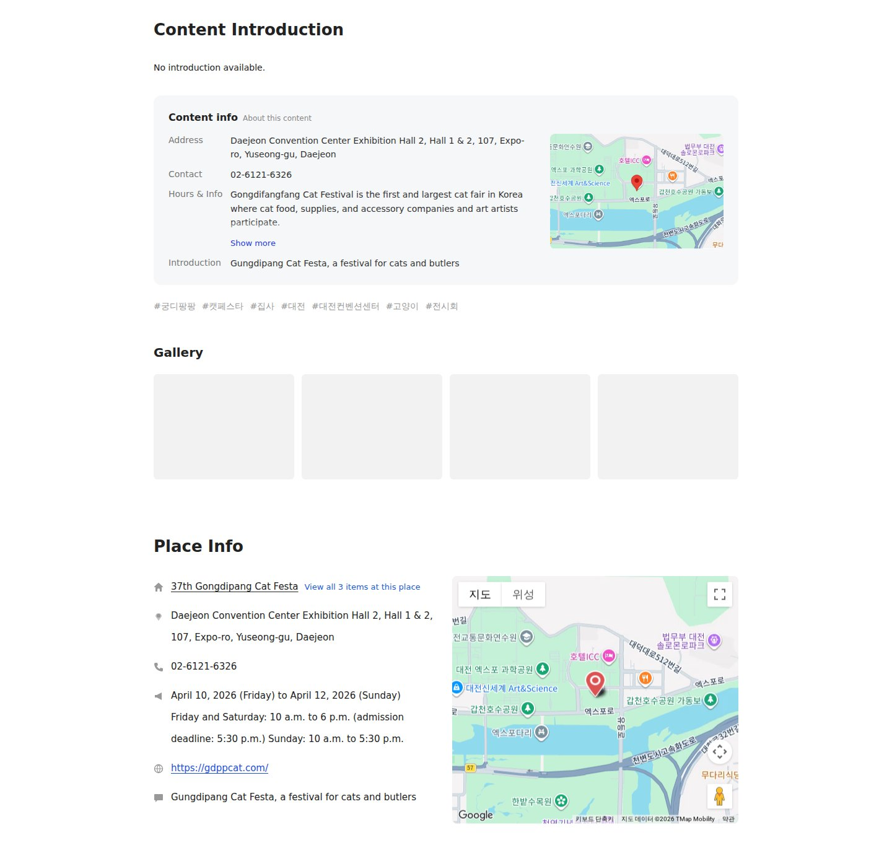

</div>
<div class="col" style="flex:1">

**B안(추천)** — 굵은 윗선 + 표 · 좌표가 ±50m 이내면 콘텐츠 정보 지도 생략 → 「아래 장소 정보와 같은 위치 ↓」

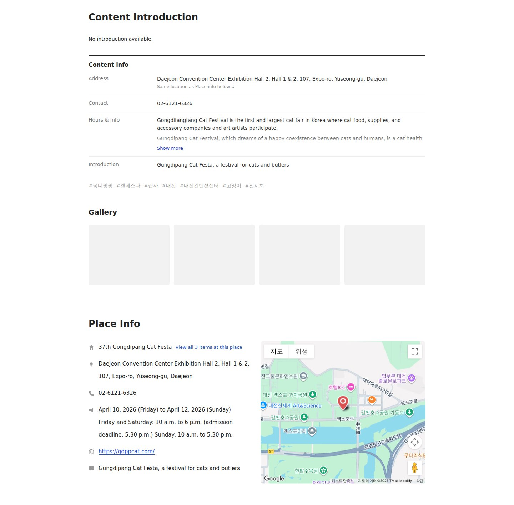

</div>
</div>

<div class="links"><span class="lbl">직접 확인</span>
<a class="lnk" href="https://kabkee-main.tailfe017f.ts.net:8443/IND/issues/IND-8840" target="_blank">https://kabkee-main.tailfe017f.ts.net:8443/IND/issues/IND-8840</a></div>

---

## 📐 안건 3 · A안 / B안 — 모바일 <768 <span class="badge-date">2차 시안 IND-8981</span>

<div class="cols">
<div class="col" style="flex:1">

**A안**

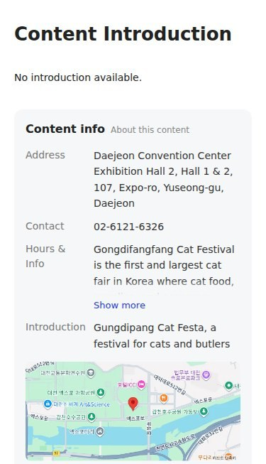

</div>
<div class="col" style="flex:1">

**B안(추천)**

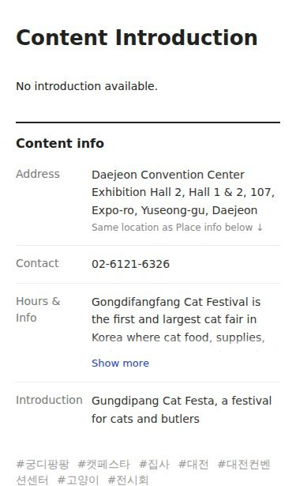

</div>
</div>

<div class="links"><span class="lbl">직접 확인</span>
<a class="lnk" href="https://kabkee-main.tailfe017f.ts.net:8443/IND/issues/IND-8840" target="_blank">https://kabkee-main.tailfe017f.ts.net:8443/IND/issues/IND-8840</a></div>

> 🎯 정할 것: ① A안 vs B안 ② 좌표 동일 판정 기준(±0.0005°) ③ 진행 방식. 회의 결과는 카드 `86297b1e` 에 답합니다.

---

## 🌐 안건 4 · oEmbed 업체 목록 등록 — 「그래서 더 퍼지는가」 <span class="badge-date">회의 안건</span>

🔴 **오너 기준: embed 의 가장 큰 목적은 Look360 콘텐츠가 외부 사이트로 퍼져서 서비스가 널리 쓰이고 알려지는 것입니다.** 등록은 「했다」가 아니라 **「그래서 더 퍼지는가」로 판단**하고, 설득이 안 되면 **「안 한다」도 정답**입니다.

등록이 뭔가: GitHub `iamcal/oembed` 저장소의 업체 목록(`providers.json`)에 「`look360…/vr/*` 주소는 `look360…/oembed` 에 물어보라」는 항목을 PR 로 추가하는 것입니다. **사람이 검색하는 목록이 아니라, 링크를 펼쳐주는 프로그램이 읽는 주소록**입니다. 비용은 PR 1건(무료)이고, 조건은 운영 `/oembed` 가 공개돼 있어야 합니다.

| # | 링크 태그만 vs 등록까지 | 판단 |
|---|---|---|
| 1 | 링크 태그만 있어도 **페이지를 직접 열어보는** 프로그램(WordPress 링크 찾기·Iframely)은 우리를 찾습니다 ⇒ 등록의 추가 효과는 **「목록만 보는」 프로그램까지 넓히는 것** | 추가 효과 있음 |
| 2 | 안정성 — 링크 태그 방식은 **Netlify 엣지 주입에 의존**합니다(엣지가 실패하면 찾기 실패). 목록 등록은 HTML 을 안 읽습니다 | 등록이 유리 |
| 3 | 신뢰·노출 — oembed.com 목록에 YouTube·Vimeo 와 나란히 올라갑니다 | <span class="hl-gray">효과는 작음</span> |
| 4 | ⚠️ **한계** — 가장 큰 확산 경로인 **WordPress 는 이 목록을 쓰지 않습니다**(자체 허용 목록). 카카오톡·슬랙·X 미리보기는 OG 카드라 무관하고, Notion 은 링크 태그로 이미 잡힙니다 | <span class="hl-red">설득 자료에 함께</span> |
| 5 | 대안 — ① **WordPress 플러그인 공개**(사람이 찾는 경로라 가장 직접적) ② Iframely·Embedly 등록 신청 ③ 유입 버튼을 재생 중에도 보이게(안건 5) | 더 직접적일 수 있음 |

---

## 🌐 안건 4 · 정할 것 <span class="badge-date">IND-8885</span>

| # | 정할 것 |
|---|---|
| ① | 목록 등록 — 운영 배포 뒤 진행 / **안 함** |
| ② | WordPress 플러그인 공개를 별도 EPIC 으로 검토할지 |
| ③ | 확산 효과를 무엇으로 잴지 — 외부 도메인별 embed 조회수는 **현재 수집하지 않습니다** |
| ④ | 운영 배포 시점 (등록·플러그인 모두 운영 `/oembed` 가 전제) |

> 등록 작업(W5)은 EM 이 「운영 배포 뒤로 보류」로 제안해 **발주하지 않았습니다.** 자식 트랙 W1~W4·QC 는 진행했습니다([IND-8886](https://kabkee-main.tailfe017f.ts.net:8443/IND/issues/IND-8886) · [IND-8887](https://kabkee-main.tailfe017f.ts.net:8443/IND/issues/IND-8887) · [IND-8888](https://kabkee-main.tailfe017f.ts.net:8443/IND/issues/IND-8888) · [IND-8889](https://kabkee-main.tailfe017f.ts.net:8443/IND/issues/IND-8889)).

---

## ↗️ 안건 5 · 임베드 유입 버튼 — 정할 것 <span class="badge-date">IND-8890</span>

시안은 Section 03 에 있습니다. 오너가 10/27 에 「조작 중 숨김 + 모서리 아이콘」 조합을 고른 상태이고, 이제 세부를 확정합니다.

| # | 정할 것 | Designer 제안 |
|---|---|---|
| ① | 위치 · 크기 · 글자 표시 기준폭 | **A 우상단** · 아이콘 28~32px 반투명 · 480px 경계 |
| ② | 나타남 타이밍 | 손 떼고 **2.5초** 뒤 0.3초 페이드 인 |
| ③ | 슬라이드용 `nocontrol=1` 임베드에도 넣을지 | 추천은 **「넣지 않는다」** |
| ④ | 구현 진행 방식 | paperclip 발주 / 직접 구현 |

> 🚫 이 EPIC 은 **시안만**이고 구현은 금지돼 있습니다. 결정 뒤에 발주합니다.

---

## 👁️ 안건 6 · 임베드 자동 재생의 조회수 기준 (C) <span class="badge-date">IND-8870</span>

원칙: **사용자가 의도해서 콘텐츠에 진입한 1회 = +1.** 같은 감상 안에서 다시 불러오는 것은 +0. 홈 히어로는 의도가 없어 조회수에서 뺐습니다([IND-8869](https://kabkee-main.tailfe017f.ts.net:8443/IND/issues/IND-8869) A안).

🎯 정할 것: 외부 사이트에 iframe 으로 붙은 임베드가 `?autoplay=1` 로 자동 재생될 때 **몇 번째부터 셀지**입니다.

| 선택지 | 내용 | 장점 | 단점 |
|---|---|---|---|
| **①** | **로드만 돼도 +1** | 외부 노출이 조회수에 잡혀 마케팅에 유리 | 그 페이지를 연 사람이 우리 콘텐츠를 보려 한 건 아니라서, **히어로를 뺀 기준과 어긋남** |
| **②** | 로드할 때 +0, 사용자가 임베드를 **조작(드래그·클릭·휠·줌)하거나 클릭해 들어오면 1회 +1** | 감상 기준에 맞음 | 외부 노출은 덜 잡힘 |

> 회의 전에 정리된 것: 링크로 직접 연 경우는 `autoplay`·`autorotate` 가 붙어 있어도 **의도한 진입이라 +1** 입니다. 우리 홈 슬라이드(`?nocontrol=1`)는 히어로와 같은 이유로 +0 입니다.

---

## 👁️ 안건 6 · 회의 결과와 상관없이 지금 지키는 것 <span class="badge-date">오너 10/29</span>

🔴 **진입 1회는 최대 +1 (부풀림 금지)**

| 지금 상태 | 바꿀 것 |
|---|---|
| 360뷰 진입 GET +1 에 첫 파노라마 POST +1 이 겹쳐 <span class="hl-red">+2</span> | 중복을 막습니다 |
| `autoplay`·`autorotate` 가 다음 파노라마로 자동으로 넘어갈 때마다 +1 이 쌓임 | **+0** 으로 바꿉니다 — 넘기는 건 사람이 아니라 타이머라서, 탭을 켜두기만 해도 계속 오릅니다 |
| 360포스트 상세에서 「감상하기」로 넘어가면 포스트가 <span class="hl-red">+2</span>(QC [IND-8883](https://kabkee-main.tailfe017f.ts.net:8443/IND/issues/IND-8883) 관찰) | **+1** 만 셉니다 |

✅ **360포스트 조회수 +1 기준 (오너 결정 10/29)**

| 판정 | 경우 |
|---|---|
| **+1** | 지도나 뷰어에서 360포스트 **마커를 클릭**해 상세가 열릴 때 · **목록에서 클릭**해 상세 페이지가 열릴 때 |
| **+0** | 뷰어를 열자마자 자동으로 뜨는 공지·포스트 표시(처음 로딩될 때 뜨는 것을 「읽었다」고 볼 수 없음) · 목록에 보이기만 하는 노출 · 번역·언어 전환으로 다시 불러올 때 · 목록이 새로 고쳐질 때 |

---

## 🏷️ 안건 7 · 그 밖에 정할 것 <span class="badge-date">회의 안건</span>

| # | 안건 | 내용 |
|---|---|---|
| ① | **flat 코드 제목** | 장소 1722 의 `sy01`~`sy29` 같은 파일명 코드 제목을 계속 둘지, 나중에 작품명으로 바꿀지(작가·주최 측에 목록 요청 여부). 지금 결정은 「현행 유지」입니다 |
| ② | **검토자 배정** | kpop·pop 각 2명에게 `ytreviewer1`·`ytreviewer2` 계정을 줄 대상 · 남은 대기열(kpop 13 · pop 39) 처리 기한과 분담 · 같은 곡의 다른 버전(라이브·리마스터) 허용 여부 |
| ③ | **client 운영 배포** | 확인 팝업([IND-8897](https://kabkee-main.tailfe017f.ts.net:8443/IND/issues/IND-8897)·[IND-8916](https://kabkee-main.tailfe017f.ts.net:8443/IND/issues/IND-8916))을 묶어서 언제 운영에 내보낼지 |
| ④ | **CloudFront 원칙** | 레거시 look360.kr 설정을 l3 플랫폼 필요로 바꾼 첫 사례입니다. 앞으로도 「썸네일류만 허용」 원칙으로 갈지 · 운영 배포 뒤 카톡·페이스북 공유 카드를 실제로 확인할 담당 |
| ⑤ | **콘텐츠 링크 후속** | [IND-9049](https://kabkee-main.tailfe017f.ts.net:8443/IND/issues/IND-9049) 시연 데이터 `l3_place_sns` uid **4209·4210·4211**(place 1457 · dev DB) 삭제 여부 |
| ⑥ | **DB 사양** | look360.kr DB 상향(t4g.small 월 +$19) · Aurora Serverless v2(최소 월 약 $73) — 다음 피크의 slow log 를 보고 결정 |

---

## 🗳️ 그 밖에 답을 기다리는 질문 카드 <span class="badge-date">pending 실측 11/03</span>

위 안건 외에 `pending` 으로 대기 중인 카드입니다. 지난 덱에서 올린 것이 아직 열려 있는 경우를 포함합니다.

| 이슈 | 묻는 것 |
|---|---|
| [IND-8446](https://kabkee-main.tailfe017f.ts.net:8443/IND/issues/IND-8446) | VR 목록 필터 수정본 시안 A/B 선택 |
| [IND-8495](https://kabkee-main.tailfe017f.ts.net:8443/IND/issues/IND-8495) | 운영 가수 오연결 정리 — 매칭 문제 82건 처리 방향 |
| [IND-8594](https://kabkee-main.tailfe017f.ts.net:8443/IND/issues/IND-8594) | VR스토리 오른쪽 가장자리 아이콘을 지금 위치에 두고 EPIC 을 종결할지 |
| [IND-8825](https://kabkee-main.tailfe017f.ts.net:8443/IND/issues/IND-8825) | vr-list 지도 마커 색 |
| [IND-8862](https://kabkee-main.tailfe017f.ts.net:8443/IND/issues/IND-8862) | 「이번 감상만」 다른 언어로 볼 때의 안내 방식 |
| [IND-8880](https://kabkee-main.tailfe017f.ts.net:8443/IND/issues/IND-8880) | VR 목록 카테고리 필터 — 2단 탐색 패널 시안 |
| [IND-9049](https://kabkee-main.tailfe017f.ts.net:8443/IND/issues/IND-9049) | 콘텐츠 링크 판매자 실검증용 OWNER 롤 QC 전용 계정과 비공개 테스트 콘텐츠 1건 생성 승인 |
| [IND-9059](https://kabkee-main.tailfe017f.ts.net:8443/IND/issues/IND-9059) · [IND-9060](https://kabkee-main.tailfe017f.ts.net:8443/IND/issues/IND-9060) | 타일 레벨·sphere 선언 불일치 — 직접 확인 목록 범위 확인 · 레거시 256건 수정 방향 |
| [IND-8702](https://kabkee-main.tailfe017f.ts.net:8443/IND/issues/IND-8702) · [IND-8826](https://kabkee-main.tailfe017f.ts.net:8443/IND/issues/IND-8826) | 작업실 — 포토샵 라이선스 창 넘기기 · PTGui zip 확인(오너 손 작업) |

---

<!-- _class: sec -->

<span class="sec-num">Section 13</span>

## ✅ 확인 완료 · 회의 보고

오너 확인 도장이 찍혔고 아직 회의에 보고하지 않은 건을 정리했습니다.

---

## ✅ 회의에 처음 올리는 것 (13건) <span class="badge-date">확인 10/27~10/29</span>

| 이슈 | 무엇을 고쳤나 |
|---|---|
| [IND-8901](https://kabkee-main.tailfe017f.ts.net:8443/IND/issues/IND-8901) | admin 브라우저 기본 confirm·alert → Vuetify 공용 확인 다이얼로그 + 기존 스낵바 전환 |
| [IND-8404](https://kabkee-main.tailfe017f.ts.net:8443/IND/issues/IND-8404) | VR 상세 자동번역 확인 모달 바깥 클릭 시 뷰어로 이동하던 문제 — 취소로 처리해 현재 페이지 유지 |
| [IND-8923](https://kabkee-main.tailfe017f.ts.net:8443/IND/issues/IND-8923) | 어드민 장소 관리 — 유형/테마 2축 필터·유형 컬럼·지역 검색을 현재 분류 구조에 맞게 수정 |
| [IND-8161](https://kabkee-main.tailfe017f.ts.net:8443/IND/issues/IND-8161) | 미사용 기능 정리 — 채널 탐색 페이지·라우트 삭제 · 검색 실험 코드 제거 · vr-info 채널명 chevron 제거 · vr-list 국가 필터 기본값 |
| [IND-8432](https://kabkee-main.tailfe017f.ts.net:8443/IND/issues/IND-8432) | QA 에이전트 로그인 시 「새 환경 로그인」 알림 메일 반복 발송 — refresh token 재사용 감지가 신뢰 환경을 삭제 |
| [IND-8942](https://kabkee-main.tailfe017f.ts.net:8443/IND/issues/IND-8942) | 핫스팟 편집·krpano 미리보기 정합 — 레거시 `legacy_attrs` 우선 규칙 반영 + 클라 `common_style.xml` 단일화 |
| [IND-8995](https://kabkee-main.tailfe017f.ts.net:8443/IND/issues/IND-8995) | 구글지도 줌 15는 「최초 로딩」만 — 사용자 확대는 21~22까지 허용(vrViewer 포함 8곳) |

---

## ✅ 회의에 처음 올리는 것 (13건 중 나머지) <span class="badge-date">확인 10/29</span>

| 이슈 | 무엇을 고쳤나 |
|---|---|
| [IND-8985](https://kabkee-main.tailfe017f.ts.net:8443/IND/issues/IND-8985) | 전역 라우트 가드 회귀 spec — `:param` 라우트에 AdminGuard·요청자 전달 강제 |
| [IND-8917](https://kabkee-main.tailfe017f.ts.net:8443/IND/issues/IND-8917) | admin 채널 편집 — 목록에서 채널 클릭 시 편집 폼이 안 뜨던 기존 결함 수정 |
| [IND-8990](https://kabkee-main.tailfe017f.ts.net:8443/IND/issues/IND-8990) | 모바일 vr-list 필터 바 접기/펼치기 pill — 기본 접힘 · sticky 213px(화면 32~40%) 점유 해소 |
| [IND-9006](https://kabkee-main.tailfe017f.ts.net:8443/IND/issues/IND-9006) | 1951 pano22763 사진 토글 이미지 위로 이동 핫스팟 라벨이 겹쳐 보임(zorder) |
| [IND-8989](https://kabkee-main.tailfe017f.ts.net:8443/IND/issues/IND-8989) | vr-list PC 지도 분할 — 지도 확대 버튼이 왼쪽 목록 스크롤바에 가려짐 |
| [IND-8590](https://kabkee-main.tailfe017f.ts.net:8443/IND/issues/IND-8590) | 가격 필터 ₩ 아이콘·천단위·번역 정비 — 금액 표기 「원」 → ₩ 아이콘(금액 앞) 전역 결정 |

---

## 🔁 지난 덱에서 보고한 뒤 바뀐 것 (7건) <span class="badge-date">바뀐 부분만</span>

| 이슈 | 무엇이 바뀌었나 | 지난 보고 |
|---|---|---|
| [IND-8153](https://kabkee-main.tailfe017f.ts.net:8443/IND/issues/IND-8153) | 콘텐츠 자동번역 토글·언어 설정 일원화 — vrViewer 설정 토글 동기화 · vr-info 진입 시 확인 팝업 · 일본어 콘텐츠 언어 미표시 결함 | 10/26 덱 |
| [IND-8816](https://kabkee-main.tailfe017f.ts.net:8443/IND/issues/IND-8816) | 푸시 알림 다국어화 — 수신자 언어(7종)로 FCM 제목·본문 발송 | 10/26 덱 |
| [IND-8628](https://kabkee-main.tailfe017f.ts.net:8443/IND/issues/IND-8628) | API 응답 개인정보·민감정보 노출 전수 검사 — 엔티티 통째 반환 차단(360포스트 작성자 ip·email·로그인ID 공개 노출 발견) | 10/26 덱 |
| [IND-8104](https://kabkee-main.tailfe017f.ts.net:8443/IND/issues/IND-8104) | YouTube형 360동영상 — 자체 드래그·자이로 입력으로 시점 회전(임베드 드래그 미지원 우회) | 10/19 덱 |
| [IND-8487](https://kabkee-main.tailfe017f.ts.net:8443/IND/issues/IND-8487) | iOS — YouTube형 360동영상 둘러보기 미지원 안내 + 「YouTube 앱에서 보기」 우회(iPhone 실기 판정 반영) | 10/19 덱 |
| [IND-8533](https://kabkee-main.tailfe017f.ts.net:8443/IND/issues/IND-8533) | vrViewer 미니맵 크기 변경 시 줌·중심 유지 + 풀스크린에서 파노라마 선택 시 풀스크린 해제 | 10/26 덱 |
| [IND-8249](https://kabkee-main.tailfe017f.ts.net:8443/IND/issues/IND-8249) | weekly(k)pop 원문 아래 영문 줄에 가수·곡 제목 모두 표시 — 중복 방지 생략 규칙 교정 | 10/19 덱 |

---

## 🔁 지난 덱 보고 뒤 방향이 바뀐 것 <span class="badge-date">11/02</span>

| 이슈 | 지난 보고 | 그 뒤 바뀐 것 |
|---|---|---|
| [IND-8534](https://kabkee-main.tailfe017f.ts.net:8443/IND/issues/IND-8534) 장소 정보 복사 · 콘텐츠 특이사항 | 10/26 덱 — 장소 1:1 매칭 콘텐츠에 장소 정보 복사 + 특이사항 신설 + 뷰어 소개 탭 채널 정보 | 회귀 QC2([IND-9047](https://kabkee-main.tailfe017f.ts.net:8443/IND/issues/IND-9047))에서 축 A~E 는 PASS 였지만 **F 축이 🟡** 입니다 — [IND-8669](https://kabkee-main.tailfe017f.ts.net:8443/IND/issues/IND-8669) 후속 복사로 집계가 W4 값과 달라져 **「1:1 되돌림 76건」 전제가 일부 무효**가 됐습니다. EPIC 은 현재 `blocked` 로, EM 판단 대기 중입니다 |
| [IND-8840](https://kabkee-main.tailfe017f.ts.net:8443/IND/issues/IND-8840) vr-info 레이아웃 | 10/26 덱 — 1차 시안 | 장소 정보 섹션 누락으로 반려 → **2차 시안 A/B** 로 다시 올렸습니다(안건 3) |

> ⚠️ IND-8534 는 **완료로 보고하지 않습니다.** 76건 전제가 흔들렸으니 오너 재확인이 필요합니다.

---

## ✅ 지난 보고(10/26) 안건 처리 결과 <span class="badge-date">11/03 실측</span>

| 지난 안건 | 지금 상태 |
|---|---|
| 안건 1 · 장소 재매칭 정책 | <span class="hl-green">방향 결정</span> — 오너가 10/29 에 서비스 방향을 갱신했습니다(장소를 「서비스가 관리하는 실제 위치」로 재정의 · [IND-9021](https://kabkee-main.tailfe017f.ts.net:8443/IND/issues/IND-9021)) |
| 안건 2 · 공유 링크 화살표 색·크기 | <span class="hl-amber">카드 대기</span> — [IND-8446](https://kabkee-main.tailfe017f.ts.net:8443/IND/issues/IND-8446) `pending` |
| 안건 3 · VR스토리 오른쪽 가장자리 아이콘 | <span class="hl-amber">카드 대기</span> — [IND-8594](https://kabkee-main.tailfe017f.ts.net:8443/IND/issues/IND-8594) `pending`(지금 위치로 종결할지) |
| 안건 4 · 콘텐츠 언어 필터 통일 | <span class="hl-amber">이번 주 안건 2 로 재상정</span> — [IND-8592](https://kabkee-main.tailfe017f.ts.net:8443/IND/issues/IND-8592) `pending` · 구현 미발주 |
| 안건 5 · RAW 자동 현상 기본 프리셋 | <span class="hl-amber">이번 주 안건 1 로 재상정</span> — [IND-8678](https://kabkee-main.tailfe017f.ts.net:8443/IND/issues/IND-8678) `pending` |
| 안건 6 · 작업실 노이즈 제거·샤픈 기본값 | <span class="hl-amber">결정 대기</span> |
| 안건 7 · 파일 백업 추가 논의 | <span class="hl-amber">결정 대기</span> |
| 안건 8 · 질문 카드 ①~④ | <span class="hl-amber">4건 모두 `pending` 유지</span> — [IND-8495](https://kabkee-main.tailfe017f.ts.net:8443/IND/issues/IND-8495) · [IND-8825](https://kabkee-main.tailfe017f.ts.net:8443/IND/issues/IND-8825) · [IND-8862](https://kabkee-main.tailfe017f.ts.net:8443/IND/issues/IND-8862) · [IND-8880](https://kabkee-main.tailfe017f.ts.net:8443/IND/issues/IND-8880) |
| 유튜브 자동 교체 하루 상한 | <span class="hl-green">회의 전 결정 완료</span> — 20곡 → 1,000(사실상 해제 · 10/29) |

---

## 📊 주간 처리량 <span class="badge-date">10/27~11/02</span>

<div class="stats">
<div class="card"><div class="num">45</div><div class="lab">완료 EPIC</div></div>
<div class="card"><div class="num">197</div><div class="lab">완료 이슈 (자식 포함)</div></div>
<div class="card"><div class="num">60</div><div class="lab">QC 이슈</div></div>
<div class="card"><div class="num">224</div><div class="lab">커밋 (저장소 7개)</div></div>
</div>

| 저장소 | 커밋 | 비고 |
|---|---:|---|
| `look360_v3_client` | 33 | l3 플랫폼 클라이언트 |
| `nestjs-look360-api` | 35 | API |
| `look360_platform_admin` | 27 | 어드민 (로컬 커밋까지 · push 는 오너 지시) |
| `Look360_ksq1.2` | 23 | 레거시 — flat 파노라마·DB 최적화·SNS 로그인 |
| `Look360_Platform_Project`(루트) | 64 | QC 검증 증빙 |
| `cron` | 34 | 자동화 스크립트·감시 |
| `weeklychart-chart` | 8 | 차트 수집 |

> weeklykpop · weeklypop 운영 소스는 서버에서 직접 관리하며, 이번 주 커밋은 `chore/php83-lightsail` 브랜치에 kpop 14건 이상 · pop 6건 이상 들어가 운영에 반영됐습니다(해시는 각 섹션에 명시).

---

## 🔗 라이브 엔드포인트

<div class="links">
<span class="lbl">l3 플랫폼 (dev)</span>
<a class="lnk" href="http://100.64.25.50:5174" target="_blank">http://100.64.25.50:5174</a>
<a class="lnk admin" href="http://100.64.25.50:5277" target="_blank">어드민 http://100.64.25.50:5277</a>
</div>

<div class="links">
<span class="lbl">이번 주 화면</span>
<a class="lnk" href="http://100.64.25.50:5174/vr-info/ab28f18c" target="_blank">vr-info 장소 SNS</a>
<a class="lnk" href="http://100.64.25.50:5174/notice/525?lang=ko" target="_blank">2단계 삭제 팝업</a>
</div>

<div class="links">
<span class="lbl">레거시 (운영)</span>
<a class="lnk legacy" href="https://look360.kr/place/azziyong_thematch" target="_blank">flat 장소 페이지</a>
<a class="lnk legacy" href="https://look360.kr/place/indyspot" target="_blank">indyspot 캐러셀</a>
</div>

<div class="links">
<span class="lbl">외부</span>
<a class="lnk" href="https://weeklykpop.com/?m=weeklychart&mode=yt_review" target="_blank">kpop 검토자 화면</a>
<a class="lnk" href="https://studio.look360.kr" target="_blank">360 작업실</a>
<a class="lnk" href="https://kabkee-main.tailfe017f.ts.net:8446/output/IND-8767-compare/index.html" target="_blank">RAW 프리셋 비교</a>
</div>

---

<!-- _class: closing -->
<!-- _paginate: false -->

## 감사합니다

장애의 진짜 원인을 2015년 코드에서 찾아 고치고, 콘텐츠를 외부로 내보낼 길을 열고, 2021년부터 깨져 있던 레거시 flat 파노라마를 정상화한 한 주였습니다.

<hr>

Indyspot AI Corp &nbsp;·&nbsp; Engineering Manager &nbsp;·&nbsp; 2026-11-04
