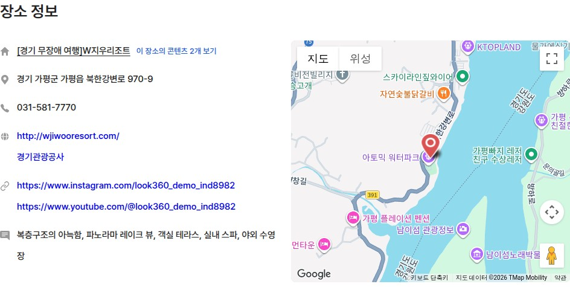
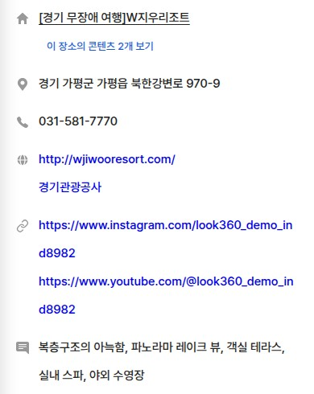
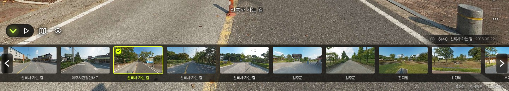
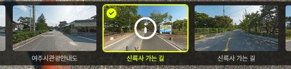
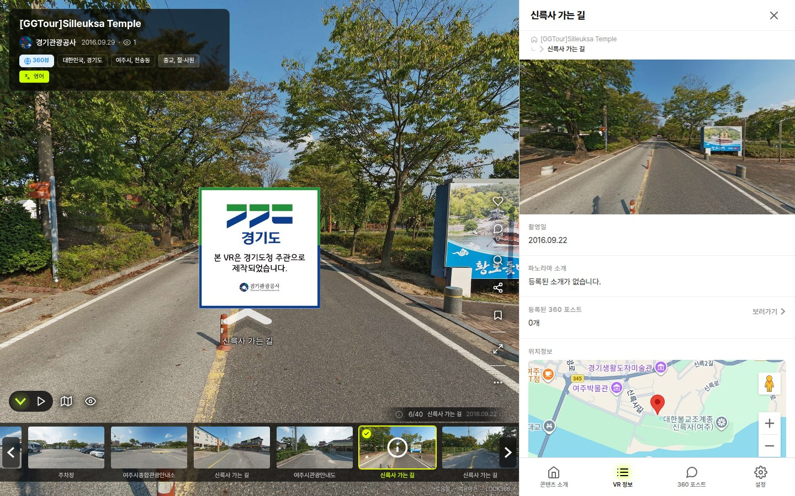

<!-- _class: cover -->
<!-- _paginate: false -->

# 주간 업무 보고

## 2026-11-03 &nbsp;~&nbsp; 2026-11-09

Indyspot AI Corp &nbsp;·&nbsp; Engineering Manager &nbsp;·&nbsp; 2026-11-09

---

<!-- _class: agenda -->

## 이번 기간 주요 작업 — 「기존 사이트 콘텐츠를 바로잡고, 외부VR 과 필터의 다음 결정을 준비한」 7일

### 기존 사이트 look360.kr
- VR투어 수정 내용이 사라지지 않도록 구조 재설계
- 안 보이던 장면 수정 · 수정 후 깨진 100장면 복구
- 만다라 전시 특수 장면 이전 · 메인 슬라이드 갱신

### 외부VR
- 2,097건 업종·지역 재분류(섹션 04)
- 새로 수집한 VR 등록 절차(섹션 05)

### 회사 공통
- Gmail 서명 네이버 블로그 배너 교체

### 새 플랫폼 화면
- 콘텐츠 단위 홈페이지·SNS 링크
- VR 뷰어 썸네일 · 소개 탭 · 알림 메뉴
- 채널 목록 비공개 콘텐츠 정책

### weekly(k)pop
- 차트 데이터 정리 · 미니 플레이어
- kpop 차트 중 기준이 잘못 들어간 155주 발견

### 이번 회의 결정
- VR 목록 필터 2안 · 고화질 이미지 전환 · 북마크 썸네일
- 외부 이동 안내 화면 · 외부VR 결정 5건 · 155주 교체

---

<!-- _class: sec -->

Section 01

## 꼭 알아야 할 변경

이번 주에 정한 규칙을 먼저 정리합니다.

---

## 🔑 이번 주에 정한 규칙 11/04~11/09

| 결정 | 내용 | 근거 |
|---|---|---|
| **장소 정보 개편 방향 전환** | 장소 시트로 한 번에 재구성하는 방식은 중단했습니다. 관리자 화면에서 콘텐츠를 하나씩 검수해 장소를 구성하고, 콘텐츠 하나에 장소를 여러 개 연결합니다 | [IND-9021](https://kabkee-main.tailfe017f.ts.net:8443/IND/issues/IND-9021) 오너 11/04 |
| **비공개 콘텐츠 정책** | 공개 목록과 탐색에는 나오지 않지만 주소로는 접속할 수 있습니다. 채널 목록에서는 주인과 관리자에게만 보입니다. VR스토리도 같습니다 | [IND-9247](https://kabkee-main.tailfe017f.ts.net:8443/IND/issues/IND-9247) 오너 11/09 |
| **VR투어 생성 방식 재설계** | 관리자 화면에서 고친 내용이 VR투어를 다시 만들 때도 반영되도록 구조를 바꿉니다 | [IND-9241](https://kabkee-main.tailfe017f.ts.net:8443/IND/issues/IND-9241) 오너 11/09 |
| **콘텐츠 언어 필터** | 언어는 1개만 선택합니다. 검색결과의 외부VR 은 VR 목록과 똑같이 처리합니다(데이터 이전이 끝날 때까지 검색에도 나오지 않음) | [IND-8592](https://kabkee-main.tailfe017f.ts.net:8443/IND/issues/IND-8592) 오너 11/05 · 11/09 |
| **해외 지역 범위** | 해외는 «주·도시»까지만 채웁니다. 도시는 필요한 것만 추가합니다 | [IND-7601](https://kabkee-main.tailfe017f.ts.net:8443/IND/issues/IND-7601) 오너 11/06 |

---

## 🔑 이번 주에 정한 규칙 (2) 11/05~11/09

| 결정 | 내용 | 근거 |
|---|---|---|
| **외부 삽입 자동 재생 조회수** | 외부 사이트에서 자동 재생이나 자동 회전으로 열리면 조회수를 1 올립니다. 메인 슬라이드는 올리지 않습니다 | [IND-8870](https://kabkee-main.tailfe017f.ts.net:8443/IND/issues/IND-8870) · [IND-9258](https://kabkee-main.tailfe017f.ts.net:8443/IND/issues/IND-9258) |
| **콘텐츠 상세의 정보 표시** | B안을 수락한 뒤, 제목과 내용을 줄로 나열하는 방식([IND-9086](https://kabkee-main.tailfe017f.ts.net:8443/IND/issues/IND-9086))으로 정해 별도 구현 없이 마무리했습니다 | [IND-8840](https://kabkee-main.tailfe017f.ts.net:8443/IND/issues/IND-8840) |
| **RAW 자동 현상** | 당장 필요하지 않아 취소했습니다. 지금까지 만든 결과물은 유지합니다 | [IND-8678](https://kabkee-main.tailfe017f.ts.net:8443/IND/issues/IND-8678) 오너 11/05 |
| **일반 사진(flat) 돌아가기 버튼** | 기존 사이트는 바꾸지 않고 새 플랫폼에서만 한 가지 디자인과 동작으로 통일합니다 | [IND-9270](https://kabkee-main.tailfe017f.ts.net:8443/IND/issues/IND-9270) 오너 11/09 |
| **weekly(k)pop 차트 기준** | kpop = 멜론 «가요»(2017-10~ «국내종합»), pop = «팝»(2018~ «해외종합»). «종합»은 어느 쪽 기준도 아닙니다 | 오너 11/06 |

---

<!-- _class: sec -->

Section 02

## 기존 사이트 — VR투어 구조 · 화면 오류 · 콘텐츠 정리

VR투어 구조 재설계는 진행 상황을 공유하고, 나머지는 완료한 일을 보고합니다.

---

## 🔄 VR투어 수정 내용 보존 — 구조 재설계 11/09

기존 사이트의 VR투어는 관리자 화면에서 저장하면 화면 구성 파일(XML)을 새로 만듭니다. 이때 사람이 직접 고친 제목·화면 안 버튼(핫스팟)·일반 사진 장면이 사라질 수 있어, 해당 투어는 지금 저장과 재생성을 금지하고 있습니다.

| 항목 | 내용 |
|---|---|
| 방향 전환 | 첫 방안은 71개 투어 343장면을 지금 상태로 고정하는 것이었는데, 그러면 관리자 화면에서 고쳐도 반영되지 않습니다. 그래서 고친 내용이 반영되는 방식으로 다시 설계합니다 |
| 검증 | 개발 환경에서 400장면을 비교했고, 오너가 승인했거나 결정을 기다리는 항목 외에 달라진 곳은 없었습니다 |

확인
<a class="lnk" href="https://kabkee-main.tailfe017f.ts.net:8443/IND/issues/IND-9134" target="_blank">IND-9134 EPIC</a>
<a class="lnk" href="https://kabkee-main.tailfe017f.ts.net:8443/IND/issues/IND-9241" target="_blank">IND-9241 생성기 재설계</a>
<a class="lnk" href="https://kabkee-main.tailfe017f.ts.net:8443/IND/issues/IND-9276" target="_blank">IND-9276 툴팁 44건 반영</a>

---

## 🏷️ 건물 이름표(툴팁) 차이 44건 — 묶음별 처리 11/09

기존 사이트 화면 파일 2,753개의 건물 이름표 31,791개를 11/06 데이터베이스 기록과 대조했습니다. 다른 것은 44건이고, 오너가 실제 화면을 보고 묶음별로 정했습니다.

| 묶음 | 건수 | 처리 |
|---|---:|---|
| 위치가 다름 (겹치거나 애매해서 화면에서 옮긴 것) | 9 | 데이터베이스 위치를 화면 위치로 변경 |
| 화면 파일에만 있음 | 5 | 데이터베이스에 추가 |
| «그...찻집» ↔ «기념품샵» | 8 | 이름을 «그...찻집»으로 통일 |
| 2775 장충단공원 띄어쓰기·표기 | 9 | 데이터베이스 기준으로 화면 파일 재생성 |
| 2372 화면에 특수문자 코드(`&amp;`)가 그대로 보임 | 1 | 데이터베이스 기준으로 화면 파일 재생성 |
| `&`·대괄호 표기만 다름 | 12 | 조치 없음 (표기 방식만 다름) |

> 영향: 여러 투어가 같은 이름표를 함께 쓰고 있어, 2291·2661·2757 투어도 다시 만들면 새 위치·이름으로 바뀝니다(오너 결정 범위). 남은 일은 오너 승인 후 실제 서비스에 반영하는 것입니다.

확인
<a class="lnk" href="https://claude.ai/artifact/K8HqTBFRpHaXbvcRJ8QZwb" target="_blank">44건 비교 페이지(오너 화면으로 열기)</a>
<a class="lnk" href="https://kabkee-main.tailfe017f.ts.net:8443/api/attachments/e2510ad8-cb56-4769-9d8a-ae18a60ceb2f/content" target="_blank">처리표</a>

---

## 📸 투어 2770 «본관» 이름표 위치 비교 11/09

실제 화면의 위치와 데이터베이스 위치가 달랐던 사례입니다. 오너 결정에 따라 데이터베이스를 화면 위치로 맞춥니다.

직접 확인
<a class="lnk legacy" href="https://look360.kr/vr/snacademy/20250612/32342" target="_blank">https://look360.kr/vr/snacademy/20250612/32342</a>
<a class="lnk" href="https://kabkee-main.tailfe017f.ts.net:8443/IND/issues/IND-9241" target="_blank">IND-9241</a>

---

## 📸 투어 1889 «그...찻집» 이름표 비교 11/09

같은 건물을 화면에서는 «그...찻집», 데이터베이스에서는 «기념품샵»으로 부르던 사례입니다. 이름을 «그...찻집»으로 통일합니다.

직접 확인
<a class="lnk legacy" href="https://look360.kr/vr/ggtour_hwadamsup/bf_ggtour_hwadamsup_vrstory/21757" target="_blank">https://look360.kr/vr/ggtour_hwadamsup/bf_ggtour_hwadamsup_vrstory/21757</a>
<a class="lnk" href="https://kabkee-main.tailfe017f.ts.net:8443/IND/issues/IND-9241" target="_blank">IND-9241</a>

---

## 🧱 VR 장면이 안 보이던 문제 전수 수정과 복구 11/04~11/09 완료

VR 이미지 조각(타일)과 화면 설정이 어긋나 콘텐츠가 안 보이던 문제를 전부 찾아 고쳤습니다. 그 수정으로 오히려 깨진 장면은 오너 지적으로 찾아 되돌렸습니다.

| 이슈 | 결과 |
|---|---|
| [IND-9060](https://kabkee-main.tailfe017f.ts.net:8443/IND/issues/IND-9060) 전수 검사·수정 | 360도 장면과 일반 사진 전체를 검사해 274개 장면을 고쳤습니다 · 검수 5건 모두 이미지 누락 없음 · 오너 최종 확인 11/09 |
| [IND-9157](https://kabkee-main.tailfe017f.ts.net:8443/IND/issues/IND-9157) 깨진 100장면 복구 | 해상도 설정이 잘못 바뀐 100개 장면을 수정 전 설정으로 되돌렸습니다 · 이미지를 새로 만들 필요는 없었습니다 |
| [IND-9059](https://kabkee-main.tailfe017f.ts.net:8443/IND/issues/IND-9059) 275건 화면 확인 | 설정을 되돌린 것 116건 · 수정이 필요 없는 것 153건 · 이상 없음 6건 · VR스토리 44장면 수정 · 오너 확인 11/09 |
| [IND-8731](https://kabkee-main.tailfe017f.ts.net:8443/IND/issues/IND-8731) 새 플랫폼 수정 | 같은 문제를 새 플랫폼에서 먼저 고쳤습니다(10/30 완료 · 오너 확인 11/09) |

> 판단 착오도 함께 보고합니다. 처음에는 원래 있던 결함 100건으로 분류했지만, 실제로는 우리 수정이 만든 문제였습니다. 오너가 「기존엔 잘 보였다」고 지적해 수정 전후를 비교해서 확인했습니다.

확인
<a class="lnk" href="https://kabkee-main.tailfe017f.ts.net:8443/IND/issues/IND-9060" target="_blank">IND-9060</a>
<a class="lnk" href="https://kabkee-main.tailfe017f.ts.net:8443/IND/issues/IND-9157" target="_blank">IND-9157</a>
<a class="lnk" href="https://kabkee-main.tailfe017f.ts.net:8443/IND/issues/IND-9059" target="_blank">IND-9059</a>

---

## 🎨 기존 사이트에서 특별히 제작한 장면을 새 플랫폼으로 옮겼습니다 (1/3) 11/09

Kay Park 만다라 전시 9개 장면입니다. 사람이 직접 만든 장면이라 자동 생성으로는 같은 화면이 나오지 않아, 기존 장면 구성을 그대로 쓰는 방식을 새 플랫폼에 추가했습니다.

직접 확인
<a class="lnk legacy" href="https://look360.kr/vr/indyspot/mandalacat" target="_blank">기존 사이트 https://look360.kr/vr/indyspot/mandalacat</a>
<a class="lnk" href="http://100.64.25.50:5174/vr/o1vj1ty0" target="_blank">플랫폼 http://100.64.25.50:5174/vr/o1vj1ty0</a>
<a class="lnk" href="https://kabkee-main.tailfe017f.ts.net:8443/IND/issues/IND-9100" target="_blank">IND-9100</a>

---

## 🎨 기존 사이트에서 특별히 제작한 장면을 새 플랫폼으로 옮겼습니다 (2/3) 11/09

격자 배경·프레임·회전 이미지·이전/다음 버튼·나레이션이 그대로 동작합니다.

직접 확인
<a class="lnk legacy" href="https://look360.kr/vr/indyspot/mandalacat" target="_blank">기존 사이트 https://look360.kr/vr/indyspot/mandalacat</a>
<a class="lnk" href="http://100.64.25.50:5174/vr/o1vj1ty0" target="_blank">플랫폼 http://100.64.25.50:5174/vr/o1vj1ty0</a>
<a class="lnk" href="https://kabkee-main.tailfe017f.ts.net:8443/IND/issues/IND-9100" target="_blank">IND-9100</a>

---

## 🎨 기존 사이트에서 특별히 제작한 장면을 새 플랫폼으로 옮겼습니다 (3/3) 11/09

9개 장면 모두 기존 사이트와 새 플랫폼에서 열리고, 배경·프레임·만다라 크기가 눈으로 비교했을 때 같습니다.

직접 확인
<a class="lnk legacy" href="https://look360.kr/vr/indyspot/mandalacat" target="_blank">기존 사이트 https://look360.kr/vr/indyspot/mandalacat</a>
<a class="lnk" href="http://100.64.25.50:5174/vr/o1vj1ty0" target="_blank">플랫폼 http://100.64.25.50:5174/vr/o1vj1ty0</a>
<a class="lnk" href="https://kabkee-main.tailfe017f.ts.net:8443/IND/issues/IND-9100" target="_blank">IND-9100</a>

---

## 🧹 기존 사이트 기준 콘텐츠 정리 결과 · 만다라 전시 남은 차이 11/06 완료

**[IND-9100](https://kabkee-main.tailfe017f.ts.net:8443/IND/issues/IND-9100) 정리 결과**

| 분류 | 결과 |
|---|---|
| 다국어 사본 31개 | 기존 사이트 화면 파일 추가 · 2194 는 새 플랫폼에서 비공개 |
| 장소 없는 투어 | 사용자 업로드 콘텐츠는 제외 · 나머지 4개는 별도 처리 |
| 1936·1982·2529 | 새 플랫폼을 기존 사이트 화면에 맞춤 |
| 원통형 파노라마 5건 | 새 플랫폼에서 표시 · 6209 는 기존 사이트도 수정 |
| 스토어 항목 125 | 비활성화 |
| 오너 시트 | 플랫폼 주소 498행 정정 |

**만다라 전시 남은 차이 (서비스 문제 아님)**

| # | 차이 |
|---|---|
| ① | 이전/다음 버튼 모양 — 기존 사이트 화살표 그림 · 새 플랫폼 글자 |
| ② | 첫 드래그 전 안내 이미지 — 기존 사이트 마우스 아이콘 · 새 플랫폼 진흥원 카드(양쪽 모두 첫 드래그 뒤 사라짐) |
| ③ | 장면 1개의 다음 버튼 — 기존 사이트는 보이지만 동작하지 않음 · 새 플랫폼은 표시 안 함 |
| ④ | 기존 사이트는 들어오는 상태에 따라 화면 확대 정도가 달라, 일부 경우 만다라가 약 1.27배 크게 보임 |

---

## 🏠 메인 화면 슬라이드(홈 히어로) 갱신 11/04~11/09

등록된 항목이 모두 2026-08-01 로 만료돼, 메인 슬라이드가 100% 무작위로 채워지고 있었습니다.

| 이슈 | 내용 |
|---|---|
| [IND-9113](https://kabkee-main.tailfe017f.ts.net:8443/IND/issues/IND-9113) 갱신 | 오너 시트 기준 기존 55개 기간 연장 + 111개 추가 → 166개 노출(일반 사진·없는 파노라마·중복 9건 제외) |
| [IND-9113](https://kabkee-main.tailfe017f.ts.net:8443/IND/issues/IND-9113) 원인 하나 더 | 앞 50개만 읽고 섞는 구조라 51번째부터는 나오지 않았습니다 → 166개 전체에서 무작위로 뽑도록 고쳤습니다 |
| [IND-9113](https://kabkee-main.tailfe017f.ts.net:8443/IND/issues/IND-9113) 검증 | 실제 메인 화면을 3번 열어 매번 10칸이 모두 선정 항목으로 채워졌고 새 항목도 나왔습니다 · 개발 환경 30회에서 서로 다른 135개 노출 |
| [IND-9114](https://kabkee-main.tailfe017f.ts.net:8443/IND/issues/IND-9114) 166개 전수 확인 | 정상 162 · 문제 0 · 🟡 4(숨김 장소 소속) · 명동성당 검은 화면 해결 |
| [IND-9238](https://kabkee-main.tailfe017f.ts.net:8443/IND/issues/IND-9238) 메인 슬라이드 관리 | 달력만 있던 관리 화면에 표 보기 추가 · 상태와 제외 사유 표시 |

확인
<a class="lnk" href="https://kabkee-main.tailfe017f.ts.net:8443/IND/issues/IND-9113" target="_blank">IND-9113</a>
<a class="lnk" href="https://kabkee-main.tailfe017f.ts.net:8443/IND/issues/IND-9114" target="_blank">IND-9114</a>
<a class="lnk" href="https://kabkee-main.tailfe017f.ts.net:8443/IND/issues/IND-9238" target="_blank">IND-9238</a>

---

## 🗂️ 메인 슬라이드 관리 — 달력 대신 표로 보기 11/09

메인 슬라이드에 무엇이 들어 있는지 바로 보이도록 표 보기를 기본으로 두고, 상태 필터·검색·행 클릭 수정/삭제를 넣었습니다. 달력 보기로도 바꿀 수 있습니다.

상태: 풀 적용 중 · 예약 · 종료 · 제외(사유 표시)

> 개발 환경 화면이라 썸네일이 회색으로 보이고, 제외 4건은 시험용 데이터입니다. 실제 서비스에서는 166건이 모두 노출 대상입니다.

직접 확인
<a class="lnk legacy" href="https://origin.look360.kr/?r=home&m=admin&module=look360_mainPage" target="_blank">기존 사이트 관리자 메인 파노 관리 (로그인 필요)</a>
<a class="lnk" href="https://kabkee-main.tailfe017f.ts.net:8443/IND/issues/IND-9238" target="_blank">IND-9238</a>

---

## 📋 VR투어 안 장면 이름 차이 표시 11/09

원래 이름과 투어 안 이름이 다른 행은 `원래 이름 → 투어 이름`(회색 → 빨강)으로 표시하고, 행별·전체 「원래 이름으로」 되돌리기 버튼을 넣었습니다. 잘못 붙은 표 제목도 고쳤습니다.

> 개발 환경 화면이라 썸네일은 임시 이미지입니다. 되돌린 이름이 실제 화면 제목에도 보이려면 기존처럼 「XML 생성」을 따로 눌러야 합니다.

직접 확인
<a class="lnk legacy" href="https://origin.look360.kr/?r=home&m=admin&module=PanoramaManagement&front=panoTour&toursubmenu=panoTour_editVrList&panotourUid=2686&prevMenu=panoTourInfo" target="_blank">기존 사이트 관리자 투어 2686 (로그인 필요)</a>
<a class="lnk" href="https://kabkee-main.tailfe017f.ts.net:8443/IND/issues/IND-9097" target="_blank">IND-9097</a>

---

## 🛠️ Look360 Utils 로 일반 사진(flat) 올리기 — 사용 가이드 공유 11/09 릴리스

**이제 작업자 PC 에 다른 프로그램을 따로 설치하지 않아도 됩니다.** (v0.1.4-beta.6 미리보기 버전)

| 항목 | 내용 |
|---|---|
| 흐름 | Utils 로 이미지 변환 → 업로드 파일 생성 → 관리자 화면에 업로드·등록 → VR투어 추가 → 화면 파일 생성 → 공개 설정 |
| Windows 확인 | 다른 프로그램이 없는 PC 에서 파일 생성과 업로드, 뷰어 표시까지 확인했습니다 |
| [flat] 표시 | 폴더 이름 끝의 [flat] 은 등록할 때 자동으로 지워집니다 |
| Mac | Apple Silicon Mac 용 설치 파일 추가 · 처음 열 때 「그래도 열기」 승인 1회 필요 · 자동 업데이트 없음 |

확인
<a class="lnk" href="https://kabkee-decks.netlify.app/guides/2026-11-09-flat-pano-upload-guide.html" target="_blank">공유 슬라이드 16장 — 일반 사진 업로드 가이드</a>
<a class="lnk" href="https://kabkee-main.tailfe017f.ts.net:8443/IND/issues/IND-9056" target="_blank">IND-9056</a>

---

<!-- _class: sec -->

Section 03

## 새 플랫폼 화면

콘텐츠 링크 방향과 이번 주 완료한 화면 변경, 기기 설정에 따른 애니메이션 차이를 공유합니다.

---

## 🔗 콘텐츠 단위 홈페이지·SNS 링크 — 방향 공유 오너 결정 11/02 · 11/05 완료

장소 SNS 는 보이게 됐지만, 콘텐츠 «자체»를 홍보할 링크는 넣을 자리가 없었습니다. 예로 「[경기관광공사] 무장애 경기관광 W지우리조트」는 장소 SNS 에 리조트 계정만 들어가 캠페인 페이지를 알릴 수 없습니다.

| 오너 결정(11/02) | 내용 |
|---|---|
| ① 입력 권한 | 판매자도 자기 콘텐츠에 입력 가능 |
| ② 개수 | 제한 없음 · 같은 플랫폼 여러 개 허용(youtube 2개 등) |
| ③ 플랫폼 | 종류 확장(X·카카오스토리 등) + 「기타」 직접 입력 |

- 장소 홈페이지는 이미 여러 개 입력하고 표시할 수 있습니다.

확인
<a class="lnk" href="https://kabkee-main.tailfe017f.ts.net:8443/IND/issues/IND-9049" target="_blank">IND-9049</a>
<a class="lnk" href="https://kabkee-main.tailfe017f.ts.net:8443/IND/issues/IND-8982" target="_blank">IND-8982</a>

---

## 📸 장소 SNS — 라벨 없이 등록된 URL 그대로 표시 11/05

11/03 회의에서 정한 대로 SNS 줄의 플랫폼 이름 표시를 없애고, 등록된 주소를 그대로 나열합니다.

> 콘텐츠 상세와 뷰어 소개 탭에 같은 방식으로 표시되고, 모바일에서는 긴 URL 이 줄바꿈됩니다.

직접 확인
<a class="lnk" href="http://100.64.25.50:5174/vr-info/ab28f18c?adminPreview=1" target="_blank">http://100.64.25.50:5174/vr-info/ab28f18c?adminPreview=1</a>
<a class="lnk" href="https://kabkee-main.tailfe017f.ts.net:8443/IND/issues/IND-9155" target="_blank">IND-9155</a>

---

## ✅ 이번 주 완료 — 플랫폼 화면 11/05~11/09

| 이슈 | 무엇을 했나 |
|---|---|
| [IND-8594](https://kabkee-main.tailfe017f.ts.net:8443/IND/issues/IND-8594) | VR스토리 재생 화면 개편 — 화면 밖 버튼 방향 표시 · 챕터 번호 · 하단 진행바 · 나레이션 재생 중 점 3개 표시 |
| [IND-9148](https://kabkee-main.tailfe017f.ts.net:8443/IND/issues/IND-9148) | VR 뷰어 하단 썸네일 — 모바일 애니메이션 · i 버튼 삭제 · 정보 영역을 누르면 장면 상세로 이동 · PC 에서 현재 장면에 마우스를 올리면 큰 i 표시 |
| [IND-9154](https://kabkee-main.tailfe017f.ts.net:8443/IND/issues/IND-9154) | 외부 사이트에 삽입한 뷰어에도 제목·채널·지역·카테고리 표시(메인 슬라이드용 삽입에서는 숨김) |
| [IND-9155](https://kabkee-main.tailfe017f.ts.net:8443/IND/issues/IND-9155) | 콘텐츠 상세의 장소 SNS — 라벨 없이 등록된 주소를 그대로 나열 |
| [IND-9255](https://kabkee-main.tailfe017f.ts.net:8443/IND/issues/IND-9255) | VR 뷰어 소개 탭 — «장소 정보가 없습니다» 안내 제거 · 장소 정보는 장소가 연결된 콘텐츠에서만 표시 |
| [IND-9257](https://kabkee-main.tailfe017f.ts.net:8443/IND/issues/IND-9257) | 상단 알림 ⋯ 메뉴(«숨기기» 하나) · 상단 카테고리를 좌우 가득 배치 + 화살표 쪽 그라데이션 |

---

## ✅ 이번 주 완료 — 플랫폼 (2) 11/05~11/09

| 이슈 | 무엇을 했나 |
|---|---|
| [IND-9247](https://kabkee-main.tailfe017f.ts.net:8443/IND/issues/IND-9247) | 채널 목록 비공개 콘텐츠 — 주인과 관리자만 볼 수 있음(360VIEW·VR스토리 동일) · 공개 목록 노출 0건(2,272건 검수) |
| [IND-8862](https://kabkee-main.tailfe017f.ts.net:8443/IND/issues/IND-8862) | 「지금 보는 언어로 공유」 체크박스(기본 켜짐) · 360포스트 공유 링크 오류 수정 · SNS 미리보기 다국어 지원 |
| [IND-8870](https://kabkee-main.tailfe017f.ts.net:8443/IND/issues/IND-8870) | 조회수가 오르는 경로 전수 점검 — 외부 사이트 자동 재생은 +1 · 메인 슬라이드는 +0 |

원문
<a class="lnk" href="https://kabkee-main.tailfe017f.ts.net:8443/IND/issues/IND-9247" target="_blank">IND-9247</a>
<a class="lnk" href="https://kabkee-main.tailfe017f.ts.net:8443/IND/issues/IND-8862" target="_blank">IND-8862</a>
<a class="lnk" href="https://kabkee-main.tailfe017f.ts.net:8443/IND/issues/IND-8870" target="_blank">IND-8870</a>

---

## 🖱️ VR 뷰어 하단 썸네일 — 마우스로 좌우 이동 11/09

PC 에서 장면이 많은 콘텐츠의 하단 썸네일을 **마우스로 끌거나 휠을 돌려** 좌우로 넘길 수 있습니다. 지금까지 마우스로는 화살표 버튼으로 장면을 하나씩 넘겨야 했습니다.

> 썸네일을 끌어도 다른 장면으로 넘어가지 않고, 짧게 누르면 기존처럼 그 장면으로 이동합니다. 휠을 돌려도 VR 화면은 확대·축소되지 않습니다.

직접 확인
<a class="lnk" href="http://100.64.25.50:5174/vr/0f99b68c?adminPreview=1" target="_blank">http://100.64.25.50:5174/vr/0f99b68c?adminPreview=1</a>

---

## ℹ️ VR 뷰어 하단 썸네일 — 지금 보는 장면의 상세 보기 11/05

PC 에서 지금 보고 있는 장면의 썸네일에 마우스를 올리면 **i 아이콘**이 나타나고, 누르면 그 장면의 사진·촬영일·소개·위치를 담은 **상세 화면**이 열립니다. 다른 장면의 썸네일을 누르면 기존처럼 그 장면으로 이동합니다.

**마우스를 올렸을 때**

**눌렀을 때**

직접 확인
<a class="lnk" href="http://100.64.25.50:5174/vr/0f99b68c?adminPreview=1" target="_blank">http://100.64.25.50:5174/vr/0f99b68c?adminPreview=1</a>
<a class="lnk" href="https://kabkee-main.tailfe017f.ts.net:8443/IND/issues/IND-9148" target="_blank">IND-9148</a>

---

## 🛑 기기 설정에 따라 애니메이션이 멈출 수 있습니다 11/09

VR스토리 나레이션 점 3개가 안 움직인다는 문의의 원인은 오류가 아니라 PC·휴대폰의 접근성 설정(동작 줄이기)이었습니다. 같은 화면이 기기마다 다르게 보일 수 있습니다.

| 기기 | 설정 위치 (이 상태면 멈춤) |
|---|---|
| Win 11 | 접근성 > 시각 효과 > 애니메이션 효과 (끄면) |
| Win 10 | 접근성 > 디스플레이 > Windows에서 애니메이션 표시 (끄면) |
| macOS | 손쉬운 사용 > 디스플레이 > 동작 줄이기 (켜면) |
| iOS | 손쉬운 사용 > 동작 > 동작 줄이기 (켜면) |
| Android | 접근성 > 애니메이션 삭제 (켜면 · 기기별 상이) |

| 점 3개 (11/09 확인) | 결과 |
|---|---|
| 기본 상태 | 움직입니다 |
| 동작 줄이기 | 멈춥니다 |

**미결:** 점 3개를 OS 설정과 무관하게 항상 움직이게 할지는 정하지 않았습니다.

직접 확인
<a class="lnk" href="http://100.64.25.50:5174/vr/2f9e62cf?story=5-1" target="_blank">http://100.64.25.50:5174/vr/2f9e62cf?story=5-1</a>

---

<!-- _class: sec -->

Section 04

## 외부VR 업종·지역 재분류 — 기존 데이터 2,097건

이전 근로장학생이 등록해 둔 **기존 데이터**의 재분류입니다. 크롤러 신규 수집(섹션 05)과는 별개입니다. 검토 시트는 드라이브 「데이터 수정 & 개선」 폴더로 옮겼고, 시트 내용은 그대로 둡니다.

원본
<a class="lnk" href="https://kabkee-decks.netlify.app/reports/2026-11-06-external-vr-reclass.html" target="_blank">원본 덱(18장)</a>
<a class="lnk" href="http://100.64.25.50:8088/reports/2026-11-06-external-vr-reclass.html" target="_blank">로컬 원본</a>
<a class="lnk" href="https://docs.google.com/spreadsheets/d/1ZmB4E4w9hx0fTGlFB0ifodH2kHu7XE9loQIV1XCG3Jo/edit" target="_blank">검토 시트</a>
<a class="lnk" href="https://drive.google.com/drive/folders/1pIWrynurZVAv8jp702IGymjXheYAK0v3" target="_blank">드라이브 폴더</a>
<a class="lnk" href="https://kabkee-main.tailfe017f.ts.net:8443/IND/issues/IND-7601" target="_blank">IND-7601</a>
<a class="lnk" href="https://kabkee-main.tailfe017f.ts.net:8443/IND/issues/IND-8592" target="_blank">IND-8592</a>

---

<!-- _class: agenda -->

## 한 줄 요약 — 분류는 끝났고, 검토와 결정만 남았습니다

### 🚨 왜 했나

- 외부VR 2,097건 전부 업종·지역이 비어 VR 목록 에 0건 노출
- 검색결과도 VR 목록 기준으로 맞추면 외부VR 이 검색에서 사라짐

### ✅ 무엇을 했나

- 업종: AI 가 플랫폼 분류표 기준으로 2,097건 판정
- 지역: 구글 지도 서비스로 시·도부터 동·리까지 채움

### 🔍 검토할 것

- 검토 필요 261건 · 오너 판단 필요 68건
- 업종 신규 제안 5개 + 이름 변경 1개
- 지역 항목 추가 한국 760 · 해외 도시 362

### 🔒 안전

- 실제 데이터는 아직 바꾸지 않았습니다

---

## 🚨 배경 — 외부VR 이 목록에도 검색에도 안 나오는 이유 11/06

| 화면 | 현재 동작 | 외부VR |
|---|---|---|
| VR 목록 | 업종(카테고리)이 있는 콘텐츠만 노출 | 2,097건 모두 업종 없음 → 0건 |
| 검색결과 VR 탭 | 업종 조건 없이 노출 | 「서울」 검색 540건 중 403건이 외부VR |
| 검색결과를 VR 목록 기준으로 통일하면 | VR 목록 와 같은 조건 | 검색에서도 0건 |

- 9/23 오너 결정은 「자동 분류 → 관리자 검증 → 데이터 이전」이었지만 검토가 승인 105건에서 멈춰 있었습니다
- 그래서 검색 방향을 정하기 전에 분류부터 채우기로 했습니다

확인
<a class="lnk" href="https://kabkee-main.tailfe017f.ts.net:8443/IND/issues/IND-7601" target="_blank">IND-7601 외부VR 분류</a>
<a class="lnk" href="https://kabkee-main.tailfe017f.ts.net:8443/IND/issues/IND-8592" target="_blank">IND-8592 검색결과 필터 통일</a>

---

## 🔁 작업 흐름 — 1차 시도에서 문제를 찾고 방식을 바꿨습니다 11/06

| 단계 | 방식 | 결과 |
|---|---|---|
| 1차 업종 | 1차 AI(선택지 고르기) | 「[서울역사박물관] 종로서적 전시」 → 서점 같은 오판 |
| 1차 지역 | 1차 AI 로 시·도 / 시·군·구만 | 동·리까지 못 채움 |
| **2차 업종** | **고성능 AI** + 분류표 + 기존 콘텐츠 분류 사례 | 제목 앞 기관명 규칙 적용 · 서울역사박물관 123건 전부 박물관 |
| **2차 지역** | **구글 지도 서비스** → 플랫폼 지역표에 맞춤 | 한국 1,509건을 동·리까지 |
| 검증 | 같은 좌표 공유·주소 불일치 점검 | 의심 좌표 425건을 주소 기준으로 재판정 |

> 1차 AI 는 «선택지 고르기»는 싸고 빠르지만, 규칙을 적용하거나 단계를 따라 내려가는 판단에는 약했습니다.

---

<!-- _class: sec -->

외부VR 재분류 · 01

## 업종 — 어떻게 판정했나

플랫폼 분류표(소분류 207개)와 기존 360VIEW 배정 사례를 기준으로 삼았습니다.

---

## 🏷️ 업종 판정 규칙과 결과 11/06

| 규칙 | 예 |
|---|---|
| 판정 대상은 «영상 속 장소 자체» — 전시 주제가 아님 | 종로서적 전시 → 서점(✕) 박물관(○) |
| 제목 앞 `[기관명]` 이 **장소**면 그 장소 업종 | `[서울역사박물관]` 123건 → 전부 박물관 |
| 제목 앞 `[기관명]` 이 **발행처**면 무시하고 영상 속 장소 | `[양천구청] 양천둘레길` → 산책로 |
| 같은 장소는 같은 소분류 · 360VIEW 사례를 따름 | `[경기관광공사]남송미술관` → 미술관 |

- 2,097건 전부 판정했고 빠진 건이 없습니다
- AI 확신도가 낮은 241건은 시트에서 «검토 필요»로 표시했습니다

---

## ➕ 업종 신규 제안 — 맞는 칸이 없던 49건 11/06

| 제안 소분류 | 대분류 | 건수 | 지금 임시 분류 |
|---|---|---|---|
| 교통시설(역·공항·터미널) | 공공장소 | 6 | 지역명소 |
| 도시·지역 투어 | 관광·여행 | 14 | 지역명소·자연명소 |
| 국가·공공기관 청사 | 공공기관 | 16 | 교육장·기업·시청·구청 |
| 출렁다리·교량 | 공공명소 | 6 | 지역명소·거리 |
| 촬영 세트장 | 관광·여행 | 4 | 테마파크·체험장 |

- 이름 변경 1개: 스카이레일 → 스카이레일·케이블카(케이블카·모노레일 3건)
- 시트에는 «추가된 상태» 기준으로 채우고, 지금 분류표 기준 임시 분류를 옆 칸에 남겼습니다

---

<!-- _class: sec -->

외부VR 재분류 · 02

## 지역 — 시·도부터 동·리까지 어떻게 채웠나

GPS 를 기본으로, 의심스러운 좌표는 주소로 다시 찾았습니다.

---

## 📍 지역 판정 방식 11/06

| 단계 | 내용 |
|---|---|
| ① GPS 로 위치 찾기 | 구글이 주는 「시·도 → 시 → 구·군 → 읍·면 → 동·리」 이름을 받습니다 |
| ② 플랫폼 지역표에 맞추기 | 위에서부터 차례로 찾아 내려갑니다 |
| ③ 의심 좌표 다시 확인 | 다른 장소와 좌표가 같거나 주소와 시·도가 다르면 주소로 다시 찾습니다 |
| ④ 없는 단계 | 한국은 새 항목을 추가하고, 해외는 공개 도시 목록에서 필요한 도시를 추가합니다 |

- 기존 360VIEW 장소와 같은 방식으로 채웠습니다
- 결과: 한국 1,526건 중 1,509건이 동·리까지 · 해외 539건이 도시까지

---

## ⚠️ GPS 함정 — 좌표가 복사된 콘텐츠가 많았습니다 11/06

| 같은 좌표 | 몰린 콘텐츠 |
|---|---|
| 예산군 응봉면 1곳 | 국립민속박물관 · 국립한글박물관 · 천리포수목원 · 신두리 해안사구 등 43건 |
| 정선군 화암면 1곳 | 강릉 선교장 · 뮤지엄산 · 코엑스 별마당 도서관 등 12건 |
| 포항 송라면 1곳 | 김천 직지사 · 보은 법주사 · 안동 봉정사 등 사찰 8건 |

- 같은 좌표를 3건 이상 공유하는 묶음이 83개(581건)였습니다
- 이 중 서로 다른 장소이거나 주소와 시·도가 어긋난 425건은 주소로 다시 찾았습니다 → 불일치 187건 → 9건

> «GPS 는 정확하다»는 전제는 이번 데이터에선 성립하지 않았습니다. 원본 좌표 정리는 별도 과제입니다.

---

## 🗺️ 지역 추가가 필요한 것 11/06

| 구분 | 추가할 것 | 해당 콘텐츠 |
|---|---|---|
| 한국 4단계(읍·면) | 신규 항목 193개 | |
| 한국 5단계(동·리) | 신규 항목 567개 | 한국 합계 약 800건 |
| 해외 도시 | 공개 도시 목록에서 추가할 도시 362개 | 444건 |
| 해외 미해결 | 도시 목록에도 없음 14건 · 위치 불명 10건 | 24건 |

- 해외 도시가 비어 있던 이유: 공개 도시 목록 중 일부만 플랫폼에 넣어 두었기 때문입니다
- ✅ 오너 결정(11/06): 도시 목록 전체를 넣지 않고 필요한 도시만 그때그때 추가합니다

---

## 🌏 판단 기준 — 해외는 «주·도시»까지만 채웁니다 11/06

| 근거 | 내용 |
|---|---|
| 콘텐츠 밀도 | 해외 571건 중 절반 이상이 대학 투어 · 도시당 대개 1건 → 더 내리면 1건짜리 항목만 늘어남 |
| 사용자 동선 | 한국은 동 단위로 좁힐 가치가 있지만, 해외는 국가 → 주 → 도시면 충분 |
| 데이터 근거 | 공개 도시 목록에는 미국 카운티·동네 단계가 없습니다 |
| 일관성 | 카운티·카운슬·町 등 나라마다 의미가 달라 같은 단계에 섞으면 필터가 혼란스러워집니다 |

- 상세 위치는 지역 계층이 아니라 구글 주소(도로명·번지)로 보여줍니다
- 예외: 한 도시에 콘텐츠가 수십 건 쌓이면 그 도시만 한 단계 내립니다

---

<!-- _class: sec -->

외부VR 재분류 · 03

## 검토 방법 — 무엇을 어떤 순서로

시트 하나에 모두 들어 있습니다. 검토할 열이 맨 앞에 있습니다.

---

## 📋 검토 시트 구성 11/06

| 탭 | 내용 | 할 일 |
|---|---|---|
| 요약 | 기준·색상 안내 · 건수 | 먼저 읽기 |
| **분류표** | 2,097행 · 검토 열(A~G)이 맨 앞 · 검토 필요 행이 위 | 판정 입력 |
| 업종추가_제안 | 신규 소분류 5개 + 이름 변경 1개 | 채택 여부 결정 |
| 업종코드표 | 소분류 207개 + 신규 제안(주황) | 수정 시 참고 |
| 지역추가_한국 / 해외(dr5hn) | 신규 항목 760개 · 추가할 도시 362개 | 이름 확인 |

- 색상: 주황 = 오너 판단 필요 · 분홍 = 검토 필요 · 보라 칸 = 지역 추가 필요

시트
<a class="lnk" href="https://docs.google.com/spreadsheets/d/1ZmB4E4w9hx0fTGlFB0ifodH2kHu7XE9loQIV1XCG3Jo/edit" target="_blank">외부VR 업종·지역 재분류 v2 (Google Sheets)</a>

---

## ✍️ 검토 순서 — 이렇게 보시면 됩니다 11/06

| 순서 | 대상 | 보는 법 |
|---|---|---|
| ① | 오너 판단 필요 68건(주황) | 국립생태원 17건 업종 1개 선택 · 신규 소분류 해당 49건 · 원본 불일치 1건 |
| ② | 업종추가_제안 탭 | 6개 제안의 채택·이름·대분류 위치 결정 |
| ③ | 검토 필요 261건(분홍) | 「판정」 드롭다운에 확정/수정/제외 · 수정이면 「수정 업종 소분류」 드롭다운 |
| ④ | 지역추가 탭 2개 | 이름이 이상한 항목만 표시(예: 같은 도시 중복) |
| ⑤ | 나머지 1,836건 | 필터로 대분류별 훑어보기 · 이상한 것만 수정 |

> 「판정」을 비워 둔 행은 «확정»으로 간주해 반영하려 합니다. 다르게 하려면 알려 주세요.

---

## 🎯 결정이 필요한 것 11/06

| # | 결정 | 영향 |
|---|---|---|
| 1 | 국립생태원 업종(과학관·식물원·동물원·전시관 중 1개) | 17건 일괄 |
| 2 | 업종 신규 제안 6개 채택 여부 | 49건의 최종 소분류 |
| 3 | 지역 항목 추가(한국 760 · 해외 도시 362) | 지역이 «신규»인 1,341건 |
| 4 | 반영 방식: 검토용 표에 제안값으로 둘지, 실제 데이터에 바로 반영할지 | VR 목록 노출 시점 |
| 5 | 검색결과 외부VR 방향 | 분류 반영 후 답변 |

> 11/09 갱신: 5번 항목은 오너가 (a) «VR 목록 검색과 똑같이»로 답변했습니다.

확인
<a class="lnk" href="https://kabkee-main.tailfe017f.ts.net:8443/IND/issues/IND-8592" target="_blank">IND-8592 검색 방향</a>
<a class="lnk" href="https://kabkee-main.tailfe017f.ts.net:8443/IND/issues/IND-7601" target="_blank">IND-7601 분류 검토</a>

---

## 💰 비용과 안전 11/06

| 항목 | 내용 |
|---|---|
| 업종 판정 | AI 작업 · 추가 비용 없음 |
| 1차 시도 | 약 $0.36 |
| 지역 | 구글 지도 서비스 2,695회 호출 · 약 $13.5 |
| 데이터 | 읽기만 했고, 바꾼 것은 없습니다 |
| 산출물 | 구글 시트 1개(검토용) · 판정 근거 문장은 행마다 「근거」 칸에 |

> 시트 검토가 끝나면 확정된 행만 반영하고, 반영 전후 VR 목록·검색 노출 건수를 확인해 보고합니다.

---

<!-- _class: sec -->

Section 05

## 외부VR — 새로 수집한 VR 등록 절차

자동 수집 도구로 **새로 모은 데이터**를 플랫폼 외부VR 로 등록하는 작업입니다. 섹션 04 의 기존 데이터 재분류와는 별개입니다.

---

## 🕸️ 수집 규모와 등록 흐름 11/09 기준 · 후보 단위

수집 규모: 검토 대기 **18,755** · 승인 114 · 게시 1 · 제외 1,679,082(자동 1,675,984 · 사람 3,098) · 접속 불가 28,264.

| 단계(메뉴 「외부VR 등록」 · 11/06 구축) | 하는 일 |
|---|---|
| 1. 장소 확정 | 주소별로 투어를 묶고, 투어 제목·좌표와 카카오 장소 후보, 홈페이지의 기관명·주소를 보여줘 실제 장소를 고릅니다. 실제 방문 장소가 없으면 「장소 없음」으로 뺍니다 |
| 2. 중복 검토 | 같은 장소를 가리키는 그룹을 정리하고 대표 주소를 고릅니다 |
| 3. 이미지 검수 | 투어마다 자동 캡처한 장면 최대 5장 중 쓸 것을 고르고 대표를 지정합니다 · 「다른 장면 더 캡처」 가능 |
| 4. 분류 검토 | 지역·카테고리를 확인하고, 플랫폼에 없는 값은 신규 제안으로 모읍니다 |

작업 화면
<a class="lnk" href="http://192.168.60.6:5175/work-labels" target="_blank">http://192.168.60.6:5175/work-labels (사내망)</a>

---

## 📊 진행 현황과 11/09 이미지 소실·복구 11/09 기준 · 장소 그룹 2,290개

| 대기 | 확정 | 장소 없음 | 플랫폼 중복 제외 | 플랫폼 등록 준비 완료 |
|---:|---:|---:|---:|---:|
| 2,140 | 41 | 2 | 107 | 0 |

| 11/09 사고 | 내용 |
|---|---|
| 증상 | 장소 확정 화면의 이미지가 전부 안 나왔습니다 |
| 원인(추정) | 매일 새벽 4시 10분에 도는 파일 정리 작업이 장면 캡처 파일을 쓰지 않는 파일로 잘못 보고 지운 것으로 추정합니다(삭제 기록이 남아 있지 않아 정황으로 판단) |
| 복구 | 정리 작업을 고치고, 쉬고 있는 PC 여러 대로 나눠 약 1시간 50분 만에 2,183개 그룹 · 9,451장을 다시 캡처했습니다(처음에는 약 5시간) |
| 후속 | 재캡처로 장면 구성이 달라질 수 있어 이미지 검수 승인 10건은 취소하고 다시 고릅니다 · 0장 그룹 63개(53개는 예전에도 0장) |

작업 화면
<a class="lnk" href="http://192.168.60.6:5175/work-labels" target="_blank">http://192.168.60.6:5175/work-labels (사내망)</a>

---

<!-- _class: sec -->

Section 06

## weekly(k)pop · 회사 공통

차트 데이터를 정리했고, 기준에 맞지 않는 155주를 발견했습니다.

---

## 🧽 차트 데이터 정리 11/06

발단은 pop 1966 41위 「[]Time」(가수 빈 값) 신고입니다. 멜론 «차트 파인더»와 대조했고, **로그인 없이 과거 차트를 볼 수 있다**는 것을 확인했습니다.

| 구분 | 사이트 | 내용 |
|---|---|---|
| 가수 빈 값 채움 | pop 14곡 · kpop 1곡 | 게시물·차트 행 맞춤 |
| 제목 빈 게시물 삭제 | pop 6 · kpop 1 | 쓰이지 않는 것을 확인하고 삭제 |
| 완전 중복 삭제 | kpop | 14행 |
| 같은 순위 겹침 정리 | kpop | 삭제 32 · 재연결 2 · 신규 등록 2 |
| 빈 순위 채움 | kpop 31행 · pop 178행 | pop 은 대부분 성인 인증 곡 |

> 정리 후 두 사이트 모두 같은 순위 겹침, 같은 주 같은 곡 중복, 가수·제목 빈 값이 0건입니다. **실수도 보고합니다** — 기준 적용이 늦어 2016-02-14 주를 잘못 정리했다가 같은 날 복구했습니다. 그 밖에 영문 병기에 붙던 «romanized»·«translated» 표시를 없앴습니다.

---

## 🔍 kpop 과거 차트 180주 전수 대조 11/06 · 2014-05-11 ~ 2017-10-08

| 판정 | 주 수 |
|---|---:|
| 정상(가요·국내종합) | 20 |
| «종합» 차트로 들어감 | 155 |
| 불일치 | 2 |
| 유령 주차(실제로 없는 주) | 3 |

| 구간 | 판정 |
|---|---|
| 2014-05-25 ~ 2015-09-13 | 종합 |
| 2015-09-20 ~ 2016-02-28 | 가요·종합 혼재 |
| 2016-03-06 ~ 2017-09-24 | 종합(2017 은 장르종합 · 08-20 만 정상) |
| 2017-10-01 ~ | 정상 · 2019-02-03 한 주만 장르종합 |

| 유령 주차 | 실제 내용 |
|---|---|
| 2016-01-01 | 2017-01-01 데이터 |
| 2016-12-26 | 12-25 주 종합(하루 밀림) |
| 2017-08-19 | 08-13 주 국내종합 정상본 |

**불일치 2주:** 2014-09-28(출처 불명) · 2016-03-27(03-20 복사본)

**데이터가 없는 주:** 2016-02-21 · 2020-02-16 · **2022-09-11 ~ 2023-01-15 19주** 등

---

## 🎬 곡 상세 YouTube 미니 플레이어 11/06

가사를 보려고 스크롤해도 영상이 오른쪽 아래에 작게 떠서 재생이 이어집니다. kpop·pop PC 에 적용했고, 재생 전에는 뜨지 않고 재생 후 고정되며 닫으면 사라지는 것을 확인했습니다.

**스크롤 전 — 영상이 맨 위**

**스크롤 후 — 가사 위 미니 플레이어**

직접 확인
<a class="lnk" href="https://pop.weeklykpop.com/?m=bbs&uid=6725" target="_blank">https://pop.weeklykpop.com/?m=bbs&uid=6725</a>
<a class="lnk" href="https://weeklykpop.com/?m=bbs&uid=7013" target="_blank">https://weeklykpop.com/?m=bbs&uid=7013</a>
영상 재생 후 아래로 스크롤

---

## ✉️ 회사 Gmail 서명 — 네이버 블로그 배너 교체 11/06

배너 3개 중 네이버 블로그만 깨져 보였습니다. 원본 이미지를 찾을 수 없어 같은 형식으로 새로 만들어 올리고 블로그 링크를 걸었습니다.

**적용 전**

**적용 후**

직접 확인
<a class="lnk legacy" href="https://look360.kr/files/icon/look360_naver_blog.png" target="_blank">https://look360.kr/files/icon/look360_naver_blog.png</a>
<a class="lnk" href="https://blog.naver.com/look360kr" target="_blank">https://blog.naver.com/look360kr</a>
다른 직원 서명도 같은 주소로 교체할 수 있습니다

---

<!-- _class: sec -->

Section 07

## 🎯 이번 주 안건 — 오너 결정 대기

시안 선택과 방향 결정이 중심입니다. 결정이 나오면 그 뒤에 작업을 시작합니다.

---

## 🗳️ 안건 1 · VR 목록 필터 통합 — 안 1 vs 안 2 11/09 시안 · 2안 비교

| | 안 1 · VR 종류를 목록으로 | 안 2 · VR 종류를 상단 버튼으로 |
|---|---|---|
| VR 종류 고르기 | 목록에서 열기 → 체크 → 뒤로 (3번) | 맨 위 버튼 1번 |
| 첫 화면 | 7줄 | 버튼 1줄 + 6줄 |
| 구조 | 모든 항목을 같은 방식으로 | VR 종류만 버튼, 나머지는 목록 |
| 카테고리와 관계 | 현재값으로만 보임 | 버튼이 바로 위에 있어 순서가 보임 |

두 안 모두 필터 버튼 하나(PC 는 펼침 메뉴 · 모바일은 아래에서 올라오는 창), 카테고리는 VR 종류 기준 나열, 정렬은 별도 버튼입니다.

> **확인할 사항:** 안 1 과 안 2 중 어느 쪽으로 구현할지 골라 주십시오.

직접 확인
<a class="lnk" href="https://kabkee-main.tailfe017f.ts.net:8443/api/attachments/30daa20b-6f74-4b39-8377-da4ba26da5e5/content" target="_blank">두 안 비교 + 차이 표</a>
<a class="lnk" href="https://kabkee-main.tailfe017f.ts.net:8443/api/attachments/b92eb57c-0466-45a9-83be-da43bd996f3e/content" target="_blank">안 1 PC 화면 1</a>
<a class="lnk" href="https://kabkee-main.tailfe017f.ts.net:8443/api/attachments/f24d77e1-fd19-4c9f-8320-3305b1231e41/content" target="_blank">안 1 화면 전환</a>
<a class="lnk" href="https://kabkee-main.tailfe017f.ts.net:8443/api/attachments/f51c11f3-0b87-4a94-903a-8c88ea552026/content" target="_blank">안 2 PC 화면 1</a>
<a class="lnk" href="https://kabkee-main.tailfe017f.ts.net:8443/api/attachments/a5d8f637-e312-495c-bc6d-c899c7a00bd1/content" target="_blank">안 2 VR 종류별 카테고리</a>
<a class="lnk" href="https://kabkee-main.tailfe017f.ts.net:8443/api/attachments/28c20a22-07c4-475b-8cc2-93ecbb7b2770/content" target="_blank">안 2 모바일</a>
<a class="lnk" href="https://kabkee-main.tailfe017f.ts.net:8443/IND/issues/IND-8880" target="_blank">IND-8880</a>

---

## 🗳️ 안건 1 · 정렬 버튼 위치 두 안 공통

**추천 — 결과 개수 줄 오른쪽 「⇅ 최신순 ▾」 (PC·모바일 같은 자리):** 지금 정렬 버튼 3개가 있는 자리를 버튼 하나로 바꾸는 것이라 위치가 익숙합니다. 모바일 상단 아이콘은 필터·검색·지도 3개를 그대로 둡니다(기존 결정).

**대안 — 모바일 상단 아이콘 줄에 ⇅ 추가(4개):** 「아이콘 3개」 결정과 어긋납니다. 두 경우 모두 메뉴에서 하나를 누르면 바로 적용됩니다.

> **확인할 사항:** 정렬 버튼을 결과 개수 줄(추천)에 둘지, 모바일 상단 아이콘 줄에 둘지 골라 주십시오.

직접 확인
<a class="lnk" href="https://kabkee-main.tailfe017f.ts.net:8443/api/attachments/e5edd0a5-2e80-47e7-95f6-2a171222f946/content" target="_blank">PC 정렬 버튼</a>
<a class="lnk" href="https://kabkee-main.tailfe017f.ts.net:8443/api/attachments/8a0bc768-5850-4c41-8d15-124881022045/content" target="_blank">모바일 목록·정렬 위치</a>
<a class="lnk" href="https://kabkee-main.tailfe017f.ts.net:8443/api/attachments/a98e0ee5-a1ce-4ed8-9284-6e9c039ee9d8/content" target="_blank">모바일 정렬 시트</a>
<a class="lnk" href="https://kabkee-main.tailfe017f.ts.net:8443/IND/issues/IND-8880" target="_blank">IND-8880</a>

---

## 📐 안건 2 · 태블릿·VR 이미지 고화질 전환과 제작 정보 기록 회의 안건

태블릿과 VR 모드가 같은 1024 크기 이미지를 쓰고 있고, VR 전용 화질이 없습니다. 오너 제안은 새 콘텐츠부터 1536 크기로 만들어 제공하고, 기존 콘텐츠는 1024 를 유지하는 것입니다.

| 안건 | 정할 것 |
|---|---|
| **A. 1024 를 버릴 것인가** | A1 새 콘텐츠는 1536 만 제작 / A2 일정 기간 1024 도 함께 제작한 뒤 중단. 이미지가 커져 태블릿 첫 로딩이 늘어날 수 있습니다(추정, 아직 측정 전) |
| **B. 업로드할 때 제작 정보를 기록할까(오너 방향)** | 어떤 크기로 만들었는지 콘텐츠별로 저장하고, 화면은 그 기록만 따르게 할지 정합니다. 이렇게 하면 일부 360도 장면의 화면 구성이 의도적으로 바뀌므로, 「화면 구성을 바꾸지 않는다」는 기존 원칙을 해제하는 승인이 필요합니다 |
| **C. 기존 콘텐츠 반영** | 기존 콘텐츠에도 기록을 채운 뒤, 어떤 투어를 언제 다시 만들지 정해야 합니다(옛 투어는 VR 설정이 없는 경우가 많음) |

확인
<a class="lnk" href="https://kabkee-main.tailfe017f.ts.net:8443/IND/issues/IND-9187" target="_blank">IND-9187 이슈 본문</a>

---

## 📐 안건 2 · 현재 이미지 현황 11/04 기준 전수

| 구분 | 장면 수 |
|---|---:|
| 전체 장면 | 31,859 |
| 1024 이미지 있음 | 31,788 |
| 1024 이미지 없음 | 71 |
| 1536 이미지 있음 | 0 |

변경이 필요한 곳은 이미지 제작 · 업로드 등록 · 기존 사이트 화면 생성 5곳 · 새 플랫폼 화면 생성 2곳입니다.

1024 이미지가 없는 71개 장면에는 더 작은 512 이미지도 없습니다. 이 중 70개는 <b>일반 사진(flat)</b> 이라 원래 이 이미지를 만들지 않고, 1개는 원통형 파노라마 테스트 장면입니다. 장소별로는 (주)인디스팟 37개 · 이시용 바둑 사진전 &lt;승부&gt; 30개 · 푸레도기연구소 3개 · 파노라마 킴 1개입니다.

---

## 🖼️ 안건 3 · 북마크 썸네일 시안 v2 하얀 선 없이 꽉 채운 안

북마크에 콘텐츠가 4개 미만이면 빈 칸이 정신없어 보입니다. 수정안은 칸 사이 간격을 없앴고, 안 D 는 뺐습니다.

| 안 | 내용 |
|---|---|
| A | 1장 크게 |
| B | 1장 4칸 반복 |
| **C** | 개수 맞춤 분할(디자이너 추천) |
| E | 빈칸을 1번 사진 흐림으로 |
| F | 쓰던 이미지로 채움(2개=A·B·B·A) |

**정할 것:** ① 어떤 안으로 할지 ② 구현을 진행할지.

직접 확인
<a class="lnk" href="https://kabkee-main.tailfe017f.ts.net:8443/api/attachments/e59dc6cd-9283-40a4-9b50-248af0b782b0/content" target="_blank">PC 비교판</a>
<a class="lnk" href="https://kabkee-main.tailfe017f.ts.net:8443/api/attachments/21b15ad7-be08-4e1c-ab3d-2264cc80aced/content" target="_blank">모바일 비교판</a>
<a class="lnk" href="https://kabkee-main.tailfe017f.ts.net:8443/IND/issues/IND-9152" target="_blank">IND-9152</a>

---

## 🚪 안건 4 · 외부 페이지 이동 전 로딩 페이지 — 3안 비교 회의 안건

지금은 콘텐츠 상세의 「외부 VR 보기」를 누르면 안내 화면 없이 새 탭으로 외부 사이트가 열립니다. 이 결정이 나야 화면 구현을 시작할 수 있습니다.

| 안 | 형태 | 자동 이동 · 버튼 | 장단점 |
|---|---|---|---|
| **A** (추천) | 흰 배경 전체 화면 중간 페이지 · 로고·«외부 VR» 표시·제목·제공자·분홍 안내·진행 바 | 3초 · 「바로 이동」+「취소」 | 기존 디자인과 가장 일관되고 만들기 단순 / 페이지가 하나 늘어남 |
| **B** | 콘텐츠 상세 위에 뜨는 창 · 숫자 표시·제공자·제목·한 줄 안내 | 2초 · 「취소」만 | 보던 화면 유지 · 가벼움 / 정보 적음 · 「바로 이동」 없음 · 브라우저가 새 창을 막을 수 있어 확인 필요 |
| **C** | 어두운 전체 화면 «Look360 → 제공자» 경로 표시 | 3초 · 「지금 이동」+「돌아가기」 | 어디로 가는지 가장 명확 / 사이트 분위기와 다름 · 주의 문구(조회·좋아요 미동작) 사실 확인 필요 |

**정할 것:** ① 어떤 안으로 갈지 ② 자동 이동 시간과 버튼 구성을 시안대로 둘지.

확인
<a class="lnk" href="https://kabkee-main.tailfe017f.ts.net:8443/IND/issues/IND-9172" target="_blank">IND-9172</a>
<a class="lnk" href="https://kabkee-main.tailfe017f.ts.net:8443/IND/issues/IND-9153" target="_blank">IND-9153</a>

---

## 🚪 안건 4 · 시안 A — 흰 배경 전체 화면 추천안

직접 확인
<a class="lnk" href="http://100.64.25.50:5174/vr-info/nobeLevE" target="_blank">공산성 VR 투어 http://100.64.25.50:5174/vr-info/nobeLevE</a>
<a class="lnk" href="http://100.64.25.50:5174/vr-info/5GWRPONl" target="_blank">달토끼와 산토끼 http://100.64.25.50:5174/vr-info/5GWRPONl</a>
<a class="lnk" href="https://kabkee-main.tailfe017f.ts.net:8443/IND/issues/IND-9172" target="_blank">IND-9172</a>

---

## 🚪 안건 4 · 시안 B — 콘텐츠 상세 위에 뜨는 창 2초 · 「취소」만

직접 확인
<a class="lnk" href="http://100.64.25.50:5174/vr-info/nobeLevE" target="_blank">공산성 VR 투어 http://100.64.25.50:5174/vr-info/nobeLevE</a>
<a class="lnk" href="http://100.64.25.50:5174/vr-info/5GWRPONl" target="_blank">달토끼와 산토끼 http://100.64.25.50:5174/vr-info/5GWRPONl</a>
<a class="lnk" href="https://kabkee-main.tailfe017f.ts.net:8443/IND/issues/IND-9172" target="_blank">IND-9172</a>

---

## 🚪 안건 4 · 시안 C — 어두운 전체 화면 3초 · 「지금 이동」+「돌아가기」

직접 확인
<a class="lnk" href="http://100.64.25.50:5174/vr-info/nobeLevE" target="_blank">공산성 VR 투어 http://100.64.25.50:5174/vr-info/nobeLevE</a>
<a class="lnk" href="http://100.64.25.50:5174/vr-info/5GWRPONl" target="_blank">달토끼와 산토끼 http://100.64.25.50:5174/vr-info/5GWRPONl</a>
<a class="lnk" href="https://kabkee-main.tailfe017f.ts.net:8443/IND/issues/IND-9172" target="_blank">IND-9172</a>

---

## 🧾 안건 5 · 외부VR 재분류 결정 5건 상세는 섹션 04

| # | 결정 | 영향 |
|---|---|---|
| 1 | 국립생태원 업종(과학관·식물원·동물원·전시관 중 1개) | 17건 일괄 |
| 2 | 업종 신규 제안 5개 + 이름 변경 1개 채택 여부 | 49건의 최종 소분류 |
| 3 | 지역 항목 추가(한국 760 · 해외 도시 362) | 지역이 «신규»인 1,341건 |
| 4 | 반영 방식: 검토용 표에 제안값으로 둘지, 실제 데이터에 바로 반영할지 | VR 목록 노출 시점 |
| 5 | 검색결과 외부VR 방향 | 11/09 답변 완료 — (a) VR 목록 검색과 똑같이. 데이터 이전이 끝날 때까지 검색에도 나오지 않습니다 |

> 실제 데이터는 아직 바꾸지 않았습니다. 시트 검토가 끝나면 확정된 행만 반영하고, 반영 전후 VR 목록·검색 노출 건수를 확인해 보고합니다.

확인
<a class="lnk" href="https://kabkee-main.tailfe017f.ts.net:8443/IND/issues/IND-7601" target="_blank">IND-7601</a>
<a class="lnk" href="https://kabkee-main.tailfe017f.ts.net:8443/IND/issues/IND-8592" target="_blank">IND-8592</a>
<a class="lnk" href="https://docs.google.com/spreadsheets/d/1ZmB4E4w9hx0fTGlFB0ifodH2kHu7XE9loQIV1XCG3Jo/edit" target="_blank">검토 시트</a>

---

## 🎵 안건 6 · kpop 과거 차트 «종합» 155주 교체 회의 안건

| # | 정할 것 | 비고 |
|---|---|---|
| ① | 종합 155주(+2019-02-03)를 가요/국내종합 차트로 주 단위 통째 교체할지 | 차트 항목 약 15,500개 변경 · 새 곡 등록·유튜브·가사 작업이 뒤따름 · 한다면 1주(2015-11-29)로 먼저 시험 |
| ② | 유령 주차 3개 처리 | 숨김 · 삭제 · 날짜 이동 |
| ③ | 불일치 2주(2014-09-28 · 2016-03-27) 다시 넣기 | 가요 차트로 새로 채울지 |
| ④ | 누락 주 복구 | 2022-09 ~ 2023-01 19주 등을 차트파인더로 복구할지 |

---

## ✅ 지난 보고(11/04) 안건 처리 결과 11/09

| 지난 안건 | 결과 |
|---|---|
| 1 · RAW 자동 현상 프리셋 | 취소 — 당장 필요하지 않아 취소했습니다 |
| 2 · 콘텐츠 언어 필터 통일 | 결정 — 언어는 1개만 선택합니다 |
| 3 · 콘텐츠 상세 레이아웃 | 마무리 — B안을 수락했고, 이후 새 방식으로 대체했습니다 |
| 4 · 외부 사이트 자동 삽입 등록(oEmbed) | 보류 — 서비스 런칭 후 실제로 활성화되면 진행합니다 |
| 5 · 외부 삽입 화면의 유입 버튼 | 보류 — 서비스 런칭 후 실제로 활성화되면 진행합니다 |
| 6 · 외부 삽입 자동 재생 조회수 | 결정 — 외부 사이트에서 자동 재생으로 열리면 조회수를 1 올립니다 |
| 7 · 그 밖 5건 | 결정 기록 없음 — 일반 사진 제목 · 검토자 배정 · 플랫폼 배포 시점 · 공유 이미지 설정 · 서버 사양 |

확인
<a class="lnk" href="https://kabkee-main.tailfe017f.ts.net:8443/IND/issues/IND-8592" target="_blank">IND-8592 언어 필터</a>
<a class="lnk" href="https://kabkee-main.tailfe017f.ts.net:8443/IND/issues/IND-8840" target="_blank">IND-8840 레이아웃</a>
<a class="lnk" href="https://kabkee-main.tailfe017f.ts.net:8443/IND/issues/IND-8870" target="_blank">IND-8870 조회수</a>

---

## 📊 주간 처리량 11/03~11/09

27

완료 프로젝트

180

완료 작업

55

검수

208

코드 변경

---

## 🔗 바로 가기

새 플랫폼 (개발 환경)
<a class="lnk" href="http://100.64.25.50:5174" target="_blank">http://100.64.25.50:5174</a>
<a class="lnk admin" href="http://100.64.25.50:5277" target="_blank">관리자 화면 http://100.64.25.50:5277</a>

이번 주 화면
<a class="lnk" href="http://100.64.25.50:5174/vr/o1vj1ty0" target="_blank">만다라 전시</a>
<a class="lnk" href="http://100.64.25.50:5174/vr-info/ab28f18c" target="_blank">장소 SNS</a>
<a class="lnk" href="http://100.64.25.50:5174/vr-info/nobeLevE" target="_blank">외부VR 콘텐츠 상세</a>

기존 사이트
<a class="lnk legacy" href="https://look360.kr" target="_blank">https://look360.kr</a>
<a class="lnk legacy" href="https://look360.kr/vr/indyspot/mandalacat" target="_blank">만다라 전시</a>

외부
<a class="lnk" href="https://kabkee-decks.netlify.app/guides/2026-11-09-flat-pano-upload-guide.html" target="_blank">일반 사진 업로드 가이드</a>
<a class="lnk" href="https://weeklykpop.com/?m=bbs&uid=7013" target="_blank">kpop 미니 플레이어</a>
<a class="lnk" href="http://192.168.60.6:5175/work-labels" target="_blank">수집 작업 화면(사내망)</a>

---

<!-- _class: closing -->
<!-- _paginate: false -->

## 감사합니다

기존 사이트 콘텐츠를 바로잡고 수정 중 생긴 문제까지 되돌렸습니다. 외부VR 과 VR 목록 필터는 이번 회의의 결정을 기다리고 있습니다.

Indyspot AI Corp &nbsp;·&nbsp; Engineering Manager &nbsp;·&nbsp; 2026-11-09
