<!-- _class: cover -->
<!-- _paginate: false -->

# 주간 업무 보고

## 2026-11-03 &nbsp;~&nbsp; 2026-11-09

Indyspot AI Corp &nbsp;·&nbsp; Engineering Manager &nbsp;·&nbsp; 2026-11-09

---

<!-- _class: agenda -->

## 이번 기간 주요 작업 — 「레거시 정합을 끝까지 밀고, 외부VR 과 필터의 다음 결정을 준비한」 7일

### 레거시 look360.kr
- 투어 XML↔DB 동기화 — 운영 반영 전 · 승인 대기
- 타일 레벨 전수 수정 · 회귀 100장면 원복
- 2529 특수 씬 플랫폼 이관 · 홈 히어로 갱신

### 외부VR
- 2,097건 업종·지역 재분류(섹션 04)
- 크롤러 수집분 등록 파이프라인(섹션 05)

### 회사 공통
- Gmail 서명 네이버 블로그 배너 교체

### l3 플랫폼 화면
- 콘텐츠 단위 홈페이지·SNS 링크
- vrViewer 썸네일 · 소개 탭 · 알림 ⋯ 메뉴
- 채널 목록 비공개 콘텐츠 정책

### weekly(k)pop
- 차트 데이터 정리 운영 반영 · 미니 플레이어
- kpop «종합» 적재 155주 발견

### 이번 회의 결정
- vr-list 필터 2안 · 1536 전환 · 북마크 썸네일
- 외부 이동 로딩 시안 · 외부VR 결정 5건 · 155주 교체

---

<!-- _class: sec -->

Section 01

## 꼭 알아야 할 변경 — 결정 · 반영 범위

이번 주에 정한 규칙과 어디까지 운영에 나갔는지를 먼저 정리합니다.

---

## 🔑 이번 주에 정한 규칙 11/04~11/09

| 결정 | 내용 | 근거 |
|---|---|---|
| **장소 정보 개편 방향 전환** | 장소 원장 시트 일괄 재구성은 무산. admin 에서 콘텐츠를 하나씩 검수해 장소를 구성하고, 콘텐츠 정보는 JSON info 칸으로 옮기며, 콘텐츠당 다중 장소를 둡니다 | [IND-9021](https://kabkee-main.tailfe017f.ts.net:8443/IND/issues/IND-9021) 오너 11/04 |
| **비공개(hidden=1) 정책** | 공개 목록·탐색에는 나오지 않고 URL 접속은 유지합니다. 채널 목록에서는 주인·ADMIN 에게만 보입니다. VRSTORY 도 동일합니다 | [IND-9247](https://kabkee-main.tailfe017f.ts.net:8443/IND/issues/IND-9247) 오너 11/09 |
| **레거시 생성기 재설계** | 현재 XML 고정안 대신, 어드민 수정이 재생성에 반영되는 구조로 바꿉니다 | [IND-9241](https://kabkee-main.tailfe017f.ts.net:8443/IND/issues/IND-9241) 오너 11/09 |
| **콘텐츠 언어 필터** | 언어는 1개만 선택합니다. 검색결과 외부VR 은 vr-list 와 동일하게 처리합니다(이관 전까지 검색에서도 미노출) | [IND-8592](https://kabkee-main.tailfe017f.ts.net:8443/IND/issues/IND-8592) 오너 11/05 · 카드 `0c99edc8` 11/09 |
| **해외 지역 깊이** | 해외는 «주·도시»까지만 채웁니다. dr5hn 도시는 필요한 것만 승격합니다 | [IND-7601](https://kabkee-main.tailfe017f.ts.net:8443/IND/issues/IND-7601) 오너 11/06 |

---

## 🔑 이번 주에 정한 규칙 (2) 11/05~11/09

| 결정 | 내용 | 근거 |
|---|---|---|
| **임베드 자동 재생 조회수** | `autoplay=1` 로드도 +1, `autorotate=1` 도 +1, 홈 슬라이드(`nocontrol=1`)는 +0 을 유지합니다 | [IND-8870](https://kabkee-main.tailfe017f.ts.net:8443/IND/issues/IND-8870) 카드 `03fe1303` · [IND-9258](https://kabkee-main.tailfe017f.ts.net:8443/IND/issues/IND-9258) |
| **vr-info 콘텐츠 정보** | B안 수락 후 충돌 확인 카드로 [IND-9086](https://kabkee-main.tailfe017f.ts.net:8443/IND/issues/IND-9086) 방식(제목·내용 줄 나열)을 정본으로 정하고 구현 없이 종결했습니다 | [IND-8840](https://kabkee-main.tailfe017f.ts.net:8443/IND/issues/IND-8840) 카드 `d16bd098` |
| **RAW 자동 현상** | 당장 필요하지 않아 취소했습니다. 현재 산출물은 유지합니다 | [IND-8678](https://kabkee-main.tailfe017f.ts.net:8443/IND/issues/IND-8678) 오너 11/05 |
| **flat 돌아가기 버튼** | 레거시는 바꾸지 않고 l3 플랫폼에서만 공통 구조·액션·디자인으로 관리합니다 | [IND-9270](https://kabkee-main.tailfe017f.ts.net:8443/IND/issues/IND-9270) 오너 11/09 |
| **weekly(k)pop 차트 기준** | kpop = 멜론 «가요»(2017-10~ «국내종합»), pop = «팝»(2018~ «해외종합»). «종합»은 어느 쪽 기준도 아닙니다 | 오너 11/06(이슈 없음) |

---

## 🚦 어디까지 운영에 나갔나 — 반영 범위 11/04~11/09

| 대상 | 반영 수준 | 좌표 |
|---|---|---|
| look360.kr **홈 히어로 큐레이션** | 운영 반영 | [IND-9113](https://kabkee-main.tailfe017f.ts.net:8443/IND/issues/IND-9113) · `2c7259153` · `7b8a6e3cd` |
| look360.kr **타일 레벨 수정 · 회귀 원복** | 운영 반영 | [IND-9060](https://kabkee-main.tailfe017f.ts.net:8443/IND/issues/IND-9060) · [IND-9157](https://kabkee-main.tailfe017f.ts.net:8443/IND/issues/IND-9157) |
| look360.kr **VR투어 이름 차이 표시** | 운영 반영 11/09 | [IND-9097](https://kabkee-main.tailfe017f.ts.net:8443/IND/issues/IND-9097) · `48f6c41bf` |
| look360.kr **메인 파노 테이블뷰** | 레거시 `paperclip` 커밋까지 | [IND-9238](https://kabkee-main.tailfe017f.ts.net:8443/IND/issues/IND-9238) · `5f92965da` (배포는 범위 밖) |
| look360.kr **투어 XML↔DB 동기화** | 운영 반영 전 · 새 배포 승인 대기 | [IND-9134](https://kabkee-main.tailfe017f.ts.net:8443/IND/issues/IND-9134) · [IND-9241](https://kabkee-main.tailfe017f.ts.net:8443/IND/issues/IND-9241) |
| **weekly(k)pop 데이터 정리 · 미니 플레이어** | 운영 반영 11/06 | weeklykpop `6c21a22` · weeklypop `05b31e1` |
| l3 플랫폼 **이번 주 화면 변경** | 개발 서버 반영 | `:5174` · `paperclip` 브랜치 |
| **Look360 Utils** | v0.1.4-beta.6 프리릴리스 | [IND-9056](https://kabkee-main.tailfe017f.ts.net:8443/IND/issues/IND-9056) · Windows·mac |

---

<!-- _class: sec -->

Section 02

## 레거시 — XML 동기화 · 타일 · 콘텐츠 정리

투어 XML↔DB 동기화는 진행 공유이고, 나머지는 완료 보고입니다.

---

## 🔄 투어 XML↔DB 동기화 — 진행 공유 운영 반영 전 · 새 배포 승인 대기

레거시 투어는 어드민 저장 시 XML 을 DB 기준으로 다시 만들어, 손편집 제목·핫스팟·flat 장면이 사라질 수 있습니다. 이 위험은 지금도 운영에 남아 있어 해당 투어의 어드민 저장·재생성은 금지 상태입니다.

| 항목 | 내용 |
|---|---|
| 방향 전환(오너 11/09) | 첫 배포안은 71투어 343장면을 XML 원문으로 고정해 어드민 수정이 재생성에 반영되지 않습니다 → 생성기 재설계. 기존 승인 카드 `b83d43c3` 은 답하지 않고 새 카드로 대체합니다 |
| 로컬 검증(11/09 QC-W4 · 운영 쓰기 0) | 장면 원문 대체 0 · 400장면 중 내용 차이 0 = 389 · 오너 승인 툴팁 차이 7 · 당시 결정 대기 4(1896) · 그 밖 0 · 회귀 일반 2,761·다국어 237 불일치 0 · 어드민 수정 반영 7/7 |
| 최신 배포안 v8 | 400장면 = 차이 0 388 + 승인 8 + 보류(1896) 4 · 재생성 105투어 |
| flat 장면([IND-9208](https://kabkee-main.tailfe017f.ts.net:8443/IND/issues/IND-9208)) | 1946·2762 는 custom XML 로 원문 보존 · 2529 pano29387 은 DB panotype 을 flat 으로 정정 · 1946 의 11장면은 현재 화면 선언 유지 |
| 작성 시점 상태(11/09 조회) | [IND-9134](https://kabkee-main.tailfe017f.ts.net:8443/IND/issues/IND-9134) · [IND-9241](https://kabkee-main.tailfe017f.ts.net:8443/IND/issues/IND-9241) `blocked` · 1896 카드 `c043f078` 응답 완료(18:32 KST) · [IND-9276](https://kabkee-main.tailfe017f.ts.net:8443/IND/issues/IND-9276) `in_progress` |

확인
<a class="lnk" href="https://kabkee-main.tailfe017f.ts.net:8443/IND/issues/IND-9134" target="_blank">IND-9134 EPIC</a>
<a class="lnk" href="https://kabkee-main.tailfe017f.ts.net:8443/IND/issues/IND-9241" target="_blank">IND-9241 생성기 재설계</a>
<a class="lnk" href="https://kabkee-main.tailfe017f.ts.net:8443/IND/issues/IND-9276" target="_blank">IND-9276 툴팁 44건 반영</a>

---

## 🏷️ 건물 툴팁 차이 44건 — 묶음별 처리 운영 반영 전 · 오너 결정 11/09

레거시 XML 2,753개의 툴팁 31,791개를 11/06 운영 덤프와 대조했습니다. 다른 것은 44건이고, 운영 화면을 직접 보고 오너가 묶음별로 정했습니다.

| 묶음 | 건수 | 처리 |
|---|---:|---|
| 위치가 다름 (겹치거나 애매해서 XML 에서 옮긴 것) | 9 | DB 위치를 XML 위치로 변경 |
| XML 에만 있음 | 5 | DB 로 이관 |
| «그...찻집» ↔ «기념품샵» | 8 | DB 글자를 «그...찻집»으로 변경 |
| 2775 장충단공원 띄어쓰기·표기 | 9 | DB 기준으로 XML 재생성 |
| 2372 화면에 `&amp;` 가 그대로 보임 | 1 | DB 기준으로 XML 재생성 |
| `&`·대괄호 표기만 다름 | 12 | 조치 없음 (krpano 는 `[[` 로 써야 `[` 로 표시) |

> 영향: 위치·글자를 바꾸는 DB 행은 여러 투어가 공유해 2291·2661·2757 도 재생성하면 새 값으로 바뀝니다(오너 결정 범위). 남은 일: 결정을 배포안에 반영 → 새 배포 승인 카드 → 오너 승인 후 운영 DB·XML 반영. 플랫폼 툴팁 복원 [IND-9253](https://kabkee-main.tailfe017f.ts.net:8443/IND/issues/IND-9253) 반영 여부는 EM 판단 대기입니다.

확인
<a class="lnk" href="https://claude.ai/artifact/K8HqTBFRpHaXbvcRJ8QZwb" target="_blank">44건 비교 페이지(오너 화면으로 열기)</a>
<a class="lnk" href="https://kabkee-main.tailfe017f.ts.net:8443/api/attachments/e2510ad8-cb56-4769-9d8a-ae18a60ceb2f/content" target="_blank">처리표</a>

---

## 📸 2770 «본관» 툴팁 위치 비교 운영 반영 전

운영 화면(XML 위치)과 DB 위치가 달랐던 사례입니다. 오너 결정에 따라 DB 위치를 XML 위치로 변경합니다.

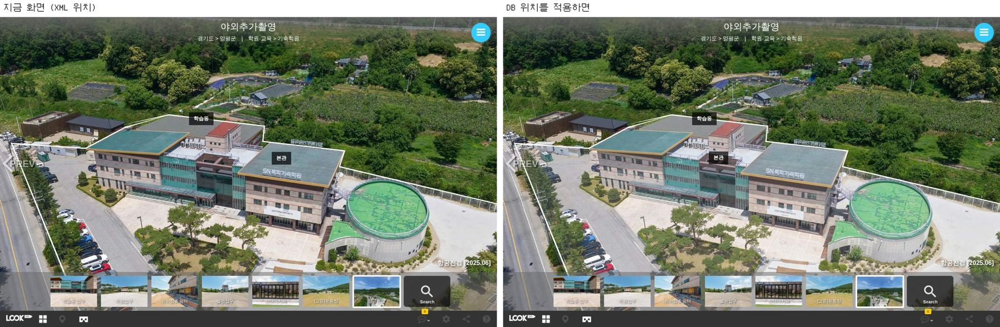

직접 확인
<a class="lnk legacy" href="https://look360.kr/vr/snacademy/20250612/32342" target="_blank">https://look360.kr/vr/snacademy/20250612/32342</a>
<a class="lnk" href="https://kabkee-main.tailfe017f.ts.net:8443/IND/issues/IND-9241" target="_blank">IND-9241</a>

---

## 📸 1889 «그...찻집» 툴팁 글자 비교 운영 반영 전

같은 건물을 XML 은 «그...찻집», DB 는 «기념품샵»으로 부르던 사례입니다. DB 글자를 «그...찻집»으로 변경합니다.

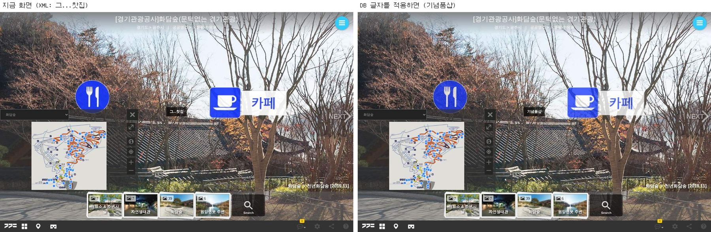

직접 확인
<a class="lnk legacy" href="https://look360.kr/vr/ggtour_hwadamsup/bf_ggtour_hwadamsup_vrstory/21757" target="_blank">https://look360.kr/vr/ggtour_hwadamsup/bf_ggtour_hwadamsup_vrstory/21757</a>
<a class="lnk" href="https://kabkee-main.tailfe017f.ts.net:8443/IND/issues/IND-9241" target="_blank">IND-9241</a>

---

## 🧱 타일 레벨 전수 수정과 회귀 원복 11/04~11/09 완료

레거시 XML 선언과 실제 타일이 어긋나 콘텐츠가 안 보이던 문제를 전수 수정했고, 그 수정이 만든 회귀를 오너 지적으로 찾아 되돌렸습니다.

| 이슈 | 결과 |
|---|---|
| [IND-9060](https://kabkee-main.tailfe017f.ts.net:8443/IND/issues/IND-9060) 레거시 전수검사·수정 | sphere·flat 전체 대상 · 수정 장면 274건 · QC 5건 모두 타일 404 0 · 오너 최종 확인 11/09 |
| [IND-9157](https://kabkee-main.tailfe017f.ts.net:8443/IND/issues/IND-9157) 회귀 100장면 원복 | l1 선언이 2546→3806 · 1910→3682 로 잘못 바뀐 회귀(잔여 타일까지 폭에 더함) → 배포 전 선언 전 레벨로 원복 · 재타일링 0 · QC 498형 232건 · 374형 168건 PASS |
| [IND-9059](https://kabkee-main.tailfe017f.ts.net:8443/IND/issues/IND-9059) 275건 화면 확인 | l1 회귀 원복 116(498형 74 · 374형 42) · 선언 밖 l3 153(수정 없음) · 이상 없음 6 · VRSTORY 44장면 수정 · 오너 확인 11/09 |
| [IND-8731](https://kabkee-main.tailfe017f.ts.net:8443/IND/issues/IND-8731) 플랫폼 선행 수정 | sphere `16bfe2b5` · flat `aea0dfed` (10/30 완료 · 오너 확인 11/09) |

> 판단 착오도 함께 보고합니다. 처음 «이음매 결함 100건»으로 분류했지만 원래 결함이 아니라 [IND-9060](https://kabkee-main.tailfe017f.ts.net:8443/IND/issues/IND-9060) 배포가 만든 회귀였고, 오너가 「기존엔 잘 보였다」고 지적해 배포 전후 XML 비교로 확인했습니다.

확인
<a class="lnk" href="https://kabkee-main.tailfe017f.ts.net:8443/IND/issues/IND-9060" target="_blank">IND-9060</a>
<a class="lnk" href="https://kabkee-main.tailfe017f.ts.net:8443/IND/issues/IND-9157" target="_blank">IND-9157</a>
<a class="lnk" href="https://kabkee-main.tailfe017f.ts.net:8443/IND/issues/IND-9059" target="_blank">IND-9059</a>

---

## 🎨 레거시에서 특별히 제작한 씬이 플랫폼에도 적절히 옮겨졌다 (1/3) 11/09

2529 Kay Park 만다라 전시 9씬입니다. 레거시 XML 을 손으로 제작한 씬이라 DB 값 자동 생성으로는 같은 화면이 나오지 않아, 레거시 씬 본문을 그대로 쓰는 방식을 플랫폼에 추가했습니다. (29336 · 29338 · 29339)

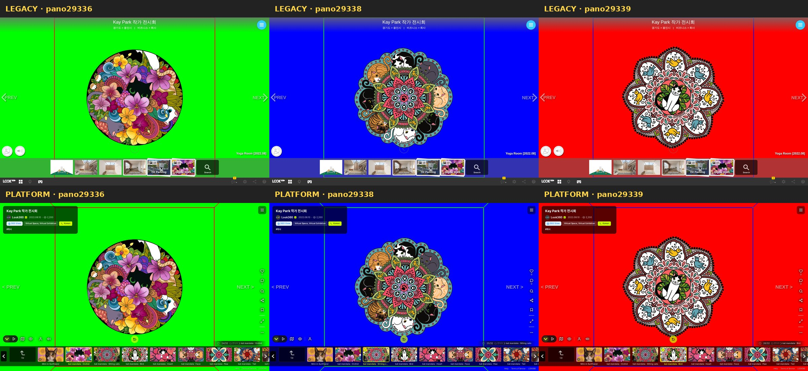

직접 확인
<a class="lnk legacy" href="https://look360.kr/vr/indyspot/mandalacat" target="_blank">레거시 https://look360.kr/vr/indyspot/mandalacat</a>
<a class="lnk" href="http://100.64.25.50:5174/vr/o1vj1ty0" target="_blank">플랫폼 http://100.64.25.50:5174/vr/o1vj1ty0</a>
<a class="lnk" href="https://kabkee-main.tailfe017f.ts.net:8443/IND/issues/IND-9100" target="_blank">IND-9100</a>

---

## 🎨 레거시에서 특별히 제작한 씬이 플랫폼에도 적절히 옮겨졌다 (2/3) 11/09

격자 배경·프레임·회전 이미지·PREV/NEXT·나레이션이 그대로 동작합니다. (29340 · 29341 · 29342)

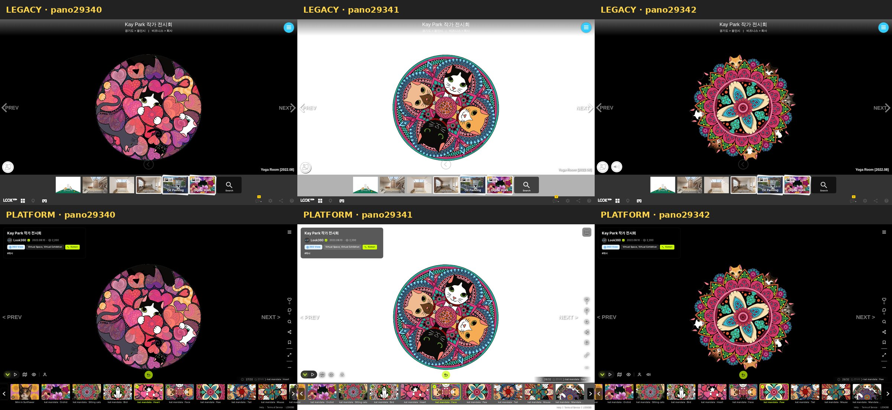

직접 확인
<a class="lnk legacy" href="https://look360.kr/vr/indyspot/mandalacat" target="_blank">레거시 https://look360.kr/vr/indyspot/mandalacat</a>
<a class="lnk" href="http://100.64.25.50:5174/vr/o1vj1ty0" target="_blank">플랫폼 http://100.64.25.50:5174/vr/o1vj1ty0</a>
<a class="lnk" href="https://kabkee-main.tailfe017f.ts.net:8443/IND/issues/IND-9100" target="_blank">IND-9100</a>

---

## 🎨 레거시에서 특별히 제작한 씬이 플랫폼에도 적절히 옮겨졌다 (3/3) 11/09

실측(11/09 · 레거시 운영 vs 플랫폼 dev · 1440×900): 9씬 모두 양쪽에서 열리고 배경·프레임·만다라 크기가 육안 비교로 같습니다. (29343 · 29344 · 29376)

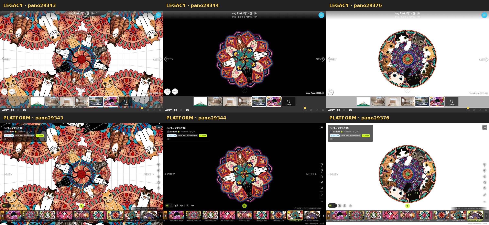

직접 확인
<a class="lnk legacy" href="https://look360.kr/vr/indyspot/mandalacat" target="_blank">레거시 https://look360.kr/vr/indyspot/mandalacat</a>
<a class="lnk" href="http://100.64.25.50:5174/vr/o1vj1ty0" target="_blank">플랫폼 http://100.64.25.50:5174/vr/o1vj1ty0</a>
<a class="lnk" href="https://kabkee-main.tailfe017f.ts.net:8443/IND/issues/IND-9100" target="_blank">IND-9100</a>

---

## 🧹 레거시 기준 콘텐츠 정리 결과 · 2529 남은 차이 11/06 완료

**[IND-9100](https://kabkee-main.tailfe017f.ts.net:8443/IND/issues/IND-9100) 정리 결과**

| 분류 | 결과 |
|---|---|
| 다국어 사본 31개 | 레거시 XML 추가 · 2194 플랫폼 비공개 |
| 장소 없는 투어 | UCC 제외 · 비UCC 4개는 [IND-9105](https://kabkee-main.tailfe017f.ts.net:8443/IND/issues/IND-9105) |
| 1936·1982·2529 | 플랫폼을 레거시 화면에 맞춤 |
| cylinder 5행 | 플랫폼 CYLINDER 렌더 · 6209 는 레거시도 수정 |
| store_item 125 | 비활성화 |
| 오너 시트 | platform_url 498행 정정 |

**2529 남은 차이 (서비스 문제 아님)**

| # | 차이 |
|---|---|
| ① | PREV/NEXT 모양 — 레거시 화살표 그림 · 플랫폼 글자 |
| ② | 첫 드래그 전 안내 이미지 — 레거시 마우스 아이콘 · 플랫폼 진흥원 카드(양쪽 모두 첫 드래그 뒤 사라짐) |
| ③ | 29376 의 NEXT — 레거시는 보이지만 동작 안 함 · 플랫폼은 미표시 |
| ④ | 레거시는 진입 상태별 fov 90·110 · 110 에서 만다라가 약 1.27배 큼 |

> cylinder 재생성 위험(827 · 1928)은 [IND-9134](https://kabkee-main.tailfe017f.ts.net:8443/IND/issues/IND-9134) 트랙으로 넘겼습니다. 삭제는 [IND-9105](https://kabkee-main.tailfe017f.ts.net:8443/IND/issues/IND-9105) 에서 별도로 진행했고 이 EPIC 의 삭제는 0건입니다.

---

## 🏠 홈 히어로 큐레이션 갱신 11/04~11/09 · 운영 반영

전 레코드가 2026-08-01 로 만료돼 유효 큐레이션 0건 → 홈 히어로가 100% 랜덤으로 채워지고 있었습니다.

| 이슈 | 내용 |
|---|---|
| [IND-9113](https://kabkee-main.tailfe017f.ts.net:8443/IND/issues/IND-9113) 갱신 | 오너 시트 기준 기존 55개 만료일 2100-12-31 연장 + 111개 추가 → 유효 166개(플랫·없는 파노·중복 9건 제외) |
| [IND-9113](https://kabkee-main.tailfe017f.ts.net:8443/IND/issues/IND-9113) 원인 하나 더 | 앞 50행만 읽고 섞는 구조라 51번째 이후는 나오지 않았습니다 → `ORDER BY display_order, RAND()` 로 풀 전체 추출(운영 RDS 부하 +0.6ms 수준) |
| [IND-9113](https://kabkee-main.tailfe017f.ts.net:8443/IND/issues/IND-9113) 검증 | 운영 메인 3회 모두 10칸이 큐레이션 · 신규 행 포함 · dev 30회 서로 다른 135개 노출 |
| [IND-9114](https://kabkee-main.tailfe017f.ts.net:8443/IND/issues/IND-9114) 166개 전수 로딩 | 정상 162 · 문제 0 · 🟡 4(숨김 장소 uid 85·91·355·356) · 명동성당 검은 화면은 `7b8a6e3cd` 로 해소 |
| [IND-9238](https://kabkee-main.tailfe017f.ts.net:8443/IND/issues/IND-9238) 메인 파노 관리 | 달력만 있던 화면에 테이블뷰 추가(기본) · 상태·제외 사유 표시 · QC PASS · 11/09 운영 반영(`5f92965da`) |

확인
<a class="lnk" href="https://kabkee-main.tailfe017f.ts.net:8443/IND/issues/IND-9113" target="_blank">IND-9113</a>
<a class="lnk" href="https://kabkee-main.tailfe017f.ts.net:8443/IND/issues/IND-9114" target="_blank">IND-9114</a>
<a class="lnk" href="https://kabkee-main.tailfe017f.ts.net:8443/IND/issues/IND-9238" target="_blank">IND-9238</a>

---

## 🗂️ 메인 파노 관리 — 달력 대신 테이블로 보기 11/09 운영 반영 `5f92965da`

메인 랜덤 풀에 무엇이 들어 있는지 바로 보이도록 테이블뷰를 기본으로 두고, 상태 필터·검색·행 클릭 수정/삭제를 넣었습니다. 달력뷰로도 전환할 수 있습니다.

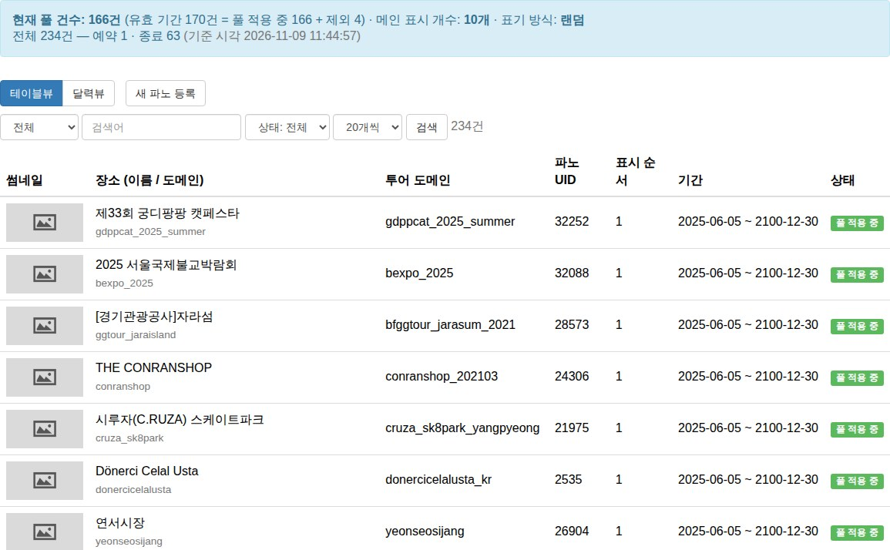

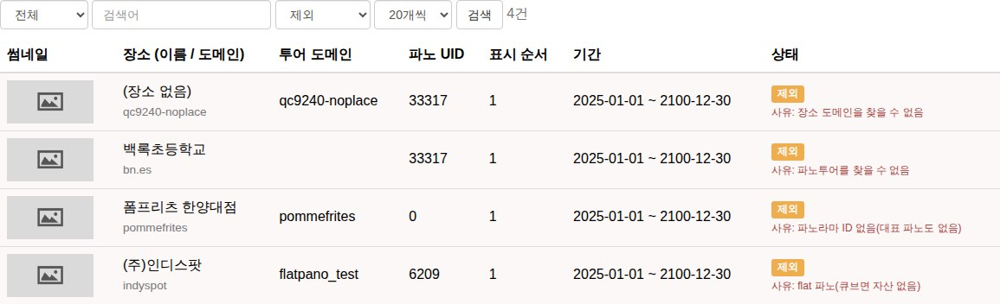

상태: 풀 적용 중 · 예약 · 종료 · 제외(사유 표시)

> 로컬 QC 화면이라 썸네일은 회색이고, 제외 4건은 QC 가 넣은 임시 데이터입니다. 운영은 풀 166건 · 제외 0건입니다(SELECT 실측).

직접 확인
<a class="lnk legacy" href="https://origin.look360.kr/?r=home&m=admin&module=look360_mainPage" target="_blank">레거시 관리자 메인 파노 관리 (로그인 필요)</a>
<a class="lnk" href="https://kabkee-main.tailfe017f.ts.net:8443/IND/issues/IND-9238" target="_blank">IND-9238</a>

---

## 📋 VR투어 소속 파노라마 이름 차이 표시 11/09 운영 반영 `48f6c41bf`

두 이름이 다른 행은 `원래 이름 → 투어 이름`(회색 → 빨강)으로 표시하고, 행별 「↩ 원래 이름으로」와 「↩ 전체 원래 이름으로 (N)」을 넣었습니다. 잘못 붙은 컬럼 헤더도 고쳤습니다.

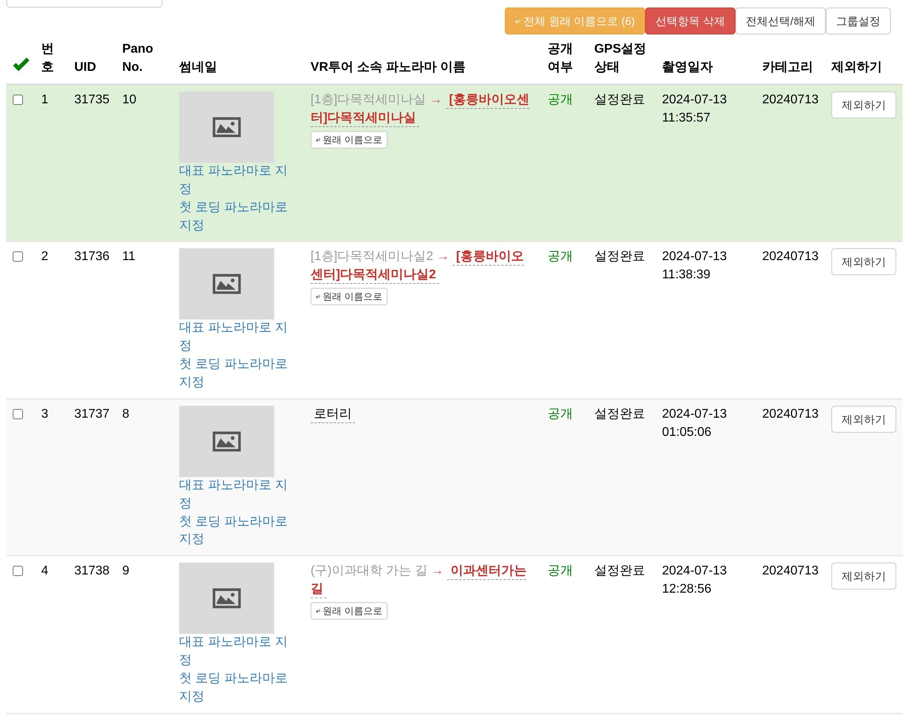

> 투어 2686 로컬 개발 환경 캡처이며 썸네일은 자리표시 이미지입니다. 되돌린 뒤 뷰어 제목까지 바꾸려면 기존처럼 「XML 생성」을 따로 눌러야 합니다.

직접 확인
<a class="lnk legacy" href="https://origin.look360.kr/?r=home&m=admin&module=PanoramaManagement&front=panoTour&toursubmenu=panoTour_editVrList&panotourUid=2686&prevMenu=panoTourInfo" target="_blank">레거시 관리자 투어 2686 (로그인 필요)</a>
<a class="lnk" href="https://kabkee-main.tailfe017f.ts.net:8443/IND/issues/IND-9097" target="_blank">IND-9097</a>

---

## 🛠️ Look360 Utils 로 flat 파노라마 올리기 — 사용 가이드 공유 11/09 릴리스

Utils v0.1.4-beta.6(GitHub 프리릴리스). **Hugin·ImageMagick·ExifTool 을 앱에 포함해 작업자 PC 에 따로 설치할 필요가 없습니다.**

| 항목 | 내용 |
|---|---|
| 흐름 | Utils 타일 생성 → Batch XML → 업로드 zip → 관리자 zip 업로드 → Batch XML 등록 → VR투어 추가 → XML 생성 → 공개 설정 |
| Windows 검증 | 세 프로그램이 없는 PC 에서 파일 297개 생성 · 개발 서버 업로드 → 뷰어 flat 2장·sphere 1장 동작(장소 1641 · 투어 2663) |
| [flat] 표시 | 폴더명 끝 띄어 쓴 [flat] 은 등록 이름에서 자동 제거 · 두 번 쓰면 하나 남음 |
| mac | arm64 dmg 추가 · 파일 297개 생성 확인 · 처음 열 때 「그래도 열기」 승인 1회 필요 · 자동 업데이트 없음 |

확인
<a class="lnk" href="https://kabkee-decks.netlify.app/guides/2026-11-09-flat-pano-upload-guide.html" target="_blank">공유 슬라이드 16장 — flat 파노라마 업로드 가이드</a>
<a class="lnk" href="https://kabkee-main.tailfe017f.ts.net:8443/IND/issues/IND-9056" target="_blank">IND-9056</a>

---

<!-- _class: sec -->

Section 03

## l3 플랫폼 화면

콘텐츠 링크 방향 공유와 이번 주 완료 건, OS 설정에 따른 애니메이션 차이를 공유합니다.

---

## 🔗 콘텐츠 단위 홈페이지·SNS 링크 — 방향 공유 오너 결정 11/02 · 11/05 완료

[IND-8982](https://kabkee-main.tailfe017f.ts.net:8443/IND/issues/IND-8982) 로 장소 SNS 는 보이게 됐지만, 콘텐츠 «자체»를 홍보할 링크는 넣을 자리가 없었습니다. 예로 「[경기관광공사] 무장애 경기관광 W지우리조트」는 장소 SNS 에 리조트 계정만 들어가 캠페인 페이지를 알릴 수 없습니다.

| 오너 결정(11/02) | 내용 |
|---|---|
| ① 진행 방식 | 에픽으로 진행 |
| ② 입력 권한 | 판매자(OWNER 롤)도 자기 콘텐츠에 입력 가능 |
| ③ 개수 | 제한 없음 · 같은 플랫폼 여러 개 허용(youtube 2개 등) |
| ④ 플랫폼 | 종류 확장(X·카카오스토리 등) + 「기타」 직접 입력 |

- 장소 홈페이지는 이미 여러 개 입력·표시가 가능합니다(어드민 「웹사이트 추가」 · [IND-6925](https://kabkee-main.tailfe017f.ts.net:8443/IND/issues/IND-6925)). dev DB 에서 website 2개 이상인 장소는 이번 시연 데이터 전까지 0곳이었습니다.
- 회의 후 정리: 시연 데이터 `l3_place_sns` uid **4209·4210·4211**(place 1457 · dev DB `127.0.0.1:3308`) 삭제 여부를 정합니다.

확인
<a class="lnk" href="https://kabkee-main.tailfe017f.ts.net:8443/IND/issues/IND-9049" target="_blank">IND-9049</a>
<a class="lnk" href="https://kabkee-main.tailfe017f.ts.net:8443/IND/issues/IND-8982" target="_blank">IND-8982</a>

---

## 📸 시연 화면 — 장소 홈페이지 여러 개 + 장소 SNS PC 1440 · 모바일 390

장소 1457 에 website 2개 + instagram + youtube 를 넣어 표시되는 모습입니다.

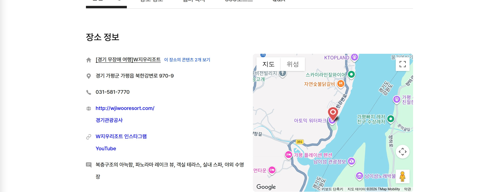

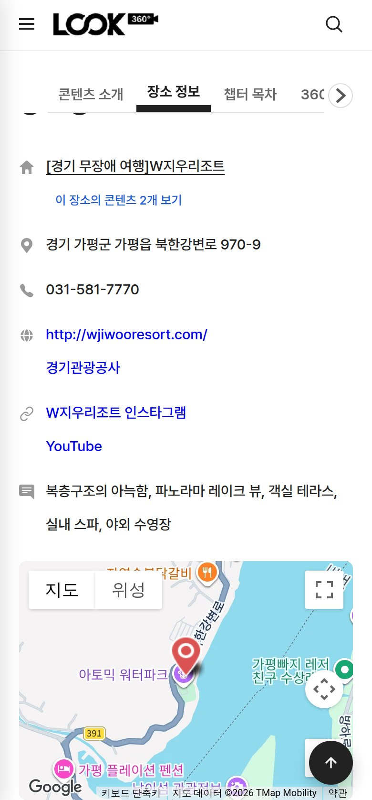

직접 확인
<a class="lnk" href="http://100.64.25.50:5174/vr-info/ab28f18c" target="_blank">http://100.64.25.50:5174/vr-info/ab28f18c</a>
<a class="lnk" href="https://kabkee-main.tailfe017f.ts.net:8443/IND/issues/IND-9049" target="_blank">IND-9049</a>

---

## ✅ 이번 주 완료 — 플랫폼 화면 11/05~11/09

| 이슈 | 무엇을 했나 |
|---|---|
| [IND-8594](https://kabkee-main.tailfe017f.ts.net:8443/IND/issues/IND-8594) | VR스토리 컨트롤러 개편 — 화면 밖 핫스팟 방향 표시 · 챕터 n/N · 하단 진행바 · 나레이션 재생 중 점 3개 |
| [IND-9148](https://kabkee-main.tailfe017f.ts.net:8443/IND/issues/IND-9148) | vrViewer 하단 썸네일 — 모바일 하프시트 애니메이션 · i 버튼 삭제 · 정보 영역 탭 → pano detail · PC 현재 파노 hover 시 큰 i |
| [IND-9154](https://kabkee-main.tailfe017f.ts.net:8443/IND/issues/IND-9154) | 외부 embed 뷰어에 홈 hero 정보(제목·채널 프로필·채널명·지역·카테고리) 표시 · `nocontrol=1` 은 숨김 |
| [IND-9155](https://kabkee-main.tailfe017f.ts.net:8443/IND/issues/IND-9155) | vr-info 장소 SNS — 라벨 없이 등록된 URL 을 그대로 나열 |
| [IND-9255](https://kabkee-main.tailfe017f.ts.net:8443/IND/issues/IND-9255) | vrViewer 소개 탭 — «장소 정보가 없습니다» 안내 제거 · 장소 정보 섹션·내비 탭은 place_uid 있을 때만 |
| [IND-9257](https://kabkee-main.tailfe017f.ts.net:8443/IND/issues/IND-9257) | 헤더 알림 ⋯ 메뉴(«숨기기» 하나) · 상단 카테고리 좌우 가득 + 화살표 쪽 그라데이션 |

---

## ✅ 이번 주 완료 — 플랫폼 (2) 11/05~11/09

| 이슈 | 무엇을 했나 |
|---|---|
| [IND-9247](https://kabkee-main.tailfe017f.ts.net:8443/IND/issues/IND-9247) | 채널 목록 비공개 콘텐츠 — 주인·ADMIN 만 비공개 상태로 조회(360VIEW·VRSTORY 동일) · 공개 목록 hidden 누출 0(2,272건 QC) |
| [IND-8862](https://kabkee-main.tailfe017f.ts.net:8443/IND/issues/IND-8862) | 「지금 보는 언어로 공유」 체크박스(기본 켜짐) · 360포스트 공유 쿼리 소실 수정 · SNS 미리보기 다국어 · 표시 방식 C(표시 없음) |
| [IND-8870](https://kabkee-main.tailfe017f.ts.net:8443/IND/issues/IND-8870) | 조회수 증가 경로 전수 검수·원칙 위반 수정 — 외부 iframe `autoplay=1` 로드 +1 · 홈 슬라이드 embed +0 |

> 위 건은 원장 기준 완료 보고 대상입니다. 회의 메모에서 나온 건([IND-9148](https://kabkee-main.tailfe017f.ts.net:8443/IND/issues/IND-9148) · [IND-9154](https://kabkee-main.tailfe017f.ts.net:8443/IND/issues/IND-9154) · [IND-9155](https://kabkee-main.tailfe017f.ts.net:8443/IND/issues/IND-9155) · [IND-9255](https://kabkee-main.tailfe017f.ts.net:8443/IND/issues/IND-9255) · [IND-9257](https://kabkee-main.tailfe017f.ts.net:8443/IND/issues/IND-9257))은 11/03 회의 메모 #6·#7·#22·#23·#10·#15 를 발주해 처리했습니다.

원문
<a class="lnk" href="https://kabkee-main.tailfe017f.ts.net:8443/IND/issues/IND-9247" target="_blank">IND-9247</a>
<a class="lnk" href="https://kabkee-main.tailfe017f.ts.net:8443/IND/issues/IND-8862" target="_blank">IND-8862</a>
<a class="lnk" href="https://kabkee-main.tailfe017f.ts.net:8443/IND/issues/IND-8870" target="_blank">IND-8870</a>

---

## 🛑 웹 애니메이션이 사용자 OS 설정 때문에 멈출 수 있습니다 11/09 · 이슈 없음(오너 직접 확인)

VR스토리 나레이션 점 3개가 안 움직인다는 문의의 원인은 코드 오류가 아니라 OS 접근성 설정(`prefers-reduced-motion: reduce`)이었습니다. 같은 화면이 PC 마다 다르게 보일 수 있습니다.

| OS | 설정 위치 (reduce 조건) |
|---|---|
| Win 11 | 접근성 > 시각 효과 > 애니메이션 효과 (끄면) |
| Win 10 | 접근성 > 디스플레이 > Windows에서 애니메이션 표시 (끄면) |
| macOS | 손쉬운 사용 > 디스플레이 > 동작 줄이기 (켜면) |
| iOS | 손쉬운 사용 > 동작 > 동작 줄이기 (켜면) |
| Android | 접근성 > 애니메이션 삭제 (켜면 · 기기별 상이) |

| 점 3개 (11/09 실측) | 결과 |
|---|---|
| 기본값 | 2.29~6.18px 변화 · `running` |
| `reduce` | `animation: none` · 3.71 / 6.19 / 2.29px 고정 |

**미결:** 점 3개를 OS 설정과 무관하게 항상 움직이게 할지는 정하지 않았습니다.

직접 확인
<a class="lnk" href="http://100.64.25.50:5174/vr/2f9e62cf?story=5-1" target="_blank">http://100.64.25.50:5174/vr/2f9e62cf?story=5-1</a>
콘솔: <code>matchMedia('(prefers-reduced-motion: reduce)').matches</code> · 코드 <code>VrStoryControls.vue:337</code> · <code>default.css:1230,1250,1271</code>

---

## 🚧 진행 중인 EPIC 11/09 조회

| 이슈 | 상태 | 어디까지 왔나 |
|---|---|---|
| [IND-9021](https://kabkee-main.tailfe017f.ts.net:8443/IND/issues/IND-9021) 장소·콘텐츠 정보 개편 | `blocked` | 11/04 방향 전환 · 카테고리 다중 등록 구조 확정(연결 테이블, 11/09) · 하위 [IND-9086](https://kabkee-main.tailfe017f.ts.net:8443/IND/issues/IND-9086) `in_review` |
| [IND-8264](https://kabkee-main.tailfe017f.ts.net:8443/IND/issues/IND-8264) vr-list 통합 구현 | `in_progress` | [IND-8880](https://kabkee-main.tailfe017f.ts.net:8443/IND/issues/IND-8880) 결정에 따라 범위를 다시 정리합니다 |
| [IND-9147](https://kabkee-main.tailfe017f.ts.net:8443/IND/issues/IND-9147) 해시태그 → 통합검색 | `blocked` | BE W1 런타임 확인 완료 · FE W2 는 같은 파일 선행 작업 대기 |
| [IND-9270](https://kabkee-main.tailfe017f.ts.net:8443/IND/issues/IND-9270) flat 돌아가기 버튼 공통화 | `blocked` | 15콘텐츠 289장면 대상 · 공통 액션 반영 후 정리 단계 |
| [IND-9253](https://kabkee-main.tailfe017f.ts.net:8443/IND/issues/IND-9253) 레거시 건물 툴팁 플랫폼 복원 | `in_review` | 스키마 변경 카드 `01f07942` 대기 |
| [IND-8527](https://kabkee-main.tailfe017f.ts.net:8443/IND/issues/IND-8527) 이동 핫스팟·이전/다음 버튼 | `in_review` | QC2 전 축 PASS · VR 헤드셋 실기 확인만 남음 |

---

<!-- _class: sec -->

Section 04

## 외부VR 업종·지역 재분류 — 기존 데이터 2,097건

이전 근로장학생이 등록해 둔 **기존 데이터**의 재분류입니다. 크롤러 신규 수집(섹션 05)과는 별개입니다. 검토 시트는 드라이브 「데이터 수정 & 개선」 폴더로 옮겼고, 시트 내용은 그대로 둡니다.

원본
<a class="lnk" href="https://kabkee-decks.netlify.app/reports/2026-11-06-external-vr-reclass.html" target="_blank">원본 덱(18장)</a>
<a class="lnk" href="http://100.64.25.50:8088/reports/2026-11-06-external-vr-reclass.html" target="_blank">로컬 원본</a>
<a class="lnk" href="https://docs.google.com/spreadsheets/d/1ZmB4E4w9hx0fTGlFB0ifodH2kHu7XE9loQIV1XCG3Jo/edit" target="_blank">검토 시트</a>
<a class="lnk" href="https://drive.google.com/drive/folders/1pIWrynurZVAv8jp702IGymjXheYAK0v3" target="_blank">드라이브 폴더</a>
<a class="lnk" href="https://kabkee-main.tailfe017f.ts.net:8443/IND/issues/IND-7601" target="_blank">IND-7601</a>
<a class="lnk" href="https://kabkee-main.tailfe017f.ts.net:8443/IND/issues/IND-8592" target="_blank">IND-8592</a>

---

<!-- _class: agenda -->

## 한 줄 요약 — 분류는 끝났고, 검토와 결정만 남았습니다

### 🚨 왜 했나

- 외부VR 2,097건 전부 업종·지역이 비어 vr-list 에 0건 노출
- 검색결과도 vr-list 기준으로 맞추면 외부VR 이 검색에서 사라짐

### ✅ 무엇을 했나

- 업종: Claude Opus 가 플랫폼 분류표 기준으로 2,097건 판정
- 지역: 구글 지오코딩으로 area1~5 채움

### 🔍 검토할 것

- 검토 필요 261건 · 오너 판단 필요 68건
- 업종 신규 제안 5개 + 이름 변경 1개
- 지역 노드 추가 한국 760 · 해외 도시 362

### 🔒 안전

- DB 는 읽기만 했습니다(반영 0건)

---

## 🚨 배경 — 외부VR 이 목록에도 검색에도 안 나오는 이유 11/06

| 화면 | 현재 동작 | 외부VR |
|---|---|---|
| vr-list | 업종(카테고리)이 있는 콘텐츠만 노출 | 2,097건 모두 업종 없음 → 0건 |
| 검색결과 VR 탭 | 업종 조건 없이 노출 | 「서울」 검색 540건 중 403건이 외부VR |
| 검색결과를 vr-list 기준으로 통일하면 | vr-list 와 같은 조건 | 검색에서도 0건 |

- 9/23 오너 결정은 「자동 분류 → 관리자 검증 → 이관」이었지만 검토가 승인 105건에서 멈춰 있었습니다
- 그래서 검색 방향 카드(IND-8592)에 답하기 전에 분류부터 채우기로 했습니다

확인
<a class="lnk" href="https://kabkee-main.tailfe017f.ts.net:8443/IND/issues/IND-7601" target="_blank">IND-7601 외부VR 분류</a>
<a class="lnk" href="https://kabkee-main.tailfe017f.ts.net:8443/IND/issues/IND-8592" target="_blank">IND-8592 검색결과 필터 통일</a>

---

## 🔁 작업 흐름 — 1차 시도에서 문제를 찾고 방식을 바꿨습니다 11/06

| 단계 | 방식 | 결과 |
|---|---|---|
| 1차 업종 | 판정 AI jev(선택지 고르기) | 「[서울역사박물관] 종로서적 전시」 → 서점 같은 오판 |
| 1차 지역 | jev 로 시·도 / 시·군·구만 | 동·리(area5)까지 못 채움 |
| **2차 업종** | **Claude Opus** + 분류표 + 360VIEW 실제 배정 사례 | 접두어 규칙 적용 · 서울역사박물관 123건 전부 박물관 |
| **2차 지역** | **구글 지오코딩** → 지역 테이블 트리 매칭 | 한국 1,509건 area5 까지 |
| 검증 | 같은 좌표 공유·주소 불일치 점검 | 의심 좌표 425건을 주소 기준으로 재판정 |

> jev 는 «선택지 고르기»는 싸고 빠르지만, 규칙을 적용하거나 계층을 따라 내려가는 판단에는 약했습니다.

---

<!-- _class: sec -->

외부VR 재분류 · 01

## 업종 — 어떻게 판정했나

플랫폼 분류표(소분류 207개)와 기존 360VIEW 배정 사례를 기준으로 삼았습니다.

---

## 🏷️ 업종 판정 규칙과 결과 11/06

| 규칙 | 예 |
|---|---|
| 판정 대상은 «영상 속 장소 자체» — 전시 주제가 아님 | 종로서적 전시 → 서점(✕) 박물관(○) |
| 제목 앞 `[기관명]` 이 **장소**면 그 장소 업종 | `[서울역사박물관]` 123건 → 전부 박물관 |
| 제목 앞 `[기관명]` 이 **발행처**면 무시하고 영상 속 장소 | `[양천구청] 양천둘레길` → 산책로 |
| 같은 장소는 같은 소분류 · 360VIEW 사례를 따름 | `[경기관광공사]남송미술관` → 미술관 |

- 2,097건 전부 판정 · 누락 0 · 분류표 밖 값 0
- 확신 0.7 미만 241건은 시트에서 «검토 필요»로 표시했습니다

---

## ➕ 업종 신규 제안 — 맞는 칸이 없던 49건 11/06

| 제안 소분류 | 대분류 | 건수 | 지금 근사 배정 |
|---|---|---|---|
| 교통시설(역·공항·터미널) | 공공장소 | 6 | 지역명소 |
| 도시·지역 투어 | 관광·여행 | 14 | 지역명소·자연명소 |
| 국가·공공기관 청사 | 공공기관 | 16 | 교육장·기업·시청·구청 |
| 출렁다리·교량 | 공공명소 | 6 | 지역명소·거리 |
| 촬영 세트장 | 관광·여행 | 4 | 테마파크·체험장 |

- 이름 변경 1개: 스카이레일 → 스카이레일·케이블카(케이블카·모노레일 3건)
- 시트에는 «추가된 상태» 기준으로 채우고, 지금 분류표 기준 근사값을 옆 칸에 남겼습니다

---

<!-- _class: sec -->

외부VR 재분류 · 02

## 지역 — area1~5 를 어떻게 채웠나

GPS 를 기본으로, 의심스러운 좌표는 주소로 다시 찾았습니다.

---

## 📍 지역 판정 방식 11/06

| 단계 | 내용 |
|---|---|
| ① GPS 역지오코딩 | 구글이 주는 「시·도 → 시 → 구·군 → 읍·면 → 동·리」 이름을 받음 |
| ② 지역 테이블 매칭 | 위에서부터 차례로 찾아 내려감 · area 번호 = 지역 테이블 레벨 |
| ③ 의심 좌표 재판정 | 다른 장소와 좌표 공유 · 주소와 시·도 불일치 → 주소로 다시 지오코딩 |
| ④ 없는 단계 | 한국은 신규 노드(구글 이름) · 해외는 dr5hn 도시 승격으로 채움 |

- 서울은 area1·3·5(시·구·동), 경기 일반시는 area1·2·4·5 처럼 기존 360VIEW 장소와 같은 방식입니다
- 결과: 한국 1,526건 중 1,509건이 area5 까지 · 해외 539건이 도시(area2)까지

---

## ⚠️ GPS 함정 — 좌표가 복사된 콘텐츠가 많았습니다 11/06

| 같은 좌표 | 몰린 콘텐츠 |
|---|---|
| 예산군 응봉면 1곳 | 국립민속박물관 · 국립한글박물관 · 천리포수목원 · 신두리 해안사구 등 43건 |
| 정선군 화암면 1곳 | 강릉 선교장 · 뮤지엄산 · 코엑스 별마당 도서관 등 12건 |
| 포항 송라면 1곳 | 김천 직지사 · 보은 법주사 · 안동 봉정사 등 사찰 8건 |

- 같은 좌표를 3건 이상 공유하는 묶음이 83개(581건)였습니다
- 이 중 서로 다른 장소이거나 주소와 시·도가 어긋난 425건은 주소로 다시 찾았습니다 → 불일치 187건 → 9건

> «GPS 는 정확하다»는 전제는 이번 데이터에선 성립하지 않았습니다. 원본 좌표 정리는 별도 과제입니다.

---

## 🗺️ 지역 추가가 필요한 것 11/06

| 구분 | 추가할 것 | 해당 콘텐츠 |
|---|---|---|
| 한국 4단계(읍·면) | 신규 노드 193개 | |
| 한국 5단계(동·리) | 신규 노드 567개 | 한국 합계 약 800건 |
| 해외 도시 | dr5hn 에서 승격할 도시 362개 | 444건 |
| 해외 미해결 | dr5hn 에도 없음 14건 · 위치 불명 10건 | 24건 |

- 해외 도시가 비어 있던 이유: dr5hn 원본엔 있는데 «states 전량 + 매핑용 도시»만 시드했기 때문
- ✅ 오너 결정(11/06): dr5hn 전체를 넣지 않고 필요한 도시만 그때그때 승격합니다

---

## 🌏 판단 기준 — 해외는 «주·도시»까지만 채웁니다 11/06

| 근거 | 내용 |
|---|---|
| 콘텐츠 밀도 | 해외 571건 중 절반 이상이 대학 투어 · 도시당 대개 1건 → 더 내리면 1건짜리 노드만 늘어남 |
| 사용자 동선 | 한국은 동 단위로 좁힐 가치가 있지만, 해외는 국가 → 주 → 도시면 충분 |
| 데이터 근거 | dr5hn 에는 미국 카운티·동네 단계가 없음(도쿄 구·이스탄불 구처럼 필요한 곳은 이미 도시로 존재) |
| 일관성 | 카운티·카운슬·町 등 나라마다 의미가 달라 L3~L5 칸에 섞으면 필터가 혼란 |

- 상세 위치는 지역 계층이 아니라 구글 주소 문자열(도로명·번지)로 보여줍니다
- 예외: 한 도시에 콘텐츠가 수십 건 쌓이면 그 도시만 한 단계 내립니다

---

<!-- _class: sec -->

외부VR 재분류 · 03

## 검토 방법 — 무엇을 어떤 순서로

시트 하나에 모두 들어 있습니다. 검토할 열이 맨 앞에 있습니다.

---

## 📋 검토 시트 구성 11/06

| 탭 | 내용 | 할 일 |
|---|---|---|
| 요약 | 기준·색상 안내 · 건수 | 먼저 읽기 |
| **분류표** | 2,097행 · 검토 열(A~G)이 맨 앞 · 검토 필요 행이 위 | 판정 입력 |
| 업종추가_제안 | 신규 소분류 5개 + 이름 변경 1개 | 채택 여부 결정 |
| 업종코드표 | 소분류 207개 + 신규 제안(주황) | 수정 시 참고 |
| 지역추가_한국 / 해외(dr5hn) | 신규 노드 760개 · 승격 도시 362개 | 이름 확인 |

- 색상: 주황 = 오너 판단 필요 · 분홍 = 검토 필요 · 보라 칸 = 지역 추가 필요

시트
<a class="lnk" href="https://docs.google.com/spreadsheets/d/1ZmB4E4w9hx0fTGlFB0ifodH2kHu7XE9loQIV1XCG3Jo/edit" target="_blank">외부VR 업종·지역 재분류 v2 (Google Sheets)</a>

---

## ✍️ 검토 순서 — 이렇게 보시면 됩니다 11/06

| 순서 | 대상 | 보는 법 |
|---|---|---|
| ① | 오너 판단 필요 68건(주황) | 국립생태원 17건 업종 1개 선택 · 신규 소분류 해당 49건 · 원본 불일치 1건 |
| ② | 업종추가_제안 탭 | 6개 제안의 채택·이름·대분류 위치 결정 |
| ③ | 검토 필요 261건(분홍) | 「판정」 드롭다운에 확정/수정/제외 · 수정이면 「수정 업종 소분류」 드롭다운 |
| ④ | 지역추가 탭 2개 | 이름이 이상한 노드만 표시(예: 같은 도시 중복) |
| ⑤ | 나머지 1,836건 | 필터로 대분류별 훑어보기 · 이상한 것만 수정 |

> 「판정」을 비워 둔 행은 «확정»으로 간주해 반영하려 합니다. 다르게 하려면 알려 주세요.

---

## 🎯 결정이 필요한 것 11/06

| # | 결정 | 영향 |
|---|---|---|
| 1 | 국립생태원 업종(과학관·식물원·동물원·전시관 중 1개) | 17건 일괄 |
| 2 | 업종 신규 제안 6개 채택 여부 | 49건의 최종 소분류 |
| 3 | 지역 노드 추가(한국 760 · 해외 도시 362) | area 칸이 «신규»인 1,341건 |
| 4 | 반영 방식: 분류 검토 테이블 제안값 vs 운영 데이터 바로 반영 | vr-list 노출 시점 |
| 5 | 검색결과 외부VR 방향(IND-8592 카드) | 분류 반영 후 답변 |

> 11/09 갱신: 5번 카드 `0c99edc8` 은 오너가 (a) «vr-list 검색과 똑같이»로 답변했습니다.

확인
<a class="lnk" href="https://kabkee-main.tailfe017f.ts.net:8443/IND/issues/IND-8592" target="_blank">IND-8592 카드 0c99edc8</a>
<a class="lnk" href="https://kabkee-main.tailfe017f.ts.net:8443/IND/issues/IND-7601" target="_blank">IND-7601 분류 검토</a>

---

## 💰 비용과 안전 11/06

| 항목 | 내용 |
|---|---|
| 업종 판정 | Claude Opus 서브에이전트 9개 · 별도 API 비용 없음 |
| 1차 시도 | jev 유료 약 $0.36 |
| 지역 | 구글 지오코딩 2,695회(역 995 · 주소 850 · 재역 850, 한국어·현지어 각각) · 약 $13.5 |
| DB | dev DB 읽기만 · 지오코딩 응답도 DB 캐시가 아니라 작업 폴더에 저장 |
| 산출물 | 구글 시트 1개(검토용) · 판정 근거 문장은 행마다 「근거」 칸에 |

> 시트 검토가 끝나면 확정된 행만 반영하고, 반영 전후 vr-list·검색 노출 건수를 실측해 보고합니다.

---

<!-- _class: sec -->

Section 05

## 외부VR — 크롤러 수집분 등록 파이프라인

CMS for VR Crawler 로 **새로 수집한 데이터**를 플랫폼 외부VR 로 등록하는 작업입니다. 섹션 04 의 기존 데이터 재분류와는 결이 다릅니다.

---

## 🕸️ 수집 규모와 등록 흐름 11/09 기준 · 후보 단위

수집 규모: 검토 대기 **18,755** · 승인 114 · 게시 1 · 제외 1,679,082(자동 1,675,984 · 사람 3,098) · 접속 불가 28,264.

| 단계(메뉴 「외부VR 등록」 · 11/06 구축) | 하는 일 |
|---|---|
| 1. 장소 확정 | URL 경로 단위로 투어를 묶고, 투어 XML 제목·좌표와 Kakao 후보, 홈페이지의 기관명·주소를 보여줘 실제 장소를 고릅니다. 실제 방문 장소가 없으면 「장소 없음」으로 뺍니다 |
| 2. 중복 검토 | 같은 장소를 가리키는 그룹을 정리하고 대표 URL 을 고릅니다 |
| 3. 이미지 검수 | 투어마다 자동 캡처한 장면 최대 5장 중 쓸 것을 고르고 대표를 지정합니다 · 「다른 장면 더 캡처」 가능 |
| 4. 분류 검토 | 지역(area1~5)·카테고리를 확인하고, 플랫폼에 없는 값은 신규 제안으로 모읍니다 |

> 수집 쪽은 「수집 파이프라인」 메뉴로 분리했습니다. 이슈 없이 저장소 `cms-for-vr-crawler` 에서 진행 중입니다.

작업 화면
<a class="lnk" href="http://192.168.60.6:5175/work-labels" target="_blank">http://192.168.60.6:5175/work-labels (사내망)</a>

---

## 📊 진행 현황과 11/09 이미지 소실·복구 11/09 기준 · 장소 그룹 2,290개

| 대기 | 확정 | 장소 없음 | 플랫폼 중복 제외 | 플랫폼 등록 준비 완료 |
|---:|---:|---:|---:|---:|
| 2,140 | 41 | 2 | 107 | 0 |

| 11/09 사고 | 내용 |
|---|---|
| 증상 | 장소 확정 화면의 이미지가 전부 안 나왔습니다 |
| 원인(추정) | 매일 04:10 업로드 정리 스크립트가 장면 캡처 경로(`place_groups.scene_images`)를 참조로 보지 않아 캡처 파일 전체를 고아 파일로 지운 것으로 추정합니다(삭제 로그는 재부팅으로 소실 · 코드와 정황으로 판단) |
| 복구 | 스크립트 수정(`f947c74`) · 유휴 PC 여러 대로 나눠 약 1시간 50분 만에 2,183개 그룹 · 9,451장 재캡처(최초 캡처는 약 5시간) |
| 후속 | 재캡처로 장면 구성이 달라질 수 있어 이미지 검수 승인 10건은 취소하고 다시 고릅니다 · 0장 그룹 63개(53개는 예전에도 0장) |

작업 화면
<a class="lnk" href="http://192.168.60.6:5175/work-labels" target="_blank">http://192.168.60.6:5175/work-labels (사내망)</a>

---

<!-- _class: sec -->

Section 06

## weekly(k)pop · 회사 공통

차트 데이터 정리는 운영에 반영했고, 기준에 맞지 않는 155주를 발견했습니다.

---

## 🧽 차트 데이터 정리 — 운영 반영 11/06 · 이슈 없음(오너 직접 진행)

발단은 pop 1966 41위 「[]Time」(가수 빈 값) 신고입니다. 멜론 «차트 파인더»를 desktop-kabkee Chrome 으로 열어 대조했고, **로그인 없이 과거 차트가 다 보입니다**([IND-7804](https://kabkee-main.tailfe017f.ts.net:8443/IND/issues/IND-7804) 의 «원본 확보 불가» 판단을 뒤집습니다).

| 구분 | 사이트 | 내용 |
|---|---|---|
| 가수 빈 값 채움 | pop 14곡 · kpop 1곡 | 게시물·차트 행 맞춤 |
| 제목 빈 게시물 삭제 | pop 6 · kpop 1 | 연결 0건 확인 후 삭제 |
| 완전 중복 삭제 | kpop | 14행 |
| 순위 충돌 정리 | kpop | 삭제 32 · 재연결 2 · 신규 등록 2 |
| 빈 순위 채움 | kpop 31행 · pop 178행 | pop 은 대부분 성인 인증 곡 |

> 반영 후 두 사이트 모두 «같은 순위 여러 행 0 · 같은 주 같은 곡 중복 0 · 가수/제목 빈 차트 행 0». 백업 `~/weeklychart-chart/fix-backup/20261106-*.sql`. **실수도 보고합니다** — 기준 적용이 늦어 2016-02-14 를 잘못 정리했다가 같은 날 복구했습니다(가요 100/100). 그 밖에 [IND-9156](https://kabkee-main.tailfe017f.ts.net:8443/IND/issues/IND-9156) 영문 병기 «romanized»·«translated» 태그를 제거했습니다.

---

## 🔍 kpop 장르 판정 — 180주 전수 대조 11/06 · 2014-05-11 ~ 2017-10-08 · 읽기만

| 판정 | 주 수 |
|---|---:|
| 정상(가요·국내종합) | 20 |
| 종합으로 적재 | 155 |
| 불일치 | 2 |
| 유령 주차 | 3 |

| 구간 | 판정 |
|---|---|
| 2014-05-25 ~ 2015-09-13 | 종합 |
| 2015-09-20 ~ 2016-02-28 | 가요·종합 혼재 |
| 2016-03-06 ~ 2017-09-24 | 종합(2017 은 장르종합 · 08-20 만 정상) |
| 2017-10-01 ~ | 정상 · 2019-02-03 한 주만 장르종합 |

| 유령 주차 | 실체 |
|---|---|
| 2016-01-01 | 2017-01-01 데이터 |
| 2016-12-26 | 12-25 주 종합(하루 밀림) |
| 2017-08-19 | 08-13 주 국내종합 정상본 |

**불일치 2주:** 2014-09-28(출처 불명) · 2016-03-27(03-20 복사본)

**DB 에 없는 주:** 2016-02-21 · 2020-02-16 · **2022-09-11 ~ 2023-01-15 19주** 등

---

## 🎬 곡 상세 YouTube 미니 플레이어 11/06 운영 반영 · 이슈 없음(오너 직접 진행)

가사를 보려고 스크롤해도 영상이 오른쪽 아래 400×225 로 떠서 재생이 이어집니다. kpop·pop PC 적용 · 재생 전 안 뜸 / 재생 후 고정 / 닫기 후 안 뜸을 운영에서 확인했습니다.

**스크롤 전 — 영상이 맨 위**

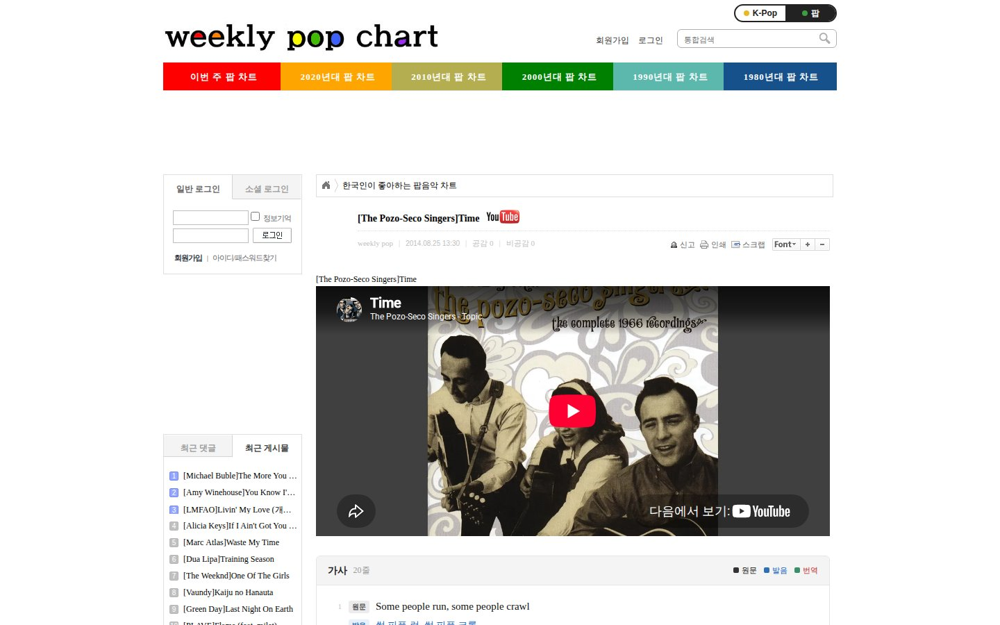

**스크롤 후 — 가사 위 미니 플레이어**

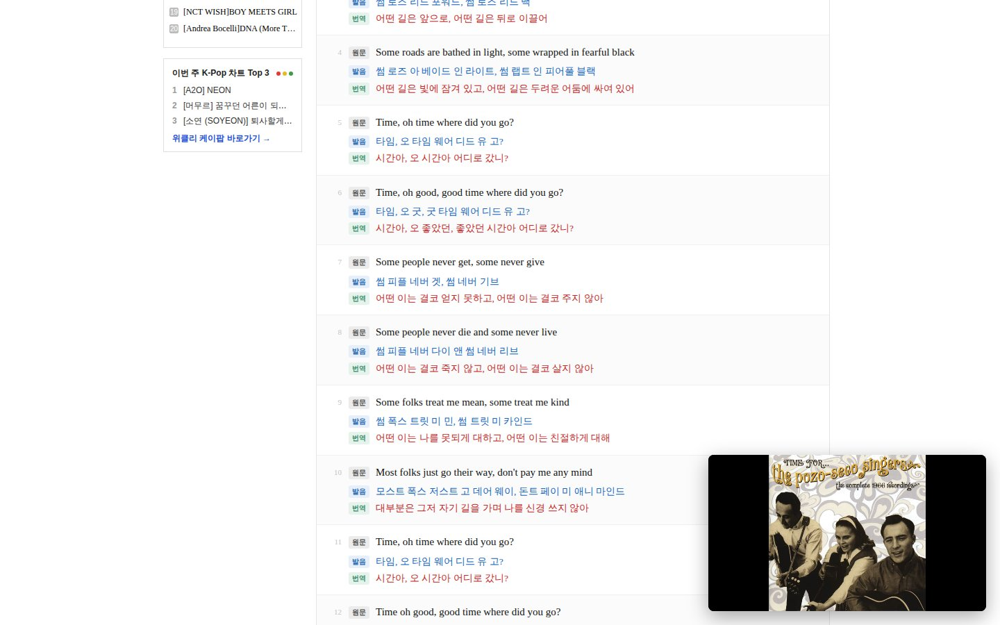

직접 확인
<a class="lnk" href="https://pop.weeklykpop.com/?m=bbs&uid=6725" target="_blank">https://pop.weeklykpop.com/?m=bbs&uid=6725</a>
<a class="lnk" href="https://weeklykpop.com/?m=bbs&uid=7013" target="_blank">https://weeklykpop.com/?m=bbs&uid=7013</a>
영상 재생 후 아래로 스크롤 · weeklykpop <code>6c21a22</code> · weeklypop <code>05b31e1</code>

---

## ✉️ 회사 Gmail 서명 — 네이버 블로그 배너 교체 11/06 적용 완료 · 이슈 없음(오너 직접 진행)

배너 3개 중 네이버 블로그만 깨져 보였습니다. 원본이 어느 저장소에도 없어(두 버킷 전수 검색 0건) 같은 형식으로 새로 만들어 313×100(27KB)으로 올리고 블로그 링크를 걸었습니다.

**적용 전**

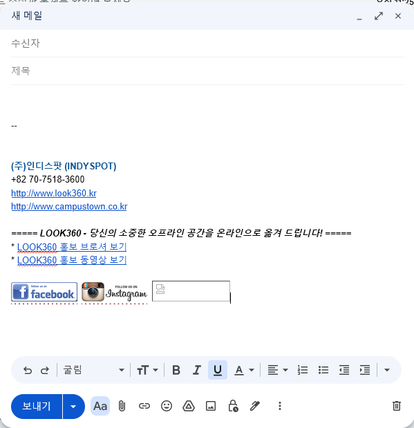

**적용 후**

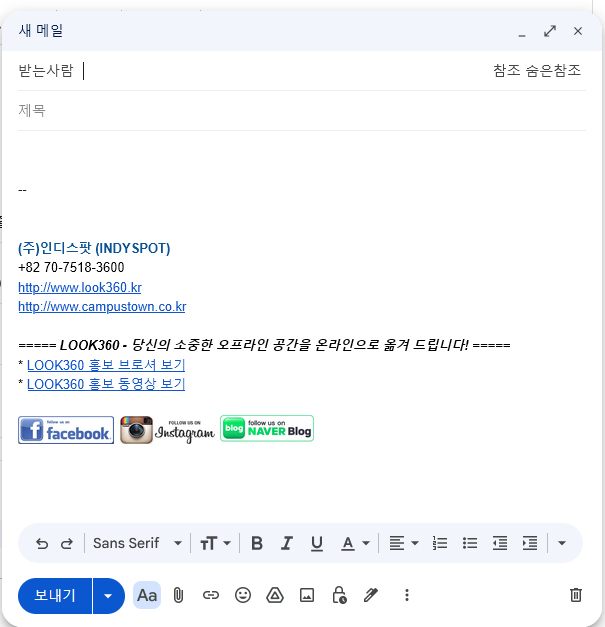

직접 확인
<a class="lnk legacy" href="https://look360.kr/files/icon/look360_naver_blog.png" target="_blank">https://look360.kr/files/icon/look360_naver_blog.png</a>
<a class="lnk" href="https://blog.naver.com/look360kr" target="_blank">https://blog.naver.com/look360kr</a>
CloudFront 무효화 <code>IYCX3QT36A61ZSHHRGD7ZJB8K</code> · 다른 직원 서명도 같은 주소로 교체 가능

---

<!-- _class: sec -->

Section 07

## 🎯 이번 주 안건 — 오너 결정 대기

시안 선택과 방향 결정이 중심입니다. 결정이 나오면 그 뒤에 발주합니다.

---

## 🗳️ 질문 IND-8880 · vr-list 필터 통합 — 안 1 vs 안 2 11/09 시안 · 2안 비교

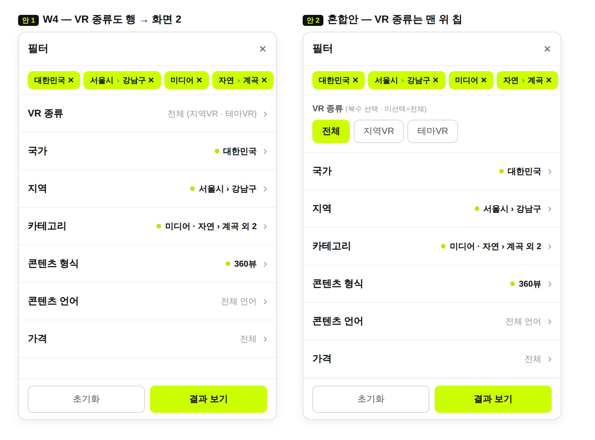

| | 안 1 · VR 종류 = 행 | 안 2 · VR 종류 = 칩 |
|---|---|---|
| VR 종류 고르기 | 행 → 체크 → 뒤로 (3번) | 맨 위 칩 1번 |
| 화면 1 | 7행 | 칩 1줄 + 6행 |
| 구조 | 모든 항목이 «행 → 화면 2» | VR 종류만 칩, 나머지는 행 |
| 카테고리와 관계 | 현재값으로만 보임 | 칩이 바로 위에 있어 순서가 보임 |

두 안 모두 필터 버튼 하나(PC 드롭다운 · 모바일 하프시트), 카테고리는 VR 종류 기준 나열, 정렬은 별도 버튼입니다.

> **확인할 사항:** 안 1 과 안 2 중 어느 쪽으로 구현할지 골라 주십시오. 결정에 따라 [IND-8264](https://kabkee-main.tailfe017f.ts.net:8443/IND/issues/IND-8264) 범위를 다시 정리합니다.

직접 확인
<a class="lnk" href="https://kabkee-main.tailfe017f.ts.net:8443/api/attachments/30daa20b-6f74-4b39-8377-da4ba26da5e5/content" target="_blank">두 안 비교 + 차이 표</a>
<a class="lnk" href="https://kabkee-main.tailfe017f.ts.net:8443/api/attachments/b92eb57c-0466-45a9-83be-da43bd996f3e/content" target="_blank">안 1 PC 화면 1</a>
<a class="lnk" href="https://kabkee-main.tailfe017f.ts.net:8443/api/attachments/f24d77e1-fd19-4c9f-8320-3305b1231e41/content" target="_blank">안 1 화면 전환</a>
<a class="lnk" href="https://kabkee-main.tailfe017f.ts.net:8443/api/attachments/f51c11f3-0b87-4a94-903a-8c88ea552026/content" target="_blank">안 2 PC 화면 1</a>
<a class="lnk" href="https://kabkee-main.tailfe017f.ts.net:8443/api/attachments/a5d8f637-e312-495c-bc6d-c899c7a00bd1/content" target="_blank">안 2 VR 종류별 카테고리</a>
<a class="lnk" href="https://kabkee-main.tailfe017f.ts.net:8443/api/attachments/28c20a22-07c4-475b-8cc2-93ecbb7b2770/content" target="_blank">안 2 모바일</a>
<a class="lnk" href="https://kabkee-main.tailfe017f.ts.net:8443/IND/issues/IND-8880" target="_blank">IND-8880</a>

---

## 🗳️ 질문 IND-8880 · 정렬 버튼 위치 두 안 공통

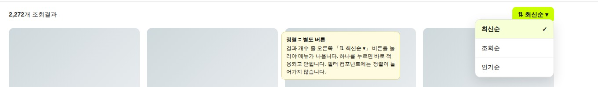

**추천 — 결과 개수 줄 오른쪽 「⇅ 최신순 ▾」 (PC·모바일 같은 자리):** 지금 정렬 버튼 3개가 있는 자리를 버튼 하나로 바꾸는 것이라 위치가 익숙합니다. 모바일 상단 아이콘은 필터·검색·지도 3개를 그대로 둡니다(IND-8243 결정).

**대안 — 모바일 상단 아이콘 줄에 ⇅ 추가(4개):** 「아이콘 3개」 결정과 어긋납니다. 두 경우 모두 메뉴에서 하나를 누르면 바로 적용됩니다.

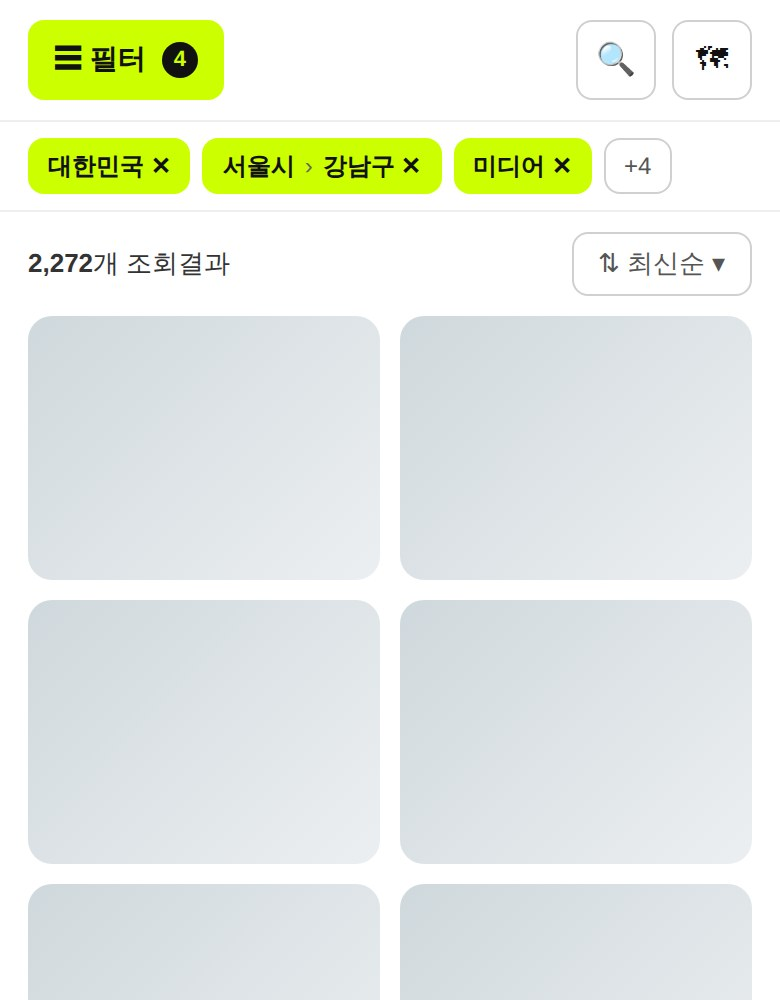

> **확인할 사항:** 정렬 버튼을 결과 개수 줄(추천)에 둘지, 모바일 상단 아이콘 줄에 둘지 골라 주십시오.

직접 확인
<a class="lnk" href="https://kabkee-main.tailfe017f.ts.net:8443/api/attachments/e5edd0a5-2e80-47e7-95f6-2a171222f946/content" target="_blank">PC 정렬 버튼</a>
<a class="lnk" href="https://kabkee-main.tailfe017f.ts.net:8443/api/attachments/8a0bc768-5850-4c41-8d15-124881022045/content" target="_blank">모바일 목록·정렬 위치</a>
<a class="lnk" href="https://kabkee-main.tailfe017f.ts.net:8443/api/attachments/a98e0ee5-a1ce-4ed8-9284-6e9c039ee9d8/content" target="_blank">모바일 정렬 시트</a>
<a class="lnk" href="https://kabkee-main.tailfe017f.ts.net:8443/IND/issues/IND-8880" target="_blank">IND-8880</a>

---

## 📐 안건 2 · 단일 큐브 1024→1536 전환 · tile_info 기록 기획 · 개발 금지 · backlog

태블릿과 VR 이 모두 `1024_%s.jpg` 를 쓰고 VR 전용 해상도가 없습니다. 오너 제안은 신규 콘텐츠부터 태블릿·VR 을 1536 으로 생성·제공하고 레거시는 1024 를 유지하는 것입니다.

| 안건 | 정할 것 |
|---|---|
| **A. 1024 를 버릴 것인가** | A1 신규는 `1536_%s.jpg` 만 생성 / A2 일정 기간 1024 병행 생성 후 끔. 파일명은 `1536_%s.jpg` 로 새로 만듭니다. 픽셀 2.25배라 태블릿 첫 로딩이 늘어납니다(추정 · 미실측) |
| **B. 업로드 시점부터 기록(오너 방향)** | 512·1024·1536·레벨·폴더 번호를 `tile_info` 에 저장하고 XML 이 그 값만 따르게 할지. flat 전용 → sphere 키 확장. `null`=미기록(현행) · `cube:[]`=없음 확인(VR 은 멀티레졸루션) · 값 있음=그대로. 「sphere 출력 바이트 불변」 원칙([IND-8773](https://kabkee-main.tailfe017f.ts.net:8443/IND/issues/IND-8773)) 해제 승인이 필요합니다 |
| **C. 레거시 반영** | 백필 후 기존 투어 XML 재생성 범위·시점 결정이 필요합니다(VR 분기 없는 옛 XML 이 다수) |

확인
<a class="lnk" href="https://kabkee-main.tailfe017f.ts.net:8443/IND/issues/IND-9187" target="_blank">IND-9187 이슈 본문</a>

---

## 📐 안건 2 · 실측과 변경 위치 백업 목록표 11/04 기준 전수

| 구분 | 장면 폴더 |
|---|---:|
| 장면 폴더 | 31,859 |
| `1024_*` 6면 전부 | 31,788 |
| `1024_*` 없음 | 71 |
| 일부 면만 있음 | 0 |
| `1536_*` 있음 | 0 |

없는 71개는 초기 타일 구조입니다(place 100 37 · 1722 30 · 275 3 · 329 1). `512_*` 도 같습니다.

| 구분 | 위치 |
|---|---|
| 타일 생성 | `krpanotools/krpano_config/multires_*.config` |
| 업로드 등록 | `panoBatch/a.parsePanoListXml.php` · `a.insertNewPano.php` · `_panoTileInfoGuard.php` |
| 레거시 XML 5곳 | `a.createCyberTourXML.php` · `_BATCH` · `_multiLanguage` · `a.krpanoXml.php` · `a.krpanoXmlForIndoorMap.php`, `look360_ucc/a.getKrpanoXml.php` |
| 플랫폼 XML 2곳 | `krpano-xml-builder.ts` · `panostory-xml-builder.ts` |

> 회의 후 정리: 결정 내용을 [IND-9187](https://kabkee-main.tailfe017f.ts.net:8443/IND/issues/IND-9187) 에 기록하고 제목의 「(주간회의 후)」 표시를 뗍니다. 발주 여부는 오너 지시로 정합니다.

---

## 🖼️ 안건 3 · 북마크 썸네일 시안 v2 하얀 선 없이 꽉 채운 안

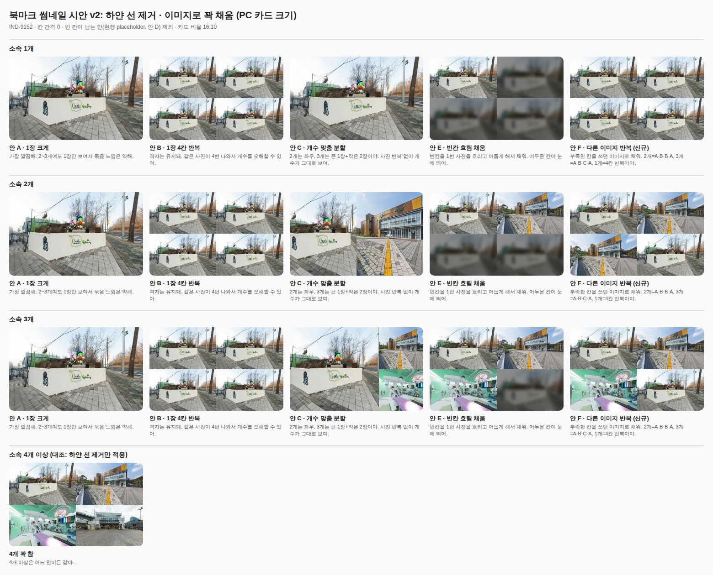

소속 콘텐츠가 4개 미만이면 빈 칸 placeholder 가 정신없어 보입니다(11/03 메모 #13). v2 공통: 칸 간격 0 · 안 D 제외.

| 안 | 내용 |
|---|---|
| A | 1장 크게 |
| B | 1장 4칸 반복 |
| **C** | 개수 맞춤 분할(Designer 추천) |
| E | 빈칸을 1번 사진 흐림으로 |
| F | 쓰던 이미지로 채움(2개=A·B·B·A) |

**정할 것:** ① 어떤 안 ② 구현 발주 여부. 카드 `b0a8abd9` 에 답합니다(F 는 Other · «칸 간격 0» 함께).

직접 확인
<a class="lnk" href="https://kabkee-main.tailfe017f.ts.net:8443/api/attachments/e59dc6cd-9283-40a4-9b50-248af0b782b0/content" target="_blank">PC 비교판</a>
<a class="lnk" href="https://kabkee-main.tailfe017f.ts.net:8443/api/attachments/21b15ad7-be08-4e1c-ab3d-2264cc80aced/content" target="_blank">모바일 비교판</a>
<a class="lnk" href="https://kabkee-main.tailfe017f.ts.net:8443/IND/issues/IND-9152" target="_blank">IND-9152</a>

---

## 🚪 안건 4 · 외부 페이지 이동 전 로딩 페이지 — 3안 비교 IND-9172 · 부모 IND-9153

지금은 vr-info 「외부 VR 보기」를 누르면 안내 화면 없이 새 탭으로 외부 사이트가 열립니다. 이 선택이 [IND-9153](https://kabkee-main.tailfe017f.ts.net:8443/IND/issues/IND-9153) W3 구현을 막고 있습니다.

| 안 | 형태 | 자동 이동 · 버튼 | 장단점 |
|---|---|---|---|
| **A** (Designer·EM 추천) | 흰 배경 전체 화면 중간 페이지 · 로고·«외부 VR» 칩·제목·제공자·핑크 안내·진행 바 | 3초 · 「바로 이동」+「취소」 | 기존 톤과 가장 일관 · 구현 단순 / 라우트가 하나 늘어남 |
| **B** | vr-info 위 오버레이(모달) · 숫자 링·제공자·제목·한 줄 안내 | 2초 · 「취소」만 | 맥락 유지 · 가벼움 / 정보 적음 · 「바로 이동」 없음 · 새 탭 팝업 차단 위험 확인 필요 |
| **C** | 다크 전체 화면 «Look360 → 제공자» 경로 표시 | 3초 · 「지금 이동」+「돌아가기」 | 어디로 가는지 가장 명확 / 사이트 톤과 다름 · 주의 문구(조회·좋아요 미동작) 사실 확인 필요 |

**정할 것:** ① 어떤 안으로 갈지 ② 자동 이동 시간과 버튼 구성을 시안대로 둘지. 카드 `99f04e7e` 에 답합니다(코멘트 말고 카드에서).

확인
<a class="lnk" href="https://kabkee-main.tailfe017f.ts.net:8443/IND/issues/IND-9172" target="_blank">IND-9172</a>
<a class="lnk" href="https://kabkee-main.tailfe017f.ts.net:8443/IND/issues/IND-9153" target="_blank">IND-9153</a>

---

## 🚪 안건 4 · 시안 A — 흰 배경 전체 화면 Designer·EM 추천

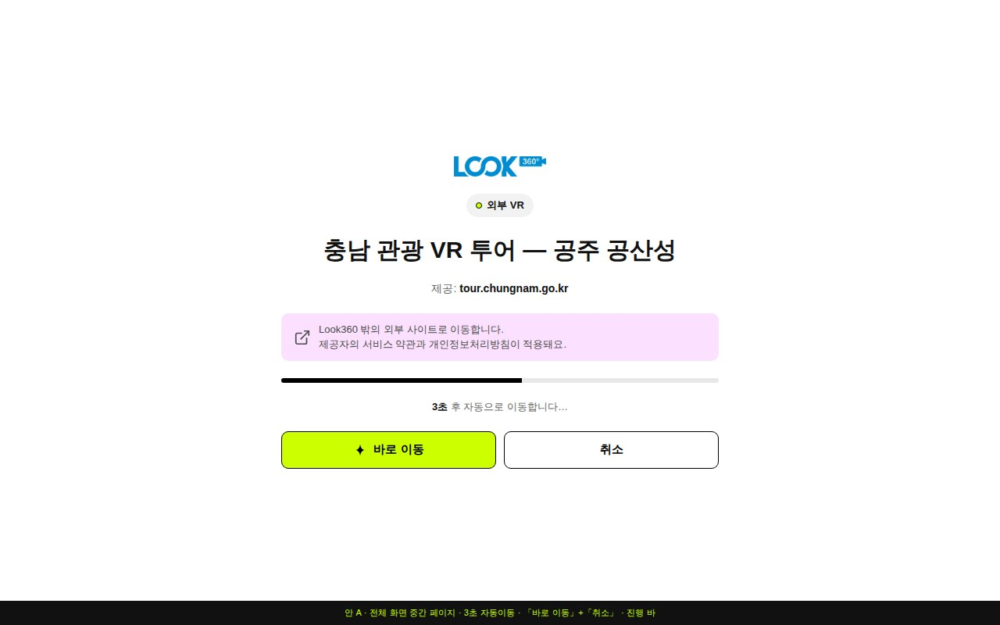

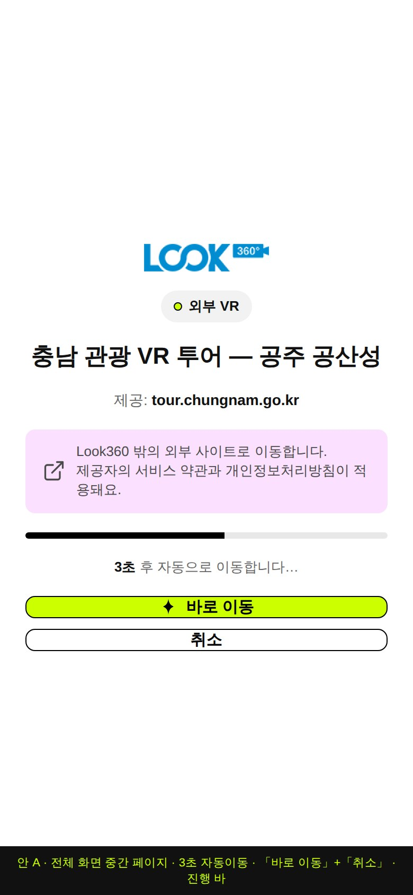

직접 확인
<a class="lnk" href="http://100.64.25.50:5174/vr-info/nobeLevE" target="_blank">공산성 VR 투어 http://100.64.25.50:5174/vr-info/nobeLevE</a>
<a class="lnk" href="http://100.64.25.50:5174/vr-info/5GWRPONl" target="_blank">달토끼와 산토끼 http://100.64.25.50:5174/vr-info/5GWRPONl</a>
<a class="lnk" href="https://kabkee-main.tailfe017f.ts.net:8443/IND/issues/IND-9172" target="_blank">IND-9172</a>

---

## 🚪 안건 4 · 시안 B — vr-info 위 오버레이 2초 · 「취소」만

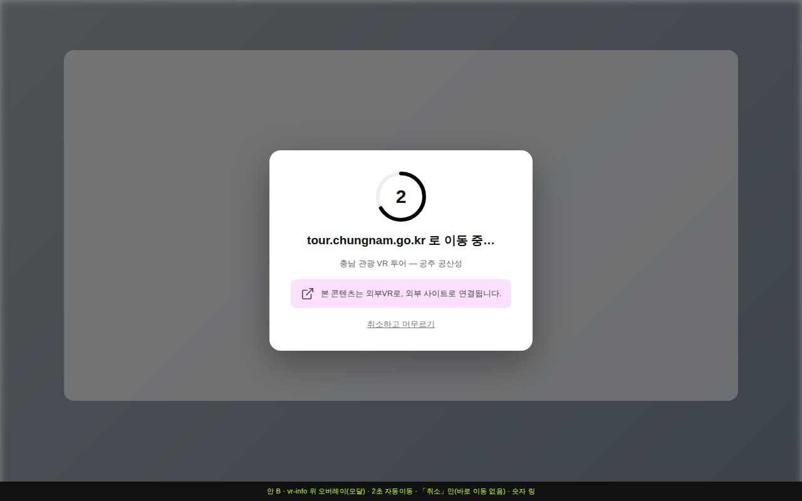

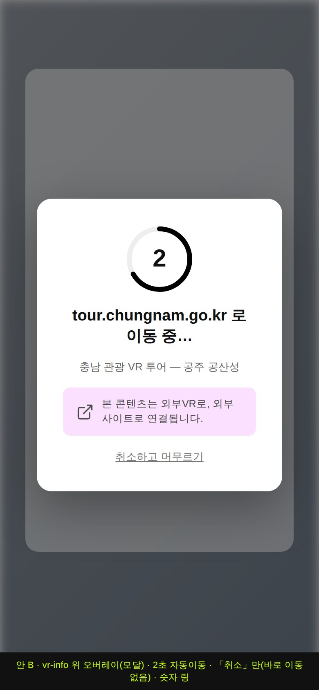

직접 확인
<a class="lnk" href="http://100.64.25.50:5174/vr-info/nobeLevE" target="_blank">공산성 VR 투어 http://100.64.25.50:5174/vr-info/nobeLevE</a>
<a class="lnk" href="http://100.64.25.50:5174/vr-info/5GWRPONl" target="_blank">달토끼와 산토끼 http://100.64.25.50:5174/vr-info/5GWRPONl</a>
<a class="lnk" href="https://kabkee-main.tailfe017f.ts.net:8443/IND/issues/IND-9172" target="_blank">IND-9172</a>

---

## 🚪 안건 4 · 시안 C — 다크 전체 화면 3초 · 「지금 이동」+「돌아가기」

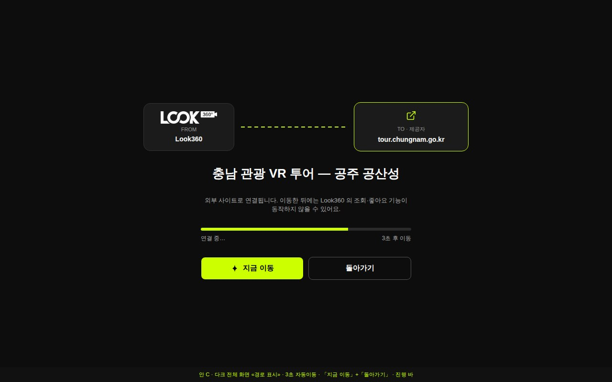

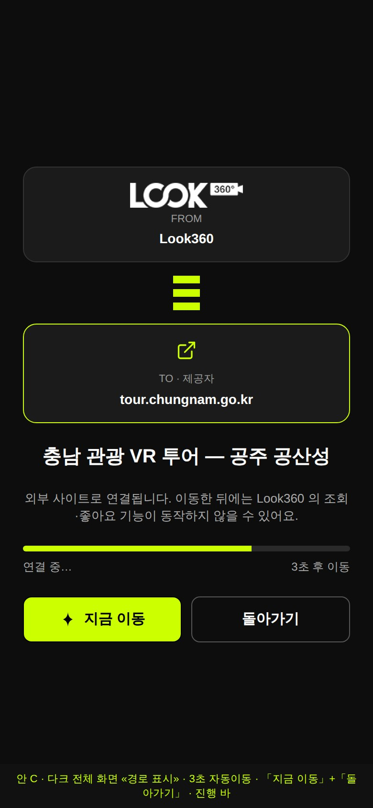

직접 확인
<a class="lnk" href="http://100.64.25.50:5174/vr-info/nobeLevE" target="_blank">공산성 VR 투어 http://100.64.25.50:5174/vr-info/nobeLevE</a>
<a class="lnk" href="http://100.64.25.50:5174/vr-info/5GWRPONl" target="_blank">달토끼와 산토끼 http://100.64.25.50:5174/vr-info/5GWRPONl</a>
<a class="lnk" href="https://kabkee-main.tailfe017f.ts.net:8443/IND/issues/IND-9172" target="_blank">IND-9172</a>

---

## 🧾 안건 5 · 외부VR 재분류 결정 5건 상세는 섹션 04

| # | 결정 | 영향 |
|---|---|---|
| 1 | 국립생태원 업종(과학관·식물원·동물원·전시관 중 1개) | 17건 일괄 |
| 2 | 업종 신규 제안 5개 + 이름 변경 1개 채택 여부 | 49건의 최종 소분류 |
| 3 | 지역 노드 추가(한국 760 · 해외 도시 362) | area 칸이 «신규»인 1,341건 |
| 4 | 반영 방식: 분류 검토 테이블 제안값 vs 운영 데이터 바로 반영 | vr-list 노출 시점 |
| 5 | 검색결과 외부VR 방향(카드 `0c99edc8`) | 11/09 답변 완료 — (a) vr-list 검색과 똑같이. 이관이 끝날 때까지 검색에도 나오지 않습니다 |

> DB 는 읽기만 했고 반영 0건입니다. 시트 검토가 끝나면 확정된 행만 반영하고, 반영 전후 vr-list·검색 노출 건수를 실측해 보고합니다.

확인
<a class="lnk" href="https://kabkee-main.tailfe017f.ts.net:8443/IND/issues/IND-7601" target="_blank">IND-7601</a>
<a class="lnk" href="https://kabkee-main.tailfe017f.ts.net:8443/IND/issues/IND-8592" target="_blank">IND-8592</a>
<a class="lnk" href="https://docs.google.com/spreadsheets/d/1ZmB4E4w9hx0fTGlFB0ifodH2kHu7XE9loQIV1XCG3Jo/edit" target="_blank">검토 시트</a>

---

## 🎵 안건 6 · weekly kpop «종합» 155주 교체 이슈 없음 · 교체 미집행

| # | 정할 것 | 비고 |
|---|---|---|
| ① | 종합 155주(+2019-02-03)를 가요/국내종합 차트로 주 단위 통째 교체할지 | 차트 행 약 15,500개 변경 · 새 곡 게시물·유튜브·가사 후속 · 한다면 시범 1주(2015-11-29) 먼저 |
| ② | 유령 주차 3개 처리 | 숨김 · 삭제 · 날짜 이동 |
| ③ | 불일치 2주(2014-09-28 · 2016-03-27) 재적재 | 가요 차트로 새로 채울지 |
| ④ | 누락 주 복구 | 2022-09 ~ 2023-01 19주 등을 차트파인더로 복구할지 |

> 상세 기록: `~/weeklychart-chart/reports/2026-11-06-weeklychart-data-audit.md`(커밋 `3ea6d33`) · 주차별 판정표 `2026-11-06-kpop-genre-audit-verdict.tsv`.

---

## 🗳️ 그 밖에 답을 기다리는 카드 pending 조회 11/09

| 이슈 | 카드 | 묻는 것 |
|---|---|---|
| [IND-9134](https://kabkee-main.tailfe017f.ts.net:8443/IND/issues/IND-9134) | `b83d43c3` | 단계 A 운영 반영 — 답하지 않고 새 카드로 대체 예정 |
| [IND-9220](https://kabkee-main.tailfe017f.ts.net:8443/IND/issues/IND-9220) | `4fc11190` | 생성기 버전 차이 GP2·GP3·RP1·GP1 처리 |
| [IND-9206](https://kabkee-main.tailfe017f.ts.net:8443/IND/issues/IND-9206) | `282a01cd` | shot_type 충돌 · mapid 지도 3투어 · 장면 순서 4투어 |
| [IND-9253](https://kabkee-main.tailfe017f.ts.net:8443/IND/issues/IND-9253) | `01f07942` | 툴팁 사본 추적 스키마 승인 · 레거시/DB 값 기준 |
| [IND-9149](https://kabkee-main.tailfe017f.ts.net:8443/IND/issues/IND-9149) | `11c322be` | iPhone 지도 토글 실기 확인 |
| [IND-9189](https://kabkee-main.tailfe017f.ts.net:8443/IND/issues/IND-9189) | `abc68199` | 헤드셋 VR 방향 화살표 확인(56·69·91) |
| [IND-9151](https://kabkee-main.tailfe017f.ts.net:8443/IND/issues/IND-9151) | `e67ce054` | Vimeo 360 iPhone 실기 확인 |
| [IND-9258](https://kabkee-main.tailfe017f.ts.net:8443/IND/issues/IND-9258) | `ce9f2840` | 검증이 만든 조회수 행 2개(uid 1168737·1168738) 삭제 여부 |
| [IND-9202](https://kabkee-main.tailfe017f.ts.net:8443/IND/issues/IND-9202) | `8a8dc63f` | VR스토리 7행 dev 조회수 복구 여부 |

> [IND-8880](https://kabkee-main.tailfe017f.ts.net:8443/IND/issues/IND-8880) 카드 `ec5dccc3` 은 안건 1 회의 결과로 정리합니다. [IND-9152](https://kabkee-main.tailfe017f.ts.net:8443/IND/issues/IND-9152) `b0a8abd9` · [IND-9172](https://kabkee-main.tailfe017f.ts.net:8443/IND/issues/IND-9172) `99f04e7e` 는 안건 3·4 입니다.

---

## ✅ 지난 보고(11/04 덱) 안건 처리 결과 11/09 조회

| 지난 안건 | 지금 상태 |
|---|---|
| 1 · RAW 자동 현상 프리셋 | 취소 — [IND-8678](https://kabkee-main.tailfe017f.ts.net:8443/IND/issues/IND-8678) `cancelled`(11/05 · 당장 불필요 · 산출물 유지) |
| 2 · 콘텐츠 언어 필터 통일 | 결정 — 카드 `b739001a` 수락 · 언어 1개 선택 정정(메모 #25) · 구현 [IND-8592](https://kabkee-main.tailfe017f.ts.net:8443/IND/issues/IND-8592) `blocked`(같은 파일 선행 작업 대기) |
| 3 · vr-info 레이아웃 | 종결 — [IND-8840](https://kabkee-main.tailfe017f.ts.net:8443/IND/issues/IND-8840) B안 수락 후 [IND-9086](https://kabkee-main.tailfe017f.ts.net:8443/IND/issues/IND-9086) 방식을 정본으로 구현 없이 종결 |
| 4 · oEmbed 목록 등록 | 보류 — 11/03 회의 결정: 서비스 런칭 후 실제로 활성화되면 진행 |
| 5 · 임베드 유입 버튼 | 보류 — 11/03 회의 결정: 서비스 런칭 후 실제로 활성화되면 진행 |
| 6 · 임베드 자동 재생 조회수 | 결정·구현 — C1 로드 +1([IND-8870](https://kabkee-main.tailfe017f.ts.net:8443/IND/issues/IND-8870)) · `autorotate=1` 도 +1([IND-9258](https://kabkee-main.tailfe017f.ts.net:8443/IND/issues/IND-9258) QC PASS) |
| 7 · 그 밖 6건 | 결정 기록 없음(flat 제목 · 검토자 · client 배포 · CloudFront · DB 사양) · 시연 데이터는 [IND-9049](https://kabkee-main.tailfe017f.ts.net:8443/IND/issues/IND-9049) 회의 후 정리 |

> 11/03 회의 메모 26건: `kabkee_works/memo/2026-11-05-quick-memo-recovered.md`

---

## ✅ 지난 덱 대기 카드 처리 결과 11/09 조회

| 이슈 | 결과 |
|---|---|
| [IND-8446](https://kabkee-main.tailfe017f.ts.net:8443/IND/issues/IND-8446) | 답변 11/09 — A·B 모두 고르지 않음. 시안 결정은 [IND-8880](https://kabkee-main.tailfe017f.ts.net:8443/IND/issues/IND-8880) 에서 이어 갑니다 |
| [IND-8495](https://kabkee-main.tailfe017f.ts.net:8443/IND/issues/IND-8495) | 답변 완료 · 11/09 종결(섹션 08 재확인 대상) |
| [IND-8594](https://kabkee-main.tailfe017f.ts.net:8443/IND/issues/IND-8594) | 카드 `f3ad4ef3` 수락 11/09 · 종결 |
| [IND-8825](https://kabkee-main.tailfe017f.ts.net:8443/IND/issues/IND-8825) | 로즈-레드 + 브랜드 라임으로 답변 11/05 · 종결 |
| [IND-8862](https://kabkee-main.tailfe017f.ts.net:8443/IND/issues/IND-8862) | C(표시 없음) 답변 11/05 · 종결 |
| [IND-9049](https://kabkee-main.tailfe017f.ts.net:8443/IND/issues/IND-9049) | 판매자 QC 계정 승인 11/05 · 종결 |
| [IND-9059](https://kabkee-main.tailfe017f.ts.net:8443/IND/issues/IND-9059) · [IND-9060](https://kabkee-main.tailfe017f.ts.net:8443/IND/issues/IND-9060) | 오너 확인 11/09 · 종결 |
| [IND-8702](https://kabkee-main.tailfe017f.ts.net:8443/IND/issues/IND-8702) · [IND-8826](https://kabkee-main.tailfe017f.ts.net:8443/IND/issues/IND-8826) | 이슈 `cancelled`(카드 만료 11/05) |

---

<!-- _class: sec -->

Section 08

## 무엇이 바뀌었나 — 오너 재확인 필요

확인 도장 뒤 재작업·방향 변경이 생긴 건입니다. 완료로 보고하지 않습니다.

---

## 🔁 무엇이 바뀌었나 · 오너 재확인 필요 원장 recheck

| 이슈 | 무엇이 바뀌었나 |
|---|---|
| [IND-8982](https://kabkee-main.tailfe017f.ts.net:8443/IND/issues/IND-8982) 장소 SNS | 11/03 메모 #23 — 라벨 없이 URL 나열로 표시 방식 변경([IND-9155](https://kabkee-main.tailfe017f.ts.net:8443/IND/issues/IND-9155) 완료) |
| [IND-8840](https://kabkee-main.tailfe017f.ts.net:8443/IND/issues/IND-8840) vr-info 레이아웃 | 오너 확인 뒤 B안 수락 → [IND-9086](https://kabkee-main.tailfe017f.ts.net:8443/IND/issues/IND-9086) 방식으로 대체 · 구현 없이 종결(11/05) |
| [IND-8534](https://kabkee-main.tailfe017f.ts.net:8443/IND/issues/IND-8534) 장소 정보 복사 | QC2 F 축 🟡 를 전제 갱신 후 인수해 11/07 종결. 복사 칸은 [IND-9021](https://kabkee-main.tailfe017f.ts.net:8443/IND/issues/IND-9021) W6 [IND-9086](https://kabkee-main.tailfe017f.ts.net:8443/IND/issues/IND-9086) 에서 삭제하는 방향입니다 |
| [IND-8668](https://kabkee-main.tailfe017f.ts.net:8443/IND/issues/IND-8668) 1:N 오너 검수 반영 | 장소 정보 복사 1,191건이 [IND-9021](https://kabkee-main.tailfe017f.ts.net:8443/IND/issues/IND-9021) W6 삭제 대상과 같은 데이터입니다 |
| [IND-8595](https://kabkee-main.tailfe017f.ts.net:8443/IND/issues/IND-8595) vr-list 지도 UX | 오너 확인 뒤 마커 색([IND-8825](https://kabkee-main.tailfe017f.ts.net:8443/IND/issues/IND-8825))·테마탭 지도 QC 를 거쳐 11/05 재완료 |
| [IND-8495](https://kabkee-main.tailfe017f.ts.net:8443/IND/issues/IND-8495) 영문 줄 규칙 | 운영 백필 13회차 완주 · crontab 등록 · 공식 표기 33명 반영 · 매칭 문제 82건 처리 후 11/09 재완료 |

---

## 🔁 지난 회의 보고 뒤 방향이 바뀐 것 원장 changedAfterMeeting

| 이슈 | 무엇이 바뀌었나 |
|---|---|
| [IND-8249](https://kabkee-main.tailfe017f.ts.net:8443/IND/issues/IND-8249) weekly 영문 줄 | 「원문과 같은 쪽만 생략」 규칙을 [IND-8495](https://kabkee-main.tailfe017f.ts.net:8443/IND/issues/IND-8495) 에서 재정의 |
| [IND-8880](https://kabkee-main.tailfe017f.ts.net:8443/IND/issues/IND-8880) vr-list 카테고리 필터 | 카테고리 패널 → **필터 전체 통합 기획**으로 범위 확대(안건 1) |
| [IND-8592](https://kabkee-main.tailfe017f.ts.net:8443/IND/issues/IND-8592) 콘텐츠 언어 필터 | 복수 선택 추천안 수락 뒤 1개 선택으로 정정 · 검색결과 방향 카드 답변 |
| [IND-8243](https://kabkee-main.tailfe017f.ts.net:8443/IND/issues/IND-8243) 지역·테마 통합 목록 | [IND-8446](https://kabkee-main.tailfe017f.ts.net:8443/IND/issues/IND-8446) 시안 A·B 무효화(11/09) → [IND-8264](https://kabkee-main.tailfe017f.ts.net:8443/IND/issues/IND-8264) 범위를 [IND-8880](https://kabkee-main.tailfe017f.ts.net:8443/IND/issues/IND-8880) 결정 뒤 재정리 |
| [IND-8675](https://kabkee-main.tailfe017f.ts.net:8443/IND/issues/IND-8675) 360 작업실 로드맵 | 하위 [IND-8678](https://kabkee-main.tailfe017f.ts.net:8443/IND/issues/IND-8678) RAW 취소(11/05) · [IND-8676](https://kabkee-main.tailfe017f.ts.net:8443/IND/issues/IND-8676)·[IND-8677](https://kabkee-main.tailfe017f.ts.net:8443/IND/issues/IND-8677)·[IND-8679](https://kabkee-main.tailfe017f.ts.net:8443/IND/issues/IND-8679) 종결 · [IND-8680](https://kabkee-main.tailfe017f.ts.net:8443/IND/issues/IND-8680) `blocked` |
| [IND-9060](https://kabkee-main.tailfe017f.ts.net:8443/IND/issues/IND-9060) · [IND-8731](https://kabkee-main.tailfe017f.ts.net:8443/IND/issues/IND-8731) 타일 레벨 | 지난 덱 보고 뒤 회귀 원복([IND-9157](https://kabkee-main.tailfe017f.ts.net:8443/IND/issues/IND-9157)) 포함 11/09 종결 — 섹션 02 |

---

## 📊 주간 처리량 11/03~11/09

27

완료 EPIC

180

완료 이슈 (자식 포함)

55

QC 이슈

208

커밋 (저장소 7개)

| 저장소 | 커밋 | 비고 |
|---|---:|---|
| `look360_v3_client` | 27 | l3 플랫폼 클라이언트 |
| `nestjs-look360-api` | 31 | API |
| `look360_platform_admin` | 5 | 어드민 |
| `Look360_ksq1.2` | 10 | 레거시 |
| `Look360_Platform_Project`(루트) | 126 | QC 검증 증빙 |
| `cron` | 8 | 자동화 스크립트·감시 |
| `weeklychart-chart` | 1 | 차트 수집 |

---

## 🔗 라이브 엔드포인트

l3 플랫폼 (dev)
<a class="lnk" href="http://100.64.25.50:5174" target="_blank">http://100.64.25.50:5174</a>
<a class="lnk admin" href="http://100.64.25.50:5277" target="_blank">어드민 http://100.64.25.50:5277</a>

이번 주 화면
<a class="lnk" href="http://100.64.25.50:5174/vr/o1vj1ty0" target="_blank">2529 만다라</a>
<a class="lnk" href="http://100.64.25.50:5174/vr-info/ab28f18c" target="_blank">장소 SNS</a>
<a class="lnk" href="http://100.64.25.50:5174/vr-info/nobeLevE" target="_blank">외부VR vr-info</a>

레거시 (운영)
<a class="lnk legacy" href="https://look360.kr" target="_blank">https://look360.kr</a>
<a class="lnk legacy" href="https://look360.kr/vr/indyspot/mandalacat" target="_blank">2529 만다라</a>

외부
<a class="lnk" href="https://kabkee-decks.netlify.app/guides/2026-11-09-flat-pano-upload-guide.html" target="_blank">flat 업로드 가이드</a>
<a class="lnk" href="https://weeklykpop.com/?m=bbs&uid=7013" target="_blank">kpop 미니 플레이어</a>
<a class="lnk" href="http://192.168.60.6:5175/work-labels" target="_blank">크롤러 작업 화면(사내망)</a>

---

<!-- _class: closing -->
<!-- _paginate: false -->

## 감사합니다

레거시 정합을 끝까지 밀어 회귀까지 되돌렸고, 외부VR 과 vr-list 필터는 이번 회의의 결정을 기다리고 있습니다.

Indyspot AI Corp &nbsp;·&nbsp; Engineering Manager &nbsp;·&nbsp; 2026-11-09
