<!-- _class: cover -->
<!-- _paginate: false -->

# 주간 업무 보고

## 2026-11-10 &nbsp;~&nbsp; 2026-11-16

Indyspot AI Corp &nbsp;·&nbsp; Engineering Manager &nbsp;·&nbsp; 2026-11-16

---

<!-- _class: agenda -->

## 이번 회의 진행 순서 — 「결정이 필요한 것을 먼저 보고, 개발 결과는 다음 주에 보는」 회의

### Part 1 · 회의에서 정할 것 (먼저)
- 🤝 협업 요청 4건 — 레거시 글 채우기 · weekly 가수 매칭 등
- 🗳️ 결정 안건 9건 — 돌하우스 포함
- 의견이 갈릴 수 있는 방향 결정 위주
- 답을 기다리는 확인 카드 6건 (4건은 회의 전 결정)

### Part 2 · 회의에서 확인할 것
- VR스토리 «다음» 버튼 파장 — 실제 화면 확인
- vr-list 지도 스팟 최종 색상 · 지도 재조정 버튼

### Part 3 · 다음 주 보고 예정 (미리 작성)
- VR 뷰어 · 검색 · 외부VR 화면 개선 9건
- 기존 사이트(look360.kr) 개선 · krpano 1.24
- weekly(k)pop

### 이 덱 사용법
- 오른쪽 아래 「💬 코멘트」로 요소마다 의견을 남길 수 있습니다
- 종류에서 «의사결정으로 앞으로» · «다음 주로 미루기»를 고르면 다음 판에 반영합니다

---

<!-- _class: sec -->

Part 1 · Section 01

## 협업 요청 — 사람 손이 필요한 일

C1 레거시 글 채우기 · C2 weekly(k)pop 가수 매칭 · C3 용산꿈나무 지도 스팟 · C4 외부VR 검수

---

## 🤝 협업 요청 한눈에 — 사람 손이 필요한 일 11/16 기준 NEW

AI 가 할 수 있는 선작업은 끝났고, 이제 사람이 확인하거나 직접 해야 진행되는 일입니다. 담당과 기한을 정해 주십시오.

| # | 일 | 사람이 할 일 | 규모 |
|---|---|---|---|
| C1 | look360.kr 장면 설명·장소 글 채우기 | AI 초안 확인 · 직접 작성 | 장면 29,895문장 · 장소 15,292문장 · 직접 5,914칸 |
| C2 | weekly(k)pop 가수 매칭 | 학생 검수(11/16 시작) · AI 애매 판정 확인 | AI 애매 117 · 불일치 35 · 미확정 906단위 |
| C3 | 용산꿈나무 층별 지도 스팟 | 평면도 보고 위치·방향 찍기 | 6개 층 · 58장면 |
| C4 | 외부VR 분류·장소 연결 검수 | 시트 v2 검수 · 검수 페이지 확인 | 장소 연결 627행 |

확인
<a class="lnk" href="https://kabkee-main.tailfe017f.ts.net:8443/IND/issues/IND-9389" target="_blank">C1 IND-9389</a>
<a class="lnk" href="https://kabkee-main.tailfe017f.ts.net:8443/IND/issues/IND-9456" target="_blank">C2 IND-9456</a>
<a class="lnk legacy" href="https://look360.kr/vr/yongsanyouthtown_or_kr/yongsanyouthtown" target="_blank">C3 투어 1952</a>
<a class="lnk" href="https://kabkee-main.tailfe017f.ts.net:8443/IND/issues/IND-9418" target="_blank">C4 IND-9418</a>
<a class="lnk" href="https://kabkee-main.tailfe017f.ts.net:8443/IND/issues/IND-9398" target="_blank">C4 IND-9398</a>

---

## 🤝 C1 · 레거시 글 채우기 — AI 초안을 사람이 확인해 주셔야 합니다 11/13

[IND-9389](https://kabkee-main.tailfe017f.ts.net:8443/IND/issues/IND-9389) · look360.kr 장면 설명·장소 글을 채우는 일입니다. 애드센스 대응(D1)의 실행 수단이기도 합니다.

| 사람이 할 일 | 규모 | 예상 시간(추정) |
|---|---|---|
| 🟡 VR 장면 설명 확인 | 29,895문장 | 약 83시간 |
| 🟡 장소 글 확인 | 15,292문장 | 약 270시간 |
| ⬜ 직접 작성 칸 | 5,914칸 | — |
| 판단 불가 | 31개 | 회의에서 처리 방향 |

- AI 선작업: 장면 초안 29,893 / 공개 29,927 · 장소 글 추천 문구 1,623곳
- 사용량: AI 호출 7,359회 · API 환산 약 $190 · 실제 추가 청구 0원(Max 20x 주간 사용률 52→77%, 다른 작업 몫 포함)

> **요청:** ① 검수 담당 배정 ② 일괄 확인 허용 범위 ③ 첫 반영 시점 ④ 판단 불가 31개 처리

직접 확인
<a class="lnk" href="https://kabkee-decks.netlify.app/reports/2026-11-13-content-studio-ai-bulk.html" target="_blank">AI 초안 일괄 생성 덱</a>
<a class="lnk" href="https://kabkee-main.tailfe017f.ts.net:8443/IND/issues/IND-9307" target="_blank">IND-9307</a>

---

## 🤝 C2 · weekly(k)pop 가수 매칭 — 학생 검수를 시작했습니다 11/16 NEW

KPOP 가수 확정이 83.9%에서 멈춰 있었습니다. 수집기는 정상이고, 남은 것은 사람이 확인해야 늘어납니다([IND-9292](https://kabkee-main.tailfe017f.ts.net:8443/IND/issues/IND-9292) → [IND-9456](https://kabkee-main.tailfe017f.ts.net:8443/IND/issues/IND-9456)). 11/16 부터 근로장학생이 검토자 화면에서 검수합니다.

| 학생 작업 화면에 오늘 넣은 것 | 내용 |
|---|---|
| 곡마다 «▶ 듣기 / 🔍 검색» | 노래와 유튜브 제목·채널로 가수를 확인 (KPOP 곡 99.1% 에 영상 연결) |
| «AI 불일치·애매 매칭» 필터 | AI(Gemini)가 영상을 보고 판정한 결과를 배지로 표시 · 마우스를 올리면 근거 |
| «곡 0» 표시 오류 수정 | 같은 곡이 표기 두 개로 오른 경우 한쪽이 «곡 0»으로 보이던 문제 |

- AI 점검 «이름 다름» 1,559건: 일치 1,406 · 불일치 35 · 애매 117 — 애매 117 은 학생이 필터로 확인합니다
- 앞선 30건 점검에서는 한국 가수가 같은 이름의 외국 가수에 잘못 붙은 사례 9건을 찾았습니다(예: 하울 → Howlin' Wolf)
- AI 비용: 누적 약 1만 6천 원 / 충전 3만 2천 원 (단가 실측 기준 추정 · 실제 금액은 Billing 확인)

> **요청:** 학생 검수 담당·주기 확정. 같은 이름 가수가 둘로 보이면 학생은 메모만 하고, 합치기는 관리자가 합니다.

직접 확인
<a class="lnk" href="https://weeklykpop.com/?r=home&m=weeklychart&mode=artist_review" target="_blank">https://weeklykpop.com/?r=home&m=weeklychart&mode=artist_review</a>
<a class="lnk" href="https://kabkee-main.tailfe017f.ts.net:8443/IND/issues/IND-9456" target="_blank">IND-9456</a>

---

## 🗳️ C2 · weekly(k)pop 매칭 — 오늘 정한 기준과 남은 판단 11/16

**✅ 정한 기준 — «프로젝트명 (멤버, 멤버)» 표기는 멤버마다 연결합니다.** 예: «허용별 (허각, 신용재, 임한별)» 은 쉼표로만 잘려 «허용별 (허각» · «임한별)» 처럼 괄호가 붙어 신용재에게만 연결돼 있었습니다. 같은 모양 22건 중 19건을 고쳐 23개를 새로 확정했습니다. 단체곡 3건(스타쉽 크리스마스 합동곡)은 직접 나눴습니다.

| 남은 판단 | 규모 | 제안 |
|---|---|---|
| 곡에 붙은 유튜브 영상이 틀림 (예: «50kg» 에 정승환 영상) | 불일치 35 중 다수 | 유튜브 복구 대기열로 넘김 (곡 데이터 쓰기) |
| 그룹 ↔ 멤버 경계 (김진호 ↔ SG워너비 · DK ↔ 디셈버 등) | 5 | 기준 결정 필요 |
| 가수로 등록되지 않은 멤버 (창민 · 우현 · 황광희 등) | 15명 | 등록하면 사람이 연결 |
| 동명이인 위험 (창민 → 최강창민, 김정수) | 2 | 연결 보류 유지 |

> AI 가 «불일치»로 본 것 중 8건은 새 가수의 이름이 비어서 생긴 오판이라 매칭 자체는 맞습니다 — 판정 규칙을 보완해 다시 돌립니다. AI 판정은 학생 확인용 표시이고, 자동 해제는 위키데이터 자동 확정분만 대상입니다.

직접 확인
<a class="lnk" href="https://weeklykpop.com/?r=home&m=weeklychart&mode=artist_review" target="_blank">검토자 화면 → 「허각」 검색</a>

---

## 🤝 C3 · 용산꿈나무종합타운 층별 실내지도 6장에 스팟이 없습니다 11/12

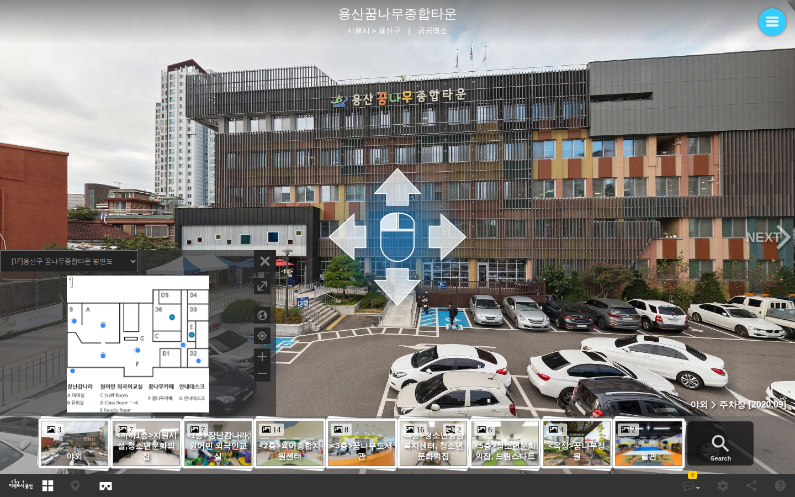

정상 — «[1F] 용산구 꿈나무종합타운 평면도» · 위치 점 7개

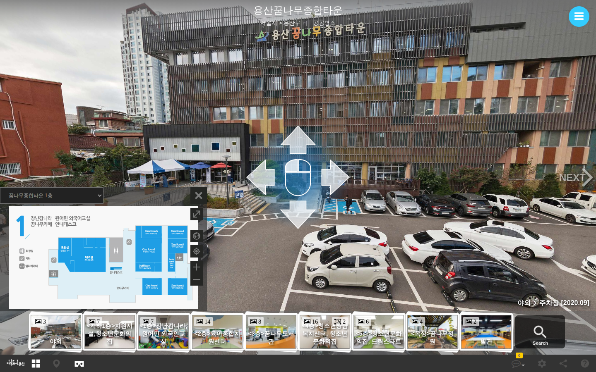

문제 — «꿈나무종합타운 1층» · 점 0개 → 지도에서 장면으로 이동할 수 없음

> 2021-01-31 에 평면도만 올리고 스팟을 배치하지 않았습니다. 11월 지도 유실 사고와 무관하며 원본이 없어 새로 찍어야 합니다.

직접 확인
<a class="lnk legacy" href="https://look360.kr/vr/yongsanyouthtown_or_kr/yongsanyouthtown" target="_blank">https://look360.kr/vr/yongsanyouthtown_or_kr/yongsanyouthtown</a>

---

## 🤝 C3 · 작업 대상과 작업자 할 일 공개 투어 1952

| 지도 (id) | 찍을 장면 |
|---|---|
| 지하1층 (272) | [B1F] 7개 |
| 1층 (267) | [1F] 7개 |
| 2층 (268) | [2F] 14개 |
| 3층 (269) | [3F] 8개 |
| 4층 (270) | [4F] 16개 |
| 5층 (271) | [5F] 6개 |

- 작업자: 관리자 투어 편집 → 실내지도 → 평면도를 보며 장면마다 위치·방향 → 저장 후 투어 XML 생성. 좌표는 사람이 판단합니다.
- XML 은 이제 약 2분 안에 반영됩니다(11-12 캐시 60초 설정).

> **요청:** ① 담당 작업자와 기한 ② 옥상·별관 장면(꿈나무공원·드론경기장 등) 지도 신설 여부 ③ 숨김 복사본 2517(`yongsanyouthtown_2022`)도 채울지

직접 확인
<a class="lnk legacy" href="https://look360.kr/vr/yongsanyouthtown_or_kr/yongsanyouthtown" target="_blank">공개 투어 1952</a>

---

## 🗳️ 결정 안건 한눈에 (D1~D9) 11/16 기준 NEW

| # | 안건 | 지금 상태 | 제안 |
|---|---|---|---|
| D1 | 장소·회원·게시판 «품질 자동 noindex» 유지 여부 | 배치 미등록 · 운영 영향 0 | 끄고 광고 코드 제외로 대체 |
| D2 | vr-list 외부VR 기본 목록 제외(④) 확정 | 개발 서버 잠정 적용 | ④ 확정 + 필터 안내 장치 |
| D3 | 통합검색 외부VR 정렬·체크 기본값 | 자체 우선 + 체크 꺼짐 | 현행 확정 |
| D4 | 채널 기본 아바타 A(실루엣) / B(첫 글자) | B안 임시 적용 | 회의 결정대로 |
| D5 | 신규 타일 WebP 전환 여부·품질 | 검토만 · 코드 변경 0 | 결정 필요(−16% 안팎) |
| D6 | RAW 일괄 보정 저장 형식·시범 적용 | 작업실 기능 완료 | WebP 90 · 다음 촬영 1건 |
| D7 | krpano 1.24 남은 정리 2건 | 운영 배포 완료 | 정리 시점만 결정 |
| D8 | 외부VR 미사용 정보(SNS·영상 유형) 활용 | 조사만 | 제안 — 결정 불필요 시 보류 |
| D9 | 돌하우스 — 학습 사진 권리 · 사전학습 · 기능화 | 시범 79.1% | 계약서 확인부터 |

> 협업 요청(C1~C4)은 앞 섹션에서 먼저 봤습니다. 다음 장부터 D1 순서로 봅니다.

확인
<a class="lnk" href="http://100.64.25.50:8830/" target="_blank">요청 원장 http://100.64.25.50:8830/</a>
<a class="lnk" href="https://kabkee-main.tailfe017f.ts.net:8443/IND/issues" target="_blank">paperclip 이슈 목록</a>

---

<!-- _class: sec -->

Part 1 · Section 02

## 회의에서 정할 것 — 검색 노출과 애드센스

D1 · 기존 사이트(look360.kr)의 색인 기준과 광고 코드 배치입니다.

---

## 🔎 D1 · noindex 기준은 이렇게 바뀌어 왔습니다 11/11~11/16

애드센스 심사 대응([IND-9303](https://kabkee-main.tailfe017f.ts.net:8443/IND/issues/IND-9303)) 중 «무엇을 검색에서 뺄지»의 기준이 데이터를 보고 세 번 바뀌었습니다.

| 단계 | 기준 | 바꾼 이유 |
|---|---|---|
| 처음 계획 | 고유 설명 없는 VR 은 noindex (VR 약 137개만 색인) | 숨은 글·빈약한 페이지 정리 |
| 철회 (11-11) | 운영 반영 중단 | 서치 콘솔 16개월 검색 클릭의 61.7% 가 VR 페이지 |
| ① 바뀐 기준 | «16개월 노출 0» AND «고유 글 없음»만 · 데이터 없으면 noindex 안 함 | 이미 있는 유입을 스스로 버리지 않기 |
| ② 보완 | 생성 16개월 미만·데이터 갱신 14일 정지 시 noindex 안 함 | 새 페이지 «닭과 달걀» 방지 |
| ③ 최종 | VR·VR스토리는 항상 색인 · 광고 코드는 VR 뷰어에서 제외 | VR 은 핵심 유입 · 장면 설명은 IND-9307 로 채움 |

> 중복 주소는 noindex 대신 대표 주소(canonical)로 정리했습니다. VR 뷰어 광고 제외는 «광고는 있는데 읽을 내용이 적은 페이지»로 보일 위험을 줄이려는 판단이며, 구글 정책 문서로 확인한 것은 아닙니다.

직접 확인
<a class="lnk legacy" href="https://look360.kr/vr/mdsustreet" target="_blank">VR 페이지(색인 · 광고 코드 없음)</a>
<a class="lnk legacy" href="https://look360.kr/" target="_blank">메인(광고 코드 있음)</a>
<a class="lnk" href="https://kabkee-decks.netlify.app/reports/2026-11-11-look360-adsense-approval.html" target="_blank">애드센스 참고 덱</a>

---

## 🗳️ D1 · 장소·회원·게시판의 «품질 자동 noindex»를 끌 것인가 11/16 제기 NEW

### 문제 — 한 번 빠지면 돌아오지 못하는 구조
- 판정 조건 «16개월 노출 0»은 noindex 의 결과로 계속 채워집니다
- noindex 된 페이지는 검색에 안 나오니 노출이 영원히 0
- 빠져나오는 길은 누가 그 페이지에 고유 글을 써 주는 것뿐

### 운영 현황 (11-16 실측)
- 운영 DB 에 노출 데이터 테이블·갱신 크론이 없어 지금 빠진 페이지는 0
- 배치를 등록하는 순간 장소 약 298곳이 noindex (개발 DB 기준)

### 제안
- 품질 자동 noindex 를 끕니다
- 애드센스 보호는 VR 과 같은 방식 — 빈약한 페이지에 광고 코드를 넣지 않기
- 글이 없는 장소는 글쓰기 도구(C1)로 채움 · 판정 함수는 «글을 먼저 채울 장소 목록» 용도로 전환

### 그대로 두는 것
- 공개 범위 noindex(숨김·비밀번호·미발행) · canonical · VR 광고 제외

> **정할 것:** ① 장소 품질 noindex 끄기 ② 회원·게시판도 끌지, 다른 기준(빈 회원 페이지·스팸성 글)을 둘지. 결정 전까지 배치 크론은 등록하지 않습니다. 애드센스 승인 여부는 아직 모릅니다.

직접 확인
<a class="lnk legacy" href="https://look360.kr/place/suwon_wallpainting_street" target="_blank">개발 판정 noindex 표본 — 운영은 색인(ALL)</a>
<a class="lnk" href="https://kabkee-main.tailfe017f.ts.net:8443/IND/issues/IND-9303" target="_blank">IND-9303</a>

---

<!-- _class: sec -->

Part 1 · Section 03

## 회의에서 정할 것 — 외부VR 노출과 채널 이미지

D2 vr-list · D3 통합검색 · D4 기본 아바타 · D8 외부VR 미사용 정보

---

## 🗳️ D2 · vr-list 첫 화면을 외부VR 이 차지합니다 — 4가지 방안 11/16 NEW

외부VR 2,065건을 09-21 «10분 사이»에 일괄 등록해 가져온 시각이 등록일이 됐습니다. 최신순 상위 48건 중 외부VR 46 · 자체 2였습니다.

| 방안 | 장점 | 단점 |
|---|---|---|
| ① 정렬에서 외부VR 을 뒤로 | 구현 단순 · 목록에 남음 | 약 246페이지부터 나와 사실상 안 보임 · 조회수순 의미 흐려짐 |
| ② 섞어 보여주기(10:2 등) | 첫 화면에 두 종류 | 페이지 계산·검증 비용 가장 큼 · 정렬 기준 모호 |
| ③ 원래 등록일로 바로잡기 | 근본 원인 해결 | 원래 날짜 확보 가능 여부 미확인 · 매번 같은 처리 |
| ④ 기본 목록에서 제외 · 필터로만 잠정 적용 | 첫 화면 = 자체 콘텐츠 · 필터 이미 있음 | 외부VR 유입 감소 예상(추정) · 필터 안내 장치 필요 |

> **정할 것:** ① ④ 확정 또는 변경 ② 외부VR 필터를 알리는 장치(건수 배지 / 목록 끝 안내 / 없음) ③ 장소 상세에도 같은 규칙 ④ 원래 등록일 복원(③) 별도 조사 여부

직접 확인
<a class="lnk" href="http://100.64.25.50:5174/vr-list" target="_blank">http://100.64.25.50:5174/vr-list</a>
<a class="lnk" href="http://100.64.25.50:5174/vr-list?contentType=external" target="_blank">외부VR 필터</a>

---

## 📸 D2 · ④ 잠정 적용 화면 — 기본 2,272건 / 외부VR 필터 2,065건 11/16 개발 서버

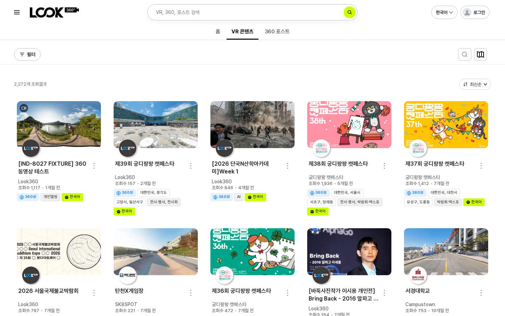

기본 목록 — 자체 콘텐츠만 (최신순 48건 = 360VIEW 48)

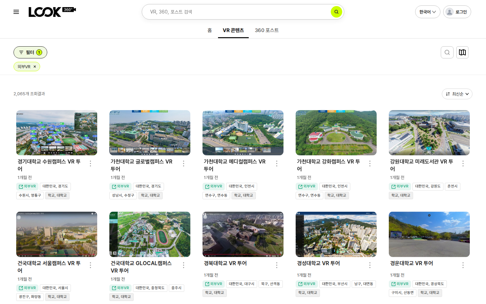

「외부VR」 필터 — 2,065건 · 유형 칩 건수 유지

> 지역·카테고리 필터 건수는 기존 계약상 외부VR 이 포함된 숫자로 보입니다. 필터 안내 장치는 아직 만들지 않았습니다.

직접 확인
<a class="lnk" href="http://100.64.25.50:5174/vr-list" target="_blank">http://100.64.25.50:5174/vr-list</a>
<a class="lnk" href="http://100.64.25.50:5174/vr-list?contentType=external" target="_blank">http://100.64.25.50:5174/vr-list?contentType=external</a>

---

## 🗳️ D3 · 통합검색 — 외부VR 을 빼지 않고 «뒤로» 보냅니다 11/16 NEW

| 검색어 | 전체 | 외부VR | 자체 | 1페이지 24개 중 외부VR (변경 전) |
|---|---|---|---|---|
| 역사박물관 | 131 | 131 | 0 | 24 |
| 대학교 | 576 | 200 | 376 | 24 |
| 서울 | 347 | 203 | 144 | 24 |
| 전시 | 143 | 46 | 97 | 24 |

- 🚫 **검색은 기본 제외하지 않습니다** — 찾으려는 행위라 둘러보기(vr-list)와 다릅니다. 「역사박물관」은 제외하면 결과가 비어 버립니다.
- 🔑 **정렬이 핵심, 체크는 보조** — ① 자체 콘텐츠 우선 정렬 ② 「외부VR 제외」 체크(기본 꺼짐) ③ 제외로 0건이면 «외부VR N건» 안내

> **정할 것:** ① 정렬 방식(자체 우선 / 섞기) ② 체크 기본값(꺼짐 / 켜짐) ③ 장소 상세 등 다른 화면 적용 여부

직접 확인
<a class="lnk" href="http://100.64.25.50:5174/search?q=%EB%8C%80%ED%95%99%EA%B5%90&tab=vr&sort=latest" target="_blank">「대학교」 VR 탭</a>
<a class="lnk" href="http://100.64.25.50:5174/search?q=%EC%97%AD%EC%82%AC%EB%B0%95%EB%AC%BC%EA%B4%80&tab=vr&sort=latest&noExt=1" target="_blank">「역사박물관」 제외 체크</a>

---

## 📸 D3 · 적용 화면 — 자체 우선 · 체크 · 0건 안내 11/16 개발 서버

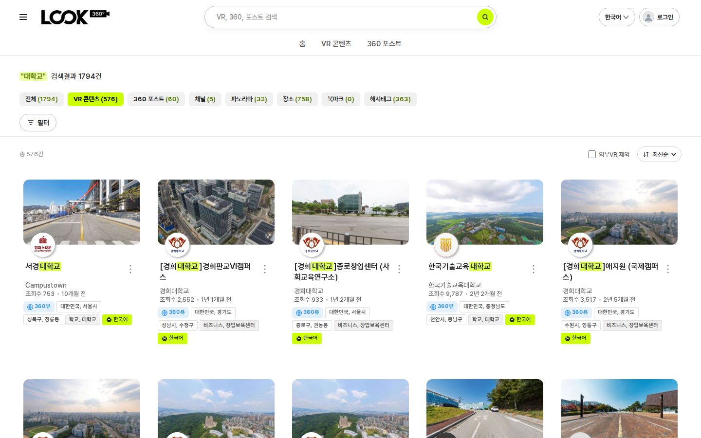

① 「대학교」 576건 그대로 · 앞 24개 전부 자체

② 체크 켬 → 376건 (URL `noExt=1`)

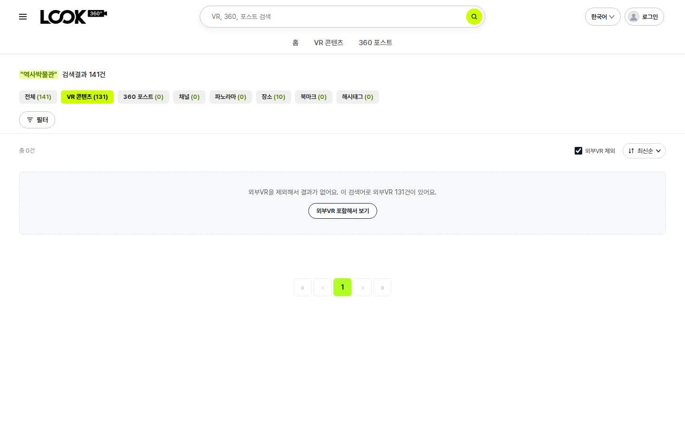

③ 0건 안내 + 「외부VR 포함해서 보기」

> ko 외 6개 언어 문구는 AI 번역이며 화면 확인은 ko·en 만 했습니다. 운영 배포는 하지 않았습니다.

직접 확인
<a class="lnk" href="http://100.64.25.50:5174/search?q=%EB%8C%80%ED%95%99%EA%B5%90&tab=vr&sort=latest" target="_blank">http://100.64.25.50:5174/search?q=대학교&tab=vr</a>
<a class="lnk" href="http://100.64.25.50:5174/search?q=%EC%97%AD%EC%82%AC%EB%B0%95%EB%AC%BC%EA%B4%80&tab=vr&sort=latest&noExt=1" target="_blank">http://100.64.25.50:5174/search?q=역사박물관&noExt=1</a>

---

## 🖼️ D4 · 채널 이미지 «빈 칸» 314 → 274 11/16 NEW

이미지 없는 활성 채널이 444개 중 314개(71%)라 검색 채널 탭이 «고장난 사이트처럼» 보였습니다([IND-9545](https://kabkee-main.tailfe017f.ts.net:8443/IND/issues/IND-9545) · [IND-9546](https://kabkee-main.tailfe017f.ts.net:8443/IND/issues/IND-9546)).

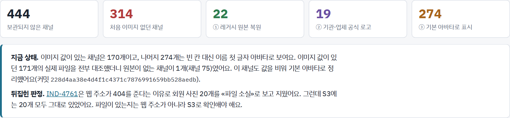

- 레거시 원본 복원 22 — 🔴 반증: IND-4761 이 «소실»로 지운 회원 사진 20개가 S3 에 그대로 있었습니다
- 공식 로고 19(오너가 후보를 하나씩 확인) · 나머지 274 는 기본 아바타 B안 임시 적용

직접 확인
<a class="lnk" href="http://100.64.25.50:5174/search?q=%EB%8C%80%ED%95%99%EA%B5%90&tab=channel&sort=nameAsc" target="_blank">「대학교」 채널 탭</a>
<a class="lnk" href="http://100.64.25.50:5174/search?q=naver&tab=channel&sort=nameAsc" target="_blank">「naver」 채널 탭</a>

---

## 📸 D4 · 복원·로고 적용 화면 11/16 개발 서버

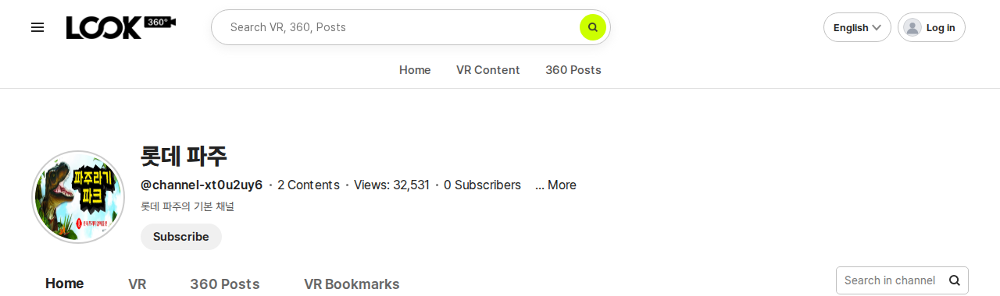

① 레거시 원본 복원 — 롯데 파주(장소 대표 사진)

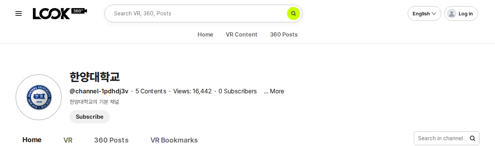

② 공식 로고 — 한양대학교

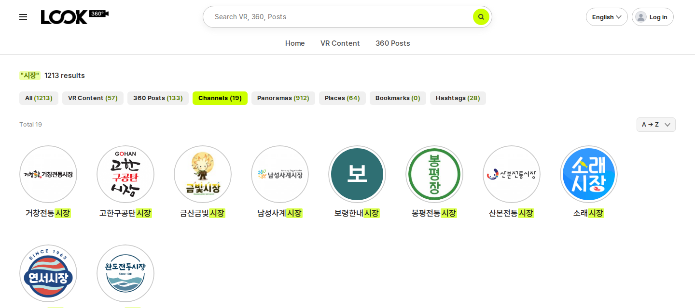

② 「시장」 채널 탭 — 로고와 기본 아바타가 섞여 보입니다

직접 확인
<a class="lnk" href="http://100.64.25.50:5174/search?q=%EB%8C%80%ED%95%99%EA%B5%90&tab=channel&sort=nameAsc" target="_blank">http://100.64.25.50:5174/search?q=대학교&tab=channel</a>
<a class="lnk" href="http://100.64.25.50:5174/search?q=%EC%8B%9C%EC%9E%A5&tab=channel&sort=nameAsc" target="_blank">http://100.64.25.50:5174/search?q=시장&tab=channel</a>

---

## 🗳️ D4 · 기본 아바타 — A(회색 실루엣) vs B(이름 첫 글자) 회의 결정

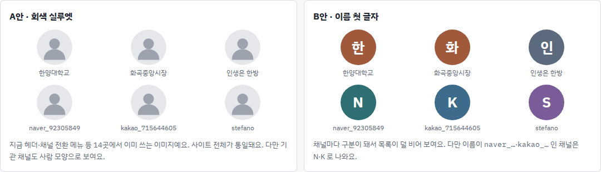

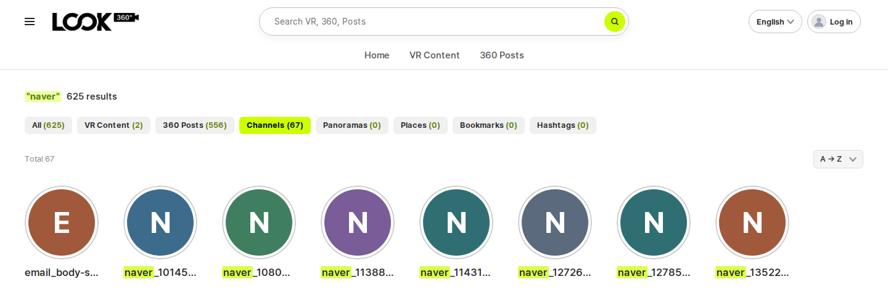

B안의 약점 — `naver_…` 이름 채널 67건이 전부 «N»

| | A · 실루엣 | B · 첫 글자 (현재) |
|---|---|---|
| 목록 인상 | 비어 보임 | 덜 비어 보임 |
| 통일성 | 사이트 전체와 같음 | 채널만 다름 |
| 약점 | 기관도 사람 모양 | naver·kakao 이름은 N·K |

컴포넌트 하나(`ChannelInitialAvatar.vue`)만 바꾸면 A안으로 되돌릴 수 있습니다.

> **정할 것:** A안 / B안 유지. 결정대로 바로 적용합니다. 운영 배포는 아직 하지 않았습니다.

직접 확인
<a class="lnk" href="http://100.64.25.50:5174/search?q=naver&tab=channel&sort=nameAsc" target="_blank">http://100.64.25.50:5174/search?q=naver&tab=channel</a>
<a class="lnk" href="https://kabkee-main.tailfe017f.ts.net:8443/IND/issues/IND-9546" target="_blank">IND-9546</a>

---

## 💡 D8 · 외부VR 데이터 중 화면에 안 쓰는 정보 조사 · 코드 변경 0

[IND-9170](https://kabkee-main.tailfe017f.ts.net:8443/IND/issues/IND-9170) 조사입니다. 이 조사에서 «외부VR 조회수가 항상 0»인 문제를 찾아 이동 횟수 집계로 이어졌습니다(Part 3).

| 구분 | 필드 (채워진 비율) |
|---|---|
| API 로 내려오지만 화면 미사용 | `type`(360view/360video · 100%) · `placeInstagram`(58%) · `placeYoutube`(52%) · `updatedAt` |
| DB 에는 있지만 상세 API 에 없음 | `placeFacebook`(54%) · `placeTwitter`(27%) · `placeBlog`(27%) · `placeTiktok`(10%) · `subtitle`(6.6%) |
| 내부용(노출 대상 아님) | memo · ip · userAgent · legacy_uid |
| 화면 경로는 있지만 데이터 0 | tags · image6 |

> **제안(결정 아님):** SNS 링크와 360video 유형 표시를 화면에 쓸지 검토합니다. 오너가 정하지 않은 사항이라 우선순위만 여쭙습니다.

직접 확인
<a class="lnk" href="http://100.64.25.50:5174/vr-info/T7Ukosjm" target="_blank">외부VR 상세 예시</a>
<a class="lnk" href="https://kabkee-main.tailfe017f.ts.net:8443/IND/issues/IND-9153" target="_blank">IND-9153</a>

---

<!-- _class: sec -->

Part 1 · Section 04

## 회의에서 정할 것 — 촬영·이미지·뷰어 엔진

D5 WebP 전환 · D6 RAW 일괄 보정 · D7 krpano 1.24

---

## 🗳️ D5 · files/pano 신규 타일을 WebP 로 바꿀 것인가 11/13 실측

krpano 1.24 부터 타일 도구가 WebP 를 바로 출력합니다. 같은 화질(SSIM)에서 줄어드는 양이 기대보다 작아 «전환 여부»부터 정해야 합니다.

| 품질 | 용량 (현재 JPG q60 대비) | SSIM | 판단 |
|---|---|---|---|
| WebP q60 | −15.6% | 0.9135 (JPG 0.9146) | 같은 화질 |
| WebP q65 | −8.4% | 0.9209 | 조금 나음 |
| WebP q50 | −26.1% | 0.8996 | 화질 나빠짐 |

- 지금 타일 275GB 를 처음부터 WebP q60 으로 만들었다면 약 232GB(−43GB) · 🔴 `webpmethod=6` 필수(기본값이면 오히려 +3.9%)
- 기존 전수 재인코딩은 화질 한 번 더 손실 · 월 절감 약 $1.8 대비 PUT 약 $55(추정) → 보류 권장
- WebP 를 못 여는 실제 사용자 약 0.002% (GA4 90일 · 봇 추정분 제외)

> **정할 것:** ① 신규 타일 전환 여부(코드 수정 5개 저장소 대비 효과) ② 품질 q60/q65 ③ 기존 데이터 보류 ④ 지원 하한(iOS 14·macOS 11) ⑤ 에픽 발주 / 직접 구현

직접 확인
<a class="lnk" href="https://kabkee-decks.netlify.app/reports/2026-11-13-webp-transition.html" target="_blank">WebP 전환 검토 덱 (23장)</a>

---

## 🗳️ D6 · 360 작업실 «RAW 일괄 보정» — Camera Raw 수작업을 작업실로 11/13

### 해결한 것 (궁디팡팡 1774 · 실측)
- 작업자 보정 130장 = 4묶음 → 자동 제안이 같은 구조(ISO 50 / 200 / 800)
- 적용 26장 약 9분 → 85초 · 첫 화면 102 → 12.7초
- 렌즈 색수차 보정: 로비 녹색 경계 화소 35,905 → 2,210
- 보라 번짐(11-16): 작업자 결과를 학습해 교체 → 입구·로비·포토존 작업자의 0.6~1.8배(기존 20~32배)

### 남은 과제
- 실외 입구 재현 오차 6.72 (실내 1.91~2.47)
- ISO 800 장소는 보라 번짐이 아직 작업자의 약 11배 (색 노이즈 감소 차이로 추정)

### 저장 형식 (3장 실측)
| | 용량 | 비고 |
|---|---|---|
| JPG 95 | 기준 | |
| WebP 90 | −36~−62% | 화질 JPG 90~93 수준 · 처리 약 2배 느림 |
| JPG 90 | WebP 대비 +18% | 속도 우선 |

이 수치는 NAS 스티칭 «중간 파일» 기준입니다(D5 의 서비스 타일과 다름).

> **정할 것:** ① 저장 형식 기본값(제안 WebP 90) ② 다음 촬영 1건 시범 적용 ③ 실외 보정 개선 ④ 시험 폴더(9.3GB) 유지·삭제 시점

직접 확인
<a class="lnk" href="https://kabkee-decks.netlify.app/reports/2026-11-13-studio-raw-batch.html" target="_blank">RAW 일괄 보정 덱 (22장)</a>
<a class="lnk" href="https://studio.look360.kr/rawbatch.html" target="_blank">https://studio.look360.kr/rawbatch.html</a>

---

## 🗳️ D7 · krpano 1.24 업그레이드 — 배포 완료 · 남은 정리 2건 11/13

| 대상 | 이전 → 이후 |
|---|---|
| utils 타일 도구(mac·Windows) · 미리보기 | 1.20.9 / 1.20.8 → 1.24 |
| 플랫폼 client · admin 뷰어 | 1.23.3 / 1.22.4 → 1.24 |
| 레거시 뷰어 · 서버 타일 도구 | 1.23.3 / 1.19-pr16 → 1.24 (운영 배포 · CloudFront 무효화) |

- 배포 전에 잡은 함정: 🔴 1.24 는 `levelsizes` 순서대로 레벨 번호를 붙여 서버 config 21개를 내림차순으로 고침 · 2014년 라이선스 코드 거부 → 비밀값 파일로 이전
- 검증: 개발 26건 · 운영 10건 이전 버전과 같은 결과, 실패 요청 0

> **정할 것:** ① 1.24 대응판이 없는 구버전 플러그인 3개(레거시 스킨이 직접 참조) 정리 여부 ② 되돌림용 `vr-1.23.3.js` 삭제 시점. utils 앱 실행과 평면 장면은 직접 확인하지 못했습니다.

직접 확인
<a class="lnk legacy" href="https://look360.kr/vr/oidodock" target="_blank">레거시 VR (1.24)</a>
<a class="lnk" href="http://100.64.25.50:5174/vr/xo6jh8ib?adminPreview=1" target="_blank">플랫폼 VR (1.24)</a>

---

<!-- _class: sec -->

Part 1 · Section 05

## 회의에서 정할 것 — 돌하우스

D9 · 360 사진으로 방을 세우는 돌하우스 시범 결과와 다음 단계입니다.

---

## 🏠 D9 · 돌하우스 — 360 사진만으로 방을 세웠습니다 11/13~11/16 NEW

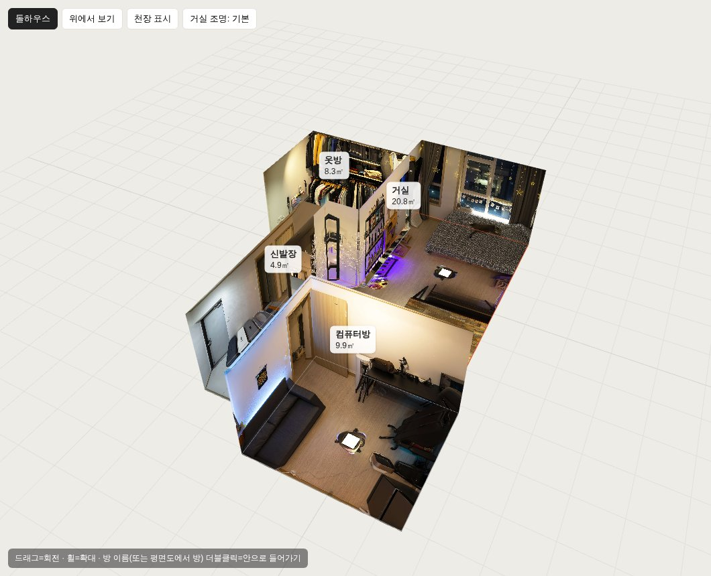

미노네집 돌하우스(오너가 평면도에서 한 번 맞춘 배치)

- 깊이 카메라 없이 기존 투어의 360 사진에서 «벽이 바닥에 닿는 선»을 찾아 방을 세우고 사진을 입힙니다
- 방 배치는 기존 이동 핫스팟을 그대로 써서 반자동
- 우리 사진 349장에 사람이 정답을 그려 직접 학습 → 일반 방 정확도(3D IoU) 79.1% · 외부 공개 모델 73.8% · 목표 80%
- 정답 103 → 189 → 349장으로 늘 때마다 올랐습니다(71.3 → 76.2 → 79.1)
- 🔴 지금 결과는 ImageNet 초기값을 쓴 «테스트» — 권리가 불명확해 서비스 전 자체 사전학습으로 바꿔야 합니다

직접 확인
<a class="lnk" href="https://kabkee-decks.netlify.app/reports/2026-11-13-dollhouse-models/" target="_blank">돌하우스 비교 뷰어(6곳)</a>
<a class="lnk" href="https://kabkee-decks.netlify.app/reports/2026-11-13-dollhouse-howto.html" target="_blank">입문 설명 덱</a>
<a class="lnk" href="https://kabkee-decks.netlify.app/reports/2026-11-13-dollhouse-guide.html" target="_blank">시범 결과 덱</a>

---

## 🗳️ D9 · 돌하우스 — 정할 것과 오너 확인 사항 11/16

| # | 정할 것 | 제안 |
|---|---|---|
| 1 | 🔴 촬영 대행 계약서 기준 «AI 학습에 써도 되는 장소·기간» | 오너 확인 — 고객사 저작권 귀속 여부 · 이게 정해져야 자체 사전학습 사진을 고릅니다 |
| 2 | 자체 사전학습 일정·비용 | 레거시 공개 360 사진 후보 30,888장 · AWS 서울 GPU 임시 사용 약 $8~70(추정) |
| 3 | 다음 시범 장소 | 직각 구조 실내 2~3곳 (삼가동 아파트 등) |
| 4 | 다음 촬영부터 촬영 규칙 적용 | 카메라 높이 기록 · 문 앞 핫스팟 · 문 열어 두기 |
| 5 | 플랫폼 기능화 | 관리자 «돌하우스 생성 + 보정» → VR 뷰어 탑재 (에픽 발주 여부) |

- 11/16: «ImageNet 없이» 같은 조건으로 학습해 초기값의 영향을 재는 실험을 준비했습니다(기준선 측정).
- 라벨(정답 그리기)은 사람이 하는 일이라, 사전학습 뒤 정답을 늘릴 때는 작업자 배정이 필요합니다.

직접 확인
<a class="lnk" href="https://kabkee-decks.netlify.app/reports/2026-11-13-dollhouse-howto.html" target="_blank">돌하우스 도입 전 필수 단계(입문 덱)</a>
<a class="lnk" href="http://100.64.25.50:8791/" target="_blank">라벨링 도구(내부망)</a>

---

<!-- _class: sec -->

Part 1 · Section 06

## 답을 기다리는 확인 카드

paperclip 이슈 스레드에 걸린 오너 결정 카드 10건 중 4건은 회의 전(11/16)에 결정했습니다. 남은 카드는 6건입니다.

---

## 🃏 회의에서 같이 보면 좋은 카드 11/05~11/13

| 이슈 | 묻는 것 | 에이전트 추천 |
|---|---|---|
| [IND-9241](https://kabkee-main.tailfe017f.ts.net:8443/IND/issues/IND-9241) | 레거시 생성기 재설계 운영 반영(DB 289행 수정 · 109투어 재생성) + 충돌 6건 | 실행 시점 선택 · 충돌별 추천 있음 |
| [IND-9253](https://kabkee-main.tailfe017f.ts.net:8443/IND/issues/IND-9253) | 툴팁 사본 추적 스키마 추가 · 화면과 DB 가 다른 툴팁은 어느 쪽을 따를지 | 승인 · DB 기준 |
| [IND-9345](https://kabkee-main.tailfe017f.ts.net:8443/IND/issues/IND-9345) | 외부VR 비회원 신청 화면의 입구(푸터 / 주소 분기 / 없음) | — |

확인
<a class="lnk" href="https://kabkee-main.tailfe017f.ts.net:8443/IND/issues/IND-9241#document-deploy-v17-1" target="_blank">IND-9241 배포안 v17.1 요약</a>

---

## 🃏 오너 혼자 처리해도 되는 카드 11/05~11/13

| 이슈 | 묻는 것 |
|---|---|
| [IND-9189](https://kabkee-main.tailfe017f.ts.net:8443/IND/issues/IND-9189) | 헤드셋 VR 모드에서 스토리 56·69·91 방향 화살표가 맞게 동작하는지 실기 확인 |
| [IND-9418](https://kabkee-main.tailfe017f.ts.net:8443/IND/issues/IND-9418) | 외부VR 장소 연결 검수 페이지(627행) 검수 완료 여부 |
| [IND-9470](https://kabkee-main.tailfe017f.ts.net:8443/IND/issues/IND-9470) | QC 중 오른 개발 DB 조회수 되돌리기 여부 |

> 카드는 승인함이 아니라 각 이슈 스레드에 있습니다. 회의 시간을 줄이려고 둘로 나눴습니다 — 옮길 카드가 있으면 코멘트로 표시해 주십시오.

확인
<a class="lnk" href="https://kabkee-main.tailfe017f.ts.net:8443/IND/issues/IND-9418" target="_blank">IND-9418 검수</a>
<a class="lnk" href="https://kabkee-main.tailfe017f.ts.net:8443/IND/issues/IND-9189" target="_blank">IND-9189 헤드셋 확인</a>

---

## ✅ 회의 전에 결정한 카드 11/16

| 이슈 | 묻던 것 | 오너 결정 |
|---|---|---|
| [IND-9461](https://kabkee-main.tailfe017f.ts.net:8443/IND/issues/IND-9461) | Vimeo 병행 규칙(장면당 영상 수 · 기본 출처 · 계정 조건 · 안내 시안) | 장면당 1개 · 직접 업로드 기본 · 공개 영상은 Free 허용 · 안내 C안 → 구현 [IND-9547](https://kabkee-main.tailfe017f.ts.net:8443/IND/issues/IND-9547) · 계정으로만 확인할 10건은 오너가 Free 계정을 공유한 뒤 테스트 |
| [IND-9473](https://kabkee-main.tailfe017f.ts.net:8443/IND/issues/IND-9473) | 모바일 파노 상세 팝업을 연 채 하단 썸네일 사용 | 현행 유지 — 모바일은 팝업을 닫고 썸네일을 고릅니다. 갱신 동작은 PC 범위로 마무리 |
| [IND-9134](https://kabkee-main.tailfe017f.ts.net:8443/IND/issues/IND-9134) | 레거시 생성기 단계 A(합본 v4) 운영 반영 | 승인하지 않음 — 장면 원문 대체 343장면 방식은 11/09 에 폐기했습니다. [IND-9241](https://kabkee-main.tailfe017f.ts.net:8443/IND/issues/IND-9241) 배포안 v17.1 카드로 대체합니다 |
| [IND-9445](https://kabkee-main.tailfe017f.ts.net:8443/IND/issues/IND-9445) | 조회수 처리 · PC 속성 패널 좌/우 · 스크린샷 재촬영 | 조회수 그대로 · 속성 패널 왼쪽 유지 · 재촬영 없음 — 오른쪽은 작성 폼이 쓰고 있어 이 화면에서는 왼쪽이 맞습니다 |

---

## ✅ 지난 회의(11/09) 안건 처리 결과 11/10~11/16

| 지난 안건 | 결과 |
|---|---|
| VR 목록 필터 통합 안 1 / 안 2 · 정렬 위치 | 안 1 + 수정 2건 · 추천 정렬 위치로 확정 → 구현 이슈로 넘김 ([IND-8880](https://kabkee-main.tailfe017f.ts.net:8443/IND/issues/IND-8880)) |
| 북마크 썸네일 placeholder | 안 A(1장 크게) + 위쪽 겹친 폴더 구현·QC 완료 ([IND-9152](https://kabkee-main.tailfe017f.ts.net:8443/IND/issues/IND-9152)) |
| 외부 사이트 이동 안내 화면 | 시안 A + 5초 카운트다운 구현 완료 → Part 3 ([IND-9153](https://kabkee-main.tailfe017f.ts.net:8443/IND/issues/IND-9153)) |
| 외부VR 분류 반영 | 구글 시트 v2 검수 → 대조 진행 중 ([IND-9398](https://kabkee-main.tailfe017f.ts.net:8443/IND/issues/IND-9398)) |

확인
<a class="lnk" href="https://kabkee-decks.netlify.app/weekly-reports/2026-11-09.html" target="_blank">11/09 주간 덱</a>
<a class="lnk" href="http://100.64.25.50:5174/my/bookmarks" target="_blank">북마크 화면</a>

---

<!-- _class: sec -->

Part 2 · Section 07

## 회의에서 확인할 것

오너가 «회의에서 확인받기로» 한 화면과, 확인 뒤 다시 바뀐 화면입니다.

---

## ✨ VR스토리 «다음» 버튼 배경 파장 — 구현 완료 · 확인 요청 11/11

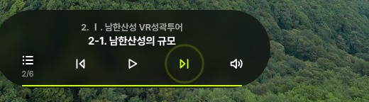

실제 구현 화면(11/16 개발 서버) — 2/6 항목이 끝나 대기 중, 다음(▶|) 버튼 둘레의 라임 링

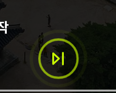

시안 B2 — 링 중심 = 버튼 중심

- 오너 선택 ② 배경 파장 → 수정 시안 B2(중앙 · 최대 1.7배 · 링 2개)
- 아이템이 끝나 «다음»을 기다리는 동안만 켜지고, 넘어가면 꺼집니다
- QC PASS: PC·모바일 켜짐/꺼짐 · VR 화면 안 다음 핫스팟 · 엔드 오버레이
- 커밋 `18b2d66c` · 운영 배포 범위 밖

> **확인할 것:** 아래 링크에서 항목이 끝난 뒤 다음 버튼

직접 확인
<a class="lnk" href="http://100.64.25.50:5174/vr/59f1c404?story=1-1&adminPreview=1" target="_blank">http://100.64.25.50:5174/vr/59f1c404?story=1-1&adminPreview=1</a>
<a class="lnk" href="https://kabkee-main.tailfe017f.ts.net:8443/api/attachments/3163a524-ef6c-4c91-9924-e82cfa3986f8/content" target="_blank">시안 동작 영상 PC</a>
<a class="lnk" href="https://kabkee-main.tailfe017f.ts.net:8443/IND/issues/IND-9325" target="_blank">IND-9325</a>

---

## 🗺️ vr-list 지도 스팟 — 최종 색상 적용 결과 11/05 적용 · 11/10 후속

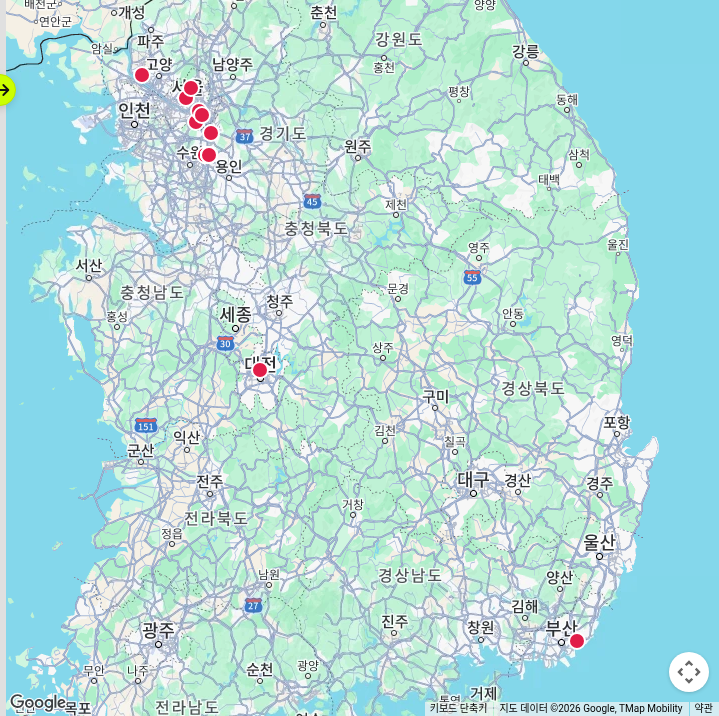

기본 — 빨강 `#e11d48` + 흰 테두리 2

hover — 밝은 로즈 `#fb7185` + 흰 테두리 3

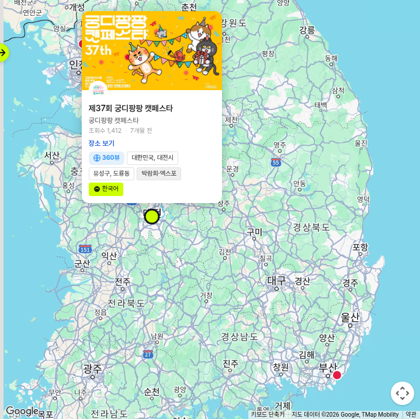

선택 — 라임 `#CCFF00` + 테두리 `#111827` 3

> 🔴 10/26 덱의 B안(선택 = 검정 채움)과 다릅니다 — 최종 결정은 «로즈-레드 + 라임». 11/10 후속: 스팟 직접 hover · 빈 곳 클릭 시 선택 해제. 상위 [IND-8595](https://kabkee-main.tailfe017f.ts.net:8443/IND/issues/IND-8595) 는 오너 재확인 필요.

직접 확인
<a class="lnk" href="http://100.64.25.50:5174/vr-list" target="_blank">http://100.64.25.50:5174/vr-list</a>
<a class="lnk" href="https://kabkee-main.tailfe017f.ts.net:8443/IND/issues/IND-8825" target="_blank">IND-8825</a>

---

## 🧭 vr-list 지도 「지도 재조정」 버튼 신설 11/10

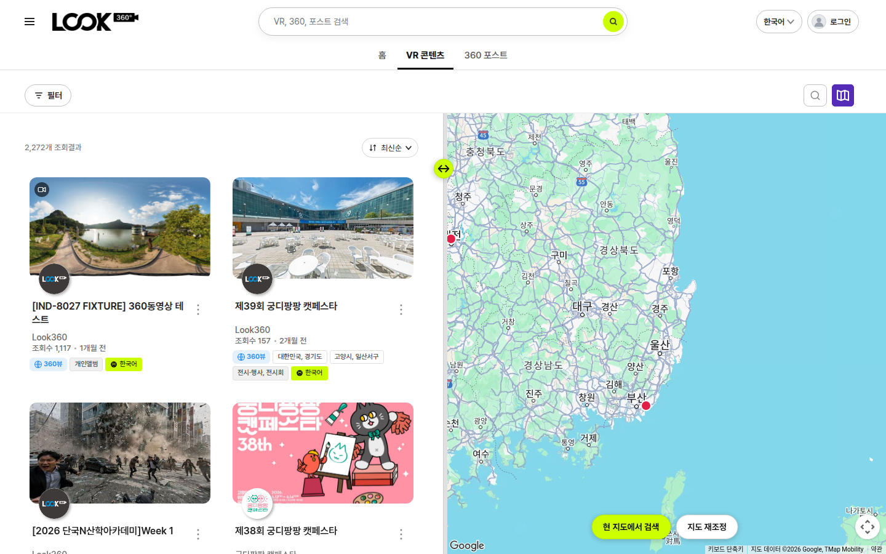

지도를 옮기면 「현 지도에서 검색」 옆에 버튼이 나타납니다

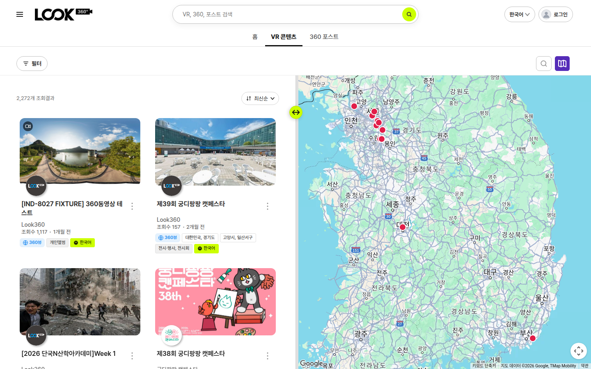

누르면 현재 목록의 GPS 항목이 전부 보이게 맞춥니다

> 오너 선택은 «내 현재 위치»가 아니라 «목록에 맞게 재조정»입니다. 실측: 마커 1개 → 24개. ko 외 6개 언어는 화면 미확인([IND-9299](https://kabkee-main.tailfe017f.ts.net:8443/IND/issues/IND-9299)).

직접 확인
<a class="lnk" href="http://100.64.25.50:5174/vr-list" target="_blank">http://100.64.25.50:5174/vr-list</a>

---

<!-- _class: sec -->

Part 3 · Section 08

## 다음 주 보고 예정 — VR 뷰어

이번 회의에서는 건너뛰고 다음 주에 보여드릴 개발 결과입니다(미리 작성).

---

## 🫧 VR 뷰어 미니맵 «탱글탱글» 드래그 복귀 11/11

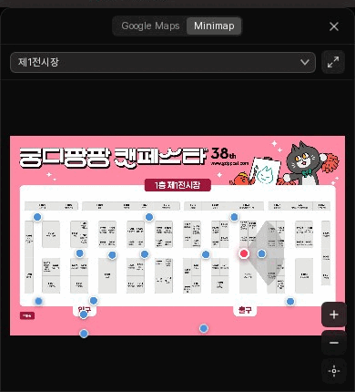

- 문제: 실내 미니맵을 끌면 지도 영역 밖으로 완전히 사라질 수 있었습니다 · 현재 위치 버튼은 순간이동
- 레거시 `mapDragging` 규칙 이식 — 범위 밖으로 끌면 고무줄처럼 저항, 놓으면 젤리처럼 튕겨 들어와 한 면이 패널에 붙습니다
- 현재 위치 버튼은 0.5초 애니메이션 이동
- 같이 고침: 모바일 하프시트가 열리는 도중 지도가 안 보이던 문제 · PC 드래그 중 글자 선택
- 실측: 800px 끌면 225px 만 따라옴 · 실기기 모바일 터치 오너 확인(11/11)

직접 확인
<a class="lnk" href="https://look360-v3-client.netlify.app/vr/c7bce52b?pano=33135" target="_blank">https://look360-v3-client.netlify.app/vr/c7bce52b?pano=33135</a>
<a class="lnk" href="https://kabkee-main.tailfe017f.ts.net:8443/IND/issues/IND-9343" target="_blank">IND-9343</a>

---

## 📱 iPhone 하단 지도 사라짐 수정 + 열고 닫기 애니메이션 11/12

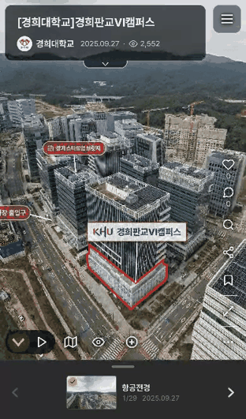

- 문제: iPhone 에서 VR 뷰어 하단 지도 영역이 사라졌습니다
- 지도 패널을 body 로 옮기고, 지도·VR 영역·미니바가 같은 시간축으로 열리고 닫히게 했습니다
- 2026-11-12 오너가 iPhone 실기에서 «지도 잘 나온다» 확인
- 커밋 `9715ae80` · `eebd167d` (look360_v3_client)

> 캡처는 실기가 아니라 iPhone 에뮬레이션(Safari 엔진 · 390×664)입니다.

직접 확인
<a class="lnk" href="https://look360-v3-client.netlify.app/vr/xo6jh8ib?adminPreview=1" target="_blank">https://look360-v3-client.netlify.app/vr/xo6jh8ib?adminPreview=1</a>
<a class="lnk" href="https://kabkee-main.tailfe017f.ts.net:8443/IND/issues/IND-9149" target="_blank">IND-9149</a>

---

## 🎬 Vimeo 360 영상 장면 신설 — 재생 중 끌어서 회전 11/12

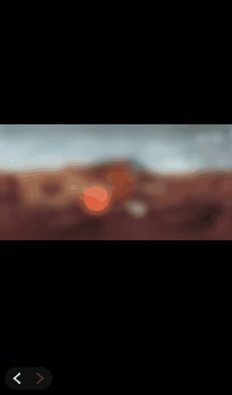

- 조사([IND-9151](https://kabkee-main.tailfe017f.ts.net:8443/IND/issues/IND-9151)) 결론: Vimeo 360 은 드래그 회전 가능 · YouTube 360 은 조이패드 방식
- 장면 출처(source)에 Vimeo 를 신설해 뷰어가 Vimeo 로 재생([IND-9360](https://kabkee-main.tailfe017f.ts.net:8443/IND/issues/IND-9360))
- 실측: 재생 중 드래그 1회에 시점 0 → 304.6
- 2026-11-12 오너가 iPhone 실기에서 원본·우리 뷰어 모두 확인
- 영상 원본에 망원경 모양 가림 연출이 있어 처음에는 화면 대부분이 검습니다

> 캡처는 iPhone 에뮬레이션입니다. 병행 규칙은 11/16 에 결정했습니다(장면당 1개 · 공개 영상은 Free 허용 · 안내 C안).

직접 확인
<a class="lnk" href="https://look360-v3-client.netlify.app/vr/ind8027fx?pano=1000010" target="_blank">https://look360-v3-client.netlify.app/vr/ind8027fx?pano=1000010</a>
<a class="lnk" href="https://player.vimeo.com/video/206627186" target="_blank">Vimeo 원본</a>

---

## 🔗 VR 이동 핫스팟 «라벨»을 눌러도 장면 이동 — 레거시와 같은 방식 11/09 QC

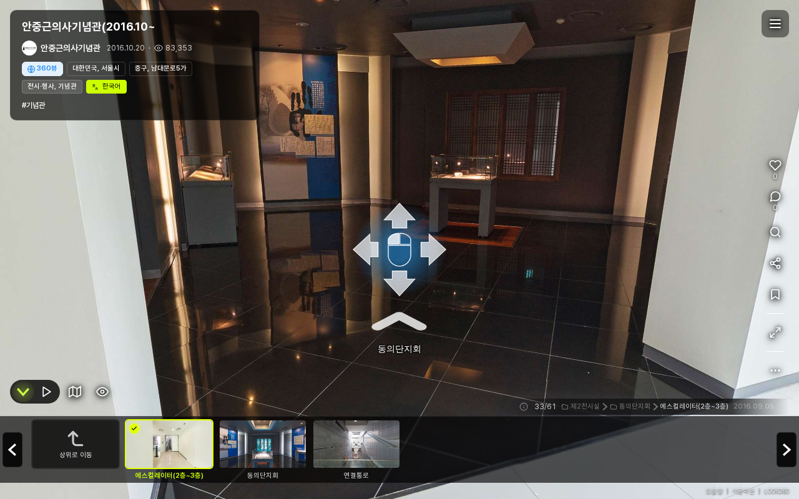

- 문제: 라벨에 마우스를 올리면 화살표는 커졌지만, 라벨을 눌러도 이동하지 않았습니다
- 🔑 레거시 `moveHS_tooltip` 과 같은 구조 — 라벨을 누르면 «연결된 화살표의 클릭을 그대로 실행»합니다
- 차이 1개: 장면 링크가 있는 화살표만 위임(외부 링크 핫스팟은 그대로)
- QC: 3개 투어 PC 클릭·모바일 터치 결과가 화살표 클릭과 같음
- 커밋 `8eea3d1e` · 운영 배포 여부는 확인 필요

> PC 라벨 클릭 10회 중 1회 미이동 관측(원인 미확정) — «100% 확인»으로 쓰지 않습니다.

직접 확인
<a class="lnk" href="http://100.64.25.50:5174/vr/yzkyw3ep?adminPreview=1" target="_blank">http://100.64.25.50:5174/vr/yzkyw3ep?adminPreview=1</a>
<a class="lnk" href="https://kabkee-main.tailfe017f.ts.net:8443/IND/issues/IND-9280" target="_blank">IND-9280</a>

---

## 🔄 핫스팟 회전 분리 — 「회전」 / 「x·y·z축 회전」 11/13~11/14

| 화면에 붙이기 | 바뀐 것 |
|---|---|
| 끔 | 「회전」(화면 평면) — 슬라이더·숫자·모서리 핸들·Q/E · 이전엔 회전 불가 |
| 켬 | 「x축 / y축 / z축 회전」(가상공간 3D) |
| 공통 | 360 게시물 이미지 마커 + VR 스티커 · 두 값은 서로 독립 보존 |

- 11/14 모바일 「기울기」 패드가 손가락과 반대로 기울던 부호 오류 수정 — 오너 실기 확인
- 🔑 **오너 결정(11/14) — 모바일 기울기 탭 C′안**: 패드 + 아래 x·y축 미세 조정 2줄 · 바텀시트 319px(시안 C 보다 44px 낮음)
- 커밋 BE `2cc6125c` · FE `09cf27d4` · `e6bd882e` · `9f737bd6` · `30a18e10`

직접 확인
<a class="lnk" href="https://look360-v3-client.netlify.app/vr/ddheagmq?tab=post" target="_blank">https://look360-v3-client.netlify.app/vr/ddheagmq?tab=post</a>
<a class="lnk" href="https://kabkee-decks.netlify.app/reports/2026-11-14-hotspot-mobile-rotate-options.html" target="_blank">모바일 회전 UI 시안 비교(A·B·C)</a>
<a class="lnk" href="https://kabkee-main.tailfe017f.ts.net:8443/IND/issues/IND-9524" target="_blank">IND-9524</a>

---

## 📸 핫스팟 회전 — PC 끔/켬 11/16 개발 서버

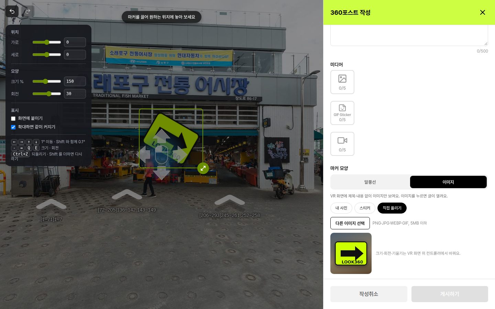

화면에 붙이기 끔 — 「회전」 1줄(30°) · 마커가 화면 평면에서 회전

켬 — x축 30 · y축 −30 · z축 0 · 마커가 가상공간 안에서 기울어짐

직접 확인
<a class="lnk" href="http://100.64.25.50:5174/vr/ddheagmq?tab=post&adminPreview=1" target="_blank">http://100.64.25.50:5174/vr/ddheagmq?tab=post → 360포스트 작성 → 이미지 마커</a>

---

## 📸 핫스팟 회전 — 모바일 회전 다이얼 · 기울기 탭 C′안 11/16 개발 서버

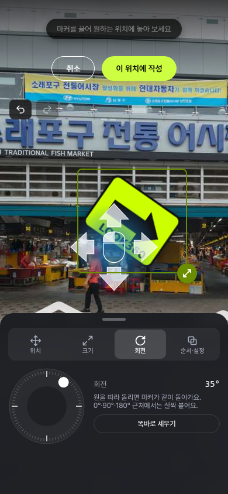

끔 — 「회전」 다이얼 35°

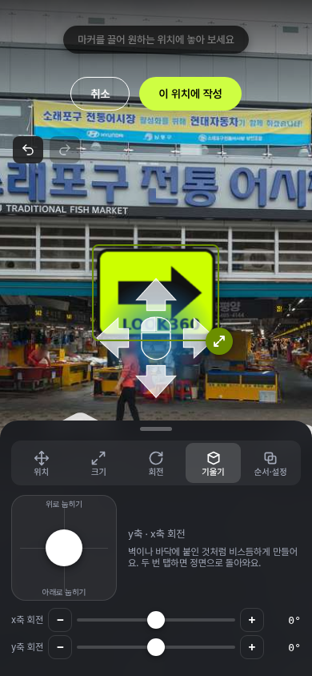

켬 — 기울기 패드 + x·y 미세 조정 2줄

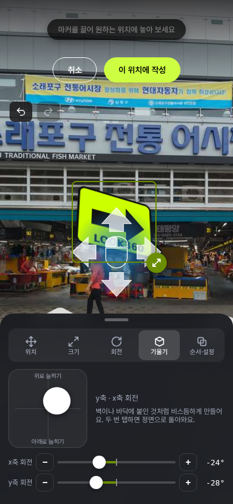

패드를 오른쪽 위로 끈 뒤 — x −24° · y −28°

직접 확인
<a class="lnk" href="https://look360-v3-client.netlify.app/vr/ddheagmq?tab=post" target="_blank">https://look360-v3-client.netlify.app/vr/ddheagmq?tab=post</a>

---

<!-- _class: sec -->

Part 3 · Section 09

## 다음 주 보고 예정 — 검색 · 외부VR

---

## #️⃣ 해시태그를 누르면 통합검색으로 + «해시태그(n)» 탭 11/13 QC PASS

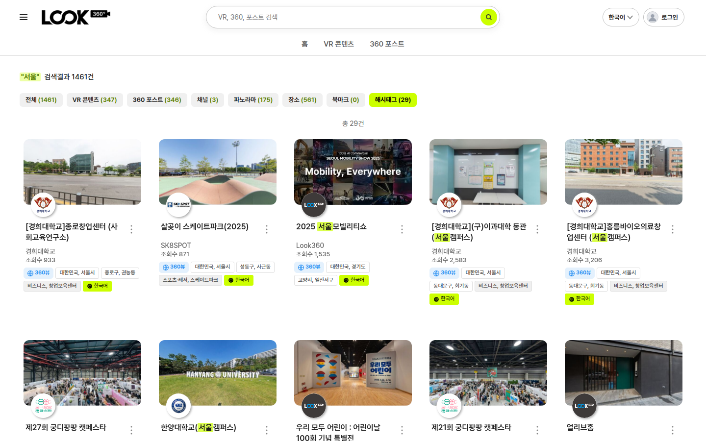

「서울」 해시태그 탭 — «… 북마크(0) · 해시태그(29)»

- 11/03 회의 오너 메모 → 결과 보고
- VR 제목 정보의 해시태그 → `/search?q=<태그>&tab=hashtag` 로 이동
- 탭 순서 «… 북마크 · 해시태그(n)» · 「전체」 탭 맨 아래 해시태그 목록
- 번역 화면에서도 원문 태그로 검색
- 데이터는 매일 02:00 수집 테이블 기준 — 오늘 고친 태그는 다음 날 반영(결함 아님)

> 11/16 개발 서버 캡처. 커밋 BE `b2f90f88` · `e2c13859` / FE `775213c5` · `fbfb116c`

직접 확인
<a class="lnk" href="http://100.64.25.50:5174/search?q=%EC%84%9C%EC%9A%B8&tab=hashtag" target="_blank">http://100.64.25.50:5174/search?q=서울&tab=hashtag</a>
<a class="lnk" href="http://100.64.25.50:5174/vr/12gub8j9?adminPreview=1" target="_blank">뷰어 해시태그</a>
<a class="lnk" href="https://kabkee-main.tailfe017f.ts.net:8443/IND/issues/IND-9147" target="_blank">IND-9147</a>

---

## 🔲 통합검색 VR 결과 — vr-list 와 같은 그리드 11/16

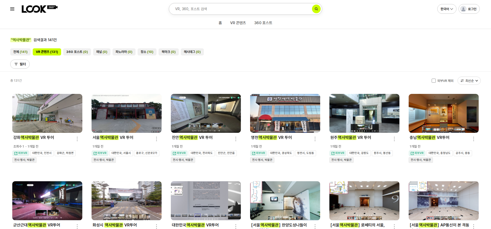

통합검색 VR 탭 1920px — 6열

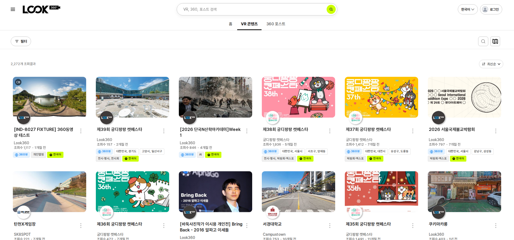

같은 폭의 vr-list — 6열

> 페이지 크기 10 → PC 24 · 모바일 12 · 「전체」 탭 미리보기 12개. 360~2560px 10구간 열 수가 vr-list 와 같습니다. 5열 구간(약 1440~1679px)에서는 마지막 줄이 꽉 차지 않습니다. 운영 배포는 하지 않았습니다.

직접 확인
<a class="lnk" href="http://100.64.25.50:5174/search?q=%EC%97%AD%EC%82%AC%EB%B0%95%EB%AC%BC%EA%B4%80&tab=vr&sort=latest" target="_blank">http://100.64.25.50:5174/search?q=역사박물관&tab=vr</a>
<a class="lnk" href="http://100.64.25.50:5174/search?q=%EC%97%AD%EC%82%AC%EB%B0%95%EB%AC%BC%EA%B4%80" target="_blank">「전체」 탭</a>

---

## ↗️ 외부VR «사이트 이동하기» → 로딩 페이지 + 5초 카운트다운 11/16

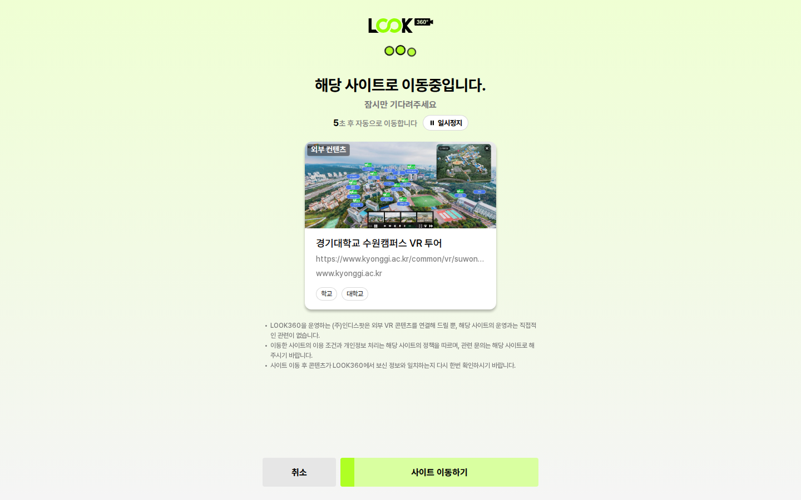

카운트다운 + 「⏸ 일시정지」

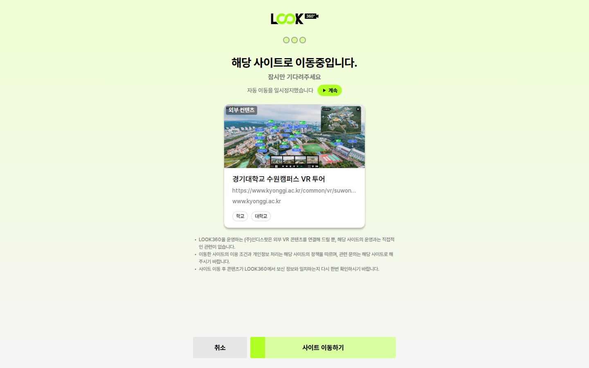

일시정지 → 「▶ 계속」 · 창이 안 보이면 자동 정지

> 새 창 로딩 페이지 → 5초 뒤 외부 사이트로 이동(뒤로가기로 안 돌아옴) · 「취소」는 새 창만 닫음. 안내 문구 3줄을 외부VR 맥락으로 고쳐 Figma 원문과 다릅니다. ko 외 6개 언어는 AI 번역(원어민 검수 없음).

직접 확인
<a class="lnk" href="http://100.64.25.50:5174/vr-info/T7Ukosjm" target="_blank">http://100.64.25.50:5174/vr-info/T7Ukosjm → 「사이트 이동하기」</a>
<a class="lnk" href="https://kabkee-main.tailfe017f.ts.net:8443/IND/issues/IND-9153" target="_blank">IND-9153</a>

---

## 👁️ 외부VR 조회수 = 「사이트 이동」 횟수 · 제공처 표시 11/16

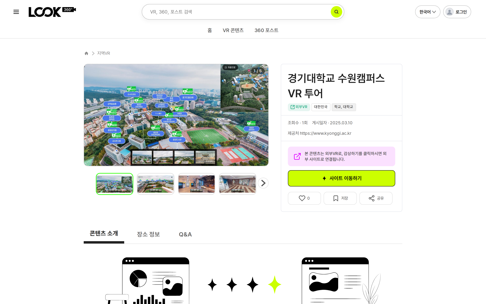

- 이전: 외부VR 조회수가 항상 0 (응답에 조회수 키 없음)
- 이제: 실제로 외부 사이트로 이동할 때만 +1 · 「취소」·상세 열람은 세지 않음
- 실측: 0 → 취소 0 → 이동 1 → 자동 이동 2
- 조회수 아래에 «제공처» 한 줄([IND-9171](https://kabkee-main.tailfe017f.ts.net:8443/IND/issues/IND-9171)) — 외부VR 일 때만

> 11/16 배포 이후부터 쌓이므로 숫자가 작습니다. 화면의 «1회»는 오너가 직접 이동하며 오른 값입니다. 러시아어 «학교» 분류명 오역도 함께 고쳤습니다(운영 DB 는 배포 때 마이그레이션 2건 필요).

직접 확인
<a class="lnk" href="http://100.64.25.50:5174/vr-info/T7Ukosjm" target="_blank">http://100.64.25.50:5174/vr-info/T7Ukosjm</a>

---

<!-- _class: sec -->

Part 3 · Section 10

## 다음 주 보고 예정 — 기존 사이트 · weekly(k)pop

---

## 📖 레거시 VR 뷰어 「장소 소개」 패널 — 숨은 글을 사람도 보게 11/11 운영 배포

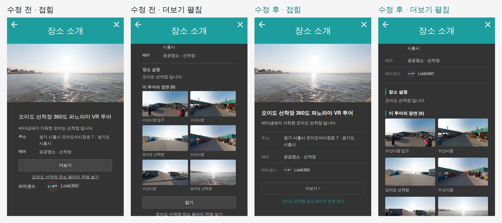

화면 밖에만 있던 장소 설명을 「장소 소개」 패널 «더보기»로 옮기고 글자 크기를 px 단계로 고정했습니다([IND-9304](https://kabkee-main.tailfe017f.ts.net:8443/IND/issues/IND-9304)). 함정: CloudFront 가 쿼리 문자열을 캐시 키에 넣지 않아 `?v=` 만으로는 옛 CSS 가 나가 경로를 따로 무효화했습니다.

직접 확인
<a class="lnk legacy" href="https://look360.kr/vr/oidodock" target="_blank">https://look360.kr/vr/oidodock → 「장소 소개」 → 「더보기」</a>

---

## 🎵 weekly(k)pop 11/05~11/13

| 이슈 | 내용 |
|---|---|
| [IND-9292](https://kabkee-main.tailfe017f.ts.net:8443/IND/issues/IND-9292) | KPOP 미확정 가수 정규화 재판정 — 사람 검수 요청은 앞의 협업 요청 C2 |
| [IND-9156](https://kabkee-main.tailfe017f.ts.net:8443/IND/issues/IND-9156) | 영문 병기 줄의 «romanized» · «translated» 태그 제거 |

직접 확인
<a class="lnk" href="https://weeklykpop.com/" target="_blank">https://weeklykpop.com/</a>

---

## 📊 주간 처리량 11/10~11/16

35

완료 상위 작업

268

완료 작업

187

코드 변경

10

결정 대기 카드

| 저장소 | 커밋 |
|---|---|
| look360_v3_client (사용자 화면) | 98 |
| nestjs-look360-api (API) | 52 |
| Look360_ksq1.2 (기존 사이트) | 29 |
| look360_platform_admin (관리자) | 8 |
| 모노레포 루트 (검증 증빙) | 161 |

> 완료 상위 작업은 일일 점검 루틴 7건을 뺀 수입니다.

---

## 🔗 바로 가기

새 플랫폼 (개발 환경)
<a class="lnk" href="http://100.64.25.50:5174" target="_blank">http://100.64.25.50:5174</a>
<a class="lnk admin" href="http://100.64.25.50:5277" target="_blank">관리자 화면 http://100.64.25.50:5277</a>

이번 주 화면
<a class="lnk" href="http://100.64.25.50:5174/vr-list" target="_blank">vr-list</a>
<a class="lnk" href="http://100.64.25.50:5174/search?q=%EB%8C%80%ED%95%99%EA%B5%90&tab=vr&sort=latest" target="_blank">통합검색</a>
<a class="lnk" href="http://100.64.25.50:5174/vr-info/T7Ukosjm" target="_blank">외부VR 상세</a>

기존 사이트
<a class="lnk legacy" href="https://look360.kr" target="_blank">https://look360.kr</a>
<a class="lnk legacy" href="https://look360.kr/vr/oidodock" target="_blank">장소 소개 패널</a>

검토 자료
<a class="lnk" href="https://kabkee-decks.netlify.app/reports/2026-11-13-webp-transition.html" target="_blank">WebP 전환</a>
<a class="lnk" href="https://kabkee-decks.netlify.app/reports/2026-11-13-studio-raw-batch.html" target="_blank">RAW 일괄 보정</a>
<a class="lnk" href="https://kabkee-decks.netlify.app/reports/2026-11-13-content-studio-ai-bulk.html" target="_blank">AI 초안</a>

---

<!-- _class: closing -->
<!-- _paginate: false -->

## 감사합니다

이번 주는 검색 노출·외부VR·채널 이미지처럼 방향을 정해야 하는 일이 많았습니다. 결정 안건을 앞에 두었고, 개발 결과는 다음 주에 이어서 보고드리겠습니다.

Indyspot AI Corp &nbsp;·&nbsp; Engineering Manager &nbsp;·&nbsp; 2026-11-16
