<!-- _class: cover -->
<!-- _paginate: false -->

# 주간 업무 보고

## 2026-11-17 &nbsp;~&nbsp; 2026-11-22

Indyspot AI Corp &nbsp;·&nbsp; Engineering Manager &nbsp;·&nbsp; 2026-11-22

---

<!-- _class: agenda -->

## 이번 회의 진행 순서 — 「정할 것 먼저, 만든 것 다음, 알아둘 것 마지막」

### ① 안건 결정
- 🤝 협업 요청 2건 — 장소 전수 검수 착수 · 외부VR 검수 주환 테스트
- 🗳️ 결정 안건 8건 — VR 목록 정렬 용어 «기본목록» · WebP 전환 방법 포함
- 결정 공유 — 장소 모델 재설계 · 반영 순서
- 대기 카드 4장 · 지난 회의(11/17) 안건 결과

### ② 개발사항 공유
- 이번 주 신규 — VR 뷰어 검색 · 필터 · 북마크 · 메일 다국어 · 블로그
- 11/16 덱에서 미리 작성한 개발 결과 13장

### ③ 정보 공유
- 사내망 G 드라이브 공유 · 학습용 PC 원격 사용법
- Paseo 추천 · 크롬 저장 비밀번호 일괄 삭제
- weekly(k)pop 차량(Android Auto) 재생 검토

### 표기
- 확인 대기 = paperclip 완료 · 오너 확인 전
- 확인 완료 = 요청 원장 오너 확인 도장
- 오른쪽 아래 「💬 코멘트」(단축키 C)로 요소마다 의견을 남길 수 있습니다

---

<!-- _class: sec -->

Section 01

## ① 안건 결정

협업 요청 → 결정 안건 → 결정 공유 → 대기 카드 → 지난 안건 결과

---

## 🗳️ 이번 회의에서 정할 것 한눈에 11/22 기준 NEW

| # | 안건 | 지금 상태 | 정할 것 |
|---|---|---|---|
| C1 | 장소 전수 검수 착수 ([IND-9722](https://kabkee-main.tailfe017f.ts.net:8443/IND/issues/IND-9722) · [IND-9588](https://kabkee-main.tailfe017f.ts.net:8443/IND/issues/IND-9588)) | 행사형 화면 QC 완료 · 0/95곳 | 진행 확정 · 담당 · 기한 |
| C2 | 외부VR 검수 주환 테스트 ([IND-9418](https://kabkee-main.tailfe017f.ts.net:8443/IND/issues/IND-9418)) | `:5190` 에서 계속 | 테스트 기간 · 개선 목록 위치 · 인계자 |
| D1 | VR 뷰어 VR 목록 정렬 기본값 용어 | 「제작자 지정 순」 | «기본목록» 으로 바꿀지 |
| D2 | 회원가입 API 이메일 인증 서버 확인 | API 직접 호출 시 우회 가능 | 직접 구현 / 에픽 발주 |
| D3 | 대시보드 북마크 썸네일 PC < 모바일 ([IND-9598](https://kabkee-main.tailfe017f.ts.net:8443/IND/issues/IND-9598)) | 코드 미변경 | ①3열 · ②2열 · ③전체 폭 |
| D4 | vr-title-info 윤곽 시안 D 재논의 ([IND-9322](https://kabkee-main.tailfe017f.ts.net:8443/IND/issues/IND-9322)) | D 적용 | 유지 / 다른 안 |
| D5 | 단국대 현장실습 참여 | 오너 결론: 당장 불참 | 확인 방법 · 업무 빈틈 |
| D6 | weekly 차트 플레이리스트 안내 링크 | 검토만 | 넣을지 · 개인용 앱 정리 |
| D7 | 다중 장소 확인용 데이터 4건 ([IND-9591](https://kabkee-main.tailfe017f.ts.net:8443/IND/issues/IND-9591)) | 개발 DB 에만 있음 | 원래 1곳으로 되돌릴지 |
| D8 | 레거시 타일 WebP 전환 — 어떻게·언제 | 전환 확정 | 시범 장소 · 품질 · JPG 삭제 시점 · 진행 방식 |

---

## 🤝 C1 · 장소 전수 검수 — admin 화면으로 «사람이» 시작합니다 11/21 결정 요청

레거시 «장소 아래 콘텐츠» 구조라 장소 칸에 행사 회차·촬영 회사·묶음 폴더가 들어갔습니다. 예: 궁디팡팡 캣페스타 31건이 회차마다 장소를 따로 갖고, 실제 전시장 연결은 0건입니다.

| 유형 | 장소 | 콘텐츠 | 처리 |
|---|---|---|---|
| 실제장소 | 1,503 | 1,924 | 유지 |
| **행사형** | **95**(+VR포토이벤트 3) | 591 | 이번 EPIC — 행사 정보는 콘텐츠로, 콘텐츠는 실제 장소로 |
| 중복형 · 폴더형 · 소속형 · 주소불일치 | 66 · 33 · 20 · 25 | 114 · 53 · 108 · 90 | 다음 EPIC 순서대로 |

> **정할 것:** ① 사람 전수 검수 진행 확정(자동 반영 없음 · 화면은 제안만) ② 행사형 95곳 담당 · 기한 ③ 다음 순서(중복형 → 폴더형 → 소속형 → 주소불일치) ④ «VR포토이벤트» 대형 묶음 3곳(콘텐츠 476건) 처리. 분류는 이름·주소 패턴 «초안»이라 오탐이 있습니다.

확인
<a class="lnk" href="https://kabkee-main.tailfe017f.ts.net:8443/IND/issues/IND-9722" target="_blank">IND-9722</a>
<a class="lnk" href="https://kabkee-main.tailfe017f.ts.net:8443/IND/issues/IND-9588" target="_blank">IND-9588</a>

---

## 📸 C1 · 행사형 장소 검수 화면 — 0 / 95곳 11/22 개발 서버

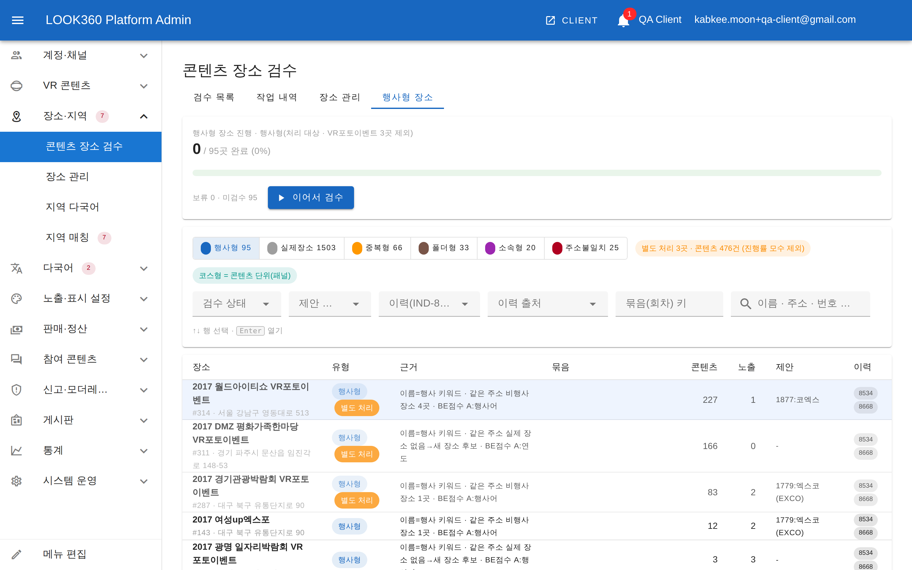

화면 QC 완료(궁디팡팡 31건 끝까지) · «무시(제외)» 버튼은 장소 모델 재설계 대기 · W8 4단계 QC 진행 중

직접 확인
<a class="lnk admin" href="http://100.64.25.50:5277/content-review/event-places" target="_blank">http://100.64.25.50:5277/content-review/event-places</a>
<a class="lnk admin" href="http://100.64.25.50:5277/content-review" target="_blank">콘텐츠 장소 검수</a>
<a class="lnk" href="http://100.64.25.50:5174/login" target="_blank">먼저 client 에서 ADMIN 로그인</a>

---

## 🤝 C2 · 외부VR 검수 페이지 — 주환 1차 사용 테스트 11/21

[IND-9418](https://kabkee-main.tailfe017f.ts.net:8443/IND/issues/IND-9418) · 다른 근로자에게 넘기기 전에, 써 보면서 고칠 것을 모읍니다.

| 항목 | 내용 |
|---|---|
| 대상 | 기존 검수 페이지 `http://192.168.60.6:5190/` — admin 검수 전용 창이 QC 를 통과할 때까지 여기서 계속 |
| 할 일 | ① 불편한 점 · 막히는 점 · 헷갈리는 문구 ② 인계 전 고칠 것(설명 · 단축키 · 버튼 이름 · 실수 방지) |
| 주의 | 테스트도 실제 검수 기록으로 쌓입니다 — 되돌리기 하거나 검토자 이름으로 구분 |
| 현재 기록 | 1,886건(11/12~11/18) · 1차 반영은 장소 모델 재설계 확정까지 보류 |

> **정할 것:** 테스트 기간 · 개선 목록을 남길 곳(IND-9418 코멘트 등) · 인계받을 근로자

직접 확인
<a class="lnk" href="http://192.168.60.6:5190/" target="_blank">http://192.168.60.6:5190/ (사내망)</a>
<a class="lnk" href="http://100.64.25.50:5190/" target="_blank">tailnet 주소</a>

---

## ⏸ C2 · 작업자 안내 — 맨 위에 빨간 띠가 보이면 멈추기 11/21

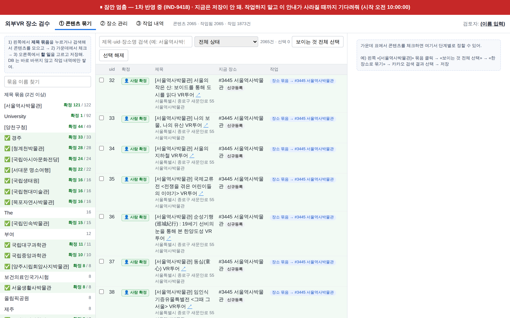

맨 위 빨간 띠 = DB 반영 중

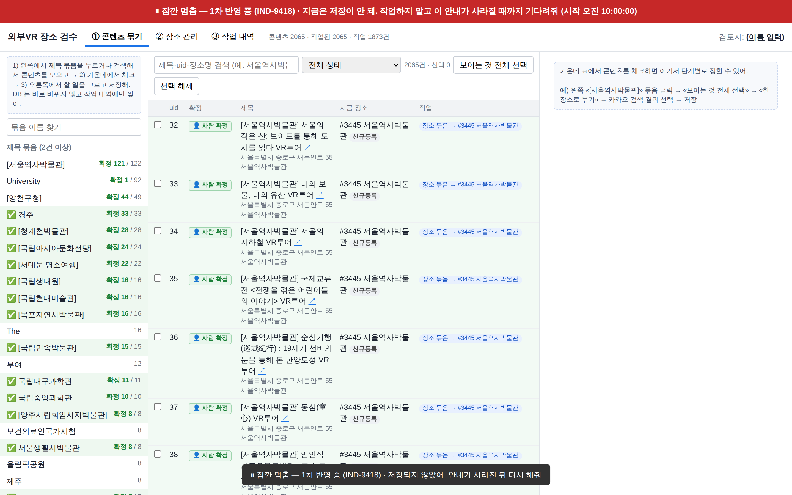

이때 누른 건 저장되지 않습니다(«저장되지 않았어»)

> 띠가 사라지면 다시 하면 됩니다. 화면 확인용으로 잠금 응답만 바꿔 찍은 캡처입니다(작업 데이터 변화 0). 띠 앞 ⏸ 기호가 캡처 글꼴에서 ▪ 로 보입니다.

직접 확인
<a class="lnk" href="http://192.168.60.6:5190/" target="_blank">http://192.168.60.6:5190/</a>

---

## 🧭 결정 공유 · 장소 모델 재설계 + 반영 순서 11/21~11/22

| 결정 | 내용 |
|---|---|
| 반영 순서(11/21) | 외부VR 검수를 W8 로 통합 — 사이드바 없는 «검수 전용 창» · 모든 쓰기 경로에 동시 수정 확인. 같은 DB 를 «모았다 일괄 반영»과 «즉시 쓰기» 두 경로로 쓰면 반영 때마다 충돌하기 때문입니다 |
| 장소 모델(11/22) | 레거시 `look360_place` 는 **통째 복제 보관** · `l3_place` 는 **새 개념 장소**(실제 장소·건물)만 · 지금 검수·외부VR 결정은 재마이그 뒤 규칙으로 다시 적용 ([IND-9779](https://kabkee-main.tailfe017f.ts.net:8443/IND/issues/IND-9779)) |
| 영향 | 외부VR 1차 반영(카드 `9ab94ac3`)은 설계 확정까지 보류 · W8·행사형 장소 쓰기도 실데이터엔 안 씀(개발·QC 계속) |

- 진행: 설계 초안 W0 · 보관층 W1 · place_key 이관 W2 · 결정 재적용 W3 완료 → 장소 쓰기 경로 4곳 대응 W4 남음
- 파일 경로는 이미 안전 — 썸네일·파노라마 경로가 장소 번호와 분리돼 있습니다([IND-9024](https://kabkee-main.tailfe017f.ts.net:8443/IND/issues/IND-9024))

확인
<a class="lnk" href="https://kabkee-main.tailfe017f.ts.net:8443/IND/issues/IND-9779" target="_blank">IND-9779</a>
<a class="lnk" href="https://kabkee-main.tailfe017f.ts.net:8443/IND/issues/IND-9775" target="_blank">IND-9775 외부VR 1차 반영 카드</a>

---

## 🗳️ D1 · VR 목록 정렬 기본값 — «제작자 지정 순» → «기본목록»? 11/22 제기 NEW

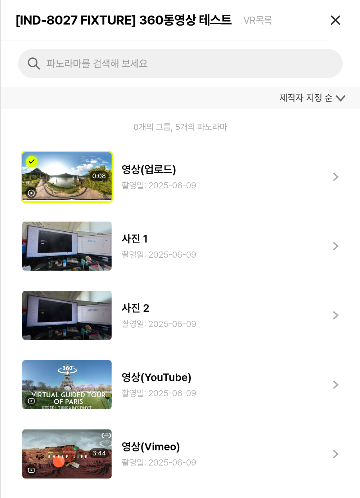

**현재 상태**(VR 뷰어 → VR 정보 탭 · 「정렬 방식」)

| 옵션 | 지금 문구 |
|---|---|
| 기본값 | 제작자 지정 순 |
| 이름 | 이름 오름차순 · 이름 내림차순 |
| 촬영일 | 촬영일 오름차순 · 촬영일 내림차순 |

- 다른 언어: Creator's order · 制作者指定順 · 创作者指定顺序 · Vom Ersteller festgelegt · Orden del creador · Порядок автора
- 문제: 사용자는 «제작자»가 누구인지 모릅니다 · 문구가 길어 드롭다운 폭을 차지합니다

직접 확인
<a class="lnk" href="http://100.64.25.50:5174/vr/ind8027fx?tab=list" target="_blank">http://100.64.25.50:5174/vr/ind8027fx?tab=list</a>
<a class="lnk" href="https://look360-v3-client.netlify.app/vr/ind8027fx?tab=list" target="_blank">Netlify</a>

---

## 🗳️ D1 · 용어안 — 다른 서비스는 «기본정렬» 을 씁니다 참고 · K Car

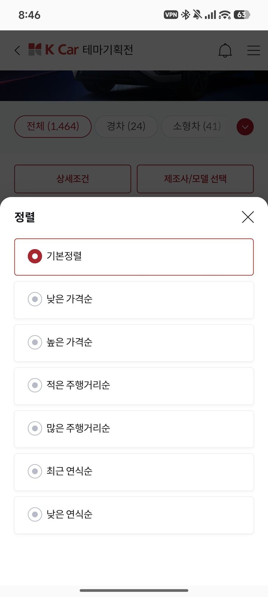

K Car 모바일 정렬 시트 — 맨 위 «기본정렬»

| 안 | 문구 | 장단점 |
|---|---|---|
| A | **기본목록** (오너 제안) | 짧고 «처음 보이는 순서»가 바로 읽힘 |
| B | 기본정렬 | 업계에서 흔함 · «정렬 방식» 제목과 겹침 |
| C | 제작자 지정 순 (현행) | 뜻은 정확하지만 길고 낯섦 |

- 같이 정할 것(선택): 나머지를 «이름순 · 이름 역순 · 최근 촬영순 · 오래된 촬영순» 처럼 K Car 식 표현으로 바꿀지
- 다른 언어 초안(A·B 공통): Default · 標準 · 默认 · Standard · Predeterminado · По умолчанию (AI 초안)

> 문구만 바뀌고 정렬 동작은 같습니다. 정해지면 7개 언어 키 1개(`vrList.sort.default`)를 고칩니다.

직접 확인
<a class="lnk" href="http://100.64.25.50:5174/vr/ind8027fx?tab=list" target="_blank">http://100.64.25.50:5174/vr/ind8027fx?tab=list (우리 현재 화면)</a>

---

## 🗳️ D2 · 회원가입 — 이메일 인증을 서버가 확인하지 않습니다 11/19 발견

- 11/19 「회원가입 버튼이 안 켜진다」 신고를 고치다가 찾았습니다(화면 수정 결과는 ② 개발사항 공유).
- 가입 API(`POST /auth/join`)가 이메일 인증 여부를 서버에서 확인하지 않습니다. 인증에 성공하면 코드를 지워서 가입 시점에는 근거도 남아 있지 않습니다.
- ⇒ 화면을 거치지 않고 API 를 직접 부르면 인증 없이 가입됩니다.
- 고치려면 «인증 성공 표시를 서버에 남기는» 설계 변경이 필요합니다(가입 인증 메일 다국어 작업 IND-9729 와 같은 경로).

> **정할 것:** 직접 구현 / 에픽 발주 · 운영 배포 전에 막을지

확인
<a class="lnk" href="https://look360-v3-client.netlify.app/" target="_blank">https://look360-v3-client.netlify.app/ → 로그인 → 회원가입</a>

---

## 🗳️ D3 · 대시보드 북마크 썸네일이 PC 보다 모바일에서 더 큽니다 11/21 확인

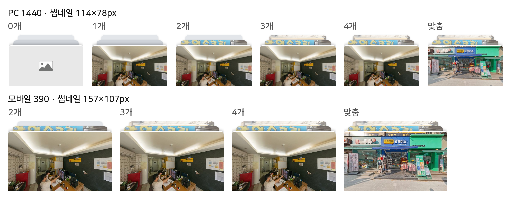

PC 는 패널 절반 + 4열이라 114px, 모바일은 전체 폭 + 2열이라 157px(Figma 시안 값 그대로) · PC 에선 3겹 뒤 장이 선처럼만 보입니다.

| 방안 | PC 썸네일 폭 | 대시보드 북마크 수 |
|---|---|---|
| ① PC 3열 | 약 159px (모바일과 거의 같음) | 4 → 3개 |
| ② PC 2열 | 약 250px | 4 → 2개 |
| ③ 패널 전체 폭 + 4열 유지 (추천) | 약 260px | 4개 유지 · 「구매한 콘텐츠」 아래 줄로 |

직접 확인
<a class="lnk" href="http://100.64.25.50:5174/my/dashboard" target="_blank">http://100.64.25.50:5174/my/dashboard (로그인)</a>

---

## 🗳️ D4 · vr-title-info 윤곽 — 시안 D(그림자 통일) 적용 · 재논의 11/20

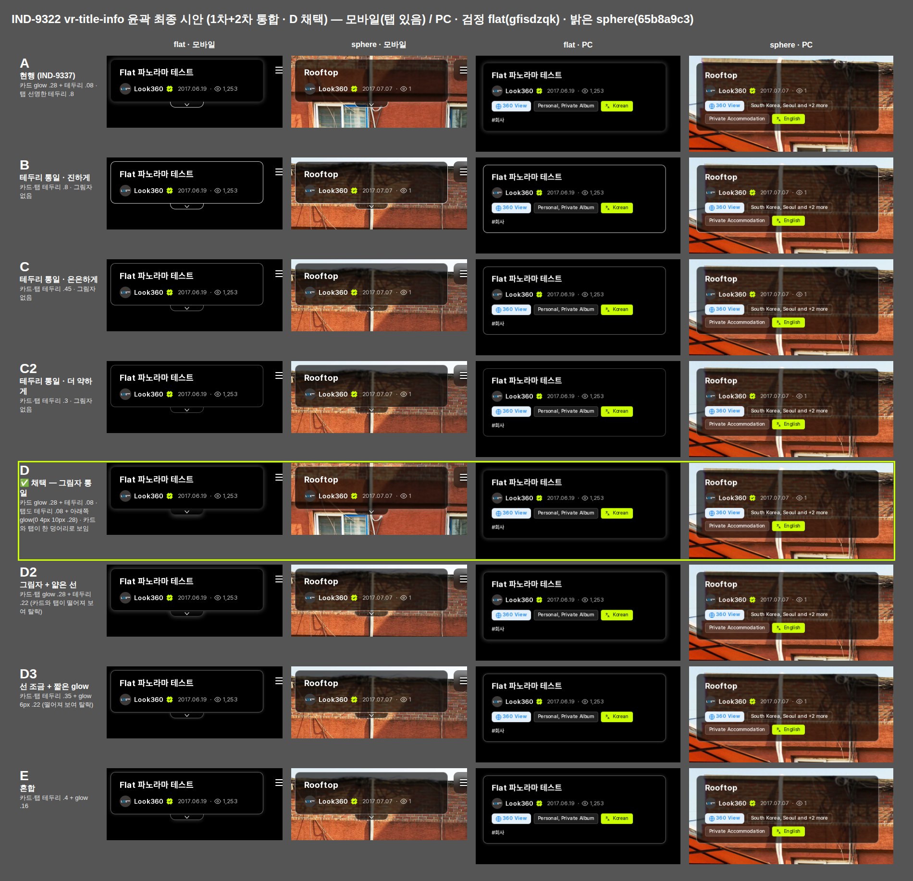

- 검정 배경 flat 장면에서도 윤곽이 보이도록 카드에 흰 glow 를 넣었더니, 모바일 chevron 탭(접기 핸들)의 선명한 흰 테두리와 질감이 어긋났습니다
- 시안 8개 비교 → 오너가 **D(그림자 통일)** 로 정하고 적용 — 탭 테두리 .8 → .08 + 아래쪽 흰 glow
- 기준: «카드와 핸들이 떨어져 보이지 않을 것» · C(테두리 통일)는 흰 선이 확실히 보여 기능적으로 안전하다는 의견도 있었습니다
- 예전 결정 «탭 테두리는 .8 로 밝게»를 뒤집은 것입니다
- 모바일(≤1023px)만 바뀜 · 커밋 `6554626a`

> **정할 것:** D 유지 / 다른 안. 시안은 라이브 화면에 CSS 를 주입해 찍은 것이고, 실제 소스에는 D 만 들어 있습니다.

직접 확인
<a class="lnk" href="http://100.64.25.50:5174/vr/gfisdzqk" target="_blank">http://100.64.25.50:5174/vr/gfisdzqk (모바일 폭 · 검정 배경)</a>
<a class="lnk" href="http://100.64.25.50:5174/vr/65b8a9c3" target="_blank">밝은 배경</a>
<a class="lnk" href="https://kabkee-main.tailfe017f.ts.net:8443/IND/issues/IND-9322" target="_blank">IND-9322</a>

---

## 🗳️ D5 · 단국대 현장실습(SW중심대학 인턴) 참여 검토 11/20

| 항목 | 내용 |
|---|---|
| 비용(표준형) | 기업 지급 월 2,236,300원 이상 → 대학 환급 월 559,075원(25%) → **실부담 월 약 1,677,000원** · 산재보험 의무 |
| 2027 예정 | 교육부 「대학생 첫경력 프로젝트」로 대학 지원 **50% 상향 예정** → 확정되면 실부담 월 약 1,118,000원 |
| 일정 | 동계(12/23~2/28) 신청 마감 **12/11** · 2027 1학기 장기 마감 **2027-02-05** |

- 🎯 오너 결론(11/20): 당장은 참여하지 않고, 2027 이후 50% 지원이 확실해지면 참여
- 필요한 건 «정기적인 정규직 형태 + 고정 업무» — 고정 업무를 주려면 비정규직 근로 정리가 먼저입니다
- 후보 업무: 주환 기획 보조 · 진영 AI 뉴스·서비스 조사 · 개발 정규직은 서비스 런칭 이후
- 참여 시 형태: 표준형(사무실 고정 출근) · 가장 큰 변수는 **내년에 주환 자리가 비는지**

> **논의:** ① 50% 확정 여부를 언제·어떻게 확인할지 ② 기획·디자인·백업·스티칭 업무 빈틈 ③ 비정규직 근로 정리 방향

확인
<a class="lnk" href="https://internship.dankook.ac.kr" target="_blank">https://internship.dankook.ac.kr</a>

---

## 🗳️ D8 · 레거시 타일 WebP 전환 — 확정 · 이제 «어떻게·언제» 11/18 실행 계획 NEW

전환 자체는 확정됐습니다. 대상은 레거시 큐브 타일 `mres_*` 전부(1,758곳 · 1,224만 개 · 275.6GB)이고, `512_`·`1024_` 는 2차, 썸네일·og·GIF 는 JPG 를 유지합니다.

| # | 정할 것 | 계획서 제안 |
|---|---|---|
| ① | 시범 장소 3곳 | 크기 소·중·대 1곳씩 · 그중 1곳은 커스텀·다국어 XML 장소 |
| ② | 품질값 | 시범 장소에서 q70(−16~22%) · q75(−11~16%) 를 뷰어로 나란히 비교 후 결정 · `webpmethod=6` |
| ③ | JPG 삭제 시점 | 관찰 30일 뒤 · 백업 대조 완료분만 · 오너 승인 |
| ④ | 진행 방식 · 시작 시점 | 에픽 발주 / 직접 구현 · 4~8주 · kabkee-main 에서 실행 |

- 효과: 타일 275.6GB → 약 215~245GB · 관람자가 받는 첫 화면 타일 −23~28% · 지금 트래픽(월 0.2~0.4TB)은 무료 한도 안이라 전송비 절감은 1TB 를 넘는 달부터
- 1회 비용 약 $67(업로드 $55 + 공존 기간 저장 약 $12) · 질감 많은 장면은 오히려 커져서 «장면 절감률 8% 미만이면 JPG 유지» 규칙을 둡니다

확인
<a class="lnk" href="https://kabkee-decks.netlify.app/reports/2026-11-18-webp-legacy-tile-plan.html" target="_blank">레거시 큐브 타일 WebP 전환 실행 계획 (11/18)</a>
<a class="lnk" href="https://kabkee-decks.netlify.app/reports/2026-11-18-s3files-cost.html" target="_blank">S3 Files 비용 영향</a>
<a class="lnk" href="https://kabkee-decks.netlify.app/reports/2026-11-13-webp-transition.html" target="_blank">WebP 전환 검토 (11/13)</a>

---

## 🃏 답을 기다리는 확인 카드 11/22 조회

| 이슈 | 카드 | 묻는 것 |
|---|---|---|
| [IND-9775](https://kabkee-main.tailfe017f.ts.net:8443/IND/issues/IND-9775) | `9ab94ac3` · 11/21 | 외부VR 1차 반영 — 서로 부딪히는 기록(예: 장소 4394/4395) 처리 · 장소 모델 재설계 확정까지 보류 |
| [IND-9461](https://kabkee-main.tailfe017f.ts.net:8443/IND/issues/IND-9461) | `d9c921fb` · 11/16 | iPhone 에서 Vimeo 장면 자이로(기기 기울이기) 동작 확인 — https 주소로 열어야 동작 |
| [IND-9418](https://kabkee-main.tailfe017f.ts.net:8443/IND/issues/IND-9418) | `c03b12d9` · 11/13 | 외부VR 검수 페이지 «검수 끝» 확인 — C2 테스트·재설계 뒤로 |
| [IND-9189](https://kabkee-main.tailfe017f.ts.net:8443/IND/issues/IND-9189) | `abc68199` · 11/05 | 헤드셋 VR 모드에서 스토리 56·69·91 방향 화살표 실기 확인 |

> 4장 모두 오너 실기 확인 또는 재설계 뒤 처리할 카드라 회의에서는 순서만 정하면 됩니다. 11/16 덱의 IND-9253 · IND-9345 · IND-9470 카드는 처리됐습니다.

---

## ✅ 지난 회의(11/17) 안건 결과 — 결정 안건 D1~D9 11/17~11/22

| 11/16 덱 안건 | 결과 |
|---|---|
| D3 통합검색 외부VR | 「외부VR 제외」 체크 제거(11/17 요청 #14) → [IND-9603](https://kabkee-main.tailfe017f.ts.net:8443/IND/issues/IND-9603) |
| D6 RAW 일괄 보정 | 종료 · 기능 삭제(11/22) — 작업실은 retouched 부터만 사용(② 참고) |
| D9 돌하우스 사전학습 | 실험 5회 → 기본 3차 · 대비책 4차(② 참고) |
| D5 WebP 전환 | 전환 확정 — 어떻게·언제는 이번 회의 안건(① D8) |
| C1 글 채우기 · C2 가수 매칭 · C3 용산 지도 스팟 | C2 는 split 118 운영 반영 완료([IND-9456](https://kabkee-main.tailfe017f.ts.net:8443/IND/issues/IND-9456)) · C1·C3 담당·기한 결과 확인 필요([IND-9389](https://kabkee-main.tailfe017f.ts.net:8443/IND/issues/IND-9389)) |
| 회의에서 확인한 화면 | VR스토리 «다음» 파장([IND-9325](https://kabkee-main.tailfe017f.ts.net:8443/IND/issues/IND-9325)) · 지도 스팟 색([IND-8825](https://kabkee-main.tailfe017f.ts.net:8443/IND/issues/IND-8825)) · 지도 재조정([IND-9299](https://kabkee-main.tailfe017f.ts.net:8443/IND/issues/IND-9299)) |

확인
<a class="lnk" href="https://kabkee-decks.netlify.app/weekly-reports/2026-11-16.html" target="_blank">11/16 주간 덱</a>

---

## ✅ 지난 회의(11/17) 요청 18건 → EPIC 14개 11/18 발주 · 11/18~11/20 완료

| 요청 | EPIC | 결과 |
|---|---|---|
| 모바일 마이페이지 탭 · 알림 칩 좌우 이동 | [IND-9596](https://kabkee-main.tailfe017f.ts.net:8443/IND/issues/IND-9596) · [IND-9597](https://kabkee-main.tailfe017f.ts.net:8443/IND/issues/IND-9597) | 완료 · 확인 대기 |
| 북마크 겹친 썸네일 3겹 | [IND-9598](https://kabkee-main.tailfe017f.ts.net:8443/IND/issues/IND-9598) | 확인 완료(11/20) → ② |
| Ctrl+F+F 제목만 검색 · 해시태그 완전 일치 | [IND-9599](https://kabkee-main.tailfe017f.ts.net:8443/IND/issues/IND-9599) · [IND-9605](https://kabkee-main.tailfe017f.ts.net:8443/IND/issues/IND-9605) | 완료 · 확인 대기 |
| 장소 페이지 폐지 1·2단계(링크 제거 → 404) | [IND-9600](https://kabkee-main.tailfe017f.ts.net:8443/IND/issues/IND-9600) · [IND-9640](https://kabkee-main.tailfe017f.ts.net:8443/IND/issues/IND-9640) | 완료 · 확인 대기 |
| 적립금 위젯 제거 · 포인트 용어 | [IND-9601](https://kabkee-main.tailfe017f.ts.net:8443/IND/issues/IND-9601) | 완료 · 확인 대기 |
| 360포스트 마커 2건 · 모바일 스티커 화면 분리 | [IND-9602](https://kabkee-main.tailfe017f.ts.net:8443/IND/issues/IND-9602) · [IND-9604](https://kabkee-main.tailfe017f.ts.net:8443/IND/issues/IND-9604) | 완료 · 확인 대기 |
| 외부VR 필터 정리 · 필터 구분선 | [IND-9603](https://kabkee-main.tailfe017f.ts.net:8443/IND/issues/IND-9603) → [IND-9684](https://kabkee-main.tailfe017f.ts.net:8443/IND/issues/IND-9684) | 완료 · 확인 대기 |
| Q&A 고도화 · 알림 아이콘 · 자동 번역 중 표시 · 대시보드 시안 | [IND-9636](https://kabkee-main.tailfe017f.ts.net:8443/IND/issues/IND-9636) · [IND-9637](https://kabkee-main.tailfe017f.ts.net:8443/IND/issues/IND-9637) · [IND-9638](https://kabkee-main.tailfe017f.ts.net:8443/IND/issues/IND-9638) · [IND-9639](https://kabkee-main.tailfe017f.ts.net:8443/IND/issues/IND-9639) | 완료 · 확인 대기 |

> 확인 대기 EPIC 은 ② 뒤쪽 표에 한 줄씩 정리했습니다. 회의 중 직접 확인하거나 원장 「확인 분류」에서 도장을 찍어 주십시오.

---

<!-- _class: sec -->

Section 02

## ② 개발사항 공유

이번 주 신규 결과 → 11/16 덱에서 미리 작성한 결과 → 확인 대기 · 확인 완료 목록

---

## 🔍 VR 뷰어 검색 재구성 — 검색 페이지 제거 · Ctrl+F 는 VR 정보 목록 필터로 11/13 · 11/20 오너 확인

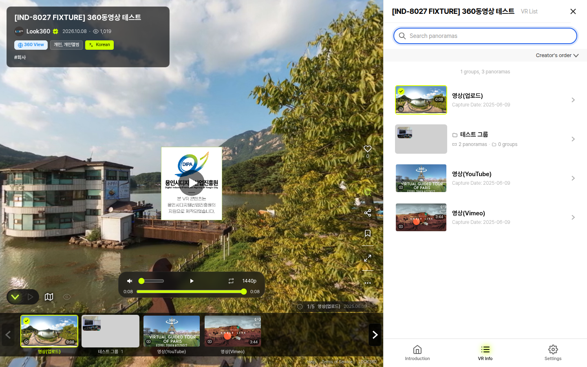

Ctrl+F 한 번 — 패널이 닫혀 있어도 VR 정보 탭 필터 입력창으로

- 별도 검색 페이지를 없앴습니다. 검색 버튼(모바일 포함) · Ctrl+F(macOS ⌘F) → 오른쪽 패널 «VR 정보» 탭 맨 위 입력창에 포커스
- 입력하면 그 VR 안의 장면 목록이 바로 걸러집니다(«결과 없음» 문구 포함)
- 브라우저 «찾기»는 VR 뷰어 안에서만 대체 — 다른 페이지는 그대로
- 정렬 선택은 오른쪽 정렬 + chevron · 기본값 «제작자 지정 순»(→ D1 안건)

> 테스트용 VR(영어 화면)으로 찍은 실측입니다. ko 외 6개 언어 문구는 화면으로 확인하지 않았습니다.

직접 확인
<a class="lnk" href="https://look360-v3-client.netlify.app/vr/ind8027fx" target="_blank">https://look360-v3-client.netlify.app/vr/ind8027fx → 화면 클릭 후 Ctrl+F</a>
<a class="lnk" href="https://kabkee-main.tailfe017f.ts.net:8443/IND/issues/IND-9319" target="_blank">IND-9319</a>

---

## 🔍 Ctrl+F 두 번 → 통합검색 모달 11/13 · 11/18 제목만

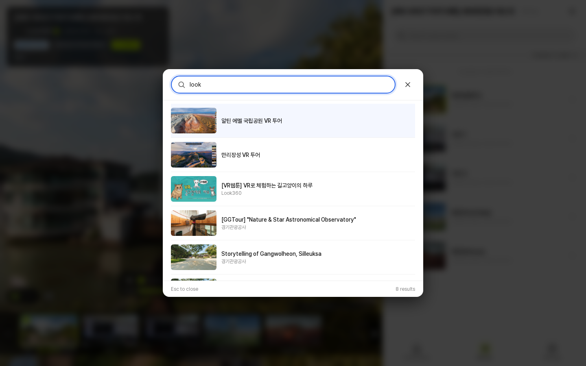

- 0.5초 안에 두 번 누르면 VR 전체를 검색하는 모달 — 썸네일 · 제목 · 채널명 · 무한 스크롤
- 닫으면(Esc · X · 바깥) 포커스가 «첫 Ctrl+F 직전» 위치로 돌아가 방향키로 바로 VR 조작([IND-9475](https://kabkee-main.tailfe017f.ts.net:8443/IND/issues/IND-9475))
- 11/17 회의 요청 #3: 모달은 **콘텐츠 제목만** 검색하도록 바꿈([IND-9599](https://kabkee-main.tailfe017f.ts.net:8443/IND/issues/IND-9599) · 확인 대기)
- 한글 입력 중(조합 중) 결과가 안 바뀌던 문제를 6곳 같이 고침([IND-9691](https://kabkee-main.tailfe017f.ts.net:8443/IND/issues/IND-9691))
- 커밋 `62c1cd48` · `9629ef08` · `0f7108b6`

직접 확인
<a class="lnk" href="http://100.64.25.50:5174/vr/ind8027fx" target="_blank">http://100.64.25.50:5174/vr/ind8027fx → Ctrl+F 빠르게 두 번</a>

---

## ☑️ vr-list 필터 「전체」 정비 — VR 종류 11/20 오너 확인

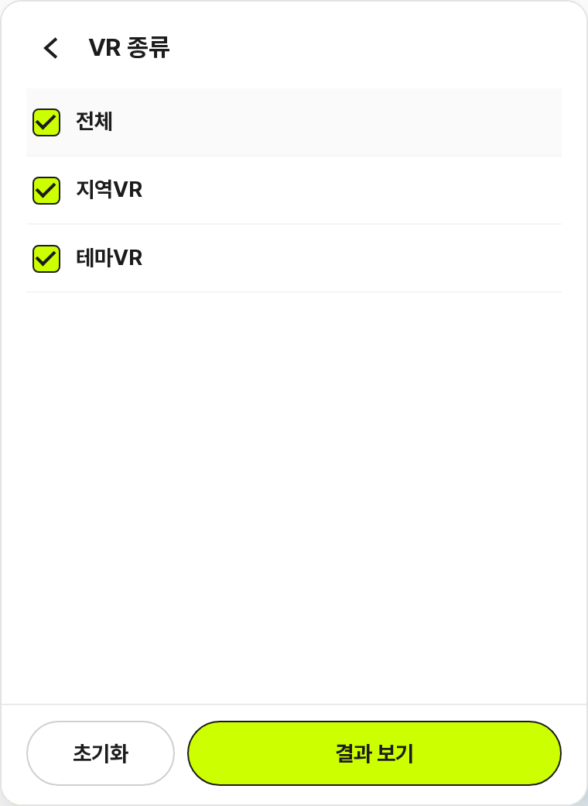

기본 = 전부 체크

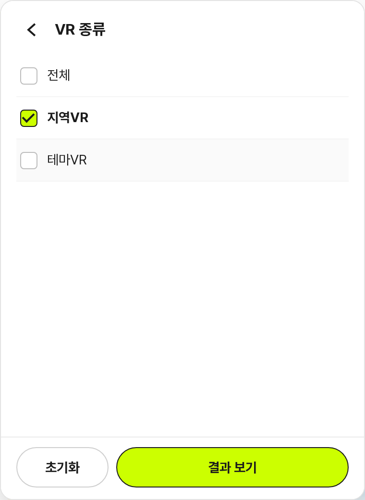

테마VR 해제 → 지역VR 만 남고 전체 풀림

- 이전: 「전체」가 선택돼 있어도 지역VR·테마VR 체크가 안 보였고, 둘 다 고르면 개별 체크가 풀렸습니다
- 이제: **전체·지역VR·테마VR 전부 체크가 기본 · 전체 해제는 없음** · 둘 다 체크하면 전체도 체크 · 둘 다 풀면 전체로 복귀
- IND-8243(지역·테마 통합 목록) 확인 중 오너가 발견 → 직접 구현 `d9de15a0`

직접 확인
<a class="lnk" href="http://100.64.25.50:5174/vr-list" target="_blank">http://100.64.25.50:5174/vr-list → 「필터」</a>
<a class="lnk" href="https://kabkee-main.tailfe017f.ts.net:8443/IND/issues/IND-9713" target="_blank">IND-9713</a>

---

## ☑️ vr-list 필터 — 콘텐츠 형식 · 썸네일 화살표 11/20 오너 확인

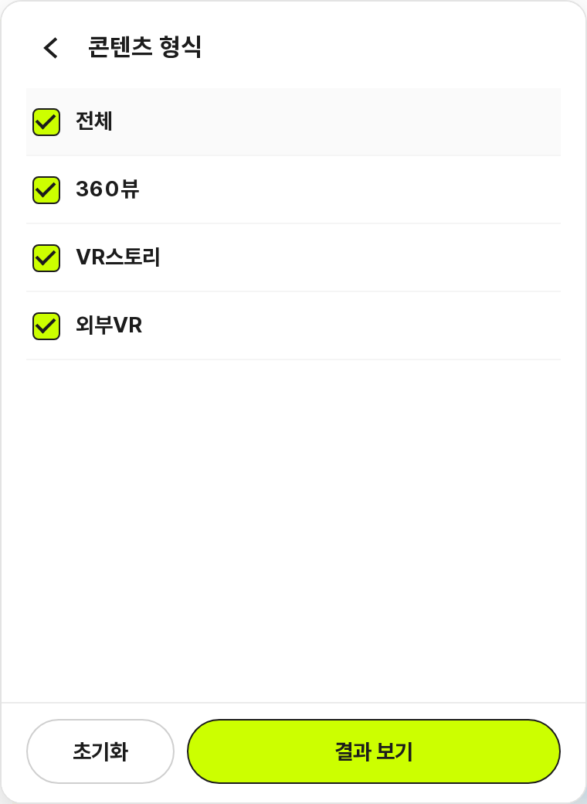

전체 클릭 → 전부 체크

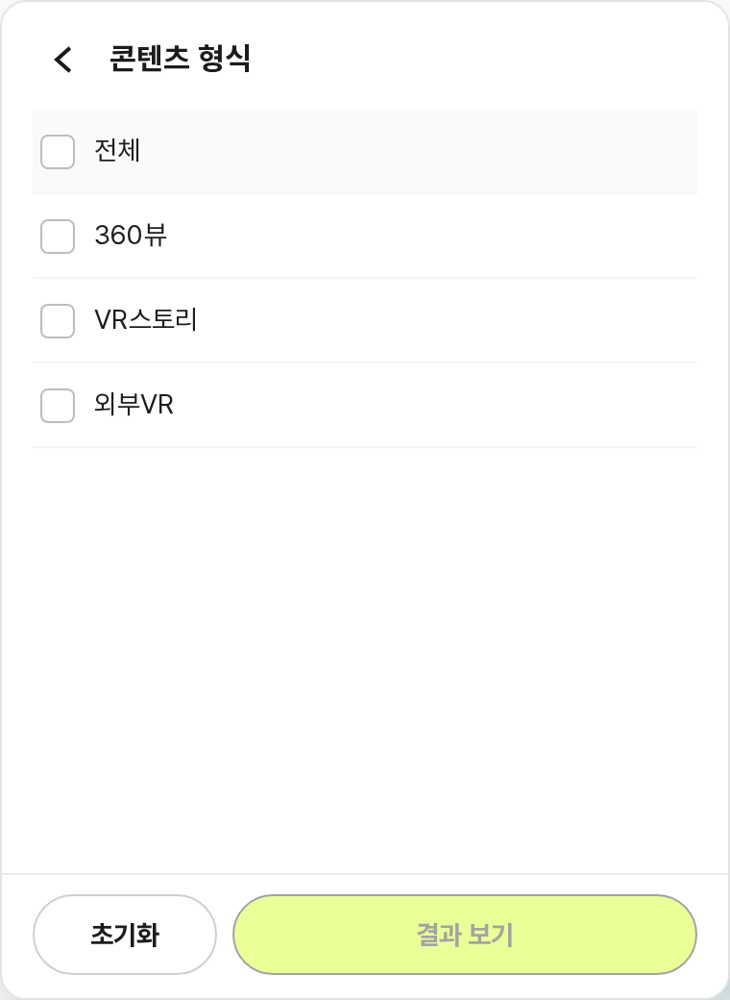

다시 클릭 → 전부 해제 · 「결과 보기」 비활성

- 모두 해제하면 첫 화면 값은 «선택 안 함» · 검색결과 VR 탭도 같은 필터라 같이 맞춤
- 기본값(360뷰 + VR스토리)은 필터 버튼 옆 개수에 **세지 않음**(오너 결정 11/20)
- VR 뷰어 하단 썸네일 좌우 화살표: 마우스를 올리면 가리키는 방향으로 살짝 왕복(`b0ca50f8`) — 터치·«동작 줄이기»에서는 정지
- 모바일 하프시트는 화면으로 확인하지 않았습니다

직접 확인
<a class="lnk" href="http://100.64.25.50:5174/vr-list" target="_blank">http://100.64.25.50:5174/vr-list</a>
<a class="lnk" href="http://100.64.25.50:5174/vr/xo6jh8ib" target="_blank">화살표 hover — /vr/xo6jh8ib 하단 썸네일 줄</a>

---

## 📚 북마크 겹친 썸네일 재구현 — 항상 3겹 11/18 · 11/21 후속 · 오너 확인

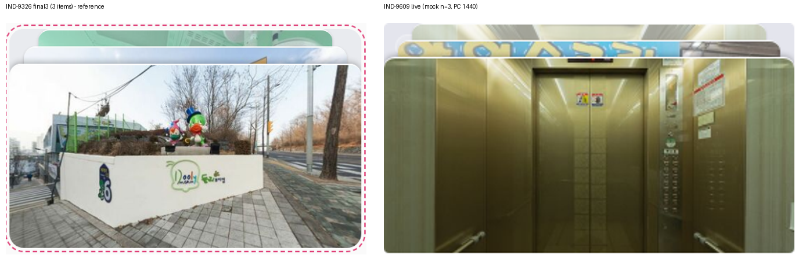

11/17 회의 요청 #2 — 맨 뒤 회색 배경 제거 · 개수와 상관없이 **항상 3겹** · 2개 이상이면 뒤 장을 2·3번째 썸네일로 · 앞 장은 항상 이미지 1장(11/21) · 대시보드까지 7개 화면이 같은 컴포넌트. 0개·4개 이상·맞춤 썸네일에도 뒤 2장을 붙였습니다(오너 원문 «총 3겹까지 항시»).

직접 확인
<a class="lnk" href="http://100.64.25.50:5174/my/bookmarks" target="_blank">http://100.64.25.50:5174/my/bookmarks (로그인)</a>
<a class="lnk" href="https://kabkee-main.tailfe017f.ts.net:8443/IND/issues/IND-9598" target="_blank">IND-9598</a>

---

## 📚 북마크 — 개수별 모양 11/21 합성 화면

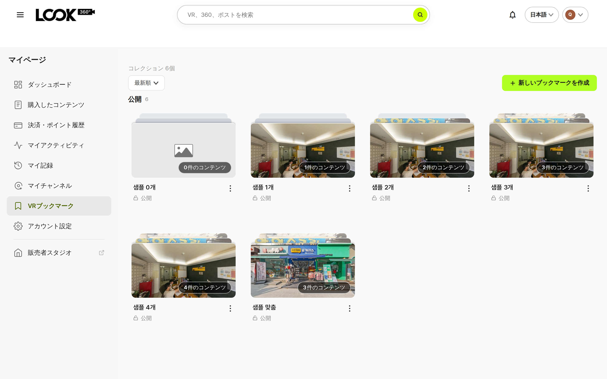

0 · 1 · 2 · 3 · 4 · 맞춤 썸네일 6종 — API 응답을 가로채 만든 **개수별 모양 확인용 합성 화면**입니다(실제 DB 쓰기 0 · 화면 언어 일본어).

직접 확인
<a class="lnk" href="http://100.64.25.50:5174/my/bookmarks" target="_blank">http://100.64.25.50:5174/my/bookmarks</a>

---

## 📍 콘텐츠 지역 칩 «외 +n» — 장소가 여러 곳인 콘텐츠 11/20

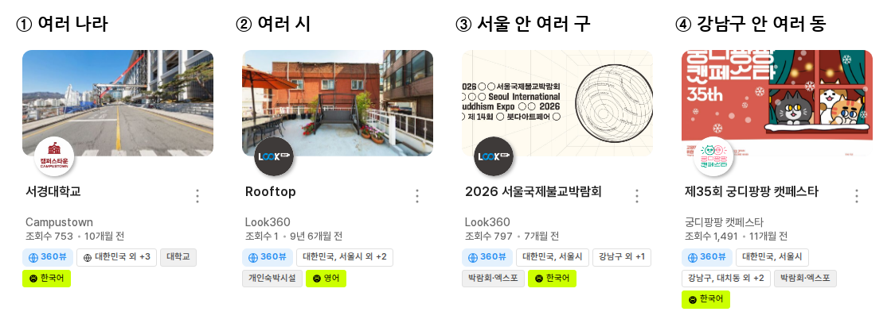

① 여러 나라 🌐 「대한민국 외 +3」 · ② 여러 시 「대한민국, 서울시 외 +2」 · ③ 여러 구 「강남구 외 +1」 · ④ 여러 동 「강남구, 대치동 외 +2」 — 첫 장소 기준, 처음 갈라지는 단계에서 «외 +n». 다중 장소 콘텐츠가 0건이라 **개발 서버에만 확인용 장소를 덧붙였습니다**(→ ① D7).

직접 확인
<a class="lnk" href="http://100.64.25.50:5174/vr-info/2wxh34h3" target="_blank">http://100.64.25.50:5174/vr-info/2wxh34h3 ①</a>
<a class="lnk" href="http://100.64.25.50:5174/vr-info/65b8a9c3" target="_blank">②</a>
<a class="lnk" href="http://100.64.25.50:5174/vr-info/9b2qpiue" target="_blank">③</a>
<a class="lnk" href="http://100.64.25.50:5174/vr-info/xnlj1z9v" target="_blank">④</a>
<a class="lnk" href="https://kabkee-main.tailfe017f.ts.net:8443/IND/issues/IND-9591" target="_blank">IND-9591</a>

---

## ✉️ 메일 다국어 — 4종을 사용자 언어로 · 모르면 한·영 병기 11/20~11/21

| 받는 사람 언어 | 발송 본문 |
|---|---|
| ko · en · ja · zh · de · es · ru | 그 언어 하나 (금액·일시 서식도 언어별) |
| 모름(값 없음·목록 밖) | 한국어 + 영어 병기 — 코드·링크는 1번만 |

| 메일 | 언어 근거 |
|---|---|
| 가입 인증 코드 | 가입 화면의 사이트 언어 |
| 비밀번호 재설정 | 요청 화면 언어 → 계정 언어 |
| 로그인 알림 · 영수증 | 계정 언어만 |
| 외부VR 결과(비회원) | 신청 때 언어 · 모르면 병기로 맞춤(S3 대기) |

- 이전: 외부VR 결과 메일만 다국어, 나머지 4종은 한국어 고정 · QC 가 실제로 6통 발송 확인(11/20)
- 외부VR 결과 메일 병기 전환(S3 · IND-9778)이 남아 «완료» 아님 · 문구는 이제 코드 상수라 어드민 「이메일 템플릿」에서 고쳐도 4종엔 반영되지 않습니다

확인
<a class="lnk" href="https://kabkee-main.tailfe017f.ts.net:8443/IND/issues/IND-9729" target="_blank">IND-9729</a>
<a class="lnk" href="https://kabkee-main.tailfe017f.ts.net:8443/IND/issues/IND-9735" target="_blank">IND-9735 병기 결정</a>

---

## ✉️ 메일 다국어 — 가입 인증 · 비밀번호 재설정 렌더 샘플

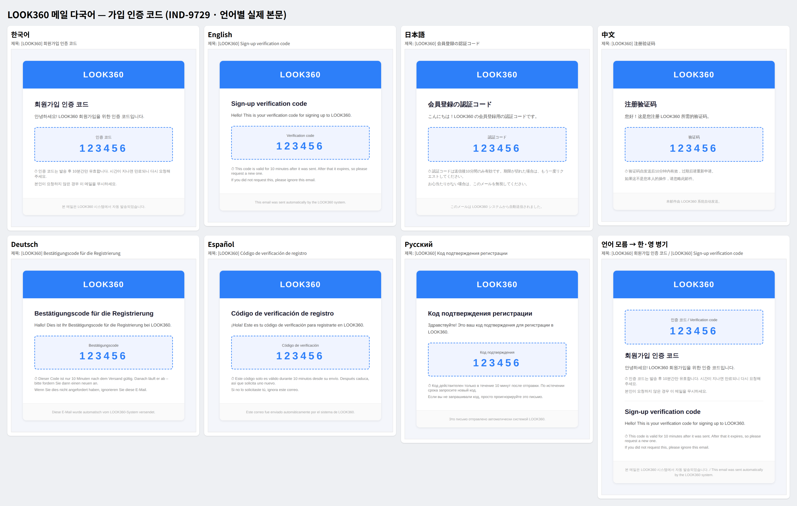

가입 인증 코드 — ko·en·ja·zh·de·es·ru·병기

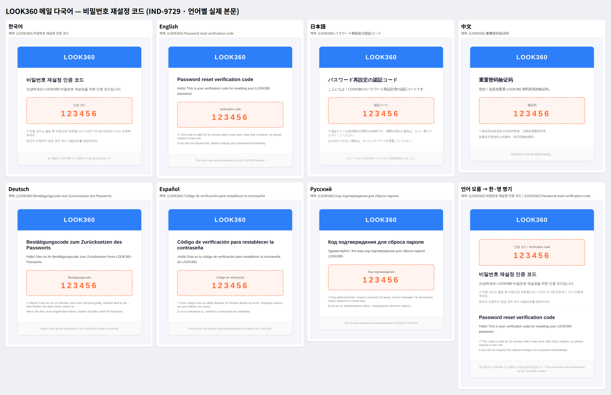

비밀번호 재설정 코드

> 서버 렌더러가 만든 실제 HTML(메일 클라이언트 화면 아님) · 고객명 「홍길동」은 샘플 데이터

확인
<a class="lnk" href="https://kabkee-main.tailfe017f.ts.net:8443/IND/issues/IND-9733" target="_blank">IND-9733 렌더 샘플</a>

---

## ✉️ 메일 다국어 — 로그인 알림 · 결제 영수증 렌더 샘플

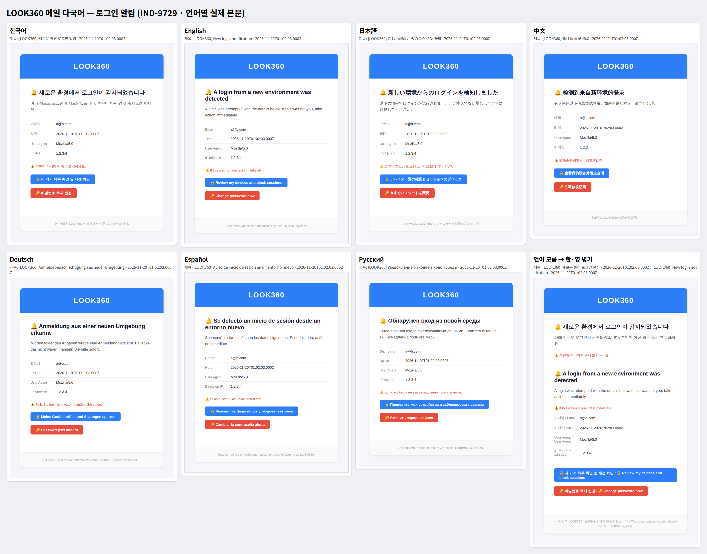

로그인 알림

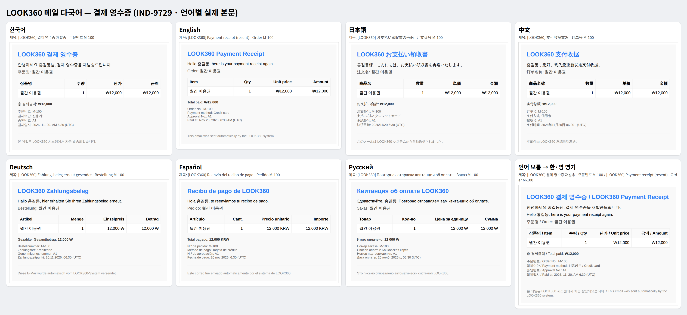

결제 영수증(어드민 재발송 때만)

> 상품명은 샘플 데이터 · 금액은 언어별 서식(de `12.000 ₩` · es `12.000 KRW`)

확인
<a class="lnk" href="https://kabkee-main.tailfe017f.ts.net:8443/IND/issues/IND-9737" target="_blank">IND-9737 실발송 QC</a>

---

## 🔑 회원가입 버튼이 안 켜지던 문제 — 이유를 보여주게 했습니다 11/19 · Netlify 배포

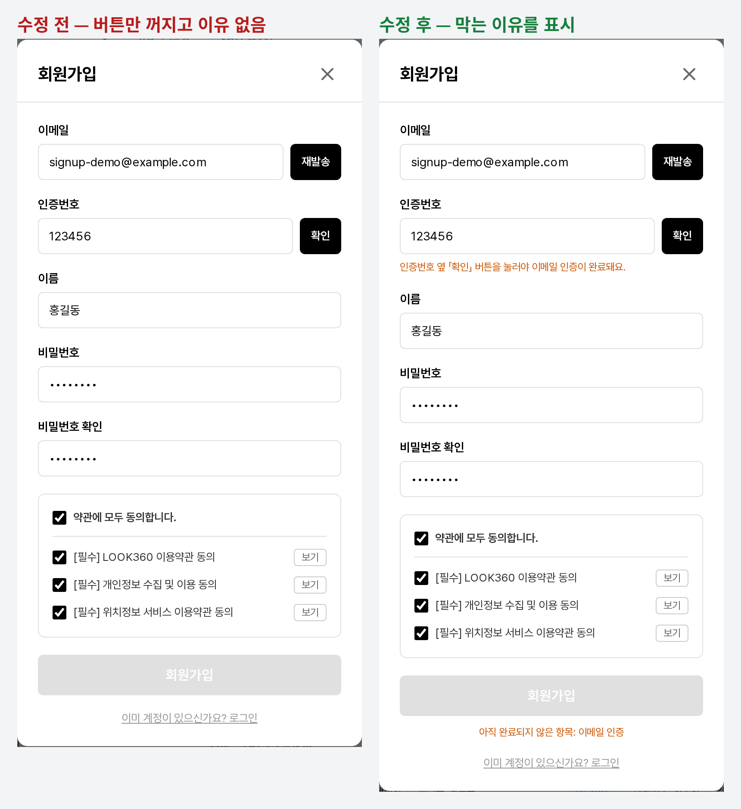

- 신고: 모든 칸을 채우고 이메일 인증까지 했는데 「회원가입」이 꺼져 있음
- 원인(추정): 조건 하나만 빠져도 꺼지는데 이유를 안 보여줬습니다 — 대표적으로 ① 인증번호 입력 후 「확인」 미클릭 ② 비밀번호 불일치(가려진 칸)
- 같이 찾은 결함: ③ 틀린 인증 코드도 「인증완료」(서버는 200 + `false`) ④ 이름 1글자는 화면 통과 · 서버 거절
- 수정: «아직 완료되지 않은 항목» 표시 · 「확인」 안내 · 불일치 즉시 표시 · 이름 2자 · 인증 `true` 일 때만 완료
- 커밋 `91676747` · 오너 확인 완료 · 남은 보안 구멍은 ① D2

직접 확인
<a class="lnk" href="https://look360-v3-client.netlify.app/" target="_blank">https://look360-v3-client.netlify.app/ → 로그인 → 회원가입</a>

---

## 📝 Look360 블로그 «Look360 VR 마실» 개통 — 독자가 보는 화면 11/22 NEW

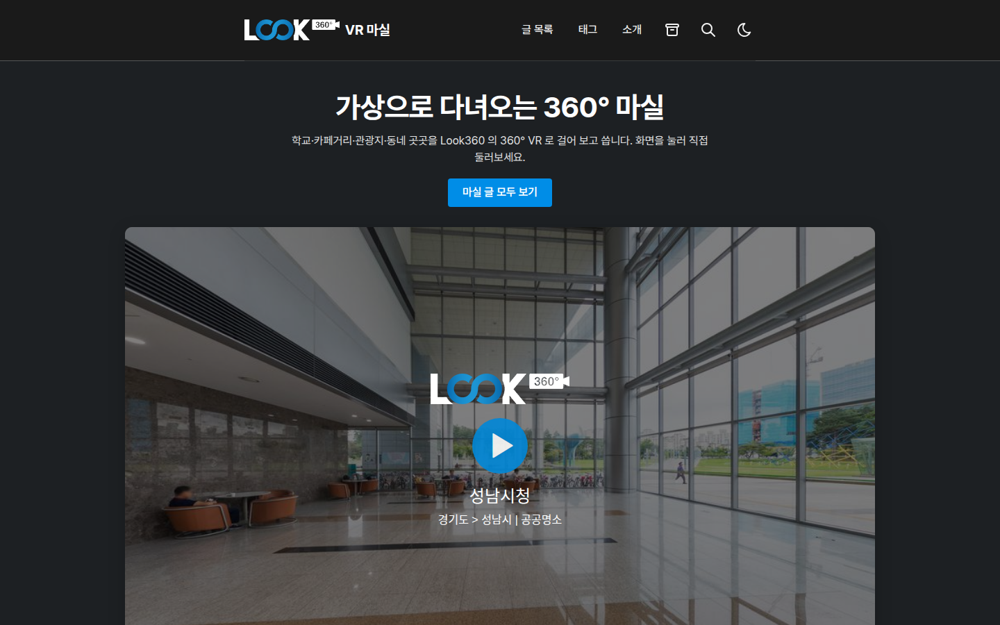

블로그 메인 — 히어로 VR + 글 카드

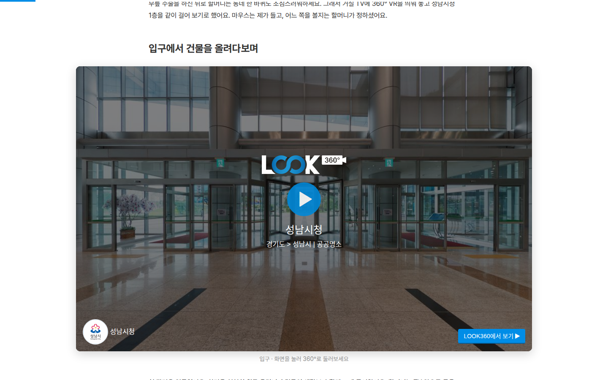

첫 글 «성남시청» — 장면마다 VR 을 크게(iframe)

look360.kr 애드센스 승인용 **`/blog/`** 블로그 — 가상의 두 화자가 360° VR 로 다녀온 산책기(가상 인물·VR 방문임을 글마다 밝힘)

직접 확인
<a class="lnk legacy" href="https://look360.kr/blog/posts/vr-seongnamcity/" target="_blank">https://look360.kr/blog/posts/vr-seongnamcity/</a>
<a class="lnk legacy" href="https://look360.kr/blog/" target="_blank">https://look360.kr/blog/</a>

---

## 📝 블로그 제작 흐름 — 레이더 → 작업실 → 고치기 → 발행 내부 전용 · tailnet 에서만 열림

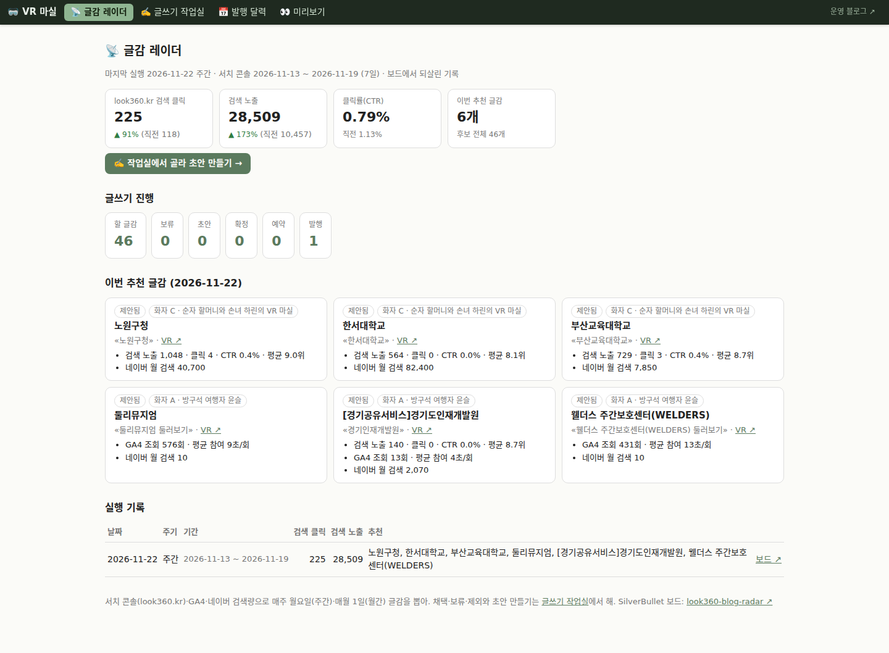

① 글감 레이더(매주 월요일 · 11/22 스냅샷)

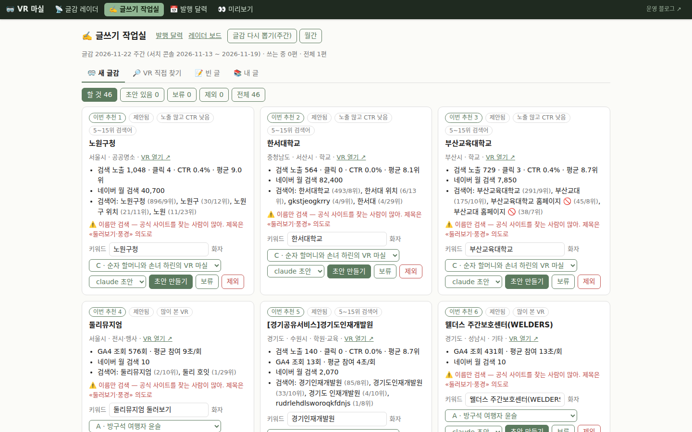

② 작업실 새 글감 → ③ 고치기 → 발행

- 첫 글감: 노출은 많고 클릭이 거의 없던 `/vr/seongnamcity`(주간 노출 1,508 · CTR 0.1%)
- 같은 날 레거시 광고 코드 범위: 장소 상세·회원·신청 게시판·짧은 글 제외 · VR 은 「장소 소개」 300자 이상만(`d53ecc7dd`·`f492ace79`·`4fda9ba50` 운영 배포)
- 11/22 사이트맵 제출·색인 요청 · 애드센스 승인 여부 모름 · 글 1편(20~30편 후 재심사)

직접 확인
<a class="lnk" href="https://kabkee-main.tailfe017f.ts.net:8448/" target="_blank">VR 마실 허브 https://kabkee-main.tailfe017f.ts.net:8448/ (내부 전용)</a>

---

## 🧰 360 작업실 — retouched(스티칭 이후)부터만 쓰도록 정리 11/17 · 11/22

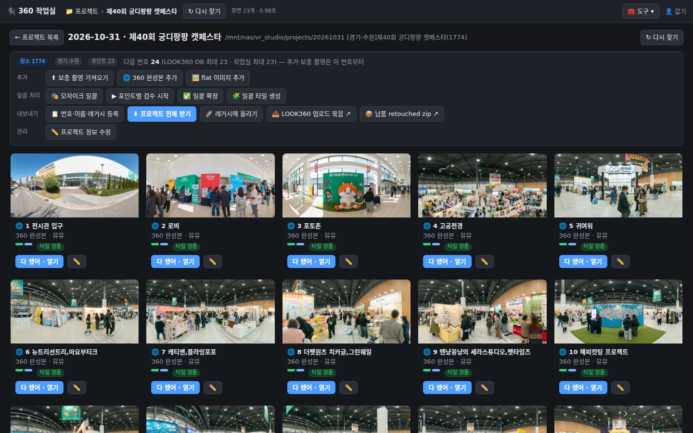

프로젝트 홈 — 추가 · 일괄 처리 · 내보내기

- 오너 결정(11/22): 당분간 **retouched 스피어부터만** — 스티칭·원본(RAW) 제작은 하지 않습니다 · 직원용 `studio.look360.kr` 도 같은 화면
- **숨김**(11/17 · 다시 켤 수 있음): 정렬·검수·마스크·최종 렌더 단계 · 360 일괄 자동 처리 · SD 카드·NAS inbox·RAW 올리기
- **삭제**(11/22): 🎞️ RAW 일괄 보정(코드 약 2,300줄 · 시험 폴더 9.6GB · 튜닝 자료 5.8GB) · 밤사이 모자이크 자동 배치 → «🎭 모자이크 일괄»로 대체
- 원본 NEF·xmp 260장은 NAS 에 그대로 · 커밋 pano-stitcher `62bf3a4`

직접 확인
<a class="lnk" href="https://studio.look360.kr/" target="_blank">https://studio.look360.kr/</a>

---

## 🧰 360 작업실 — 남은 도구 4개 · 포인트 단계 5개 11/22

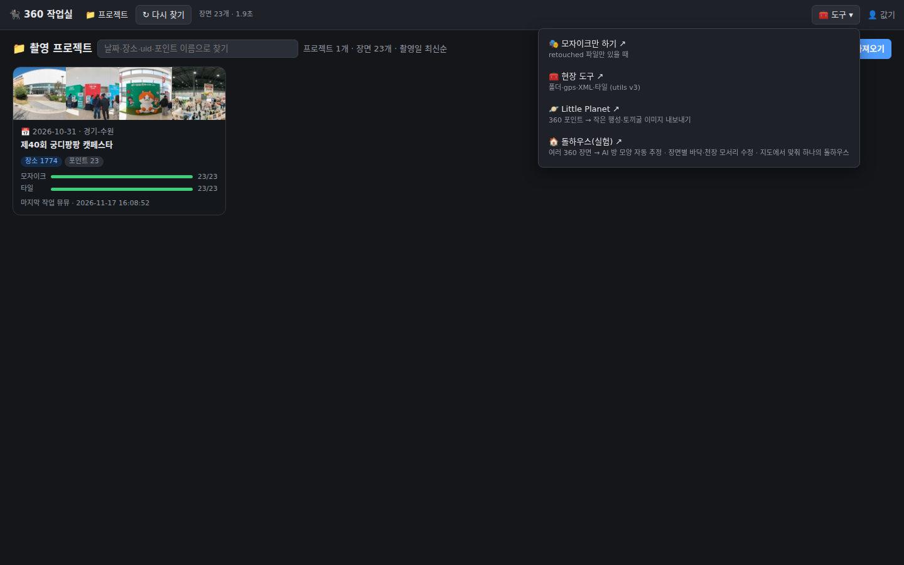

🧰 도구 — 모자이크만 하기 · 현장 도구 · Little Planet · 돌하우스(실험)

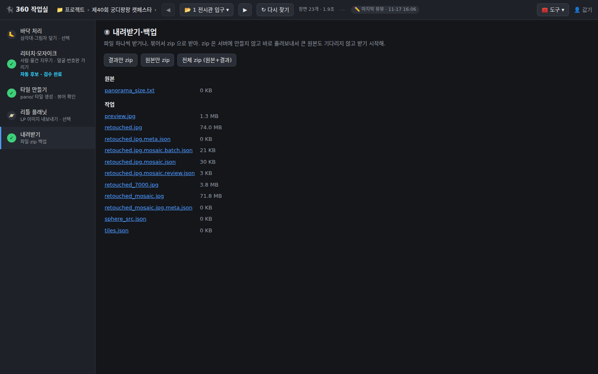

포인트 단계 — 바닥 처리 · 리터치·모자이크 · 타일 · 리틀 플래닛 · 내려받기

> «보충 촬영 가져오기»는 «스티칭 끝난 이미지를 추가하는 화면»입니다(원본 입구 아님).

직접 확인
<a class="lnk" href="https://studio.look360.kr/" target="_blank">https://studio.look360.kr/</a>

---

## 🏠 돌하우스 자기지도 사전학습 — 5번 실험 · 기본 3차 · 대비책 4차 11/17~11/21

| 실험 | 기간 · 장비 | 시작점 · 바퀴 | 14장 | 36장 |
|---|---|---|---|---|
| 1차 | 11/17~18 · 3060 | 무작위 · 250 | 75.55 | 76.99 |
| 2차 | 11/18 · 3060 | ImageNet · 100 | 78.75 | 79.08 |
| **3차** | 11/18~19 · 3060 | ImageNet · 250 | 79.77 | 80.43 |
| **4차** | 11/19~20 · 2070 + 3060 | 무작위 · 800 | 77.05 | 77.65 |
| 5차 | 11/20~21 · JH3060 | ImageNet · 800 | 75.29 | 75.53 |

3D IoU · 기준 ImageNet 79.10 / 78.50 · 사전학습 사진 고르기 페이지에서 확정한 실내 9,134장 사용(11/16 안건 «자체 사전학습»의 결과)

- **3차 = 기본**: 유일하게 여섯 기준 모두 ImageNet 보다 높음(+0.2~+1.9) · **4차 = 대비책**: ImageNet 없이 만든 것 중 최고(격차 76% 메움)
- 5차: 800바퀴로 늘리자 −4.5점 → 오래 돌린다고 좋아지지 않음 · 더 올리려면 사진 수(추정)
- «지금 쓰는 모델을 이미 교체했다»가 아닙니다 — 다음 라벨로 재학습할 때 3차에서 시작 · 3차도 ImageNet 출발이라 의존 제거는 4차 역할

---

## ✍️ 장소 글 쓰기 — 버전별 AI 검토 순위 · 모델 비교 테스트 계획 11/18

| 자료 | 내용 |
|---|---|
| 글 버전 3종 | v1 블로그 감성 감상(시범 4편) · v2 현장 리포트(10편) · **v3 가이드**(웹 조사 · 장면별 가이드 · 검수 정보 · 10편 · 현재) |
| 검토 순위 페이지 | AI 평가 80% + 기계 지표 20% 로 점수를 매겨 «점수 낮은 순 = 사람 검토 우선»으로 정렬 · 가장 약한 문장 / 근거 없는 문장을 노란 형광 |
| v3 결과 | 10곳 중 🟡 검토 권장 1 · ⚪ 무난 9 · 🔴 검토 우선 0 |
| 모델 비교 계획 | 같은 재료·같은 프롬프트로 12개 모델 비교 · 5곳 37장면 · Zen 지출 약 $10(상한 $25) → 1,636곳 전체 실행 모델 선정 |

- 시험 장소는 «서로 다른 함정» 기준 — 공식 자료 많은 곳 · 폐교(시간 순서) · 근거가 위키뿐 · 조사 사실 0건 · 여러 가게 묶음
- 병목은 비용이 아니라 «사람이 읽을 양»(12모델 × 37장면 = 장면 글 444개) · 결과는 DB 에 쓰지 않는 실험입니다

확인
<a class="lnk" href="https://kabkee-decks.netlify.app/reports/2026-11-18-place-guide-scores.html" target="_blank">가이드 검토 순위</a>
<a class="lnk" href="https://kabkee-decks.netlify.app/reports/2026-11-18-place-report-scores.html" target="_blank">현장 리포트</a>
<a class="lnk" href="https://kabkee-decks.netlify.app/reports/2026-11-18-place-feel-scores.html" target="_blank">감상글</a>
<a class="lnk" href="https://kabkee-decks.netlify.app/reports/2026-11-18-place-text-model-compare-plan.html" target="_blank">모델 비교 계획</a>

---

## 🫧 VR 뷰어 미니맵 «탱글탱글» 드래그 복귀 11/11 · 11/16 덱 미리 작성

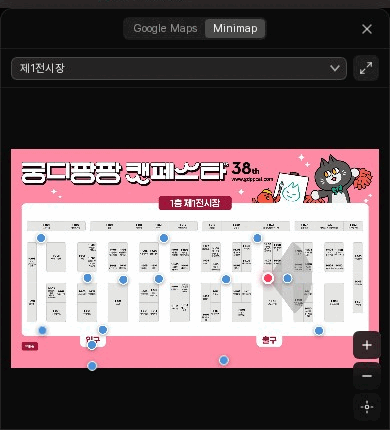

- 문제: 실내 미니맵을 끌면 지도 영역 밖으로 완전히 사라질 수 있었습니다 · 현재 위치 버튼은 순간이동
- 레거시 `mapDragging` 규칙 이식 — 범위 밖으로 끌면 고무줄처럼 저항, 놓으면 젤리처럼 튕겨 들어와 한 면이 패널에 붙습니다
- 현재 위치 버튼은 0.5초 애니메이션 이동
- 같이 고침: 모바일 하프시트가 열리는 도중 지도가 안 보이던 문제 · PC 드래그 중 글자 선택
- 실측: 800px 끌면 225px 만 따라옴 · 실기기 모바일 터치 오너 확인(11/11)
- 이번 주 후속: 미니맵 제목 다국어([IND-9692](https://kabkee-main.tailfe017f.ts.net:8443/IND/issues/IND-9692)) · 스팟 hover 딜레이([IND-9709](https://kabkee-main.tailfe017f.ts.net:8443/IND/issues/IND-9709)) — 확인 대기

직접 확인
<a class="lnk" href="https://look360-v3-client.netlify.app/vr/c7bce52b?pano=33135" target="_blank">https://look360-v3-client.netlify.app/vr/c7bce52b?pano=33135</a>
<a class="lnk" href="https://kabkee-main.tailfe017f.ts.net:8443/IND/issues/IND-9343" target="_blank">IND-9343</a>

---

## 📱 iPhone 하단 지도 사라짐 수정 + 열고 닫기 애니메이션 11/12

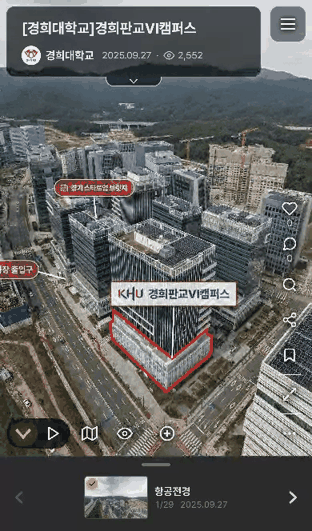

- 문제: iPhone 에서 VR 뷰어 하단 지도 영역이 사라졌습니다
- 지도 패널을 body 로 옮기고, 지도·VR 영역·미니바가 같은 시간축으로 열리고 닫히게 했습니다
- 2026-11-12 오너가 iPhone 실기에서 «지도 잘 나온다» 확인
- 커밋 `9715ae80` · `eebd167d` (look360_v3_client)

> 캡처는 실기가 아니라 iPhone 에뮬레이션(Safari 엔진 · 390×664)입니다.

직접 확인
<a class="lnk" href="https://look360-v3-client.netlify.app/vr/xo6jh8ib?adminPreview=1" target="_blank">https://look360-v3-client.netlify.app/vr/xo6jh8ib?adminPreview=1</a>
<a class="lnk" href="https://kabkee-main.tailfe017f.ts.net:8443/IND/issues/IND-9149" target="_blank">IND-9149</a>

---

## 🎬 Vimeo 360 영상 장면 신설 — 재생 중 끌어서 회전 11/12

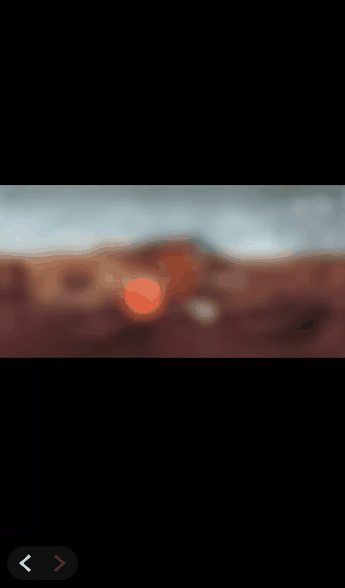

- 조사([IND-9151](https://kabkee-main.tailfe017f.ts.net:8443/IND/issues/IND-9151)) 결론: Vimeo 360 은 드래그 회전 가능 · YouTube 360 은 조이패드 방식
- 장면 출처(source)에 Vimeo 를 신설해 뷰어가 Vimeo 로 재생([IND-9360](https://kabkee-main.tailfe017f.ts.net:8443/IND/issues/IND-9360))
- 실측: 재생 중 드래그 1회에 시점 0 → 304.6
- 2026-11-12 오너가 iPhone 실기에서 원본·우리 뷰어 모두 확인
- 영상 원본에 망원경 모양 가림 연출이 있어 처음에는 화면 대부분이 검습니다

> 캡처는 iPhone 에뮬레이션입니다. 병행 규칙은 11/16 결정(장면당 1개 · 공개 영상은 Free 허용 · 안내 C안). 자이로 실기 확인 카드는 ① 대기 카드.

직접 확인
<a class="lnk" href="https://look360-v3-client.netlify.app/vr/ind8027fx?pano=1000010" target="_blank">https://look360-v3-client.netlify.app/vr/ind8027fx?pano=1000010</a>
<a class="lnk" href="https://player.vimeo.com/video/206627186" target="_blank">Vimeo 원본</a>

---

## 🔗 VR 이동 핫스팟 «라벨»을 눌러도 장면 이동 — 레거시와 같은 방식 11/09 QC

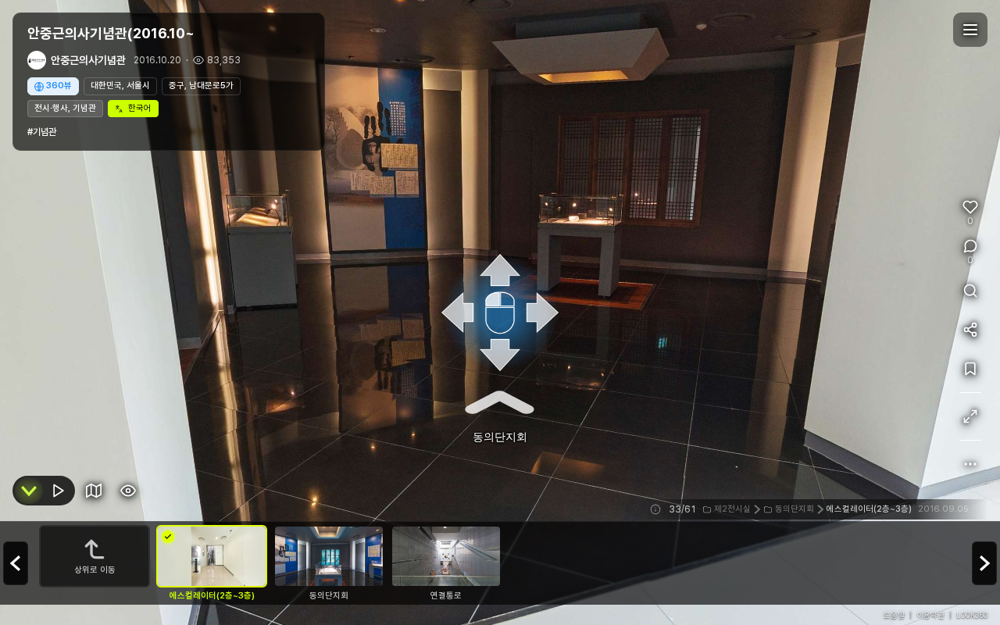

- 문제: 라벨에 마우스를 올리면 화살표는 커졌지만, 라벨을 눌러도 이동하지 않았습니다
- 🔑 레거시 `moveHS_tooltip` 과 같은 구조 — 라벨을 누르면 «연결된 화살표의 클릭을 그대로 실행»합니다
- 차이 1개: 장면 링크가 있는 화살표만 위임(외부 링크 핫스팟은 그대로)
- QC: 3개 투어 PC 클릭·모바일 터치 결과가 화살표 클릭과 같음
- 커밋 `8eea3d1e` · 운영 배포 여부는 확인 필요

> PC 라벨 클릭 10회 중 1회 미이동 관측(원인 미확정) — «100% 확인»으로 쓰지 않습니다.

직접 확인
<a class="lnk" href="http://100.64.25.50:5174/vr/yzkyw3ep?adminPreview=1" target="_blank">http://100.64.25.50:5174/vr/yzkyw3ep?adminPreview=1</a>
<a class="lnk" href="https://kabkee-main.tailfe017f.ts.net:8443/IND/issues/IND-9280" target="_blank">IND-9280</a>

---

## 🔄 핫스팟 회전 분리 — 「회전」 / 「x·y·z축 회전」 11/13~11/14

| 화면에 붙이기 | 바뀐 것 |
|---|---|
| 끔 | 「회전」(화면 평면) — 슬라이더·숫자·모서리 핸들·Q/E · 이전엔 회전 불가 |
| 켬 | 「x축 / y축 / z축 회전」(가상공간 3D) |
| 공통 | 360 게시물 이미지 마커 + VR 스티커 · 두 값은 서로 독립 보존 |

- 11/14 모바일 「기울기」 패드가 손가락과 반대로 기울던 부호 오류 수정 — 오너 실기 확인
- 🔑 **오너 결정(11/14) — 모바일 기울기 탭 C′안**: 패드 + 아래 x·y축 미세 조정 2줄 · 바텀시트 319px(시안 C 보다 44px 낮음)
- 커밋 BE `2cc6125c` · FE `09cf27d4` · `e6bd882e` · `9f737bd6` · `30a18e10`
- 이번 주 후속: 모바일 스티커 수정 화면을 VR 영역과 완전 분리([IND-9604](https://kabkee-main.tailfe017f.ts.net:8443/IND/issues/IND-9604) · 확인 대기)

직접 확인
<a class="lnk" href="https://look360-v3-client.netlify.app/vr/ddheagmq?tab=post" target="_blank">https://look360-v3-client.netlify.app/vr/ddheagmq?tab=post</a>
<a class="lnk" href="https://kabkee-decks.netlify.app/reports/2026-11-14-hotspot-mobile-rotate-options.html" target="_blank">모바일 회전 UI 시안 비교(A·B·C)</a>
<a class="lnk" href="https://kabkee-main.tailfe017f.ts.net:8443/IND/issues/IND-9524" target="_blank">IND-9524</a>

---

## 📸 핫스팟 회전 — PC 끔/켬 11/16 개발 서버

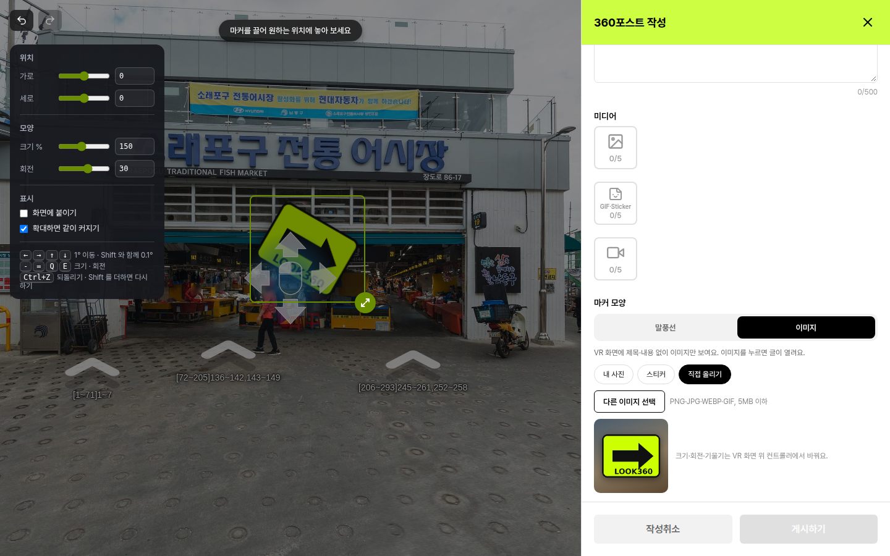

화면에 붙이기 끔 — 「회전」 1줄(30°) · 마커가 화면 평면에서 회전

켬 — x축 30 · y축 −30 · z축 0 · 마커가 가상공간 안에서 기울어짐

직접 확인
<a class="lnk" href="http://100.64.25.50:5174/vr/ddheagmq?tab=post&adminPreview=1" target="_blank">http://100.64.25.50:5174/vr/ddheagmq?tab=post → 360포스트 작성 → 이미지 마커</a>

---

## 📸 핫스팟 회전 — 모바일 회전 다이얼 · 기울기 탭 C′안 11/16 개발 서버

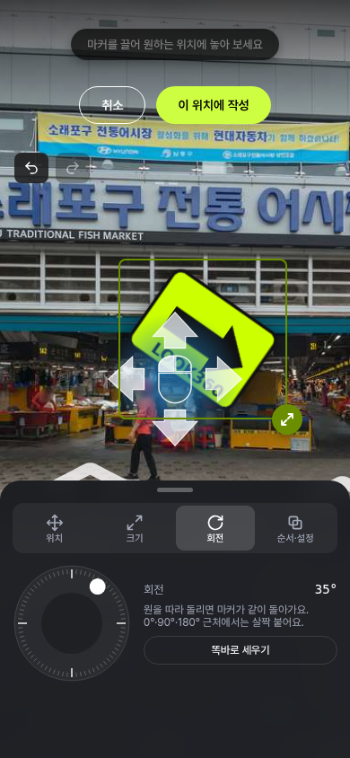

끔 — 「회전」 다이얼 35°

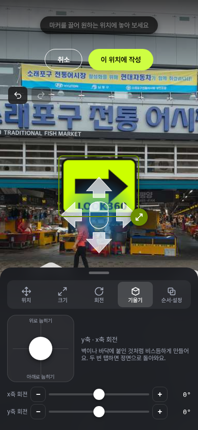

켬 — 기울기 패드 + x·y 미세 조정 2줄

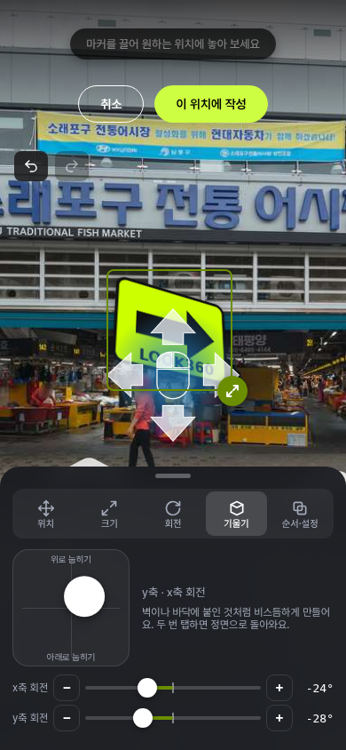

패드를 오른쪽 위로 끈 뒤 — x −24° · y −28°

직접 확인
<a class="lnk" href="https://look360-v3-client.netlify.app/vr/ddheagmq?tab=post" target="_blank">https://look360-v3-client.netlify.app/vr/ddheagmq?tab=post</a>

---

## #️⃣ 해시태그를 누르면 통합검색으로 + «해시태그(n)» 탭 11/13 QC PASS · 11/18 후속

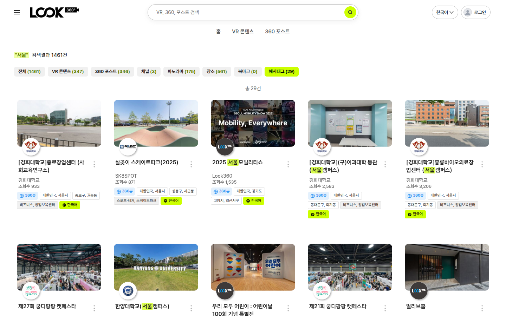

「서울」 해시태그 탭 — «… 북마크(0) · 해시태그(29)» (11/16 캡처)

- VR 제목 정보의 해시태그 → 통합검색 해시태그 탭으로 이동 · 「전체」 탭 맨 아래 해시태그 목록
- 11/17 회의 요청 #16·#17 로 이어서 바뀜: 검색어 앞 «#» · **완전 일치** 태그만 · vr-info 등 다른 곳 해시태그도 클릭 · 인스타그램식 파란 글씨([IND-9605](https://kabkee-main.tailfe017f.ts.net:8443/IND/issues/IND-9605) · 확인 대기)

> 데이터는 매일 02:00 수집 테이블 기준이라 오늘 고친 태그는 다음 날 반영됩니다(결함 아님).

직접 확인
<a class="lnk" href="http://100.64.25.50:5174/search?tab=hashtag&q=%23%EC%84%9C%EC%9A%B8" target="_blank">http://100.64.25.50:5174/search?tab=hashtag&q=#서울</a>
<a class="lnk" href="http://100.64.25.50:5174/vr/12gub8j9?adminPreview=1" target="_blank">뷰어 해시태그</a>
<a class="lnk" href="https://kabkee-main.tailfe017f.ts.net:8443/IND/issues/IND-9147" target="_blank">IND-9147</a>

---

## 🔲 통합검색 VR 결과 — vr-list 와 같은 그리드 11/16

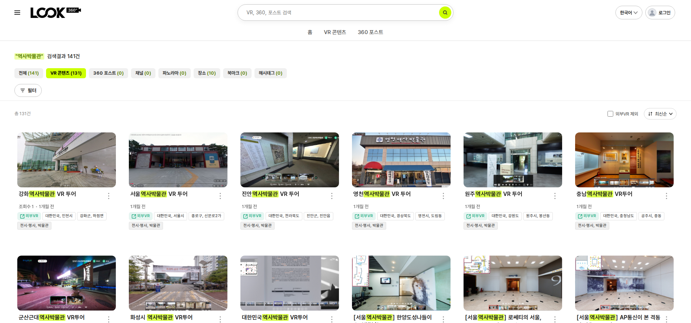

통합검색 VR 탭 1920px — 6열 (11/16 캡처)

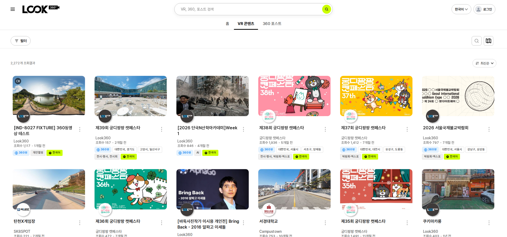

같은 폭의 vr-list — 6열

> 페이지 크기 10 → PC 24 · 모바일 12 · 「전체」 탭 미리보기 12개. 360~2560px 10구간 열 수가 vr-list 와 같습니다(5열 구간은 마지막 줄이 꽉 차지 않음). 캡처에 보이는 「외부VR 제외」 체크는 11/17 회의 요청으로 **제거**됐습니다([IND-9603](https://kabkee-main.tailfe017f.ts.net:8443/IND/issues/IND-9603)).

직접 확인
<a class="lnk" href="http://100.64.25.50:5174/search?q=%EC%97%AD%EC%82%AC%EB%B0%95%EB%AC%BC%EA%B4%80&tab=vr&sort=latest" target="_blank">http://100.64.25.50:5174/search?q=역사박물관&tab=vr</a>
<a class="lnk" href="http://100.64.25.50:5174/search?q=%EC%97%AD%EC%82%AC%EB%B0%95%EB%AC%BC%EA%B4%80" target="_blank">「전체」 탭</a>

---

## ↗️ 외부VR «사이트 이동하기» → 로딩 페이지 + 5초 카운트다운 11/16

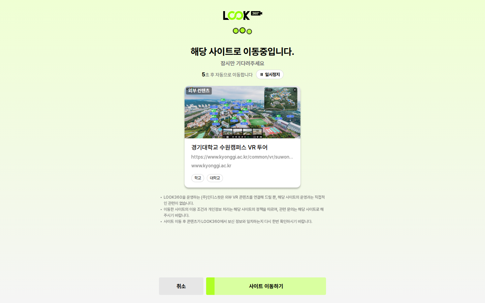

카운트다운 + 「⏸ 일시정지」

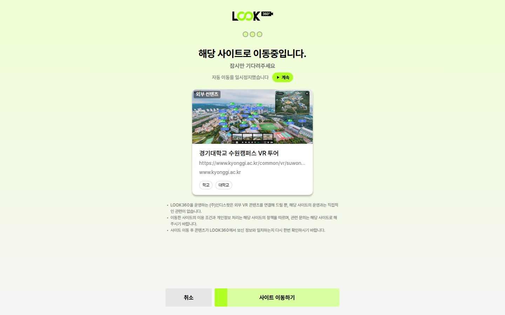

일시정지 → 「▶ 계속」 · 창이 안 보이면 자동 정지

> 새 창 로딩 페이지 → 5초 뒤 외부 사이트로 이동(뒤로가기로 안 돌아옴) · 「취소」는 새 창만 닫음. 안내 문구 3줄을 외부VR 맥락으로 고쳐 Figma 원문과 다릅니다. ko 외 6개 언어는 AI 번역(원어민 검수 없음).

직접 확인
<a class="lnk" href="http://100.64.25.50:5174/vr-info/T7Ukosjm" target="_blank">http://100.64.25.50:5174/vr-info/T7Ukosjm → 「사이트 이동하기」</a>
<a class="lnk" href="https://kabkee-main.tailfe017f.ts.net:8443/IND/issues/IND-9153" target="_blank">IND-9153</a>

---

## 👁️ 외부VR 조회수 = 「사이트 이동」 횟수 · 제공처 표시 11/16

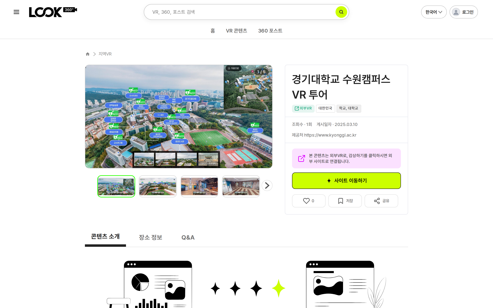

- 이전: 외부VR 조회수가 항상 0 (응답에 조회수 키 없음)
- 이제: 실제로 외부 사이트로 이동할 때만 +1 · 「취소」·상세 열람은 세지 않음
- 실측: 0 → 취소 0 → 이동 1 → 자동 이동 2
- 조회수 아래에 «제공처» 한 줄([IND-9171](https://kabkee-main.tailfe017f.ts.net:8443/IND/issues/IND-9171)) — 외부VR 일 때만

> 11/16 배포 이후부터 쌓이므로 숫자가 작습니다. 러시아어 «학교» 분류명 오역도 함께 고쳤습니다(운영 DB 는 배포 때 마이그레이션 2건 필요).

직접 확인
<a class="lnk" href="http://100.64.25.50:5174/vr-info/T7Ukosjm" target="_blank">http://100.64.25.50:5174/vr-info/T7Ukosjm</a>

---

## 📖 레거시 VR 뷰어 「장소 소개」 패널 — 숨은 글을 사람도 보게 11/11 운영 배포

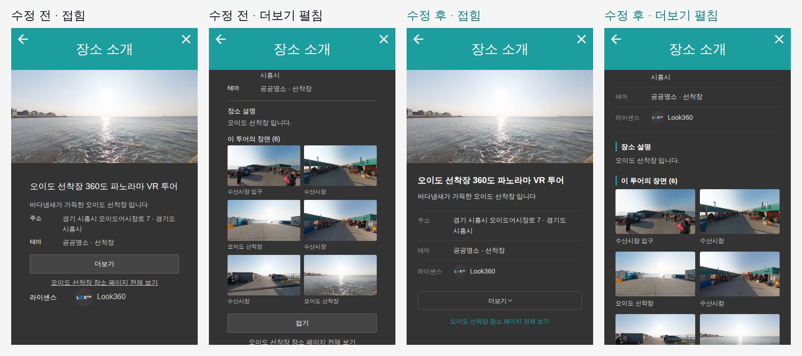

화면 밖에만 있던 장소 설명을 「장소 소개」 패널 «더보기»로 옮기고 글자 크기를 px 단계로 고정했습니다([IND-9304](https://kabkee-main.tailfe017f.ts.net:8443/IND/issues/IND-9304)). 함정: CloudFront 가 쿼리 문자열을 캐시 키에 넣지 않아 `?v=` 만으로는 옛 CSS 가 나가 경로를 따로 무효화했습니다.

직접 확인
<a class="lnk legacy" href="https://look360.kr/vr/oidodock" target="_blank">https://look360.kr/vr/oidodock → 「장소 소개」 → 「더보기」</a>

---

## 🎵 weekly(k)pop — 가수 매칭 정리 11/16~11/20

| 이슈 | 내용 |
|---|---|
| [IND-9456](https://kabkee-main.tailfe017f.ts.net:8443/IND/issues/IND-9456) | 다중 가수·괄호/영문 병기 미매칭 해소 — split 118 운영 반영 · «프로젝트명 (멤버, 멤버)»는 멤버마다 연결(11/16 오너 기준) |
| [IND-9552](https://kabkee-main.tailfe017f.ts.net:8443/IND/issues/IND-9552) | 가수 정리 2단계 — 이름 없는 가수 채우기 → 중복 가수 합치기 → 미확정 표기 Gemini 후보 제안 · 확인 대기 |
| 학생 검수 | 검토자 화면 ▶듣기/🔍검색 · AI 불일치·애매 필터 · AI 점검 1,559건 중 애매 117 |

- 남은 판단: 틀린 유튜브 영상 교체 · 그룹↔멤버 경계 5건 · 미등록 멤버 15명 · 동명이인 보류(창민·김정수) · 이름 빈 새 가수 8건

직접 확인
<a class="lnk" href="https://weeklykpop.com/?r=home&m=weeklychart&mode=artist_review" target="_blank">https://weeklykpop.com/ 검토자 화면</a>

---

## 🟡 완료 · 오너 확인 대기 (1/2) — 화면·기능 11/18~11/21 완료

| EPIC | 내용 |
|---|---|
| [IND-9596](https://kabkee-main.tailfe017f.ts.net:8443/IND/issues/IND-9596) · [IND-9597](https://kabkee-main.tailfe017f.ts.net:8443/IND/issues/IND-9597) | 모바일 마이페이지 탭 · 알림 칩 좌우 이동(휠·드래그·터치) · 「판매」 탭은 판매자만 |
| [IND-9693](https://kabkee-main.tailfe017f.ts.net:8443/IND/issues/IND-9693) | PC 가로 스크롤 UI 전수 — 드래그·휠 이동 + 공용 래퍼 강제 lint |
| [IND-9599](https://kabkee-main.tailfe017f.ts.net:8443/IND/issues/IND-9599) · [IND-9605](https://kabkee-main.tailfe017f.ts.net:8443/IND/issues/IND-9605) | Ctrl+F+F 제목만 검색 · 해시태그 완전 일치 탭 · 링크형 스타일 |
| [IND-9600](https://kabkee-main.tailfe017f.ts.net:8443/IND/issues/IND-9600) · [IND-9640](https://kabkee-main.tailfe017f.ts.net:8443/IND/issues/IND-9640) | 장소 페이지 폐지 — 링크·검색 결과 제거 → `/place/:domain` 404 |
| [IND-9601](https://kabkee-main.tailfe017f.ts.net:8443/IND/issues/IND-9601) · [IND-9636](https://kabkee-main.tailfe017f.ts.net:8443/IND/issues/IND-9636) | 적립금 위젯 제거 · Q&A 답변 전 편집·삭제 · 익명 · admin 수정 표시 |
| [IND-9602](https://kabkee-main.tailfe017f.ts.net:8443/IND/issues/IND-9602) · [IND-9604](https://kabkee-main.tailfe017f.ts.net:8443/IND/issues/IND-9604) | 360포스트 마커 표시 2건 · 모바일 스티커 수정 화면 분리 |
| [IND-9603](https://kabkee-main.tailfe017f.ts.net:8443/IND/issues/IND-9603) · [IND-9684](https://kabkee-main.tailfe017f.ts.net:8443/IND/issues/IND-9684) | 외부VR 필터 표시 정리 · 필터 구분선 · 결과 0건 지역 제외 |
| [IND-9637](https://kabkee-main.tailfe017f.ts.net:8443/IND/issues/IND-9637) · [IND-9638](https://kabkee-main.tailfe017f.ts.net:8443/IND/issues/IND-9638) · [IND-9639](https://kabkee-main.tailfe017f.ts.net:8443/IND/issues/IND-9639) | 알림 카테고리 아이콘 · 「자동 번역 중」 표시 · 마이페이지 대시보드 시안 |
| [IND-9253](https://kabkee-main.tailfe017f.ts.net:8443/IND/issues/IND-9253) · [IND-9345](https://kabkee-main.tailfe017f.ts.net:8443/IND/issues/IND-9345) | 레거시 건물 툴팁 전부 복원 · 외부VR 비회원 등록 신청 개편 |
| [IND-9692](https://kabkee-main.tailfe017f.ts.net:8443/IND/issues/IND-9692) · [IND-9709](https://kabkee-main.tailfe017f.ts.net:8443/IND/issues/IND-9709) · [IND-4286](https://kabkee-main.tailfe017f.ts.net:8443/IND/issues/IND-4286) | 미니맵 제목 다국어 · 스팟 hover 딜레이 · VR스토리 lookTo 줌·next 멈춤 |

---

## 🟡 완료 · 오너 확인 대기 (2/2) — 번역 11/19~11/21 완료

| EPIC | 내용 |
|---|---|
| [IND-9730](https://kabkee-main.tailfe017f.ts.net:8443/IND/issues/IND-9730) · [IND-9721](https://kabkee-main.tailfe017f.ts.net:8443/IND/issues/IND-9721) | 360뷰·VR스토리·외부VR 전부 자동번역 · 카드 제목 미번역(번역 키가 360뷰만 생성) |
| [IND-9719](https://kabkee-main.tailfe017f.ts.net:8443/IND/issues/IND-9719) · [IND-9720](https://kabkee-main.tailfe017f.ts.net:8443/IND/issues/IND-9720) | 파노라마명 «처음 볼 때 자동번역+저장» · 칩 회귀 수정 · 번역 대기 중 흐림+물결 표시 |
| [IND-9745](https://kabkee-main.tailfe017f.ts.net:8443/IND/issues/IND-9745) · [IND-9752](https://kabkee-main.tailfe017f.ts.net:8443/IND/issues/IND-9752) | 긴 글 분할 번역(AWS 10KB 한도) · VR 안 툴팁 핫스팟 이름표 자동번역 |
| [IND-9760](https://kabkee-main.tailfe017f.ts.net:8443/IND/issues/IND-9760) | 번역 자원 이월 도구 — 마이그레이션 때 dev 번역 재사용, 원문 바뀐 것만 제외 |
| [IND-9723](https://kabkee-main.tailfe017f.ts.net:8443/IND/issues/IND-9723) | 테마·카테고리 이름 이중 번역 제거 — DB 다국어를 정본으로 |
| [IND-9710](https://kabkee-main.tailfe017f.ts.net:8443/IND/issues/IND-9710) · [IND-9694](https://kabkee-main.tailfe017f.ts.net:8443/IND/issues/IND-9694) | «다른 언어 콘텐츠» 카드 지역·카테고리 번역 · 장소 소개 구글지도 언어 |
| [IND-9552](https://kabkee-main.tailfe017f.ts.net:8443/IND/issues/IND-9552) | weekly(k)pop 가수 정리 2단계 |

> paperclip 은 완료지만 요청 원장에 오너 확인 도장이 없는 EPIC 입니다. «완료»가 아니라 «확인 대기»로 보고합니다 — 원장 「확인 분류」에서 확인해 주십시오.

확인
<a class="lnk" href="http://100.64.25.50:8830/triage" target="_blank">요청 원장 확인 분류 http://100.64.25.50:8830/triage</a>

---

## ✅ 오너 확인 완료 — 회의 보고 대기분 확인 11/09~11/20

| EPIC | 내용 | 처음 보고 |
|---|---|---|
| [IND-8243](https://kabkee-main.tailfe017f.ts.net:8443/IND/issues/IND-8243) · [IND-9713](https://kabkee-main.tailfe017f.ts.net:8443/IND/issues/IND-9713) | 지역VR·테마VR 통합 목록 · 필터 「전체」(«완전 좋아 만족») | 이번 덱 |
| [IND-9598](https://kabkee-main.tailfe017f.ts.net:8443/IND/issues/IND-9598) · [IND-9319](https://kabkee-main.tailfe017f.ts.net:8443/IND/issues/IND-9319) | 북마크 3겹 · VR 뷰어 검색 재구성 | 이번 덱 |
| [IND-9152](https://kabkee-main.tailfe017f.ts.net:8443/IND/issues/IND-9152) · [IND-8880](https://kabkee-main.tailfe017f.ts.net:8443/IND/issues/IND-8880) | 북마크 placeholder 시안 · VR 목록 카테고리 2단 패널 | 11/09 · 10/26 |
| [IND-8241](https://kabkee-main.tailfe017f.ts.net:8443/IND/issues/IND-8241) · [IND-8208](https://kabkee-main.tailfe017f.ts.net:8443/IND/issues/IND-8208) · [IND-8154](https://kabkee-main.tailfe017f.ts.net:8443/IND/issues/IND-8154) | VR 목록 chevron·하단 썸네일 · 다국어 전수검사 · 번역 누락·언어 전환 | 10/19 |
| [IND-8469](https://kabkee-main.tailfe017f.ts.net:8443/IND/issues/IND-8469) · [IND-8592](https://kabkee-main.tailfe017f.ts.net:8443/IND/issues/IND-8592) | 다국어 미번역 후속 · 콘텐츠 언어 필터 | 10/19 · 10/26 |
| [IND-8534](https://kabkee-main.tailfe017f.ts.net:8443/IND/issues/IND-8534) · [IND-8668](https://kabkee-main.tailfe017f.ts.net:8443/IND/issues/IND-8668) · [IND-8675](https://kabkee-main.tailfe017f.ts.net:8443/IND/issues/IND-8675) | 장소 정보 복사·특이사항 · 1:N 오너 검수 반영 · 360 작업실 로드맵 | 10/26 |
| [IND-8495](https://kabkee-main.tailfe017f.ts.net:8443/IND/issues/IND-8495) · [IND-8249](https://kabkee-main.tailfe017f.ts.net:8443/IND/issues/IND-8249) | weekly(k)pop 영문 줄 규칙 | 10/19 |

- 재확인 필요: [IND-9100](https://kabkee-main.tailfe017f.ts.net:8443/IND/issues/IND-9100) 레거시 콘텐츠 정리 · [IND-8982](https://kabkee-main.tailfe017f.ts.net:8443/IND/issues/IND-8982) 장소 SNS 표시 — 확인 뒤 재작업 · 재작업: [IND-9155](https://kabkee-main.tailfe017f.ts.net:8443/IND/issues/IND-9155) 장소 SNS 를 서비스 아이콘 방식으로 방향 변경

---

<!-- _class: sec -->

Section 03

## ③ 정보 공유

결정이나 개발 결과가 아니라 «알아두면 좋은 것»

---

## 🗂️ 사내망 G 드라이브 공유 «Dev_DAS» — 누구나 읽기 전용 11/19 NEW

| 항목 | 내용 |
|---|---|
| 무엇 | kabkee-main 의 G 드라이브(2.8TB · Backups / Design / Development / Utils) |
| 접속 | 탐색기 주소창 `\\KABKEE-MAIN\Dev_DAS` (= `\\192.168.60.6\Dev_DAS`) → 읽기 전용 공용 계정 |
| 계정 | Bitwarden Look360 조직 · «Dev_DAS - kabkee-main G드라이브 읽기 전용 공유» · «자격 증명 기억» 체크 |
| 권한 | 공용 계정은 어떤 경로로도 읽기·복사만 · 오너 계정만 쓰기 |

- «오류 1219» 가 나오면: 이미 `\\192.168.60.6\scan`(스캐너)에 다른 계정으로 연결한 PC 입니다 → 컴퓨터 이름 주소(`\\KABKEE-MAIN\Dev_DAS`)로 여세요
- 비밀번호를 안 묻고 열리면 그 PC 에 다른 계정 연결이 남아 있는 것입니다(익명 접속은 막혀 있음)
- `Design/백업/` 의 퇴사자 바탕화면 폴더는 연도별로 정리 중입니다

---

## 🖥️ 학습용 PC 원격 사용법 — JH3060 · 2070 PC 11/19~11/20

하루 넘게 GPU 를 쓰는 일(사전학습 등)을 개발용 PC 대신 남는 PC 에서 돌리려고 «서버처럼» 쓰게 설정했습니다.

| PC | 사양 | 켜기 | 접속 | 쓸 수 있는 일 |
|---|---|---|---|---|
| JH3060 `192.168.60.33` | RTX 3060 12GB · 64GB | **WoL 로 켜짐** | 원격 데스크톱(사내망) · SSH | 사전학습 + 방 구조 학습 + 채점 |
| 2070 PC `192.168.60.26` | RTX 2070 SUPER 8GB · 47GB | 전원 버튼(WoL 안 됨) | SSH | 사전학습만 |

- 로그인하지 않아도 부팅하면 WSL Ubuntu·SSH 가 자동으로 켜짐 · 절전 안 함 · 학습은 서비스로 돌려 비정상 종료 시 자동 재개 · 진행은 Paseo 알림
- 원격 화면에서 재부팅·종료·`wsl --shutdown` 을 하면 학습이 멈춥니다 · 2070 은 fp16·배치 40 으로만
- 계정은 Bitwarden «desktop-jh3060 account» · 설정 기록 pano-stitcher `dollhouse/pretrain/README.md` 5-4·5-5절

---

## 🧭 Paseo 추천 — 터미널 여러 개 + tmux 로 Claude Code 를 돌리던 방식의 대안 11/21

| | 전 — 터미널 N개 + tmux | 후 — Paseo |
|---|---|---|
| 동시 요청 | 터미널 수가 상한(최대 8개) | 탭 개수 제한 없음 |
| 무엇을 맡겼나 | 어느 창에 어떤 주제인지 외워야 함 | 프로젝트별·폴더별 탭으로 화면에서 바로 보임 |
| 며칠 이어 쓰기 | tmux 세션 관리가 번거로움 | 해당 프로젝트 탭으로 바로 들어감 |
| 원격 | 같은 컴퓨터에서만 | 서버(데몬)를 한 컴퓨터에 두고 **다른 PC·휴대폰에서 접속** · 자리 비우면 휴대폰 푸시 |

- 누구에게: Claude 데스크톱 앱 사용자보다 **터미널에서 Claude Code 를 여러 개 띄워 쓰는 사람**에게 효과가 큽니다
- 실사용(11/21): kabkee-main 에 Paseo `0.15.0` · 프로젝트 8곳 · 에이전트 세션 76개 · 대화 원문은 Claude Code 세션 파일에 그대로 남음

---

## 🔐 크롬·Google 계정에 저장된 비밀번호 일괄 삭제 11/20 · 회사 공통 보안 팁

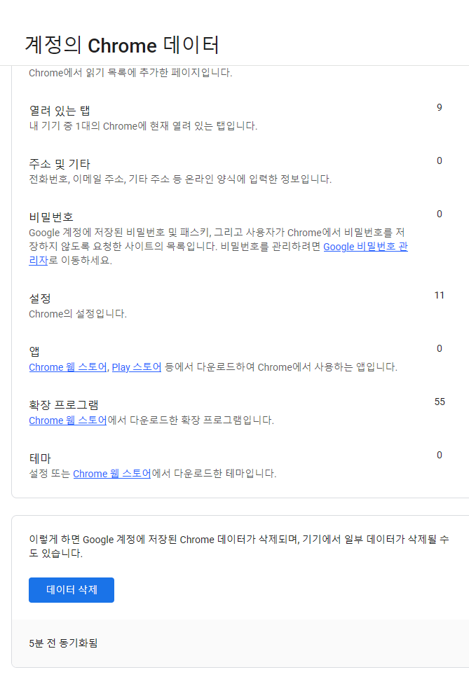

맨 아래 «데이터 삭제» → 비밀번호 0

- 🔑 **chrome.google.com/data → 페이지 맨 아래 «데이터 삭제»** 를 눌러야 Google 계정의 사이트별 비밀번호까지 지워집니다
- 🔴 함정: 구글 도움말의 «Google 비밀번호 관리자 데이터 모두 삭제»로는 passwords.google.com 의 비밀번호가 지워지지 않았습니다(오너 실측)

순서 ① passwords.google.com → 설정 → «비밀번호 내보내기»(CSV) ② 필요한 것만 남기기 ③ «데이터 삭제» ④ 비었는지 확인 ⑤ «비밀번호 가져오기» ⑥ **CSV 완전 삭제(휴지통까지)**

> 북마크·방문 기록 등 동기화 데이터와 패스키도 함께 지워질 수 있습니다. 회사 공용 계정 비밀번호는 CSV 에서 지우지 마십시오.

바로 가기
<a class="lnk" href="https://chrome.google.com/data" target="_blank">https://chrome.google.com/data</a>
<a class="lnk" href="https://passwords.google.com" target="_blank">https://passwords.google.com</a>

---

## 🚗 weekly(k)pop 차트를 차량(Android Auto)에서 듣기 — 검토 결과 11/19 · 구현 없음

- 발단: 플레이어에 이전/다음(Media Session)을 넣고 Android 에서 시험해 보니, 브라우저를 닫거나 화면을 끄면 재생이 멈췄습니다
- 원인: 소리를 내는 YouTube iframe 이 «페이지가 숨겨짐»을 감지해 스스로 멈춥니다(백그라운드 재생은 YouTube Premium 기능 · 우리 쪽에서 막을 수 없음)

| 방법 | 결과 |
|---|---|
| 유튜브 뮤직 플레이리스트 | Android Auto 공식 지원 · 화면 끄고 들으려면 Premium · 우리 videoId 그대로 사용 |
| 스포티파이 플레이리스트 | 무료도 백그라운드·Android Auto 가능(광고·넘기기 제한) · **매일 갱신되는 멜론 차트 플레이리스트가 이미 있음** |
| 우리가 음원 권리 확보 | 정식 서비스지만 라이선스 필요 — 현실적으로 불가 |
| YouTube 오디오 직접 재생 앱 | 기술적으로 되지만 약관 위반 · 스토어 심사 불가 · 사이트(AdSense) 위험 |

> **① D6 안건:** 사이트에 「Spotify·YouTube Music 차트 플레이리스트로 듣기」 안내·링크를 넣을지 · 개인용 앱은 만들지 않는 쪽으로 정리할지

예시
<a class="lnk" href="https://open.spotify.com/playlist/20R8anptqFQTGk4P2X6dRp" target="_blank">Spotify 멜론차트 TOP 100 (매일 갱신)</a>

---

## 📊 주간 처리량 11/17~11/22

36

완료 상위 작업

219

완료 작업

192

코드 변경

4

결정 대기 카드

| 저장소 | 커밋 |
|---|---|
| nestjs-look360-api (API) | 90 |
| look360_v3_client (사용자 화면) | 67 |
| look360_platform_admin (관리자) | 18 |
| pano-stitcher (360 작업실 · 돌하우스) | 13 |
| Look360_ksq1.2 (기존 사이트) | 4 |
| 모노레포 루트 (검증 증빙) | 77 |

> 완료 상위 작업은 일일 점검 루틴을 뺀 수입니다. 코드 변경은 모노레포 루트(검증 증빙)를 뺀 합계입니다.

---

## 🔗 바로 가기

새 플랫폼 (개발 환경)
<a class="lnk" href="http://100.64.25.50:5174" target="_blank">http://100.64.25.50:5174</a>
<a class="lnk admin" href="http://100.64.25.50:5277" target="_blank">관리자 화면 http://100.64.25.50:5277</a>
<a class="lnk" href="https://look360-v3-client.netlify.app/" target="_blank">Netlify</a>

이번 주 화면
<a class="lnk" href="http://100.64.25.50:5174/vr/ind8027fx?tab=list" target="_blank">VR 목록 정렬</a>
<a class="lnk admin" href="http://100.64.25.50:5277/content-review/event-places" target="_blank">행사형 장소 검수</a>
<a class="lnk" href="http://100.64.25.50:5174/my/bookmarks" target="_blank">북마크</a>
<a class="lnk" href="http://100.64.25.50:5174/vr-list" target="_blank">vr-list 필터</a>

기존 사이트
<a class="lnk legacy" href="https://look360.kr/blog/" target="_blank">Look360 블로그</a>
<a class="lnk legacy" href="https://look360.kr/vr/oidodock" target="_blank">장소 소개 패널</a>

내부 도구
<a class="lnk" href="http://100.64.25.50:8830/" target="_blank">요청 원장</a>
<a class="lnk" href="https://studio.look360.kr/" target="_blank">360 작업실</a>
<a class="lnk" href="http://192.168.60.6:5190/" target="_blank">외부VR 검수</a>

---

<!-- _class: closing -->
<!-- _paginate: false -->

## 감사합니다

이번 주는 지난 회의 요청 18건을 EPIC 14개로 마무리했고, 장소 데이터를 사람이 바로잡는 단계로 넘어갑니다. 장소 전수 검수 착수와 VR 목록 정렬 용어를 정해 주시면 바로 진행하겠습니다.

Indyspot AI Corp &nbsp;·&nbsp; Engineering Manager &nbsp;·&nbsp; 2026-11-22
